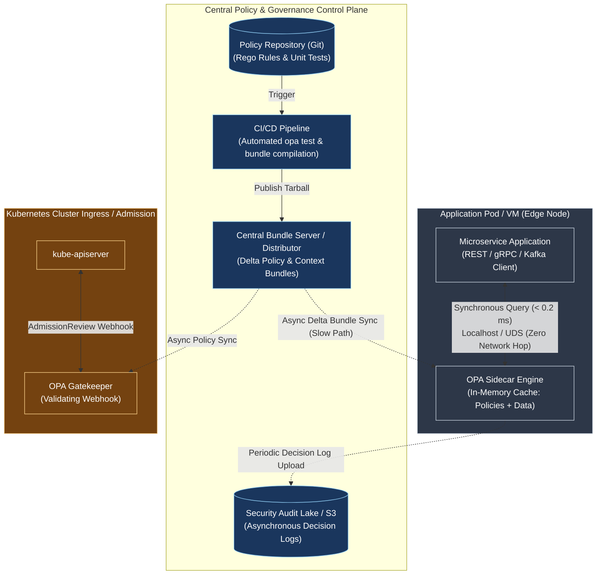

# Pattern: Distributed Policy as Code and Sidecar Authorization

**Breadcrumbs:** [[Digital Garden/0-Index|🏠 Index]] > Patterns > **Distributed Policy as Code and Sidecar Authorization**

---

## 🏛️ Architectural Context

In modern distributed microservices and Kubernetes architectures, centralized authorization gateways create severe latency bottlenecks and single points of failure. The **Distributed Policy as Code and Sidecar Authorization** pattern solves this by:
1. **Decoupling Policy from Application Logic:** Policies are authored declaratively as code (using Rego or equivalent DSLs), version-controlled in Git, and validated via automated unit testing in CI/CD.
2. **Pushing Policy to the Edge (Host-Local Cache Principle):** Running lightweight, in-memory policy engines (such as Open Policy Agent) directly alongside the application as a sidecar container in Kubernetes pods or as a system daemon on VMs.
3. **Decoupling Data Distribution:** Asynchronously distributing policy bundles and contextual metadata (organizational hierarchy, resource ownership) via background delta sync, enabling sub-millisecond ($< 0.2\text{ ms}$) synchronous evaluations over localhost or Unix Domain Sockets without network roundtrips.

---

## ⚖️ Trade-offs & Alternatives

### Pros
* **Sub-Millisecond Latency:** In-memory evaluations take between $10\text{ }\mu\text{s}$ and $200\text{ }\mu\text{s}$, preventing latency thrashing in high-throughput services (e.g. Kafka, payment gateways).
* **Fault Isolation & Partition Resilience:** If the central control plane or network connectivity drops, local sidecars continue making authorization decisions without downtime.
* **Unified Auditability:** Decision log streaming captures the exact input payload, rule revision, and decision for non-repudiation security compliance.
* **Separation of Concerns:** Developers focus on business logic; platform and security teams manage governance policies centrally.

### Cons
* **Memory Footprint:** Each container pod or VM hosts a policy engine instance holding policies and context data in RAM.
* **Eventual Consistency of Policy Data:** Changes in central identity or role data take a few seconds to propagate down via the Bundle API.
* **Data Scale Limitations:** Megabyte-scale datasets fit in memory; terabyte-scale datasets require partial evaluation or query pushdown into the database layer.

### Alternatives
* **Centralized Authorization Gateway (e.g. Keycloak / Cloud IAM):** Simpler architecture for small fleets, but introduces network latency on every request and represents a single point of failure.
* **Hardcoded Middleware Libraries:** Embedding authorization logic directly in application code across Python, Go, Node, and Java causes policy drift and language maintenance nightmares.
* **Built-in Kubernetes RBAC:** Suitable only for coarse-grained API verbs (`GET /pods`), but incapable of inspecting payload bodies, image registries, or label semantics.

---

## 🛠️ Verification & Practical Implementation

For complete technical specifications, policy implementations, and hands-on validation recipes:
* **Netflix Distributed Architecture:** [[Reference Notes/12-5_netflix_cloud_native_authorization_architecture|Module 12-5: Distributed Cloud-Native Authorization Architecture at Netflix Scale]]
* **Open Policy Agent (OPA) Internals:** [[Reference Notes/12-6_open_policy_agent_architecture_and_deep_dive|Module 12-6: Open Policy Agent (OPA) Internals & Policy-as-Code Engine]]
* **Dynamic Webhook Security Pattern:** [[Digital Garden/Pattern - Dynamic Security Admission and Webhook TLS Verification|Pattern: Dynamic Security Admission and Webhook TLS Verification]]
