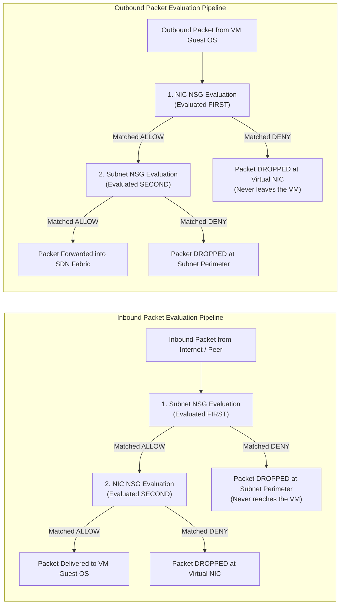

# Azure Virtual Networking - Wire Server Mechanics, Subnet DNS Proxies, and Stateful NSG Inspection

**Breadcrumbs:** [[Main Notes/0-Index|🏠 Index]] > [[Azure Virtual Networking and Intersite Connectivity]] > **Wire Server Mechanics, Subnet DNS Proxies, and Stateful NSG Inspection**

---

## 🧠 1. The Wire Server (`168.63.129.16`) & Subnet DNS Architecture

In Azure Virtual Networks, virtual machines communicate with essential platform services without routing across external internet connections. Many administrators mistakenly believe that DNS servers, DHCP daemons, and load balancer health checkers reside on physical servers rack-mounted in the corner of an Azure data hall.

In reality, these critical platform capabilities are provided by a single, protected Anycast Virtual IP address: **`168.63.129.16`**, colloquially referred to as the **Azure Wire Server**.

```text
+---------------------------------------------------------------------------------------------------+
|                        AZURE WIRE SERVER (168.63.129.16) ARCHITECTURE                             |
+---------------------------------------------------------------------------------------------------+
|                                                                                                   |
|  [ Virtual Machine (Guest OS) ]                                                                   |
|   ├── DHCP Option 6: DNS Server = 10.0.1.2 (Subnet Proxy)                                         |
|   └── Default Gateway: 10.0.1.1                                                                   |
|         │                                                                                         |
|         ▼                                                                                         |
|  [ Hypervisor vSwitch / SDN Filter Driver ] ◄── Intercepts packets at physical host               |
|         │                                                                                         |
|         ├── Subnet .2 / .3 DNS Requests ──► Rewritten / Proxied to 168.63.129.16                  |
|         ├── Wire Server Engine (168.63.129.16 Virtual Anycast VIP):                               |
|         │     ├── 1. DHCP Server: Assigns IP, subnet mask, default gateway, and lease renewals    |
|         │     ├── 2. Azure Recursive DNS: Resolves public internet FQDNs & Private DNS Zones     |
|         │     ├── 3. Load Balancer Probes: Originates TCP/HTTP/HTTPS probes (AzureLoadBalancer)   |
|         │     └── 4. Guest Agent Host Channel: Communicates with waagent & Windows Guest Agent    |
|         │                                                                                         |
|         └── Physical Datacenter Fabric (Geneve/VXLAN Encapsulated Underlay)                       |
+---------------------------------------------------------------------------------------------------+
```

### Subnet `.2` / `.3` DNS Placeholders vs. The Wire Server
When an administrator inspects `ipconfig /all` on Windows or `resolvectl status` on Linux inside an Azure VM, the configured DNS servers appear as `10.0.1.2` and `10.0.1.3` (for subnet `10.0.1.0/24`):
* **The Illusion:** It appears that two dedicated DNS servers exist at the beginning of each subnet.
* **The Reality:** Subnet addresses `.2` and `.3` are **virtual proxy pointers** instantiated directly in the hypervisor virtual filter driver.
* When the guest OS dispatches a UDP/TCP port 53 DNS query to `10.0.1.2`, the local hypervisor intercepts the frame, maps it to `168.63.129.16`, and evaluates the request against:
  1. Authoritative **Azure Private DNS Zones** linked to the parent VNet (e.g., `privatelink.blob.core.windows.net`, `corp.internal`).
  2. Public recursive internet resolvers managed by Microsoft.
* Administrators can also configure `168.63.129.16` directly as a static DNS server inside custom DNS forwarders or BIND daemons running on Azure VMs.

### The Four Core Duties of `168.63.129.16`:
1. **Dynamic Host Configuration Protocol (DHCP):**
   * Azure does not support static manual IP configuration inside the guest OS adapter settings. All private IP assignments—even those configured as "Static" in the Azure Portal—are delivered to the VM via DHCP leases from `168.63.129.16`.
   * The guest OS must periodically renew its DHCP lease (typically every 24 hours, renewing at the 12-hour mark).
2. **Authoritative and Recursive DNS:**
   * Acts as the resolver for internal Azure hostname registrations, Private DNS Zones, and recursive external domain queries.
3. **Azure Load Balancer Health Probing:**
   * Both Basic and Standard Azure Load Balancers evaluate backend pool health by dispatching TCP SYN or HTTP GET probes.
   * All load balancer health probes originate from the physical host hypervisor under the source IP **`168.63.129.16`**. In Network Security Groups, this traffic is abstracted under the default `AzureLoadBalancer` service tag.
4. **Virtual Machine Guest Agent Telemetry:**
   * The Azure Linux Agent (`waagent`) and Windows Guest Agent communicate with the Wire Server via REST over HTTP port 80 to report heartbeat health status, retrieve VM extension scripts, and process password resets.

> [!CAUTION]
> **The Wire Server Blackhole Outage:**
> Under no circumstances should `168.63.129.16` be blocked! If an administrator or security agent installs aggressive host-based endpoint firewalls (such as Windows Defender Firewall, `iptables`, `nftables`, or third-party EDR/IPS) that block `168.63.129.16`:
> * Azure Load Balancer health probes immediately fail; the load balancer marks all VMs as "Offline/Unhealthy" and drops all incoming customer traffic.
> * The Azure VM Agent stops reporting heartbeats; the Azure Portal marks the VM as "Agent Not Ready" and extension deployments fail.
> * When the VM's 24-hour DHCP lease expires, the guest OS fails to negotiate a lease renewal and drops its private IP configuration, completely severing all network connectivity.

---

## 🛡️ 2. The Two-Tier Stateful NSG Evaluation Pipeline

A **Network Security Group (NSG)** is a distributed, stateful Layer 4 packet-filtering firewall implemented directly in the Azure SDN hypervisor driver. It evaluates packets against a sequence of 5-tuple security rules:

$$\text{5-Tuple} = (\text{Source IP/Prefix}, \text{Source Port}, \text{Destination IP/Prefix}, \text{Destination Port}, \text{Protocol})$$

NSG rules are processed in numerical order from lowest priority (**100**) to highest priority (**4096**), with processing terminating upon the very first rule match.



### The Symmetrical Evaluation Order:
* **For INBOUND Traffic:**
  1. **Subnet NSG is evaluated FIRST:** If the Subnet NSG denies the packet, it is dropped immediately at the subnet perimeter. It never touches the virtual network interface card (NIC).
  2. **NIC NSG is evaluated SECOND:** If the Subnet NSG allows the packet, it proceeds to the VM's specific virtual NIC NSG. Only if the NIC NSG also permits the traffic does the packet reach the VM operating system.
* **For OUTBOUND Traffic:**
  1. **NIC NSG is evaluated FIRST:** Traffic originating from inside the VM is inspected first by the NIC NSG. If blocked, the packet never leaves the virtual machine.
  2. **Subnet NSG is evaluated SECOND:** If permitted by the NIC NSG, the packet is inspected by the Subnet NSG before being dispatched to the Azure SDN routing fabric.

### The Stateful Law of NSGs:
Network Security Groups are **completely stateful**.
* When an inbound connection is allowed by the two-tier NSG pipeline (e.g., a client connects from the internet to web port 443), the hypervisor registers an entry in its active state connection table.
* The response packets emitted by the VM back to that client are **automatically permitted**, completely bypassing outbound NSG rules!
* Conversely, when an outbound connection is initiated by the VM (e.g., an outbound API call to an external endpoint on port 443), the return response packets from the server are automatically permitted inbound, regardless of inbound NSG rules.

### Immutable Default Rules:
Every NSG is provisioned with 3 default inbound rules and 3 default outbound rules (priorities 65000 to 65500) that cannot be modified or deleted:

| Direction | Priority | Name | Source | Dest | Port | Protocol | Access | Purpose |
| :---: | :---: | :--- | :--- | :--- | :---: | :---: | :---: | :--- |
| **Inbound** | `65000` | `AllowVnetInBound` | `VirtualNetwork` | `VirtualNetwork` | `*` | Any | Allow | Allows inter-subnet and inter-peered VNet traffic |
| **Inbound** | `65001` | `AllowAzureLoadBalancerInBound` | `AzureLoadBalancer` | `*` | `*` | Any | Allow | Allows health probes from `168.63.129.16` |
| **Inbound** | `65500` | `DenyAllInBound` | `*` | `*` | `*` | Any | **Deny** | Default-deny posture dropping all unapproved incoming traffic |
| **Outbound**| `65000` | `AllowVnetOutBound` | `VirtualNetwork` | `VirtualNetwork` | `*` | Any | Allow | Allows outbound traffic across VNet and peered VNets |
| **Outbound**| `65001` | `AllowInternetOutBound` | `*` | `Internet` | `*` | Any | Allow | Allows outbound internet access from VMs |
| **Outbound**| `65500` | `DenyAllOutBound` | `*` | `*` | `*` | Any | **Deny** | Catches and denies any other unhandled outbound traffic |

### Where NSGs Can and Cannot Attach:
* **Permitted:** User-defined subnets, virtual machine network interfaces (NICs).
* **FORBIDDEN on `GatewaySubnet`:** You must never associate an NSG with `GatewaySubnet`. Doing so interrupts IPsec tunnel negotiation, BGP keepalive handshakes, and gateway health monitoring.
* **FORBIDDEN on `AzureFirewallSubnet`:** The ARM control plane explicitly blocks attaching an NSG to the `AzureFirewallSubnet`.

---

## 🏷️ 3. Application Security Groups (ASGs): Microsegmentation Without Static IPs

In dynamic cloud environments, virtual machines scale out, scale down, and undergo automated replacement. Writing NSG firewall rules based on static IP addresses or CIDR blocks creates significant operational overhead and security risk:

```text
The Old Way (Brittle Static IP Rules):
Rule 100: Allow Source 10.0.1.4, 10.0.1.5, 10.0.1.6 to Dest 10.0.2.4 on Port 3306
(When VM 4 is deployed with IP 10.0.1.7, database connections fail until an engineer manually edits the NSG!)

The Cloud-Native Way (Application Security Groups):
Rule 100: Allow Source 'asg-web-tier' to Dest 'asg-db-tier' on Port 3306 TCP
(Any new VM tagged with 'asg-web-tier' instantly inherits database access with zero firewall modifications!)
```

```text
+---------------------------------------------------------------------------------------------------+
|                        APPLICATION SECURITY GROUP (ASG) ARCHITECTURE                              |
+---------------------------------------------------------------------------------------------------+
| Virtual Network: vnet-production (10.0.0.0/16)                                                    |
|                                                                                                   |
|  [ Subnet 1: snet-web (10.0.1.0/24) ]                [ Subnet 2: snet-db (10.0.2.0/24) ]         |
|                                                                                                   |
|    +-----------------------------+                     +-----------------------------+            |
|    | VM-Web-01 (10.0.1.4)        |                     | VM-DB-01 (10.0.2.4)         |            |
|    | NIC ASG: [ asg-web-tier ]   |                     | NIC ASG: [ asg-db-tier ]    |            |
|    +-----------------------------+                     +-----------------------------+            |
|    | VM-Web-02 (10.0.1.5)        |                     | VM-DB-02 (10.0.2.5)         |            |
|    | NIC ASG: [ asg-web-tier ]   |                     | NIC ASG: [ asg-db-tier ]    |            |
|    +-----------------------------+                     +-----------------------------+            |
|                   │                                                   ▲                           |
|                   │                                                   │                           |
|                   └───────── NSG Rule (Priority 100): ────────────────┘                           |
|                              Allow Source: 'asg-web-tier'                                         |
|                              Dest: 'asg-db-tier' | Port: 3306 TCP                                 |
+---------------------------------------------------------------------------------------------------+
```

### ASG Mechanics:
* **Logical Tagging:** An ASG is not a subnet and contains no IP configuration. It is a logical object in ARM that groups virtual network interfaces (NICs).
* **Declarative Filtering:** Instead of listing IP addresses, administrators define NSG rules using the ASG name as the Source or Destination parameter.
* **Dynamic Binding:** When a Virtual Machine Scale Set (VMSS) spins up 50 new instances, the orchestration engine attaches the `asg-web-tier` tag to each new NIC. Azure's SDN hypervisors automatically program the filtering tables on the physical hosts without any modification to NSG rule definitions.

> [!IMPORTANT]
> **The Same-VNet Invariant:**
> All virtual network interfaces assigned to an Application Security Group **must reside within the exact same Virtual Network**!
> * An ASG cannot group NICs located in different VNets.
> * An NSG rule residing in VNet A **cannot reference an ASG defined in VNet B**, even if VNet A and VNet B are connected via VNet Peering! Across peering boundaries, NSG rules must use IP CIDR prefixes or IP addresses.

---

*Read more in [[Reference Notes/13-104-05_administer_virtual_networking.md#stage-3-deep-intuition-platform-mechanics--topology]]*
