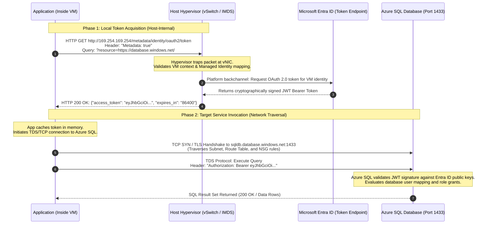

# Azure Workload Identity - IMDS Host Interception vs Target Service Network Traversal

**Breadcrumbs:** [[Main Notes/0-Index|🏠 Index]] > [[Microsoft Entra ID and Cloud Workload Identity]] > **IMDS Host Interception vs Target Service Network Traversal**

---

## 🧠 Executive Summary & The Core Conceptual Distinction

When engineers first learn about **Azure Managed Identities**, a pervasive misconception emerges regarding how virtual machines authenticate to cloud services. Many believe that the Azure Instance Metadata Service (`169.254.169.254`) acts as a full network proxy—assuming the application sends its SQL queries or Key Vault secrets requests directly through the metadata IP address to be forwarded to Azure.

In reality, Managed Identity architecture operates on a strict **Two-Phase Separation of Concerns**:
1. **Phase 1 (Local Token Acquisition):** A host-internal, non-routable link-local exchange where the local hypervisor vSwitch intercepts an HTTP request and vends a cryptographically signed OAuth 2.0 JSON Web Token (JWT) into application memory.
2. **Phase 2 (Target Service Network Traversal):** A standard, routed TCP/TLS network connection initiated by the application directly to the destination service endpoint (e.g., `sqldb.database.windows.net:1433` or `kv-prod.vault.azure.net:443`), carrying the JWT as an `Authorization: Bearer <token>` header over the Azure Virtual Network (VNet).

The hypervisor is merely an **identity ATM machine dispensing digital cash (tokens)**; it never walks into the store to make the purchase on your behalf.

---

## 🌐 1. RFC 3927 Link-Local Addressing & The `169.254.169.254` Endpoint

To understand why Managed Identity is physically impossible to access from outside Azure compute, one must understand the networking foundation of **Link-Local Addressing**.

```text
+---------------------------------------------------------------------------------------------------+
|                        RFC 3927 LINK-LOCAL SUBNET SPECIFICATION                                   |
+---------------------------------------------------------------------------------------------------+
|  Subnet Range: 169.254.0.0/16 (169.254.0.1 through 169.254.255.254)                               |
|  Standard: RFC 3927 - Dynamic Configuration of IPv4 Link-Local Addresses                        |
|  Strict Invariant: Non-Routable. Routers MUST NOT forward packets with link-local source or dest. |
+---------------------------------------------------------------------------------------------------+
```

### Key Principles of RFC 3927:
* **Host-Local Scope:** The `169.254.0.0/16` IP block is reserved exclusively for host-internal communication within a single physical or virtual segment.
* **Non-Routable by Definition:** By Internet Engineering Task Force (IETF) specification, any IP router or layer-3 switch receiving a packet destined for `169.254.0.0/16` **MUST drop the packet immediately**. It cannot cross a default gateway, a VPN tunnel, ExpressRoute, or the public internet.
* **Industry Standard IMDS Endpoint:** Major hyperscalers (Azure, AWS, and GCP) universally adopted `169.254.169.254` as the well-known link-local endpoint for their respective metadata services.

---

## ⚡ 2. Hypervisor vSwitch Packet Interception Mechanics

When an application or the Azure SDK inside a VM initiates an HTTP GET request to `http://169.254.169.254/metadata/identity/oauth2/token`:

```text
+---------------------------------------------------------------------------------------------------+
|                       HYPERVISOR vSWITCH PACKET INTERCEPTION                                      |
+---------------------------------------------------------------------------------------------------+
|                                                                                                   |
|   [ Guest Virtual Machine (OS Kernel) ]                                                           |
|     └── Application Process dispatches HTTP GET to 169.254.169.254                                 |
|           │                                                                                       |
|           ▼                                                                                       |
|     [ Virtual Network Interface Card (vNIC) ]                                                     |
|           │ (Packet never hits physical wire / physical top-of-rack switch!)                          |
|           ▼                                                                                       |
|   [ Physical Host Hypervisor (Kernel / vSwitch SDN Filter Driver) ] ◄── TRAPPED HERE              |
|           ├── Intercepts destination 169.254.169.254                                              |
|           ├── Verifies mandatory HTTP Header: "Metadata: true" (SSRF Protection)                 |
|           ├── Validates VM's hardware identity context & ARM Managed Identity assignment          |
|           ├── Dispatches backchannel request to regional Entra ID Token Endpoint                  |
|           └── Injects JSON response (signed JWT) directly back into VM vNIC receive buffer        |
|                                                                                                   |
+---------------------------------------------------------------------------------------------------+
```

### The Micro-Mechanics of the Interception:
1. **Trapped at the vNIC Filter:** The packet never leaves the physical server blade. As the IP packet exits the guest OS networking stack into the hypervisor's virtual switch (vSwitch / SDN filter driver), the hypervisor identifies the destination IP `169.254.169.254`.
2. **Short-Circuited Host-Internally:** Instead of encapsulating the frame in Geneve/VXLAN to send over the Azure datacenter physical fabric, the hypervisor diverts the packet directly to the local **Azure Instance Metadata Service (IMDS)** daemon running inside the host hypervisor management layer.
3. **Hardware-Attested Authentication:** Because the hypervisor physically controls the compute slicing for that specific VM, it possesses undeniable, hardware-level knowledge of which VM and subscription made the request. Spoofing another VM's identity is physically impossible at this layer.
4. **Anti-SSRF Protection Header:** To prevent **Server-Side Request Forgery (SSRF)** attacks—where an attacker tricks a vulnerable web app on the VM into curling external URLs—Azure IMDS strictly mandates an HTTP header:
   ```http
   Metadata: true
   ```
   If a request arrives at `169.254.169.254` missing the `Metadata: true` header, the hypervisor rejects the request with HTTP `400 Bad Request`, preventing naive SSRF exploitation.

---

## 🔄 3. The Two-Phase Separation of Concerns: Token Vending vs. Service Invocation

Understanding Managed Identity requires separating token procurement from target service utilization.

```text
+---------------------------------------------------------------------------------------------------+
|                             THE TWO-PHASE SEPARATION OF CONCERNS                                  |
+---------------------------------------------------------------------------------------------------+
|                                                                                                   |
|   +-----------------------------------------------------------------------------------------+     |
|   | PHASE 1: LOCAL TOKEN ACQUISITION (Host-Internal Link-Local)                            |     |
|   |                                                                                         |     |
|   |  VM App ──[GET /metadata/identity/oauth2/token?resource=...]──► Hypervisor (IMDS)       |     |
|   |  Hypervisor ──[Internal Backchannel]──► Entra ID                                        |     |
|   |  Entra ID ──[Signed OAuth 2.0 JWT]──► Hypervisor ──► VM Memory                           |     |
|   +-----------------------------------------------------------------------------------------+     |
|                                            │                                                      |
|                                            ▼ (Token now held in memory)                           |
|   +-----------------------------------------------------------------------------------------+     |
|   | PHASE 2: TARGET SERVICE INVOCATION (Network Routed Traversal)                           |     |
|   |                                                                                         |     |
|   |  VM App ──[TCP:1433 with Header: "Authorization: Bearer <JWT>"]──► Azure SQL Database  |     |
|   |  (Traverses VNet, Subnet Routing, NSGs, Azure Backbone, or Private Endpoints)          |     |
|   +-----------------------------------------------------------------------------------------+     |
|                                                                                                   |
+---------------------------------------------------------------------------------------------------+
```

### The "ATM Dispenser" Mental Model
* **Phase 1 is the ATM:** You walk up to an ATM, insert your debit card, enter your PIN, and receive cash. The ATM only hands you cash; it does not buy your dinner or purchase your groceries.
* **Phase 2 is the Restaurant:** You walk into a restaurant, order food, and hand over the cash to pay the bill. The restaurant examines the cash to ensure it is not counterfeit, then serves your meal.
* **The Analogy to Azure:** 
  * IMDS is the ATM. It checks your host identity and hands you a signed JSON Web Token (the digital cash).
  * Azure SQL / Key Vault / Storage is the restaurant. Your application opens a direct network connection over port 1433 or 443, presents the JWT, and the destination service inspects the token's signature, claims, and role assignments before executing your query.

---

## 📊 4. End-to-End Architectural Sequence Diagram

The following sequence diagram details the full, step-by-step transaction flow from initial token vending to authenticated database execution:



---

## 🛡️ 5. Network Security Group (NSG) and Routing Invariants: Loopback Bypass vs. Target Service Rules

One of the most heavily tested architectural nuances in the **AZ-104 exam** involves how **Network Security Groups (NSGs)** and **User-Defined Routes (UDRs)** interact with IMDS versus target services.

### Invariant 1: NSGs Cannot Block IMDS (`169.254.169.254`)
* Network Security Groups operate on traffic passing through the virtual network layer.
* Because communication between the guest OS and `169.254.169.254` is trapped **host-internally by the hypervisor filter driver before the packet enters the virtual network routing pipeline**, NSG outbound rules have **NO EFFECT** on IMDS traffic!
* An administrator can create an outbound NSG rule with `Priority: 100, Destination: 0.0.0.0/0, Action: DENY`, and the VM will **still successfully retrieve tokens from `169.254.169.254`**.

### Invariant 2: User-Defined Routes (UDRs) Cannot Redirect IMDS
* If a custom route table is associated with the subnet with a default route (`0.0.0.0/0 -> Next Hop: Virtual Appliance`), the Azure SDN platform treats `169.254.169.254` as an exempt link-local loopback.
* IMDS packets will **never** be routed to your firewall (NVA) or on-premises gateway.

### Invariant 3: NSG Outbound Rules STRICTLY APPLY to Target Service Invocation (Phase 2)
* While Phase 1 (token acquisition) always succeeds regardless of NSG rules, **Phase 2 (connecting to the database or storage account) is standard VNet network traffic**.
* If an NSG outbound rule blocks port 1433 or blocks the destination IP / Service Tag (`Sql`), the application will successfully get the token from IMDS, and then **fail with a network timeout (Connection Refused / TCP Timeout)** when trying to connect to Azure SQL.

```text
+---------------------------------------------------------------------------------------------------+
|                        NSG & ROUTING EVALUATION MATRIX                                            |
+---------------------------------------------------------------------------------------------------+
|  Traffic Flow                | Destination IP / Port     | NSG Evaluation? | Can NSG Block It?    |
+------------------------------+---------------------------+-----------------+----------------------+
|  Phase 1: Token Acquisition  | 169.254.169.254:80        | BYPASSED        | ❌ NO (Host Internal)|
|  Phase 2: Azure SQL Query    | <SQL_Public/Private>:1433 | EVALUATED       | ✅ YES (Requires NSG)|
|  Phase 2: Azure Key Vault    | <KV_Public/Private>:443   | EVALUATED       | ✅ YES (Requires NSG)|
|  Phase 2: Azure Storage Blob | <Blob_Endpoint>:443       | EVALUATED       | ✅ YES (Requires NSG)|
+---------------------------------------------------------------------------------------------------+
```

> [!WARNING]
> **The "Managed Identity is Broken" False Positive:**
> When an application logs `SqlException: Cannot open server 'sqldb.database.windows.net'`, junior engineers frequently waste hours debugging Entra ID permissions, assuming the Managed Identity was configured incorrectly.
> In over 80% of production incidents, the Managed Identity acquired the token flawlessly in Phase 1, but Phase 2 was dropped by an aggressive outbound NSG rule or a missing firewall exception on the target Azure SQL Server!

---

## 🛠️ 6. Hands-On Verification: Inspecting IMDS from Guest Compute

To verify Managed Identity token vending directly from a Linux or Windows VM without installing SDKs:

### Linux (Bash / `curl`):
```bash
# Query the local hypervisor IMDS for an Azure Resource Manager token
curl -s -H "Metadata: true" \
  "http://169.254.169.254/metadata/identity/oauth2/token?api-version=2018-02-01&resource=https://management.azure.com/" \
  | jq .
```

### Windows (PowerShell / `Invoke-RestMethod`):
```powershell
# Query IMDS for an Azure Key Vault token
$response = Invoke-RestMethod -Headers @{"Metadata"="true"} `
  -Uri "http://169.254.169.254/metadata/identity/oauth2/token?api-version=2018-02-01&resource=https://vault.azure.net" `
  -Method GET

$response.access_token
```

### Anatomy of the Returned JWT Bearer Token:
When decoding the returned `access_token` on `jwt.ms`, the critical claims include:
* **`aud` (Audience):** The target resource requested (e.g., `https://management.azure.com/` or `https://database.windows.net/`). Target services will reject tokens if the `aud` claim does not match their service URI.
* **`oid` (Object ID / Principal ID):** The exact GUID of the Service Principal representing this Managed Identity in the Entra ID tenant.
* **`tid` (Tenant ID):** The directory tenant owning the identity.
* **`exp` (Expiration Time):** Epoch timestamp indicating when the token expires (typically 24 hours, automatically refreshed by Azure SDKs when 50% of lifespan remains).

---

## 🎓 7. High-Yield Architectural Takeaways for AZ-104 & Production

1. **Host-Bound Boundary:** IMDS traffic is physically confined to the local hypervisor. It cannot cross VNets, VPNs, ExpressRoute, or the internet. External runners (like GitHub Actions or on-prem servers) cannot query Azure IMDS.
2. **ATM Dispenser Model:** IMDS only vends credentials; it does not proxy application traffic. Your app connects directly to the target service over standard network paths.
3. **NSG Imbalance:** NSG rules cannot block token generation (`169.254.169.254`), but they strictly govern whether the application can reach the target service on port 1433/443.
4. **Mandatory Header Requirement:** All IMDS queries must include `Metadata: true` to prevent Server-Side Request Forgery (SSRF) vulnerabilities.
