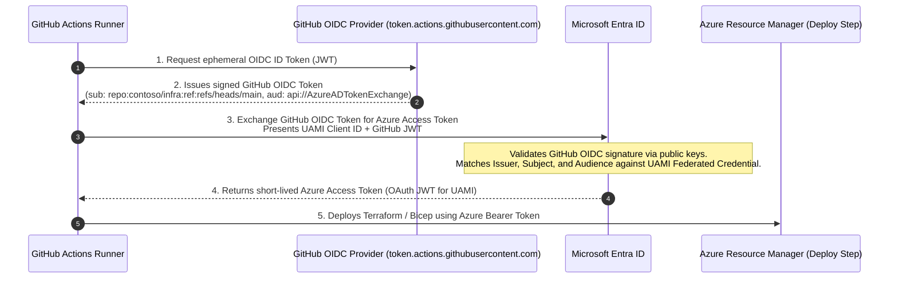
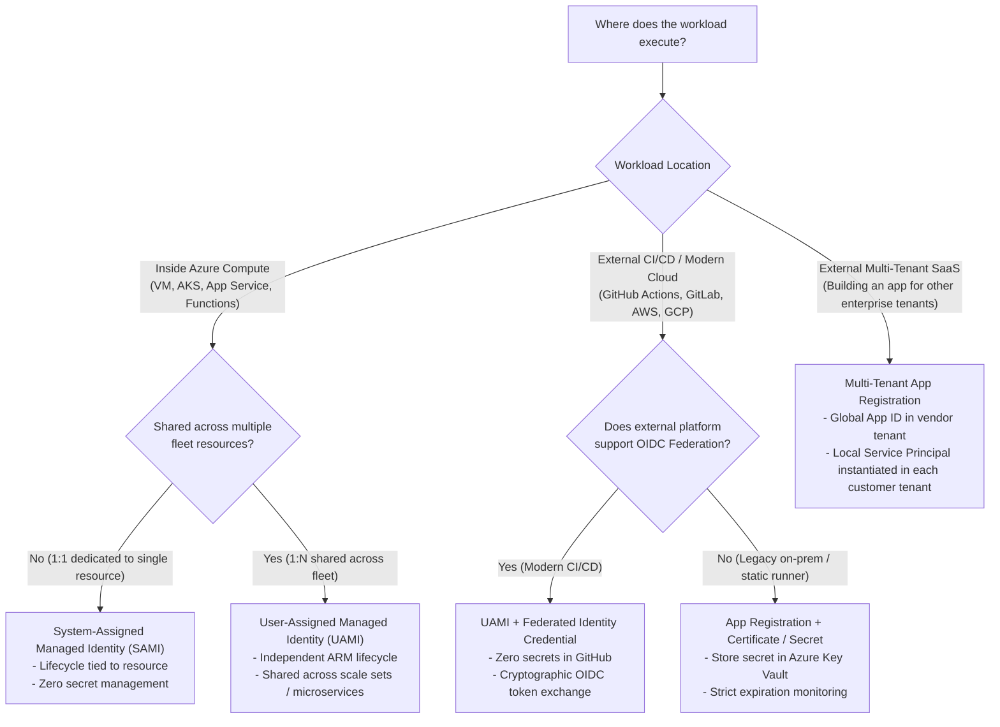

# Azure Workload Identity - RBAC Principal ID Invariants, Multi-Tenant SaaS Isolation, and UAMI OIDC Federation

**Breadcrumbs:** [[Main Notes/0-Index|🏠 Index]] > [[Microsoft Entra ID and Cloud Workload Identity]] > **RBAC Principal ID Invariants, Multi-Tenant SaaS Isolation, and UAMI OIDC Federation**

---

## 🎯 1. The Core Invariant: Why Azure RBAC Requires Principal ID and Rejects Application ID

When administering Microsoft Entra ID and automating Azure infrastructure via Terraform, Bicep, or the Azure CLI, engineers frequently encounter two distinct GUIDs associated with every workload identity:
1. **Application ID (Client ID):** The public, global blueprint identifier representing the application's definition.
2. **Object ID (Principal ID):** The unique, local security principal identifier instantiated within a specific Microsoft Entra ID tenant.

```text
+---------------------------------------------------------------------------------------------------+
|                        APPLICATION ID vs. PRINCIPAL ID INVARIANT                                  |
+---------------------------------------------------------------------------------------------------+
|                                                                                                   |
|  [ Application Registration (Global Blueprint) ]                                                  |
|    └── Application (Client) ID:  dd000000-0000-0000-0000-000000000001 (Shared globally)           |
|                                                                                                   |
|                                  │ (Instantiated into local tenant)                               |
|                                  ▼                                                                |
|  [ Enterprise Service Principal (Concrete Tenant Instance) ]                                      |
|    ├── Application (Client) ID:  dd000000-0000-0000-0000-000000000001 (Pointer to blueprint)       |
|    └── Object ID (Principal ID): c0010000-0000-0000-0000-000000000001 (Unique Security Principal)  |
|                                                                                                   |
|                                  │ (Azure Role Assignment Target)                                 |
|                                  ▼                                                                |
|  [ Azure RBAC Engine (ARM Gateway) ]                                                              |
|    └── Rule: Role assignments MUST bind strictly to Object ID (Principal ID)!                     |
|                                                                                                   |
+---------------------------------------------------------------------------------------------------+
```

### The Architectural Invariant:
Azure Role-Based Access Control (Azure RBAC) operates **exclusively on Principal IDs (Object IDs)**. Under no circumstances will the Azure Resource Manager (ARM) authorization engine accept an Application (Client) ID for a role assignment. 

Attempting to assign a role directly to an Application ID fails because the Application ID does not represent a security principal that can hold access credentials or be granted security tokens within an authorization context.

---

## 🏢 2. Multi-Tenant SaaS Architectural Isolation: The Datadog Example

The architectural necessity of binding RBAC to the **Principal ID (Object ID)** rather than the **Application ID (Client ID)** becomes vividly apparent when examining multi-tenant Software-as-a-Service (SaaS) platforms, such as **Datadog**, **Dynatrace**, or **Snowflake**.

```text
+---------------------------------------------------------------------------------------------------+
|                         MULTI-TENANT SAAS ISOLATION TOPOLOGY                                      |
+---------------------------------------------------------------------------------------------------+
|                                                                                                   |
|   Datadog Inc. Home Tenant (Vendor)                                                               |
|   └── Global Application Registration:                                                            |
|       └── App ID: dd000000-0000-0000-0000-000000000001 (Single Global Blueprint)                   |
|                                                                                                   |
|                                     │                                                             |
|           ┌─────────────────────────┴─────────────────────────┐                                   |
|           │ Instantiated into Customer Tenants                │                                   |
|           ▼                                                   ▼                                   |
|   Contoso Corporation Tenant                        Fabrikam Enterprises Tenant                   |
|   └── Local Service Principal:                       └── Local Service Principal:                  |
|       ├── App ID:    dd000000-... (Datadog App)          ├── App ID:    dd000000-... (Datadog App)     |
|       └── Object ID: c0010000-0000-0000-0000-000000000001└── Object ID: fa990000-0000-0000-0000-000000000001|
|                                                                                                   |
|           │                                                   │                                   |
|           ▼                                                   ▼                                   |
|   Contoso Azure Subscription                         Fabrikam Azure Subscription                  |
|   └── RBAC: "Monitoring Reader"                      └── RBAC: "Monitoring Reader"                |
|       assigned to Principal ID:                          assigned to Principal ID:                |
|       c0010000-0000-0000-0000-000000000001               fa990000-0000-0000-0000-000000000001     |
|                                                                                                   |
+---------------------------------------------------------------------------------------------------+
```

### The Architectural Breakdown:
1. **The Vendor Registers Once:** Datadog creates a single multi-tenant Application Registration in its own home Entra ID tenant. This registration is stamped with a permanent, immutable Application (Client) ID: `dd000000-...`.
2. **Customer Consent Creates Local Service Principals:**
   * When Contoso IT logs into the Azure Portal and consents to the Datadog integration, Entra ID projects a **local Service Principal** into Contoso's directory. Contoso's Entra ID generates a unique local **Object ID**: `c0010000-...`.
   * When Fabrikam consents, Fabrikam's Entra ID projects another **local Service Principal** with a different unique local **Object ID**: `fa990000-...`.
3. **Both share the exact same Application ID (`dd000000-...`), but hold completely different Object IDs.**

### The Catastrophe of Binding RBAC to Application ID:
Imagine if Azure RBAC allowed role assignments to bind directly to the Application ID:
* Contoso would grant the role `Monitoring Reader` to `dd000000-...`.
* Datadog authenticates against Entra ID and receives an OAuth access token stamped with `appId: dd000000-...`.
* **Tenant Isolation Is Completely Destroyed:** Any token issued to Datadog's application—regardless of which customer initiated the workflow—would be accepted by Contoso's subscription! A rogue process in Fabrikam's pipeline could present Datadog's token to read Contoso's production databases and metrics.

### How Object ID Binding Guarantees Zero-Trust Isolation:
Because Contoso assigns RBAC exclusively to `c0010000-...`:
1. When Datadog accesses Contoso's infrastructure, it must request a token scoped to **Contoso's tenant ID**.
2. The resulting JWT bearer token has its subject claim (`oid`) populated with `c0010000-...`.
3. When ARM evaluates the request, it verifies: `Token Object ID (c001...) == RBAC Role Assignee (c001...)`.
4. If Datadog mistakenly presents a token issued by Fabrikam's tenant (`oid: fa99...`), ARM immediately rejects the request with HTTP `403 Forbidden`, because `fa99...` has no permissions in Contoso's subscription.

---

## ⚙️ 3. Infrastructure as Code (IaC) Gotchas: CLI, Bicep, and Terraform

The distinction between Application ID and Object ID is one of the most notorious sources of pipeline deployment failures in enterprise cloud engineering.

### 1. Azure CLI: `--assignee` vs. `--assignee-object-id`
When creating an RBAC role assignment via the Azure CLI:
```bash
# ⚠️ THE FRAGILE APPROACH (Requires Microsoft Graph API Permissions):
az role assignment create \
  --role "Reader" \
  --assignee "dd000000-0000-0000-0000-000000000001" \
  --scope "/subscriptions/00000000-0000-0000-0000-000000000000/resourceGroups/rg-prod"
```
* **Behind the Scenes:** Because `--assignee` accepts either a UPN, an App ID, or an Object ID, the Azure CLI **must first query Microsoft Graph (`/v1.0/servicePrincipals`)** to resolve the App ID into its local tenant Object ID.
* **The Failure Mode:** If the automated deployment pipeline (e.g., Terraform or GitHub Actions) does not have explicit `Directory.Read.All` permissions in Microsoft Entra ID, this Graph lookup fails with an `Authorization_RequestDenied` or `Insufficient privileges` error, aborting the deployment.

```bash
# ✅ THE PRODUCTION ROBUST APPROACH (Bypasses Microsoft Graph):
az role assignment create \
  --role "Reader" \
  --assignee-object-id "c0010000-0000-0000-0000-000000000001" \
  --assignee-principal-type "ServicePrincipal" \
  --scope "/subscriptions/00000000-0000-0000-0000-000000000000/resourceGroups/rg-prod"
```
* Supplying `--assignee-object-id` instructs the CLI to bypass Graph resolution entirely and talk directly to the ARM REST API.

### 2. Terraform (`azurerm_role_assignment`)
In HashiCorp Terraform, configuring `azurerm_role_assignment` with an Application ID is a critical bug:

```hcl
# ❌ ERRONEOUS CONFIGURATION:
resource "azurerm_role_assignment" "broken_example" {
  scope                = azurerm_resource_group.rg.id
  role_definition_name = "Contributor"
  principal_id         = azuread_application.app.client_id  # 💥 BUG: client_id is Application ID!
}

# ✅ CORRECT ZERO-TRUST CONFIGURATION:
resource "azurerm_role_assignment" "correct_example" {
  scope                = azurerm_resource_group.rg.id
  role_definition_name = "Contributor"
  principal_id         = azuread_service_principal.sp.object_id # ✅ CORRECT: Local tenant Object ID
}
```

### 3. Bicep / ARM Templates
In Bicep, the `Microsoft.Authorization/roleAssignments` resource requires `principalId`:
```bicep
resource roleAssignment 'Microsoft.Authorization/roleAssignments@2022-04-01' = {
  name: guid(resourceGroup().id, uami.id, 'Contributor')
  properties: {
    roleDefinitionId: subscriptionResourceId('Microsoft.Authorization/roleDefinitions', 'b24988ac-6180-42a0-ab88-20f7382dd24c') // Contributor
    principalId: uami.properties.principalId // ✅ Resolves directly to the tenant Object ID
    principalType: 'ServicePrincipal'
  }
}
```

---

## 👤 4. User-Assigned Managed Identity (UAMI) Under the Hood

A common question among architects is: *What is a User-Assigned Managed Identity actually doing behind the scenes?*

A **User-Assigned Managed Identity (UAMI)** is not a foreign identity primitive. **Under the hood, a UAMI IS an Entra ID Service Principal**, managed and encapsulated by Azure Resource Manager:

```text
+---------------------------------------------------------------------------------------------------+
|                         UAMI DUAL-PLANE ARCHITECTURAL REALITY                                     |
+---------------------------------------------------------------------------------------------------+
|                                                                                                   |
|   RESOURCE MANAGEMENT PLANE (ARM)                       IDENTITY PLANE (Microsoft Entra ID)       |
|   Provider: Microsoft.ManagedIdentity/userAssignedIdentities                                       |
|                                                                                                   |
|   [ ARM Resource: uami-prod-eastus ]                   [ Entra ID Service Principal ]             |
|   ├── Resource ID: /subscriptions/.../uami-prod        ├── Application (Client) ID: 33333333-...  |
|   ├── Resource Group: rg-identity-prod                 └── Object ID (Principal ID): 77777777-... |
|   ├── Region: East US                                            │                                |
|   ├── Resource Tags: { "Environment": "Prod" }                   │ Backing Security Identity      |
|   └── Resource Locks: CanNotDelete                               │ (Evaluated by ARM RBAC)        |
|               │                                                  │                                |
|               └────────────────── AUTOMATED BINDING ─────────────┘                                |
|                                                                                                   |
+---------------------------------------------------------------------------------------------------+
```

### Why UAMI Bridges the Cloud Infrastructure Divide:
1. **First-Class ARM Resource:** Unlike a standard Entra ID App Registration—which exists only in the directory graph and has no resource group, subscription, tags, or ARM locks—a UAMI lives inside an Azure Resource Group.
2. **FinOps & Governance Integration:** You can apply Azure Policy (e.g., mandate tags), assign Azure Resource Locks (`CanNotDelete`), and audit creation events in Azure Activity Log.
3. **Automated Credential Lifecycle:** Entra ID automatically handles certificate generation, signing, and background rotation (every 46 days) for the backing Service Principal. Administrators never see, create, or rotate passwords.

---

## 🔗 5. Workload Identity Federation: Why Microsoft Enabled OIDC on UAMIs

Historically, when automating CI/CD pipelines outside Azure (such as **GitHub Actions** or **GitLab CI**), organizations were forced to create an **App Registration with a Client Secret**:

```text
+---------------------------------------------------------------------------------------------------+
|                        LEGACY CI/CD ANTI-PATTERN (STATIC CLIENT SECRETS)                          |
+---------------------------------------------------------------------------------------------------+
|  Developer creates App Registration ➔ Generates Client Secret (password) ➔                         |
|  Pastes Secret into GitHub Actions Repository Secrets ➔ Secret expires at 2:00 AM (Outage) OR     |
|  Secret leaks into build logs / developer laptop (Security Compromise).                          |
+---------------------------------------------------------------------------------------------------+
```

### The Cloud-Native Solution: Workload Identity Federation via OIDC
To completely eradicate client secrets from CI/CD, Microsoft introduced **Workload Identity Federation** based on open **OpenID Connect (OIDC)** standards.

Crucially, Microsoft enabled **Federated Identity Credentials directly on User-Assigned Managed Identities (UAMIs)**:



### Why UAMI + OIDC is the Gold Standard for CI/CD:
* **Zero Static Secrets:** No passwords, no API keys, and no client secrets are ever stored in GitHub repository settings.
* **Granular Subject Matching:** The Federated Credential on the UAMI can enforce that only runs executing from `repo:contoso/production-infra:ref:refs/heads/main` can assume the identity. Runs on pull requests or feature branches are rejected by Entra ID.
* **Unified ARM Lifecycle:** The UAMI resides within the application's Resource Group. When the application environment is decommissioned (`az group delete`), the UAMI and all its federated permissions are deleted together.

---

## 📊 6. Comprehensive Architectural Comparison: App Registration vs. User-Assigned Managed Identity

| Architectural Dimension | App Registration / Software App | User-Assigned Managed Identity (UAMI) |
| :--- | :--- | :--- |
| **Where It Lives** | Microsoft Entra ID Directory Plane only (Graph API object). | Azure Resource Manager (ARM) Plane as a concrete resource (`Microsoft.ManagedIdentity`). |
| **Resource Group & Subscriptions** | ❌ None (Tenant-wide directory object). | ✅ Belongs to a specific Subscription and Resource Group. |
| **ARM Tags & Resource Locks** | ❌ Cannot apply ARM tags or `CanNotDelete` locks. | ✅ Full support for ARM tags, cost allocation, and resource locks. |
| **Static Passwords / Client Secrets**| ✅ Supports client secrets (passwords) & certificates. | ❌ **No secrets allowed.** Completely passwordless by design. |
| **Multi-Tenant SaaS Support** | ✅ **YES** (Can be configured as Multi-Tenant across any tenant). | ❌ **NO** (Strictly single-tenant; exists only within parent tenant). |
| **Azure Compute Attachment** | ❌ Cannot be attached directly to Azure VM / App Service vNIC. | ✅ Can be assigned to multiple VMs, AKS pods, and App Services (1:N). |
| **Workload Identity Federation (OIDC)**| ✅ Supported via Application Object federated credentials. | ✅ Supported directly on the UAMI resource in ARM. |
| **External Systems Without OIDC** | ✅ Supported (Can use client secrets or certificates). | ❌ Not supported (Requires OIDC or native Azure host IMDS). |

---

## 🧭 7. Real-World Architectural Decision Heuristic

Use the following flowchart and rules of thumb to determine the precise workload identity mechanism for any enterprise scenario:



### High-Yield Production Rules:
1. **Never use App Registrations for workloads running inside Azure:** Always choose SAMI or UAMI. Using client secrets inside an Azure VM is an antipattern.
2. **Never store static secrets in GitHub Actions or GitLab:** Use Workload Identity Federation (OIDC) bound to a User-Assigned Managed Identity.
3. **Always pass Object IDs to ARM role assignments:** In scripts and IaC, ensure `principal_id` points to the tenant Object ID, never the Application ID.
