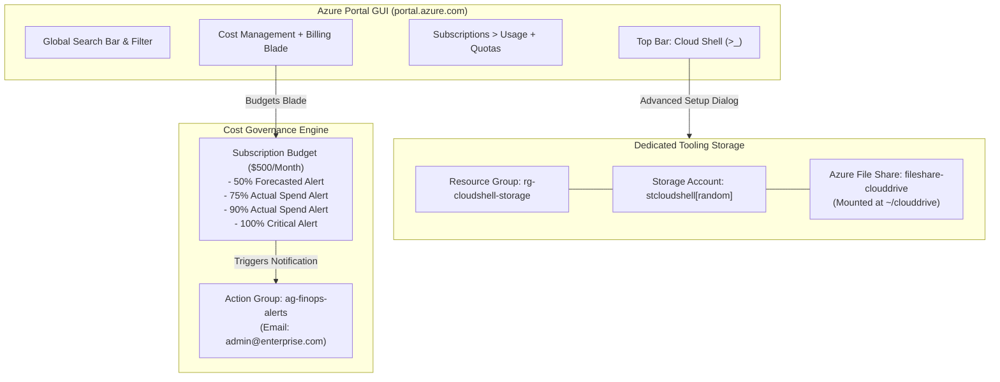

# Lab 01: Enterprise Subscription Baseline, Cloud Shell Storage & FinOps Budgeting

**Breadcrumbs:** [[--Index--|🏠 Index]] > [[13-Index - AZ-104|📘 AZ-104 Track]] > Projects > **Lab 01: Governance & Tooling**

---

## 🎯 Lab Overview & Enterprise Scenario

In a production enterprise cloud environment, unmonitored infrastructure deployment leads directly to billing shocks and security chaos. Before any application workloads are deployed, an Azure Administrator must establish baseline financial governance, persistent administrative tooling, and compute quota visibility. 

In this hands-on project, you will act as the Lead Azure Systems Administrator setting up the foundational landing zone for a modern enterprise. You will work primarily through the **Azure Portal GUI** to configure persistent Cloud Shell storage, implement automated subscription-level cost budgets with alerting thresholds, inspect regional compute quotas, and verify resource group metadata boundaries.

### Concepts Tackled & Seen in Action:
1. **Azure Portal Topography & Navigation:** Exploring blades, global search, resource breadcrumbs, and directory/subscription filters.
2. **Cloud Shell Architecture:** Decoupling ephemeral container compute from persistent Azure File Share storage (`~/clouddrive`).
3. **FinOps Cost Management & Budgeting:** Establishing subscription-level budgets, tracking actual vs. forecasted spend, and binding automated **Action Groups**.
4. **Subscription Quotas & Capacity Limits:** Auditing regional vCPU quotas and understanding compute limits before provisioning VMs.

---

## 🏛️ Target Architecture & Visual Workflow



---

## ⚡ Phase 1: Fast Environment Bootstrap (Optional Azure CLI Script)

If you prefer to initialize the lab baseline via Azure CLI or want to follow along in a scripted sandbox, run the following snippet in your local terminal or existing Cloud Shell session:

```bash
#!/usr/bin/env bash
# Fast Environment Bootstrap: Create baseline resource group and action group
set -euo pipefail

RG_NAME="rg-baseline-lab"
LOCATION="eastus"

echo "Creating Baseline Resource Group: ${RG_NAME} in ${LOCATION}..."
az group create --name "${RG_NAME}" --location "${LOCATION}" --tags Environment=Lab CostCenter=IT-Ops

echo "Creating Action Group for FinOps Alerts..."
az monitor action-group create \
  --resource-group "${RG_NAME}" \
  --name "ag-finops-alerts" \
  --short-name "FinOpsAlert" \
  --action email admin-ops "admin@enterprise.internal"

echo "Bootstrap complete! Now proceed to the Azure Portal GUI tasks below."
```

---

## 🖥️ Phase 2: Core Hands-On Implementation (Azure Portal GUI - Step-by-Step)

### Task 1: Initialize Azure Cloud Shell with Advanced Persistent Storage
By default, basic Cloud Shell setup creates an auto-named storage account in an auto-named resource group. In an enterprise, you must control the naming convention, resource group, and region.

1. Open your browser and navigate to the **Azure Portal** (`https://portal.azure.com`).
2. In the global search bar at the very top, locate the **Cloud Shell icon (`>_`)** immediately to the right of the search bar, and click it.
3. If this is your first time opening Cloud Shell (or if no storage is currently mounted), a splash dialog will appear asking to **Welcome to Azure Cloud Shell**:
   * Select **Bash** as your preferred shell.
4. When prompted with "You have no storage mounted", **DO NOT** click "Create storage".
5. Click the link labeled **Show advanced settings**:
   * **Subscription:** Select your target practice subscription.
   * **Cloud Shell region:** Select your closest geographic region (e.g., `East US`).
   * **Resource group:** Select **Create new** and enter: `rg-cloudshell-storage`.
   * **Storage account:** Select **Create new** and enter a globally unique lowercase name: `stcloudshell` + 5 random digits (e.g., `stcloudshell48102`).
   * **File share:** Select **Create new** and enter: `fileshare-clouddrive`.
6. Click **Create storage**.
7. 👁️ **Visual Checkpoint:** Wait 30–60 seconds. Once the terminal prompt appears (`username@Azure:~$`), execute the following command to verify that your home directory is mounted to persistent Azure storage:
   ```bash
   df -h | grep clouddrive
   ```
   *Notice that `/home/username/clouddrive` is mounted to the Azure File Share (`//stcloudshellXXXXX.file.core.windows.net/fileshare-clouddrive`). Any files saved here survive terminal restarts.*

---

### Task 2: Configure Subscription-Level Budget & Multi-Stage Alerts
In this task, you will create a strict $500 monthly budget with progressive alerts to prevent runaway cloud spend.

1. In the Azure Portal top search bar, type `Cost Management + Billing` and select it from the services list.
2. Under the **Cost Management** section in the left sidebar, click on **Budgets**.
3. In the top action bar, click **+ Add**:
4. In the **Create budget** blade, configure the **Budget details**:
   * **Scope:** Confirm it is set to your active Subscription.
   * **Name:** `budget-sub-enterprise-guardrail`.
   * **Reset period:** Select `Monthly`.
   * **Creation date:** Leave as the first day of the current month.
   * **Expiration date:** Set to 1 year from the current date.
   * **Budget amount:** Enter `500` (USD or local currency).
5. Click **Next: Set alerts >**.
6. Configure the alert thresholds to track both actual spend and predictive burn rate:
   * **Alert Condition 1 (Early Warning):**
     * **Type:** `Forecasted` *(Alerts if Azure predicts your monthly bill will cross the threshold)*.
     * **% of budget:** `50`.
     * **Action group:** Select `ag-finops-alerts` (or click **Manage action group** to create one).
   * **Alert Condition 2 (Operational Threshold):**
     * Click **+ Add alert condition**.
     * **Type:** `Actual`.
     * **% of budget:** `75`.
     * **Alert recipients (email):** Enter your email address.
   * **Alert Condition 3 (Critical Escalation):**
     * Click **+ Add alert condition**.
     * **Type:** `Actual`.
     * **% of budget:** `90`.
     * **Alert recipients (email):** Enter your email address.
   * **Alert Condition 4 (Budget Exhausted):**
     * Click **+ Add alert condition**.
     * **Type:** `Actual`.
     * **% of budget:** `100`.
7. Click **Review + create** and then click **Create**.
8. 👁️ **Visual Checkpoint:** In the **Budgets** blade, verify that `budget-sub-enterprise-guardrail` is listed with a green progress bar showing your current spend percentage vs. the $500 limit.

---

### Task 3: Audit Compute Regional Quotas in Azure Portal
Before provisioning compute clusters, you must ensure the target region has sufficient vCPU capacity allocated to your subscription.

1. In the top search bar, type `Subscriptions` and click on it.
2. Select your active lab subscription.
3. In the left-hand navigation menu, scroll down to the **Settings** group and click **Usage + quotas**.
4. In the top filter bar:
   * **Provider:** Select `Microsoft.Compute`.
   * **Location:** Select `East US` (or your primary lab region).
5. In the quota search box, type `Total Regional vCPUs`.
6. 👁️ **Visual Checkpoint:** Observe the progress ring:
   * Check your **Current usage** against the **Limit** (e.g., `0 / 10` or `4 / 100`).
   * Notice that modern Azure accounts enforce both family-specific limits (e.g., *Standard Dsv5 Family vCPUs*) and an overarching *Total Regional vCPUs* cap.
7. Click the **Request increase** button on the top right to inspect how Microsoft handles automated quota expansions without opening support tickets.

---

## 🔗 Phase 3: Cross-Module Integration Task

### Integration: Attributing Cloud Shell Infrastructure with Governance Tags
To connect this tooling baseline with **Module 03 (Governance & Compliance)**:

1. In the top search bar, type `Resource groups` and click on it.
2. Select the `rg-cloudshell-storage` resource group created in Task 1.
3. In the left menu, select **Tags**.
4. Add the following enterprise metadata tags:
   * **Name:** `Environment` | **Value:** `Management`
   * **Name:** `ManagedBy` | **Value:** `CloudOps`
   * **Name:** `CostCenter` | **Value:** `IT-Infrastructure`
5. Click **Apply**.
6. 👁️ **Visual Checkpoint:** Navigate to the storage account inside `rg-cloudshell-storage` and notice that resource-level tags can be filtered in Cost Management to track how much administrative tooling costs the company.

---

## 🔬 Phase 4: Verification & Validation Testing (Azure CLI / Cloud Shell)

Open your Azure Cloud Shell terminal and execute the following automated validation commands to prove your Portal configurations are active:

```bash
# Test 1: Verify the Subscription Budget Configuration via ARM API
az costmanagement budget show \
  --budget-name "budget-sub-enterprise-guardrail" \
  --query "{Name:name, Amount:amount, ResetPeriod:timeGrain, StartDate:timePeriod.startDate, EndDate:timePeriod.endDate}" \
  --output table

# Test 2: Verify the Action Group Notification Dispatch Binding
az monitor action-group list \
  --resource-group "rg-baseline-lab" \
  --query "[].{Name:name, ShortName:groupShortName, EmailReceivers:emailReceivers[].emailAddress}" \
  --output jsonc

# Test 3: Query Regional Compute Quota programmatically
az vm list-usage \
  --location "eastus" \
  --query "[?name.value=='regionalSockets' || name.value=='cores'].{Resource:name.localizedValue, Current:currentValue, Limit:limit}" \
  --output table
```

---

## ⚠️ Phase 5: "See It in Action" Real-World Failure & Recovery Loop (AARF)

### Scenario: The Orphaned Storage Bill Shock
* **The Architecture:** An organization sets up Cloud Shell and deploys several test environments.
* **The Assumption:** The team assumes that closing the browser or resetting the Cloud Shell session terminates all associated cloud billing.
* **The Failure Loop:**
  * The engineer resets their Cloud Shell session multiple times by selecting "Unmount storage account" in the CLI and recreating new storage accounts with basic auto-settings.
  * Over 6 months, 8 orphaned storage accounts and file shares remain active in the subscription.
  * The subscription incurs continuous monthly charges for unused file shares and LRS storage allocations.
* **The Remediation via Portal GUI:**
  1. In the Portal, navigate to **Storage accounts**.
  2. Search for accounts prefixed with `stcloudshell`.
  3. Inspect the **Containers** and **File shares** blades of each account.
  4. Identify orphaned accounts not actively mounted in Cloud Shell and delete them.
  5. Enforce an **Azure Policy** (covered in Lab 03) that mandates tagging on all newly created storage accounts.

---

## 🧹 Phase 6: Cost Optimization & Lab Teardown

To guarantee zero ongoing costs from this introductory lab, execute the cleanup command below in Cloud Shell:

```bash
# 1. Delete the baseline resource group and action group
az group delete --name "rg-baseline-lab" --yes --no-wait

# Note: Retain 'rg-cloudshell-storage' if you wish to preserve your Cloud Shell files 
# for subsequent labs. If you wish to delete it completely:
# az group delete --name "rg-cloudshell-storage" --yes --no-wait
```
