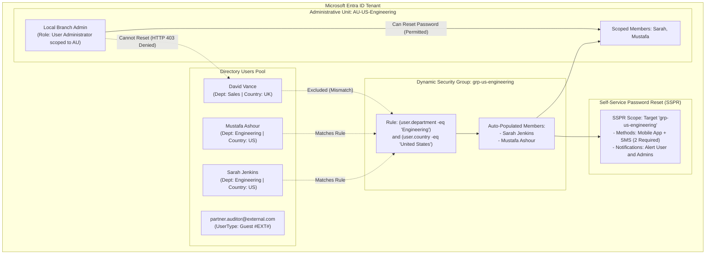

# Lab 02: Enterprise Identity, Dynamic Security Groups, SSPR & Administrative Units

**Breadcrumbs:** [[--Index--|🏠 Index]] > [[13-Index - AZ-104|📘 AZ-104 Track]] > Projects > **Lab 02: Entra ID**

---

## 🎯 Lab Overview & Enterprise Scenario

In an enterprise environment, managing individual user accounts manually is a recipe for operational gridlock and privilege sprawl. Scalable identity governance requires automated group memberships based on HR attributes, self-service capabilities that eliminate IT helpdesk ticket backlogs, and regional delegation boundaries that prevent branch office administrators from compromising headquarters accounts.

In this hands-on project, you will act as the Enterprise Identity Engineer configuring **Microsoft Entra ID** (formerly Azure Active Directory). You will work primarily in the **Azure Portal GUI** to configure automated **Dynamic Security Groups**, deploy **Self-Service Password Reset (SSPR)** with multi-factor verification policies, establish an **Administrative Unit (AU)** to enforce scoped role delegation, and onboard external partners via **B2B Guest Collaboration**.

### Concepts Tackled & Seen in Action:
1. **User & Attribute Management:** Understanding mandatory user properties, User Principal Names (UPN), and the critical role of `usageLocation`.
2. **Dynamic Membership Rules:** Using the Portal's visual rule builder to dynamically populate security groups based on department and country tags.
3. **Self-Service Password Reset (SSPR):** Configuring password reset gates, required authentication methods, and writeback settings.
4. **Administrative Units (AUs):** Confining directory role authority (e.g., User Administrator) strictly to a regional subset of users.
5. **B2B Guest Collaboration:** Inviting external partner identities and inspecting `#EXT#` UPN formatting and tenant separation.

---

## 🏛️ Target Architecture & Visual Workflow



---

## ⚡ Phase 1: Fast Environment Bootstrap (Optional Azure CLI Script)

To save you from manually typing 5 different users in the portal before practicing the dynamic rules and administrative units, run this fast bootstrap script in your **Azure Cloud Shell (Bash)**:

```bash
#!/usr/bin/env bash
# Fast Environment Bootstrap: Provision test users with distinct HR attributes
set -euo pipefail

TENANT_DOMAIN=$(az rest --method get --url "https://graph.microsoft.com/v1.0/domains" --query "value[?isDefault].id" -o tsv)
echo "Operating in Tenant Domain: ${TENANT_DOMAIN}"

# Create 3 Internal Test Users with distinct attributes
echo "Creating User 1: Sarah Jenkins (Engineering - US)..."
az ad user create \
  --display-name "Sarah Jenkins" \
  --user-principal-name "sarah.jenkins@${TENANT_DOMAIN}" \
  --password "SecurePass123456!" \
  --mail-nickname "sarah.jenkins"
az ad user update \
  --id "sarah.jenkins@${TENANT_DOMAIN}" \
  --set department="Engineering" country="United States" usageLocation="US" jobTitle="Senior DevOps Engineer"

echo "Creating User 2: Mustafa Ashour (Engineering - US)..."
az ad user create \
  --display-name "Mustafa Ashour" \
  --user-principal-name "mustafa.ashour@${TENANT_DOMAIN}" \
  --password "SecurePass123456!" \
  --mail-nickname "mustafa.ashour"
az ad user update \
  --id "mustafa.ashour@${TENANT_DOMAIN}" \
  --set department="Engineering" country="United States" usageLocation="US" jobTitle="Cloud Solutions Architect"

echo "Creating User 3: David Vance (Sales - UK)..."
az ad user create \
  --display-name "David Vance" \
  --user-principal-name "david.vance@${TENANT_DOMAIN}" \
  --password "SecurePass123456!" \
  --mail-nickname "david.vance"
az ad user update \
  --id "david.vance@${TENANT_DOMAIN}" \
  --set department="Sales" country="United Kingdom" usageLocation="GB" jobTitle="Account Executive"

echo "Creating User 4: Scoped Helpdesk Admin..."
az ad user create \
  --display-name "Local Helpdesk Lead" \
  --user-principal-name "helpdesk.lead@${TENANT_DOMAIN}" \
  --password "SecurePass123456!" \
  --mail-nickname "helpdesk.lead"
az ad user update \
  --id "helpdesk.lead@${TENANT_DOMAIN}" \
  --set department="IT-Support" usageLocation="US"

echo "Bootstrap complete! 4 test users generated. Proceed to the Portal GUI tasks below."
```

---

## 🖥️ Phase 2: Core Hands-On Implementation (Azure Portal GUI - Step-by-Step)

### Task 1: Inspect Users and Attribute Architecture in Azure Portal
1. In the Azure Portal search bar, type `Microsoft Entra ID` (or `Azure Active Directory`) and select it.
2. In the left navigation menu under **Manage**, click on **Users**.
3. In the list, click on **Sarah Jenkins**:
   * Click **Edit properties** in the top action bar.
   * Review the **Job information** tab: Observe that `Department` is `Engineering` and `Job title` is `Senior DevOps Engineer`.
   * Review the **Settings** tab: Verify that **Usage location** is set to `United States`. *(Crucial rule: Licensable features and conditional policies fail if usage location is blank!)*
4. Click **Cancel** to return to the Users blade.

---

### Task 2: Build a Dynamic Security Group with Visual Rule Expressions
In this task, you will create a group that automatically manages its own membership using attributes from the identity plane.

1. In the left navigation of Microsoft Entra ID, select **Groups**.
2. In the top action bar, click **+ New group**:
3. In the **New Group** blade, configure the basic settings:
   * **Group type:** Select `Security`.
   * **Group name:** `grp-us-engineering`.
   * **Group description:** `Automated dynamic group for US engineering personnel`.
   * **Membership type:** Change the dropdown from `Assigned` to **`Dynamic User`**.
4. Under **Dynamic user members**, click on the link **Add dynamic query**:
5. In the **Dynamic membership rules** builder:
   * **Rule 1:**
     * **Property:** Click dropdown and select `department`.
     * **Operator:** Select `Equals`.
     * **Value:** Type `Engineering`.
   * In the rule builder, click **+ Add expression** (notice the logical `And` operator is inserted).
   * **Rule 2:**
     * **Property:** Select `country`.
     * **Operator:** Select `Equals`.
     * **Value:** Type `United States`.
6. Inspect the **Rule syntax** text box at the bottom. It should reflect:
   ```text
   (user.department -eq "Engineering") and (user.country -eq "United States")
   ```
7. Click **Save** at the top of the rule builder blade.
8. Click **Create** at the bottom of the New Group blade.
9. 👁️ **Visual Checkpoint:**
   * Open the newly created `grp-us-engineering` group.
   * Under **Manage** in the left sidebar, click **Members**.
   * *Note: Dynamic group processing runs as an asynchronous background worker in Entra ID (typically takes 1–3 minutes).* Click **Refresh** after a minute.
   * Observe that **Sarah Jenkins** and **Mustafa Ashour** appear automatically as members. **David Vance** is excluded because his department is `Sales` and country is `United Kingdom`.

---

### Task 3: Configure Self-Service Password Reset (SSPR) Policy
Password reset requests account for over 30% of enterprise IT tickets. In this task, you will roll out SSPR targeted specifically to our engineering group.

1. Return to the main **Microsoft Entra ID** overview blade.
2. In the left sidebar, scroll down to the **Manage** section and click on **Password reset**.
3. On the **Properties** blade:
   * **Self service password reset enabled:** Click the **Selected** radio button.
   * Under **Select group**, click **No groups selected**.
   * In the search box, search for and select `grp-us-engineering`.
   * Click **Select** at the bottom, then click **Save** at the top.
4. In the left sidebar under Password reset, click **Authentication methods**:
   * **Number of methods required to reset:** Select `1` (or `2` for heightened security).
   * **Methods available to users:** Check the following boxes:
     * `Email`
     * `Mobile phone` (SMS)
     * `Mobile app notification` (Microsoft Authenticator)
   * Click **Save** in the top action bar.
5. In the left sidebar, click **Registration**:
   * **Require users to register when signing in?** Set to `Yes`.
   * **Number of days before users are asked to re-confirm their authentication information:** Set to `180`.
   * Click **Save**.
6. 👁️ **Visual Checkpoint:** On the **Customization** tab, notice the field **Customize helpdesk link**. In enterprise production, this is pointed to your corporate ServiceNow / Jira portal (`https://helpdesk.company.com`).

---

### Task 4: Establish an Administrative Unit (AU) with Scoped Helpdesk Delegation
In a multinational company, an administrator in New York should not be able to reset passwords or delete accounts belonging to employees in London or Tokyo. Administrative Units solve this by creating a scoped security boundary.

1. In the left menu of **Microsoft Entra ID**, scroll down to **Manage** and select **Administrative units**.
2. Click **+ Add** in the top action bar:
3. **Basics tab:**
   * **Name:** `AU-US-Engineering`.
   * **Description:** `Scoped administrative boundary for US engineering staff`.
4. Click **Next: Assign roles >**:
   * In the list of available directory roles, locate **User Administrator**.
   * Click on the role name or select the pencil icon, and click **+ Add assignments**:
   * Search for and select our test helpdesk user: `Local Helpdesk Lead` (`helpdesk.lead@...`).
   * Click **Select**.
5. Click **Next: Review + create >**, then click **Create**.
6. Open the newly created `AU-US-Engineering` administrative unit:
   * Under **Manage** in the left sidebar, click on **Users**.
   * Click **+ Add member**.
   * Select `Sarah Jenkins` and `Mustafa Ashour`.
   * Click **Select**.
7. 👁️ **Visual Checkpoint:**
   * Under **Manage**, click on **Roles and administrators**.
   * Click on **User Administrator**. Observe that `Local Helpdesk Lead` is listed as the assigned principal.
   * *The Architectural Takeaway:* `Local Helpdesk Lead` holds the User Administrator role **strictly within the boundary of AU-US-Engineering**. They can reset Sarah and Mustafa's passwords, but if they attempt to reset David Vance or any Global Admin, Entra ID returns **`403 Forbidden`**.

---

### Task 5: Onboard External Partners via B2B Guest Collaboration
1. In the left menu of **Microsoft Entra ID**, select **Users** > **+ New user** > **Invite external user**.
2. On the **Invite external user** blade:
   * **Email:** Enter an external email (e.g., your personal Gmail or `partner.auditor@outlook.com`).
   * **Display name:** `External Compliance Auditor`.
   * **Personalized invitation message:** Check and enter: `Welcome to the Enterprise Architecture Review`.
3. Click **Review + invite** and then click **Invite**.
4. 👁️ **Visual Checkpoint:**
   * In the Users list, search for `External Compliance Auditor`.
   * Look at the **User type** column: It displays **`Guest`**.
   * Look at the **User principal name** column: Notice it is formatted using the external isolation convention:
     `partner.auditor_outlook.com#EXT#@<your-tenant>.onmicrosoft.com`.

---

## 🔗 Phase 3: Cross-Module Integration Task

### Integration: Granting Directory Groups Access to Azure Subscriptions (Mod 01 + Mod 02)
To observe how Entra ID identities map to Azure Resource Manager (ARM) compute and governance controls:

1. In the top search bar, type `Subscriptions` and select your active subscription.
2. In the left menu, select **Access Control (IAM)**.
3. Click **+ Add** > **Add role assignment**:
   * **Role:** Search for `Reader` and select it. Click **Next**.
   * **Members tab:**
     * **Assign access to:** Select `User, group, or service principal`.
     * Click **+ Select members**.
     * Search for our dynamic group: `grp-us-engineering`.
     * Click **Select**.
4. Click **Review + assign** twice.
5. 👁️ **Visual Checkpoint:** Click the **Role assignments** tab in Access Control. Verify that `grp-us-engineering` holds the `Reader` role. Because Sarah and Mustafa are dynamic members of this group, they inherit read access across the entire subscription without needing individual permissions!

---

## 🔬 Phase 4: Verification & Validation Testing (Azure CLI / Cloud Shell)

Open your Azure Cloud Shell and run these diagnostic commands to verify your GUI configurations:

```bash
# Test 1: Verify Dynamic Group Rule and Active Member Count
az ad group show \
  --group "grp-us-engineering" \
  --query "{Name:displayName, MembershipRule:membershipRule, RuleProcessing:membershipRuleProcessingState}" \
  --output jsonc

# Test 2: List Dynamic Group Members via Microsoft Graph
GROUP_ID=$(az ad group show --group "grp-us-engineering" --query "id" -o tsv)
az ad group member list \
  --group "${GROUP_ID}" \
  --query "[].{DisplayName:displayName, UPN:userPrincipalName, Department:department}" \
  --output table

# Test 3: Verify Administrative Unit Scoped Role Assignment
AU_ID=$(az rest --method get --url "https://graph.microsoft.com/v1.0/directory/administrativeUnits" --query "value[?displayName=='AU-US-Engineering'].id" -o tsv)
az rest --method get \
  --url "https://graph.microsoft.com/v1.0/directory/administrativeUnits/${AU_ID}/members" \
  --query "value[].{DisplayName:displayName, UPN:userPrincipalName}" \
  --output table
```

---

## ⚠️ Phase 5: "See It in Action" Real-World Failure & Recovery Loop (AARF)

### Scenario: The Missing Usage Location Licensing Failure
* **The Architecture:** An enterprise deploys dynamic groups to automatically assign Microsoft 365 or Entra ID P2 licenses to newly onboarded engineers.
* **The Assumption:** The HR team creates user accounts with names, departments, and passwords, assuming licensing and SSPR work automatically.
* **The Failure Loop:**
  * The administrator assigns a license to `grp-us-engineering`.
  * The license assignment fails with the error:
    `"License cannot be assigned to a user without a usage location specified."`
  * Consequently, the users cannot register for SSPR or use multi-factor authentication.
* **The Remediation via Portal GUI:**
  1. In the Portal, navigate to **Microsoft Entra ID** > **Users**.
  2. Select the affected user (e.g., `Sarah Jenkins`).
  3. Click **Edit properties** > **Settings** tab.
  4. Under **Usage location**, select the country where the user resides (e.g., `United States`).
  5. Click **Save**.
  6. Return to the group license blade or SSPR registration—the error clears immediately.

---

## 🧹 Phase 6: Cost Optimization & Lab Teardown

Entra ID objects do not incur hourly runtime charges, but cleaning up test accounts maintains tenant hygiene. Run the following cleanup snippet in Cloud Shell:

```bash
# Clean up test users created during the lab
for user in "sarah.jenkins" "mustafa.ashour" "david.vance" "helpdesk.lead"; do
  UPN="${user}@${TENANT_DOMAIN}"
  echo "Deleting test user: ${UPN}..."
  az ad user delete --id "${UPN}" || true
done

# Clean up dynamic security group
az ad group delete --group "grp-us-engineering" || true
```
