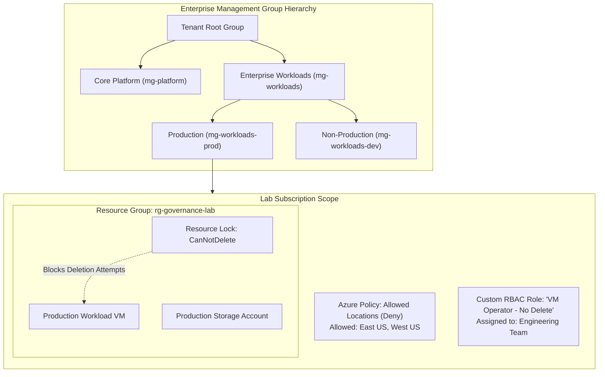

# Lab 03: Custom RBAC Role Engineering, Resource Locks & Azure Policy Governance

**Breadcrumbs:** [[--Index--|🏠 Index]] > [[13-Index - AZ-104|📘 AZ-104 Track]] > Projects > **Lab 03: Governance & Compliance**

---

## 🎯 Lab Overview & Enterprise Scenario

In an enterprise cloud landing zone, developer velocity must be balanced with strict compliance boundaries and blast-radius containment. If junior engineers are given overly broad `Contributor` access, they can inadvertently delete production databases or deploy expensive GPU clusters in unauthorized geographic regions. 

In this hands-on project, you will act as the Principal Cloud Governance Architect. You will work primarily through the **Azure Portal GUI** to build an enterprise **Management Group hierarchy**, author and assign a least-privilege **Custom RBAC Role** using the Portal's visual role builder, lock down mission-critical resource groups with **Resource Locks**, and enforce organizational compliance using **Azure Policy** with automated remediation.

### Concepts Tackled & Seen in Action:
1. **Management Group Topography:** Constructing a multi-tier governance tree to enforce policy inheritance across subscriptions.
2. **Custom RBAC Role Creation:** Engineering a tailored role definition in the Azure Portal GUI that allows VM operators to start/stop/restart workloads while strictly stripping deletion rights.
3. **Resource Locks (`CanNotDelete` vs. `ReadOnly`):** Observing how ARM intercepts destructive operations at the control plane before packets reach physical resources.
4. **Azure Policy Engine:** Deploying a policy with a `Deny` effect to block resource creation outside approved geographic regions.
5. **Automated Policy Remediation:** Using the `Modify` policy effect and Managed Identity to automatically inject missing compliance tags into non-compliant resource groups.

---

## 🏛️ Target Architecture & Visual Workflow



---

## ⚡ Phase 1: Fast Environment Bootstrap (Optional Azure CLI Script)

Run this optional script in **Azure Cloud Shell (Bash)** to deploy the baseline resource group and a lightweight test resource for this lab:

```bash
#!/usr/bin/env bash
# Fast Environment Bootstrap: Create target resource group for governance testing
set -euo pipefail

RG_NAME="rg-governance-lab"
LOCATION="eastus"

echo "Creating Resource Group: ${RG_NAME} in ${LOCATION}..."
az group create --name "${RG_NAME}" --location "${LOCATION}" --tags Environment=Production

echo "Bootstrap complete! Open the Azure Portal GUI to perform the hands-on tasks."
```

---

## 🖥️ Phase 2: Core Hands-On Implementation (Azure Portal GUI - Step-by-Step)

### Task 1: Build the Management Group Hierarchy in Azure Portal
1. In the Azure Portal search bar, type `Management groups` and select it.
2. In the Management Groups tree view, select the **Tenant Root Group** and click **+ Create**:
   * **Management group ID:** `mg-enterprise-workloads`.
   * **Management group display name:** `Enterprise Workloads`.
3. Click **Submit**.
4. In the list, click on your newly created `Enterprise Workloads` group to open its scope:
   * In the top toolbar, click **+ Create** to add a child management group:
     * **Management group ID:** `mg-workloads-prod`.
     * **Management group display name:** `Production Workloads`.
     * Click **Submit**.
5. 👁️ **Visual Checkpoint:** Click the breadcrumbs back to **Management groups**. Notice the structured parent-child tree:
   `Tenant Root Group > Enterprise Workloads > Production Workloads`. Any policy assigned at `Enterprise Workloads` will automatically cascade down to all subscriptions nested beneath it.

---

### Task 2: Build a Custom RBAC Role Using the Portal GUI Visual Builder
In this task, you will create a role named **`VM Operator - No Delete`** that allows starting, stopping, and restarting VMs, but strictly removes the ability to delete VMs or their disks.

1. In the top search bar, type `Subscriptions` and click on your active subscription.
2. In the left-hand navigation, click **Access control (IAM)**.
3. Click **+ Add** in the top action bar > select **Add custom role**:
4. **Basics tab:**
   * **Custom role name:** `VM Operator - No Delete`.
   * **Description:** `Permits full operational control of VMs but prevents resource deletion`.
   * **Baseline permissions:** Leave selected as `Start from scratch`.
5. Click **Next: Permissions >**:
   * Click **+ Add permissions**:
   * In the search box, search for `Microsoft.Compute/virtualMachines`.
   * Check the following operational actions:
     * `Microsoft.Compute/virtualMachines/read` (Read Virtual Machine)
     * `Microsoft.Compute/virtualMachines/start/action` (Start Virtual Machine)
     * `Microsoft.Compute/virtualMachines/restart/action` (Restart Virtual Machine)
     * `Microsoft.Compute/virtualMachines/powerOff/action` (Power Off Virtual Machine)
   * Click **Add**.
   * Click **+ Add permissions** again and search for `Microsoft.Network/networkInterfaces/read` and `Microsoft.Network/virtualNetworks/read`, then click **Add**.
6. Click **Next: Assignable scopes >**:
   * Verify that your current **Subscription** is listed as the assignable scope.
7. Click **Next: JSON >**:
   * Inspect the declarative JSON schema generated by the Portal GUI. Notice how your clicked permissions are populated under the `"Actions"` array.
8. Click **Review + create**, then click **Create**.
9. 👁️ **Visual Checkpoint:** In the **Access control (IAM)** blade, select the **Roles** tab and search for `VM Operator - No Delete`. Observe that its **Type** is clearly marked as **`CustomRole`**.

---

### Task 3: Enforce & Test Resource Locks (`CanNotDelete` vs. `ReadOnly`)
1. In the top search bar, type `Resource groups` and select `rg-governance-lab`.
2. In the left navigation menu under **Settings**, select **Locks**.
3. In the top action bar, click **+ Add**:
   * **Lock name:** `lock-prevent-deletion`.
   * **Lock type:** Select `Delete` (Maps to ARM `CanNotDelete`).
   * **Notes:** `Critical production guardrail against accidental deletion`.
4. Click **OK**.
5. **Test the Deletion Block in GUI:**
   * Click the **Overview** blade of `rg-governance-lab`.
   * In the top toolbar, click **Delete resource group**.
   * Type the resource group name `rg-governance-lab` in the confirmation box and click **Delete**.
   * 👁️ **Visual Checkpoint:** An immediate error banner pops up in the top right:
     `"Failed to delete resource group rg-governance-lab. The resource group cannot be deleted because it is locked by 'lock-prevent-deletion'."`
6. **Test the ReadOnly Lock Impact:**
   * Return to the **Locks** blade. Click **+ Add**:
     * **Lock name:** `lock-freeze-configuration`.
     * **Lock type:** Select `Read-only` (Maps to ARM `ReadOnly`).
     * Click **OK**.
   * Return to **Overview** and attempt to add a tag:
     * Click **Edit tags**, add `Audit=Passed`, and click **Apply**.
   * 👁️ **Visual Checkpoint:** The operation fails with an authorization error because a `ReadOnly` lock restricts all write (`PUT`/`PATCH`/`POST`) calls at the ARM control plane.
   * Return to the **Locks** blade, click the **...** context menu on `lock-freeze-configuration`, and select **Delete** so we can continue testing.

---

### Task 4: Enforce Geographic Compliance via Azure Policy (`Deny` Effect)
In this task, you will enforce an organizational mandate that forbids deploying resources outside of `East US` and `West US`.

1. In the top search bar, type `Policy` and select it.
2. In the left sidebar under **Authoring**, click **Definitions**:
   * In the search box, type `Allowed locations`.
   * Select the built-in policy definition: **Allowed locations** (Category: *General*).
3. In the top action bar, click **Assign**:
4. **Basics tab:**
   * **Scope:** Click the ellipsis (`...`) and select your lab Subscription and the `rg-governance-lab` resource group.
   * **Assignment name:** `enforce-us-regions-only`.
   * **Policy enforcement:** Ensure it is set to `Enabled`.
5. Click **Next: Parameters >**:
   * In the **Allowed locations** multi-select dropdown, select:
     * `East US`
     * `West US`
6. Click **Review + create**, then click **Create**.
7. **Test Policy Enforcement in the GUI:**
   * In the top search bar, type `Storage accounts` and click **+ Create**.
   * **Resource group:** Select `rg-governance-lab`.
   * **Storage account name:** `stpolicytest` + 5 numbers.
   * **Region:** Select `West Europe` *(Deliberately selecting an unallowed region)*.
   * Click **Review**.
   * 👁️ **Visual Checkpoint:** Validation fails immediately! Look at the error message:
     `"Validation failed. Resource 'stpolicytestXXXXX' was disallowed by policy 'enforce-us-regions-only'."`
   * Click the error link to view the compliance details showing that `West Europe` is blocked by policy.

---

## 🔗 Phase 3: Cross-Module Integration Task

### Integration: Binding Custom RBAC to Dynamic Entra Groups (Mod 02 + Mod 03)
Connect the identity architecture from Module 02 with the governance controls built in this lab:

1. In the Azure Portal, open **Resource groups** > `rg-governance-lab`.
2. In the left menu, click **Access control (IAM)** > click **+ Add** > **Add role assignment**.
3. **Role tab:**
   * Search for your custom role: `VM Operator - No Delete`.
   * Select it and click **Next**.
4. **Members tab:**
   * Select **User, group, or service principal**.
   * Click **+ Select members**.
   * Search for the dynamic group created in Module 02: `grp-us-engineering`.
   * Click **Select**.
5. Click **Review + assign** twice.
6. 👁️ **Visual Checkpoint:** Click the **Role assignments** tab in `rg-governance-lab`. Verify that `grp-us-engineering` now holds `VM Operator - No Delete`. Any user dynamically added to this group inherits operational VM control while remaining blocked from deleting infrastructure!

---

## 🔬 Phase 4: Verification & Validation Testing (Azure CLI / Cloud Shell)

Execute these validation commands in Azure Cloud Shell to confirm your governance policies are active in ARM:

```bash
# Test 1: Verify Custom Role Definition Properties in ARM
az role definition list \
  --name "VM Operator - No Delete" \
  --query "[].{RoleName:roleName, IsCustom:isCustom, Actions:permissions[0].actions, NotActions:permissions[0].notActions}" \
  --output jsonc

# Test 2: Check Active Resource Locks on the Resource Group
az lock list \
  --resource-group "rg-governance-lab" \
  --query "[].{Name:name, Level:level, Notes:notes}" \
  --output table

# Test 3: Verify the Azure Policy Assignment
az policy assignment show \
  --name "enforce-us-regions-only" \
  --resource-group "rg-governance-lab" \
  --query "{Name:name, DisplayName:displayName, Scope:scope, Parameters:parameters.listOfAllowedLocations.value}" \
  --output jsonc
```

---

## ⚠️ Phase 5: "See It in Action" Real-World Failure & Recovery Loop (AARF)

### Scenario: The "NotActions is a Deny" Production Outage
* **The Architecture:** A company creates a custom role with `NotActions: ["Microsoft.Compute/virtualMachines/delete"]` intended to prevent contractors from deleting VMs.
* **The Assumption:** The team assumes that putting an action in `NotActions` functions as an explicit security Deny.
* **The Failure Loop:**
  * A contractor is also granted the built-in `Virtual Machine Contributor` role on a specific resource group to troubleshoot a network issue.
  * The contractor runs a cleanup script that inadvertently deletes 3 production VMs.
  * The engineering lead asks: *"Why did Azure permit the deletion when the custom role had NotActions for delete?"*
* **The Root Cause:**
  * Azure RBAC is strictly **additive**. `NotActions` merely subtracts that permission from the `Actions` array of that specific role definition:
    $$\text{Role Grants} = \text{Actions} - \text{NotActions}$$
  * If another role assigned to the user grants the permission, the user **CAN** delete the resource!
* **The Remediation via Portal GUI:**
  1. To create an absolute, un-overridable block on deletion, navigate to the target Resource Group.
  2. Click **Locks** > add a **`Delete` lock**.
  3. No role assignment—not even Subscription Owner—can delete a locked resource without explicitly removing the lock first.

---

## 🧹 Phase 6: Cost Optimization & Lab Teardown

Run the following cleanup script in Cloud Shell to remove test locks and tear down the lab resource group:

```bash
# 1. Delete the Resource Lock first (ARM blocks RG deletion while locked!)
LOCK_ID=$(az lock list --resource-group "rg-governance-lab" --query "[?name=='lock-prevent-deletion'].id" -o tsv)
if [ -n "${LOCK_ID}" ]; then
  echo "Removing Resource Lock: ${LOCK_ID}..."
  az lock delete --ids "${LOCK_ID}"
fi

# 2. Remove the Azure Policy Assignment
az policy assignment delete --name "enforce-us-regions-only" --resource-group "rg-governance-lab" || true

# 3. Delete the Lab Resource Group
az group delete --name "rg-governance-lab" --yes --no-wait
```
