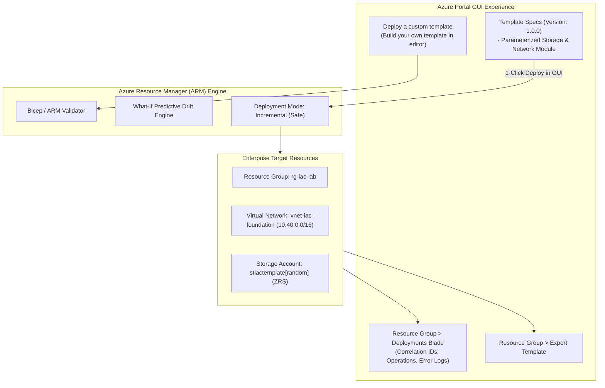

# Lab 04: Declarative IaC with ARM Templates, Bicep & Azure Template Specs

**Breadcrumbs:** [[--Index--|🏠 Index]] > [[13-Index - AZ-104|📘 AZ-104 Track]] > Projects > **Lab 04: Resources & Bicep**

---

## 🎯 Lab Overview & Enterprise Scenario

In an enterprise environment, point-and-click infrastructure configuration fails to scale and creates severe configuration drift. Repeatable deployments require **Infrastructure as Code (IaC)**. However, many enterprise organizations do not run raw CLI scripts in production; instead, central DevOps teams publish versioned **Template Specs** into the Azure Portal, enabling operations teams to deploy standardized, approved infrastructure topologies through the GUI.

In this hands-on project, you will act as the Cloud Automation Engineer. You will work primarily in the **Azure Portal GUI** to deploy custom ARM templates using the built-in JSON template editor, inspect live **Deployment History** and execution telemetry, author and publish a reusable **Template Spec** directly into the Azure control plane, and export running resources into declarative code. You will also use the Bicep CLI to validate predictive **`what-if`** drift analysis.

### Concepts Tackled & Seen in Action:
1. **ARM Template Anatomy:** Understanding `parameters`, `variables`, `resources`, and `outputs` within the Azure Portal template editor.
2. **Template Specs:** Publishing versioned, central IaC templates as native Azure resources accessible from the Portal GUI.
3. **Deployment History & Observability:** Inspecting deployment status, operation correlation IDs, duration, and input/output parameters.
4. **Portal Template Export:** Reverse-engineering existing Azure resources into declarative templates.
5. **Deployment Modes (`Incremental` vs. `Complete`):** Understanding the catastrophic risks of complete mode deletions.

---

## 🏛️ Target Architecture & Visual Workflow



---

## ⚡ Phase 1: Fast Environment Bootstrap (Optional Azure CLI Script)

If you wish to stage the resource group and generate the Bicep files on your workstation or in Cloud Shell before executing the Portal GUI tasks, run this script:

```bash
#!/usr/bin/env bash
# Fast Environment Bootstrap: Create target resource group and local Bicep files
set -euo pipefail

RG_NAME="rg-iac-lab"
LOCATION="eastus"

echo "Creating Resource Group: ${RG_NAME} in ${LOCATION}..."
az group create --name "${RG_NAME}" --location "${LOCATION}" --tags Environment=Dev ManagedBy=IaC

# Generate a sample Bicep template file locally
cat << 'EOF' > storage-vnet.bicep
@description('Primary geographic location for resources')
param location string = resourceGroup().location

@description('Storage Account SKU')
param storageSku string = 'Standard_LRS'

@description('Unique suffix for storage account')
param storageSuffix string = uniqueString(resourceGroup().id)

resource vnet 'Microsoft.Network/virtualNetworks@2023-09-01' = {
  name: 'vnet-iac-foundation'
  location: location
  properties: {
    addressSpace: {
      addressPrefixes: [
        '10.40.0.0/16'
      ]
    }
    subnets: [
      {
        name: 'snet-workload'
        properties: {
          addressPrefix: '10.40.1.0/24'
        }
      }
    ]
  }
}

resource storage 'Microsoft.Storage/storageAccounts@2023-01-01' = {
  name: 'stiac${substring(storageSuffix, 0, 8)}'
  location: location
  sku: {
    name: storageSku
  }
  kind: 'StorageV2'
  properties: {
    minimumTlsVersion: 'TLS1_2'
    allowBlobPublicAccess: false
  }
}

output vnetId string = vnet.id
output storageAccountId string = storage.id
EOF

echo "Compiled Bicep template: storage-vnet.bicep. Now proceed to the GUI tasks."
```

---

## 🖥️ Phase 2: Core Hands-On Implementation (Azure Portal GUI - Step-by-Step)

### Task 1: Deploy Infrastructure Using the Portal Custom Template Editor
In this task, you will use the Azure Portal's built-in JSON template editor to author and deploy resources with parameterized controls.

1. In the Azure Portal top search bar, type `Deploy a custom template` and select it from the services list.
2. On the **Custom deployment** blade, click on the link: **Build your own template in the editor**.
3. In the **Edit template** blade:
   * Notice the structural components on the left: `parameters`, `variables`, `resources`, `outputs`.
   * Clear the default JSON and paste the following production ARM JSON template:
     ```json
     {
       "$schema": "https://schema.management.azure.com/schemas/2019-04-01/deploymentTemplate.json#",
       "contentVersion": "1.0.0.0",
       "parameters": {
         "storagePrefix": {
           "type": "string",
           "defaultValue": "stlab",
           "metadata": { "description": "Prefix for the storage account" }
         },
         "skuName": {
           "type": "string",
           "defaultValue": "Standard_ZRS",
           "allowedValues": [ "Standard_LRS", "Standard_ZRS", "Standard_GRS" ]
         }
       },
       "variables": {
         "uniqueStorageName": "[concat(parameters('storagePrefix'), uniqueString(resourceGroup().id))]"
       },
       "resources": [
         {
           "type": "Microsoft.Storage/storageAccounts",
           "apiVersion": "2023-01-01",
           "name": "[variables('uniqueStorageName')]",
           "location": "[resourceGroup().location]",
           "sku": { "name": "[parameters('skuName')]" },
           "kind": "StorageV2",
           "properties": {
             "minimumTlsVersion": "TLS1_2",
             "allowBlobPublicAccess": false
           }
         }
       ],
       "outputs": {
         "storageEndpoint": {
           "type": "string",
           "value": "[reference(variables('uniqueStorageName')).primaryEndpoints.blob]"
         }
       }
     }
     ```
4. Click **Save** in the top action bar.
5. In the **Custom deployment** configuration blade:
   * **Subscription:** Select your practice subscription.
   * **Resource group:** Select `rg-iac-lab`.
   * **Region:** Verify `East US`.
   * **Storage Prefix:** Leave as `stlab`.
   * **Sku Name:** Click the dropdown and select **`Standard_ZRS`** (notice how `allowedValues` in JSON creates a clean dropdown in the GUI!).
6. Click **Review + create**, then click **Create**.
7. 👁️ **Visual Checkpoint:** The Portal transitions to the deployment screen showing **"Deployment is in progress"**. Watch the status transition to **"Your deployment is complete"**.

---

### Task 2: Inspect Deployment History, Correlation IDs & Outputs in Portal GUI
1. On the completion screen, click the button **Go to resource group** (or navigate to `rg-iac-lab`).
2. In the left-hand navigation menu of `rg-iac-lab`, under **Settings**, click on **Deployments**.
3. In the deployments list, click on the top deployment (named `Microsoft.Template`).
4. **Inspect the Observability Blades:**
   * **Overview:** Displays the Duration, Start Time, and the unique **Correlation ID** used by Microsoft support to trace ARM API calls.
   * **Inputs:** Shows the parameter values passed during creation (`skuName = Standard_ZRS`).
   * **Outputs:** Shows the generated `storageEndpoint` output URL (`https://stlabXXXXX.blob.core.windows.net/`).
   * **Template:** Displays the exact JSON template that was executed.
   * **Operation details:** Lists every sub-resource operation with individual HTTP status codes.

---

### Task 3: Author and Publish an Enterprise Template Spec in the Portal GUI
Template Specs allow organizations to store validated, approved templates inside Azure so that team members can deploy compliant resources without touching raw code.

1. In the top search bar, type `Template Specs` and select it from the services list.
2. In the top action bar, click **+ Create** > **Template Spec**:
3. **Basics tab:**
   * **Resource group:** Select `rg-iac-lab`.
   * **Name:** `ts-enterprise-storage`.
   * **Title:** `Standard Enterprise Storage Module`.
   * **Description:** `Pre-approved storage account with TLS 1.2 and disabled public blob access`.
   * **Version:** `1.0.0`.
4. Click **Next: Edit template >**:
   * Clear the placeholder JSON and paste the same ARM JSON template used in Task 1.
5. Click **Review + create**, then click **Create**.
6. 👁️ **Visual Checkpoint:**
   * Open the newly created `ts-enterprise-storage` template spec.
   * Notice that version **`1.0.0`** is active.
   * In the top action bar, click the **Deploy** button!
   * Notice how the Portal immediately renders a friendly UI wizard matching your template parameters, allowing anyone in the company with RBAC permissions to deploy compliant storage with a single click!

---

### Task 4: Reverse-Engineer Running Infrastructure via "Export Template"
1. In the Azure Portal, open **Resource groups** > select `rg-iac-lab`.
2. In the left-hand menu under **Automation**, click **Export template**.
3. Azure Resource Manager scans all live resources in the group and compiles them into a unified template.
4. Review the generated template:
   * Notice how hardcoded resource names are parameterized.
   * In the top action bar, click **Download** to save the `.zip` archive containing `template.json` and `parameters.json`.

---

## 🔗 Phase 3: Cross-Module Integration Task

### Integration: Linking IaC Deployment to Governance Resource Locks (Mod 03 + Mod 04)
To demonstrate how ARM deployment modes interact with control-plane governance:

1. In `rg-iac-lab`, navigate to **Locks** and click **+ Add**:
   * **Lock name:** `lock-iac-freeze`.
   * **Lock type:** `Delete`.
   * Click **OK**.
2. Return to **Deployments** > click on your previous deployment > click **Redeploy**:
   * Click **Review + create** > **Create**.
3. 👁️ **Visual Checkpoint:** Notice that **Incremental redeployment SUCCEEDS** because `CanNotDelete` permits updating existing resources and adding new ones. However, if the deployment were run in **Complete Mode**, ARM would attempt to delete any existing resource not listed in the template, causing the entire deployment to crash against the Resource Lock!

---

## 🔬 Phase 4: Verification & Validation Testing (Azure CLI / Cloud Shell)

Open Azure Cloud Shell and run these commands to verify your templates and test predictive drift analysis:

```bash
# Test 1: Verify the Published Template Spec via CLI
az ts show \
  --name "ts-enterprise-storage" \
  --resource-group "rg-iac-lab" \
  --version "1.0.0" \
  --query "{Name:name, Version:version, Description:description}" \
  --output table

# Test 2: Execute Bicep 'what-if' Predictive Impact Analysis
# This predicts exactly what ARM will create, modify, or delete BEFORE touching Azure!
az deployment group what-if \
  --resource-group "rg-iac-lab" \
  --template-file storage-vnet.bicep \
  --output table
```

---

## ⚠️ Phase 5: "See It in Action" Real-World Failure & Recovery Loop (AARF)

### Scenario: The "Complete Mode" Catastrophic Deletion Disaster
* **The Architecture:** An organization manages its virtual network and storage accounts using declarative ARM / Bicep deployments in CI/CD pipelines.
* **The Assumption:** The team assumes that deploying a template containing only a new Storage Account will simply add the storage account without touching existing subnets.
* **The Failure Loop:**
  * An engineer changes the deployment mode flag from the default `Incremental` to `Complete`:
    ```bash
    az deployment group create --mode Complete ...
    ```
  * The deployment completes successfully.
  * Seconds later, the production Virtual Network and all attached subnets **vanish from the resource group**, causing an immediate total outage for all running virtual machines.
* **The Root Cause:**
  * In **Incremental Mode (Default)**, ARM leaves unmentioned resources untouched.
  * In **Complete Mode**, ARM considers the template to be the absolute source of truth. Any resource residing in the resource group that is **NOT explicitly declared in the template is deleted permanently!**
* **The Remediation via Portal GUI:**
  1. In production CI/CD pipelines, strictly enforce `Incremental` mode.
  2. Protect all stateful and network infrastructure with **`CanNotDelete` Resource Locks** (as configured in Task 5), which blocks ARM from executing complete-mode deletions.

---

## 🧹 Phase 6: Cost Optimization & Lab Teardown

Run the following cleanup command in Cloud Shell to remove all IaC test resources and template specs:

```bash
# 1. Remove the Resource Lock if active
LOCK_ID=$(az lock list --resource-group "rg-iac-lab" --query "[?name=='lock-iac-freeze'].id" -o tsv)
if [ -n "${LOCK_ID}" ]; then
  az lock delete --ids "${LOCK_ID}"
fi

# 2. Delete the Template Spec
az ts delete --name "ts-enterprise-storage" --resource-group "rg-iac-lab" --yes || true

# 3. Delete the Lab Resource Group
az group delete --name "rg-iac-lab" --yes --no-wait
rm -f storage-vnet.bicep
```
