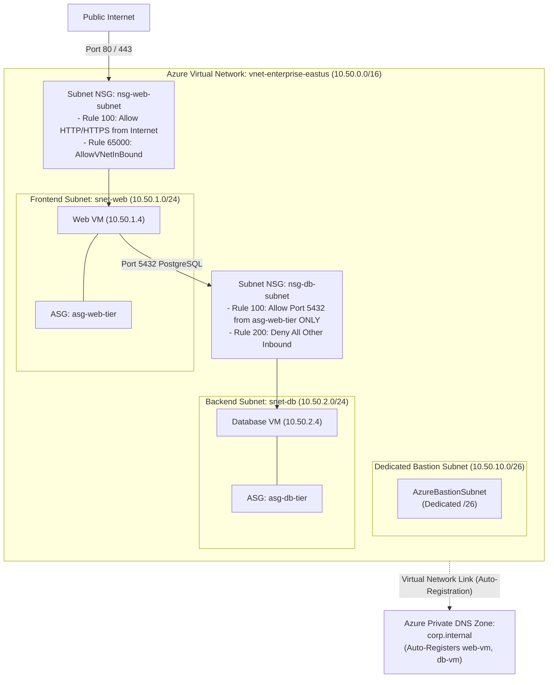

# Lab 05: VNet Architecture, VLSM Subnetting, NSGs, ASGs & Azure Private DNS

**Breadcrumbs:** [[--Index--|🏠 Index]] > [[13-Index - AZ-104|📘 AZ-104 Track]] > Projects > **Lab 05: Networking & DNS**

---

## 🎯 Lab Overview & Enterprise Scenario

In an enterprise cloud landing zone, a poorly planned network topology leads directly to IP exhaustion, routing deadlocks, and severe security vulnerabilities. Azure Virtual Networks require disciplined CIDR allocation, micro-segmentation using stateful firewalls, and private split-horizon name resolution.

In this hands-on project, you will act as the Lead Network Systems Engineer. You will work primarily through the **Azure Portal GUI** to design an enterprise **Virtual Network (VNet)** from scratch, slice it into dedicated subnets using **Variable Length Subnet Masking (VLSM)**, construct zero-trust micro-segmentation rules using **Network Security Groups (NSGs)** and **Application Security Groups (ASGs)**, and deploy an **Azure Private DNS Zone** with automated machine registration.

### Concepts Tackled & Seen in Action:
1. **VNet CIDR & Subnet Slicing:** Calculating host bits ($32 - \text{Prefix}$), observing the 5 platform-reserved IP addresses, and enforcing flat subnet hierarchies.
2. **Application Security Groups (ASGs):** Abstracting IP management by grouping VM interfaces under logical application labels (`asg-web-tier`, `asg-db-tier`).
3. **NSG Stateful Rule Architecture:** Crafting priority-spaced security rules and understanding the evaluation order (Subnet NSG evaluated first, then NIC NSG).
4. **Azure Private DNS Zones:** Provisioning private namespace resolution (`corp.internal`) and configuring automatic DNS `A` record registration for provisioned workloads.
5. **Longest Prefix Match (LPM):** Observing how Azure's underlying SDN fabric routes traffic between subnets without virtual routers.

---

## 🏛️ Target Architecture & Visual Workflow



---

## ⚡ Phase 1: Fast Environment Bootstrap (Optional Azure CLI Script)

If you wish to quickly create the baseline resource group and two test VMs to observe Private DNS auto-registration in action, run this script in **Azure Cloud Shell (Bash)**:

```bash
#!/usr/bin/env bash
# Fast Environment Bootstrap: Create resource group and baseline VMs
set -euo pipefail

RG_NAME="rg-network-lab"
LOCATION="eastus"

echo "Creating Resource Group: ${RG_NAME} in ${LOCATION}..."
az group create --name "${RG_NAME}" --location "${LOCATION}" --tags Environment=Production

echo "Bootstrap complete! Open the Azure Portal GUI to perform the hands-on networking tasks."
```

---

## 🖥️ Phase 2: Core Hands-On Implementation (Azure Portal GUI - Step-by-Step)

### Task 1: Create Virtual Network & Calculate Subnet Ranges in Azure Portal
In this task, you will deploy a multi-tier Virtual Network carved into functional subnets.

1. In the Azure Portal top search bar, type `Virtual networks` and select it.
2. In the top action bar, click **+ Create**:
3. **Basics tab:**
   * **Subscription:** Select your practice subscription.
   * **Resource group:** Select `rg-network-lab`.
   * **Virtual network name:** `vnet-enterprise-eastus`.
   * **Region:** Select `East US`.
4. Click **Next: Security >**:
   * Leave Azure Bastion, DDoS Network Protection, and Firewall disabled for now (we will deploy Bastion into its dedicated subnet in Lab 09).
5. Click **Next: IP addresses >**:
   * **IPv4 address space:** Enter `10.50.0.0/16` (65,536 addresses).
   * Delete the default subnet if populated.
   * Click **+ Add subnet**:
     * **Subnet name:** `snet-web`.
     * **Starting address:** `10.50.1.0`.
     * **Subnet size:** `/24 (256 addresses - 251 usable)`.
     * Click **Add**.
   * Click **+ Add subnet** a second time:
     * **Subnet name:** `snet-db`.
     * **Starting address:** `10.50.2.0`.
     * **Subnet size:** `/24 (256 addresses - 251 usable)`.
     * Click **Add**.
   * Click **+ Add subnet** a third time:
     * **Subnet name:** `AzureBastionSubnet` *(Must use this exact name for Bastion)*.
     * **Starting address:** `10.50.10.0`.
     * **Subnet size:** `/26 (64 addresses - 59 usable)`.
     * Click **Add**.
6. Click **Review + create**, then click **Create**.
7. 👁️ **Visual Checkpoint:** Once deployed, open `vnet-enterprise-eastus` > click **Subnets** in the left menu. Observe the three subnets sitting side-by-side in a flat hierarchy. Notice that in each `/24` subnet, Azure reports **251 available IPs** (because `.0`, `.1`, `.2`, `.3`, and `.255` are permanently reserved by the SDN platform!).

---

### Task 2: Create Application Security Groups (ASGs) in Azure Portal
ASGs allow you to configure network security rules using application workloads rather than hardcoded IP addresses.

1. In the top search bar, type `Application security groups` and select it.
2. Click **+ Create**:
   * **Resource group:** `rg-network-lab`.
   * **Name:** `asg-web-tier`.
   * **Region:** `East US`.
   * Click **Review + create** > **Create**.
3. In the top action bar, click **+ Create** again:
   * **Resource group:** `rg-network-lab`.
   * **Name:** `asg-db-tier`.
   * **Region:** `East US`.
   * Click **Review + create** > **Create**.
4. 👁️ **Visual Checkpoint:** Open **Application security groups** in the portal. Verify both `asg-web-tier` and `asg-db-tier` are active. When VMs are attached to these ASGs later, their dynamic IPs automatically inherit security rules!

---

### Task 3: Author Network Security Groups (NSGs) & Micro-Segmentation Rules
In this task, you will create two NSGs: one protecting the web tier from the internet, and one isolating the database tier so it accepts traffic **only** from the web tier.

#### A. Configure Web Tier NSG
1. In the top search bar, type `Network security groups` and click **+ Create**:
   * **Resource group:** `rg-network-lab`.
   * **Name:** `nsg-web-subnet`.
   * **Region:** `East US`.
   * Click **Review + create** > **Create**.
2. Open `nsg-web-subnet`:
   * Under **Settings** in the left sidebar, click **Inbound security rules**.
   * Notice the 3 default immutable rules: `AllowVNetInBound (65000)`, `AllowAzureLoadBalancerInBound (65001)`, `DenyAllInBound (65500)`.
   * Click **+ Add**:
     * **Source:** `Internet`.
     * **Source port ranges:** `*`.
     * **Destination:** Click dropdown and select **`Application security group`**.
     * **Destination application security group:** Select `asg-web-tier`.
     * **Service:** `Custom`.
     * **Destination port ranges:** `80, 443`.
     * **Protocol:** `TCP`.
     * **Action:** `Allow`.
     * **Priority:** `100` *(Leave spacing for future emergency rules!)*.
     * **Name:** `Allow-Internet-Web-Inbound`.
     * Click **Add**.
3. In the left menu of `nsg-web-subnet`, click **Subnets**:
   * Click **+ Associate**.
   * **Virtual network:** `vnet-enterprise-eastus`.
   * **Subnet:** `snet-web`.
   * Click **OK**.

#### B. Configure Database Tier NSG
1. Search for **Network security groups** > click **+ Create**:
   * **Resource group:** `rg-network-lab`.
   * **Name:** `nsg-db-subnet`.
   * **Region:** `East US`.
   * Click **Review + create** > **Create**.
2. Open `nsg-db-subnet` > click **Inbound security rules** > click **+ Add**:
   * **Source:** Select **`Application security group`**.
   * **Source application security group:** Select `asg-web-tier`.
   * **Source port ranges:** `*`.
   * **Destination:** Select **`Application security group`**.
   * **Destination application security group:** Select `asg-db-tier`.
   * **Destination port ranges:** `5432` (PostgreSQL) or `1433` (SQL Server).
   * **Protocol:** `TCP`.
   * **Action:** `Allow`.
   * **Priority:** `100`.
   * **Name:** `Allow-WebTier-to-Database-Inbound`.
   * Click **Add**.
3. In the left menu of `nsg-db-subnet`, click **Subnets**:
   * Click **+ Associate**.
   * **Virtual network:** `vnet-enterprise-eastus`.
   * **Subnet:** `snet-db`.
   * Click **OK**.
4. 👁️ **Visual Checkpoint:** The database subnet is now completely immune to direct internet probes. Even if an engineer places a public IP on a database VM, the Subnet NSG drops all inbound traffic except connections originating from members of `asg-web-tier`!

---

### Task 4: Provision Azure Private DNS Zone with Auto-Registration
1. In the Azure Portal top search bar, type `Private DNS zones` and select it.
2. In the top action bar, click **+ Create**:
   * **Resource group:** `rg-network-lab`.
   * **Name:** `corp.internal` *(Must be a valid private domain)*.
   * Click **Review + create** > **Create**.
3. Open the newly deployed `corp.internal` Private DNS Zone:
   * Under **Settings** in the left sidebar, click **Virtual network links**.
   * In the top action bar, click **+ Add**:
     * **Link name:** `link-vnet-enterprise`.
     * **Virtual network:** Select `vnet-enterprise-eastus`.
     * Check the box: **`Enable auto-registration`** *(This instructs Azure to automatically inject A records matching VM hostnames into this private zone)*.
   * Click **OK**.
4. 👁️ **Visual Checkpoint:** In the **Overview** blade of `corp.internal`, notice that any virtual machine provisioned in `vnet-enterprise-eastus` automatically registers its private IP address under `hostname.corp.internal` without running internal BIND/Windows DNS servers!

---

## 🔗 Phase 3: Cross-Module Integration Task

### Integration: Protecting Network Infrastructure with Governance Locks (Mod 03 + Mod 05)
To connect this network fabric with **Module 03 (Governance & Compliance)**:

1. Open **Virtual networks** > `vnet-enterprise-eastus`.
2. In the left navigation menu, click **Locks**.
3. Click **+ Add**:
   * **Lock name:** `lock-vnet-core-infrastructure`.
   * **Lock type:** `Delete`.
   * **Notes:** `Protects enterprise IPAM fabric from accidental deletion`.
   * Click **OK**.
4. 👁️ **Visual Checkpoint:** Attempt to delete the `vnet-enterprise-eastus` virtual network from the top toolbar. Observe that ARM immediately halts the deletion, ensuring downstream compute workloads in future modules never lose their underlying network routing!

---

## 🔬 Phase 4: Verification & Validation Testing (Azure CLI / Cloud Shell)

Execute these diagnostic commands in Azure Cloud Shell to verify that your VNet subnets and NSG rules are active:

```bash
# Test 1: Query VNet Subnetting and Address Ranges
az network vnet subnet list \
  --resource-group "rg-network-lab" \
  --vnet-name "vnet-enterprise-eastus" \
  --query "[].{Name:name, CIDR:addressPrefix, NSG:networkSecurityGroup.id != null}" \
  --output table

# Test 2: Inspect Web Subnet Inbound NSG Security Rules
az network nsg rule list \
  --resource-group "rg-network-lab" \
  --nsg-name "nsg-web-subnet" \
  --query "[?direction=='Inbound'].{Name:name, Priority:priority, Access:access, Source:sourceAddressPrefix, DestPorts:destinationPortRanges}" \
  --output table

# Test 3: Verify Private DNS Zone Virtual Network Link State
az network private-dns link vnet list \
  --resource-group "rg-network-lab" \
  --zone-name "corp.internal" \
  --query "[].{LinkName:name, VNet:virtualNetwork.id, AutoRegistration:registrationEnabled, Status:virtualNetworkLinkState}" \
  --output table
```

---

## ⚠️ Phase 5: "See It in Action" Real-World Failure & Recovery Loop (AARF)

### Scenario: The Subnet vs. NIC NSG Conflict Lockout
* **The Architecture:** An organization deploys a database VM with both a Subnet-level NSG and an individual NIC-level NSG.
* **The Assumption:** The engineer creates an `Allow Inbound Port 5432` rule on the VM's NIC NSG, assuming it is sufficient to permit database connections.
* **The Failure Loop:**
  * Application servers on the web subnet attempt to connect to the database on port 5432.
  * The connection times out with `Connection refused / TCP Handshake Timeout`.
  * The engineer inspects the NIC NSG and confirms port 5432 is explicitly allowed.
* **The Root Cause:**
  * For inbound traffic, Azure evaluates the **Subnet NSG FIRST**. If the Subnet NSG does not explicitly permit port 5432, traffic is dropped by the default `DenyAllInBound (65500)` rule **before it ever reaches the NIC NSG!**
* **The Remediation via Portal GUI:**
  1. Navigate to the affected VM in the Azure Portal.
  2. Under **Networking**, click on the network interface name.
  3. In the left menu, click **Effective security rules**.
  4. Inspect the aggregated evaluation table: Notice how the Subnet NSG rule status displays `Denied`.
  5. Add the required `Allow` rule to the **Subnet NSG** to restore connectivity immediately.

---

## 🧹 Phase 6: Cost Optimization & Lab Teardown

Run the following cleanup script in Cloud Shell to remove the network lab resources:

```bash
# 1. Remove the Resource Lock first
LOCK_ID=$(az lock list --resource-group "rg-network-lab" --query "[?name=='lock-vnet-core-infrastructure'].id" -o tsv)
if [ -n "${LOCK_ID}" ]; then
  az lock delete --ids "${LOCK_ID}"
fi

# 2. Delete the Private DNS Zone
az network private-dns zone delete --resource-group "rg-network-lab" --name "corp.internal" --yes || true

# 3. Delete the Network Lab Resource Group
az group delete --name "rg-network-lab" --yes --no-wait
```
