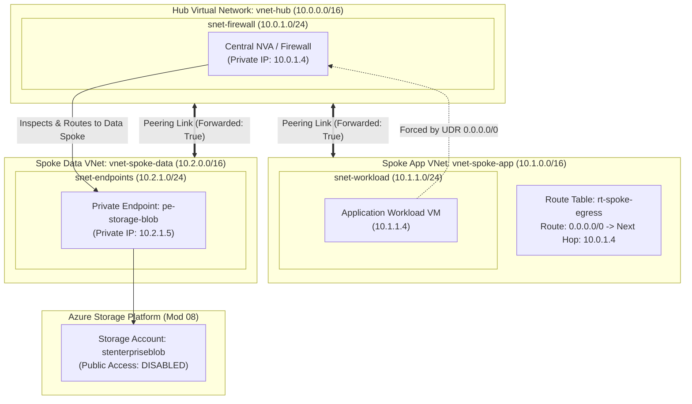

# Lab 06: Hub-and-Spoke VNet Peering, Custom UDRs & Azure Private Link

**Breadcrumbs:** [[--Index--|🏠 Index]] > [[13-Index - AZ-104|📘 AZ-104 Track]] > Projects > **Lab 06: Intersite Connectivity**

---

## 🎯 Lab Overview & Enterprise Scenario

In an enterprise cloud landing zone, allowing every virtual network to peer directly in an unmanaged mesh creates security sprawl and makes egress inspection impossible. The gold-standard cloud enterprise pattern is the **Hub-and-Spoke Topology**: a central Hub VNet hosts shared security appliances, VPN/ExpressRoute gateways, and firewalls, while isolated Spoke VNets host application workloads.

In this hands-on project, you will act as the Senior Network Architect. You will work primarily in the **Azure Portal GUI** to interconnect a central Hub VNet with two Spoke VNets via **Bidirectional VNet Peering**, enable inter-spoke transit via the critical **`Allow forwarded traffic`** flag, author a custom **Route Table (UDR)** forcing all egress traffic through a central Network Virtual Appliance (NVA), verify the resulting route hierarchy using **Effective Routes**, and deploy an **Azure Private Endpoint** to privately consume PaaS storage over the internal Microsoft backbone.

### Concepts Tackled & Seen in Action:
1. **Hub-and-Spoke Peering:** Establishing high-speed, non-transitive peering links across VNets using the Azure global optical WAN.
2. **Peering Transit Controls:** Configuring `Allow forwarded traffic` and understanding why default peering is strictly non-transitive.
3. **User Defined Routes (UDR):** Overriding Azure default system routes (`0.0.0.0/0 -> Internet`) with custom next-hop routing targeting firewalls.
4. **Effective Routes Inspection:** Auditing the hypervisor's calculated routing table on live VM network interfaces.
5. **Azure Private Link & Private Endpoints:** Exposing an Azure Storage Account through a private IP address on an internal subnet, bypassing public endpoints.

---

## 🏛️ Target Architecture & Visual Workflow



---

## ⚡ Phase 1: Fast Environment Bootstrap (Optional Azure CLI Script)

To save you 20 minutes of clicking through empty VNet creation wizards before performing the actual peering and routing tasks, run this script in **Azure Cloud Shell (Bash)**:

```bash
#!/usr/bin/env bash
# Fast Environment Bootstrap: Create Hub VNet, two Spoke VNets, and a demo Storage Account
set -euo pipefail

RG_NAME="rg-intersite-lab"
LOCATION="eastus"

echo "Creating Resource Group: ${RG_NAME} in ${LOCATION}..."
az group create --name "${RG_NAME}" --location "${LOCATION}" --tags Environment=Production

echo "Creating Hub VNet (10.0.0.0/16)..."
az network vnet create \
  --resource-group "${RG_NAME}" \
  --name "vnet-hub" \
  --address-prefixes "10.0.0.0/16" \
  --subnet-name "snet-firewall" \
  --subnet-prefixes "10.0.1.0/24"

echo "Creating Spoke App VNet (10.1.0.0/16)..."
az network vnet create \
  --resource-group "${RG_NAME}" \
  --name "vnet-spoke-app" \
  --address-prefixes "10.1.0.0/16" \
  --subnet-name "snet-workload" \
  --subnet-prefixes "10.1.1.0/24"

echo "Creating Spoke Data VNet (10.2.0.0/16)..."
az network vnet create \
  --resource-group "${RG_NAME}" \
  --name "vnet-spoke-data" \
  --address-prefixes "10.2.0.0/16" \
  --subnet-name "snet-endpoints" \
  --subnet-prefixes "10.2.1.0/24"

# Create Storage Account to use for Private Link target
STORAGE_NAME="stpe$(az rand --max 999999)"
echo "Creating Demo Storage Account: ${STORAGE_NAME}..."
az storage account create \
  --resource-group "${RG_NAME}" \
  --name "${STORAGE_NAME}" \
  --location "${LOCATION}" \
  --sku "Standard_LRS" \
  --allow-blob-public-access false

echo "Bootstrap complete! 3 VNets and Storage Account deployed. Open the Portal GUI."
```

---

## 🖥️ Phase 2: Core Hands-On Implementation (Azure Portal GUI - Step-by-Step)

### Task 1: Configure Bidirectional VNet Peering in Azure Portal
In this task, you will link the Hub VNet to both Spoke VNets. In modern Azure, configuring peering from one side can automatically establish the reverse link simultaneously.

#### A. Peer Hub to Spoke App
1. In the Azure Portal search bar, type `Virtual networks` and select `vnet-hub`.
2. Under **Settings** in the left navigation menu, click **Peerings**.
3. In the top action bar, click **+ Add**:
4. In the **Add peering** blade:
   * **This virtual network (vnet-hub):**
     * **Peering link name:** `peer-hub-to-spokeapp`.
     * **Traffic to remote virtual network:** `Allow (default)`.
     * **Traffic forwarded from remote virtual network:** Check **`Allow`** *(Critical: permits the spoke to forward traffic through the hub!)*.
     * **Virtual network gateway:** `None` (or Leave default).
   * **Remote virtual network (vnet-spoke-app):**
     * **Peering link name:** `peer-spokeapp-to-hub`.
     * **Subscription:** Select your practice subscription.
     * **Virtual network:** Select `vnet-spoke-app`.
     * **Traffic to remote virtual network:** `Allow (default)`.
     * **Traffic forwarded from remote virtual network:** Check **`Allow`**.
5. Click **Add**.

#### B. Peer Hub to Spoke Data
1. Still in `vnet-hub` > **Peerings**, click **+ Add**:
   * **This virtual network (vnet-hub):**
     * **Peering link name:** `peer-hub-to-spokedata`.
     * **Traffic forwarded from remote virtual network:** Check **`Allow`**.
   * **Remote virtual network (vnet-spoke-data):**
     * **Peering link name:** `peer-spokedata-to-hub`.
     * **Virtual network:** Select `vnet-spoke-data`.
     * **Traffic forwarded from remote virtual network:** Check **`Allow`**.
2. Click **Add**.
3. 👁️ **Visual Checkpoint:**
   * In the **Peerings** list of `vnet-hub`, inspect the **Peering status** column.
   * Both peerings must display **`Connected`** in green.
   * *The Architectural Takeaway:* `vnet-spoke-app` can talk to `vnet-hub`, and `vnet-spoke-data` can talk to `vnet-hub`. However, **`vnet-spoke-app` CANNOT talk to `vnet-spoke-data`** because peering is non-transitive!

---

### Task 2: Create a Custom Route Table (UDR) to Enforce Central Egress Inspection
In this task, you will force all traffic leaving the application spoke to route through the central NVA firewall (`10.0.1.4`) located in the Hub.

1. In the Azure Portal top search bar, type `Route tables` and select it.
2. Click **+ Create**:
   * **Resource group:** `rg-intersite-lab`.
   * **Region:** `East US`.
   * **Name:** `rt-spoke-egress`.
   * **Propagate gateway routes:** Leave set to `Yes`.
3. Click **Review + create**, then click **Create**.
4. Open the newly created `rt-spoke-egress` route table:
   * Under **Settings** in the left sidebar, click **Routes**.
   * In the top action bar, click **+ Add**:
     * **Route name:** `route-force-hub-firewall`.
     * **Destination type:** Select `IP Addresses`.
     * **Destination IP addresses/CIDR ranges:** Enter `0.0.0.0/0` *(Matches all IPv4 traffic)*.
     * **Next hop type:** Select **`Virtual appliance`**.
     * **Next hop IP address:** Enter `10.0.1.4` *(The private IP of the central firewall in the Hub)*.
     * Click **Add**.
5. Under **Settings**, click **Subnets**:
   * Click **+ Associate**.
   * **Virtual network:** Select `vnet-spoke-app`.
   * **Subnet:** Select `snet-workload`.
   * Click **OK**.
6. 👁️ **Visual Checkpoint:** In the **Subnets** blade of `rt-spoke-egress`, verify that `vnet-spoke-app / snet-workload` is associated. Azure's routing engine now intercepts all outbound packets from this subnet and delivers them to `10.0.1.4` instead of going directly to the public internet!

---

### Task 3: Deploy an Azure Private Endpoint in the Data Spoke VNet
In this task, you will eliminate public internet access to an Azure Storage account by binding it to a private IP inside `vnet-spoke-data`.

1. In the top search bar, type `Private endpoints` and select it.
2. In the top action bar, click **+ Create**:
3. **Basics tab:**
   * **Resource group:** `rg-intersite-lab`.
   * **Name:** `pe-storage-blob`.
   * **Region:** `East US`.
4. Click **Next: Resource >**:
   * **Connection method:** Select `Connect to an Azure resource in my directory`.
   * **Resource type:** Select `Microsoft.Storage/storageAccounts`.
   * **Resource:** Select the demo storage account created in Phase 1 (`stpeXXXXXX`).
   * **Target sub-resource:** Select **`blob`** *(Creates an endpoint for Blob storage)*.
5. Click **Next: Virtual Network >**:
   * **Virtual network:** Select `vnet-spoke-data`.
   * **Subnet:** Select `snet-endpoints (10.2.1.0/24)`.
   * **Private IP allocation:** Select `Dynamically allocate IP address`.
6. Click **Next: DNS >**:
   * **Integrate with private DNS zone:** Ensure **`Yes`** is checked.
   * **Private DNS Zone:** Notice Azure automatically targets `privatelink.blob.core.windows.net`.
7. Click **Review + create**, then click **Create**.
8. 👁️ **Visual Checkpoint:**
   * Open the newly deployed `pe-storage-blob` Private Endpoint.
   * In the **Overview** blade, look at the **Network interface** link and click it.
   * Observe the **Private IP address** assigned to the endpoint (e.g., `10.2.1.5`).
   * Open the `privatelink.blob.core.windows.net` Private DNS Zone created in your resource group: Observe that `stpeXXXXXX` has an `A` record resolving directly to `10.2.1.5`!

---

### Task 4: Configure Virtual Network Service Endpoints (Architectural Comparison with Private Link)

*Architectural Difference (AZ-104 Core):*
* **Service Endpoints:** Optimizes traffic routing across the Microsoft backbone to Azure services using public IP VIPs, securing the target service's firewall to allow only your subnet CIDR. Traffic never traverses the public internet, but the PaaS service continues using its public IP address.
* **Private Endpoints (Private Link):** Assigns a true private IP address from your local subnet to the PaaS resource, completely eliminating public IP exposure and enabling cross-premises access over VPN/ExpressRoute.

1. Enable Service Endpoint on Subnet:
   * In the Azure Portal, navigate to **Virtual networks** > `vnet-spoke-app`.
   * Under **Settings** in the left menu, click **Subnets**.
   * Click into `snet-workload`.
   * Scroll down to **Service endpoints**:
     * Under **Services**, select `Microsoft.Storage`.
   * Click **Save**.
2. Restrict Storage Account Firewall to Subnet:
   * Navigate to your practice Storage Account `stpeXXXXXX`.
   * In the left menu under **Security + networking**, click **Networking**.
   * Under **Public network access**, change from *Enabled from all networks* to:
     * **Enabled from selected virtual networks and IP addresses**.
   * Under **Virtual networks**, click **+ Add existing virtual network**:
     * **Virtual networks:** Select `vnet-spoke-app`.
     * **Subnets:** Select `snet-workload`.
     * Click **Add**.
   * Click **Save** at the top of the blade.
3. 👁️ **Visual Checkpoint:** Under the storage account **Networking** blade, `vnet-spoke-app / snet-workload` is listed under allowed virtual networks. Any client outside this subnet (or outside configured client IP exceptions) receives an `HTTP 403 Forbidden` error when accessing the storage account.

---

### Task 5: Gateway Transit & Remote Gateways in VNet Peering

In a hub-and-spoke topology with an on-premises VPN or ExpressRoute Gateway in the Hub, spoke VNets do not need their own expensive VPN gateways. Instead, spokes leverage **Gateway Transit**.

1. In the Azure Portal, open `vnet-hub` > **Settings** > **Peerings**.
2. Click on the peering link `peer-hub-to-spokeapp`.
3. Under **Virtual network gateway or Route Server**:
   * If a Virtual Network Gateway (`GatewaySubnet`) exists in the Hub, observe the radio buttons:
     * **Use this virtual network's gateway or Route Server** (Enables "Allow gateway transit" on the hub side).
4. Navigate to the Spoke side: Open `vnet-spoke-app` > **Settings** > **Peerings** > click `peer-spokeapp-to-hub`.
5. Under **Virtual network gateway or Route Server**:
   * Observe the setting: **Use the remote virtual network's gateway or Route Server**.
   * *Critical Rule:* A spoke VNet cannot enable "Use the remote virtual network's gateway" if the spoke already has its own VPN gateway deployed. A VNet can have either its own gateway OR use a remote gateway, never both!

---

---

## 🔗 Phase 3: Cross-Module Integration Task

### Integration: Auditing Effective Routes on a Workload Interface (Mod 05 + Mod 06)
To see how Azure resolves route precedence between Azure default routes and your custom UDR:

1. In the top search bar, type `Virtual machines` (or Network interfaces).
2. If you deployed a VM in `vnet-spoke-app`, navigate to its **Networking** blade.
3. Click on the VM's **Network Interface** link.
4. Under **Help** in the left sidebar, click on **Effective routes**:
5. 👁️ **Visual Checkpoint:** Review the calculated routing table:
   * **Source: Default:** `10.1.0.0/16` -> Next Hop: `Virtual network` (Direct intra-VNet communication).
   * **Source: VNet peering:** `10.0.0.0/16` -> Next Hop: `VNet peering` (Direct access to Hub).
   * **Source: User (UDR):** `0.0.0.0/0` -> Next Hop: **`10.0.1.4 (Virtual appliance)`**!
   * Notice that your custom UDR has a status of **Active**, overriding the Azure default system route for internet egress.

---

## 🔬 Phase 4: Verification & Validation Testing (Azure CLI / Cloud Shell)

Open Azure Cloud Shell to programmatically audit your peering and private endpoint configurations:

```bash
# Test 1: Verify Peering Status across All VNets
az network vnet peering list \
  --resource-group "rg-intersite-lab" \
  --vnet-name "vnet-hub" \
  --query "[].{PeeringName:name, RemoteVNet:remoteVirtualNetwork.id, Status:peeringState, ForwardedTraffic:allowForwardedTraffic}" \
  --output table

# Test 2: Verify Custom Route in Route Table
az network route-table route list \
  --resource-group "rg-intersite-lab" \
  --route-table-name "rt-spoke-egress" \
  --query "[].{Route:name, Prefix:addressPrefix, NextHop:nextHopType, NextHopIP:nextHopIpAddress}" \
  --output table

# Test 3: Inspect Private Endpoint IP Resolution via DNS
az network private-endpoint show \
  --resource-group "rg-intersite-lab" \
  --name "pe-storage-blob" \
  --query "{Name:name, Subnet:subnet.id, NIC:networkInterfaces[0].id}" \
  --output jsonc
```

---

## ⚠️ Phase 5: "See It in Action" Real-World Failure & Recovery Loop (AARF)

### Scenario: The Peering Forwarded Traffic Trap & Asymmetric Routing
* **The Architecture:** An enterprise deploys Spoke 1 (App) and Spoke 2 (Data) peered to a central Hub NVA.
* **The Assumption:** The engineer creates a UDR in Spoke 1 directing `10.2.0.0/16` to the Hub NVA (`10.0.1.4`), assuming packets will flow smoothly to Spoke 2.
* **The Failure Loop:**
  * Workloads in Spoke 1 attempt to query database endpoints in Spoke 2.
  * The connection drops with 100% packet loss.
  * Running Network Watcher Next Hop confirms the packet reached the Hub, but never emerged in Spoke 2.
* **The Root Cause:**
  * By default, VNet Peering links have **`allowForwardedTraffic` set to `false`**.
  * When the Hub receives a packet whose Source IP is Spoke 1 (`10.1.1.4`) and attempts to forward it to Spoke 2, the hypervisor detects that the packet did not originate from the Hub itself and **silently drops it!**
* **The Remediation via Portal GUI:**
  1. In the Portal, navigate to **Virtual networks** > `vnet-hub` > **Peerings**.
  2. Select the peering link `peer-hub-to-spokeapp`.
  3. Ensure the checkbox **`Allow traffic forwarded from remote virtual network`** is set to **`Enabled`**.
  4. Repeat on the Spoke side. Forwarded packets now traverse the hub without dropping.

---

## 🧹 Phase 6: Cost Optimization & Lab Teardown

Run the following cleanup command in Cloud Shell to delete all peering links, private endpoints, and lab VNets:

```bash
# Delete the entire Intersite Connectivity Lab Resource Group
az group delete --name "rg-intersite-lab" --yes --no-wait
```

---

## 🔬 Exam-Specific Gotchas & Speed Shortcuts (AZ-104 Reference)

* **VNet Peering Non-Transitivity Law:**
  * Peering between VNet A and VNet B, and between VNet B and VNet C does **NOT** allow VNet A to communicate with VNet C.
  * To route between A and C through B, you **must** deploy an NVA in VNet B, enable `allowForwardedTraffic = true` on both peerings, and configure UDRs in A and C pointing to the NVA private IP.
* **Gateway Transit Rules:**
  * Hub VNet must check: **`Allow gateway transit`** (or "Use this virtual network's gateway").
  * Spoke VNet must check: **`Use remote virtual network's gateway`**.
  * A VNet cannot use a remote gateway if it already has a gateway of its own.
  * Only **one** peering link on a VNet can have "Use remote gateway" enabled.
* **Service Endpoints vs Private Endpoints:**
  * **Service Endpoints:** Public IP maintained; traffic traverses Microsoft backbone; no on-premises VPN/ExpressRoute access; subnet-scoped authorization.
  * **Private Endpoints (Private Link):** Private IP assigned from subnet CIDR; completely disables public exposure; accessible from on-premises via VPN/ExpressRoute; requires Private DNS integration (`privatelink.blob.core.windows.net`).
* **Route Precedence Order (Longest Prefix Match):**
  1. Longest Prefix Match (most specific CIDR mask, e.g., `/28` over `/24`, `/24` over `/16`, `/16` over `/0`).
  2. If identical prefixes exist, priority is: **UDR (User Defined Route) ➔ BGP / ExpressRoute ➔ System Default Route**.

