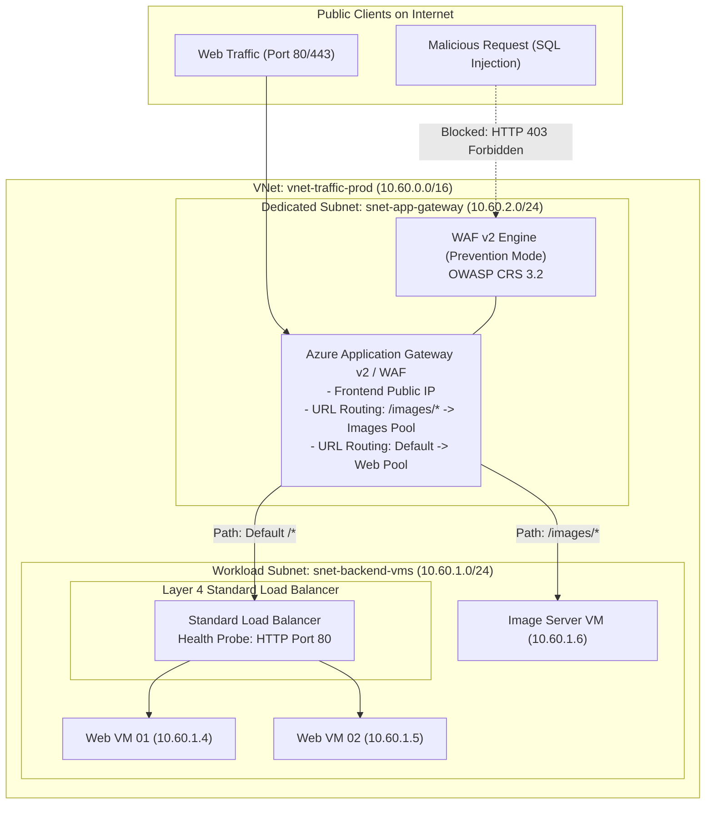

# Lab 07: Azure Standard Load Balancer, Application Gateway v2 & WAF Inspection

**Breadcrumbs:** [[--Index--|🏠 Index]] > [[13-Index - AZ-104|📘 AZ-104 Track]] > Projects > **Lab 07: Network Traffic**

---

## 🎯 Lab Overview & Enterprise Scenario

Enterprise web workloads require intelligent traffic distribution, high availability across datacenter availability zones, and perimeter web protection against malicious exploits (SQL injection, cross-site scripting). Azure provides two complementary regional traffic controllers: **Azure Load Balancer (Layer 4)** for ultra-low latency transport distribution, and **Azure Application Gateway (Layer 7)** for URL path routing, SSL termination, and Web Application Firewall (WAF) inspection.

In this hands-on project, you will act as the Senior Infrastructure Reliability Engineer. You will work primarily in the **Azure Portal GUI** to deploy an **Azure Standard Load Balancer**, configure health probes and load-balancing rules, provision an **Azure Application Gateway v2** inside a dedicated `/26` subnet, author **URL Path-Based Routing Rules** (`/images/*`), activate **WAF v2 in Prevention Mode**, and troubleshoot connectivity using **Network Watcher** diagnostic tools directly in the portal.

### Concepts Tackled & Seen in Action:
1. **Layer 4 vs. Layer 7 Ingress:** Contrasting packet hash forwarding (Load Balancer) with full HTTP reverse proxy routing (Application Gateway).
2. **Dedicated Subnet Architecture:** Understanding why Application Gateway v2 mandates an isolated subnet (`/26` or `/27`) containing zero other resources.
3. **URL Path-Based Routing:** Slicing traffic flows so that static assets (`/images/*`) route to dedicated storage/compute pools while API traffic routes to app instances.
4. **Web Application Firewall (WAF v2):** Enforcing OWASP Core Rule Set (CRS 3.2) inspection in `Prevention` mode to block malicious payloads at the cloud perimeter.
5. **Network Watcher Diagnostics:** Using the Portal's **IP Flow Verify** and **Next Hop** tools to audit packet filtering without SSH/RDP.

---

## 🏛️ Target Architecture & Visual Workflow



---

## ⚡ Phase 1: Fast Environment Bootstrap (Optional Azure CLI Script)

Run this optional script in **Azure Cloud Shell (Bash)** to deploy the baseline VNet and two lightweight Ubuntu web servers hosting demo HTML responses so you have real targets to load balance in the GUI:

```bash
#!/usr/bin/env bash
# Fast Environment Bootstrap: Create VNet with dedicated AppGW subnet and 2 test VMs
set -euo pipefail

RG_NAME="rg-traffic-lab"
LOCATION="eastus"

echo "Creating Resource Group: ${RG_NAME} in ${LOCATION}..."
az group create --name "${RG_NAME}" --location "${LOCATION}" --tags Environment=Production

echo "Creating Virtual Network with Backend and Dedicated AppGW subnets..."
az network vnet create \
  --resource-group "${RG_NAME}" \
  --name "vnet-traffic-prod" \
  --address-prefixes "10.60.0.0/16" \
  --subnet-name "snet-backend-vms" \
  --subnet-prefixes "10.60.1.0/24"

# Application Gateway v2 mandates a dedicated subnet containing NO OTHER RESOURCES
az network vnet subnet create \
  --resource-group "${RG_NAME}" \
  --vnet-name "vnet-traffic-prod" \
  --name "snet-app-gateway" \
  --address-prefixes "10.60.2.0/24"

echo "Bootstrap complete! Now proceed to the Azure Portal GUI tasks below."
```

---

## 🖥️ Phase 2: Core Hands-On Implementation (Azure Portal GUI - Step-by-Step)

### Task 1: Deploy & Configure Azure Standard Load Balancer in Portal GUI
In this task, you will create a Layer 4 Standard Load Balancer with an active health probe and load-balancing rule.

1. In the Azure Portal search bar, type `Load balancers` and select it.
2. In the top action bar, click **+ Create**:
3. **Basics tab:**
   * **Subscription:** Select your practice subscription.
   * **Resource group:** Select `rg-traffic-lab`.
   * **Name:** `lb-external-web`.
   * **Region:** Select `East US`.
   * **SKU:** Select **`Standard`** *(Mandatory for zone-redundancy and HA ports)*.
   * **Type:** Select **`Public`**.
   * **Tier:** Select `Regional`.
4. Click **Next: Frontend IP configuration >**:
   * Click **+ Add a frontend IP configuration**:
     * **Name:** `LoadBalancerFrontEnd`.
     * **IP version:** `IPv4`.
     * **IP type:** `IP address`.
     * **Public IP address:** Click **Create new** > Name: `pip-lb-web` (SKU: Standard, Tier: Regional).
     * Click **Add**.
5. Click **Next: Backend pools >**:
   * Click **+ Add a backend pool**:
     * **Name:** `BackendPool-Web`.
     * **Virtual network:** Select `vnet-traffic-prod`.
     * Click **Save**.
6. Click **Next: Inbound rules >**:
   * Under **Load balancing rules**, click **+ Add a load balancing rule**:
     * **Name:** `rule-http-80`.
     * **Frontend IP address:** Select `LoadBalancerFrontEnd`.
     * **Protocol:** `TCP`.
     * **Port:** `80`.
     * **Backend port:** `80`.
     * **Backend pool:** Select `BackendPool-Web`.
     * **Health probe:** Click **Create new**:
       * **Name:** `probe-http-port80`.
       * **Protocol:** `HTTP`.
       * **Port:** `80`.
       * **Path:** `/`.
       * **Interval:** `5` seconds.
       * Click **Save**.
     * **Session persistence:** `None` (Default 5-tuple hash).
     * **Idle timeout (minutes):** `4`.
     * **TCP Reset:** Check **Enable**.
     * **Floating IP:** Leave `Disabled`.
     * Click **Save**.
7. Click **Review + create**, then click **Create**.
8. 👁️ **Visual Checkpoint:** Open `lb-external-web` > inspect **Load balancing rules**. Observe how the frontend IP maps incoming port 80 traffic to the backend pool guided by the HTTP health probe.

---

### Task 2: Deploy Azure Application Gateway v2 with Path-Based Routing in GUI
Application Gateway operates at Layer 7, inspecting HTTP headers and request URLs to dispatch requests intelligently.

1. In the top search bar, type `Application gateways` and click **+ Create**:
2. **Basics tab:**
   * **Resource group:** `rg-traffic-lab`.
   * **Application gateway name:** `appgw-enterprise-prod`.
   * **Region:** `East US`.
   * **Tier:** Select **`WAF V2`** *(Enables Layer 7 routing and firewall inspection)*.
   * **Autoscaling:** Check **Enable autoscaling** (Minimum instances: `1`, Maximum instances: `3`).
   * **Virtual network:** Select `vnet-traffic-prod`.
   * **Subnet:** Select **`snet-app-gateway (10.60.2.0/24)`** *(Notice that only the dedicated subnet is selectable!)*.
3. Click **Next: Frontends >**:
   * **Frontend IP of type:** Select `Public`.
   * **Public IP address:** Click **Add new** > Name: `pip-appgw-prod`.
4. Click **Next: Backends >**:
   * Click **Add a backend pool**:
     * **Name:** `pool-general-web`.
     * Click **Add**.
   * Click **Add a backend pool** a second time:
     * **Name:** `pool-images-service`.
     * Click **Add**.
5. Click **Next: Configuration >**:
   * Under **Routing rules**, click **+ Add a routing rule**:
     * **Rule name:** `rule-path-based-routing`.
     * **Priority:** `100`.
     * **Listener tab:**
       * **Listener name:** `listener-http-port80`.
       * **Frontend IP:** Select `Public`.
       * **Protocol:** `HTTP`, **Port:** `80`.
     * **Backend targets tab:**
       * **Target type:** `Backend pool`.
       * **Backend target:** `pool-general-web`.
       * **Backend settings:** Click **Add new**:
         * **Backend settings name:** `setting-http-80`.
         * **Port:** `80`, **Protocol:** `HTTP`.
         * Click **Add**.
       * Under **Path-based rules**, click **+ Add a path-based rule**:
         * **Path:** `/images/*`.
         * **Target name:** `images-target`.
         * **Backend settings:** Select `setting-http-80`.
         * **Backend target:** Select **`pool-images-service`**!
         * Click **Add**.
     * Click **Add** to commit the routing rule.
6. Click **Review + create**, then click **Create**.
7. 👁️ **Visual Checkpoint:**
   * Open `appgw-enterprise-prod` once deployed.
   * In the left menu, select **Backend pools**. Observe the two distinct target pools.
   * Select **Rules** > click on `rule-path-based-routing`.
   * Observe how requests to `http://<Public-IP>/` flow to `pool-general-web`, while requests to `http://<Public-IP>/images/*` are diverted to `pool-images-service`.

---

### Task 3: Enforce Web Application Firewall (WAF v2) in Prevention Mode
1. In the left navigation of `appgw-enterprise-prod`, under **Security**, click **Web application firewall**.
2. Notice the current status displays **WAF policy**. Click on the policy name link (or create a new policy).
3. In the WAF Policy blade:
   * Under **Settings** in the left menu, click **Policy settings**.
   * **Policy mode:** Change from `Detection` to **`Prevention`** *(Crucial: Detection only logs attacks; Prevention actively terminates malicious connections with HTTP 403 Forbidden!)*.
   * Click **Save**.
4. In the left menu, click **Managed rules**:
   * Inspect the active rule set: **`Microsoft_DefaultRuleSet (version 2.1 / CRS 3.2)`**.
   * Expand the rule groups: Observe active protection for **SQL Injection (SQLI)**, **Cross-Site Scripting (XSS)**, and **Local File Inclusion (LFI)**.
5. 👁️ **Visual Checkpoint:** If an attacker sends an HTTP request containing `?id=1' OR '1'='1`, the WAF engine terminates the connection at the Azure edge and logs the attack into Log Analytics.

---

### Task 4: Troubleshoot Traffic Paths Using Azure Network Watcher in GUI
When packets drop unexpectedly, you can diagnose NSGs and routing tables directly in the portal without logging into servers.

1. In the top search bar, type `Network Watcher` and select it.
2. In the left menu under **Network diagnostic tools**, click **IP flow verify**:
   * **Target resource:** Select any test VM in `vnet-traffic-prod`.
   * **Protocol:** `TCP`.
   * **Direction:** `Inbound`.
   * **Local port:** `80`.
   * **Remote IP address:** Enter `8.8.8.8` (Simulating public internet traffic).
   * **Remote port:** `52110`.
   * Click **Verify IP flow**.
   * 👁️ **Visual Checkpoint:** The diagnostic result returns **`Access Allowed`** (or `Access Denied`), identifying the exact NSG rule name responsible for the decision!
3. In the left menu, click **Next hop**:
   * **Target resource:** Select your test VM.
   * **Destination IP address:** Enter `8.8.8.8`.
   * Click **Next hop**.
   * 👁️ **Visual Checkpoint:** Network Watcher displays: **`Next hop type: Internet`** (or `Virtual appliance`), allowing you to instantly prove whether a UDR route is active.

---

## 🔗 Phase 3: Cross-Module Integration Task

### Integration: Securing Public Traffic Ingress with Governance Locks (Mod 03 + Mod 07)
Application Gateways take 8–15 minutes to provision. Preventing accidental deletion is essential:

1. Open **Application gateways** > select `appgw-enterprise-prod`.
2. In the left menu, select **Locks**.
3. Click **+ Add**:
   * **Lock name:** `lock-appgw-prevent-deletion`.
   * **Lock type:** `Delete`.
   * Click **OK**.
4. 👁️ **Visual Checkpoint:** The ingress gateway is locked against accidental deletion. Even if an automated cleanup script executes, ARM protects the ingress gateway.

---

## 🔬 Phase 4: Verification & Validation Testing (Azure CLI / Cloud Shell)

Run these automated verification commands in Azure Cloud Shell to confirm load balancer and gateway states:

```bash
# Test 1: Query Load Balancer Health Probe and Rule Status
az network lb probe list \
  --resource-group "rg-traffic-lab" \
  --lb-name "lb-external-web" \
  --query "[].{Name:name, Protocol:protocol, Port:port, Path:requestPath, Interval:intervalInSeconds}" \
  --output table

# Test 2: Inspect Application Gateway v2 Frontend Public IP
APPGW_PIP=$(az network public-ip show --resource-group "rg-traffic-lab" --name "pip-appgw-prod" --query "ipAddress" -o tsv)
echo "Application Gateway Public IP: ${APPGW_PIP}"

# Test 3: Test HTTP Ingress via curl
curl -I "http://${APPGW_PIP}/" || true

# Test 4: Simulate SQL Injection attack against WAF
# WAF in Prevention Mode MUST return HTTP 403 Forbidden!
curl -I "http://${APPGW_PIP}/?query=1'%20OR%20'1'='1" || true
```

---

## ⚠️ Phase 5: "See It in Action" Real-World Failure & Recovery Loop (AARF)

### Scenario: The Application Gateway Subnet Co-Location Failure
* **The Architecture:** An engineer creates a VNet and attempts to deploy an Application Gateway v2 into the same subnet hosting backend virtual machines.
* **The Assumption:** The engineer assumes that subnets can freely mix compute workloads and gateway appliances.
* **The Failure Loop:**
  * During the creation wizard, the deployment fails with:
    `"Subnet /subscriptions/.../snet-backend-vms requires dedicated delegation and cannot contain other resources."`
  * If the engineer attempts to deploy a VM into an existing Application Gateway subnet, the VM provisioning fails.
* **The Root Cause:**
  * **Application Gateway v2 mandates a dedicated subnet containing ZERO other resources.**
  * The gateway provisions dynamic internal proxy instances inside this subnet that scale up and down automatically.
* **The Remediation via Portal GUI:**
  1. In the VNet, carve a dedicated subnet sized `/26` or `/27` named `snet-app-gateway`.
  2. Assign the Application Gateway exclusively to this dedicated subnet.
  3. Deploy virtual machines and databases into separate workload subnets.

---

## 🧹 Phase 6: Cost Optimization & Lab Teardown

Application Gateway v2 incurs hourly runtime charges. Execute this cleanup script immediately after completing your tests:

```bash
# 1. Remove the Resource Lock first
LOCK_ID=$(az lock list --resource-group "rg-traffic-lab" --query "[?name=='lock-appgw-prevent-deletion'].id" -o tsv)
if [ -n "${LOCK_ID}" ]; then
  az lock delete --ids "${LOCK_ID}"
fi

# 2. Delete the Traffic Lab Resource Group
az group delete --name "rg-traffic-lab" --yes --no-wait
```
