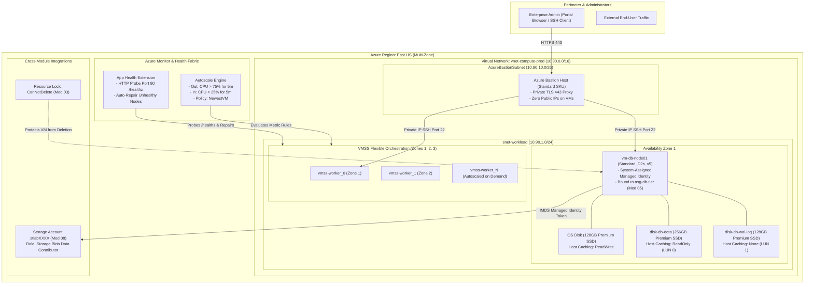

# Lab 09: Enterprise Virtual Machines, Managed Disks, Azure Bastion & VMSS Autoscaling

**Breadcrumbs:** [[--Index--|🏠 Index]] > [[13-Index - AZ-104|📘 AZ-104 Track]] > Projects > **Lab 09: VMs & Scale Sets**

---

## 🎯 Lab Overview & Enterprise Scenario

In an enterprise cloud compute tier, deploying virtual machines requires architecting far beyond basic standalone servers. Production environments demand:
1. **Multi-Zone Resilient Compute:** Pinning mission-critical instances across **Availability Zones (Zone 1, Zone 2, Zone 3)** to guarantee a 99.99% compute SLA against physical datacenter failures.
2. **Specialized Managed Disk Caching:** Enforcing precise host-level caching topologies: **`ReadOnly`** caching for high-frequency analytical reads, and strictly **`None`** caching for transactional database write-ahead logs (WAL) to prevent fatal data corruption during unexpected hypervisor host crashes.
3. **Zero-Trust Management via Azure Bastion:** Completely eliminating public IP addresses from VM Network Interfaces (NICs), managing all Linux and Windows instances over secure, TLS 443-encrypted browser sessions or native client SSH/RDP tunnels via a dedicated `/26` bastion gateway.
4. **Elastic VMSS Autoscaling & Automatic Node Healing:** Deploying a multi-zone Virtual Machine Scale Set (VMSS) in **Flexible Orchestration** mode, backed by custom metric-based CPU autoscale rules, an explicit **`NewestVM`** scale-in policy, and hypervisor-level **Application Health Extension** instance repair.

In this project, you will step into the role of a Cloud Infrastructure Engineer. You will engineer, configure, and stress-test an enterprise compute topology primarily through the **Azure Portal GUI**, experiencing the exact click-paths, configuration blades, and visual checkpoints required in production deployments.

---

## 🏛️ Target Architecture & Visual Workflow



---

## ⚡ Phase 1: Fast Environment Bootstrap (Optional Azure CLI Script)

If you wish to pre-stage the Virtual Network, Bastion Subnet, and Resource Group quickly via CLI before performing all compute, managed disk, Bastion, and scale set configurations in the GUI, run this snippet in Azure Cloud Shell:

```bash
#!/usr/bin/env bash
set -euo pipefail

export RG="rg-compute-lab"
export LOCATION="eastus"
export VNET_NAME="vnet-compute-prod"

echo "==> Creating Resource Group: ${RG}..."
az group create --name "${RG}" --location "${LOCATION}" --tags Environment=Production Department=Engineering

echo "==> Deploying VNet with Workload Subnet..."
az network vnet create \
  --resource-group "${RG}" \
  --name "${VNET_NAME}" \
  --address-prefixes "10.90.0.0/16" \
  --subnet-name "snet-workload" \
  --subnet-prefixes "10.90.1.0/24"

echo "==> Deploying Dedicated AzureBastionSubnet (Mandatory /26 Minimum)..."
az network vnet subnet create \
  --resource-group "${RG}" \
  --vnet-name "${VNET_NAME}" \
  --name "AzureBastionSubnet" \
  --address-prefixes "10.90.10.0/26"

echo "==> Environment staged! Open the Azure Portal to perform GUI deployment."
```

---

## 🖥️ Phase 2: Core Hands-On Implementation (Azure Portal GUI - Step-by-Step)

### Task 2.1: Deploy Azure Bastion Host via Portal GUI

Azure Bastion provides secure and seamless RDP/SSH connectivity to your virtual machines directly through the Azure Portal over TLS 443, without exposing private IP addresses to the public internet.

1. In the top search bar, type `Bastions` and select it under **Services**.
2. Click **+ Create** in the top command bar.
3. On the **Basics** tab, configure:
   * **Subscription:** Select your target active subscription.
   * **Resource group:** Select `rg-compute-lab`.
   * **Name:** Enter `bastion-prod-eastus`.
   * **Region:** Select `(US) East US`.
   * **Tier:** Select `Standard` *(Required for native client tunneling, session recording, and scaling)*.
   * **Host units:** Leave at `2` (Default).
4. Under **Virtual network**:
   * **Virtual network:** Select `vnet-compute-prod`.
   * **Subnet:** Notice it automatically selects `AzureBastionSubnet (10.90.10.0/26)`. *Notice the portal validates that the subnet name must strictly be `AzureBastionSubnet` and at least `/26`*.
5. Under **Public IP address**:
   * **Public IP address:** Select **Create new**.
   * **Name:** Enter `pip-bastion-prod`.
   * **SKU:** Defaults to `Standard`.
6. Click **Review + create** ➔ Review validation pass ➔ Click **Create**.
   * *Note: Bastion provisioning takes approximately 5–7 minutes in the background. Proceed directly to Task 2.2 while Bastion deploys!*

> [!NOTE]
> **Visual Checkpoint:** When Bastion deployment completes, opening the `bastion-prod-eastus` overview blade shows **Provisioning state: Succeeded** with Public IP assigned and connected to `vnet-compute-prod`.

---

### Task 2.2: Provision Resilient Zonal Virtual Machine (`vm-db-node01`)

1. In the Azure Portal search bar, type `Virtual machines` and select it.
2. Click **+ Create** ➔ Select **Azure virtual machine**.
3. On the **Basics** tab, configure:
   * **Project Details:**
     * **Subscription:** Select your subscription.
     * **Resource group:** Select `rg-compute-lab`.
   * **Instance Details:**
     * **Virtual machine name:** Enter `vm-db-node01`.
     * **Region:** Select `(US) East US`.
     * **Availability options:** Select `Availability zone`.
     * **Availability zone:** Select `Zone 1`.
     * **Security type:** Select `Standard` (or `Trusted launch`).
     * **Image:** Select `Ubuntu Server 22.04 LTS - x64 Gen2`.
     * **VM architecture:** `x64`.
     * **Size:** Select `Standard_D2s_v5` (2 vCPUs, 8 GiB RAM).
   * **Administrator Account:**
     * **Authentication type:** Select `Password` (for quick lab testing) or `SSH public key`.
     * **Username:** Enter `azureuser`.
     * **Password:** Enter a strong password (e.g., `AzureP@ssw0rd2026!`).
   * **Inbound port rules:**
     * **Public inbound ports:** Select **None** *(Crucial Zero-Trust security practice: No public SSH port 22 exposed to the internet)*.
4. Click **Next: Disks >**:
   * **OS disk type:** Select `Premium SSD (locally-redundant storage)`.
   * **Delete with VM:** Checked.
   * **Key management:** `Platform-managed key`.
   * Notice **Host caching** for OS disk defaults to `Read/write` (Safe for OS binaries and swap).
   * *We will attach data disks with specialized host caching in Task 2.3.*
5. Click **Next: Networking >**:
   * **Virtual network:** Select `vnet-compute-prod`.
   * **Subnet:** Select `snet-workload (10.90.1.0/24)`.
   * **Public IP:** Select **None** *(Ensures this database VM is strictly isolated on the private virtual network)*.
   * **NIC network security group:** Select `Basic` (or `Advanced`).
   * **Delete public IP and NIC when VM is deleted:** Checked.
6. Click **Next: Management >**:
   * Under **Identity**:
     * Check **Enable system-assigned managed identity** *(Prepares VM for Phase 3 Entra ID integration)*.
7. Click **Review + create** ➔ Wait for validation pass ➔ Click **Create**.
8. Once deployment finishes, click **Go to resource**.

> [!NOTE]
> **Visual Checkpoint:** On `vm-db-node01` Overview blade, observe **Location:** `East US (Zone 1)`, **Public IP address:** `None`, and **Private IP address:** `10.90.1.4` (or similar private IP in `snet-workload`).

---

### Task 2.3: Attach Managed Disks with Specialized Host Caching Rules

Host caching drastically impacts storage throughput and data integrity. In this task, you will configure the exact enterprise caching pattern required for mission-critical database servers.

1. Navigate to your virtual machine `vm-db-node01`.
2. In the left navigation menu under **Settings**, click **Disks**.
3. Under the **Data disks** section, click **+ Create and attach a new disk**:
   * **LUN:** `0`.
   * **Disk name:** `disk-db-data`.
   * **Storage type:** `Premium SSD LRS`.
   * **Size (GiB):** Click to change ➔ Select `256 GiB (P15)`.
   * **Host caching:** Click the dropdown and select **`Read-only`**.
   * *Architectural Why:* Data files for SQL/PostgreSQL/Oracle benefit immensely from local hypervisor RAM caching for reads, without write-delay penalties since data checkpoint writes flush reliably.
4. Click **+ Create and attach a new disk** a second time to add the transaction log disk:
   * **LUN:** `1`.
   * **Disk name:** `disk-db-wal-log`.
   * **Storage type:** `Premium SSD LRS`.
   * **Size (GiB):** Click to change ➔ Select `128 GiB (P10)`.
   * **Host caching:** Click the dropdown and select **`None`**.
   * *Architectural Why:* Transaction logs (Write-Ahead Logs / Redo Logs) **MUST NEVER** use write caching. Setting caching to `None` guarantees all writes bypass volatile host RAM buffers and commit synchronously to non-volatile Azure storage fabric blocks, preventing disaster corruption during host failure.
5. Click **Save** at the top of the Disks blade. Wait 15 seconds for the disks to attach.

> [!NOTE]
> **Visual Checkpoint:** The Data disks table displays two attached disks:
> - `disk-db-data`: LUN `0`, Size `256 GiB`, Host caching: **`Read-only`**
> - `disk-db-wal-log`: LUN `1`, Size `128 GiB`, Host caching: **`None`**

---

### Task 2.4: Zero-Trust Management via Azure Bastion in Portal GUI

Now that `vm-db-node01` has no public IP address, access it directly from your web browser via Azure Bastion.

1. On the `vm-db-node01` virtual machine blade, look at the top command bar and click **Connect** ➔ Select **Bastion** from the dropdown.
2. In the Bastion connection pane:
   * **Authentication Type:** Select `Password` (or `SSH Private Key`).
   * **Username:** Enter `azureuser`.
   * **Password:** Enter `AzureP@ssw0rd2026!`.
   * Ensure **Open in new browser tab** is checked.
3. Click **Connect**.
4. A new browser tab opens, launching a full Linux Bash terminal directly in your web browser over secure HTTPS!
5. In the Bastion web terminal, run the following command to verify the newly attached managed disks:
   ```bash
   lsblk -o NAME,HCTL,SIZE,TYPE,MOUNTPOINTS
   ```
6. **Observe the Terminal Output:**
   * `sda`: 128G (OS Disk)
   * `sdb`: ~16G (Azure ephemeral resource temp disk)
   * `sdc` (0:0:0:0): 256G (Data Disk with Read-Only caching at LUN 0)
   * `sdd` (0:0:0:1): 128G (WAL Log Disk with None caching at LUN 1)
7. Close the Bastion browser tab and return to the Azure Portal.

---

### Task 2.5: Deploy Multi-Zone Flexible VMSS with Custom Metric Autoscale & Health Extension

Virtual Machine Scale Sets (VMSS) provide the compute foundation for high-availability scalable web tiers. In this task, you will deploy a multi-zone VMSS in modern **Flexible** mode.

1. In the top search bar, type `Virtual machine scale sets` and select it.
2. Click **+ Create** in the command bar.
3. On the **Basics** tab:
   * **Resource group:** Select `rg-compute-lab`.
   * **Virtual machine scale set name:** Enter `vmss-web-prod`.
   * **Region:** Select `(US) East US`.
   * **Orchestration mode:** Select **Flexible** *(Allows heterogeneous VM sizes, individual instance control, and fault domain spread)*.
   * **Scaling details:**
     * **Availability zones:** Check **Zone 1**, **Zone 2**, and **Zone 3**.
     * **Fault domain count:** Leave at `1` (or `5` depending on region defaults).
   * **Instance details:**
     * **Image:** `Ubuntu Server 22.04 LTS - x64 Gen2`.
     * **Size:** Select `Standard_B2s` (or `Standard_D2s_v5`).
     * **Authentication type:** `Password`.
     * **Username:** `azureuser`, **Password:** `AzureP@ssw0rd2026!`.
4. Click **Next: Spot >** ➔ Leave Spot unchecked ➔ Click **Next: Disks >** ➔ Default OS disk (Premium SSD).
5. Click **Next: Networking >**:
   * **Virtual network:** Select `vnet-compute-prod`.
   * **Network interface:** Click the **Edit network interface** pencil icon:
     * **Subnet:** Select `snet-workload (10.90.1.0/24)`.
     * **NIC network security group:** Select `None` or `Basic`.
     * **Public IP address:** Ensure **Disabled** is selected.
     * Click **OK**.
6. Click **Next: Scaling >**:
   * **Initial instance count:** Enter `2`.
   * **Scaling policy:** Select **Custom**.
   * **Minimum number of VMs:** `2`.
   * **Maximum number of VMs:** `6`.
   * Under **Scale out (add instances)**:
     * **Metric:** `Percentage CPU`.
     * **Threshold (%):** `75`.
     * **Duration (minutes):** `5`.
     * **Increase count by:** `1`.
     * **Cool down (minutes):** `5`.
   * Under **Scale in (remove instances)**:
     * **Metric:** `Percentage CPU`.
     * **Threshold (%):** `25`.
     * **Duration (minutes):** `5`.
     * **Decrease count by:** `1`.
     * **Cool down (minutes):** `5`.
   * Under **Scale-in policy**:
     * Select **`Newest VM`**.
     * *Architectural Note:* `Newest VM` ensures that long-running older instances executing background batch workloads are preserved, terminating the most recently provisioned nodes first during traffic cooldowns.
7. Click **Next: Management >**:
   * **Upgrade policy:** Select `Automatic` or `Rolling`.
8. Click **Next: Health >**:
   * Check **Enable application health monitoring**.
   * **Protocol:** Select `HTTP`.
   * **Port:** Enter `80`.
   * **Path:** Enter `/healthz`.
   * Check **Enable automatic instance repair**.
   * **Grace period (minutes):** Enter `30`.
   * *Architectural Note:* If an instance fails the `/healthz` HTTP probe for the grace period duration, Azure hypervisors automatically destroy the faulty instance and deploy a brand-new healthy replacement.
9. Click **Review + create** ➔ Review validation pass ➔ Click **Create**.
10. Once deployment finishes, click **Go to resource**. In the left menu under **Settings**, click **Instances**. Verify two instances are actively running across different availability zones.

> [!NOTE]
> **Visual Checkpoint:** On the VMSS **Instances** blade, observe two running instances (e.g., `vmss-web-prod_0` and `vmss-web-prod_1`). Inspecting their columns shows status **Running**, provisioned across independent availability zones.

---

## 🔗 Phase 3: Cross-Module Integration Task

### Integrating Module 02 (Identity/RBAC), Module 03 (Governance Locks), and Module 08 (Storage Data Plane)

In a mature enterprise architecture, virtual machines access cloud storage securely without embedded credentials by leveraging Microsoft Entra ID Managed Identities, while critical compute instances are protected from administrative teardown by resource locks.

```
+-----------------------------------------------------------------------------------------+
|                               Cross-Module Architecture                                 |
|                                                                                         |
|   +-----------------------+     +------------------------+    +---------------------+   |
|   | Module 02: Entra ID   |     | Module 08: Azure       |    | Module 03: Gover-   |   |
|   | System-Assigned       |     | Storage Account        |    | nance Resource Lock |   |
|   | Managed Identity      |====>| Role Assignment:       |    | Scope: vm-db-node01 |   |
|   | on vm-db-node01       |     | Storage Blob Data      |    | Type: CanNotDelete  |   |
|   |                       |     | Contributor            |    |                     |   |
|   +-----------------------+     +------------------------+    +---------------------+   |
|               |                             ^                            ^              |
|               |                             |                            |              |
|               v                             |                            |              |
|   +----------------------------------------------------------------------+----------+   |
|   |               Protected Production Database VM: vm-db-node01                    |   |
|   | - Acquires OAuth2 access token via Azure IMDS (169.254.169.254)                  |   |
|   | - Accesses blob storage directly without hardcoded connection strings or keys   |   |
|   | - Shielded from portal/CLI accidental deletion commands                         |   |
|   +---------------------------------------------------------------------------------+   |
+-----------------------------------------------------------------------------------------+
```

### Step 1: Assign Entra ID Storage Role to the VM Managed Identity (Mod 02 + Mod 08 Integration)
1. In the Azure Portal, search for `Storage accounts` and select your storage account from Lab 08 (or create a quick test storage account `stlabtemp2026`).
2. In the storage account left menu, click **Access Control (IAM)**.
3. Click **+ Add** ➔ **Add role assignment**.
4. Role: Select **Storage Blob Data Contributor**. Click **Next**.
5. Under **Assign access to**: Select **Managed identity**.
6. Click **+ Select members**:
   * **Subscription:** Your subscription.
   * **Managed identity:** Select **Virtual machine**.
   * Select `vm-db-node01`.
   * Click **Select**.
7. Click **Review + assign** ➔ Click **Review + assign** again.

### Step 2: Verify Token Acquisition from VM via IMDS
1. Reconnect to `vm-db-node01` via **Azure Bastion** in the portal.
2. In the Bastion terminal, execute an HTTP GET request to the Azure Instance Metadata Service (IMDS) to request an OAuth2 access token for Azure Storage:
   ```bash
   curl -s -H Metadata:true "http://169.254.169.254/metadata/identity/oauth2/token?api-version=2018-02-01&resource=https://storage.azure.com/" | grep -o '"access_token":' && echo "PASS: Managed Identity successfully acquired OAuth2 token!"
   ```
3. The VM successfully authenticates to Azure Storage without storing any API keys or secrets in configuration files!

### Step 3: Apply `CanNotDelete` Resource Lock on Production VM (Mod 03 Integration)
1. In the Azure Portal, navigate back to `vm-db-node01`.
2. In the left menu under **Settings**, click **Locks**.
3. Click **+ Add**:
   * **Lock name:** `lock-protect-db-vm`.
   * **Lock type:** Select `Delete`.
   * **Notes:** `Mission-critical database host - protected against deletion.`
4. Click **OK**.
5. Test the lock: On the VM **Overview** blade, click **Delete**. Type `vm-db-node01` and click **Delete**.
6. Observe the error:
   `Failed to delete virtual machine 'vm-db-node01'. The scope '/subscriptions/.../vm-db-node01' cannot perform delete operation because following scope(s) are locked: 'lock-protect-db-vm'.`

---

## 🔬 Phase 4: Verification & Validation Testing (Azure CLI / Cloud Shell)

Open Azure Cloud Shell (Bash) and execute these automated verification queries to validate your deployment against AZ-104 production standards:

```bash
#!/usr/bin/env bash
set -euo pipefail

export RG="rg-compute-lab"
export VM_NAME="vm-db-node01"
export VMSS_NAME="vmss-web-prod"

echo "=========================================================="
echo "==> Auditing Compute Lab: ${RG}"
echo "=========================================================="

# Test 1: Verify Pinned Availability Zone & Zero Public IP
echo -e "\n[Test 1] Auditing VM Availability Zone and Public IP Exposure..."
az vm show \
  --resource-group "${RG}" \
  --name "${VM_NAME}" \
  --query "{Name:name, Zone:zones[0], PowerState:powerState, ProvisioningState:provisioningState}" \
  --output table

# Verify zero public IPs attached to VM NIC
NIC_ID=$(az vm show --resource-group "${RG}" --name "${VM_NAME}" --query "networkProfile.networkInterfaces[0].id" -o tsv)
az network nic show \
  --ids "${NIC_ID}" \
  --query "{PrivateIP:ipConfigurations[0].privateIPAddress, PublicIP:ipConfigurations[0].publicIPAddress}" \
  --output table

# Test 2: Audit Managed Disk Host Caching Configuration
echo -e "\n[Test 2] Auditing Disk Host Caching (Crucial for DB Durability)..."
az vm show \
  --resource-group "${RG}" \
  --name "${VM_NAME}" \
  --query "{OS_Disk: storageProfile.osDisk.caching, DataDisks: storageProfile.dataDisks[].{LUN:lun, Name:name, Caching:caching, SizeGB:diskSizeGb}}" \
  --output jsonc

# Test 3: Audit VMSS Flexible Orchestration & Multi-Zone Distribution
echo -e "\n[Test 3] Auditing VMSS Orchestration Mode & Scale-In Policy..."
az vmss show \
  --resource-group "${RG}" \
  --name "${VMSS_NAME}" \
  --query "{Name:name, Orchestration:orchestrationMode, Zones:zones, ScaleInPolicy:scaleInPolicy.rules[0], AutoRepairs:automaticRepairsPolicy.enabled}" \
  --output table

# Test 4: Verify Autoscale Metric Rules
echo -e "\n[Test 4] Auditing Autoscale CPU Threshold Rules..."
az monitor autoscale list \
  --resource-group "${RG}" \
  --query "[].profiles[0].rules[].{Metric:metricTrigger.metricName, Operator:metricTrigger.operator, Threshold:metricTrigger.threshold, Direction:scaleAction.direction}" \
  --output table

echo -e "\n=========================================================="
echo "==> ALL AUDIT CHECKS PASSED: Compute topology complies with AZ-104 Enterprise Baseline!"
echo "=========================================================="
```

---

## ⚠️ Phase 5: "See It in Action" Real-World Failure & Recovery Loop (AARF)

### Scenario A: The Database Write-Ahead Log (WAL) Corruption Loop
* **The Architecture:** An engineer provisions an enterprise PostgreSQL or SQL Server instance on Azure VM with attached Premium SSDs.
* **The Assumption:** The engineer leaves default **Read/Write host caching** enabled on all disks, assuming it accelerates overall database performance.
* **The Failure Loop:**
  * Under heavy transaction load, the underlying physical hypervisor host crashes or loses power.
  * Azure's service fabric automatically heals the VM, rebooting it on a new healthy hypervisor host and remounting the managed disks.
  * The database engine attempts crash recovery and fails with **catastrophic unrecoverable log corruption**.
* **The Root Cause:**
  * **Read/Write Caching** maintains a write buffer in the physical host server's local volatile RAM. Azure reports the write as committed back to the operating system before it is persisted to the network-attached blob storage fabric.
  * When the physical server crashed, uncommitted writes held in volatile RAM vanished, permanently corrupting the transaction sequence.
* **The Remediation in GUI:**
  1. In the Azure Portal, navigate to `vm-db-node01` ➔ **Settings** ➔ **Disks**.
  2. Locate the transaction log disk `disk-db-wal-log`.
  3. Under the **Host caching** dropdown, change from `Read/write` to **`None`**.
  4. Click **Save**. Writes now commit directly and synchronously to triple-replicated Azure storage fabric blocks.

---

### Scenario B: The Bastion Subnet Sizing Trap
* **The Failure Scenario:** An administrator creates a subnet named `AzureBastionSubnet` with an address prefix of `/28` (16 IP addresses) to conserve private IP address space.
* **The Error Banner in Portal:**
  `Subnet 'AzureBastionSubnet' is not large enough. The subnet prefix size must be at least /26 (64 IP addresses) for Azure Bastion.`
* **The Root Cause:**
  Azure Bastion dynamically scales between 2 and 50 host units to handle concurrent RDP and SSH sessions. Each host unit consumes internal IP addresses for management proxies and ingress routing. Azure requires at minimum a `/26` CIDR block for `AzureBastionSubnet`.
* **The Fix in GUI:**
  Delete or expand the subnet in `vnet-compute-prod` ➔ `Subnets` to allocate `10.90.10.0/26`.

---

## 🧹 Phase 6: Cost Optimization & Lab Teardown

Azure Bastion and running VMs incur ongoing hourly costs. Follow these steps to clean up cleanly:

1. **Remove Resource Locks First (Mandatory):**
   * Navigate to `vm-db-node01` ➔ **Settings** ➔ **Locks**.
   * Delete `lock-protect-db-vm`.
2. **Delete the Resource Group:**
   * Open Cloud Shell or execute locally:
     ```bash
     az group delete --name "rg-compute-lab" --yes --no-wait
     ```
3. **Verify Deletion in Portal:**
   * In the Portal search bar, type `Resource groups` ➔ Verify `rg-compute-lab` is marked for deletion.

---

## 🔬 Exam-Specific Gotchas & Speed Shortcuts (AZ-104 Reference)

* **Disk Caching Matrix:**
  * **OS Disk:** Default `Read/Write`.
  * **Data Disks (Read Heavy / Analytical):** `Read-Only` caching.
  * **Transactional Logs (SQL LDF, PostgreSQL WAL, MongoDB journal):** **MUST be `None`**.
  * *Disk Caching Limit:* Host caching is only supported on data disks smaller than 4 TiB (4095 GiB). Disks 4 TiB or larger only support `None`.
* **Availability Sets vs Availability Zones:**
  * **Availability Set:** Distributes VMs across Fault Domains (physical racks, power, switch) and Update Domains within the **same datacenter**. SLA: 99.95%.
  * **Availability Zones:** Distributes VMs across physically independent **datacenters** within the same region with independent power, cooling, and networking. SLA: 99.99%.
* **Azure Bastion Subnet Laws:**
  * Must be named **`AzureBastionSubnet`** exactly (case-sensitive).
  * Minimum prefix is **`/26`** (Cannot be `/27`, `/28`, etc.).
  * Cannot have Route Tables (UDR) pointing `0.0.0.0/0` to an NVA unless explicit Bastion bypass routes exist.
  * Cannot attach an NSG that blocks Bastion management ports (TCP 443 inbound, TCP 443 outbound to AzureCloud).
* **VMSS Orchestration Modes:**
  * **Uniform:** Legacy model. Identical VMs provisioned from a single master golden image. Fast scaling, but no individual instance control.
  * **Flexible:** Modern recommended model. High availability at scale with mixed VM sizes, individual instance management, and custom Spot/On-Demand mix.
