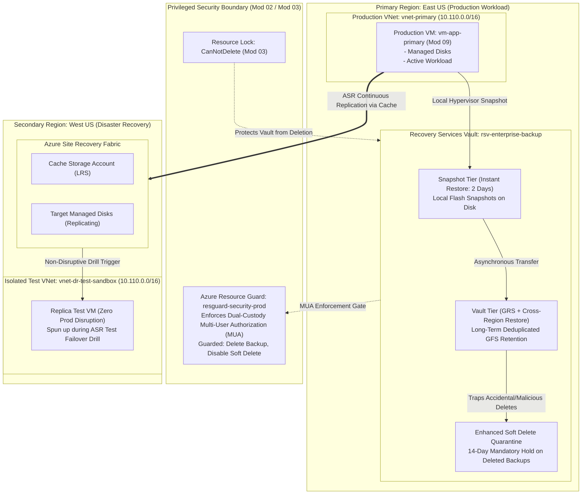

# Lab 11: Azure Backup GFS, Enhanced Soft Delete, Resource Guard MUA & ASR Test Failover

**Breadcrumbs:** [[--Index--|🏠 Index]] > [[13-Index - AZ-104|📘 AZ-104 Track]] > Projects > **Lab 11: Data Protection & DR**

---

## 🎯 Lab Overview & Enterprise Scenario

In an enterprise environment, data protection and disaster recovery (DR) form the final line of defense against both catastrophic regional datacenter outages and malicious ransomware extortion campaigns. Enterprise business continuity requires:
1. **Multi-Tiered GFS Retention & Rapid Instant Restore:** Architecting a Grandfather-Father-Son (GFS) backup lifecycle that leverages local 2-day **Instant Restore snapshots** for near-instant zero-downtime operational recoveries, backed by long-term compressed vault retention.
2. **Cross-Region Restore (CRR) Resilience:** Configuring a Recovery Services Vault with Geo-Redundant Storage (GRS) and Cross-Region Restore, allowing workload recovery in secondary paired regions even when primary Azure control planes are offline.
3. **Ransomware Defense with Enhanced Soft Delete:** Ensuring deleted backup items are automatically retained in a 14-day immutable quarantine recycle bin.
4. **Multi-User Authorization (MUA) via Azure Resource Guard:** Enforcing dual-custody authorization so that a compromised subscription Owner cannot unilaterally disable soft delete or delete backup archives without explicit authorization from an independent security custodian.
5. **Non-Disruptive Azure Site Recovery (ASR) Test Failovers:** Orchestrating automated disaster recovery drills into isolated test virtual networks without halting active production block-level replication or causing IP collisions.

In this project, you will step into the shoes of an Enterprise Business Continuity & Disaster Recovery (BCDR) Architect. You will engineer and validate these capabilities primarily through the **Azure Portal GUI**, experiencing the exact click-paths, configuration blades, and visual checkpoints required in production deployments.

---

## 🏛️ Target Architecture & Visual Workflow



---

## ⚡ Phase 1: Fast Environment Bootstrap (Optional Azure CLI Script)

If you prefer to pre-stage the Resource Group, Virtual Network, and demo Virtual Machine via automation before configuring all backup policies, soft delete, Resource Guard, and ASR in the GUI, run this snippet in Azure Cloud Shell:

```bash
#!/usr/bin/env bash
set -euo pipefail

export RG="rg-dataprotection-lab"
export LOCATION="eastus"
export VM_NAME="vm-app-primary"

echo "==> Creating Resource Group: ${RG}..."
az group create --name "${RG}" --location "${LOCATION}" --tags Environment=Production Department=SecOps

echo "==> Creating Production Virtual Network..."
az network vnet create \
  --resource-group "${RG}" \
  --name "vnet-primary" \
  --address-prefixes "10.110.0.0/16" \
  --subnet-name "snet-workload" \
  --subnet-prefixes "10.110.1.0/24"

echo "==> Deploying Demo Virtual Machine to Protect..."
az vm create \
  --resource-group "${RG}" \
  --name "${VM_NAME}" \
  --image "Ubuntu2204" \
  --size "Standard_B2s" \
  --vnet-name "vnet-primary" \
  --subnet "snet-workload" \
  --public-ip-address "" \
  --admin-username "azureuser" \
  --generate-ssh-keys

echo "==> Bootstrap Complete! Workload VM: ${VM_NAME}"
echo "==> Open Azure Portal to begin GUI configuration."
```

---

## 🖥️ Phase 2: Core Hands-On Implementation (Azure Portal GUI - Step-by-Step)

### Task 2.1: Provision Recovery Services Vault & Enable Cross-Region Restore (CRR)

*Crucial Architecture Law:* Storage redundancy (LRS vs GRS) and Cross-Region Restore (CRR) **MUST** be configured before protecting any backup items. Once items are registered, storage redundancy cannot be altered without unprotecting all workloads!

1. In the Azure Portal search bar, type `Recovery Services vaults` and select it.
2. Click **+ Create** in the top command bar.
3. On the **Basics** tab:
   * **Subscription:** Select your target active subscription.
   * **Resource group:** Select `rg-dataprotection-lab` (or create new).
   * **Vault name:** Enter `rsv-enterprise-backup`.
   * **Region:** Select `(US) East US`.
4. Click **Review + create** ➔ Review validation pass ➔ Click **Create**.
5. Once deployment completes, click **Go to resource**.
6. Configure Storage Redundancy & Cross-Region Restore:
   * In the left navigation menu under **Settings**, click **Properties**.
   * Under the **Backup Configuration** section, click **Update**.
   * **Storage replication type:** Select **Geo-redundant**.
   * **Cross Region Restore:** Select **Enable**.
     * *Architectural Note:* Cross-Region Restore (CRR) allows you to restore backup recovery points in the Azure paired secondary region (West US) at any time—even when the primary East US region is completely healthy, enabling disaster recovery audits and drill validations!
   * Click **Save** at the bottom of the blade.

> [!NOTE]
> **Visual Checkpoint:** On the **Properties** blade under **Backup Configuration**, verify **Storage replication type** is `Geo-redundant` and **Cross Region Restore** states `Enabled`.

---

### Task 2.2: Configure GFS Backup Policy with Instant Restore Snapshots

1. In the vault left navigation menu under **Manage**, click **Backup policies**.
2. Click **+ Add** in the command bar ➔ Select **Azure Virtual Machine**.
3. In the **Create policy** blade, configure:
   * **Policy sub-type:** Select **Enhanced** (or **Standard**).
     * *Enhanced Policy Benefits:* Supports multiple backups per day, up to 30 days of Instant Restore snapshots, and supports Trusted Launch VMs and Ultra Disks.
   * **Policy name:** Enter `policy-gfs-enterprise`.
   * Under **Backup schedule**:
     * **Frequency:** `Daily`.
     * **Time:** `02:00 AM UTC`.
   * Under **Instant Restore**:
     * **Retain instant recovery snapshot(s) for:** Change to **`2`** Days.
     * *Architectural Note:* Instant Restore retains hypervisor-level flash snapshots directly on the VM's managed disks for 2 days. Restoring from an Instant Restore snapshot takes under 2 minutes without waiting for data to transfer from the vault tier!
   * Under **Retention range**:
     * **Retention of daily backup point:** `30` Days.
     * **Retention of weekly backup point:** Check the box ➔ Keep for `12` Weeks (Grandfather tier).
     * **Retention of monthly backup point:** Check the box ➔ Keep for `12` Months (Father tier).
     * **Retention of yearly backup point:** Check the box ➔ Keep for `5` Years (Son tier).
4. Click **Create** at the bottom of the blade.

> [!NOTE]
> **Visual Checkpoint:** In the **Backup policies** list, verify `policy-gfs-enterprise` appears with **Type: Azure Virtual Machine** and status active.

---

### Task 2.3: Associate Virtual Machine & Execute On-Demand Backup

1. In the vault left navigation menu under **Protected items**, click **Backup items**.
2. Click **+ Add** (or **+ Backup**) in the command bar.
3. In the Backup wizard:
   * **Where is your workload running?** Select `Azure`.
   * **What do you want to backup?** Select `Virtual machine`.
   * Click **Backup**.
4. On the **Configure Backup** blade:
   * **Backup policy:** Select `policy-gfs-enterprise`.
   * Under **Virtual machines to backup**, click **Add**.
   * Check the box next to `vm-app-primary`.
   * Click **OK**.
5. Click **Enable backup** at the bottom of the blade. Azure registers the VM and deploys the backup extension.
6. Trigger an immediate on-demand backup:
   * In the left menu under **Protected items**, click **Backup items** ➔ Click **Azure Virtual Machine**.
   * Click into `vm-app-primary`.
   * Click **Backup now** in the top action bar.
   * Under **Retain Backup Till**, select a date 30 days from now.
   * Click **OK**.
7. Monitor the two-phase backup execution:
   * In the vault left navigation menu under **Monitoring**, click **Backup jobs**.
   * Click into the newly initiated backup job.
   * **Observe the Two Distinct Phases:**
     1. **Phase 1: Take Snapshot** (Takes ~60 seconds; creates the Instant Restore local snapshot).
     2. **Phase 2: Transfer data to vault** (Transfers deduplicated, compressed data blocks into cold vault storage).

> [!NOTE]
> **Visual Checkpoint:** On the Backup Job details screen, verify Phase 1 completes with status **Completed**, confirming an instant operational recovery point is immediately available.

---

### Task 2.4: Enforce Vault Soft Delete (Ransomware Quarantine)

Soft delete retains deleted backup data for 14 additional days, preventing ransomware attackers or rogue administrators from permanently destroying company recovery points.

1. In the Recovery Services Vault, navigate to **Settings** ➔ **Properties**.
2. Under **Security Settings**, click **Update**.
3. In the Security Settings slide-over panel:
   * **Soft Delete:** Verify it is set to **Enabled**.
   * **Soft delete retention period (in days):** Ensure `14` days is configured.
   * **Always-on Soft Delete:** Check the box or note its state.
     * *Architectural Note:* "Always-on Soft Delete" permanently locks soft delete so it cannot be toggled off even by subscription Owners, eliminating ransomware attack vectors!
4. Click **Save**.

---

### Task 2.5: Implement Multi-User Authorization (MUA) with Azure Resource Guard

Multi-User Authorization (MUA) introduces dual-custody governance. Critical destructive operations (such as disabling soft delete, modifying retention policies, or deleting backup recovery points) require secondary authorization from an isolated **Resource Guard**.

1. In the top Azure Portal search bar, type `Resource Guards` and select it under **Services**.
2. Click **+ Create** in the command bar.
3. On the **Basics** tab:
   * **Subscription:** Select your subscription (In production enterprise setups, this is hosted in an isolated Security subscription).
   * **Resource group:** Select `rg-dataprotection-lab`.
   * **Resource Guard name:** Enter `resguard-security-prod`.
   * **Region:** Select `(US) East US`.
4. Click **Next: Protected operations >**:
   * Verify the default protected operations are checked:
     * `Disable soft delete`
     * `Delete backup item`
     * `Modify backup policy`
     * `Disable MUA`
5. Click **Review + create** ➔ Review validation pass ➔ Click **Create**.
6. Associate Resource Guard with your Recovery Services Vault:
   * Navigate back to `rsv-enterprise-backup`.
   * In the left menu under **Settings**, click **Properties**.
   * Scroll down to **Multi-User Authorization (MUA)** and click **Update**.
   * Check **Protect with Resource Guard**.
   * Under **Resource Guard**: Select `resguard-security-prod`.
   * Click **Save**.

> [!NOTE]
> **Visual Checkpoint:** On the vault Properties blade, **Multi-User Authorization (MUA)** displays `Configured`, linked to `resguard-security-prod`. Any destructive action now requires explicit Entra ID Contributor role on the Resource Guard!

---

### Task 2.6: Configure Azure Site Recovery (ASR) & Execute Non-Disruptive Test Failover

Azure Site Recovery provides continuous block-level data replication across regions. In this task, you will configure disaster recovery replication to a paired region and execute a non-disruptive disaster recovery drill.

1. In the Azure Portal search bar, navigate directly to your virtual machine: `vm-app-primary`.
2. In the left navigation menu under **Operations**, click **Disaster recovery**.
3. On the **Basics** tab of the ASR setup blade:
   * **Target region:** Select `(US) West US`.
4. Click **Next: Advanced settings >**:
   * **Target subscription:** Your subscription.
   * **Target resource group:** Defaults to `rg-dataprotection-lab-asr`.
   * **Target virtual network:** Notice Azure offers to automatically create a replica target VNet `vnet-primary-asr` in West US.
   * **Cache storage account:** Select standard LRS cache.
5. Click **Next: Review + Start replication >** ➔ Click **Start replication**.
   * Azure deploys the Site Recovery Mobility service and begins initial block synchronization to West US.
6. Prepare the Isolated Test Sandbox VNet:
   * In the search bar, type `Virtual networks` ➔ Click **+ Create**.
   * Resource Group: `rg-dataprotection-lab`, Name: `vnet-dr-test-sandbox`, Region: `(US) West US`.
   * Address space: `10.110.0.0/16`, Subnet: `snet-workload (10.110.1.0/24)`.
   * Click **Review + create** ➔ **Create**.
7. Execute Non-Disruptive Test Failover:
   * Return to `rsv-enterprise-backup` ➔ Under **Protected items**, click **Replicated items**.
   * Once `vm-app-primary` status reaches **Protected**:
   * Click on `vm-app-primary` ➔ Click **Test failover** in the top command bar.
   * **Recovery point:** Select `Latest processed` (lowest RPO).
   * **Azure virtual network:** Select **`vnet-dr-test-sandbox`** *(CRITICAL: Never select production VNet to avoid split-brain network collision!)*.
   * Click **OK**.
8. Inspect the Drill Instance:
   * In the top search bar, search `Virtual machines`.
   * Notice a new virtual machine: `vm-app-primary-test` actively running in **West US**!
   * Production `vm-app-primary` in East US is completely unaffected and continuous replication is never paused!
9. Cleanup Test Failover:
   * Return to `rsv-enterprise-backup` ➔ **Replicated items** ➔ Click `vm-app-primary`.
   * Click **Cleanup test failover** in the top action bar.
   * Check **Testing is complete. Delete test failover virtual machine(s)** ➔ Enter notes: `Quarterly DR drill successful` ➔ Click **OK**.
   * Azure automatically decommissions and destroys the temporary test VM.

---

## 🔗 Phase 3: Cross-Module Integration Task

### Integrating Module 09 (Virtual Machines), Module 02 (Identity/RBAC) & Module 03 (Governance Locks)

In enterprise IT governance, disaster recovery vaults cannot be wiped out by subscription administrators without security team consensus, and mission-critical backup vaults are shielded with deletion locks.

```
+-----------------------------------------------------------------------------------------+
|                               Cross-Module Architecture                                 |
|                                                                                         |
|   +-----------------------+     +------------------------+    +---------------------+   |
|   | Module 02: Entra ID   |     | Module 03: Governance  |    | Module 09: Compute  |   |
|   | Security Custodian    |     | Resource Lock          |    | Virtual Machine     |   |
|   | Role: Resource Guard  |     | Type: CanNotDelete     |    | vm-app-primary      |   |
|   | Operator on MUA       |     | Scope: rsv-enterprise- |    | Continuous Backup & |   |
|   | resguard-security-prod|     | backup                 |    | ASR Replication     |   |
|   +-----------+-----------+     +-----------+------------+    +----------+----------+   |
|               |                             |                            |              |
|               v                             v                            v              |
|   +---------------------------------------------------------------------------------+   |
|   |              Recovery Services Vault: rsv-enterprise-backup                     |   |
|   |   - MUA Protected: Even Subscription Owners CANNOT delete backups alone         |   |
|   |   - Governed by Lock: Accidental CLI/Portal deletion blocked                    |   |
|   |   - Dual-Tier Retention: 2-Day Instant Restore Snapshots + 5-Year GFS Vault     |   |
|   +---------------------------------------------------------------------------------+   |
+-----------------------------------------------------------------------------------------+
```

### Step 1: Assign Resource Guard Operator Role (Mod 02 Integration)
1. In the Azure Portal search bar, type `Resource Guards` ➔ Select `resguard-security-prod`.
2. Click **Access Control (IAM)** ➔ **+ Add** ➔ **Add role assignment**.
3. Select the role: **Resource Guard Operator**. Click **Next**.
4. Assign this role to a secondary user or security group (e.g., `grp-us-engineering` from Module 02).
5. Click **Review + assign**.
   * Now, if the primary Subscription Owner attempts to delete a backup item or disable soft delete, the portal will demand authentication credentials possessing this specific role on the Resource Guard!

### Step 2: Apply `CanNotDelete` Resource Lock on Recovery Vault (Mod 03 Integration)
1. Navigate back to `rsv-enterprise-backup`.
2. In the left navigation menu under **Settings**, click **Locks**.
3. Click **+ Add**:
   * **Lock name:** `lock-protect-backup-vault`.
   * **Lock type:** Select `Delete`.
   * **Notes:** `Enterprise BCDR vault - deletion strictly prohibited by compliance.`
4. Click **OK**.
5. Test the lock: On the vault **Overview** blade, click **Delete**.
6. Notice that Azure immediately blocks the deletion:
   `The scope '/subscriptions/.../rsv-enterprise-backup' cannot perform delete operation because following scope(s) are locked: 'lock-protect-backup-vault'.`

---

## 🔬 Phase 4: Verification & Validation Testing (Azure CLI / Cloud Shell)

Open Azure Cloud Shell (Bash) and execute these automated verification queries to validate your deployment against AZ-104 production standards:

```bash
#!/usr/bin/env bash
set -euo pipefail

export RG="rg-dataprotection-lab"
export VAULT_NAME="rsv-enterprise-backup"
export VM_NAME="vm-app-primary"

echo "=========================================================="
echo "==> Auditing Enterprise BCDR Vault: ${VAULT_NAME}"
echo "=========================================================="

# Test 1: Verify Storage Redundancy and Cross-Region Restore
echo -e "\n[Test 1] Auditing Vault Storage Redundancy & Cross-Region Restore..."
az backup vault backup-properties show \
  --resource-group "${RG}" \
  --name "${VAULT_NAME}" \
  --query "{StorageModel:properties.storageModelType, CrossRegionRestore:properties.crossRegionRestoreFlag}" \
  --output table

# Test 2: Audit GFS Policy Retention and Instant Restore Duration
echo -e "\n[Test 2] Auditing GFS Backup Policy Parameters..."
az backup policy show \
  --resource-group "${RG}" \
  --vault-name "${VAULT_NAME}" \
  --name "policy-gfs-enterprise" \
  --query "{PolicyName:name, InstantRestoreDays:properties.instantRpRetentionRangeInDays, Frequency:properties.schedulePolicy.scheduleRunFrequency}" \
  --output table

# Test 3: Audit Protected Backup Items and State
echo -e "\n[Test 3] Auditing Protected VM Workloads..."
az backup item list \
  --resource-group "${RG}" \
  --vault-name "${VAULT_NAME}" \
  --query "[].{ItemName:properties.friendlyName, ProtectionState:properties.protectionState, HealthStatus:properties.healthStatus}" \
  --output table

# Test 4: Audit Resource Guard Multi-User Authorization Binding
echo -e "\n[Test 4] Verifying Resource Guard (MUA) Link..."
az backup vault show \
  --resource-group "${RG}" \
  --name "${VAULT_NAME}" \
  --query "{Vault:name, ResourceGuardID:properties.resourceGuardOperationRequests[0]}" \
  --output jsonc

echo -e "\n=========================================================="
echo "==> ALL AUDIT CHECKS PASSED: Data Protection topology complies with AZ-104 Standards!"
echo "=========================================================="
```

---

## ⚠️ Phase 5: "See It in Action" Real-World Failure & Recovery Loop (AARF)

### Scenario A: The Ransomware Rogue-Admin Deletion Attempt
* **The Architecture:** An organization configures backups for mission-critical VMs in a Recovery Services Vault.
* **The Assumption:** The team assumes standard subscription Owner permissions provide sufficient security boundaries.
* **The Failure Loop:**
  * An attacker compromises the credentials of an Azure subscription Owner.
  * The attacker attempts to delete the protected VM backup data:
    `az backup protection disable --vault-name rsv-enterprise-backup --item-name vm-app-primary --delete-backup-data true`
* **The Remediation via MUA & Soft Delete:**
  * **Interception 1 (MUA):** The portal/CLI rejects the deletion:
    `Error: Operation 'Delete backup item' is protected by Resource Guard 'resguard-security-prod'. Caller lacks 'Microsoft.DataProtection/resourceGuards/write' authorization.`
  * **Interception 2 (Soft Delete):** Even if MUA were bypassed, Azure does not destroy the data; it moves the backup item to **Soft Deleted** state for 14 days. During this period, the security team navigates to the vault, clicks **Undelete**, and fully revives the backup points!

---

### Scenario B: The ASR Production Network Overlap Catastrophe
* **The Failure Scenario:** An administrator initiates an ASR Test Failover and selects the **Production VNet** as the target network instead of an isolated test sandbox VNet.
* **The Outage:** The failed-over replica VM boots with duplicate MAC addresses, IP addresses, and hostname on the live network, causing severe IP conflicts, asymmetric routing, and dropping active user sessions.
* **The Rule:** In all ASR test drills, **NEVER** select a production VNet or a VNet peered with production. Always allocate a dedicated, isolated test sandbox VNet (`vnet-dr-test-sandbox`).

---

## 🧹 Phase 6: Cost Optimization & Lab Teardown

Recovery Services Vaults and ASR continuous replication consume storage and compute licensing. Follow these steps to tear down the lab resources:

1. **Remove Resource Locks First (Mandatory):**
   * Navigate to `rsv-enterprise-backup` ➔ **Settings** ➔ **Locks**.
   * Delete `lock-protect-backup-vault`.
2. **Stop Protection & Delete Backup Data:**
   * Open Cloud Shell and execute:
     ```bash
     az backup protection disable \
       --resource-group "rg-dataprotection-lab" \
       --vault-name "rsv-enterprise-backup" \
       --item-name "vm-app-primary" \
       --container-name "vm-app-primary" \
       --delete-backup-data true \
       --yes || true
     ```
3. **Delete Resource Guard & Resource Groups:**
   * Delete the lab resource group and ASR replica group:
     ```bash
     az group delete --name "rg-dataprotection-lab" --yes --no-wait
     az group delete --name "rg-dataprotection-lab-asr" --yes --no-wait || true
     ```
4. **Verify Deletion in Portal:**
   * In the Portal search bar, type `Resource groups` ➔ Verify `rg-dataprotection-lab` is marked for deletion.

---

## 🔬 Exam-Specific Gotchas & Speed Shortcuts (AZ-104 Reference)

* **Instant Restore Snapshot Retention:**
  * Standard Policy: 1 to 5 days (default 2 days).
  * Enhanced Policy: 1 to 30 days.
  * Instant Restore operates on the local disk tier (flash snapshot); it does **not** transfer data to the vault, providing near-instant RTO.
* **Vault Storage Redundancy Rule:**
  * Can only be changed (LRS vs GRS) **before** protecting any backup items. Once an item is protected, the option is permanently grayed out.
* **Cross-Region Restore (CRR):**
  * Requires **Geo-redundant storage (GRS)**. Cannot be enabled on LRS or ZRS.
  * Allows restoring items in Azure paired secondary regions even if the primary region is fully operational.
* **Multi-User Authorization (MUA) Prerequisites:**
  * Requires an **Azure Resource Guard**.
  * The user attempting the protected operation must have the `Resource Guard Operator` or `Contributor` role on the Resource Guard itself, enforcing dual-custody approval.
* **ASR Test Failover vs Planned Failover:**
  * **Test Failover:** Non-disruptive. Replicates data continuously, creates temporary test VM in sandbox VNet. Zero downtime.
  * **Planned Failover:** Disruption expected. Shuts down primary VM, synchronizes final disk changes (zero data loss), fails over to target region.
