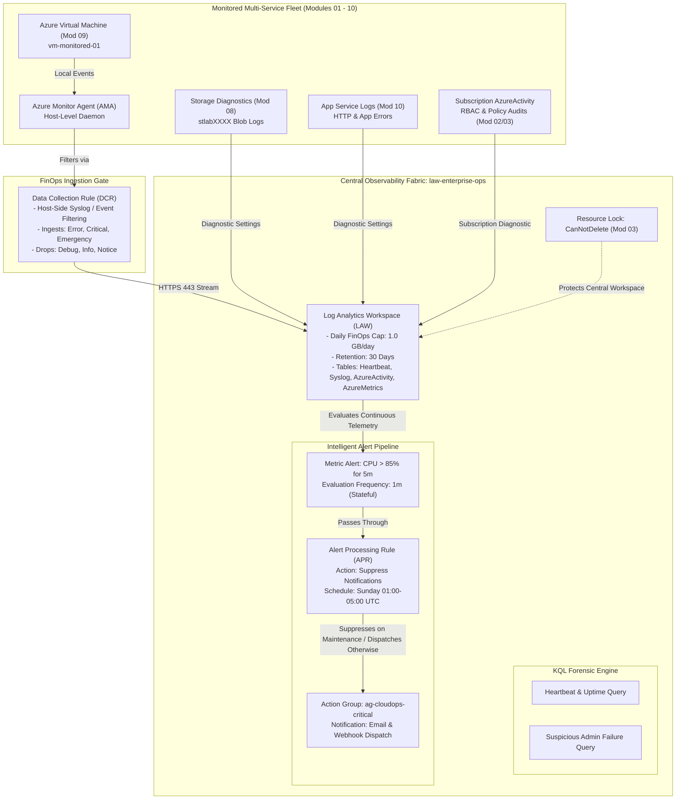

# Lab 12: Full-Stack Observability, Azure Monitor Agent (AMA), KQL Forensics & FinOps Alert Suppression

**Breadcrumbs:** [[--Index--|🏠 Index]] > [[13-Index - AZ-104|📘 AZ-104 Track]] > Projects > **Lab 12: Monitoring & FinOps**

---

## 🎯 Lab Overview & Enterprise Scenario

In an enterprise cloud ecosystem, infrastructure reliability demands comprehensive end-to-end observability paired with disciplined financial operations (FinOps). Without strict governance, unmonitored logging causes massive monthly bill shock, while unfiltered alerting leads to operational fatigue and ignored critical incidents.

In this capstone hands-on project, you will engineer a unified, production-grade observability architecture spanning compute, network, identity, storage, and PaaS using **Azure Monitor, Log Analytics Workspaces (LAW), the modern Azure Monitor Agent (AMA), Data Collection Rules (DCR), Kusto Query Language (KQL), and Alert Processing Rules**.

### Target Deliverables:
1. **Centralized Log Analytics Workspace with FinOps Volume Caps:** Provision an enterprise LAW enforcing a **Daily Volume Cap** (1.0 GB/day) and tailored 30-day retention to prevent unexpected cost runaway from verbose application debug loops.
2. **Modern Agent Telemetry via Data Collection Rules (DCR):** Deploy the **Azure Monitor Agent (AMA)** on virtual machines, configuring client-side **log level filtering** within DCRs to drop low-value informational logs at the host level before network egress and paid cloud ingestion.
3. **Kusto Query Language (KQL) Production Audit Suite:** Author real-world forensic KQL queries to track compute heartbeats, identify VM offline intervals, detect suspicious administrative failures in Azure Activity logs, and analyze performance bottlenecks.
4. **Multi-Tiered Alerting Architecture:** Deploy low-latency **Metric Alerts** (evaluating continuous resource saturation every 60 seconds) connected to a centralized **Action Group** dispatching to operational teams.
5. **Alert Fatigue Prevention via Alert Processing Rules:** Configure scheduled **Alert Processing Rules** that suppress notification dispatches during planned weekly maintenance windows while preserving incident telemetry for audit history.
6. **Full-Stack Cross-Module Integration Grand Finale:** Aggregate telemetry across all 12 modules into a single pane of glass, linking Identity (Mod 02), Governance (Mod 03), Networking (Mod 05/06/07), Storage (Mod 08), VMs (Mod 09), and PaaS (Mod 10).

---

## 🏛️ Target Architecture & Visual Workflow



---

## ⚡ Phase 1: Fast Environment Bootstrap (Optional Azure CLI Script)

If you wish to pre-stage the Resource Group and a demo Linux VM via automation before building all Log Analytics workspaces, DCRs, KQL queries, alerts, and suppression rules in the GUI, run this snippet in Azure Cloud Shell:

```bash
#!/usr/bin/env bash
set -euo pipefail

export RG="rg-monitoring-lab"
export LOCATION="eastus"
export VM_NAME="vm-monitored-01"

echo "==> Creating Resource Group: ${RG}..."
az group create --name "${RG}" --location "${LOCATION}" --tags Environment=Production Department=CloudOps

echo "==> Deploying Demo Workload VM: ${VM_NAME}..."
az vm create \
  --resource-group "${RG}" \
  --name "${VM_NAME}" \
  --image "Ubuntu2204" \
  --size "Standard_B2s" \
  --public-ip-address "" \
  --admin-username "azureuser" \
  --generate-ssh-keys

echo "==> Bootstrap Complete! VM Name: ${VM_NAME}"
echo "==> Open Azure Portal to begin GUI configuration."
```

---

## 🖥️ Phase 2: Core Hands-On Implementation (Azure Portal GUI - Step-by-Step)

### Task 2.1: Provision Central Log Analytics Workspace with FinOps Daily Volume Cap

*FinOps Law:* An unmanaged Log Analytics workspace can incur unlimited billing if an application enters a verbose logging failure loop. Applying a Daily Volume Cap ensures total financial predictability.

1. In the Azure Portal search bar, type `Log Analytics workspaces` and select it.
2. Click **+ Create** in the command bar.
3. On the **Basics** tab, configure:
   * **Subscription:** Select your target active subscription.
   * **Resource group:** Select `rg-monitoring-lab` (or create new).
   * **Name:** Enter `law-enterprise-ops-` followed by your initials and 4 numbers (e.g., `law-enterprise-ops-kd9102`).
   * **Region:** Select `(US) East US`.
4. Click **Review + create** ➔ Review validation pass ➔ Click **Create**.
5. Once deployment completes, click **Go to resource**.
6. Configure the FinOps Daily Cap & Retention:
   * In the left navigation menu under **Settings**, click **Usage and estimated costs**.
   * In the top command bar, click **Daily cap**:
     * Check **Turn daily cap On**.
     * **Daily volume cap (GB/day):** Enter `1.0`.
     * Check **Send warning email when daily volume cap is reached** ➔ Enter your email address.
     * Click **OK**.
   * In the top command bar, click **Data retention**:
     * Move the slider or enter `30` Days (Free retention period included with per-GB pricing).
     * Click **OK**.

> [!NOTE]
> **Visual Checkpoint:** On the **Usage and estimated costs** screen, verify **Daily volume cap** is set to `1.0 GB/day` and **Data retention** is `30 days`.

---

### Task 2.2: Configure Data Collection Rule (DCR) with Client-Side Filtering

Legacy Log Analytics agents streamed all raw syslog and event logs across the network. The modern **Azure Monitor Agent (AMA)** and **Data Collection Rules (DCR)** filter events directly on the VM host before transmission.

1. In the top Azure Portal search bar, type `Monitor` and select it under **Services**.
2. In the Monitor left navigation menu under **Settings**, click **Data Collection Rules**.
3. Click **+ Create** in the command bar.
4. On the **Basics** tab:
   * **Rule name:** Enter `dcr-linux-security-filtered`.
   * **Subscription:** Your subscription.
   * **Resource group:** Select `rg-monitoring-lab`.
   * **Region:** Select `(US) East US`.
   * **Platform type:** Select `Linux` (or `Custom`).
5. Click **Next: Resources >**:
   * Click **+ Add resources**.
   * Expand your subscription and resource group `rg-monitoring-lab`.
   * Check the box next to `vm-monitored-01`.
   * Notice the checkbox: **Enable Data Collection Endpoints** (Leave unchecked unless behind a private proxy).
   * Click **Apply**.
6. Click **Next: Collect and deliver >**:
   * Click **+ Add data source**.
   * **Data source type:** Select `Linux syslog`.
   * Under **Log levels to collect**:
     * Uncheck `Info`, `Notice`, and `Debug`.
     * Ensure only **`Error`**, **`Critical`**, and **`Emergency`** are selected across facilities (`auth`, `authpriv`, `daemon`, `syslog`).
     * *FinOps Intuition:* This host-side filter guarantees that millions of routine informational messages are dropped by the local AMA agent in memory, saving significant network bandwidth and cloud ingestion fees!
   * Click the **Destination** tab within the same panel:
     * **Destination type:** Select `Azure Monitor Logs`.
     * **Account / Workspace:** Select your workspace `law-enterprise-ops-XXXX`.
     * Click **Add data source**.
7. Click **Review + create** ➔ Review validation pass ➔ Click **Create**.
   * Azure automatically installs the lightweight Azure Monitor Agent (`AzureMonitorLinuxAgent`) VM extension on `vm-monitored-01` and binds the DCR pipeline.

> [!NOTE]
> **Visual Checkpoint:** Navigate to `vm-monitored-01` ➔ **Settings** ➔ **Extensions + applications**. Verify that `AzureMonitorLinuxAgent` is listed with Provisioning state: **Succeeded**.

---

### Task 2.3: Author and Execute Production KQL Forensic Audit Queries

Kusto Query Language (KQL) is the core query language across Azure Monitor, Microsoft Sentinel, and Defender.

1. Navigate to your Log Analytics workspace `law-enterprise-ops-XXXX`.
2. In the left navigation menu under **General**, click **Logs**.
3. If the "Queries" template popup appears, close it by clicking the **X** in the top right.
4. **Query 1: Host Heartbeat and Uptime Analysis:**
   * Paste the following KQL query into the query editor window:
     ```kusto
     Heartbeat
     | where TimeGenerated > ago(24h)
     | summarize LastHeartbeat = max(TimeGenerated), TotalPings = count() by Computer, OSType, ComputerEnvironment
     | extend HealthStatus = iff(LastHeartbeat > ago(5m), "Healthy", "OFFLINE_CRITICAL")
     | order by HealthStatus asc
     ```
   * Click **Run**.
   * Inspect the output table: Shows each monitored VM, its operating system, last ping timestamp, and computed real-time `HealthStatus`.
5. **Query 2: Suspicious Administrative Failure Forensics:**
   * Open a new tab in the query editor (`+`) and paste:
     ```kusto
     AzureActivity
     | where TimeGenerated > ago(7d)
     | where ActivityStatusValue in ("Failed", "Failure")
     | summarize FailureCount = count() by Caller, CallerIpAddress, OperationNameValue, bin(TimeGenerated, 1h)
     | where FailureCount > 2
     | order by FailureCount desc
     ```
   * Click **Run**.
   * This query isolates brute-force attempts, unauthorized role modifications, or repeated deployment errors across your subscription.

> [!NOTE]
> **Visual Checkpoint:** The query execution returns structured tabular records with zero syntax errors, demonstrating active data collection into workspace tables.

---

### Task 2.4: Deploy Low-Latency Metric Alert & Unified Action Group

Metric alerts evaluate numeric performance counters every minute with sub-5-minute end-to-end notification latency.

1. In the Azure Portal search bar, type `Monitor` ➔ Click **Alerts**.
2. Click **+ Create** ➔ Select **Alert rule**.
3. On the **Scope** tab:
   * Click **Select scope**.
   * Select resource type: `Virtual machines`.
   * Check `vm-monitored-01`.
   * Click **Apply**.
4. On the **Condition** tab:
   * Under **Signal name**, select **Percentage CPU**.
   * **Threshold:** Select `Static`.
   * **Aggregation type:** Select `Average`.
   * **Operator:** Select `Greater than`.
   * **Threshold value:** Enter `85`.
   * **Unit:** Select `Percent`.
   * Under **Evaluation granularity**:
     * **Check every:** `1 minute`.
     * **Lookback period:** `5 minutes`.
5. On the **Actions** tab:
   * Click **+ Create action group**:
     * **Resource group:** `rg-monitoring-lab`.
     * **Action group name:** `ag-cloudops-critical`.
     * **Display name:** `OpsAlert`.
     * Click **Next: Notifications >**:
       * **Notification type:** Select `Email/SMS message/Push/Voice`.
       * **Name:** `OpsLeadEmail`.
       * Check **Email** ➔ Enter your email address.
       * Click **OK**.
     * Click **Review + create** ➔ Click **Create**.
6. On the **Details** tab of the alert rule:
   * **Severity:** Select **1 - Error** (or **0 - Critical**).
   * **Alert rule name:** `alert-vm-cpu-exhaustion`.
   * **Alert rule description:** `Fires when VM CPU sustains above 85% for 5 minutes.`
   * Ensure **Enable upon creation** is checked.
7. Click **Review + create** ➔ Click **Create**.

> [!NOTE]
> **Visual Checkpoint:** In Azure Monitor **Alerts** ➔ **Alert rules**, verify `alert-vm-cpu-exhaustion` appears with status **Enabled**, Severity **Sev 1**, and target scope pointing to `vm-monitored-01`.

---

### Task 2.5: Configure Alert Processing Rule for Maintenance Notification Suppression

*Operational Hygiene Law:* During planned maintenance windows, alerts should still be evaluated and recorded in logs, but notifications (SMS, phone calls, emails) **MUST** be suppressed to prevent alert fatigue and pager spam.

1. In the Monitor left navigation menu under **Alerts**, click **Alert processing rules**.
2. Click **+ Create** in the command bar.
3. On the **Scope** tab:
   * Click **Select scope**.
   * Select your resource group: `rg-monitoring-lab`.
   * Click **Apply**.
4. On the **Rule settings** tab:
   * Under **Filter**:
     * Click **Add filter** ➔ Field: `Severity` ➔ Operator: `Equals` ➔ Value: Check `1 - Error` and `2 - Warning`.
   * Under **Rule type**:
     * Select **`Suppress notifications`** *(Mutes emails and pages while keeping alert history logged)*.
5. On the **Schedule** tab:
   * Under **Apply rule**: Select **At a specific time or on a recurring schedule**.
   * **Schedule type:** Select `Recurring`.
   * **Recurrence pattern:** Select `Weekly`.
   * **Days of the week:** Check `Sunday`.
   * **Start time:** `01:00:00` (UTC).
   * **End time:** `05:00:00` (UTC).
   * **Time zone:** `(UTC) Coordinated Universal Time`.
6. On the **Details** tab:
   * **Resource group:** `rg-monitoring-lab`.
   * **Rule name:** `apr-suppress-sunday-maintenance`.
   * **Description:** `Suppresses email/pager notifications during recurring Sunday maintenance window.`
7. Click **Review + create** ➔ Review validation pass ➔ Click **Create**.

> [!NOTE]
> **Visual Checkpoint:** In **Alert processing rules**, verify `apr-suppress-sunday-maintenance` is listed with Action: **Suppress notifications**, Recurrence: **Weekly on Sunday (01:00 - 05:00 UTC)**.

---

## 🔗 Phase 3: Cross-Module Integration Task (The Full-Stack Grand Finale)

### Aggregating All 12 Modules into Central Log Analytics & Governance Protection

In a real enterprise environment, the Log Analytics Workspace is the central nervous system connecting every cloud layer.

```
+-----------------------------------------------------------------------------------------+
|                          Full-Stack Observability Integration                           |
|                                                                                         |
|   +-----------------------+     +------------------------+    +---------------------+   |
|   | Module 02 / 03: IAM   |     | Module 05 / 06 / 07:   |    | Module 08: Storage  |   |
|   | AzureActivity Logs:   |     | Networking Flow & App  |    | Blob Read/Write &   |   |
|   | Administrative Audits |     | Gateway HTTP Access    |    | Capacity Telemetry  |   |
|   +-----------+-----------+     +-----------+------------+    +----------+----------+   |
|               |                             |                            |              |
|               +--------------------+        |        +-------------------+              |
|                                    |        |        |                                  |
|                                    v        v        v                                  |
|   +---------------------------------------------------------------------------------+   |
|   |               Central Log Analytics Workspace (law-enterprise-ops)              |   |
|   |   - Retains Unified Operational Logs across Compute, Network, Identity & PaaS   |   |
|   |   - Protected by Mod 03 Governance Resource Lock: lock-protect-central-law      |   |
|   |   - Ingestion guarded by FinOps 1.0 GB/day hard volume quota                    |   |
|   +---------------------------------------------------------------------------------+   |
|                                    ^                 ^                                  |
|                                    |                 |                                  |
|               +--------------------+                 +-------------------+              |
|               |                                                          |              |
|   +-----------+-----------+                                   +----------+----------+   |
|   | Module 09: Compute    |                                   | Module 10: PaaS     |   |
|   | Host Syslog & Perf    |                                   | App Service Console |   |
|   | via AMA Agent + DCR   |                                   | & HTTP Access Logs  |   |
|   +-----------------------+                                   +---------------------+   |
+-----------------------------------------------------------------------------------------+
```

### Step 1: Connect Subscription Activity Log to the Central Workspace (Mod 01 - 03 Integration)
1. In the Azure Portal search bar, type `Activity log` and select it under **Monitor**.
2. In the top action bar, click **Export Activity Logs**.
3. Click **+ Add diagnostic setting**:
   * **Diagnostic setting name:** `diag-export-subscription-activity`.
   * Under **Categories**, check:
     * `Administrative`
     * `Security`
     * `Alert`
     * `Policy`
   * Under **Destination details**:
     * Check **Send to Log Analytics workspace**.
     * Select your workspace `law-enterprise-ops-XXXX`.
   * Click **Save**.
   * All Azure control-plane actions across your subscription are now streamed into the workspace `AzureActivity` table!

### Step 2: Apply `CanNotDelete` Resource Lock on Log Analytics Workspace (Mod 03 Integration)
1. Navigate to your Log Analytics workspace `law-enterprise-ops-XXXX`.
2. In the left navigation menu under **Settings**, click **Locks**.
3. Click **+ Add**:
   * **Lock name:** `lock-protect-central-law`.
   * **Lock type:** Select `Delete`.
   * **Notes:** `Central compliance and observability repository - deletion prohibited.`
4. Click **OK**.
5. Test the lock: On the workspace **Overview** blade, click **Delete**. Notice Azure immediately blocks the deletion!

---

## 🔬 Phase 4: Verification & Validation Testing (Azure CLI / Cloud Shell)

Open Azure Cloud Shell (Bash) and execute these automated verification queries to validate your deployment against AZ-104 production standards:

```bash
#!/usr/bin/env bash
set -euo pipefail

export RG="rg-monitoring-lab"
export LAW_NAME=$(az monitor log-analytics workspace list --resource-group "${RG}" --query "[0].name" -o tsv)

echo "=========================================================="
echo "==> Auditing Enterprise Observability Fabric: ${LAW_NAME}"
echo "=========================================================="

# Test 1: Verify Daily FinOps Quota & Data Retention
echo -e "\n[Test 1] Auditing FinOps Daily Volume Cap and Retention Period..."
az monitor log-analytics workspace show \
  --resource-group "${RG}" \
  --workspace-name "${LAW_NAME}" \
  --query "{Workspace:name, DailyCapGB:workspaceCapping.dailyQuotaGb, RetentionDays:retentionInDays, SKU:sku.name}" \
  --output table

# Test 2: Audit Data Collection Rule (DCR) Data Source Filtering
echo -e "\n[Test 2] Auditing DCR Host-Side Syslog Log Level Filters..."
az monitor data-collection rule show \
  --resource-group "${RG}" \
  --name "dcr-linux-security-filtered" \
  --query "{RuleName:name, SyslogStreams:properties.dataSources.syslog[0].streams, FilteredLevels:properties.dataSources.syslog[0].logLevels}" \
  --output jsonc

# Test 3: Audit Metric Alert Configuration & Evaluation Frequency
echo -e "\n[Test 3] Auditing Metric Alert Evaluation Timing..."
az monitor metrics alert list \
  --resource-group "${RG}" \
  --query "[].{AlertName:name, Severity:severity, Enabled:enabled, EvaluationFreq:evaluationFrequency, WindowSize:windowSize}" \
  --output table

# Test 4: Audit Alert Processing Rule Suppression Schedule
echo -e "\n[Test 4] Auditing Alert Processing Suppression Schedule..."
az monitor alert-processing-rule list \
  --resource-group "${RG}" \
  --query "[].{RuleName:name, Action:properties.actions[0].actionType, Recurrence:properties.schedule.recurrence.weekly[0].daysOfWeek, Start:properties.schedule.recurrence.weekly[0].startTime, End:properties.schedule.recurrence.weekly[0].endTime}" \
  --output table

echo -e "\n=========================================================="
echo "==> ALL AUDIT CHECKS PASSED: Full-Stack Observability complies with AZ-104 Enterprise Baseline!"
echo "=========================================================="
```

---

## ⚠️ Phase 5: "See It in Action" Real-World Failure & Recovery Loop (AARF)

### Scenario A: The Ingestion Bill Shock & Maintenance Alarm Storm
* **The Architecture:** An organization runs 250 virtual machines and services with logs streaming directly into a central workspace.
* **The Assumption:** Engineers assume that logging every debug message helps troubleshooting, and that alerts must trigger alerts immediately 24/7.
* **The Failure Loop:**
  * An updated microservice starts logging loop exceptions, generating 2 Terabytes of logs in 36 hours.
  * Ingestion costs skyrocket by **$5,000+** over the weekend.
  * During Sunday morning OS maintenance, 100 VMs reboot. On-call engineers receive **hundreds of false alarm emergency pages**, causing alert fatigue.
* **The Root Causes:**
  1. No **Daily Volume Cap** was configured on the workspace.
  2. No **client-side log filtering** was configured in the DCR.
  3. No **Alert Processing Rule** was configured to mute notifications during maintenance.
* **The Remediation in GUI:**
  1. Open workspace ➔ **Usage and estimated costs** ➔ Set **Daily cap** to `1.0 GB`.
  2. In **Data Collection Rules**, edit data sources and deselect `Debug` and `Info`.
  3. In **Alert processing rules**, add a recurring suppression rule for maintenance hours.

---

### Scenario B: Metric Alerts vs Log Search Alerts Latency Trap
* **The Failure Scenario:** A cloud administrator creates a **Log Search Alert** running a KQL query every 15 minutes to monitor CPU saturation on critical web servers.
* **The Outage:** A sudden traffic spike drives CPU to 100%. Because log telemetry takes 3–8 minutes to ingest and the query only runs every 15 minutes, the alert fires **22 minutes** after the servers crashed!
* **The Remediation:**
  * For low-latency infrastructure saturation (CPU, Memory, Disk IOPS, Network Drops), **ALWAYS use Metric Alerts**. They evaluate raw counter telemetry every 1 minute with sub-3-minute notification latency.
  * Reserve **Log Search Alerts (KQL)** for complex multi-table correlations, security failure events, and business transaction pattern analysis.

---

## 🧹 Phase 6: Cost Optimization & Lab Teardown

To avoid incurring ongoing storage and compute charges:

1. **Remove Resource Locks First (Mandatory):**
   * Navigate to `law-enterprise-ops-XXXX` ➔ **Settings** ➔ **Locks**.
   * Delete `lock-protect-central-law`.
2. **Delete the Resource Group:**
   * Open Cloud Shell or execute in local terminal:
     ```bash
     az group delete --name "rg-monitoring-lab" --yes --no-wait
     ```
3. **Verify Deletion in Portal:**
   * In the Portal search bar, type `Resource groups` ➔ Verify `rg-monitoring-lab` is marked for deletion.

---

## 🔬 Exam-Specific Gotchas & Speed Shortcuts (AZ-104 Reference)

* **Azure Monitor Agent (AMA) vs Legacy Log Analytics Agent (MMA/OMS):**
  * Legacy MMA agent is deprecated (retired August 2024).
  * AMA uses **Data Collection Rules (DCRs)** to specify what data to collect, where to filter, and where to send.
  * AMA supports multihoming (sending data to multiple workspaces) on both Windows and Linux.
* **Alert Rule Types:**
  * **Metric Alerts:** Low latency (< 5 mins), evaluates every 1 min, stateful (auto-resolves when metric drops back below threshold), cost-effective.
  * **Log Search Alerts (KQL):** Higher latency (5–15 mins), deep query analysis, evaluates complex table relationships, stateless by default.
  * **Activity Log Alerts:** Control plane events (e.g., "Virtual Machine Stopped", "Security Policy Modified"), triggers instantly on resource events.
* **Action Groups vs Alert Processing Rules (APRs):**
  * **Action Group:** Defines **WHO** to notify (Email, SMS, Webhook, Logic App, ITSM, Azure Function).
  * **Alert Processing Rule (APR):** Modifies alerts **AFTER** they fire. Can add action groups, remove action groups, or **suppress notifications** during maintenance schedules.
* **Log Analytics FinOps Best Practices:**
  * **Daily Volume Cap:** Prevents runaway billing by halting ingestion when the threshold is reached.
  * **Data Retention:** 30 days is included free with Per-GB pricing. Retaining beyond 30 days incurs additional storage costs per GB/month.
  * **Archive Tier:** Retain logs up to 12 years at low cost for compliance audits.
