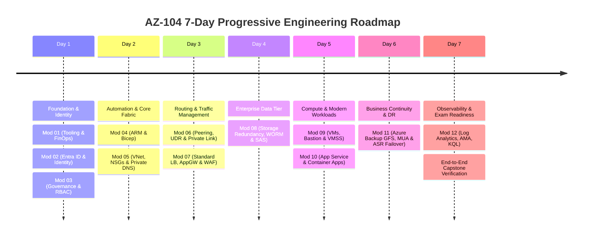

# 🏮 AZ-104 Lighthouse: Master Progressive Architecture, SKU Matrix, Regional Locality & 7-Day Plan

**Breadcrumbs:** [[--Index--|🏠 Index]] > [[13-Index - AZ-104|📘 AZ-104 Track]] > **AZ-104 Projects Hub & Lighthouse**

---

## 🧭 Executive Diagnostic & Progressive Engineering Philosophy

In analyzing the AZ-104 curriculum and reference notes ([[13-Index - AZ-104|AZ-104 MOC]]) against traditional hands-on exercises, two structural engineering flaws become apparent:

1. **Isolated "Throwaway" Labs vs. Progressive Architecture:** Traditional practice exercises deploy isolated resource groups (`rg-baseline-lab`, `rg-network-lab`, `rg-storage-lab`, `rg-compute-lab`) that are deleted at the end of each module. In real enterprise cloud environments, infrastructure is cumulative and interconnected: identity and governance govern subnets, subnets host load balancers and scale sets, storage accounts connect via private endpoints, and backup and monitoring oversee the entire living fabric.
2. **The SKU and Regional Locality Blind Spot:** Microsoft AZ-104 exam scenario questions and production engineering require mastery of **SKU boundaries** (what features are unlocked at each pricing tier) and **Locality/Regional boundaries** (what resources must reside in the same region vs. what can span regions or subscriptions).

This **Lighthouse document** is the consolidated, single source of truth for the **"Project Contoso Cloud Landing Zone"** progressive build, the master SKU/regional matrices, and the 7-day intensive execution roadmap.

---

## 🏛️ The Progressive Enterprise Architecture: "Project Contoso Cloud Landing Zone"

Instead of 12 disconnected labs, you build a **single, cumulative enterprise architecture** across Modules 01 through 12. Every resource deployed remains active, protected, and integrated into subsequent modules until the final capstone review.

This progressive design directly bridges into production Infrastructure-as-Code, such as [[Project-01_HA_Scalable_Infrastructure_VMSS|Piyush's Advanced Terraform on Azure VMSS Project]].

```mermaid
flowchart TD
    subgraph ManagementGroup ["Contoso Enterprise Management Group (MG-Contoso-Production)"]
        subgraph MgmtRG ["rg-contoso-mgmt (East US)"]
            SubBudget["Cost Budget ($500/mo)\n+ Action Group"]
            PolicyLocks["Custom RBAC & Locks\n(CanNotDelete / ReadOnly)"]
            LAW["Central Log Analytics Workspace\n(law-contoso-ops)\n- 1 GB Daily Cap & DCRs"]
            TempSpec["Template Specs (v1.0.0)\nBicep Landing Zone"]
        end

        subgraph HubRG ["rg-contoso-hub-network (East US)"]
            subgraph HubVNet ["Hub Virtual Network: vnet-hub-eastus (10.100.0.0/16)"]
                BastionSubnet["AzureBastionSubnet (10.100.0.0/26)\nAzure Bastion Standard SKU\n(Native Client Tunneling & IP Connect)"]
                AppGWSubnet["snet-hub-appgw (10.100.1.0/24)\nApplication Gateway v2 + WAF\n(Path Routing & SSL Termination)"]
                NVASubnet["snet-hub-nva (10.100.2.0/24)\nFirewall / Simulated Router Appliance"]
            end
        end

        subgraph WorkloadRG ["rg-contoso-spoke-workload (East US)"]
            subgraph Spoke1VNet ["Spoke-1 Workload VNet: vnet-spoke-workload (10.101.0.0/16)"]
                WebSubnet["snet-workload-web (10.101.1.0/24)\n- Standard Internal Load Balancer\n- VMSS Flexible (Multi-Zone 1,2,3)\n- ASG: asg-web-tier"]
                AppSubnet["snet-workload-app (10.101.2.0/24)\n- Multi-Zone Backend VMs\n- ASG: asg-app-tier"]
            end
        end

        subgraph ServicesRG ["rg-contoso-spoke-services (East US)"]
            subgraph Spoke2VNet ["Spoke-2 Services VNet: vnet-spoke-services (10.102.0.0/16)"]
                PESubnet["snet-services-pe (10.102.1.0/24)\nPrivate Endpoints for Blob & Files\n(privatelink.blob.core.windows.net)"]
                PaaSSubnet["snet-services-paas (10.102.2.0/24)\nDelegated: Microsoft.Web/serverFarms\n(Regional VNet Integration)"]
                ContSubnet["snet-services-containers (10.102.3.0/24)\nDelegated: Microsoft.App/environments\n(Azure Container Apps)"]
            end
            StorageAcc["Storage Account: stcontosodata[id]\n- GPv2, GRS Redundancy\n- WORM Immutability Policy\n- Lifecycle Rules (Cool 30d, Archive 90d)\n- User Delegation SAS"]
            AppSvcPlan["App Service Plan (Standard S1 / P1v3)\n- Web App with Staging/Prod Slots\n- Canary 10% Traffic Routing"]
        end

        subgraph DR_RG ["rg-contoso-recovery (Primary: East US | Secondary: Central US)"]
            RSV["Recovery Services Vault (East US)\n- GFS Policy (Daily, Weekly, Monthly)\n- Instant Restore Snapshots (2 days)\n- Enhanced Soft Delete (14 days)\n- MUA via Resource Guard"]
            ASR_Target["Azure Site Recovery Target (Central US)\n- Replicated Secondary VNet (10.200.0.0/16)\n- Isolated Test Failover Network"]
        end
    end

    %% Network Connections
    HubVNet <== "Bidirectional VNet Peering\n(Allow Forwarded Traffic)" ==> Spoke1VNet
    HubVNet <== "Bidirectional VNet Peering\n(Allow Forwarded Traffic)" ==> Spoke2VNet
    
    %% Traffic Flows
    Internet["Public Internet"] -->|"Port 80 / 443"| AppGWSubnet
    AppGWSubnet -->|"HTTP Forwarding"| WebSubnet
    WebSubnet -->|"Port 8080 Probe"| AppSubnet
    AppSubnet -. "Route Table UDR (0.0.0.0/0)" .-> NVASubnet
    
    %% PaaS & Private Access
    PaaSSubnet -. "VNet Egress Access" .-> PESubnet
    PESubnet ==>|"Private Link (RFC 1918)"| StorageAcc
    
    %% Security & Management
    BastionSubnet -. "Secure Jumpbox Tunneling" .-> AppSubnet
    RSV -. "Backup Fabric (Same Region)" .-> AppSubnet
    RSV == "ASR Cross-Region Replication" ==> ASR_Target
    
    %% Telemetry
    Spoke1VNet -. "AMA & DCR Telemetry" .-> LAW
    Spoke2VNet -. "Diagnostic Logs" .-> LAW
    HubVNet -. "NSG Flow Logs" .-> LAW
```



---

## 🗺️ Master Curriculum Navigation Matrix

| Module & Directory | Lab Document | Core Progressive Deliverables | Key Azure Technologies & Tools |
| :--- | :--- | :--- | :--- |
| **01: Governance & Tooling**<br>`01_Cloud_Governance_and_Tooling/` | [[Lab-01_Enterprise_Subscription_Baseline_and_Tooling\|Lab 01: Baseline & Tooling]] | Persistent Cloud Shell storage in `rg-contoso-mgmt`, Cost Management $500 budget with alerts to `ag-contoso-ops`, compute quotas inspection. | Cost Management, Cloud Shell, Action Groups, Quotas |
| **02: Identity & Entra ID**<br>`02_Identity_and_Entra_ID/` | [[Lab-02_Enterprise_Identity_SSPR_and_Administrative_Units\|Lab 02: Entra ID & Identity]] | Dynamic Security Group `grp-cloud-engineers`, SSPR with verification gates, Administrative Unit `AU-US-Engineering`, B2B Guest onboarding. | Entra ID, Dynamic Membership, SSPR, Graph CLI |
| **03: Governance & Compliance**<br>`03_Governance_and_Compliance/` | [[Lab-03_Custom_RBAC_Resource_Locks_and_Azure_Policy\|Lab 03: Governance & Compliance]] | Management Group hierarchy (`MG-Contoso-Production`), Custom RBAC `Custom VM Operator`, Azure Policy for VM SKUs/tags, `CanNotDelete` lock. | Management Groups, Custom RBAC, Azure Policy, Locks |
| **04: Resources & Bicep**<br>`04_Azure_Resources_and_Bicep/` | [[Lab-04_Declarative_IaC_with_Bicep_and_ARM\|Lab 04: IaC with Bicep & ARM]] | Declarative landing zone in Bicep, Template Spec `vnet-hub-spec` (v1.0.0) in `rg-contoso-mgmt`, What-If deployment validation. | Template Specs, ARM JSON, Bicep CLI, What-If |
| **05: Virtual Networking**<br>`05_Virtual_Networking_and_DNS/` | [[Lab-05_VNet_Architecture_Subnetting_NSG_and_Private_DNS\|Lab 05: Networking & DNS]] | Multi-subnet VNets (`vnet-hub-eastus`, `vnet-spoke-workload`), Application Security Groups (`asg-web-tier`), NSGs, Private DNS Zone `contoso.internal`. | VNets, Subnets, ASGs, NSGs, Private DNS Zones |
| **06: Intersite Connectivity**<br>`06_Intersite_Connectivity_and_Private_Link/` | [[Lab-06_Hub_and_Spoke_Peering_UDR_and_Private_Link\|Lab 06: Hub-Spoke & Private Link]] | Bidirectional VNet peering (Hub ↔ Spoke-1 & Spoke-2 with `AllowForwardedTraffic`), Route Table UDR (`0.0.0.0/0` ➔ NVA), Effective Routes audit. | VNet Peering, Route Tables (UDR), NVAs, Private Link |
| **07: Traffic Management**<br>`07_Network_Traffic_Management/` | [[Lab-07_Azure_Load_Balancer_Application_Gateway_and_WAF\|Lab 07: Load Balancers & WAF]] | Internal Standard Load Balancer with HTTP/TCP probe, external Application Gateway v2 in `/26` subnet, path-based routing (`/app/*`), WAF v2. | Standard LB, App Gateway v2, WAF CRS, Network Watcher |
| **08: Storage & Protection**<br>`08_Storage_Accounts_and_Data_Protection/` | [[Lab-08_Storage_Redundancy_Lifecycle_and_User_Delegation_SAS\|Lab 08: Storage & WORM SAS]] | GPv2 Storage Account with GRS/ZRS, Lifecycle rules (Cool 30d, Archive 90d), WORM 14d immutability, Private Endpoint in `snet-services-pe`, User Delegation SAS. | Storage Accounts, Lifecycle Rules, WORM, Entra SAS, Azure Files |
| **09: VMs & Scale Sets**<br>`09_Virtual_Machines_and_Scale_Sets/` | [[Lab-09_VM_Resilience_Managed_Disks_Bastion_and_VMSS\|Lab 09: VMs, Bastion & VMSS]] | Azure Bastion Standard in Hub, Multi-Zone VMs (Zone 1/2), Managed Disk host caching (`ReadOnly` data, `None` WAL), VMSS Flexible autoscale on CPU. | Managed Disks, Host Caching, Azure Bastion, VMSS Flexible |
| **10: PaaS & Containers**<br>`10_PaaS_Compute_and_Containers/` | [[Lab-10_App_Service_Blue_Green_Slots_and_Container_Apps\|Lab 10: App Service & Containers]] | App Service Plan (Standard S1/P1v3) with Regional VNet Integration (`snet-services-paas`), Staging slot with sticky settings, ACA with KEDA. | App Service, Deployment Slots, ACA, KEDA Scaling |
| **11: Data Protection & DR**<br>`11_Data_Protection_and_Site_Recovery/` | [[Lab-11_Azure_Backup_Soft_Delete_Resource_Guard_and_ASR\|Lab 11: Backup, MUA & ASR]] | Recovery Services Vault (East US), GFS Policy with Instant Restore, Enhanced Soft Delete, Resource Guard MUA, ASR Test Failover into `centralus`. | Recovery Services Vault, Soft Delete, MUA, ASR Failover |
| **12: Monitoring & FinOps**<br>`12_Monitoring_Observability_and_FinOps/` | [[Lab-12_Full_Stack_Observability_AMA_KQL_and_Alert_Suppression\|Lab 12: Monitoring & FinOps]] | Central Log Analytics Workspace (`law-contoso-ops`, 1.0 GB cap), AMA + DCR syslog filtering, Forensic KQL queries, Alert Processing Rule (Sunday suppression). | Log Analytics, AMA, DCR, KQL, Alert Processing Rules |

---

## 🔗 Progressive Cross-Module Integration Roadmap

```
[Module 01: Subscriptions & FinOps Budget Alerts]
        │
        ▼
[Module 02: Entra ID Dynamic Groups & Administrative Units]
        │
        ├──────────────────────────────┐
        ▼                              ▼
[Module 03: Custom RBAC Roles & Resource Locks]   [Module 04: Template Specs & Bicep IaC]
        │
        ├──────────────────────────────┐
        ▼                              ▼
[Module 05: VNet, Subnets, ASGs & Private DNS] ──► [Protected by Module 03 Resource Lock]
        │
        ▼
[Module 06: Hub-Spoke Peering, NVA UDRs & Private Endpoints]
        │
        ▼
[Module 07: Layer 4 Standard LB & Layer 7 App Gateway + WAF]
        │
        ├─────────────────────────────────────────────────────────────┐
        ▼                                                             ▼
[Module 08: Storage Accounts, Lifecycle & WORM]             [Module 09: VMs, Caching & VMSS]
  - Governed by Mod 03 Resource Locks                         - Connected to Mod 05 ASG Subnets
  - Access via Mod 02 Entra ID RBAC                           - Managed via Mod 02 Managed Identity
  - Restricted via Mod 06 Private Endpoints                   - Managed via Zero-Trust Azure Bastion
        │                                                             │
        ├──────────────────────────────┬──────────────────────────────┘
        ▼                              ▼
[Module 10: App Service Slots & ACA]  [Module 11: Backup GFS & ASR DR]
  - Regional VNet Egress (Mod 05)       - Protects Mod 08 Storage & Mod 09 VMs
  - Managed Identity to Mod 08 Storage  - Dual-Custody MUA with Mod 02 Entra IDs
  - Shielded by Mod 03 Resource Locks   - Locked by Mod 03 Governance Locks
        │                              │
        └──────────────────────────────┴──────────────────────────────┐
                                                                      ▼
                                                [Module 12: Full-Stack Observability Capstone]
                                                  - Central Log Analytics Workspace
                                                  - Diagnostic streaming from Mods 01-11
                                                  - FinOps 1.0 GB Daily Cap & APR Suppression
```

---

## ⚙️ Standard 6-Phase Lab Engineering Lifecycle

Every module in `Projects/AZ-104/` strictly adheres to this 6-phase engineering lifecycle:

1. **🎯 Lab Overview & Enterprise Scenario:** Real-world architectural context, business motivations, and measurable enterprise deliverables.
2. **🏛️ Target Architecture & Visual Workflow:** Mermaid sequence diagrams, flowcharts, and component maps illustrating interactions across subscriptions, VNets, and services.
3. **⚡ Phase 1: Fast Environment Bootstrap (Optional Azure CLI Script):** An optional, automated Bash script in Azure Cloud Shell to pre-stage prerequisite resource groups, virtual networks, or baseline VMs in under 2 minutes.
4. **🖥️ Phase 2: Core Hands-On Implementation (Azure Portal GUI - Step-by-Step):** Detailed, click-by-click UI instructions with exact blade names, settings tabs, radio buttons, parameter inputs, and visual checkpoints.
5. **🔗 Phase 3: Cross-Module Integration Task:** Explicit tasks connecting the lab's infrastructure to components provisioned in preceding modules (RBAC, Resource Locks, VNet peering, Managed Identities, Private Endpoints).
6. **🔬 Phase 4: Verification & Validation Testing (Azure CLI / Cloud Shell):** Automated CLI verification queries, API inspections, and curl tests proving that policies, routes, and services are actively functioning.
7. **⚠️ Phase 5: "See It in Action" Real-World Failure & Recovery Loop (AARF):** Deep-intuition Assumption-Architecture-Root-Cause-Failure analysis exposing common enterprise mistakes (e.g., host caching corruption, un-sticky slot swaps, rogue admin deletions, missing peering flags) and demonstrating live recovery.
8. **🧹 Phase 6: Cost Optimization & Lab Teardown:** Explicit instructions and CLI commands to remove resource locks, delete resource groups, and eliminate lingering cloud billing.
9. **🔬 Exam-Specific Gotchas & Speed Shortcuts:** Curated high-yield test insights, platform limits, and architectural rules directly relevant to the AZ-104 certification exam.

---

## 📊 Master SKU Differences & Capabilities Matrix ("What I Can vs. Cannot Do")

> [!TIP]
> Keep this matrix open during exam scenario questions. Microsoft tests feature boundaries directly against SKUs.

| Azure Service | SKU / Tier | What You CAN Do | What You CANNOT Do | High-Yield Exam Trap |
| :--- | :--- | :--- | :--- | :--- |
| **Microsoft Entra ID** | **Free** | • 500,000 directory objects<br>• Cloud-only user SSPR (reset cloud passwords)<br>• Basic Security Defaults (free MFA for all)<br>• Azure RBAC role assignments | • **NO** Dynamic User or Group Membership<br>• **NO** SSPR on-premises password writeback<br>• **NO** Conditional Access policies<br>• **NO** Privileged Identity Management (PIM) | Cloud users can reset passwords for free, but synchronizing reset passwords to on-prem AD DS requires **P1**. |
| | **P1** | • **Dynamic Security Groups** (`user.department -eq "Sales"`)<br>• **SSPR with on-prem writeback**<br>• **Conditional Access** (MFA by location/device)<br>• Administrative Units | • **NO** Risk-based Conditional Access (Identity Protection)<br>• **NO** Privileged Identity Management (PIM)<br>• **NO** Access Reviews | Dynamic group membership is evaluated asynchronously (takes 15–30 min to update). |
| | **P2** | • Everything in P1<br>• **Privileged Identity Management (PIM)** (Just-In-Time role elevation with approvals)<br>• **Identity Protection** (User & Sign-in Risk scoring)<br>• Access Reviews | Fully featured tier. | PIM is required for temporary elevation of directory roles and Azure resource roles. |
| **Storage Accounts** | **General Purpose v2** | • Blob, Azure Files, Queue, Table<br>• All access tiers (Hot, Cool, Cold, Archive)<br>• All redundancy (LRS, ZRS, GRS, GZRS)<br>• Lifecycle Management rules & Private Endpoints | Cannot achieve microsecond latency for high-transaction uncompressed workloads. | Standard recommendation for AZ-104 storage questions. Supports all storage services in one account. |
| | **Premium Block Blobs** | • High transaction rates, sub-millisecond latency<br>• HPC, real-time analytics, AI ingestion | • **NO** Access Tiering (Hot/Cool/Archive unsupported)<br>• **NO** GRS/GZRS redundancy (LRS and ZRS only) | Cannot run lifecycle rules that transition blobs to Cool or Archive tiers! |
| | **Premium File Shares** | • High IOPS, SMB 3.1.1 and **NFS 4.1 file shares**<br>• Provisioned burstable IOPS up to 100,000 | Does not support standard blob storage or access tier transitions. | **NFS 4.1 file shares require Premium File Shares** and can ONLY be mounted from Linux clients over private networks. |
| **Storage Redundancy** | **LRS vs ZRS vs GRS vs GZRS** | • **LRS:** 3 copies in 1 data center (cheapest)<br>• **ZRS:** 3 copies across 3 Availability Zones in 1 region<br>• **GRS:** LRS in primary (3 copies) + LRS in secondary (3 copies) = 6 copies<br>• **GZRS:** ZRS in primary (3 AZs) + LRS in secondary = 6 copies | Standard GRS secondary region is inaccessible for read/write until customer failover is initiated (use **RA-GRS** for secondary read access). | A customer-managed failover from primary to secondary converts the account to **LRS in the secondary region**. Geo-replication must be reconfigured! |
| **Blob Access Tiers** | **Hot / Cool / Cold / Archive** | • **Hot:** Active data (lowest access cost)<br>• **Cool:** Infrequent data (min 30-day retention)<br>• **Cold:** Infrequent data (min 90-day retention)<br>• **Archive:** Offline data (lowest storage cost; min 180-day retention) | **Blobs in Archive tier CANNOT be read directly**; must be rehydrated to Hot or Cool first (Standard: up to 15 hours; High Priority: under 1 hour). | Deleting or moving a blob from Cool before 30 days, or from Archive before 180 days, incurs an **early deletion penalty** fee! |
| **Public IP** | **Standard** | • Static IP only<br>• Zone-redundant or zonal<br>• **Secure by default** (all traffic blocked until NSG permits) | Standard Load Balancers **CANNOT** use Basic Public IPs. All IPs must be Standard SKU. | Basic Public IP is retired/deprecated. Standard Public IPs require an NSG rule to allow traffic. |
| **Load Balancer** | **Standard (Layer 4)** | • Layer 4 TCP/UDP distribution<br>• Up to 1,000 backend instances<br>• Supports Availability Zones<br>• HTTPS health probes & HA Ports rule (`0`)<br>• Secure by default | Does not inspect URL paths, HTTP headers, or terminate SSL (Layer 7). | Standard LB backend pools **MUST** have an NSG associated. Without an NSG rule allowing traffic, probes and traffic fail! |
| **Application Gateway** | **v2 (Standard_v2 / WAF_v2)** | • Layer 7 reverse proxy (HTTP/HTTPS)<br>• Path-based routing (`/images/*`), host routing, SSL termination, Cookie affinity<br>• Autoscaling (0 to 125 instances), Zone redundancy<br>• WAF Core Rule Set (CRS 3.2) Prevention mode | Must be deployed into a **dedicated subnet** (minimum `/26` recommended). Cannot contain other resources. | Backend pool CAN contain IP addresses from **on-premises (via VPN/ER)**, other VNets, other regions, or external FQDNs. Not restricted to the local VNet! |
| **Azure Bastion** | **Basic vs. Standard** | • **Basic:** Browser-based RDP/SSH inside Portal (2 concurrent sessions)<br>• **Standard:** **Native client tunneling** (`az network bastion ssh/rdp`), file transfer, IP connect to peered VNets, up to 50 sessions | Basic SKU CANNOT use native command-line clients (Putty, OpenSSH, Windows mstsc). | Azure Bastion **MUST** be deployed into a subnet named exactly `AzureBastionSubnet` with a prefix of `/26` or larger (/25, /24). |
| **VM Host Caching** | **OS vs. Data Disks** | • **OS Disk:** Always `Read/Write`<br>• **Data Disk:** `ReadOnly` (read-heavy, SQL data) or `None` (write-heavy, SQL logs) | Ultra Disks and Premium SSD v2 **DO NOT support host caching** (cache must be set to `None`). | Write-heavy databases risk data corruption if Host Caching is set to `Read/Write` on transaction log disks. Set caching to `None` or `ReadOnly`! |
| **App Service Plans** | **Standard (S1) vs. Premium (P1v3)** | • **Standard (S1):** Autoscaling (10 instances), **5 Deployment Slots**, **Regional VNet Integration**, daily backups<br>• **Premium (P1v3):** Autoscaling (30 instances), **20 Deployment Slots**, Private Endpoints | Free, Shared, and Basic plans **CANNOT** use Deployment Slots or Regional VNet Integration. | Deployment slot swap swaps virtual IP and DNS pointers; **slot-sticky settings** (`slotSetting=true`) stay with the slot and do NOT travel with the code! |
| **Data Protection** | **Recovery Services Vault vs. Backup Vault** | • **Recovery Services Vault:** Azure VMs, SQL in Azure VM, SAP HANA, Azure Files, ASR<br>• **Backup Vault:** Azure Blobs, Azure Disks, Azure PostgreSQL, AKS | Recovery Services Vault CANNOT directly back up Azure Blobs (blobs use operational backup in Backup Vault). | **Mandatory Locality Rule:** A Recovery Services Vault and the target Azure VM must reside in the **EXACT SAME Azure Region**! |
| **Azure Monitor** | **Metrics vs. Log Analytics** | • **Metrics:** Numerical time-series; retained for **93 days**; near-real-time alerting (1 min)<br>• **Log Analytics:** Diagnostic logs and events; retained **30 to 730 days**; queried with **KQL**; configured via **Data Collection Rules (DCRs)** | Metrics cannot store complex text events or syslogs.<br>Log alert rules have higher latency (5–15 min evaluation loop). | Activity Log retention is fixed at **90 days** in the Portal. To keep audit logs longer, you MUST export them to Log Analytics or Storage! |

---

## 🌍 Master Regional & Scope Locality Matrix

> [!IMPORTANT]
> This table answers: **"What resources MUST be in the same region, and what CAN cross regions or subscriptions?"**

| Resource Pairing | Locality Rule | Scope Constraint & Operational Behavior |
| :--- | :--- | :--- |
| **Virtual Network ↔ Subnet** | **MANDATORY: Same Region** | Subnets are logical address divisions of a VNet; they exist in the exact same region as the parent VNet. |
| **Virtual Machine ↔ NIC ↔ OS Disk** | **MANDATORY: Same Region & Same Availability Zone** | A VM, its Network Interface (NIC), and its attached Managed Disks must reside in the exact same Azure region and Availability Zone. |
| **NIC ↔ Subnet** | **MANDATORY: Same Region & Same VNet** | A NIC can only be attached to a subnet inside the same VNet and region. |
| **Network Security Group (NSG) ↔ Subnet/NIC** | **MANDATORY: Same Region & Same VNet** | An NSG can ONLY be associated with subnets or NICs residing in the **same region and same VNet**. An NSG in East US cannot protect a subnet in West US. |
| **Route Table (UDR) ↔ Subnet** | **MANDATORY: Same Region & Same VNet** | A Route Table can only be associated with subnets in the same region and VNet. Each subnet can have at most **one** Route Table associated. |
| **NAT Gateway ↔ Subnet** | **MANDATORY: Same Region & Same VNet** | A NAT Gateway is assigned to subnets in the same VNet and region. It can be zone-redundant or zonal, but cannot span multiple VNets. |
| **Azure Bastion ↔ Target VMs** | **Same VNet OR Peered VNets** | Bastion must reside in `AzureBastionSubnet` in its host VNet. Under **Standard SKU**, it can connect via private IP to VMs in **peered VNets** across the same region or globally. |
| **Standard Load Balancer ↔ Backend Pool NICs** | **MANDATORY: Same Region (Can span Peered VNets)** | A Standard Load Balancer backend pool can contain NICs/IPs across multiple VNets in the **same region** (via VNet peering), but CANNOT balance across different Azure regions. |
| **Application Gateway v2 ↔ Backend Pool Targets** | **GLOBAL / REGION-AGNOSTIC** | App Gateway itself must be hosted in a dedicated subnet in its local VNet. However, its backend pool can contain **ANY reachable IP address or FQDN** (same VNet, peered VNet, different Azure region, on-prem via VPN, or public web endpoints). |
| **Private Endpoint ↔ Target PaaS Resource** | **CROSS-REGION & CROSS-TENANT SUPPORTED** | A Private Endpoint resides in a subnet in your local VNet (East US). However, the target PaaS resource (Storage Account, Key Vault, Azure SQL) can reside in a **different Azure region, different subscription, or different Entra ID tenant**! |
| **VNet Peering (Hub ↔ Spoke)** | **SAME REGION or CROSS-REGION (Global Peering)** | Local peering links VNets in the same region. Global VNet peering links VNets across different regions. Traverses Microsoft's private global fiber backbone (never touches the public internet). |
| **Recovery Services Vault ↔ Azure VM Backup** | **MANDATORY: Same Region** | **Hard Rule:** A Recovery Services Vault and the Azure Virtual Machines it backs up **MUST reside in the same Azure region**. You cannot back up a West US VM to an East US Vault. |
| **Azure Site Recovery (ASR) ↔ Target Region** | **MANDATORY: Different Region (Paired Region)** | ASR disaster recovery requires replicating VMs to a **geographically distinct target region** (e.g., East US replicated to Central US). |
| **App Service Plan ↔ Web Apps** | **MANDATORY: Same Region & Same Resource Group** | An App Service Plan defines the compute hardware in a specific datacenter region (Web Space). All Web Apps hosted on that plan must share that region. |
| **Regional VNet Integration (App Service)** | **MANDATORY: Same Region** | App Service Regional VNet Integration requires a dedicated delegated subnet (`Microsoft.Web/serverFarms`) in a VNet in the **same Azure region**. |
| **Log Analytics Workspace ↔ Monitored Resources** | **GLOBAL / REGION-AGNOSTIC** | A single central Log Analytics Workspace can collect diagnostic logs, performance metrics, and AMA telemetry from VMs, VNets, and PaaS services across **ANY Azure region and ANY subscription** within the same tenant. |

---

## 📅 The 7-Day Intensive Master Study & Execution Plan



---

### 🗓️ Day 1: Cloud Foundation, Enterprise Identity & Governance
* **Reference Notes to Review:**
  * [[13-104-01_course_introduction_and_certification|13-104-01: Course Intro & Blueprint]]
  * [[13-104-02_administer_identity|13-104-02: Administer Identity]]
  * [[13-104-03_administer_governance_and_compliance|13-104-03: Governance & Compliance]]
* **First-Principles Architecture to Master:**
  * Tenant vs. Subscription (Authentication boundary vs. Authorization/Billing boundary).
  * Dynamic Security Group rule syntax (`user.department -eq "CloudOps"` and `user.userType -eq "Member"`).
  * SSPR authentication gates & password writeback to on-premises AD DS.
  * Administrative Units (AUs) for scoping delegated directory roles without granting tenant-wide Global Admin privileges.
  * Management Group inheritance (`Root Management Group` ➔ `MG-Contoso-Production` ➔ Subscriptions ➔ Resource Groups).
  * RBAC Evaluation: Role assignments are additive (`Union`); Explicit `DenyAssignments` override `Actions`.
  * Resource Locks (`CanNotDelete` permits edits but prevents deletion; `ReadOnly` blocks edits and deletions).
* **Main Notes to Construct in Obsidian (`Main Notes/`):**
  1. `[[Entra ID Dynamic Membership and SSPR Architecture]]` (Parent: `[[13-104-02_administer_identity]]`)
  2. `[[Azure RBAC Evaluation Hierarchy, Custom Roles, and Resource Locks]]` (Parent: `[[13-104-03_administer_governance_and_compliance]]`)
* **Progressive Lab Milestone:**
  * Deploy `rg-contoso-mgmt` in `eastus`.
  * Configure monthly budget ($500) and link to Action Group `ag-contoso-ops`.
  * Provision 3 Entra ID test users with distinct department and country tags.
  * Deploy Dynamic Security Group `grp-cloud-engineers` and configure SSPR policy targeting it.
  * Deploy Administrative Unit `AU-US-Engineering` and delegate `User Administrator` role.
  * Build Management Group hierarchy and author Custom RBAC Role `Custom VM Operator` with JSON permissions:
    `["Microsoft.Compute/*/read", "Microsoft.Compute/virtualMachines/start/action", "Microsoft.Compute/virtualMachines/restart/action"]`.
  * Deploy Azure Policy definition denying unapproved VM SKUs and enforcing tag `Environment=Production`.
  * Apply `CanNotDelete` lock on `rg-contoso-mgmt`.

---

### 🗓️ Day 2: Declarative Automation & Core Network Fabric
* **Reference Notes to Review:**
  * [[13-104-04_administer_azure_resources|13-104-04: Administer Azure Resources]]
  * [[13-104-05_administer_virtual_networking|13-104-05: Administer Virtual Networking]]
* **First-Principles Architecture to Master:**
  * Bicep vs. ARM JSON; Deployment Modes (`Incremental` preserves unmanaged resources; `Complete` deletes resources not in the template).
  * Template Specs: Storing versioned (`1.0.0`) Bicep landing zone templates directly in Azure.
  * Azure SDN IP Allocation: Subnets lose **5 platform-reserved IP addresses** (`.0`, `.1`, `.2`, `.3`, `.255`). Formula: Usable IPs = $2^{32-\text{prefix}} - 5$.
  * NSG Stateful Evaluation: Inbound rules evaluated (Subnet NSG first, then NIC NSG); Outbound rules evaluated (NIC NSG first, then Subnet NSG). Return traffic is automatically allowed.
  * Application Security Groups (ASGs): Decoupling firewall rules from IP addresses (`asg-web-tier` ➔ `asg-db-tier`).
  * Azure Private DNS Zones: Split-horizon name resolution (`contoso.internal`); auto-registration of VM records.
* **Main Notes to Construct in Obsidian (`Main Notes/`):**
  1. `[[Bicep Declarative IaC and Template Spec Lifecycle]]` (Parent: `[[13-104-04_administer_azure_resources]]`)
  2. `[[Azure Virtual Network Subnetting, NSGs, and Private DNS Resolution]]` (Parent: `[[13-104-05_administer_virtual_networking]]`)
* **Progressive Lab Milestone:**
  * Deploy `rg-contoso-hub-network` in `eastus`.
  * Publish a Bicep Template Spec `vnet-hub-spec` (v1.0.0) in `rg-contoso-mgmt`.
  * Deploy Hub Virtual Network `vnet-hub-eastus` (`10.100.0.0/16`) with subnets:
    * `AzureBastionSubnet` (`10.100.0.0/26`)
    * `snet-hub-appgw` (`10.100.1.0/24`)
    * `snet-hub-nva` (`10.100.2.0/24`)
    * `snet-hub-mgmt` (`10.100.3.0/24`)
  * Deploy Spoke-1 Workload Virtual Network `vnet-spoke-workload` (`10.101.0.0/16`) with subnets:
    * `snet-workload-web` (`10.101.1.0/24`)
    * `snet-workload-app` (`10.101.2.0/24`)
    * `snet-workload-db` (`10.101.3.0/24`)
  * Create Application Security Groups: `asg-web-tier`, `asg-app-tier`, `asg-db-tier`.
  * Create NSGs with priority rules: Allow HTTP/HTTPS to `asg-web-tier` (Priority 100); Allow Port 8080 from `asg-web-tier` to `asg-app-tier` (Priority 110); Allow Port 5432/1433 from `asg-app-tier` to `asg-db-tier` (Priority 120); Deny All Inbound (Priority 4000).
  * Provision Azure Private DNS Zone `contoso.internal`, link to both VNets with auto-registration enabled.

---

### 🗓️ Day 3: Intersite Connectivity & Network Traffic Management
* **Reference Notes to Review:**
  * [[13-104-06_administer_intersite_connectivity|13-104-06: Intersite Connectivity]]
  * [[13-104-07_administer_network_traffic|13-104-07: Network Traffic Management]]
* **First-Principles Architecture to Master:**
  * VNet Peering Mechanics: Non-transitive by default (Spoke 1 cannot talk to Spoke 2 through Hub unless routed via NVA/Gateway).
  * Peering Flags: `AllowVirtualNetworkAccess` (enables traffic between VNets), `AllowForwardedTraffic` (mandatory on Hub to accept traffic originating outside the Hub), `AllowGatewayTransit` (Hub shares VPN gateway), `UseRemoteGateways` (Spoke uses Hub's gateway).
  * Route Tables & UDRs: Longest Prefix Match (LPM). Next Hop types (`VirtualAppliance`, `VirtualNetworkGateway`, `VnetLocal`, `Internet`, `None`).
  * Standard Load Balancer (Layer 4) vs. Application Gateway v2 (Layer 7):
    * Standard LB: 5-tuple hash (Source IP/Port, Dest IP/Port, Protocol); high performance; HA ports rule.
    * App Gateway: Reverse proxy terminating HTTP connections; path-based routing (`/images/*` ➔ Pool 1, `/api/*` ➔ Pool 2); SSL offload; WAF CRS 3.2 prevention.
  * Network Watcher: IP Flow Verify, Next Hop, Connection Troubleshoot.
* **Main Notes to Construct in Obsidian (`Main Notes/`):**
  1. `[[Hub-and-Spoke VNet Peering, Gateway Transit, and User-Defined Routing]]` (Parent: `[[13-104-06_administer_intersite_connectivity]]`)
  2. `[[Azure Standard Load Balancer vs Application Gateway v2 Architectural Design]]` (Parent: `[[13-104-07_administer_network_traffic]]`)
* **Progressive Lab Milestone:**
  * Deploy Spoke-2 Services Virtual Network `vnet-spoke-services` (`10.102.0.0/16`) in `rg-contoso-spoke-services`.
  * Configure bidirectional VNet Peering: Hub ↔ Spoke-1 and Hub ↔ Spoke-2 (`AllowForwardedTraffic = true`).
  * Create Route Table `rt-spoke-to-hub` with UDR: `0.0.0.0/0` ➔ Next Hop `VirtualAppliance` (IP `10.100.2.4` in `snet-hub-nva`). Associate with `snet-workload-app`.
  * Deploy internal **Standard Load Balancer** `lb-internal-workload` in `snet-workload-web` with TCP 80 health probe and HA load balancing rule.
  * Deploy external **Application Gateway v2** `appgw-hub-public` in `snet-hub-appgw` with Standard Public IP, HTTP listener, path-based routing rule (`/app/*` ➔ `lb-internal-workload`), and WAF in Detection Mode.
  * Run Network Watcher **IP Flow Verify** to validate NSG filtering.

---

### 🗓️ Day 4: Enterprise Storage, Security & Private Link Access
* **Reference Notes to Review:**
  * [[13-104-08_administer_azure_storage|13-104-08: Administer Azure Storage]]
* **First-Principles Architecture to Master:**
  * Shared Access Signatures (SAS) Hierarchy:
    * **User Delegation SAS:** Signed with Entra ID user/managed identity (most secure; revokable by disabling identity).
    * **Service SAS:** Signed with storage account key; scoped to single service.
    * **Account SAS:** Signed with storage account key; broad account-level access (high security risk).
  * Immutability Policies (WORM): Time-based retention policy vs. Legal hold.
  * Storage Network Security: Default Action `Deny`; Service Endpoints (public IP routed over Azure backbone) vs. **Private Endpoints** (RFC 1918 private IP from your subnet directly assigned to the PaaS resource).
  * Azure Files & Azure File Sync: Cloud Tiering mechanics (hot files local, cold files tiered as stubs in Azure Files).
* **Main Notes to Construct in Obsidian (`Main Notes/`):**
  1. `[[Azure Storage Redundancy, Lifecycle Rules, and Immutability Architecture]]` (Parent: `[[13-104-08_administer_azure_storage]]`)
  2. `[[Zero-Trust Storage Security - User Delegation SAS vs Private Endpoints]]` (Parent: `[[13-104-08_administer_azure_storage]]`)
* **Progressive Lab Milestone:**
  * Deploy Storage Account `stcontosodata[unique]` in `rg-contoso-spoke-services` (GPv2, GRS redundancy).
  * Configure Blob Lifecycle Management rule: Transition blobs to Cool after 30 days; transition to Archive after 90 days; delete after 365 days.
  * Create container `archive-records` and apply a Time-Based Immutability Policy of 14 days. Verify that deletion fails with `BlobImmutableDueToPolicy`.
  * Lock down Storage Account Firewall: Set public access to **Disabled**.
  * Provision a **Private Endpoint** `pe-storage-blob` in `snet-services-pe` (`vnet-spoke-services`).
  * Link Private DNS Zone `privatelink.blob.core.windows.net` to `vnet-hub-eastus` and `vnet-spoke-workload`.
  * Generate an **Entra ID User Delegation SAS** token using Azure CLI and verify secure blob upload.
  * Provision an Azure Files share `fileshare-appdata` with SMB 3.0.

---

### 🗓️ Day 5: Resilient Compute, VMSS Autoscaling & PaaS Workloads
* **Reference Notes to Review:**
  * [[13-104-09_administer_azure_virtual_machines|13-104-09: Virtual Machines & Compute]]
  * [[13-104-10_administer_paas_compute_options|13-104-10: PaaS Compute Options]]
* **First-Principles Architecture to Master:**
  * Azure Bastion: Jumpbox-as-a-Service in `AzureBastionSubnet`; terminates SSL in browser or establishes native SSH/RDP tunnels without public IPs on backend VMs.
  * Host Caching Rules: OS Disks = Always `Read/Write`; Data Disks (Read-heavy) = `ReadOnly`; Data Disks (Write-heavy/DB Logs) = `None`. Ultra Disks / Premium SSD v2 do not support host caching.
  * Flexible Virtual Machine Scale Sets (VMSS): Multi-zone instance spreading (Zones 1, 2, 3); integration with Standard Load Balancer backend pools; autoscale rules.
  * App Service Architecture: App Service Plan + Web App; Regional VNet Integration (outbound traffic into dedicated subnet); **Deployment Slots** (zero-downtime swap; slot-sticky settings).
  * Azure Container Apps (ACA): Microservices container environment with KEDA auto-scaling (0 to $N$ replicas).
* **Main Notes to Construct in Obsidian (`Main Notes/`):**
  1. `[[Resilient Virtual Machine Architectures - Availability Zones, Host Caching, and VMSS]]` (Parent: `[[13-104-09_administer_azure_virtual_machines]]`)
  2. `[[Azure App Service Deployment Slots, Sticky Settings, and VNet Integration]]` (Parent: `[[13-104-10_administer_paas_compute_options]]`)
* **Progressive Lab Milestone:**
  * Deploy **Azure Bastion** (Standard SKU) into `AzureBastionSubnet` in `vnet-hub-eastus`.
  * Deploy 2 Virtual Machines (`vm-app-01` in Zone 1, `vm-app-02` in Zone 2) into `snet-workload-app` with Managed Disks (OS: `ReadWrite`, Data: `ReadOnly`).
  * Attach both VM NICs to Application Security Group `asg-app-tier`.
  * Connect to `vm-app-01` securely via Azure Bastion native client tunneling:
    `az network bastion ssh --name bastion-hub --resource-group rg-contoso-hub-network --target-resource-id <vm-id> --auth-type ssh-key`.
  * Deploy a **Flexible VMSS** `vmss-web-cluster` into `snet-workload-web` across Zones 1, 2, 3, attached to `lb-internal-workload`.
  * Configure autoscale rules: Scale out by 1 if CPU > 75% for 5 min; Scale in by 1 if CPU < 25% for 5 min.
  * In `rg-contoso-spoke-services`, deploy App Service Plan (Standard S1) and Web App. Enable **Regional VNet Integration** into `snet-services-paas`.
  * Create deployment slot `staging` with slot-sticky setting `APP_ENVIRONMENT=Staging` (`slotSetting=true`). Configure 10% canary traffic routing.

---

### 🗓️ Day 6: Business Continuity, Disaster Recovery & Multi-User Authorization
* **Reference Notes to Review:**
  * [[13-104-11_administer_data_protection|13-104-11: Administer Data Protection]]
* **First-Principles Architecture to Master:**
  * Recovery Services Vault (RSV): GFS Backup Policy (Daily, Weekly, Monthly, Yearly); Instant Restore snapshots (1 to 5 days).
  * **Enhanced Soft Delete:** 14 to 180 days retention for deleted backups.
  * **Resource Guard (MUA - Multi-User Authorization):** Prevents rogue admin backup deletion by requiring approval from an authorized user in a separate subscription/directory.
  * Azure Site Recovery (ASR): Continuous disk replication across paired regions; **Test Failover** into an isolated test network with zero impact to ongoing production replication.
* **Main Notes to Construct in Obsidian (`Main Notes/`):**
  1. `[[Azure Backup Architecture - GFS Policies, Soft Delete, and Resource Guard MUA]]` (Parent: `[[13-104-11_administer_data_protection]]`)
  2. `[[Azure Site Recovery (ASR) Cross-Region Disaster Recovery and Failover Testing]]` (Parent: `[[13-104-11_administer_data_protection]]`)
* **Progressive Lab Milestone:**
  * Deploy `rg-contoso-recovery` in `eastus`.
  * Deploy Recovery Services Vault `rsv-contoso-primary` in `eastus` (MANDATORY: same region as VMs).
  * Configure vault storage redundancy as **GRS** with **Cross-Region Restore (CRR)** enabled.
  * Deploy **Resource Guard** `rg-guard-mfa` in a separate resource group and bind it to the vault.
  * Create GFS Backup Policy: Daily backup at 23:00 UTC, Instant Restore snapshots retained for 2 days, daily retention 30 days, weekly retention 12 weeks.
  * Associate `vm-app-01` and `vm-app-02` with the policy and trigger an on-demand backup.
  * Enable **Enhanced Soft Delete** with a 14-day retention period.
  * In secondary region (`centralus`), deploy `rg-contoso-recovery-dr` and DR Virtual Network `vnet-dr-centralus` (`10.200.0.0/16`).
  * Configure **Azure Site Recovery (ASR)** for `vm-app-01`, replicating to `centralus`.
  * Execute a non-disruptive **Test Failover** of `vm-app-01` into `vnet-dr-centralus`. Verify VM health and clean up test failover.

---

### 🗓️ Day 7: Full-Stack Observability, FinOps Capstone & Final Exam Readiness
* **Reference Notes to Review:**
  * [[13-104-12_administer_monitoring|13-104-12: Administer Monitoring]]
* **First-Principles Architecture to Master:**
  * Azure Monitor Pipeline: Sources ➔ Ingestion ➔ Log Analytics Workspace ➔ KQL Alerts & Workbooks.
  * Azure Monitor Agent (AMA) & Data Collection Rules (DCR): XPath event filters, syslog facilities, performance counters.
  * FinOps Ingestion Controls: **Daily Volume Cap** (e.g. 1.0 GB/day) and Data Retention (30 to 730 days).
  * Alert Processing Rules: Suppressing alert notifications during maintenance windows without disabling the underlying alert rules.
  * Master KQL Syntax: `where`, `summarize count() by bin(TimeGenerated, 1h)`, `project`, `join`.
* **Main Notes to Construct in Obsidian (`Main Notes/`):**
  1. `[[Azure Monitor Agent, Data Collection Rules, and Log Analytics Workspace Design]]` (Parent: `[[13-104-12_administer_monitoring]]`)
  2. `[[KQL Query Suite for Azure Infrastructure Auditing and Alert Processing Rules]]` (Parent: `[[13-104-12_administer_monitoring]]`)
* **Progressive Lab Milestone:**
  * In `rg-contoso-mgmt`, deploy Log Analytics Workspace `law-contoso-ops`.
  * Configure a **Daily Volume Cap** of 1.0 GB and set data retention to 30 days.
  * Create a **Data Collection Rule (DCR)** `dcr-linux-syslog` capturing `auth`, `daemon`, and `syslog` facility logs with log level `Warning` and `Error`.
  * Install AMA extension on `vm-app-01`, `vm-app-02`, and the VMSS cluster. Associate with `dcr-linux-syslog`.
  * Configure Diagnostic Settings on `appgw-hub-public` and `stcontosodata[unique]` streaming to `law-contoso-ops`.
  * Execute master forensic KQL queries:
    ```kql
    // 1. Audit failed VM login attempts
    Syslog
    | where Facility == "auth" and SyslogMessage has "Failed password"
    | summarize FailedCount = count() by SourceHost, bin(TimeGenerated, 15m)
    | order by TimeGenerated desc

    // 2. Storage Transaction Volume by Operation
    StorageBlobLogs
    | where TimeGenerated > ago(24h)
    | summarize RequestCount = count() by OperationName, StatusCode
    | order by RequestCount desc
    ```
  * Deploy a **Metric Alert Rule**: Trigger when Average VMSS CPU > 85% for 5 min; notify Action Group `ag-contoso-ops`.
  * Deploy an **Alert Processing Rule**: Suppress all notifications from Action Group `ag-contoso-ops` every Sunday between 02:00 UTC and 06:00 UTC (Maintenance Window).
  * **Capstone Teardown:** Remove Resource Locks and safely delete all lab resource groups in reverse order.

---

## 🌉 Bridging AZ-104 to Advanced Cloud IaC (Piyush Terraform Project)

Completing this progressive AZ-104 build establishes the direct architectural mental model needed for enterprise Terraform deployments ([[Project-01_HA_Scalable_Infrastructure_VMSS|Piyush VMSS Project]]):

| AZ-104 Enterprise Architectural Component | Terraform (`azurerm`) Provider Resource | Production Engineering Value |
| :--- | :--- | :--- |
| **Virtual Network & Sliced Subnets** | `azurerm_virtual_network`<br>`azurerm_subnet` | Codifies network topology; prevents IP overlap and reserves platform IPs. |
| **Micro-Segmentation & Security** | `azurerm_network_security_group`<br>`azurerm_subnet_network_security_group_association` | Enforces zero-trust firewall rules across subnets and VM network interfaces. |
| **Layer 4 Standard Load Balancer** | `azurerm_lb`<br>`azurerm_lb_probe`<br>`azurerm_lb_rule`<br>`azurerm_lb_backend_address_pool` | Distributes traffic across instances; monitors port health; handles multi-zone load balancing. |
| **Egress SNAT Port Preservation** | `azurerm_nat_gateway`<br>`azurerm_subnet_nat_gateway_association` | Prevents outbound SNAT port exhaustion during heavy package installations or API polling. |
| **Multi-Zone Resilient Scale Set** | `azurerm_orchestrated_virtual_machine_scale_set` | Flexible orchestration mode; distributes identical compute nodes across Zones 1, 2, and 3. |
| **Metric-Based CPU Autoscale** | `azurerm_monitor_autoscale_setting` | Automatically scales instance capacity out and in based on real-time CPU metric thresholds. |
| **Private Endpoint & Private DNS** | `azurerm_private_endpoint`<br>`azurerm_private_dns_zone`<br>`azurerm_private_dns_zone_virtual_network_link` | Eliminates public internet exposure for databases and storage accounts using RFC 1918 private IPs. |
| **Automated Enterprise Backup** | `azurerm_recovery_services_vault`<br>`azurerm_backup_policy_vm`<br>`azurerm_backup_protected_vm` | Guarantees compliance and automated recovery point generation with zero manual overhead. |
| **Full-Stack Telemetry & Logging** | `azurerm_log_analytics_workspace`<br>`azurerm_monitor_data_collection_rule` | Centralizes observability; enables proactive anomaly detection with KQL. |

---

## 🏁 Summary Checklist Before Sitting for the AZ-104 Exam

1. [ ] **Identity:** Can you construct dynamic group rule queries (`user.department -eq "IT"`) and explain why SSPR writeback requires Entra ID P1?
2. [ ] **Governance:** Can you calculate effective permissions when an explicit Deny assignment exists, and explain the exact difference between `CanNotDelete` and `ReadOnly` locks?
3. [ ] **Networking:** Can you calculate available IPs for a given subnet prefix ($2^{32-\text{prefix}} - 5$) and explain why peering is non-transitive?
4. [ ] **Routing:** Can you explain how Next Hop types work in a UDR and how to route all outbound traffic through an NVA?
5. [ ] **Traffic Management:** Can you explain the difference between a Standard Load Balancer (Layer 4) and an Application Gateway v2 (Layer 7 WAF), and know which one supports path-based routing?
6. [ ] **Storage:** Can you differentiate LRS, ZRS, GRS, and GZRS, and explain the difference between an Account SAS and an Entra ID User Delegation SAS?
7. [ ] **Compute:** Can you explain the host caching rules for database data disks vs transaction logs, and configure an autoscale rule on a VMSS?
8. [ ] **PaaS:** Can you explain what happens during an App Service deployment slot swap and how to configure a slot-sticky setting?
9. [ ] **Backup & DR:** Can you state the mandatory locality rule for Recovery Services Vault VM backup (same region), and explain how ASR Test Failover works without interrupting replication?
10. [ ] **Monitoring:** Can you write a basic KQL query using `where`, `summarize`, and `project`, and explain how an Alert Processing Rule suppresses alerts during maintenance windows?

---

## 🤝 Interactive Daily Protocol

To begin Day 1 or any subsequent day, invoke:
`"Let's start Day <N>: Explain Modules <X>, <Y>, and <Z> and guide me through the Day <N> Progressive Lab setup."`
