# AZ-104: Microsoft Azure Administrator Enterprise Hands-On Projects & Lab Curriculum

**Breadcrumbs:** [[--Index--|🏠 Index]] > [[13-Index - AZ-104|📘 AZ-104 Track]] > **AZ-104 Projects Hub**

---

## 🎯 Curriculum Overview & GUI-First Engineering Philosophy

Welcome to the **AZ-104 Enterprise Hands-On Lab Curriculum**. This project portfolio is engineered to transform theoretical knowledge into real-world cloud engineering capability. Rather than presenting trivial exam-cram checklists, each lab models a complex enterprise objective.

### Core Instructional Methodology: Azure Portal GUI-First
To ensure complete mastery and deep visual comprehension of Azure services, every lab is structured around an **Azure Portal GUI-First methodology**:
* **Step-by-Step Click Paths:** Explicit navigation trails (e.g., `Home ➔ Storage accounts ➔ Settings ➔ Configuration`).
* **Exact Blade Inputs:** Clear field names, radio buttons, dropdown choices, and parameter values.
* **Visual Checkpoints:** Instant visual confirmation indicators in the Azure Portal so you verify each milestone in real time.
* **Optional Fast Bootstrap Scripts:** Production-grade Azure CLI scripts provided in **Phase 1** solely for rapid prerequisite environment staging (Resource Groups, VNets, base VMs), allowing you to focus your time on the core GUI configurations.
* **Progressive Cross-Module Integrations:** Later modules actively link back to and integrate resources provisioned in earlier modules (e.g., applying Module 03 Resource Locks to Module 08 Storage and Module 09 VMs; connecting Module 10 App Services to Module 05 VNets and Module 02 Managed Identities; aggregating telemetry from all modules into Module 12 Log Analytics).

```mermaid
flowchart LR
    subgraph Foundation ["Stage 1: Governance & Platform"]
        M01["Lab 01: Subscription Baseline & Tooling"]
        M02["Lab 02: Entra ID, SSPR & Admin Units"]
        M03["Lab 03: Custom RBAC, Locks & Policy"]
        M04["Lab 04: Declarative IaC with Bicep"]
    end

    subgraph Connectivity ["Stage 2: Network Fabric & Storage"]
        M05["Lab 05: VNet, Subnetting, NSG & DNS"]
        M06["Lab 06: Hub-Spoke, UDR & Private Link"]
        M07["Lab 07: Load Balancers, AppGW & WAF"]
        M08["Lab 08: Storage Redundancy & WORM SAS"]
    end

    subgraph Workloads ["Stage 3: Compute, PaaS & Resilience"]
        M09["Lab 09: VMs, Managed Disks, Bastion & VMSS"]
        M10["Lab 10: App Service Slots & Container Apps"]
        M11["Lab 11: Azure Backup GFS, MUA & ASR"]
        M12["Lab 12: Observability, AMA, KQL & FinOps"]
    end

    Foundation --> Connectivity
    Connectivity --> Workloads
```



---

## 🗺️ Master Curriculum Navigation Matrix

| Module & Directory | Lab Document | Core Real-World Deliverables | Key Azure Technologies & Tools |
| :--- | :--- | :--- | :--- |
| **01: Governance & Tooling**<br>`01_Cloud_Governance_and_Tooling/` | [[Lab-01_Enterprise_Subscription_Baseline_and_Tooling\|Lab 01: Baseline & Tooling]] | Cloud Shell persistent storage, Cost Management $500 budget with multi-threshold alerts, usage quotas inspection. | Cost Management, Cloud Shell, Action Groups, Quotas |
| **02: Identity & Entra ID**<br>`02_Identity_and_Entra_ID/` | [[Lab-02_Enterprise_Identity_SSPR_and_Administrative_Units\|Lab 02: Entra ID & Identity]] | Dynamic Security Groups, Self-Service Password Reset (SSPR), Administrative Units (AUs), B2B Guest Collaboration. | Entra ID, Dynamic Membership, SSPR, Graph CLI |
| **03: Governance & Compliance**<br>`03_Governance_and_Compliance/` | [[Lab-03_Custom_RBAC_Resource_Locks_and_Azure_Policy\|Lab 03: Governance & Compliance]] | Management Group tree, Custom RBAC role visual authoring, Resource Locks (`CanNotDelete`/`ReadOnly`), Azure Policy `Deny` regions. | Management Groups, Custom RBAC, Azure Policy, Locks |
| **04: Resources & Bicep**<br>`04_Azure_Resources_and_Bicep/` | [[Lab-04_Declarative_IaC_with_Bicep_and_ARM\|Lab 04: IaC with Bicep & ARM]] | "Deploy a custom template" in GUI, Deployment History & Correlation IDs, Template Spec publishing (`1.0.0`), live resource export. | Template Specs, ARM JSON, Bicep CLI, What-If |
| **05: Virtual Networking**<br>`05_Virtual_Networking_and_DNS/` | [[Lab-05_VNet_Architecture_Subnetting_NSG_and_Private_DNS\|Lab 05: Networking & DNS]] | Multi-subnet VNet architecture, Application Security Groups (ASGs), stateful NSG rules, Private DNS Zone auto-registration. | VNets, Subnets, ASGs, NSGs, Private DNS Zones |
| **06: Intersite Connectivity**<br>`06_Intersite_Connectivity_and_Private_Link/` | [[Lab-06_Hub_and_Spoke_Peering_UDR_and_Private_Link\|Lab 06: Hub-Spoke & Private Link]] | Bidirectional VNet peering (`Allow forwarded traffic`), Route Table with UDR (`0.0.0.0/0 ➔ NVA`), Private Endpoints, Effective Routes audit. | VNet Peering, Route Tables (UDR), NVAs, Private Link |
| **07: Traffic Management**<br>`07_Network_Traffic_Management/` | [[Lab-07_Azure_Load_Balancer_Application_Gateway_and_WAF\|Lab 07: Load Balancers & WAF]] | Standard Load Balancer with HTTP health probe, Application Gateway v2 in `/26` subnet, path-based routing (`/images/*`), WAF v2 Prevention. | Standard LB, App Gateway v2, WAF CRS, Network Watcher |
| **08: Storage & Protection**<br>`08_Storage_Accounts_and_Data_Protection/` | [[Lab-08_Storage_Redundancy_Lifecycle_and_User_Delegation_SAS\|Lab 08: Storage & WORM SAS]] | Multi-region ZRS/GRS, Visual Lifecycle Management rule builder, Data Protection (Versioning & Soft Delete 14d), WORM Immutability, User Delegation SAS. | Storage Accounts, Lifecycle Rules, WORM, Entra SAS, Azure Files |
| **09: VMs & Scale Sets**<br>`09_Virtual_Machines_and_Scale_Sets/` | [[Lab-09_VM_Resilience_Managed_Disks_Bastion_and_VMSS\|Lab 09: VMs, Bastion & VMSS]] | Multi-zone VM provisioning (Zone 1/2), Managed Disk host caching (`ReadOnly` data, `None` WAL), Azure Bastion native tunneling, VMSS Flexible autoscale. | Managed Disks, Host Caching, Azure Bastion, VMSS Flexible |
| **10: PaaS & Containers**<br>`10_PaaS_Compute_and_Containers/` | [[Lab-10_App_Service_Blue_Green_Slots_and_Container_Apps\|Lab 10: App Service & Containers]] | App Service Plan P1v3, Staging deployment slot, Sticky settings (`slotSetting=true`), 10% canary traffic routing, Container Apps with KEDA (0 to 5 replicas). | App Service, Deployment Slots, ACA, KEDA Scaling |
| **11: Data Protection & DR**<br>`11_Data_Protection_and_Site_Recovery/` | [[Lab-11_Azure_Backup_Soft_Delete_Resource_Guard_and_ASR\|Lab 11: Backup, MUA & ASR]] | Recovery Services Vault GRS+CRR, GFS Backup Policy with Instant Restore, Enhanced Soft Delete, Resource Guard MUA, ASR non-disruptive Test Failover. | Recovery Services Vault, Soft Delete, MUA, ASR Failover |
| **12: Monitoring & FinOps**<br>`12_Monitoring_Observability_and_FinOps/` | [[Lab-12_Full_Stack_Observability_AMA_KQL_and_Alert_Suppression\|Lab 12: Monitoring & FinOps]] | Log Analytics Daily Volume Cap (1.0 GB), AMA Agent with DCR Syslog filtering, Forensic KQL Query Suite, Alert Processing Rule (Sunday suppression). | Log Analytics, AMA, DCR, KQL, Alert Processing Rules |

---

## 🔗 Progressive Cross-Module Integration Roadmap

The curriculum is structured so that core governance, identity, and networking layers established in early modules form the protective bedrock for compute, storage, and monitoring in later modules:

```
[Module 01: Subscriptions & FinOps Budget Alerts]
        │
        ▼
[Module 02: Entra ID Dynamic Groups & Administrative Units]
        │
        ├──────────────────────────────┐
        ▼                              ▼
[Module 03: Custom RBAC Roles & Resource Locks]   [Module 04: Template Specs & Bicep IaC]
        │
        ├──────────────────────────────┐
        ▼                              ▼
[Module 05: VNet, Subnets, ASGs & Private DNS] ──► [Protected by Module 03 Resource Lock]
        │
        ▼
[Module 06: Hub-Spoke Peering, NVA UDRs & Private Endpoints]
        │
        ▼
[Module 07: Layer 4 Standard LB & Layer 7 App Gateway + WAF]
        │
        ├─────────────────────────────────────────────────────────────┐
        ▼                                                             ▼
[Module 08: Storage Accounts, Lifecycle & WORM]             [Module 09: VMs, Caching & VMSS]
  - Governed by Mod 03 Resource Locks                         - Connected to Mod 05 ASG Subnets
  - Access via Mod 02 Entra ID RBAC                           - Managed via Mod 02 Managed Identity
  - Restricted via Mod 06 Private Endpoints                   - Managed via Zero-Trust Azure Bastion
        │                                                             │
        ├──────────────────────────────┬──────────────────────────────┘
        ▼                              ▼
[Module 10: App Service Slots & ACA]  [Module 11: Backup GFS & ASR DR]
  - Regional VNet Egress (Mod 05)       - Protects Mod 08 Storage & Mod 09 VMs
  - Managed Identity to Mod 08 Storage  - Dual-Custody MUA with Mod 02 Entra IDs
  - Shielded by Mod 03 Resource Locks   - Locked by Mod 03 Governance Locks
        │                              │
        └──────────────────────────────┴──────────────────────────────┐
                                                                      ▼
                                                [Module 12: Full-Stack Observability Capstone]
                                                  - Central Log Analytics Workspace
                                                  - Diagnostic streaming from Mods 01-11
                                                  - FinOps 1.0 GB Daily Cap & APR Suppression
```

---

## ⚙️ Standard 6-Phase Lab Structure

Every lab document in this curriculum strictly adheres to the standardized 6-phase engineering lifecycle:

1. **🎯 Lab Overview & Enterprise Scenario:** Real-world architectural context, business motivations, and measurable enterprise deliverables.
2. **🏛️ Target Architecture & Visual Workflow:** Mermaid sequence diagrams, flowcharts, and component maps illustrating interactions across subscriptions, VNets, and services.
3. **⚡ Phase 1: Fast Environment Bootstrap (Optional Azure CLI Script):** An optional, automated Bash script in Azure Cloud Shell to pre-stage prerequisite resource groups, virtual networks, or baseline VMs in under 2 minutes.
4. **🖥️ Phase 2: Core Hands-On Implementation (Azure Portal GUI - Step-by-Step):** Detailed, click-by-click UI instructions with exact blade names, settings tabs, radio buttons, parameter inputs, and visual checkpoints.
5. **🔗 Phase 3: Cross-Module Integration Task:** Explicit tasks connecting the lab's infrastructure to components provisioned in preceding modules (RBAC, Resource Locks, VNet peering, Managed Identities, Private Endpoints).
6. **🔬 Phase 4: Verification & Validation Testing (Azure CLI / Cloud Shell):** Automated CLI verification queries, API inspections, and curl tests proving that policies, routes, and services are actively functioning.
7. **⚠️ Phase 5: "See It in Action" Real-World Failure & Recovery Loop (AARF):** Deep-intuition Assumption-Architecture-Root-Cause-Failure analysis exposing common enterprise mistakes (e.g., host caching corruption, un-sticky slot swaps, rogue admin deletions, missing peering flags) and demonstrating live recovery.
8. **🧹 Phase 6: Cost Optimization & Lab Teardown:** Explicit instructions and CLI commands to remove resource locks, delete resource groups, and eliminate lingering cloud billing.
9. **🔬 Exam-Specific Gotchas & Speed Shortcuts:** Curated high-yield test insights, platform limits, and architectural rules directly relevant to the AZ-104 certification exam.

---

## 📚 Curriculum Relationship to AZ-104 Exam Domains

This hands-on project portfolio maps directly to the five official domains tested in the **Microsoft Certified: Azure Administrator Associate (AZ-104)** exam:

1. **Manage Azure Identities and Governance (20–25%):** Modules 01, 02, 03.
2. **Implement and Manage Storage (15–20%):** Modules 08, 11.
3. **Deploy and Manage Azure Compute Resources (20–25%):** Modules 04, 09, 10.
4. **Implement and Manage Virtual Networking (15–20%):** Modules 05, 06, 07.
5. **Monitor and Maintain Azure Resources (10–15%):** Modules 01, 11, 12.
