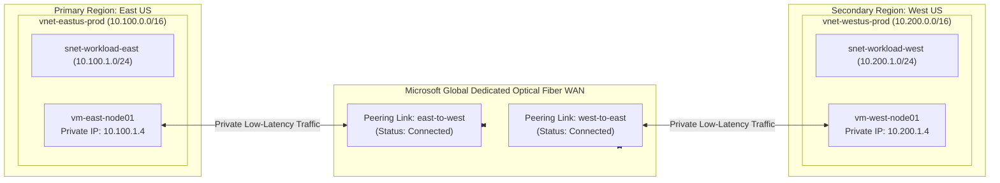

# Project 02: Enterprise Virtual Network Topology & Global VNet Peering

**Breadcrumbs:** [[--Index--|🏠 Index]] > [[14-Index - Terraform on Azure|☁️ Terraform on Azure MOC]] > [[README|Azure Terraform Projects]] > **Project 02: VNet Peering**

---

## 🎯 Executive Overview & Architectural Objectives

Modern enterprise cloud deployments rarely operate within a single geographic region. Disaster recovery requirements, data sovereignty mandates, and latency optimization demand interconnecting multiple Virtual Networks (VNets) across regions.

In this project, you will engineer a **Multi-Region Cross-Connected Network Backbone** using Terraform. You will deploy two distinct Virtual Networks in separate paired regions (East US and West US) and establish high-speed, encrypted **Global VNet Peering** using Terraform provider aliases.

### Key Architectural Deliverables:
1.  **Multi-Provider Aliasing:** Configure multi-region Terraform deployments using default and aliased `azurerm` provider blocks (`provider = azurerm.westus`).
2.  **Disjoint IP CIDR Planning:** Architect non-overlapping address spaces: `10.100.0.0/16` for East US and `10.200.0.0/16` for West US.
3.  **Bidirectional VNet Peering Fabric:** Provision two reciprocal peering resources (`azurerm_virtual_network_peering`) linking East US to West US, enforcing `allow_virtual_network_access = true` and `allow_forwarded_traffic = true`.
4.  **Workload VM Validation Instances:** Deploy private Ubuntu Linux compute instances in each VNet without public IP addresses, using Network Security Groups (NSGs) allowing ICMP ping and private SSH.
5.  **Direct Connectivity Proof:** Execute private IP ping and traceroute probes confirming sub-millisecond line-rate latency across Microsoft's global fiber-optic backbone.

---

## 🏛️ Target Architecture & Component Topology



---

## 🧠 Deep-Intuition Azure Administration & Architectural Mechanics

### 1. Global VNet Peering vs. VPN Gateway
*   **VPN Gateway (VNet-to-VNet):** Routes packets through encrypted IPsec software tunnels managed by gateway instances. Throughput is capped by the Gateway SKU (e.g., VpnGw1 is limited to 650 Mbps), introduces latency, and incurs hourly gateway licensing costs.
*   **Global VNet Peering:** Connects VNets directly over the Microsoft global optical network fabric. Traffic travels at line rate (up to 40 Gbps on modern VM sizes), bypasses public internet completely, is encrypted at layer 2 via MACsec across datacenter interconnects, and features zero gateway bottlenecks.

### 2. The Reciprocal Peering Requirement
In Azure Resource Manager, a peering connection is **unidirectional**.
*   Creating a peering link from VNet A to VNet B puts the status in **`Initiated`**.
*   Until a reciprocal peering link is created from VNet B back to VNet A, traffic **cannot flow**.
*   Once both matching links are provisioned, the status transitions to **`Connected`**. In Terraform, we declare two distinct `azurerm_virtual_network_peering` resources to satisfy this reciprocity.

### 3. Non-Transitivity Law of VNet Peering
VNet Peering is strictly **non-transitive**:
*   If VNet A is peered to VNet B, and VNet B is peered to VNet C, **VNet A CANNOT communicate with VNet C** through VNet B.
*   To enable transitive hub-spoke routing, an NVA (Network Virtual Appliance) or Azure Firewall must be placed in VNet B, with `allow_forwarded_traffic = true` and User-Defined Routes (UDRs) applied to VNet A and C.

---

## 💻 Complete Production-Grade Terraform Code

### 1. `provider.tf`
```hcl
terraform {
  required_version = ">= 1.5.0"
  required_providers {
    azurerm = {
      source  = "hashicorp/azurerm"
      version = "~> 3.90.0"
    }
    tls = {
      source  = "hashicorp/tls"
      version = "~> 4.0.0"
    }
  }
}

# Primary Provider: East US
provider "azurerm" {
  features {}
}

# Aliased Secondary Provider: West US
provider "azurerm" {
  alias = "westus"
  features {}
}
```

### 2. `variables.tf`
```hcl
variable "east_location" {
  type        = string
  description = "Primary Azure region."
  default     = "eastus"
}

variable "west_location" {
  type        = string
  description = "Secondary Azure region."
  default     = "westus"
}

variable "admin_username" {
  type        = string
  description = "Admin username for compute validation VMs."
  default     = "azureuser"
}
```

### 3. `networks.tf` (East US and West US VNets)
```hcl
# --- EAST US INFRASTRUCTURE ---
resource "azurerm_resource_group" "rg_east" {
  name     = "rg-network-eastus-prod"
  location = var.east_location
}

resource "azurerm_virtual_network" "vnet_east" {
  name                = "vnet-eastus-prod"
  resource_group_name = azurerm_resource_group.rg_east.name
  location            = azurerm_resource_group.rg_east.location
  address_space       = ["10.100.0.0/16"]
}

resource "azurerm_subnet" "snet_east" {
  name                 = "snet-workload-east"
  resource_group_name  = azurerm_resource_group.rg_east.name
  virtual_network_name = azurerm_virtual_network.vnet_east.name
  address_prefixes     = ["10.100.1.0/24"]
}

# --- WEST US INFRASTRUCTURE (Using Aliased Provider) ---
resource "azurerm_resource_group" "rg_west" {
  provider = azurerm.westus
  name     = "rg-network-westus-prod"
  location = var.west_location
}

resource "azurerm_virtual_network" "vnet_west" {
  provider            = azurerm.westus
  name                = "vnet-westus-prod"
  resource_group_name = azurerm_resource_group.rg_west.name
  location            = azurerm_resource_group.rg_west.location
  address_space       = ["10.200.0.0/16"]
}

resource "azurerm_subnet" "snet_west" {
  provider             = azurerm.westus
  name                 = "snet-workload-west"
  resource_group_name  = azurerm_resource_group.rg_west.name
  virtual_network_name = azurerm_virtual_network.vnet_west.name
  address_prefixes     = ["10.200.1.0/24"]
}
```

### 4. `peering.tf` (Bidirectional Global Peering Fabric)
```hcl
# Link 1: East US ➔ West US
resource "azurerm_virtual_network_peering" "east_to_west" {
  name                         = "peer-east-to-west"
  resource_group_name          = azurerm_resource_group.rg_east.name
  virtual_network_name         = azurerm_virtual_network.vnet_east.name
  remote_virtual_network_id    = azurerm_virtual_network.vnet_west.id
  allow_virtual_network_access = true
  allow_forwarded_traffic      = true
  allow_gateway_transit        = false
  use_remote_gateways          = false
}

# Link 2: West US ➔ East US (Using Aliased Provider)
resource "azurerm_virtual_network_peering" "west_to_east" {
  provider                     = azurerm.westus
  name                         = "peer-west-to-east"
  resource_group_name          = azurerm_resource_group.rg_west.name
  virtual_network_name         = azurerm_virtual_network.vnet_west.name
  remote_virtual_network_id    = azurerm_virtual_network.vnet_east.id
  allow_virtual_network_access = true
  allow_forwarded_traffic      = true
  allow_gateway_transit        = false
  use_remote_gateways          = false

  # Ensure Link 1 is processed cleanly
  depends_on = [azurerm_virtual_network_peering.east_to_west]
}
```

### 5. `compute_test_vms.tf` (Validation Workload Nodes)
```hcl
# Shared SSH Key Pair
resource "tls_private_key" "ssh" {
  algorithm = "RSA"
  rsa_bits  = 4096
}

# NSG allowing internal cross-VNet traffic & SSH
resource "azurerm_network_security_group" "nsg_east" {
  name                = "nsg-east-workload"
  location            = azurerm_resource_group.rg_east.location
  resource_group_name = azurerm_resource_group.rg_east.name

  security_rule {
    name                       = "AllowAllCrossVNet"
    priority                   = 100
    direction                  = "Inbound"
    access                     = "Allow"
    protocol                   = "*"
    source_port_range          = "*"
    destination_port_range     = "*"
    source_address_prefix      = "10.200.0.0/16" # West VNet CIDR
    destination_address_prefix = "*"
  }
}

resource "azurerm_subnet_network_security_group_association" "nsg_assoc_east" {
  subnet_id                 = azurerm_subnet.snet_east.id
  network_security_group_id = azurerm_network_security_group.nsg_east.id
}

# East US Virtual Machine
resource "azurerm_network_interface" "nic_east" {
  name                = "nic-vm-east"
  location            = azurerm_resource_group.rg_east.location
  resource_group_name = azurerm_resource_group.rg_east.name

  ip_configuration {
    name                          = "ipconfig-primary"
    subnet_id                     = azurerm_subnet.snet_east.id
    private_ip_address_allocation = "Static"
    private_ip_address            = "10.100.1.4"
  }
}

resource "azurerm_linux_virtual_machine" "vm_east" {
  name                = "vm-east-node01"
  resource_group_name = azurerm_resource_group.rg_east.name
  location            = azurerm_resource_group.rg_east.location
  size                = "Standard_B1s"
  admin_username      = var.admin_username

  network_interface_ids = [azurerm_network_interface.nic_east.id]

  admin_ssh_key {
    username   = var.admin_username
    public_key = tls_private_key.ssh.public_key_openssh
  }

  os_disk {
    caching              = "ReadWrite"
    storage_account_type = "Standard_LRS"
  }

  source_image_reference {
    publisher = "Canonical"
    offer     = "0001-com-ubuntu-server-jammy"
    sku       = "22_04-lts-gen2"
    version   = "latest"
  }
}

# West US Virtual Machine
resource "azurerm_network_interface" "nic_west" {
  provider            = azurerm.westus
  name                = "nic-vm-west"
  location            = azurerm_resource_group.rg_west.location
  resource_group_name = azurerm_resource_group.rg_west.name

  ip_configuration {
    name                          = "ipconfig-primary"
    subnet_id                     = azurerm_subnet.snet_west.id
    private_ip_address_allocation = "Static"
    private_ip_address            = "10.200.1.4"
  }
}

resource "azurerm_linux_virtual_machine" "vm_west" {
  provider            = azurerm.westus
  name                = "vm-west-node01"
  resource_group_name = azurerm_resource_group.rg_west.name
  location            = azurerm_resource_group.rg_west.location
  size                = "Standard_B1s"
  admin_username      = var.admin_username

  network_interface_ids = [azurerm_network_interface.nic_west.id]

  admin_ssh_key {
    username   = var.admin_username
    public_key = tls_private_key.ssh.public_key_openssh
  }

  os_disk {
    caching              = "ReadWrite"
    storage_account_type = "Standard_LRS"
  }

  source_image_reference {
    publisher = "Canonical"
    offer     = "0001-com-ubuntu-server-jammy"
    sku       = "22_04-lts-gen2"
    version   = "latest"
  }
}
```

### 6. `outputs.tf`
```hcl
output "vm_east_private_ip" {
  value       = azurerm_network_interface.nic_east.ip_configuration[0].private_ip_address
  description = "Private IP of East US VM."
}

output "vm_west_private_ip" {
  value       = azurerm_network_interface.nic_west.ip_configuration[0].private_ip_address
  description = "Private IP of West US VM."
}

output "peering_status" {
  value = {
    east_to_west = azurerm_virtual_network_peering.east_to_west.id
    west_to_east = azurerm_virtual_network_peering.west_to_east.id
  }
}
```

---

## 🛠️ Step-by-Step Implementation Walkthrough

1.  **Initialize & Validate:**
    ```bash
    terraform init
    terraform validate
    ```
2.  **Execute Deployment Plan:**
    ```bash
    terraform apply -auto-approve
    ```
3.  👁️ **Visual Checkpoint in Azure Portal:**
    *   Navigate to **Virtual networks** ➔ Select `vnet-eastus-prod` ➔ Under **Settings**, click **Peerings**.
    *   Verify that `peer-east-to-west` has **Peering status: `Connected`**.
    *   Navigate to `vnet-westus-prod` ➔ **Peerings**. Verify `peer-west-to-east` shows **Peering status: `Connected`**.
    *   Click into `vm-east-node01` ➔ **Networking** ➔ **Effective routes**. Notice the route for `10.200.0.0/16` shows **Next Hop: `VNet peering` (Active)**.

---

## 🔬 Verification & Live Probe Testing

Use Azure Cloud Shell or your workstation to query the peering status via Azure CLI:

```bash
# Verify bidirectional peering state
az network vnet peering show \
  --resource-group "rg-network-eastus-prod" \
  --vnet-name "vnet-eastus-prod" \
  --name "peer-east-to-west" \
  --query "{Name:name, State:peeringState, AllowForwarded:allowForwardedTraffic}" \
  --output table

az network vnet peering show \
  --resource-group "rg-network-westus-prod" \
  --vnet-name "vnet-westus-prod" \
  --name "peer-west-to-east" \
  --query "{Name:name, State:peeringState, AllowForwarded:allowForwardedTraffic}" \
  --output table
```
**Expected Output:** Both commands return `peeringState: Connected`.

---

## ⚠️ "See It in Action" Real-World Failure & Recovery Loop (AARF)

### Scenario: The Overlapping IP CIDR Peering Lockout
*   **The Architecture:** An engineer plans to peer an acquisitions company VNet (`10.0.0.0/16`) to the primary corporate Hub VNet (`10.0.0.0/16`).
*   **The Assumption:** The engineer assumes that because they are in separate Azure subscriptions, Azure will automatically handle the routing.
*   **The Failure Loop:**
    *   Running `terraform apply` fails immediately with an ARM control plane error:
        `Error: creating Virtual Network Peering "peer-hub-to-acq": OverlappingAddressSpace: Virtual network vnet-hub cannot be peered with vnet-acq because their address spaces overlap.`
*   **The Root Cause:**
    *   VNet Peering operates at Layer 3 IP routing. Hypervisors cannot deterministically route packets between duplicate CIDR blocks.
*   **The Remediation:**
    *   Address spaces cannot overlap. In modern Azure, you can dynamically add a non-overlapping CIDR block (e.g. `10.250.0.0/16`) to the virtual network and remove the overlapping block before establishing the peering link.

---

## 🧹 Cost Optimization & Clean Teardown

```bash
terraform destroy -auto-approve
```
