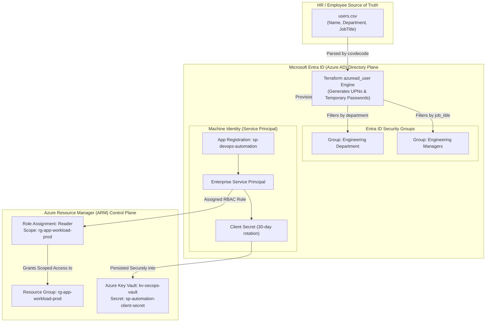

# Project 03: Microsoft Entra ID Authentication, Service Principals & RBAC as Code

**Breadcrumbs:** [[--Index--|🏠 Index]] > [[14-Index - Terraform on Azure|☁️ Terraform on Azure MOC]] > [[README|Azure Terraform Projects]] > **Project 03: Entra ID & SPN**

---

## 🎯 Executive Overview & Architectural Objectives

In enterprise cloud security, manually managing user accounts, security groups, and service principals through the Azure Portal leads to privilege creep, orphaned accounts, and non-compliant access baselines.

In this project, you will step into the shoes of a Cloud Security Architect. You will automate identity lifecycle governance and zero-trust service authentication using the **`azuread`** and **`azurerm`** Terraform providers.

### Key Architectural Deliverables:
1.  **Dual-Provider Orchestration:** Configure both `azuread` (for Microsoft Entra ID identity plane objects) and `azurerm` (for Azure Resource Manager control plane objects) in a unified Terraform workspace.
2.  **Bulk User Onboarding via `csvdecode`:** Ingest a structured employee roster (`users.csv`) and programmatically provision Entra ID users with standardized User Principal Names (UPNs), departmental metadata, and initial temporary passwords with `force_password_change = true`.
3.  **Role-Based Security Groups:** Declaratively create Departmental Security Groups (`azuread_group`) and dynamically bind user memberships based on CSV job titles and departments using `for_each` filtering.
4.  **Automated Machine Identity (Service Principal):** Provision an Entra ID Application registration (`azuread_application`), an associated Service Principal (`azuread_service_principal`), and generate a cryptographically secure client secret with automated rotation scheduling.
5.  **Scoped Least-Privilege Azure RBAC:** Assign the newly minted Service Principal the built-in **`Reader`** role scoped specifically to a target application resource group using `azurerm_role_assignment`.
6.  **Zero-Trust Secret Vaulting:** Store the generated Service Principal credentials directly inside an Azure Key Vault secret, eliminating plaintext credential exposure in state files and console output.

---

## 🏛️ Target Architecture & Component Topology



---

## 🧠 Deep-Intuition Azure Administration & Architectural Mechanics

### 1. The Separation of Identity Plane vs. Resource Plane
*   **The Identity Plane (`azuread` Provider):** Governs objects inside your Microsoft Entra ID tenant (Users, Security Groups, App Registrations, Enterprise Applications). These exist independently of Azure Subscriptions and operate globally via Microsoft Graph APIs (`graph.microsoft.com`).
*   **The Resource Plane (`azurerm` Provider):** Governs infrastructure deployed inside Azure subscriptions (Resource Groups, VNets, VMs, Databases) via ARM APIs (`management.azure.com`).
*   **The Bridge (`azurerm_role_assignment`):** Binds an object ID from the Entra ID identity plane to a scope inside the ARM resource plane, granting fine-grained authorization.

### 2. App Registrations vs. Enterprise Applications (Service Principals)
*   **`azuread_application` (App Registration):** The global blueprint and definition of the application across all tenants. It defines app ID, redirect URIs, and delegated API permissions.
*   **`azuread_service_principal` (Enterprise Application):** The local instance and security identity of the application *within a specific Entra ID tenant*. This identity is what actually authenticates and receives RBAC permissions against Azure subscriptions.
*   **`azuread_service_principal_password`:** The cryptographic client secret used by automation runners to request OAuth2 access tokens.

---

## 💻 Complete Production-Grade Terraform Code

### 1. `provider.tf`
```hcl
terraform {
  required_version = ">= 1.5.0"
  required_providers {
    azuread = {
      source  = "hashicorp/azuread"
      version = "~> 2.47.0"
    }
    azurerm = {
      source  = "hashicorp/azurerm"
      version = "~> 3.90.0"
    }
    time = {
      source  = "hashicorp/time"
      version = "~> 0.10.0"
    }
  }
}

provider "azuread" {}

provider "azurerm" {
  features {
    key_vault {
      purge_soft_delete_on_destroy    = true
      recover_soft_deleted_key_vaults = false
    }
  }
}
```

### 2. `users.csv`
Place this CSV file in the same directory as your Terraform files:
```csv
first_name,last_name,department,job_title
Alex,Rivera,Engineering,Engineer
Sarah,Connor,Engineering,Manager
Marcus,Vance,Operations,Engineer
Elena,Rostova,Security,Manager
```

### 3. `users_and_groups.tf`
```hcl
# Discover the primary initial domain name of the Entra ID tenant
data "azuread_domains" "default" {
  only_initial = true
}

locals {
  tenant_domain = data.azuread_domains.default.domains[0].domain_name
  user_records  = csvdecode(file("${path.module}/users.csv"))
}

# Bulk Provision Users
resource "azuread_user" "employees" {
  for_each = { for u in local.user_records : "${lower(u.first_name)}.${lower(u.last_name)}" => u }

  user_principal_name = "${lower(each.value.first_name)}.${lower(each.value.last_name)}@${local.tenant_domain}"
  display_name        = "${each.value.first_name} ${each.value.last_name}"
  department          = each.value.department
  job_title           = each.value.job_title

  # Deterministic initial temporary password (user is prompted to change on first login)
  password              = "TempPass2026!${length(each.value.first_name)}"
  force_password_change = true
}

# Departmental Security Group: Engineering
resource "azuread_group" "grp_engineering" {
  display_name     = "grp-engineering-department"
  security_enabled = true
  description      = "Corporate Engineering department security group managed by Terraform."
}

resource "azuread_group_member" "engineering_members" {
  for_each = {
    for k, v in azuread_user.employees : k => v
    if v.department == "Engineering"
  }

  group_object_id  = azuread_group.grp_engineering.id
  member_object_id = each.value.id
}

# Departmental Security Group: Managers
resource "azuread_group" "grp_managers" {
  display_name     = "grp-people-managers"
  security_enabled = true
  description      = "Leadership security group for managers managed by Terraform."
}

resource "azuread_group_member" "manager_members" {
  for_each = {
    for k, v in azuread_user.employees : k => v
    if v.job_title == "Manager"
  }

  group_object_id  = azuread_group.grp_managers.id
  member_object_id = each.value.id
}
```

### 4. `service_principal_and_rbac.tf`
```hcl
# Create Entra ID Application Registration
resource "azuread_application" "sp_app" {
  display_name = "sp-devops-automation"
  owners       = [data.azuread_client_config.current.object_id]
}

data "azuread_client_config" "current" {}

# Create Enterprise Service Principal
resource "azuread_service_principal" "sp" {
  client_id                    = azuread_application.sp_app.client_id
  app_role_assignment_required = false
  owners                       = [data.azuread_client_config.current.object_id]
}

# Generate Client Secret with 30-Day Rotation
resource "time_rotating" "secret_rotation" {
  rotation_days = 30
}

resource "azuread_service_principal_password" "sp_secret" {
  service_principal_id = azuread_service_principal.sp.id
  rotate_when_changed = {
    rotation = time_rotating.secret_rotation.id
  }
}

# --- ARM RESOURCE PLANE INTEGRATION ---

resource "azurerm_resource_group" "workload_rg" {
  name     = "rg-app-workload-prod"
  location = "eastus"
}

# Assign Least-Privilege Role: Reader at Resource Group Scope
resource "azurerm_role_assignment" "sp_reader" {
  scope                = azurerm_resource_group.workload_rg.id
  role_definition_name = "Reader"
  principal_id         = azuread_service_principal.sp.object_id
}
```

### 5. `keyvault_secret_storage.tf`
```hcl
data "azurerm_client_config" "arm_current" {}

# Provision Azure Key Vault to store credentials securely
resource "azurerm_key_vault" "kv" {
  name                       = "kv-secops-${substr(md5(azurerm_resource_group.workload_rg.id), 0, 8)}"
  location                   = azurerm_resource_group.workload_rg.location
  resource_group_name        = azurerm_resource_group.workload_rg.name
  tenant_id                  = data.azurerm_client_config.arm_current.tenant_id
  sku_name                   = "standard"
  soft_delete_retention_days = 7

  access_policy {
    tenant_id = data.azurerm_client_config.arm_current.tenant_id
    object_id = data.azurerm_client_config.arm_current.object_id

    secret_permissions = [
      "Get", "List", "Set", "Delete", "Purge"
    ]
  }
}

# Store Service Principal Secret in Key Vault
resource "azurerm_key_vault_secret" "sp_secret_vaulted" {
  name         = "sp-devops-automation-secret"
  value        = azuread_service_principal_password.sp_secret.value
  key_vault_id = azurerm_key_vault.kv.id

  # Ensure Key Vault policy is established first
  depends_on = [azurerm_key_vault.kv]
}
```

### 6. `outputs.tf`
```hcl
output "tenant_domain" {
  value       = local.tenant_domain
  description = "Primary verified Entra ID domain."
}

output "provisioned_users" {
  value = [
    for u in azuread_user.employees : "${u.display_name} (${u.user_principal_name})"
  ]
}

output "service_principal_client_id" {
  value       = azuread_service_principal.sp.client_id
  description = "Client (Application) ID of the Service Principal."
}

output "key_vault_secret_uri" {
  value       = azurerm_key_vault_secret.sp_secret_vaulted.versionless_id
  description = "Key Vault URI hosting the rotated Service Principal Secret."
}
```

---

## 🛠️ Step-by-Step Implementation Walkthrough

1.  **Initialize & Validate Workspace:**
    ```bash
    terraform init
    terraform validate
    ```
2.  **Deploy Identity & ARM Infrastructure:**
    ```bash
    terraform apply -auto-approve
    ```
3.  👁️ **Visual Checkpoint in Azure Portal:**
    *   In the Portal, navigate to **Microsoft Entra ID** ➔ **Users**.
    *   Verify `Alex Rivera`, `Sarah Connor`, `Marcus Vance`, and `Elena Rostova` are listed with status active and `force_password_change` flag set.
    *   Under **Groups**, verify `grp-engineering-department` contains Alex and Sarah; `grp-people-managers` contains Sarah and Elena.
    *   Under **App registrations**, click **All applications** ➔ Verify `sp-devops-automation` exists.
    *   Navigate to **Resource groups** ➔ `rg-app-workload-prod` ➔ **Access control (IAM)** ➔ **Role assignments**. Verify `sp-devops-automation` is listed with role **Reader**.
    *   Navigate to the deployed **Key Vault** ➔ **Secrets**. Verify `sp-devops-automation-secret` is stored securely!

---

## 🔬 Verification & Live Probe Testing

Verify your deployment using Azure CLI:

```bash
# 1. Query provisioned users and departments
az ad user list --filter "department eq 'Engineering'" --query "[].{Name:displayName, UPN:userPrincipalName, Title:jobTitle}" --output table

# 2. Verify Service Principal role assignment on the resource group
RG_ID=$(az group show --name "rg-app-workload-prod" --query id -o tsv)
az role assignment list --scope "${RG_ID}" --query "[].{Principal:principalName, Role:roleDefinitionName, Scope:scope}" --output table
```

---

## ⚠️ "See It in Action" Real-World Failure & Recovery Loop (AARF)

### Scenario: The Graph API Permissions & Consent Lockout
*   **The Assumption:** An engineer authenticates using `az login` with a personal account possessing `Owner` rights on the Azure Subscription and assumes Terraform can create Entra ID users and groups.
*   **The Failure Loop:**
    *   Running `terraform apply` fails with HTTP 403 Forbidden:
        `Error: creating User: graph.microsoft.com/v1.0/users: Insufficient privileges to complete the operation.`
*   **The Root Cause:**
    *   Azure Subscription `Owner` permissions exist **strictly on the ARM resource plane**. Subscription Owner gives **zero rights** on the Entra ID identity plane!
    *   Modifying users, groups, or application registrations requires directory roles such as **`User Administrator`**, **`Privileged Role Administrator`**, or delegated Microsoft Graph API permissions (`User.ReadWrite.All`, `Group.ReadWrite.All`).
*   **The Remediation:**
    *   In Entra ID ➔ **Roles and administrators**, assign your executing account or CI/CD Service Principal the **User Administrator** or **Application Administrator** role.

---

## 🧹 Cost Optimization & Clean Teardown

```bash
terraform destroy -auto-approve
```
