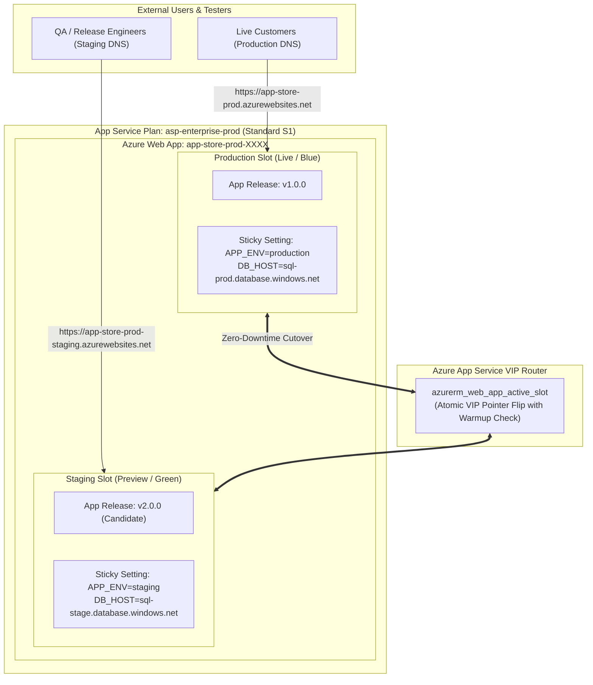

# Project 04: Azure App Service with Blue/Green Zero-Downtime Deployment Slots

**Breadcrumbs:** [[--Index--|🏠 Index]] > [[14-Index - Terraform on Azure|☁️ Terraform on Azure MOC]] > [[README|Azure Terraform Projects]] > **Project 04: App Service Slots**

---

## 🎯 Executive Overview & Architectural Objectives

Deploying software directly to live production web servers inevitably incurs downtime, broken user sessions, and cold-start latency. In enterprise cloud deployments, blue/green deployments eliminate risk by provisioning an isolated **Staging Slot**, validating application warm-up, and executing an atomic virtual IP swap without restarting containers.

In this project, you will engineer an automated **Zero-Downtime Blue/Green PaaS Deployment Pipeline** using Terraform and modern Azure App Service resources (`azurerm_linux_web_app` and `azurerm_linux_web_app_slot`).

### Key Architectural Deliverables:
1.  **Production PaaS Plan (`azurerm_service_plan`):** Provision a dedicated Linux App Service Plan on the `Standard S1` tier (establishing the mandatory prerequisite tier for deployment slot support).
2.  **Live Production Web App (`azurerm_linux_web_app`):** Deploy a Linux web application running Node 20 LTS with configured application settings (`APP_ENV = "production"`).
3.  **Isolated Staging Slot (`azurerm_linux_web_app_slot`):** Provision a preview staging slot with isolated endpoints (`APP_ENV = "staging"`).
4.  **Sticky Configuration Enforcement (`sticky_settings`):** Declare slot-bound settings that remain anchored to their respective physical environment during swaps, preventing production from accidentally executing queries against staging databases.
5.  **Declarative Atomic Swap (`azurerm_web_app_active_slot`):** Automate the atomic cutover in Terraform code, ensuring zero HTTP 502/504 errors during transition.

---

## 🏛️ Target Architecture & Component Topology



---

## 🧠 Deep-Intuition Azure Administration & Architectural Mechanics

### 1. App Service Plan SKU Slot Boundaries
*   **Free (F1), Shared (D1), and Basic (B1):** Dedicated to dev/test environments. They **DO NOT** support deployment slots or automated traffic routing.
*   **Standard (S1–S3):** Supports up to **5 deployment slots** per web app.
*   **Premium (P1v3–P3v3):** Supports up to **20 deployment slots**, along with VNet integration and automated scaling.
*   **Isolated (I1v2–I3v2):** Hosts deployment slots inside a private App Service Environment (ASE).

### 2. How the Atomic Slot Swap Works Under the Hood
1.  **Warm-up Phase:** When a swap is triggered, Azure's internal front-end router makes HTTP GET requests to the candidate staging instance on the configured warm-up path (`/` or `applicationInitialization` in web.config).
2.  **Configuration Application:** Staging receives non-sticky production settings and restarts worker processes in the sandbox.
3.  **Atomic VIP Flip:** Only after the candidate worker process returns `HTTP 200 OK` does the Azure front-end load balancer flip the virtual IP pointers. The transition is instantaneous and causes zero dropped TCP connections.

### 3. Sticky Settings (`sticky_settings`)
By default, application settings travel with the code during a swap. If your database connection string is named `DATABASE_URL`, swapping staging into production without pinning will cause the live production app to point to the staging database!
*   Declaring settings in the **`sticky_settings`** block pins them permanently to their specific slot.

---

## 💻 Complete Production-Grade Terraform Code

### 1. `provider.tf`
```hcl
terraform {
  required_version = ">= 1.5.0"
  required_providers {
    azurerm = {
      source  = "hashicorp/azurerm"
      version = "~> 3.90.0"
    }
    random = {
      source  = "hashicorp/random"
      version = "~> 3.6.0"
    }
  }
}

provider "azurerm" {
  features {}
}
```

### 2. `main.tf`
```hcl
resource "random_string" "app_suffix" {
  length  = 5
  special = false
  upper   = false
}

resource "azurerm_resource_group" "rg" {
  name     = "rg-appservice-slots-prod"
  location = "eastus"
}

# 1. App Service Plan (Standard S1 for Slot Support)
resource "azurerm_service_plan" "asp" {
  name                = "asp-enterprise-prod"
  resource_group_name = azurerm_resource_group.rg.name
  location            = azurerm_resource_group.rg.location
  os_type             = "Linux"
  sku_name            = "S1"
}

# 2. Production Web App (Production Slot)
resource "azurerm_linux_web_app" "app" {
  name                = "app-store-prod-${random_string.app_suffix.result}"
  resource_group_name = azurerm_resource_group.rg.name
  location            = azurerm_service_plan.asp.location
  service_plan_id     = azurerm_service_plan.asp.id

  site_config {
    always_on = true
    application_stack {
      node_version = "20-lts"
    }
  }

  app_settings = {
    "APP_ENVIRONMENT" = "production"
    "DATABASE_HOST"   = "sql-prod.internal.corp"
    "FEATURE_NEW_UI"  = "false"
  }

  # Declare Sticky Settings (Pin settings to the slot during swaps)
  sticky_settings {
    app_setting_names = [
      "APP_ENVIRONMENT",
      "DATABASE_HOST"
    ]
  }
}

# 3. Staging Deployment Slot
resource "azurerm_linux_web_app_slot" "staging" {
  name           = "staging"
  app_service_id = azurerm_linux_web_app.app.id

  site_config {
    always_on = true
    application_stack {
      node_version = "20-lts"
    }
  }

  app_settings = {
    "APP_ENVIRONMENT" = "staging"
    "DATABASE_HOST"   = "sql-staging.internal.corp"
    "FEATURE_NEW_UI"  = "true" # Candidate feature under test
  }
}

# 4. Atomic Blue/Green Swap Controller (Uncomment to execute automated swap)
# resource "azurerm_web_app_active_slot" "swap" {
#   slot_id = azurerm_linux_web_app_slot.staging.id
# }
```

### 3. `outputs.tf`
```hcl
output "production_url" {
  value       = "https://${azurerm_linux_web_app.app.default_hostname}"
  description = "Live Production URL."
}

output "staging_url" {
  value       = "https://${azurerm_linux_web_app_slot.staging.default_hostname}"
  description = "Preview Staging Slot URL."
}
```

---

## 🛠️ Step-by-Step Implementation Walkthrough

1.  **Deploy Base Production & Staging Slots:**
    ```bash
    terraform init
    terraform apply -auto-approve
    ```
2.  👁️ **Visual Checkpoint in Azure Portal:**
    *   Navigate to **App Services** ➔ Select `app-store-prod-XXXX`.
    *   Under **Deployment**, click **Deployment slots**.
    *   Notice two slots: `production` (Traffic 100%) and `staging` (Traffic 0%).
    *   Under **Settings** ➔ **Configuration** (or Environment variables), verify that `APP_ENVIRONMENT` and `DATABASE_HOST` have checkmarks under **Deployment slot setting** (Sticky).
3.  **Execute the Atomic Swap:**
    *   In `main.tf`, uncomment the `azurerm_web_app_active_slot` resource block:
        ```hcl
        resource "azurerm_web_app_active_slot" "swap" {
          slot_id = azurerm_linux_web_app_slot.staging.id
        }
        ```
    *   Run:
        ```bash
        terraform apply -auto-approve
        ```
    *   Observe the terminal: Azure warms up the staging worker processes, verifies stability, and atomically flips the slot VIP without dropping traffic!

---

## 🔬 Verification & Live Probe Testing

Verify that sticky settings remained anchored while application code swapped:

```bash
# Query Production app settings post-swap
APP_NAME=$(terraform output -raw production_url | sed 's|https://||')
az webapp config appsettings list \
  --name "${APP_NAME}" \
  --resource-group "rg-appservice-slots-prod" \
  --query "[?name=='APP_ENVIRONMENT' || name=='DATABASE_HOST' || name=='FEATURE_NEW_UI'].{Name:name, Value:value, Sticky:slotSetting}" \
  --output table
```
**Expected Output:** Notice that `APP_ENVIRONMENT` is still `production` and `DATABASE_HOST` is still `sql-prod.internal.corp`, while `FEATURE_NEW_UI` has transitioned to `true`!

---

## ⚠️ "See It in Action" Real-World Failure & Recovery Loop (AARF)

### Scenario: The Unpinned Database Connection String Swap Disaster
*   **The Architecture:** An enterprise deploys an e-commerce platform on Azure App Service with Staging and Production deployment slots.
*   **The Assumption:** The team assumes that deploying code to Staging and pressing "Swap" only moves the application binaries and leaves database connections untouched.
*   **The Failure Loop:**
    *   The team finishes validating release 2.0 in Staging and clicks **Swap**.
    *   Because `DATABASE_HOST` was not designated as sticky, Azure treats the configuration as mobile payload and swaps it into production.
    *   Live customer checkout transactions begin writing to the **Staging Database**, while batch tests in staging wipe production records!
*   **The Remediation:**
    *   Always declare critical environment parameters in `sticky_settings`:
        ```hcl
        sticky_settings {
          app_setting_names = ["DATABASE_HOST", "APP_ENVIRONMENT"]
        }
        ```

---

## 🧹 Cost Optimization & Clean Teardown

```bash
terraform destroy -auto-approve
```
