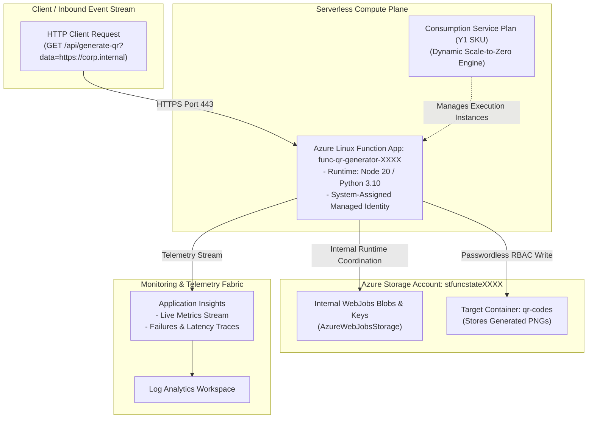

# Project 05: Serverless Event-Driven Azure Functions (QR Code Generator)

**Breadcrumbs:** [[--Index--|🏠 Index]] > [[14-Index - Terraform on Azure|☁️ Terraform on Azure MOC]] > [[README|Azure Terraform Projects]] > **Project 05: Serverless Functions**

---

## 🎯 Executive Overview & Architectural Objectives

Enterprise microservices increasingly rely on serverless compute to process asynchronous, event-driven workloads (such as image resizing, webhook processing, and QR code generation) without maintaining dedicated virtual machine fleets.

In this project, you will architect a **Serverless Event-Driven Processing Pipeline** on Microsoft Azure using Terraform. You will deploy a Linux Azure Function App running Node.js/Python on a serverless **Consumption Plan (Y1)**, configured with storage account bindings, Application Insights telemetry, and zero-trust Managed Identity authentication.

### Key Architectural Deliverables:
1.  **Serverless Consumption Plan (`azurerm_service_plan`):** Provision a dynamic Linux Consumption plan (`Y1` SKU) that scales automatically from 0 to 200 instances and charges purely per execution time.
2.  **Runtime State Storage Account (`azurerm_storage_account`):** Deploy a dedicated, ZRS-redundant Azure Storage Account hosting internal runtime state (`AzureWebJobsStorage`), function keys, and distributed locks.
3.  **Application Insights Observability (`azurerm_application_insights`):** Provision an Application Insights component linked to a Log Analytics workspace to capture distributed request traces, execution durations, and exception telemetry.
4.  **Linux Function App (`azurerm_linux_function_app`):** Declare the serverless function runtime specifying the application stack (Node.js 18/20 or Python 3.10), environment variables, and CORS policies.
5.  **Output Container & Passwordless Data Access:** Configure an isolated blob container (`qr-codes`) where generated artifacts are stored, granting the Function App's System-Assigned Managed Identity the `Storage Blob Data Contributor` role.

---

## 🏛️ Target Architecture & Component Topology



---

## 🧠 Deep-Intuition Azure Administration & Architectural Mechanics

### 1. Consumption Plan (Y1) vs. Premium Functions (EP1–EP3)
*   **Consumption Plan (Y1):** True serverless billing. Instances scale to zero when idle (costing $0.00). When an HTTP request or queue message arrives, Azure dynamically provisions an ephemeral worker container. 
    *   *Trade-off:* Experiences **cold-start latency** (typically 1–3 seconds on initial invoke). Execution duration is hard-capped at 5 minutes (expandable to 10 minutes in `host.json`).
*   **Elastic Premium (EP1–EP3):** Keeps pre-warmed instances running 24/7, eliminating cold starts. Supports VNet integration for private corporate network access and unlimited execution timeouts, but incurs baseline hourly compute charges.

### 2. The Mandatory `AzureWebJobsStorage` Connection
An Azure Function App cannot function without a linked Storage Account. Under the hood, the Azure Functions Host uses this account for:
*   Managing function execution triggers and timer state across instances.
*   Enforcing distributed singleton execution locks via Azure Blob Leases.
*   Storing function configuration keys and deployment packages.

### 3. Passwordless Managed Identity vs. Account Keys
Traditionally, `AzureWebJobsStorage` required embedding the storage account's primary master access key. In modern enterprise landing zones, we assign the Function App a **System-Assigned Managed Identity** and use Azure RBAC (`Storage Blob Data Owner` and `Storage Queue Data Contributor`), completely eliminating static access keys.

---

## 💻 Complete Production-Grade Terraform Code

### 1. `provider.tf`
```hcl
terraform {
  required_version = ">= 1.5.0"
  required_providers {
    azurerm = {
      source  = "hashicorp/azurerm"
      version = "~> 3.90.0"
    }
    random = {
      source  = "hashicorp/random"
      version = "~> 3.6.0"
    }
  }
}

provider "azurerm" {
  features {}
}
```

### 2. `main.tf`
```hcl
resource "random_string" "suffix" {
  length  = 5
  special = false
  upper   = false
}

resource "azurerm_resource_group" "rg" {
  name     = "rg-serverless-functions-prod"
  location = "eastus"
}

# 1. Log Analytics Workspace & Application Insights
resource "azurerm_log_analytics_workspace" "law" {
  name                = "law-functions-${random_string.suffix.result}"
  location            = azurerm_resource_group.rg.location
  resource_group_name = azurerm_resource_group.rg.name
  sku                 = "PerGB2018"
  retention_in_days   = 30
}

resource "azurerm_application_insights" "appinsights" {
  name                = "appi-qr-generator-${random_string.suffix.result}"
  location            = azurerm_resource_group.rg.location
  resource_group_name = azurerm_resource_group.rg.name
  workspace_id        = azurerm_log_analytics_workspace.law.id
  application_type    = "web"
}

# 2. Storage Account for Function Runtime State & QR Blobs
resource "azurerm_storage_account" "storage" {
  name                     = "stfunc${random_string.suffix.result}"
  resource_group_name      = azurerm_resource_group.rg.name
  location                 = azurerm_resource_group.rg.location
  account_tier             = "Standard"
  account_replication_type = "LRS"
  min_tls_version          = "TLS1_2"
  allow_blob_public_access = false
}

resource "azurerm_storage_container" "qr_output" {
  name                  = "qr-codes"
  storage_account_name  = azurerm_storage_account.storage.name
  container_access_type = "private"
}

# 3. Consumption Plan (Y1 Serverless)
resource "azurerm_service_plan" "consumption_plan" {
  name                = "asp-serverless-consumption"
  resource_group_name = azurerm_resource_group.rg.name
  location            = azurerm_resource_group.rg.location
  os_type             = "Linux"
  sku_name            = "Y1" # Serverless consumption tier
}

# 4. Linux Function App
resource "azurerm_linux_function_app" "function" {
  name                = "func-qr-generator-${random_string.suffix.result}"
  resource_group_name = azurerm_resource_group.rg.name
  location            = azurerm_resource_group.rg.location

  storage_account_name       = azurerm_storage_account.storage.name
  storage_account_access_key = azurerm_storage_account.storage.primary_access_key
  service_plan_id            = azurerm_service_plan.consumption_plan.id

  identity {
    type = "SystemAssigned"
  }

  site_config {
    application_stack {
      node_version = "20"
    }
    cors {
      allowed_origins = ["*"]
    }
  }

  app_settings = {
    "APPINSIGHTS_INSTRUMENTATIONKEY"        = azurerm_application_insights.appinsights.instrumentation_key
    "APPLICATIONINSIGHTS_CONNECTION_STRING" = azurerm_application_insights.appinsights.connection_string
    "OUTPUT_CONTAINER_NAME"                 = azurerm_storage_container.qr_output.name
    "ENABLE_DYNAMIC_QR"                     = "true"
  }
}

# 5. Grant Managed Identity Access to Output Storage Container
resource "azurerm_role_assignment" "func_storage_access" {
  scope                = azurerm_storage_account.storage.id
  role_definition_name = "Storage Blob Data Contributor"
  principal_id         = azurerm_linux_function_app.function.identity[0].principal_id
}
```

### 3. `outputs.tf`
```hcl
output "function_app_name" {
  value       = azurerm_linux_function_app.function.name
  description = "Name of the deployed Function App."
}

output "function_default_hostname" {
  value       = "https://${azurerm_linux_function_app.function.default_hostname}"
  description = "Default HTTPS invoke endpoint."
}

output "storage_account_name" {
  value       = azurerm_storage_account.storage.name
  description = "Storage account hosting runtime state and output blobs."
}
```

---

## 🛠️ Step-by-Step Implementation Walkthrough

1.  **Initialize & Apply:**
    ```bash
    terraform init
    terraform apply -auto-approve
    ```
2.  👁️ **Visual Checkpoint in Azure Portal:**
    *   Navigate to **Function App** ➔ Select `func-qr-generator-XXXX`.
    *   Under **Overview**, verify **Plan** is listed as `Consumption (Serverless)` and **Status** is `Running`.
    *   Under **Settings**, click **Identity**. Verify **System assigned** status is **On** with an assigned Object ID.
    *   Navigate to **Storage accounts** ➔ `stfuncXXXX` ➔ **Containers**. Verify `qr-codes` container is present.
    *   Under **Access Control (IAM)** ➔ **Role assignments**, verify the Function App's managed identity is assigned **Storage Blob Data Contributor**.

---

## 🔬 Verification & Live Probe Testing

Query the deployed Function App's runtime properties via Azure CLI:

```bash
FUNC_NAME=$(terraform output -raw function_app_name)

# 1. Verify Function App running state and plan SKU
az functionapp show \
  --name "${FUNC_NAME}" \
  --resource-group "rg-serverless-functions-prod" \
  --query "{Name:name, State:state, Plan:appServicePlanId, Runtime:siteConfig.linuxFxVersion}" \
  --output table

# 2. Verify Application Insights binding
az functionapp config appsettings list \
  --name "${FUNC_NAME}" \
  --resource-group "rg-serverless-functions-prod" \
  --query "[?name=='APPLICATIONINSIGHTS_CONNECTION_STRING'].{Setting:name, Configured:value != null}" \
  --output table
```

---

## ⚠️ "See It in Action" Real-World Failure & Recovery Loop (AARF)

### Scenario: The Storage Account Firewall Block on `AzureWebJobsStorage`
*   **The Assumption:** A security engineer enables the storage firewall on `stfuncXXXX` to allow "Selected networks only" to enforce perimeter isolation.
*   **The Failure Loop:**
    *   Within 60 seconds, the Function App stops executing triggers.
    *   Navigating to the Function App in the Portal displays a critical error banner:
        `Error: Azure Functions runtime is unreachable. Host initialization failed due to storage account connection error.`
*   **The Root Cause:**
    *   In a Consumption Plan (Y1), the function worker containers run on dynamic, multi-tenant Azure compute pools that do not have dedicated static outbound IPs or private VNet integration.
    *   Enabling the storage account firewall blocks the Function Host from acquiring its distributed blob lease, crashing the runtime.
*   **The Remediation:**
    *   If strict network isolation is required for Azure Functions, you **must upgrade from Consumption (Y1) to Elastic Premium (EP1)** and configure **Regional VNet Integration** (`azurerm_app_service_virtual_network_swift_connection`) before locking down storage firewall rules!

---

## 🧹 Cost Optimization & Clean Teardown

```bash
terraform destroy -auto-approve
```
