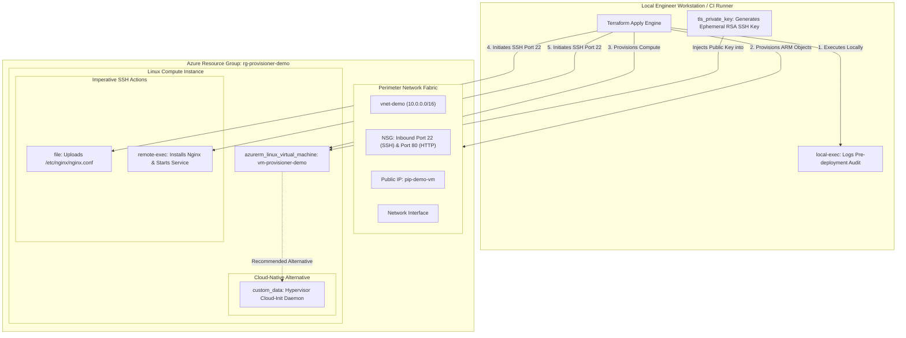

# Project 06: Terraform Provisioners vs. Native Cloud-Init & Custom Script Extensions

**Breadcrumbs:** [[--Index--|🏠 Index]] > [[14-Index - Terraform on Azure|☁️ Terraform on Azure MOC]] > [[README|Azure Terraform Projects]] > **Project 06: Provisioners & Cloud-Init**

---

## 🎯 Executive Overview & Architectural Objectives

Bootstrapping software packages, configuration templates, and administrative scripts onto newly provisioned virtual machines is a critical task in Infrastructure as Code. Terraform offers **Provisioners** (`file`, `local-exec`, and `remote-exec`) to execute imperative shell tasks.

However, HashiCorp explicitly classifies provisioners as a **last resort** because they violate declarative idempotency and introduce brittle SSH/WinRM network dependencies.

In this project, you will implement all three Terraform provisioner types to configure an Azure virtual machine, observe the "tainted resource" failure loop, and implement the modern, cloud-native enterprise replacement using **Azure `custom_data` (Cloud-Init)** and **`azurerm_virtual_machine_extension`**.

### Key Architectural Deliverables:
1.  **Network Perimeter & Jumpbox Baseline:** Deploy a Virtual Network (`10.0.0.0/16`), workload subnet, and Network Security Group (NSG) allowing inbound SSH (22) and HTTP (80).
2.  **The Three Terraform Provisioners in Action:**
    *   **`local-exec`:** Executes a local auditing script on the workstation/CI runner immediately before VM deployment.
    *   **`file`:** Securely transfers a custom Nginx configuration file (`nginx.conf`) onto the remote VM via an encrypted SSH connection block.
    *   **`remote-exec`:** Invokes remote bash commands on the Linux VM to update packages, install Nginx, and activate the web service.
3.  **Tainted Resource Forensics:** Trigger an intentional provisioner execution failure and analyze why Terraform taints the virtual machine for destruction on subsequent applies.
4.  **The Enterprise Cloud-Native Replacement:** Re-architect the solution using declarative Azure **Cloud-Init (`custom_data`)**, proving why native hypervisor-level bootstrapping is superior to imperative SSH provisioners.

---

## 🏛️ Target Architecture & Component Topology



---

## 🧠 Deep-Intuition Azure Administration & Architectural Mechanics

### 1. Why HashiCorp Classifies Provisioners as a "Last Resort"
*   **Lack of Idempotency:** Declarative Terraform resources track desired state vs. actual state. Provisioners run *only* at resource creation or destruction. If an engineer modifies a `remote-exec` script, Terraform does not know how to update the VM in-place.
*   **The Tainted Resource Penalty:** If a `remote-exec` script returns a non-zero exit code (e.g. an `apt-get` repository timeout), Terraform considers the resource corrupted. It marks the VM as **`tainted`**. On the next `terraform apply`, Terraform **destroys the VM and all attached data disks** and rebuilds from scratch!
*   **Network Fragility:** Provisioners require the Terraform runner to maintain direct, persistent SSH/WinRM TCP connections to the target VM. In zero-trust enterprise networks with private-only IPs, this forces runners to operate inside the private VNet or traverse complex jumpboxes.

### 2. The Cloud-Native Solution: `custom_data` & Cloud-Init
Instead of using SSH provisioners, production Azure architectures leverage the hypervisor-native **Linux Cloud-Init daemon**:
*   The script is base64-encoded and passed to the Azure compute fabric via the ARM API call.
*   The hypervisor injects the script into the VM's internal metadata drive (`/var/lib/cloud/instance/scripts/`).
*   The guest OS kernel executes the script at boot without opening SSH port 22 to the internet, without requiring SSH private keys in Terraform, and without risking state corruption if a task errors.

---

## 💻 Complete Production-Grade Terraform Code

### 1. `provider.tf`
```hcl
terraform {
  required_version = ">= 1.5.0"
  required_providers {
    azurerm = {
      source  = "hashicorp/azurerm"
      version = "~> 3.90.0"
    }
    tls = {
      source  = "hashicorp/tls"
      version = "~> 4.0.0"
    }
    null = {
      source  = "hashicorp/null"
      version = "~> 3.2.0"
    }
  }
}

provider "azurerm" {
  features {}
}
```

### 2. `main.tf`
```hcl
resource "azurerm_resource_group" "rg" {
  name     = "rg-provisioner-demo-prod"
  location = "eastus"
}

# 1. Network Infrastructure
resource "azurerm_virtual_network" "vnet" {
  name                = "vnet-demo"
  address_space       = ["10.0.0.0/16"]
  location            = azurerm_resource_group.rg.location
  resource_group_name = azurerm_resource_group.rg.name
}

resource "azurerm_subnet" "subnet" {
  name                 = "snet-workload"
  resource_group_name  = azurerm_resource_group.rg.name
  virtual_network_name = azurerm_virtual_network.vnet.name
  address_prefixes     = ["10.0.1.0/24"]
}

resource "azurerm_public_ip" "pip" {
  name                = "pip-provisioner-vm"
  location            = azurerm_resource_group.rg.location
  resource_group_name = azurerm_resource_group.rg.name
  allocation_method   = "Static"
  sku                 = "Standard"
}

resource "azurerm_network_security_group" "nsg" {
  name                = "nsg-provisioner-vm"
  location            = azurerm_resource_group.rg.location
  resource_group_name = azurerm_resource_group.rg.name

  security_rule {
    name                       = "AllowSSH"
    priority                   = 1001
    direction                  = "Inbound"
    access                     = "Allow"
    protocol                   = "Tcp"
    source_port_range          = "*"
    destination_port_range     = "22"
    source_address_prefix      = "*"
    destination_address_prefix = "*"
  }

  security_rule {
    name                       = "AllowHTTP"
    priority                   = 1002
    direction                  = "Inbound"
    access                     = "Allow"
    protocol                   = "Tcp"
    source_port_range          = "*"
    destination_port_range     = "80"
    source_address_prefix      = "*"
    destination_address_prefix = "*"
  }
}

resource "azurerm_network_interface" "nic" {
  name                = "nic-provisioner-vm"
  location            = azurerm_resource_group.rg.location
  resource_group_name = azurerm_resource_group.rg.name

  ip_configuration {
    name                          = "ipconfig-primary"
    subnet_id                     = azurerm_subnet.subnet.id
    private_ip_address_allocation = "Dynamic"
    public_ip_address_id          = azurerm_public_ip.pip.id
  }
}

resource "azurerm_network_interface_security_group_association" "nsg_assoc" {
  network_interface_id      = azurerm_network_interface.nic.id
  network_security_group_id = azurerm_network_security_group.nsg.id
}

# 2. Ephemeral SSH Key Pair
resource "tls_private_key" "ssh" {
  algorithm = "RSA"
  rsa_bits  = 4096
}

# 3. Local-Exec Provisioner via null_resource
resource "null_resource" "audit_pre_deploy" {
  triggers = {
    deployment_time = timestamp()
  }

  provisioner "local-exec" {
    command = "echo 'Terraform deployment initiated at ${timestamp()}' > deployment-audit.log"
  }
}

# 4. Virtual Machine with file and remote-exec Provisioners
resource "azurerm_linux_virtual_machine" "vm" {
  name                  = "vm-provisioner-demo"
  location              = azurerm_resource_group.rg.location
  resource_group_name   = azurerm_resource_group.rg.name
  network_interface_ids = [azurerm_network_interface.nic.id]
  size                  = "Standard_B1s"
  admin_username        = "azureuser"

  depends_on = [null_resource.audit_pre_deploy]

  admin_ssh_key {
    username   = "azureuser"
    public_key = tls_private_key.ssh.public_key_openssh
  }

  os_disk {
    caching              = "ReadWrite"
    storage_account_type = "Standard_LRS"
  }

  source_image_reference {
    publisher = "Canonical"
    offer     = "0001-com-ubuntu-server-jammy"
    sku       = "22_04-lts-gen2"
    version   = "latest"
  }

  # Connection block shared by provisioners
  connection {
    type        = "ssh"
    user        = "azureuser"
    private_key = tls_private_key.ssh.private_key_pem
    host        = azurerm_public_ip.pip.ip_address
    timeout     = "5m"
  }

  # Provisioner 1: File Upload
  provisioner "file" {
    content     = "server { listen 80; location / { return 200 'Configured via Terraform File Provisioner\n'; add_header Content-Type text/plain; } }"
    destination = "/home/azureuser/custom_nginx.conf"
  }

  # Provisioner 2: Remote-Exec Bash Commands
  provisioner "remote-exec" {
    inline = [
      "sudo apt-get update -y",
      "sudo apt-get install -y nginx",
      "sudo cp /home/azureuser/custom_nginx.conf /etc/nginx/sites-available/default",
      "sudo systemctl restart nginx",
      "sudo systemctl enable nginx"
    ]
  }
}
```

### 3. `outputs.tf`
```hcl
output "vm_public_ip" {
  value       = azurerm_public_ip.pip.ip_address
  description = "Public IP address of the provisioned virtual machine."
}

output "web_test_command" {
  value       = "curl http://${azurerm_public_ip.pip.ip_address}"
  description = "Command to verify webserver deployment."
}
```

---

## 🛠️ Step-by-Step Implementation Walkthrough

1.  **Initialize & Deploy:**
    ```bash
    terraform init
    terraform apply -auto-approve
    ```
    *Observe the console output:* Terraform creates the Public IP, connects over SSH using the TLS private key, transfers `custom_nginx.conf`, and executes the package installation scripts remotely.
2.  👁️ **Visual Checkpoint in Azure Portal:**
    *   Navigate to **Virtual machines** ➔ `vm-provisioner-demo`.
    *   Verify **Status** is `Running` and Public IP is assigned.
    *   Navigate to **Resource groups** ➔ Check local directory for generated `deployment-audit.log`.

---

## 🔬 Verification & Live Probe Testing

Execute an HTTP GET request against the provisioned instance:

```bash
VM_IP=$(terraform output -raw vm_public_ip)
curl "http://${VM_IP}"
```
**Expected Output:**
```text
Configured via Terraform File Provisioner
```

---

## ⚠️ "See It in Action" Real-World Failure & Recovery Loop (AARF)

### Scenario: The Network Flap & Tainted Resource Thrashing Disaster
*   **The Assumption:** An engineer assumes that if a `remote-exec` command fails temporarily (e.g., Ubuntu mirrors are slow or an apt lock is held), they can simply re-run `terraform apply` to resume where it left off.
*   **The Failure Loop:**
    *   During provisioning, a transient network error causes `remote-exec` to fail on step 4.
    *   Terraform reports:
        `Error: remote-exec provisioner error: Process exited with status 100.`
    *   Terraform marks the virtual machine as **`tainted`** in `terraform.tfstate`.
    *   When the engineer fixes the network and runs `terraform apply`, Terraform **destroys the entire VM and all attached managed disks**, wiping any data and rebuilding from scratch!
*   **The Remediation:**
    1.  To prevent destructive recreation, manually untaint the resource:
        ```bash
        terraform untaint azurerm_linux_virtual_machine.vm
        ```
    2.  Set `on_failure = continue` if the step is non-critical.
    3.  **The True Architectural Fix:** Migrate away from `remote-exec` to native **`custom_data = base64encode(file("cloud-init.yaml"))`**. Cloud-init failures never taint the Terraform resource, ensuring the VM remains intact while logging errors to `/var/log/cloud-init-output.log` inside the OS!

---

## 🧹 Cost Optimization & Clean Teardown

```bash
terraform destroy -auto-approve
rm -f deployment-audit.log
```
