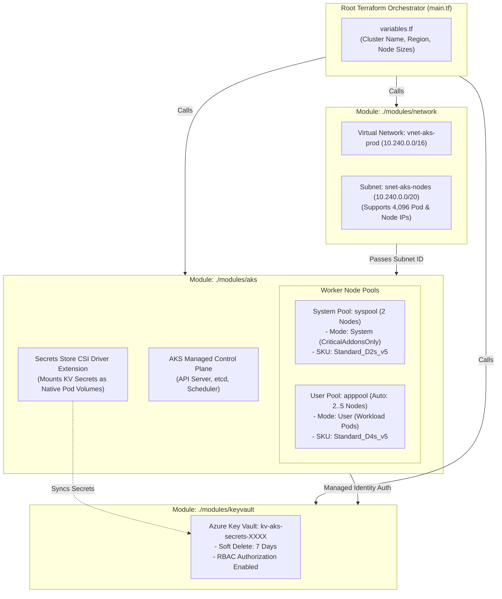

# Project 07: Enterprise Modular Azure Kubernetes Service (AKS) & Key Vault

**Breadcrumbs:** [[--Index--|🏠 Index]] > [[14-Index - Terraform on Azure|☁️ Terraform on Azure MOC]] > [[README|Azure Terraform Projects]] > **Project 07: Modular AKS & Key Vault**

---

## 🎯 Executive Overview & Architectural Objectives

Deploying enterprise Kubernetes clusters on Azure requires adhering to strict platform engineering boundaries: decoupling network provisioning from cluster creation, securing secrets in hardware security modules, and enforcing zero-trust managed identity access.

In this project, you will engineer an enterprise-grade **Modular Azure Kubernetes Service (AKS) Platform** using Terraform. You will author custom, reusable Terraform modules (`modules/network`, `modules/keyvault`, `modules/aks`), configure the **Azure CNI** networking fabric, enable the **Key Vault Secrets Store CSI Driver**, and establish node pool segregation.

### Key Architectural Deliverables:
1.  **Custom Modular Directory Architecture:** Decouple infrastructure into clean, reusable HCL modules with explicit inputs and outputs.
2.  **Enterprise Network Fabric Module (`modules/network`):** Provision a dedicated VNet (`10.240.0.0/16`) with a CIDR-sized subnet (`10.240.0.0/20`) calculated to support Azure CNI pod IP reservations.
3.  **Hardware-Secured Key Vault Module (`modules/keyvault`):** Provision an Azure Key Vault enforcing soft-delete retention and purge protection.
4.  **Zero-Trust System-Assigned Managed Identity:** Eliminate legacy Service Principal client secrets by deploying AKS with a native System-Assigned Managed Identity, granting it `Network Contributor` on the VNet and `Key Vault Secrets User` permissions.
5.  **Multi-Tier Node Pool Architecture:** Configure a dedicated **System Node Pool** (CriticalAddonsOnly) and an isolated **User Node Pool** for application workloads.
6.  **Automated Kubeconfig Output:** Declaratively extract the cluster's administrative kubeconfig and write it to a local workspace file for immediate `kubectl` administration.

---

## 🏛️ Target Architecture & Component Topology



---

## 🧠 Deep-Intuition Azure Administration & Architectural Mechanics

### 1. Azure CNI vs. Kubenet Networking
*   **Kubenet (Basic):** Nodes receive private IP addresses from the Azure VNet, but Pods receive private IP addresses from a separate internal overlay address space. Nodes perform NAT for outbound pod traffic.
    *   *Limitation:* Requires routing tables (UDR) on subnets, does not support direct pod-to-VNet routing, and imposes latency penalties.
*   **Azure CNI (Enterprise):** Every single Pod receives a real, fully routable private IP address directly from the Azure VNet subnet.
    *   *Advantage:* Pods communicate directly with on-premises servers, Azure SQL databases, and VMs without NAT. Supports Azure Network Policies and Cilium.
    *   *Subnet Sizing Law:* Requires significant IP planning. A subnet must accommodate `(Nodes * Pods_Per_Node) + Nodes + Buffer`. A `/20` subnet provides 4,096 IPs, ideal for enterprise clusters.

### 2. Managed Identity vs. Legacy Service Principals
Historically, AKS required a Service Principal Client ID and Secret. When the client secret expired (after 1 or 2 years), all cluster control-plane operations, load balancer provisions, and storage volume mounts would instantly fail, causing catastrophic production outages.
*   **System-Assigned Managed Identity** delegates credential lifecycle entirely to the Azure hypervisor. There are **zero secrets to rotate**, zero expiration dates, and credentials cannot leak into git.

### 3. Node Pool Segregation: System vs. User
Azure Best Practice dictates separating platform daemons from business logic:
*   **System Node Pool (`mode = "System"`):** Hosts CoreDNS, metrics-server, CSI drivers, and ingress controllers. Tainted with `CriticalAddonsOnly=true:NoSchedule` so application pods never exhaust system memory.
*   **User Node Pool (`mode = "User"`):** Hosts business applications, databases, and microservices with independent autoscale boundaries.

---

## 💻 Complete Production-Grade Modular Code

### 1. Root `provider.tf`
```hcl
terraform {
  required_version = ">= 1.5.0"
  required_providers {
    azurerm = {
      source  = "hashicorp/azurerm"
      version = "~> 3.90.0"
    }
    local = {
      source  = "hashicorp/local"
      version = "~> 2.4.0"
    }
  }
}

provider "azurerm" {
  features {
    key_vault {
      purge_soft_delete_on_destroy    = true
      recover_soft_deleted_key_vaults = false
    }
  }
}
```

### 2. Root `main.tf` (Orchestrates Modules)
```hcl
resource "azurerm_resource_group" "rg" {
  name     = var.resource_group_name
  location = var.location
  tags = {
    Environment = "Production"
    Platform    = "Kubernetes"
    ManagedBy   = "Terraform"
  }
}

# Module 1: Network Foundation
module "network" {
  source              = "./modules/network"
  resource_group_name = azurerm_resource_group.rg.name
  location            = azurerm_resource_group.rg.location
  vnet_cidr           = "10.240.0.0/16"
  subnet_cidr         = "10.240.0.0/20"
}

# Module 2: Azure Key Vault
module "keyvault" {
  source              = "./modules/keyvault"
  resource_group_name = azurerm_resource_group.rg.name
  location            = azurerm_resource_group.rg.location
}

# Module 3: Azure Kubernetes Service
module "aks" {
  source              = "./modules/aks"
  cluster_name        = "aks-enterprise-prod"
  resource_group_name = azurerm_resource_group.rg.name
  location            = azurerm_resource_group.rg.location
  dns_prefix          = "aks-enterprise"
  subnet_id           = module.network.aks_subnet_id
  key_vault_id        = module.keyvault.key_vault_id

  depends_on = [module.network, module.keyvault]
}

# Write kubeconfig locally for immediate kubectl use
resource "local_file" "kubeconfig" {
  content  = module.aks.kubeconfig_raw
  filename = "${path.module}/kubeconfig"
  file_permission = "0600"
}
```

### 3. Sub-Module: `modules/network/main.tf`
```hcl
variable "resource_group_name" { type = string }
variable "location" { type = string }
variable "vnet_cidr" { type = string }
variable "subnet_cidr" { type = string }

resource "azurerm_virtual_network" "vnet" {
  name                = "vnet-aks-prod"
  resource_group_name = var.resource_group_name
  location            = var.location
  address_space       = [var.vnet_cidr]
}

resource "azurerm_subnet" "aks_subnet" {
  name                 = "snet-aks-nodes"
  resource_group_name  = var.resource_group_name
  virtual_network_name = azurerm_virtual_network.vnet.name
  address_prefixes     = [var.subnet_cidr]
}

output "aks_subnet_id" {
  value = azurerm_subnet.aks_subnet.id
}
```

### 4. Sub-Module: `modules/keyvault/main.tf`
```hcl
variable "resource_group_name" { type = string }
variable "location" { type = string }

data "azurerm_client_config" "current" {}

resource "random_string" "kv_suffix" {
  length  = 5
  special = false
  upper   = false
}

resource "azurerm_key_vault" "kv" {
  name                       = "kvaks${random_string.kv_suffix.result}"
  location                   = var.location
  resource_group_name        = var.resource_group_name
  tenant_id                  = data.azurerm_client_config.current.tenant_id
  sku_name                   = "standard"
  soft_delete_retention_days = 7
  enable_rbac_authorization  = true
}

output "key_vault_id" {
  value = azurerm_key_vault.kv.id
}
```

### 5. Sub-Module: `modules/aks/main.tf`
```hcl
variable "cluster_name" { type = string }
variable "resource_group_name" { type = string }
variable "location" { type = string }
variable "dns_prefix" { type = string }
variable "subnet_id" { type = string }
variable "key_vault_id" { type = string }

resource "azurerm_kubernetes_cluster" "aks" {
  name                = var.cluster_name
  location            = var.location
  resource_group_name = var.resource_group_name
  dns_prefix          = var.dns_prefix

  # Zero-Trust Passwordless Managed Identity
  identity {
    type = "SystemAssigned"
  }

  default_node_pool {
    name           = "syspool"
    node_count     = 2
    vm_size        = "Standard_D2s_v5"
    vnet_subnet_id = var.subnet_id
    os_disk_size_gb = 64
    type           = "VirtualMachineScaleSets"
    only_critical_addons_enabled = true # System Mode
  }

  network_profile {
    network_plugin    = "azure" # Azure CNI
    load_balancer_sku = "standard"
    service_cidr      = "10.0.0.0/16"
    dns_service_ip    = "10.0.0.10"
  }

  key_vault_secrets_provider {
    secret_rotation_enabled = true
  }
}

# Dedicated User Node Pool for Applications
resource "azurerm_kubernetes_cluster_node_pool" "user_pool" {
  name                  = "apppool"
  kubernetes_cluster_id = azurerm_kubernetes_cluster.aks.id
  vm_size               = "Standard_D4s_v5"
  vnet_subnet_id        = var.subnet_id
  enable_auto_scaling   = true
  min_count             = 2
  max_count             = 5
  mode                  = "User"
}

output "kubeconfig_raw" {
  value     = azurerm_kubernetes_cluster.aks.kube_config_raw
  sensitive = true
}

output "cluster_identity_principal_id" {
  value = azurerm_kubernetes_cluster.aks.identity[0].principal_id
}
```

### 6. Root `variables.tf` & `outputs.tf`
```hcl
# variables.tf
variable "resource_group_name" {
  type    = string
  default = "rg-aks-enterprise-prod"
}

variable "location" {
  type    = string
  default = "eastus"
}

# outputs.tf
output "cluster_name" {
  value       = var.resource_group_name
  description = "Name of the deployed AKS cluster."
}

output "kubeconfig_path" {
  value       = local_file.kubeconfig.filename
  description = "Path to the local kubeconfig file."
}
```

---

## 🛠️ Step-by-Step Implementation Walkthrough

1.  **Initialize Modular Workspace:**
    ```bash
    terraform init
    ```
2.  **Verify Module Hierarchy & Execution Plan:**
    ```bash
    terraform plan -out=tfplan
    ```
3.  **Deploy Production AKS Cluster:**
    ```bash
    terraform apply tfplan
    ```
    *Note: AKS cluster provisioning takes approximately 5–7 minutes.*
4.  👁️ **Visual Checkpoint in Azure Portal:**
    *   Navigate to **Kubernetes services** ➔ Click `aks-enterprise-prod`.
    *   Under **Settings**, click **Node pools**:
        *   Verify `syspool` (Count: 2, Mode: System).
        *   Verify `apppool` (Count: 2, Autoscale: 2–5, Mode: User).
    *   Under **Settings** ➔ **Networking**: Verify Network configuration is **Azure CNI**.
    *   Navigate to **Key vaults** ➔ Verify `kvaksXXXX` is deployed with Azure RBAC authorization enabled.

---

## 🔬 Verification & Live Probe Testing

Verify cluster accessibility using the automatically generated `kubeconfig`:

```bash
# 1. Export local kubeconfig
export KUBECONFIG="./kubeconfig"

# 2. Query nodes across both system and user pools
kubectl get nodes -o wide

# 3. Verify CSI Secrets Store Driver daemonsets are actively running
kubectl get pods -n kube-system -l app=secrets-store-csi-driver
```
**Expected Output:** All 4 initial nodes report `Ready` with private IPs in the `10.240.0.0/20` subnet range!

---

## ⚠️ "See It in Action" Real-World Failure & Recovery Loop (AARF)

### Scenario: The Subnet IP Exhaustion Outage with Azure CNI
*   **The Architecture:** An engineering team provisions AKS using Azure CNI inside a small `/24` subnet (251 usable Azure IPs).
*   **The Assumption:** The team assumes that 251 IPs is plenty for a 5-node cluster.
*   **The Failure Loop:**
    *   Azure CNI pre-allocates **30 Pod IPs per node by default** at boot time: `5 nodes * 30 IPs = 150 IPs`.
    *   During deployment, the User Node Pool scales out to 8 nodes (`8 * 30 = 240 IPs`).
    *   The subnet runs completely out of available IP addresses.
    *   Newly scheduled pods fail with `ContainerCreating` and error: `Failed to allocate IP address from subnet`.
    *   Scale set nodes fail to join the cluster, causing cascading pod crashes!
*   **The Remediation:**
    *   **Always size AKS subnets to at least a `/20` (4,096 IPs) or `/21` (2,048 IPs)** when adopting Azure CNI.
    *   Alternatively, configure `max_pods = 30` on node pools to cap pre-allocated IP reservations per node to match actual workload density.

---

## 🧹 Cost Optimization & Clean Teardown

```bash
terraform destroy -auto-approve
rm -f kubeconfig
```
