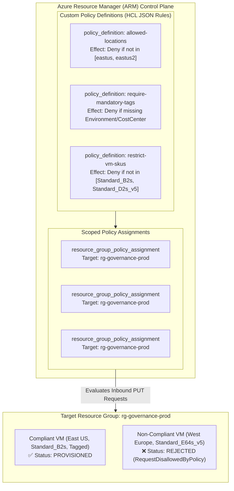

# Project 08: Azure Policy and Governance as Code

**Breadcrumbs:** [[--Index--|🏠 Index]] > [[14-Index - Terraform on Azure|☁️ Terraform on Azure MOC]] > [[README|Azure Terraform Projects]] > **Project 08: Azure Policy as Code**

---

## 🎯 Executive Overview & Architectural Objectives

Enterprise cloud governance cannot rely on human vigilance or manual review checklists. As organizations scale out decentralized platform teams, automated guardrails must be established directly within the cloud control plane to enforce regulatory compliance, sovereignty boundaries, cost guardrails, and enterprise tagging taxonomies.

In this project, you will engineer an enterprise-grade **Governance-as-Code** framework on Azure using Terraform. You will codify custom Azure Policy Definitions, scope automated Policy Assignments to resource groups, implement preventative `Deny` and detective `Audit` enforcement modes, and test compliance boundaries against real Azure Resource Manager (ARM) deployments.

### Key Architectural Deliverables:
1.  **Custom Policy Definitions (`azurerm_policy_definition`):**
    *   **Allowed Regions Policy:** Enforce data residency and sovereignty by restricting resource deployment exclusively to approved Azure regions (e.g., `eastus`, `eastus2`).
    *   **Mandatory Enterprise Tags Policy:** Enforce operational hygiene by rejecting any resource missing required metadata tags (`Environment`, `CostCenter`, `Owner`).
    *   **Permitted Virtual Machine SKUs Policy:** Guard against runaway FinOps compute costs by restricting VM deployments to cost-effective burstable or general-purpose SKUs (`Standard_B2s`, `Standard_D2s_v5`).
2.  **Resource Group Scoped Assignments (`azurerm_resource_group_policy_assignment`):** Apply governance policies dynamically to specific resource groups with custom non-compliance user messages.
3.  **Real-Time Preventative Gate Testing:** Intentionally attempt to provision non-compliant resources to validate that ARM actively denies non-conforming operations at request time before resources incur charges.
4.  **Audit vs. Deny Architectural Separation:** Model the transition pathway from safe detection (`Audit`) to strict blocking (`Deny`) in continuous delivery pipelines.

---

## 🏛️ Target Architecture & Component Topology



---

## 🧠 Deep-Intuition Azure Administration & Architectural Mechanics

### 1. Azure Policy Evaluation vs. Azure RBAC
A foundational concept in Azure enterprise governance is the functional distinction between **Role-Based Access Control (RBAC)** and **Azure Policy**:

| Dimension | Azure RBAC (Identity & Authorization) | Azure Policy (Resource Governance & Guardrails) |
| :--- | :--- | :--- |
| **Primary Question** | *"Who has permission to perform this API action?"* | *"What properties and configurations must resources have?"* |
| **Evaluation Point** | Evaluated first during request authorization. | Evaluated second, after authorization succeeds. |
| **Control Object** | Principals (Users, Groups, SPNs, Managed Identities). | Resources, resource properties, locations, and tags. |
| **Enforcement Mechanism**| Allow/Deny actions (e.g., `Microsoft.Compute/virtualMachines/write`). | Effects (`Deny`, `Audit`, `Append`, `Modify`, `DeployIfNotExists`). |

Even if a Cloud Engineer possesses the `Owner` or `Contributor` RBAC role over a Subscription, an Azure Policy with a `Deny` effect will completely block them from provisioning a resource in an unapproved region or without required tags!

### 2. ARM Request Interception Lifecycle
When Terraform submits a `PUT` request to the Azure Resource Manager API:
1.  **Authentication & Authorization:** ARM verifies the caller's Entra ID token and evaluates RBAC permissions.
2.  **Policy Evaluation Engine:**
    *   ARM matches the request against all active Policy Assignments inherited from Management Groups, Subscriptions, and the target Resource Group.
    *   **Disabled / Audit:** ARM allows the request, but logs an uncompliant event to the Azure Policy compliance engine.
    *   **Append / Modify:** ARM injects missing properties (e.g., automatically appending a default tag or setting) before committing.
    *   **Deny:** If any rule matches the `if` condition and evaluates to `deny`, ARM immediately terminates the API call, returning an `HTTP 403 Forbidden` with error code `RequestDisallowedByPolicy`. No resources are created, and no compute billing begins.

```
Incoming ARM Request (PUT)
          │
          ▼
┌─────────────────────────┐
│ 1. RBAC Check           │──[ Unauthorized ]──► HTTP 403 Access Denied
└─────────────────────────┘
          │ (Authorized)
          ▼
┌─────────────────────────┐
│ 2. Policy Engine        │──[ Append/Modify ]─► Mutate Request Payload
└─────────────────────────┘
          │
          ├───────────────────[ Deny Triggered ]──► HTTP 403 RequestDisallowedByPolicy
          ▼
┌─────────────────────────┐
│ 3. Provider Engine      │──► Creates / Updates Resource in Azure
└─────────────────────────┘
```

---

## 💻 Complete Production-Grade Terraform Code

Organize your project into the following modular files:

```
project-08-policy/
├── provider.tf
├── variables.tf
├── main.tf
├── policies.tf
├── assignments.tf
├── outputs.tf
└── terraform.tfvars
```

### 1. `provider.tf`
```hcl
terraform {
  required_version = ">= 1.5.0"
  required_providers {
    azurerm = {
      source  = "hashicorp/azurerm"
      version = "~> 3.90.0"
    }
  }
}

provider "azurerm" {
  features {}
}
```

### 2. `variables.tf`
```hcl
variable "resource_group_name" {
  type        = string
  default     = "rg-governance-demo"
  description = "Target Resource Group name for policy enforcement."
}

variable "location" {
  type        = string
  default     = "eastus"
  description = "Primary compliant Azure region."
}

variable "allowed_locations" {
  type        = list(string)
  default     = ["eastus", "eastus2"]
  description = "Whitelisted Azure regions for resource deployment."
}

variable "mandatory_tags" {
  type        = list(string)
  default     = ["Environment", "CostCenter", "Owner"]
  description = "List of tag keys mandatory on all resources."
}

variable "allowed_vm_skus" {
  type        = list(string)
  default     = ["Standard_B2s", "Standard_D2s_v5"]
  description = "Permitted VM SKUs to control infrastructure cost."
}
```

### 3. `main.tf`
```hcl
# Target Resource Group where policies will be assigned and evaluated
resource "azurerm_resource_group" "governance_rg" {
  name     = var.resource_group_name
  location = var.location

  tags = {
    Environment = "Governance-Staging"
    CostCenter  = "FinOps-001"
    Owner       = "Platform-Team"
  }
}
```

### 4. `policies.tf` (Custom Policy Definitions)
```hcl
# Policy 1: Restrict Allowed Azure Deployment Regions
resource "azurerm_policy_definition" "allowed_locations" {
  name         = "policy-allowed-locations"
  policy_type  = "Custom"
  mode         = "Indexed"
  display_name = "Enterprise Guardrail: Allowed Deployment Regions"
  description  = "Strictly restricts resource provisioning to approved data sovereignty regions."

  metadata = jsonencode({
    category = "Governance and Compliance"
    version  = "1.0.0"
  })

  policy_rule = jsonencode({
    if = {
      not = {
        field = "location"
        in    = "[parameters('allowedLocations')]"
      }
    }
    then = {
      effect = "deny"
    }
  })

  parameters = jsonencode({
    allowedLocations = {
      type = "Array"
      metadata = {
        displayName = "Allowed Locations"
        description = "The list of whitelisted regions."
      }
    }
  })
}

# Policy 2: Enforce Mandatory Resource Tags
resource "azurerm_policy_definition" "mandatory_tags" {
  name         = "policy-mandatory-tags"
  policy_type  = "Custom"
  mode         = "Indexed"
  display_name = "Enterprise Guardrail: Enforce Required Resource Tags"
  description  = "Denies resource creation if mandatory governance tags are absent."

  metadata = jsonencode({
    category = "FinOps and Tagging"
    version  = "1.0.0"
  })

  policy_rule = jsonencode({
    if = {
      anyOf = [
        for tag in var.mandatory_tags : {
          field  = "tags['${tag}']"
          exists = "false"
        }
      ]
    }
    then = {
      effect = "deny"
    }
  })
}

# Policy 3: Enforce Permitted Virtual Machine SKUs
resource "azurerm_policy_definition" "allowed_vm_skus" {
  name         = "policy-allowed-vm-skus"
  policy_type  = "Custom"
  mode         = "Indexed"
  display_name = "FinOps Guardrail: Permitted Virtual Machine SKUs"
  description  = "Restricts compute deployments strictly to approved cost-effective VM sizes."

  metadata = jsonencode({
    category = "Cost Management"
    version  = "1.0.0"
  })

  policy_rule = jsonencode({
    if = {
      allOf = [
        {
          field = "type"
          equals = "Microsoft.Compute/virtualMachines"
        },
        {
          not = {
            field = "Microsoft.Compute/virtualMachines/sku.name"
            in    = "[parameters('allowedSkus')]"
          }
        }
      ]
    }
    then = {
      effect = "deny"
    }
  })

  parameters = jsonencode({
    allowedSkus = {
      type = "Array"
      metadata = {
        displayName = "Allowed VM SKUs"
        description = "List of approved virtual machine sizes."
      }
    }
  })
}
```

### 5. `assignments.tf` (Scoped Policy Assignments)
```hcl
# Assignment 1: Allowed Locations Assignment
resource "azurerm_resource_group_policy_assignment" "assign_locations" {
  name                 = "assign-allowed-locations"
  resource_group_id    = azurerm_resource_group.governance_rg.id
  policy_definition_id = azurerm_policy_definition.allowed_locations.id
  display_name         = "Enforce Approved Geographic Regions"
  description          = "Ensures all resources in this RG reside in eastus or eastus2."

  parameters = jsonencode({
    allowedLocations = {
      value = var.allowed_locations
    }
  })

  non_compliance_message {
    content = "Resource deployment rejected: Selected Azure region is not whitelisted by enterprise governance."
  }
}

# Assignment 2: Mandatory Tags Assignment
resource "azurerm_resource_group_policy_assignment" "assign_tags" {
  name                 = "assign-mandatory-tags"
  resource_group_id    = azurerm_resource_group.governance_rg.id
  policy_definition_id = azurerm_policy_definition.mandatory_tags.id
  display_name         = "Enforce Mandatory Metadata Tags"
  description          = "Ensures Environment, CostCenter, and Owner tags exist on every resource."

  non_compliance_message {
    content = "Resource deployment rejected: Missing one or more mandatory tags (Environment, CostCenter, Owner)."
  }
}

# Assignment 3: Allowed VM SKUs Assignment
resource "azurerm_resource_group_policy_assignment" "assign_vm_skus" {
  name                 = "assign-allowed-vm-skus"
  resource_group_id    = azurerm_resource_group.governance_rg.id
  policy_definition_id = azurerm_policy_definition.allowed_vm_skus.id
  display_name         = "Enforce Permitted Compute SKUs"
  description          = "Blocks high-cost VM sizes outside Standard_B2s or Standard_D2s_v5."

  parameters = jsonencode({
    allowedSkus = {
      value = var.allowed_vm_skus
    }
  })

  non_compliance_message {
    content = "Resource deployment rejected: The requested VM size is not authorized under the FinOps approved SKU list."
  }
}
```

### 6. `outputs.tf`
```hcl
output "target_resource_group" {
  value       = azurerm_resource_group.governance_rg.name
  description = "Target Resource Group subject to policy guardrails."
}

output "policy_assignments" {
  value = {
    locations = azurerm_resource_group_policy_assignment.assign_locations.id
    tags      = azurerm_resource_group_policy_assignment.assign_tags.id
    vm_skus   = azurerm_resource_group_policy_assignment.assign_vm_skus.id
  }
  description = "Resource IDs of active policy assignments."
}
```

---

## 🛠️ Step-by-Step Implementation Walkthrough

### 1. Initialize & Apply Governance Guardrails
```bash
terraform init
terraform plan -out=tfplan
terraform apply tfplan
```

### 2. 👁️ Visual Checkpoint in Azure Portal
1.  Navigate to **Policy** in the Azure Portal search bar.
2.  In the left sidebar, click **Definitions**:
    *   Filter by Type: `Custom`.
    *   Verify your 3 definitions: `Enterprise Guardrail: Allowed Deployment Regions`, `Enterprise Guardrail: Enforce Required Resource Tags`, and `FinOps Guardrail: Permitted Virtual Machine SKUs`.
3.  Click **Assignments** in the sidebar:
    *   Filter Scope to Resource Group `rg-governance-demo`.
    *   Verify that all 3 assignments are active with enforcement mode set to **Enabled**.
4.  Click any assignment ➔ **Parameters**: Confirm the parameter arrays (`["eastus", "eastus2"]` and `["Standard_B2s", "Standard_D2s_v5"]`).

---

## 🔬 Verification & Live Probe Testing

To prove that the Azure Policy engine actively protects your cloud subscription, run a controlled compliance probe test using Azure CLI.

### Test 1: Deploy a Non-Compliant Resource (Unapproved Region)
Attempt to deploy a Storage Account in `westeurope` inside the governed resource group:

```bash
az storage account create \
  --name "storagenoncompliant$RANDOM" \
  --resource-group "rg-governance-demo" \
  --location "westeurope" \
  --sku "Standard_LRS" \
  --tags Environment=Test CostCenter=FinOps-001 Owner=Platform
```

**Expected Error Response:**
```json
{
  "error": {
    "code": "RequestDisallowedByPolicy",
    "target": "storagenoncompliant12345",
    "message": "Resource 'storagenoncompliant12345' was disallowed by policy. Policy identifier: '/subscriptions/.../providers/Microsoft.Authorization/policyAssignments/assign-allowed-locations'. Additional info: 'Resource deployment rejected: Selected Azure region is not whitelisted by enterprise governance.'."
  }
}
```
ARM actively intercepts and terminates the deployment before creation!

### Test 2: Deploy a Non-Compliant Resource (Missing Mandatory Tags)
Attempt to deploy an Azure Virtual Network in `eastus` but intentionally omit the `CostCenter` tag:

```bash
az network vnet create \
  --name "vnet-governance-test" \
  --resource-group "rg-governance-demo" \
  --location "eastus" \
  --address-prefixes "10.100.0.0/16" \
  --tags Environment=Test Owner=Platform
```

**Expected Error Response:**
```
(RequestDisallowedByPolicy) Resource 'vnet-governance-test' was disallowed by policy.
Message: Resource deployment rejected: Missing one or more mandatory tags (Environment, CostCenter, Owner).
```

### Test 3: Deploy a Fully Compliant Resource
Now provision the Virtual Network with all mandatory tags in `eastus`:

```bash
az network vnet create \
  --name "vnet-governance-valid" \
  --resource-group "rg-governance-demo" \
  --location "eastus" \
  --address-prefixes "10.100.0.0/16" \
  --tags Environment=Staging CostCenter=FinOps-001 Owner=Platform
```

**Result:** `ProvisioningState: Succeeded`! The policy engine verifies all criteria and immediately lets the request pass.

---

## ⚠️ "See It in Action" Real-World Failure & Recovery Loop (AARF)

### Scenario: The Emergency Hotfix Blocked by Aggressive Deny Policy
*   **The Architecture:** An enterprise imposes an immediate `Deny` policy across an entire subscription requiring a new tag `SecurityClassification=Confidential` on all resources.
*   **The Assumption:** Platform engineers assume that CI/CD pipelines will automatically inherit the requirement without friction.
*   **The Failure Loop:**
    *   A high-severity P1 production outage occurs at 02:00 AM.
    *   An automated incident remediation pipeline triggers a hotfix deployment that updates App Service settings and adds an autoscaling rule.
    *   Because the hotfix pipeline does not include the newly mandated tag in its HCL payload, ARM returns `HTTP 403 RequestDisallowedByPolicy`.
    *   The emergency deployment fails, extending the production downtime by over 3 hours while engineers debug what appears to be an IAM authorization permission error!
*   **The Remediation Protocol:**
    1.  **Phased Policy Rollout:** Never apply high-impact policies directly with `effect = "deny"`. Always deploy policies with `effect = "audit"` for a 14-day observation window to identify non-compliant pipelines and resources.
    2.  **Clear Non-Compliance Messages:** Always configure descriptive `non_compliance_message` blocks detailing the remediation command so engineers can self-serve immediately.
    3.  **Policy Exemption Process:** Use `azurerm_resource_policy_exemption` to grant targeted time-bound exemptions for legacy or emergency workloads during active remediation.

---

## 🧹 Cost Optimization & Clean Teardown

Azure Policy definitions and assignments carry **zero direct billing cost** in Microsoft Azure. However, cleaning up the test environment ensures no dangling assignments interfere with other projects:

```bash
# Delete test VNet if created
az network vnet delete --name "vnet-governance-valid" --resource-group "rg-governance-demo" --yes

# Destroy Terraform policy definitions and assignments
terraform destroy -auto-approve
```
