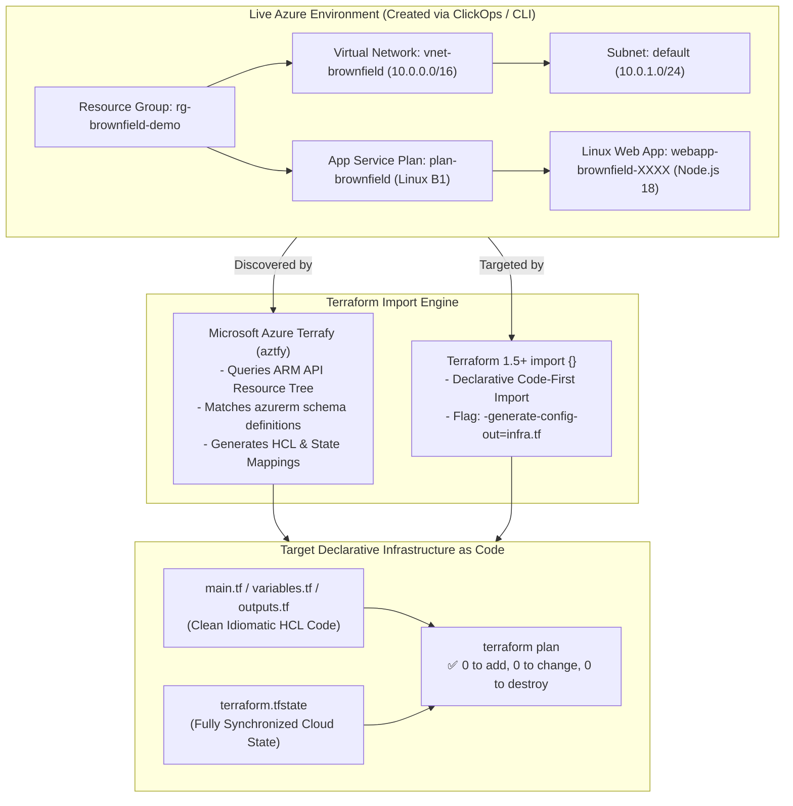

# Project 11: Terraform Import & Reverse Engineering Live Azure Clouds via aztfy

**Breadcrumbs:** [[--Index--|🏠 Index]] > [[14-Index - Terraform on Azure|☁️ Terraform on Azure MOC]] > [[README|Azure Terraform Projects]] > **Project 11: Import & Azure Terrafy**

---

## 🎯 Executive Overview & Architectural Objectives

In enterprise reality, platform engineers rarely start with a pristine greenfield cloud environment. More often, engineering teams inherit sprawling **brownfield environments**—cloud infrastructure built manually via the Azure Portal ("ClickOps"), ad-hoc Azure CLI scripts, or orphaned ARM templates with no state tracking.

In this project, you will master the art and mechanics of **Brownfield Azure Adoption and Infrastructure Reverse Engineering**. You will contrast traditional imperative CLI importing against modern declarative Terraform 1.5+ `import {}` blocks, deploy Microsoft's open-source **Azure Terrafy (`aztfy`)** engine to reverse-engineer entire resource groups into clean HCL code, and eliminate configuration drift to achieve a verified zero-drift plan (`0 to add, 0 to change, 0 to destroy`).

### Key Architectural Deliverables:
1.  **Simulate Real-World Brownfield Infrastructure:** Spin up unmanaged Azure resources (Resource Group, Virtual Network, App Service Plan, and Linux Web App) exclusively using Azure CLI scripts outside Terraform.
2.  **Traditional Imperative Import (`terraform import`):** Understand the mechanics and state limitations of the legacy import command.
3.  **Modern Declarative Import Blocks (`import {}` in Terraform 1.5+):** Author declarative import blocks and leverage automated HCL generation (`-generate-config-out=generated.tf`).
4.  **Bulk Reverse Engineering with Microsoft Azure Terrafy (`aztfy`):** Scan a live Azure resource group, map resource dependencies, generate idiomatic Terraform configuration, and synchronize `.tfstate` automatically.
5.  **Zero-Drift State Reconciliation:** Audit and reconcile generated HCL attributes against live cloud state to prevent accidental resource recreation ("Forces replacement").

---

## 🏛️ Target Architecture & Component Topology



---

## 🧠 Deep-Intuition Azure Administration & Architectural Mechanics

### 1. What Does `terraform import` Actually Do?
A pervasive misconception among junior DevOps engineers is that running `terraform import` writes HCL code for you.
*   **The State-Only Operation:** Historically, `terraform import <resource_address> <azure_resource_id>` **only modified the state file (`.tfstate`)**. It added the cloud provider's resource ID into state mapping, but did not generate a single line of HCL configuration code!
*   **The Configuration Mismatch Danger:** After running legacy import, if your handwritten HCL did not match every mandatory, optional, and defaulted property of the live Azure resource, the subsequent `terraform apply` would attempt to mutate or outright destroy and recreate the production resource!

### 2. The Modern Terraform 1.5+ `import {}` Revolution
Starting in Terraform 1.5.0, HashiCorp introduced declarative imports directly into the language:
```hcl
import {
  to = azurerm_linux_web_app.production_portal
  id = "/subscriptions/00000000-0000-0000-0000-000000000000/resourceGroups/rg-prod/providers/Microsoft.Web/sites/webapp-portal"
}
```
When paired with:
```bash
terraform plan -generate-config-out=generated_resources.tf
```
Terraform queries the Azure Resource Manager API, reads the live schema, and **writes valid HCL code automatically** into the specified file, drastically reducing human error during cloud migrations.

### 3. Microsoft Azure Terrafy (`aztfy`)
For entire resource groups containing dozens of interconnected resources, writing manual import blocks is slow and error-prone.
*   **Engine Overview:** Microsoft developed `aztfy` specifically for the Azure provider.
*   **How it works:** It queries ARM for all resources in a resource group, displays an interactive terminal UI (TUI) showing mapped and unmapped resources, generates standard HCL code, and commits the state without modifying the live cloud infrastructure.

---

## 💻 Hands-On Implementation: Brownfield Migration Drill

### Phase 1: Deploy Unmanaged Brownfield Azure Infrastructure
Execute this Azure CLI script to simulate an existing legacy environment created without Terraform:

```bash
# Set environment variables
export RG_NAME="rg-brownfield-demo"
export LOCATION="eastus"
export VNET_NAME="vnet-brownfield"
export APP_NAME="webapp-legacy-$RANDOM"

# 1. Create Resource Group
az group create --name $RG_NAME --location $LOCATION

# 2. Create Virtual Network & Subnet
az network vnet create \
  --resource-group $RG_NAME \
  --name $VNET_NAME \
  --address-prefix "10.0.0.0/16" \
  --subnet-name "default" \
  --subnet-prefix "10.0.1.0/24"

# 3. Create App Service Plan (Linux Basic Tier)
az appservice plan create \
  --name "plan-brownfield" \
  --resource-group $RG_NAME \
  --sku "B1" \
  --is-linux

# 4. Create Linux Web App running Node.js 18
az webapp create \
  --resource-group $RG_NAME \
  --plan "plan-brownfield" \
  --name $APP_NAME \
  --runtime "NODE:18-lts"
```

---

### Phase 2: Reverse Engineering via Modern `import {}` Block

Create an empty workspace directory: `mkdir project-11-import && cd project-11-import`.

#### 1. Setup `provider.tf`
```hcl
terraform {
  required_version = ">= 1.5.0"
  required_providers {
    azurerm = {
      source  = "hashicorp/azurerm"
      version = "~> 3.90.0"
    }
  }
}

provider "azurerm" {
  features {}
}
```

#### 2. Author `imports.tf`
Discover your Azure Subscription ID and declare your import target:

```hcl
# Retrieve Subscription ID using: az account show --query id -o tsv
# Replace SUB_ID with your actual Subscription GUID

import {
  to = azurerm_resource_group.imported_rg
  id = "/subscriptions/YOUR_SUBSCRIPTION_ID/resourceGroups/rg-brownfield-demo"
}

import {
  to = azurerm_virtual_network.imported_vnet
  id = "/subscriptions/YOUR_SUBSCRIPTION_ID/resourceGroups/rg-brownfield-demo/providers/Microsoft.Network/virtualNetworks/vnet-brownfield"
}
```

#### 3. Execute Automated Configuration Generation
Run the plan command with the `-generate-config-out` flag:

```bash
terraform init
terraform plan -generate-config-out=generated_infrastructure.tf
```

Terraform automatically inspects ARM and generates `generated_infrastructure.tf` containing exact, idiomatic HCL:

```hcl
# __generated__ by Terraform
# Please review these resources and move them into your main configuration.

resource "azurerm_resource_group" "imported_rg" {
  location = "eastus"
  name     = "rg-brownfield-demo"
  tags     = {}
}

resource "azurerm_virtual_network" "imported_vnet" {
  address_space       = ["10.0.0.0/16"]
  location            = "eastus"
  name                = "vnet-brownfield"
  resource_group_name = "rg-brownfield-demo"
  tags                = {}
}
```

#### 4. Apply the Import
```bash
terraform apply
```
**Output:**
```
Apply complete! Resources: 2 imported, 0 added, 0 changed, 0 destroyed.
```
Your state file is now perfectly synchronized with live cloud resources!

---

### Phase 3: Bulk Reverse Engineering with Microsoft Azure Terrafy (`aztfy`)

To import entire complex architectures (including Web Apps, Plans, Subnets, and Diagnostics) in one automated pass, use `aztfy`.

#### 1. Install & Launch `aztfy`
```bash
# Install via Go, Homebrew, or binary download
# Windows: winget install Microsoft.AzureTerrafy
# macOS/Linux: brew install azure/et/aztfy

# Run reverse-engineering on the resource group
aztfy resource-group rg-brownfield-demo
```

#### 2. Interactive Terrafy Terminal UI
`aztfy` presents an interactive console interface:
1.  It queries ARM for all child resources in `rg-brownfield-demo`.
2.  It matches each Azure resource type to its corresponding `azurerm` resource (e.g., `Microsoft.Web/serverfarms` ➔ `azurerm_service_plan`).
3.  Press **`w`** (or select Proceed) to generate HCL code and write `.tfstate`.

#### 3. Inspect Generated Code
`aztfy` creates:
*   `main.tf`: Clean HCL declarations for all resources in the group.
*   `terraform.tfstate`: Synchronized state map.
*   `aztfyResourceMapping.json`: Mapping audit trail.

---

## 🔬 Verification & Zero-Drift Audit

Once imported, the golden test of any brownfield migration is running a plan without any modifications:

```bash
terraform plan
```

**Expected Golden Verification Output:**
```
No changes. Your infrastructure matches the configuration.

Terraform has compared your real infrastructure against your configuration and found no differences.
```

If Terraform indicates `~ update in-place` or `-/+ replace (forces replacement)`, inspect the delta immediately:
*   **Tags:** Cloud platforms often add default system tags. Add matching tags to your HCL.
*   **Subnet Associations:** Inline `subnet {}` blocks in `azurerm_virtual_network` often conflict with standalone `azurerm_subnet` resources. Always prefer standalone `azurerm_subnet` definitions.

---

## ⚠️ "See It in Action" Real-World Failure & Recovery Loop (AARF)

### Scenario: The "Forces Replacement" Production Database Disaster
*   **The Architecture:** An engineer imports an unmanaged Azure SQL Database into Terraform using legacy CLI import.
*   **The Assumption:** The engineer writes the HCL resource definition from memory, assuming minor naming case differences do not matter.
*   **The Failure Loop:**
    *   In Azure, the database was created with collation `SQL_Latin1_General_CP1_CI_AS`.
    *   In the engineer's HCL file, they omit the collation attribute or specify a default collation `Latin1_General_100_CI_AS_SC`.
    *   Changing database collation in Azure SQL is a **destructive operation that requires destroying and recreating the database**!
    *   The engineer runs `terraform apply -auto-approve`.
    *   Terraform deletes the live production database holding 500GB of transactional records to recreate a blank one!
*   **The Remediation Protocol:**
    1.  **Always use `terraform plan` first:** Never run `apply` directly after an import.
    2.  **Audit the Diff Symbols:** If you see `-/+ (forces replacement)` next to any critical resource (databases, storage accounts, VMs), **STOP IMMEDIATELY**.
    3.  **Use `lifecycle { prevent_destroy = true }`:** Add this guardrail to every stateful production resource block before attempting imports.

---

## 🧹 Cost Optimization & Clean Teardown

Now that the entire brownfield environment is fully managed under Terraform state, clean up all resources in a single declarative command:

```bash
terraform destroy -auto-approve
```
Every resource created by the Azure CLI script is cleanly tracked in state and safely terminated!
