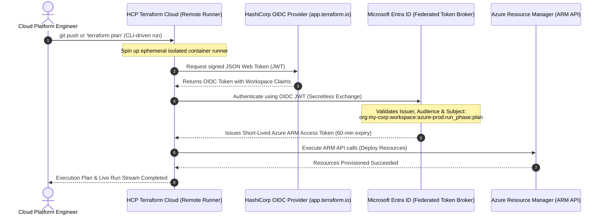

# Project 12: HCP Terraform Cloud Workspaces & Dynamic Workload Identity Federation

**Breadcrumbs:** [[--Index--|🏠 Index]] > [[14-Index - Terraform on Azure|☁️ Terraform on Azure MOC]] > [[README|Azure Terraform Projects]] > **Project 12: HCP Terraform Cloud**

---

## 🎯 Executive Overview & Architectural Objectives

As infrastructure teams expand, executing Terraform from developer laptops introduces critical risks: state file synchronization races, divergent provider versions, unmonitored deployments, and the proliferation of high-privilege Azure Service Principal client secrets across local workstations.

In this project, you will engineer an enterprise-grade **Cloud-Native Automation Platform** using **HashiCorp Cloud Platform (HCP) Terraform** (formerly Terraform Cloud) integrated with Microsoft Azure. You will configure remote execution workspaces, implement **Dynamic Workload Identity Federation (Azure OIDC)** to achieve completely **secretless authentication**, establish centralized variable sets, and execute speculative runs with remote concurrency locking.

### Key Architectural Deliverables:
1.  **HCP Terraform Organization & Workspace Topology:** Structure organizations, projects, and execution workspaces using the declarative `cloud {}` configuration block.
2.  **Secretless Authentication with Azure OIDC:** Eliminate fragile, expiring `ARM_CLIENT_SECRET` credentials by establishing a cryptographic trust between HCP Terraform and Microsoft Entra ID using OpenID Connect (OIDC).
3.  **Remote Execution Engine:** Delegate `terraform plan` and `terraform apply` executions to managed, isolated cloud execution agents.
4.  **Speculative Execution Plans on Pull Requests:** Enable non-destructive speculative plans that calculate infrastructure deltas without acquiring state locks or exposing state data.
5.  **Centralized State Locking & FinOps Tracking:** Leverage centralized remote state with native visual change tracking, cost estimations, and automated concurrency lease locking.

---

## 🏛️ Target Architecture & Component Topology



---

## 🧠 Deep-Intuition Azure Administration & Architectural Mechanics

### 1. The Vulnerability of Static Service Principal Secrets
In traditional CI/CD setups, engineers generate an Azure Service Principal and copy the `ARM_CLIENT_SECRET` into pipeline variable stores or developer `.env` files.
*   **The Expiration Trap:** Secrets carry hard expirations (e.g., 90 or 365 days). When they expire at midnight, entire automated delivery pipelines break simultaneously.
*   **The Leak Risk:** Static secrets can be leaked into logs, exported in bash traces, or compromised from build artifacts.

### 2. How Secretless OIDC Federation Works
With **Workload Identity Federation**, HCP Terraform never stores an Azure secret, and Azure never stores an HCP password!
1.  **Trust Relationship:** You configure an Entra ID App Registration with a **Federated Identity Credential**.
2.  **The Identity Claim:** You configure Azure to trust the HashiCorp token issuer (`https://app.terraform.io`) and check the token's `sub` (Subject) claim:
    ```
    organization:your-hcp-org:project:Default:workspace:azure-prod:run_phase:*
    ```
3.  **Token Exchange:** Before each run, HCP Terraform requests an OIDC token signed by HashiCorp's cryptographic key.
4.  **ARM Access:** HCP presents this JWT to Microsoft Entra ID. Entra validates the cryptographic signature, checks that the workspace matches your subject claim, and hands back a short-lived (60-minute) OAuth token scoped exclusively to the target Azure subscription!

---

## 💻 Hands-On Implementation: Configuring Secretless HCP Terraform

### Phase 1: Configure Microsoft Entra ID Workload Identity Federation

Execute this script via Azure CLI to establish the OIDC trust:

```bash
# Set your variables
export ORG_NAME="your-hcp-org"         # Replace with your HCP Terraform Org name
export WORKSPACE_NAME="azure-prod-demo" # Replace with your HCP Workspace name
export APP_NAME="spn-hcp-terraform-oidc"

# 1. Create Entra ID Application Registration
APP_ID=$(az ad app create --display-name "$APP_NAME" --query appId -o tsv)
APP_OBJECT_ID=$(az ad app show --id "$APP_ID" --query id -o tsv)

# 2. Create Service Principal for the Application
SP_ID=$(az ad sp create --id "$APP_ID" --query id -o tsv)

# 3. Grant Contributor RBAC Role on the Subscription
SUBSCRIPTION_ID=$(az account show --query id -o tsv)
az role assignment create \
  --assignee "$APP_ID" \
  --role "Contributor" \
  --scope "/subscriptions/$SUBSCRIPTION_ID"

# 4. Create Federated Identity Credential (Trusting HCP Terraform OIDC)
az ad app federated-credential create \
  --id "$APP_OBJECT_ID" \
  --parameters "{
    \"name\": \"hcp-terraform-plan-apply\",
    \"issuer\": \"https://app.terraform.io\",
    \"subject\": \"organization:$ORG_NAME:project:Default:workspace:$WORKSPACE_NAME:run_phase:*\",
    \"description\": \"OIDC Trust for HCP Terraform Workspace\",
    \"audiences\": [\"api://AzureADTokenExchange\"]
  }"
```

---

### Phase 2: Configure HCP Terraform Workspace Environment Variables

In your HCP Terraform Workspace settings (under **Variables** ➔ **Workspace Variables**), define the following **Environment Variables** (not Terraform variables):

| Variable Name | Value | Purpose |
| :--- | :--- | :--- |
| `TFC_AZURE_PROVIDER_AUTH` | `true` | Instructs the `azurerm` provider in HCP to use dynamic OIDC auth. |
| `TFC_AZURE_RUN_CLIENT_ID` | `$APP_ID` | The Client (Application) ID created in Entra ID. |
| `ARM_TENANT_ID` | `$(az account show --query tenantId -o tsv)` | Your Microsoft Entra Tenant ID. |
| `ARM_SUBSCRIPTION_ID` | `$SUBSCRIPTION_ID` | Target Azure Subscription ID. |

*Notice: **No `ARM_CLIENT_SECRET` is required anywhere!***

---

### Phase 3: Declarative HCL Code with `cloud {}` Block

Create your local workspace files:

```
project-12-hcp/
├── main.tf
├── variables.tf
└── outputs.tf
```

#### `main.tf`
```hcl
terraform {
  required_version = ">= 1.5.0"
  required_providers {
    azurerm = {
      source  = "hashicorp/azurerm"
      version = "~> 3.90.0"
    }
  }

  # HCP Terraform Remote Cloud Workspace Configuration
  cloud {
    organization = "your-hcp-org" # Replace with your real HCP organization

    workspaces {
      name = "azure-prod-demo"
    }
  }
}

# The AzureRM provider automatically consumes the dynamic OIDC token provided by HCP!
provider "azurerm" {
  features {}
  use_oidc = true
}

# Target Cloud Infrastructure to Provision Remotely
resource "azurerm_resource_group" "cloud_rg" {
  name     = "rg-hcp-cloud-prod"
  location = "eastus"

  tags = {
    Environment = "Production"
    Orchestrator = "HCP-Terraform-Cloud"
    AuthType     = "WorkloadIdentity-OIDC"
  }
}

resource "azurerm_virtual_network" "cloud_vnet" {
  name                = "vnet-hcp-infrastructure"
  resource_group_name = azurerm_resource_group.cloud_rg.name
  location            = azurerm_resource_group.cloud_rg.location
  address_space       = ["10.80.0.0/16"]

  tags = {
    ManagedBy = "TerraformCloud"
  }
}

resource "azurerm_subnet" "cloud_subnet" {
  name                 = "snet-workloads"
  resource_group_name  = azurerm_resource_group.cloud_rg.name
  virtual_network_name = azurerm_virtual_network.cloud_vnet.name
  address_prefixes     = ["10.80.1.0/24"]
}
```

#### `outputs.tf`
```hcl
output "vnet_id" {
  value       = azurerm_virtual_network.cloud_vnet.id
  description = "ID of the Virtual Network provisioned via HCP Terraform."
}

output "subnet_id" {
  value       = azurerm_subnet.cloud_subnet.id
  description = "ID of the workload subnet."
}
```

---

## 🛠️ Step-by-Step Implementation Walkthrough

### 1. Authenticate Local CLI with HCP Terraform
```bash
terraform login
```
*Generates an API token via your web browser to securely link your CLI to HCP.*

### 2. Initialize Remote Cloud Backend
```bash
terraform init
```
**Terminal Output:**
```
Initializing HCP Terraform...
Running `terraform init` in HCP Terraform.
Successfully initialized HCP Terraform!
```

### 3. Execute Remote Speculative Plan
```bash
terraform plan
```
Notice what happens in your terminal:
```
Running plan in HCP Terraform. Output will stream here. Pressing Ctrl-C
will stop streaming the logs, but will not stop the plan running remotely.

Preparing the remote plan...
Waiting for the plan to start...
...
Plan: 3 to add, 0 to change, 0 to destroy.
```
The plan is executed **inside HashiCorp's isolated cloud containers**, authenticating against Azure via secretless OIDC!

### 4. 👁️ Visual Checkpoint in HCP Terraform & Azure Portal
1.  Open [https://app.terraform.io](https://app.terraform.io) ➔ Select your organization ➔ Workspace `azure-prod-demo`.
2.  Click **Runs**:
    *   Verify the active or queued run.
    *   Click the run: Inspect the live streaming console logs, cost estimation (if enabled), and state change matrix.
    *   Click **Confirm & Apply** in the web UI.
3.  Navigate to **Microsoft Entra ID** in the Azure Portal:
    *   Click **Monitoring** ➔ **Sign-in logs** ➔ Select **Service Principal Sign-ins**.
    *   Notice the sign-in entry for `spn-hcp-terraform-oidc` with authentication type: **Federated Identity Credential**!

---

## 🔬 Verification & Remote State Inspection

Verify the remote state status directly from your local terminal:

```bash
# Query remote outputs directly
terraform output

# Check remote state sync
terraform state list
```
**Expected Output:**
```
azurerm_resource_group.cloud_rg
azurerm_subnet.cloud_subnet
azurerm_virtual_network.cloud_vnet
```
No `.tfstate` file exists on your local disk—all state data is securely encrypted in HCP Terraform with automated TLS transit encryption and role-based access control.

---

## ⚠️ "See It in Action" Real-World Failure & Recovery Loop (AARF)

### Scenario: The Expired Client Secret Outage
*   **The Architecture:** An enterprise runs 45 automated production pipelines across multiple teams using static `client_secret` strings stored in secrets vaults.
*   **The Assumption:** Engineers assume someone on the team is tracking secret expiration dates.
*   **The Failure Loop:**
    *   The Service Principal's secret was issued with a 1-year lifespan and expires on Sunday at midnight.
    *   On Monday morning, every automated deployment, autoscale trigger, and hotfix pipeline across the entire organization fails simultaneously with: `AADSTS7000222: The provided client secret keys for app 'xxxx' are expired`.
    *   Emergency administrative escalation is required to regenerate secrets, re-encrypt credentials across 45 separate repositories, and restart deployment pipelines.
*   **The Remediation Protocol:**
    *   **Migrate to Workload Identity Federation (OIDC):** OIDC tokens use short-lived (60-minute) cryptographic assertions. There are **no secrets to expire, rotate, or leak**, eliminating credential-expiration outages permanently!

---

## 🧹 Cost Optimization & Clean Teardown

Trigger a remote destruction run directly from the CLI or HCP Web UI:

```bash
terraform destroy -auto-approve
```
HCP Terraform provisions an ephemeral container, executes the destroy plan remotely using OIDC authentication, terminates the Azure resources, and releases all state locks cleanly.
