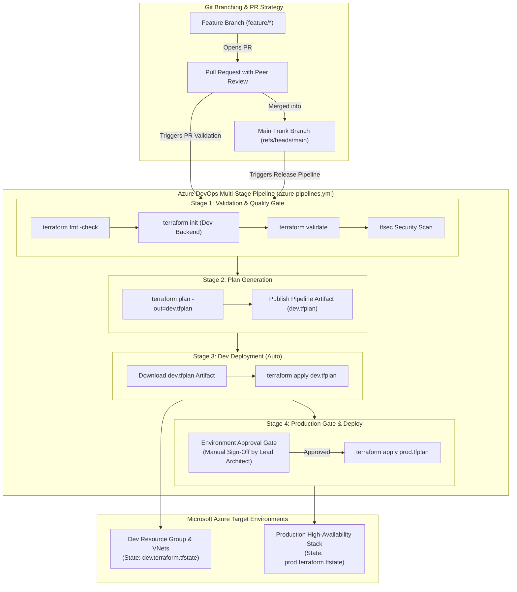

# Project 13: Azure DevOps End-to-End Enterprise CI/CD Pipeline for Terraform

**Breadcrumbs:** [[--Index--|🏠 Index]] > [[14-Index - Terraform on Azure|☁️ Terraform on Azure MOC]] > [[README|Azure Terraform Projects]] > **Project 13: Azure DevOps CI/CD Pipeline**

---

## 🎯 Executive Overview & Architectural Objectives

Deploying Infrastructure as Code manually introduces severe operational inconsistencies: disparate local Terraform binaries, unvetted security misconfigurations, bypassing peer review, and uncoordinated state file locks. In regulated enterprise settings, all infrastructure modifications must flow through an auditable, automated **Continuous Integration and Continuous Delivery (CI/CD)** pipeline.

In this project, you will engineer a production-grade **Multi-Stage Azure Pipelines Delivery Engine** using Azure DevOps and Terraform. You will codify an automated multi-stage YAML pipeline (`azure-pipelines.yml`) featuring automated HCL formatting validation, static security analysis with `tfsec`, plan artifact generation, environment approval gates, and multi-environment promotion (Dev ➔ Staging ➔ Prod) backed by Azure Service Connections.

### Key Architectural Deliverables:
1.  **Multi-Stage Enterprise YAML Pipeline (`azure-pipelines.yml`):** Construct an isolated 4-stage pipeline:
    *   **Stage 1: Validate & Security Scan:** Enforce code formatting (`terraform fmt -check`), syntax validation (`terraform validate`), and static vulnerability scanning via `tfsec`.
    *   **Stage 2: Plan Dev:** Run `terraform plan -out=tfplan` against the development environment and publish the binary plan as a pipeline build artifact.
    *   **Stage 3: Deploy Dev:** Consume the immutable plan artifact and execute `terraform apply tfplan`.
    *   **Stage 4: Production Gate & Promotion:** Enforce a manual approval gate via **Azure DevOps Environments** before promoting changes to production.
2.  **Azure Resource Manager Service Connection:** Establish a secure connection between Azure DevOps and your Azure Subscription using modern Workload Identity Federation (OIDC).
3.  **Dynamic Remote State Partitioning:** Manage isolated state keys (`dev.terraform.tfstate` and `prod.terraform.tfstate`) inside an Azure Storage Account Blob container with native concurrency locking.
4.  **Deterministic Binary Plan Preservation:** Eliminate the critical CI/CD risk of applying drifted configurations by passing saved binary plans between stages.

---

## 🏛️ Target Architecture & Component Topology



---

## 🧠 Deep-Intuition Azure Administration & Architectural Mechanics

### 1. The Critical "Plan-Apply Drift" Flaw in CI/CD
A dangerous anti-pattern frequently observed in naive CI/CD pipelines is running:
*   In Stage 1: `terraform plan` (without `-out`)
*   In Stage 2: `terraform apply -auto-approve` (without passing a plan file)

**Why this causes outages:**
If someone merges another PR, or if a colleague updates a resource via the Azure Portal between Stage 1 and Stage 2, `terraform apply` will re-evaluate the live cloud and apply the *new* state—not what was reviewed and approved!
*   **The Enterprise Solution:** Always run `terraform plan -out=tfplan`. This writes the exact planned actions, evaluated provider versions, and state hash into a binary file.
*   In the deploy stage, run `terraform apply tfplan`. If live Azure infrastructure drifted between plan and apply, Terraform **refuses to execute and aborts**, preventing unintended deletions!

### 2. Azure DevOps Environments & Deployment Gates
Unlike standard build jobs, an Azure DevOps `deployment` job binds to an **Environment**:
*   **Approval & Checks:** You configure required human approvers (e.g., Lead Architect, Security Officer) on the `production` environment.
*   **Branch Control:** Restrict the production environment to only execute from `refs/heads/main`.
*   **Business Hours Checks:** Restrict deployment windows to prevent applying changes during peak traffic hours.

---

## 💻 Complete Production-Grade Pipeline Code

Organize your repository layout as follows:

```
azure-devops-terraform/
├── azure-pipelines.yml
├── environments/
│   ├── dev/
│   │   ├── main.tf
│   │   ├── variables.tf
│   │   ├── outputs.tf
│   │   └── terraform.tfvars
│   └── prod/
│       ├── main.tf
│       ├── variables.tf
│       ├── outputs.tf
│       └── terraform.tfvars
└── modules/
    └── compute_cluster/
        ├── main.tf
        ├── variables.tf
        └── outputs.tf
```

### 1. `azure-pipelines.yml` (Complete Multi-Stage Orchestrator)
```yaml
trigger:
  branches:
    include:
      - main
      - feature/*
  paths:
    include:
      - environments/**
      - modules/**
      - azure-pipelines.yml

pr:
  branches:
    include:
      - main

variables:
  - name: terraform_version
    value: '1.5.7'
  - name: service_connection
    value: 'Azure-Enterprise-ServiceConnection'
  - name: state_resource_group
    value: 'rg-terraform-state'
  - name: state_storage_account
    value: 'sttfstatedev2026'
  - name: state_container
    value: 'tfstate'

stages:
# ==============================================================================
# STAGE 1: Code Formatting, Linting & Security Vulnerability Gate
# ==============================================================================
- stage: Validate_and_Scan
  displayName: "Lint, Validate & Security Gate"
  jobs:
  - job: terraform_validate
    displayName: "Terraform Validate & Security Scan"
    pool:
      vmImage: 'ubuntu-latest'
    steps:
    - task: TerraformInstaller@0
      displayName: "Install Terraform v$(terraform_version)"
      inputs:
        terraformVersion: $(terraform_version)

    - script: |
        echo "##[section]Checking Terraform HCL code formatting..."
        terraform fmt -check -recursive
      displayName: "Check HCL Formatting"

    - task: TerraformTaskV4@4
      displayName: "Terraform Init (Dev)"
      inputs:
        provider: 'azurerm'
        command: 'init'
        workingDirectory: '$(Build.SourcesDirectory)/environments/dev'
        backendServiceArm: $(service_connection)
        backendAzureRmResourceGroupName: $(state_resource_group)
        backendAzureRmStorageAccountName: $(state_storage_account)
        backendAzureRmContainerName: $(state_container)
        backendAzureRmKey: 'dev.terraform.tfstate'

    - task: TerraformTaskV4@4
      displayName: "Terraform Validate"
      inputs:
        provider: 'azurerm'
        command: 'validate'
        workingDirectory: '$(Build.SourcesDirectory)/environments/dev'

    - script: |
        echo "##[section]Installing tfsec security scanner..."
        curl -s https://raw.githubusercontent.com/aquasecurity/tfsec/master/scripts/install_linux.sh | bash
        tfsec $(Build.SourcesDirectory) --format junit --out tfsec-results.xml
      displayName: "Run tfsec Security Scanner"
      continueOnError: false

    - task: PublishTestResults@2
      displayName: "Publish tfsec Scan Results"
      condition: always()
      inputs:
        testResultsFormat: 'JUnit'
        testResultsFiles: 'tfsec-results.xml'

# ==============================================================================
# STAGE 2: Development Speculative Plan
# ==============================================================================
- stage: Plan_Dev
  displayName: "Plan Development Infrastructure"
  dependsOn: Validate_and_Scan
  jobs:
  - job: terraform_plan_dev
    displayName: "Generate Dev Execution Plan"
    pool:
      vmImage: 'ubuntu-latest'
    steps:
    - task: TerraformInstaller@0
      inputs:
        terraformVersion: $(terraform_version)

    - task: TerraformTaskV4@4
      displayName: "Terraform Init"
      inputs:
        provider: 'azurerm'
        command: 'init'
        workingDirectory: '$(Build.SourcesDirectory)/environments/dev'
        backendServiceArm: $(service_connection)
        backendAzureRmResourceGroupName: $(state_resource_group)
        backendAzureRmStorageAccountName: $(state_storage_account)
        backendAzureRmContainerName: $(state_container)
        backendAzureRmKey: 'dev.terraform.tfstate'

    - task: TerraformTaskV4@4
      displayName: "Terraform Plan (Output to Binary Artifact)"
      inputs:
        provider: 'azurerm'
        command: 'plan'
        workingDirectory: '$(Build.SourcesDirectory)/environments/dev'
        environmentServiceNameAzureRM: $(service_connection)
        commandOptions: '-out=$(Build.ArtifactStagingDirectory)/dev.tfplan'

    - publish: $(Build.ArtifactStagingDirectory)/dev.tfplan
      artifact: dev-plan
      displayName: "Publish Dev Plan Artifact"

# ==============================================================================
# STAGE 3: Apply to Development Environment
# ==============================================================================
- stage: Deploy_Dev
  displayName: "Deploy Development Environment"
  dependsOn: Plan_Dev
  condition: and(succeeded(), eq(variables['Build.SourceBranch'], 'refs/heads/main'))
  jobs:
  - deployment: apply_dev
    displayName: "Apply Dev Changes"
    environment: 'development'
    pool:
      vmImage: 'ubuntu-latest'
    strategy:
      runOnce:
        deploy:
          steps:
          - checkout: self

          - task: TerraformInstaller@0
            inputs:
              terraformVersion: $(terraform_version)

          - download: current
            artifact: dev-plan
            displayName: "Download dev.tfplan Artifact"

          - task: TerraformTaskV4@4
            displayName: "Terraform Init"
            inputs:
              provider: 'azurerm'
              command: 'init'
              workingDirectory: '$(Build.SourcesDirectory)/environments/dev'
              backendServiceArm: $(service_connection)
              backendAzureRmResourceGroupName: $(state_resource_group)
              backendAzureRmStorageAccountName: $(state_storage_account)
              backendAzureRmContainerName: $(state_container)
              backendAzureRmKey: 'dev.terraform.tfstate'

          - task: TerraformTaskV4@4
            displayName: "Terraform Apply Binary Plan"
            inputs:
              provider: 'azurerm'
              command: 'apply'
              workingDirectory: '$(Build.SourcesDirectory)/environments/dev'
              environmentServiceNameAzureRM: $(service_connection)
              commandOptions: '$(Pipeline.Workspace)/dev-plan/dev.tfplan'

# ==============================================================================
# STAGE 4: Production Deployment with Manual Architecture Sign-Off Gate
# ==============================================================================
- stage: Deploy_Prod
  displayName: "Deploy Production Environment"
  dependsOn: Deploy_Dev
  condition: and(succeeded(), eq(variables['Build.SourceBranch'], 'refs/heads/main'))
  jobs:
  - deployment: apply_prod
    displayName: "Apply Production Stack"
    # Bound to Azure DevOps Environment with required manual approval checks
    environment: 'production'
    pool:
      vmImage: 'ubuntu-latest'
    strategy:
      runOnce:
        deploy:
          steps:
          - checkout: self

          - task: TerraformInstaller@0
            inputs:
              terraformVersion: $(terraform_version)

          - task: TerraformTaskV4@4
            displayName: "Terraform Init (Prod State)"
            inputs:
              provider: 'azurerm'
              command: 'init'
              workingDirectory: '$(Build.SourcesDirectory)/environments/prod'
              backendServiceArm: $(service_connection)
              backendAzureRmResourceGroupName: $(state_resource_group)
              backendAzureRmStorageAccountName: $(state_storage_account)
              backendAzureRmContainerName: $(state_container)
              backendAzureRmKey: 'prod.terraform.tfstate'

          - task: TerraformTaskV4@4
            displayName: "Terraform Apply (Prod)"
            inputs:
              provider: 'azurerm'
              command: 'apply'
              workingDirectory: '$(Build.SourcesDirectory)/environments/prod'
              environmentServiceNameAzureRM: $(service_connection)
```

### 2. Environment Code: `environments/dev/main.tf`
```hcl
terraform {
  required_version = ">= 1.5.0"
  required_providers {
    azurerm = {
      source  = "hashicorp/azurerm"
      version = "~> 3.90.0"
    }
  }
  backend "azurerm" {}
}

provider "azurerm" {
  features {}
}

resource "azurerm_resource_group" "dev_rg" {
  name     = "rg-enterprise-dev"
  location = "eastus"
  tags = {
    Environment = "Development"
    Pipeline    = "AzureDevOps"
  }
}

resource "azurerm_virtual_network" "dev_vnet" {
  name                = "vnet-dev-core"
  resource_group_name = azurerm_resource_group.dev_rg.name
  location            = azurerm_resource_group.dev_rg.location
  address_space       = ["10.10.0.0/16"]
}

resource "azurerm_subnet" "dev_subnet" {
  name                 = "snet-workloads"
  resource_group_name  = azurerm_resource_group.dev_rg.name
  virtual_network_name = azurerm_virtual_network.dev_vnet.name
  address_prefixes     = ["10.10.1.0/24"]
}
```

---

## 🛠️ Step-by-Step Implementation Walkthrough

### 1. Configure Azure Storage State Backend
Provision the remote state storage account via Azure CLI:
```bash
az group create --name rg-terraform-state --location eastus
az storage account create --name sttfstatedev2026 --resource-group rg-terraform-state --sku Standard_LRS --encryption-services blob
az storage container create --name tfstate --account-name sttfstatedev2026
```

### 2. Configure Azure DevOps Service Connection
1.  Open your **Azure DevOps Project** ➔ Click **Project settings** (bottom-left).
2.  Click **Service connections** ➔ **New service connection** ➔ **Azure Resource Manager**.
3.  Choose **Workload Identity federation (automatic)**:
    *   Scope: Subscription.
    *   Service Connection Name: `Azure-Enterprise-ServiceConnection`.
    *   Check **Grant access permission to all pipelines**. Click **Save**.

### 3. Configure Environments & Manual Approval Gate
1.  In Azure DevOps, click **Pipelines** ➔ **Environments**.
2.  Click **New environment**: Name it `development` (no approvals needed).
3.  Click **New environment**: Name it `production`:
    *   Click the **3 dots** (top-right) ➔ **Approvals and checks**.
    *   Select **Approvals** ➔ Add yourself or your Lead Architect.
    *   Add **Branch control**: Allowed branches `refs/heads/main`.

### 4. 👁️ Visual Checkpoint in Azure DevOps
*   Open a Pull Request from `feature/add-vnet` to `main`.
*   Observe that only `Validate_and_Scan` and `Plan_Dev` execute.
*   Review the published `dev-plan` artifact in the pipeline summary run.
*   Merge the Pull Request into `main`:
    *   Notice `Deploy_Dev` automatically applies.
    *   Notice `Deploy_Prod` pauses with status: **Waiting for approval**!
    *   Click **Review** ➔ Inspect the plan details ➔ Click **Approve**.

---

## 🔬 Verification & Live Probe Testing

Verify pipeline execution and state persistence:

```bash
# Query Azure CLI to confirm dev resources were created by the pipeline agent
az network vnet show --resource-group rg-enterprise-dev --name vnet-dev-core --query "provisioningState" -o tsv

# Verify blob state locking lease status
az storage blob show \
  --account-name sttfstatedev2026 \
  --container-name tfstate \
  --name "dev.terraform.tfstate" \
  --query "properties.lease.status" -o tsv
```
**Expected Output:** `Unlocked` (State lease was cleanly acquired and released upon completion).

---

## ⚠️ "See It in Action" Real-World Failure & Recovery Loop (AARF)

### Scenario: The Unpinned Pipeline Binary Chaos
*   **The Architecture:** An engineering team installs Terraform dynamically on hosted ubuntu runners using `curl latest` without pinning `terraformVersion`.
*   **The Assumption:** The team assumes Terraform upgrades are always backwards-compatible.
*   **The Failure Loop:**
    *   HashiCorp releases a major new version of Terraform.
    *   The hosted pipeline agent downloads the new binary.
    *   The pipeline runs `terraform init` and modifies the `.tfstate` schema version to the new format.
    *   Local platform engineers running the previous version can no longer read or modify the state file, receiving: `Error: state snapshot was created by a newer version of Terraform`.
    *   All hotfix deployments are locked out until every workstation and pipeline is manually migrated!
*   **The Remediation Protocol:**
    1.  **Pin Every Tooling Version:** Strictly pin `terraformVersion: '1.5.7'` in your pipeline YAML.
    2.  **Pin Provider Versions in HCL:** Always declare explicit constraints in `required_providers` (e.g., `version = "~> 3.90.0"`).
    3.  **Run Version Audits:** Never upgrade production pipeline binaries without first running full staging validation.

---

## 🧹 Cost Optimization & Clean Teardown

```bash
# Delete all resources created by the pipeline
az group delete --name rg-enterprise-dev --yes --no-wait
az group delete --name rg-terraform-state --yes --no-wait
```
