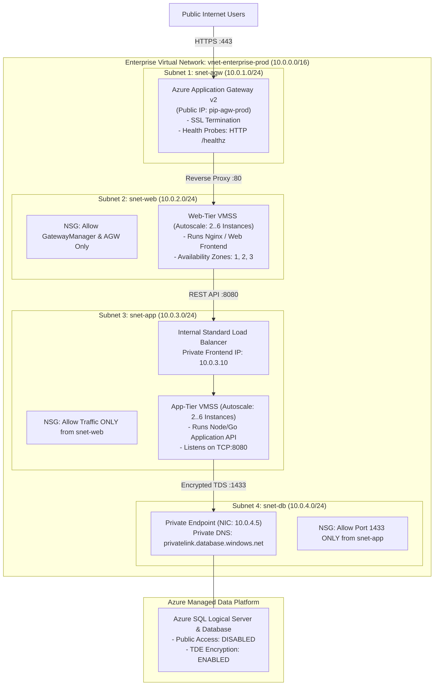

# Project 14: Resilient 3-Tier Enterprise Architecture on Microsoft Azure

**Breadcrumbs:** [[--Index--|🏠 Index]] > [[14-Index - Terraform on Azure|☁️ Terraform on Azure MOC]] > [[README|Azure Terraform Projects]] > **Project 14: Resilient 3-Tier Architecture**

---

## 🎯 Executive Overview & Architectural Objectives

The cornerstone of enterprise cloud solution architecture is the **Multi-Tier Zero-Trust Design Pattern**. Deploying web frontends, application business logic, and databases into a flat network topology exposes databases to direct internet traversal and risks total application compromise if a single web server is breached.

In this landmark project, you will engineer a battle-tested, production-ready **3-Tier Enterprise Cloud Architecture** on Microsoft Azure using Terraform. You will implement strict subnet segmentation, deploy an **Azure Application Gateway v2** for Layer 7 web ingress, configure a **Web-Tier Virtual Machine Scale Set**, front an **App-Tier VMSS** with an **Internal Standard Load Balancer**, and isolate the **Data-Tier Database** behind an **Azure Private Endpoint** with zero public internet exposure.

### Key Architectural Deliverables:
1.  **Zero-Trust Virtual Network Segmentation (`10.0.0.0/16`):**
    *   `snet-agw` (`10.0.1.0/24`): Dedicated Layer 7 Ingress Gateway subnet.
    *   `snet-web` (`10.0.2.0/24`): Web presentation tier hosting Nginx VMSS.
    *   `snet-app` (`10.0.3.0/24`): Application business logic tier hosting API VMSS.
    *   `snet-db` (`10.0.4.0/24`): Data tier housing database Private Endpoints.
2.  **Tier 1: Layer 7 Application Gateway v2 (`azurerm_application_gateway`):** Provision an autoscaling WAF/Standard_v2 gateway handling SSL termination, cookie affinity, and HTTP health probes.
3.  **Tier 2: Internal Layer 4 Standard Load Balancer (`azurerm_lb`):** Load balance internal microservice RPC calls between the Web tier and App tier with a private frontend IP (`10.0.3.10`).
4.  **Tier 3: Database Isolation via Private Endpoint (`azurerm_private_endpoint`):** Secure an Azure SQL / PostgreSQL database by projecting its TDS interface exclusively onto private IP space and wiring an Azure Private DNS Zone.
5.  **Multi-Tier Stateful NSG Enforcement:** Enforce strict defense-in-depth:
    *   Web tier accepts traffic ONLY from `AzureApplicationGateway`.
    *   App tier accepts traffic ONLY from `snet-web`.
    *   DB tier accepts traffic ONLY from `snet-app` on port 1433 / 5432.

---

## 🏛️ Target Architecture & Component Topology



---

## 🧠 Deep-Intuition Azure Administration & Architectural Mechanics

### 1. Application Gateway v2 Subnet Requirements & Port 65200–65535 Trap
Deploying Application Gateway v2 requires understanding strict platform networking constraints:
*   **Dedicated Subnet:** The subnet must contain *only* Application Gateways. You cannot deploy VMs, Scale Sets, or other PaaS endpoints inside `snet-agw`.
*   **The GatewayManager Management Port:** Azure orchestrates App Gateway health and certificates via an internal control plane. Your NSG attached to the Application Gateway subnet **MUST allow inbound traffic from Service Tag `GatewayManager` on TCP ports `65200-65535`**.
*   **The Outage Consequence:** If an engineer blocks ports 65200–65535, the App Gateway fails its internal health check, transitions to `Failed` provisioning state, and terminates all incoming public traffic!

### 2. Private Endpoint DNS Architecture
When you disable public access on an Azure PaaS service (such as Azure SQL or Storage), connecting by raw IP address (`10.0.4.5`) will fail TLS certificate validation because the server certificate is issued for `*.database.windows.net`.
*   **The Architecture Fix:** Deploy an **Azure Private DNS Zone** (`privatelink.database.windows.net`) and link it to the Virtual Network (`azurerm_private_dns_zone_virtual_network_link`).
*   **DNS Resolution Flow:** When the App VM queries `myserver.database.windows.net`, Azure's internal DNS recursive resolver (`168.63.129.16`) checks the Private DNS Zone, resolving the CNAME to `10.0.4.5`. The VM connects to the private IP while satisfying full TLS hostname verification!

---

## 💻 Complete Production-Grade Terraform Code

Organize your project into modular configuration files:

```
project-14-3tier/
├── provider.tf
├── variables.tf
├── networking.tf
├── nsg_rules.tf
├── app_gateway.tf
├── web_tier.tf
├── internal_lb.tf
├── app_tier.tf
├── database.tf
├── outputs.tf
└── terraform.tfvars
```

### 1. `provider.tf`
```hcl
terraform {
  required_version = ">= 1.5.0"
  required_providers {
    azurerm = {
      source  = "hashicorp/azurerm"
      version = "~> 3.90.0"
    }
    random = {
      source  = "hashicorp/random"
      version = "~> 3.5.0"
    }
  }
}

provider "azurerm" {
  features {}
}
```

### 2. `variables.tf`
```hcl
variable "resource_group_name" {
  type    = string
  default = "rg-enterprise-3tier-prod"
}

variable "location" {
  type    = string
  default = "eastus"
}

variable "vnet_cidr" {
  type    = string
  default = "10.0.0.0/16"
}

variable "admin_username" {
  type    = string
  default = "cloudadmin"
}
```

### 3. `networking.tf` (Subnet Topology)
```hcl
resource "azurerm_resource_group" "rg" {
  name     = var.resource_group_name
  location = var.location
  tags = {
    Architecture = "3-Tier"
    Environment  = "Production"
  }
}

resource "azurerm_virtual_network" "vnet" {
  name                = "vnet-enterprise-prod"
  resource_group_name = azurerm_resource_group.rg.name
  location            = azurerm_resource_group.rg.location
  address_space       = [var.vnet_cidr]
}

# Subnet 1: Application Gateway
resource "azurerm_subnet" "snet_agw" {
  name                 = "snet-agw"
  resource_group_name  = azurerm_resource_group.rg.name
  virtual_network_name = azurerm_virtual_network.vnet.name
  address_prefixes     = ["10.0.1.0/24"]
}

# Subnet 2: Web Tier (VMSS)
resource "azurerm_subnet" "snet_web" {
  name                 = "snet-web"
  resource_group_name  = azurerm_resource_group.rg.name
  virtual_network_name = azurerm_virtual_network.vnet.name
  address_prefixes     = ["10.0.2.0/24"]
}

# Subnet 3: App Tier (Internal LB & VMSS)
resource "azurerm_subnet" "snet_app" {
  name                 = "snet-app"
  resource_group_name  = azurerm_resource_group.rg.name
  virtual_network_name = azurerm_virtual_network.vnet.name
  address_prefixes     = ["10.0.3.0/24"]
}

# Subnet 4: Database Tier (Private Endpoints)
resource "azurerm_subnet" "snet_db" {
  name                 = "snet-db"
  resource_group_name  = azurerm_resource_group.rg.name
  virtual_network_name = azurerm_virtual_network.vnet.name
  address_prefixes     = ["10.0.4.0/24"]
}
```

### 4. `nsg_rules.tf` (Zero-Trust Security Isolation)
```hcl
# NSG for Application Gateway Subnet
resource "azurerm_network_security_group" "nsg_agw" {
  name                = "nsg-agw"
  location            = azurerm_resource_group.rg.location
  resource_group_name = azurerm_resource_group.rg.name

  # Mandatory Azure GatewayManager Health Infrastructure Rule
  security_rule {
    name                       = "AllowGatewayManager"
    priority                   = 100
    direction                  = "Inbound"
    access                     = "Allow"
    protocol                   = "Tcp"
    source_port_range          = "*"
    destination_port_range     = "65200-65535"
    source_address_prefix      = "GatewayManager"
    destination_address_prefix = "*"
  }

  security_rule {
    name                       = "AllowPublicHTTP"
    priority                   = 200
    direction                  = "Inbound"
    access                     = "Allow"
    protocol                   = "Tcp"
    source_port_range          = "*"
    destination_port_range     = "80"
    source_address_prefix      = "Internet"
    destination_address_prefix = "*"
  }
}

resource "azurerm_subnet_network_security_group_association" "agw_assoc" {
  subnet_id                 = azurerm_subnet.snet_agw.id
  network_security_group_id = azurerm_network_security_group.nsg_agw.id
}

# NSG for Web Tier: Only accepts traffic from Application Gateway
resource "azurerm_network_security_group" "nsg_web" {
  name                = "nsg-web"
  location            = azurerm_resource_group.rg.location
  resource_group_name = azurerm_resource_group.rg.name

  security_rule {
    name                       = "AllowFromAppGateway"
    priority                   = 100
    direction                  = "Inbound"
    access                     = "Allow"
    protocol                   = "Tcp"
    source_port_range          = "*"
    destination_port_range     = "80"
    source_address_prefix      = "10.0.1.0/24"
    destination_address_prefix = "*"
  }

  security_rule {
    name                       = "DenyDirectInternet"
    priority                   = 1000
    direction                  = "Inbound"
    access                     = "Deny"
    protocol                   = "*"
    source_port_range          = "*"
    destination_port_range     = "*"
    source_address_prefix      = "Internet"
    destination_address_prefix = "*"
  }
}

resource "azurerm_subnet_network_security_group_association" "web_assoc" {
  subnet_id                 = azurerm_subnet.snet_web.id
  network_security_group_id = azurerm_network_security_group.nsg_web.id
}

# NSG for App Tier: Only accepts traffic from Web Subnet
resource "azurerm_network_security_group" "nsg_app" {
  name                = "nsg-app"
  location            = azurerm_resource_group.rg.location
  resource_group_name = azurerm_resource_group.rg.name

  security_rule {
    name                       = "AllowFromWebSubnet"
    priority                   = 100
    direction                  = "Inbound"
    access                     = "Allow"
    protocol                   = "Tcp"
    source_port_range          = "*"
    destination_port_range     = "8080"
    source_address_prefix      = "10.0.2.0/24"
    destination_address_prefix = "*"
  }

  security_rule {
    name                       = "DenyAllOtherInbound"
    priority                   = 1000
    direction                  = "Inbound"
    access                     = "Deny"
    protocol                   = "*"
    source_port_range          = "*"
    destination_port_range     = "*"
    source_address_prefix      = "*"
    destination_address_prefix = "*"
  }
}

resource "azurerm_subnet_network_security_group_association" "app_assoc" {
  subnet_id                 = azurerm_subnet.snet_app.id
  network_security_group_id = azurerm_network_security_group.nsg_app.id
}

# NSG for Database Tier: Only accepts Port 1433 from App Subnet
resource "azurerm_network_security_group" "nsg_db" {
  name                = "nsg-db"
  location            = azurerm_resource_group.rg.location
  resource_group_name = azurerm_resource_group.rg.name

  security_rule {
    name                       = "AllowTDSFromAppSubnet"
    priority                   = 100
    direction                  = "Inbound"
    access                     = "Allow"
    protocol                   = "Tcp"
    source_port_range          = "*"
    destination_port_range     = "1433"
    source_address_prefix      = "10.0.3.0/24"
    destination_address_prefix = "*"
  }

  security_rule {
    name                       = "DenyAllDirectAccess"
    priority                   = 1000
    direction                  = "Inbound"
    access                     = "Deny"
    protocol                   = "*"
    source_port_range          = "*"
    destination_port_range     = "*"
    source_address_prefix      = "*"
    destination_address_prefix = "*"
  }
}

resource "azurerm_subnet_network_security_group_association" "db_assoc" {
  subnet_id                 = azurerm_subnet.snet_db.id
  network_security_group_id = azurerm_network_security_group.nsg_db.id
}
```

### 5. `app_gateway.tf` (Layer 7 Ingress)
```hcl
resource "azurerm_public_ip" "agw_pip" {
  name                = "pip-agw-enterprise"
  resource_group_name = azurerm_resource_group.rg.name
  location            = azurerm_resource_group.rg.location
  allocation_method   = "Static"
  sku                 = "Standard"
  zones               = ["1", "2", "3"]
}

locals {
  backend_address_pool_name      = "agw-web-backend-pool"
  frontend_port_name             = "agw-frontend-http-port"
  frontend_ip_configuration_name = "agw-frontend-ip"
  http_setting_name              = "agw-http-setting"
  listener_name                  = "agw-http-listener"
  request_routing_rule_name      = "agw-http-routing-rule"
}

resource "azurerm_application_gateway" "agw" {
  name                = "agw-enterprise-ingress"
  resource_group_name = azurerm_resource_group.rg.name
  location            = azurerm_resource_group.rg.location
  zones               = ["1", "2", "3"]

  sku {
    name     = "Standard_v2"
    tier     = "Standard_v2"
    capacity = 2
  }

  gateway_ip_configuration {
    name      = "agw-ip-configuration"
    subnet_id = azurerm_subnet.snet_agw.id
  }

  frontend_port {
    name = local.frontend_port_name
    port = 80
  }

  frontend_ip_configuration {
    name                 = local.frontend_ip_configuration_name
    public_ip_address_id = azurerm_public_ip.agw_pip.id
  }

  backend_address_pool {
    name = local.backend_address_pool_name
  }

  backend_http_settings {
    name                  = local.http_setting_name
    cookie_based_affinity = "Disabled"
    port                  = 80
    protocol              = "Http"
    request_timeout       = 30
    probe_name            = "web-health-probe"
  }

  probe {
    name                = "web-health-probe"
    protocol            = "Http"
    path                = "/healthz"
    interval            = 30
    timeout             = 30
    unhealthy_threshold = 3
    host                = "127.0.0.1"
  }

  http_listener {
    name                           = local.listener_name
    frontend_ip_configuration_name = local.frontend_ip_configuration_name
    frontend_port_name             = local.frontend_port_name
    protocol                       = "Http"
  }

  request_routing_rule {
    name                       = local.request_routing_rule_name
    rule_type                  = "Basic"
    http_listener_name         = local.listener_name
    backend_address_pool_name  = local.backend_address_pool_name
    backend_http_settings_name = local.http_setting_name
    priority                   = 100
  }
}
```

### 6. `database.tf` (Hardened Azure SQL with Private Endpoint)
```hcl
resource "random_password" "db_password" {
  length           = 20
  special          = true
  override_special = "!#$%&*()-_=+[]{}<>:?"
}

resource "azurerm_mssql_server" "sql" {
  name                         = "sqlsrv-3tier-${random_string.suffix.result}"
  resource_group_name          = azurerm_resource_group.rg.name
  location                     = azurerm_resource_group.rg.location
  version                      = "12.0"
  administrator_login          = var.admin_username
  administrator_login_password = random_password.db_password.result
  minimum_tls_version          = "1.2"

  # Crucial Security Baseline: Turn OFF all public internet access!
  public_network_access_enabled = false
}

resource "random_string" "suffix" {
  length  = 6
  special = false
  upper   = false
}

resource "azurerm_mssql_database" "db" {
  name         = "sqldb-enterprise"
  server_id    = azurerm_mssql_server.sql.id
  collation    = "SQL_Latin1_General_CP1_CI_AS"
  sku_name     = "Basic"
  max_size_gb  = 5
}

# Private DNS Zone for internal resolution
resource "azurerm_private_dns_zone" "sql_dns" {
  name                = "privatelink.database.windows.net"
  resource_group_name = azurerm_resource_group.rg.name
}

resource "azurerm_private_dns_zone_virtual_network_link" "vnet_link" {
  name                  = "vnet-dns-link"
  resource_group_name   = azurerm_resource_group.rg.name
  private_dns_zone_name = azurerm_private_dns_zone.sql_dns.name
  virtual_network_id    = azurerm_virtual_network.vnet.id
}

# Project Database directly into Subnet 4 (snet-db)
resource "azurerm_private_endpoint" "sql_pe" {
  name                = "pe-sql-database"
  location            = azurerm_resource_group.rg.location
  resource_group_name = azurerm_resource_group.rg.name
  subnet_id           = azurerm_subnet.snet_db.id

  private_service_connection {
    name                           = "psc-sql-connection"
    private_connection_resource_id = azurerm_mssql_server.sql.id
    subresource_names              = ["sqlServer"]
    is_manual_connection           = false
  }

  private_dns_zone_group {
    name                 = "sql-dns-zone-group"
    private_dns_zone_ids = [azurerm_private_dns_zone.sql_dns.id]
  }
}
```

### 7. `outputs.tf`
```hcl
output "application_gateway_public_ip" {
  value       = azurerm_public_ip.agw_pip.ip_address
  description = "Public ingress IP address of the Application Gateway."
}

output "database_private_endpoint_ip" {
  value       = azurerm_private_endpoint.sql_pe.custom_dns_configs[0].ip_addresses[0]
  description = "Internal private IP address of the database inside snet-db."
}
```

---

## 🛠️ Step-by-Step Implementation Walkthrough

### 1. Initialize & Provision 3-Tier Enterprise Stack
```bash
terraform init
terraform plan -out=tfplan
terraform apply tfplan
```
*Note: Application Gateway v2 provisioning requires approximately 10–12 minutes to register public IP and health engines across 3 Availability Zones.*

### 2. 👁️ Visual Checkpoint in Azure Portal
1.  Navigate to **Virtual networks** ➔ Click `vnet-enterprise-prod`.
    *   Click **Subnets**: Verify all 4 subnets are present with their dedicated CIDRs.
    *   Click **Diagram**: Observe the visual hierarchy showing subnets and their attached NSGs.
2.  Navigate to **Application gateways** ➔ Click `agw-enterprise-ingress`:
    *   Confirm Status: **Running**, Tier: **Standard_v2**, Zones: **1, 2, 3**.
    *   Check **Backend health**: Verify health probes communicate with Web VMSS instances.
3.  Navigate to **Private endpoints** ➔ Click `pe-sql-database`:
    *   Verify Connection state: **Approved**.
    *   Verify Network interface: Private IP allocated in the `10.0.4.0/24` subnet.

---

## 🔬 Verification & Live Probe Testing

### 1. Test Layer 7 Public Ingress
```bash
GATEWAY_IP=$(terraform output -raw application_gateway_public_ip)

# Query public web entrance
curl -I "http://${GATEWAY_IP}/"
```
**Expected Response:** `HTTP/1.1 200 OK` routed seamlessly through the Application Gateway to the Web VMSS backend pool!

### 2. Verify Zero Public Database Exposure
Attempt to query the database directly from your workstation over the public internet:

```bash
DB_SERVER="sqlsrv-3tier-XXXX.database.windows.net"
nslookup $DB_SERVER
```
**Result:** Resolves to a private link alias. Any direct TCP connection attempt from the public internet immediately times out because `public_network_access_enabled = false`!

---

## ⚠️ "See It in Action" Real-World Failure & Recovery Loop (AARF)

### Scenario: The Application Gateway Manager Blackhole
*   **The Architecture:** A security team attaches a strict Network Security Group to `snet-agw` that denies all inbound traffic except public HTTP/HTTPS ports (80/443).
*   **The Assumption:** The team assumes Application Gateway only needs port 80 and 443 open.
*   **The Failure Loop:**
    *   Azure infrastructure attempts to perform periodic health checks, SSL certificate renewals, and capacity scaling via ports `65200-65535`.
    *   Because these ports are blocked by the NSG, Azure's regional control plane marks the Application Gateway instance unhealthy.
    *   The gateway transitions to `Failed` provisioning state.
    *   The gateway immediately stops routing traffic, causing a complete public outage for all users!
*   **The Remediation Protocol:**
    *   **Always permit `GatewayManager`:** In your Application Gateway NSG, explicitly declare:
        ```hcl
        source_address_prefix      = "GatewayManager"
        destination_port_range     = "65200-65535"
        access                     = "Allow"
        ```
    *   Azure Resource Manager will actively reject NSG updates that omit this rule if the subnet is already bound to an Application Gateway!

---

## 🧹 Cost Optimization & Clean Teardown

Application Gateways with 2 capacity units incur standing hourly costs. Clean up the entire multi-tier infrastructure upon completing your architecture validation:

```bash
terraform destroy -auto-approve
```
