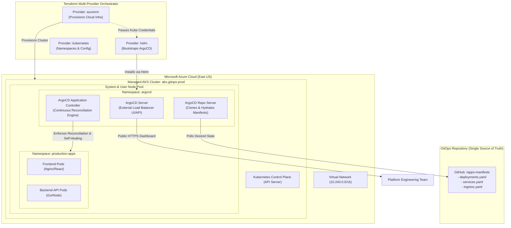

# Project 15: Enterprise AKS Platform & GitOps Continuous Delivery with ArgoCD

**Breadcrumbs:** [[--Index--|🏠 Index]] > [[14-Index - Terraform on Azure|☁️ Terraform on Azure MOC]] > [[README|Azure Terraform Projects]] > **Project 15: AKS GitOps with ArgoCD**

---

## 🎯 Executive Overview & Architectural Objectives

Modern platform engineering separates infrastructure provisioning from application deployment. While Terraform excels at declaring Day-1 cloud infrastructure (VNets, IAM, Managed Kubernetes clusters), using Terraform to manage rapidly changing application container lifecycles creates bloated state files and slow execution loops. The industry standard pattern is **GitOps**: Terraform builds the Kubernetes foundation and bootstraps a GitOps controller (**ArgoCD**), which subsequently pulls, synchronizes, and self-heals microservices from application Git repositories.

In this capstone project, you will engineer an end-to-end **Cloud-Native GitOps Platform** on Microsoft Azure. You will orchestrate multiple Terraform providers (`azurerm`, `kubernetes`, `helm`, `time`), provision an enterprise **Azure Kubernetes Service (AKS)** cluster, automatically bootstrap a production-grade **ArgoCD control plane** via Helm within the same declarative execution, and register an automated continuous delivery application that syncs microservices from Git.

### Key Architectural Deliverables:
1.  **Multi-Provider Declarative Orchestration:** Unify `azurerm` (cloud infrastructure), `kubernetes` (native resources), and `helm` (package management) into a single atomic execution pipeline.
2.  **Production AKS Cluster (`azurerm_kubernetes_cluster`):** Provision a managed Kubernetes cluster with System-Assigned Managed Identity, Azure CNI networking, and node pool isolation.
3.  **Dynamic Provider Credential Chaining:** Seamlessly pipe AKS administrative TLS credentials into the Helm and Kubernetes providers using the `time_sleep` barrier pattern.
4.  **Production-Grade ArgoCD Deployment (`helm_release`):** Deploy the official ArgoCD chart (`argo-cd`) configured with high-availability replicas, production CPU/memory reservations, and a public Standard Load Balancer service.
5.  **GitOps Continuous Delivery Application:** Codify the initial GitOps application manifest to watch an upstream Git repository and automatically reconcile Kubernetes microservices with self-healing drift detection.

---

## 🏛️ Target Architecture & Component Topology



---

## 🧠 Deep-Intuition Azure Administration & Architectural Mechanics

### 1. The Dynamic Provider Credentials Race Condition
A major technical challenge in Terraform occurs when a downstream provider (such as `helm` or `kubernetes`) depends on credentials generated by an upstream resource (such as `azurerm_kubernetes_cluster`) in the same root module:
*   **The Problem:** During `terraform plan`, Terraform builds the dependency graph. If the Kubernetes API endpoint does not exist yet, the `helm` provider cannot connect to validate Kubernetes API versions, causing the plan to fail with `connection refused`.
*   **The Enterprise Solution:** We configure the `helm` and `kubernetes` provider blocks using dynamic attributes extracted directly from `azurerm_kubernetes_cluster.main.kube_config`.
*   **The `time_sleep` Synchronization Barrier:** Even after ARM reports that the AKS cluster is `Succeeded`, the Kubernetes API server and CoreDNS pods take 30–60 seconds to finish internal TLS initialization. Introducing a `time_sleep` resource (60 seconds) guarantees that the API server is completely responsive before Helm attempts to install ArgoCD CRDs.

### 2. GitOps vs. Imperative CI/CD Pipelines
Why do enterprise cloud teams delegate application deployments to ArgoCD instead of letting Jenkins or Azure DevOps run `kubectl apply`?

| Operational Vector | Push-Based Delivery (CI/CD Pipelines) | Pull-Based GitOps (ArgoCD on AKS) |
| :--- | :--- | :--- |
| **Cluster Access** | CI/CD runners require high-privilege cluster admin credentials stored outside Azure. | **Zero external credentials**. ArgoCD runs natively inside the cluster and pulls state inward. |
| **Configuration Drift** | If an operator manually edits a pod via `kubectl edit`, the CI pipeline has no awareness. | **Active Self-Healing**: ArgoCD continuously monitors the cluster and instantly reverts unauthorized manual changes. |
| **Auditability & Rollback** | Rollback requires re-triggering older pipeline builds. | Git `revert` is an instant rollback; cluster reconciles to the prior commit in seconds. |

---

## 💻 Complete Production-Grade Terraform Code

Organize your project into the following files:

```
project-15-aks-gitops/
├── provider.tf
├── variables.tf
├── main.tf
├── kubernetes-resources.tf
├── outputs.tf
└── terraform.tfvars
```

### 1. `provider.tf` (Multi-Provider Configuration)
```hcl
terraform {
  required_version = ">= 1.5.0"
  required_providers {
    azurerm = {
      source  = "hashicorp/azurerm"
      version = "~> 3.90.0"
    }
    kubernetes = {
      source  = "hashicorp/kubernetes"
      version = "~> 2.26.0"
    }
    helm = {
      source  = "hashicorp/helm"
      version = "~> 2.12.0"
    }
    time = {
      source  = "hashicorp/time"
      version = "~> 0.10.0"
    }
  }
}

provider "azurerm" {
  features {}
}

# Dynamic Kubernetes Provider configured from AKS cluster outputs
provider "kubernetes" {
  host                   = azurerm_kubernetes_cluster.aks.kube_config[0].host
  client_certificate     = base64decode(azurerm_kubernetes_cluster.aks.kube_config[0].client_certificate)
  client_key             = base64decode(azurerm_kubernetes_cluster.aks.kube_config[0].client_key)
  cluster_ca_certificate = base64decode(azurerm_kubernetes_cluster.aks.kube_config[0].cluster_ca_certificate)
}

# Dynamic Helm Provider
provider "helm" {
  kubernetes {
    host                   = azurerm_kubernetes_cluster.aks.kube_config[0].host
    client_certificate     = base64decode(azurerm_kubernetes_cluster.aks.kube_config[0].client_certificate)
    client_key             = base64decode(azurerm_kubernetes_cluster.aks.kube_config[0].client_key)
    cluster_ca_certificate = base64decode(azurerm_kubernetes_cluster.aks.kube_config[0].cluster_ca_certificate)
  }
}
```

### 2. `variables.tf`
```hcl
variable "resource_group_name" {
  type        = string
  default     = "rg-aks-gitops-prod"
  description = "Target Resource Group name."
}

variable "location" {
  type        = string
  default     = "eastus"
  description = "Azure region for deployment."
}

variable "cluster_name" {
  type        = string
  default     = "aks-gitops-platform"
  description = "Name of the production AKS cluster."
}

variable "dns_prefix" {
  type        = string
  default     = "aks-gitops"
  description = "DNS prefix for the cluster FQDN."
}

variable "argocd_version" {
  type        = string
  default     = "6.0.1"
  description = "Official ArgoCD Helm Chart version."
}
```

### 3. `main.tf` (Azure Infrastructure & AKS Cluster)
```hcl
resource "azurerm_resource_group" "rg" {
  name     = var.resource_group_name
  location = var.location
  tags = {
    Environment = "Production"
    Platform    = "Kubernetes-GitOps"
  }
}

# Dedicated Virtual Network for AKS
resource "azurerm_virtual_network" "vnet" {
  name                = "vnet-aks-gitops"
  location            = azurerm_resource_group.rg.location
  resource_group_name = azurerm_resource_group.rg.name
  address_space       = ["10.240.0.0/16"]
}

# Sized Subnet (/20) for Azure CNI Pod IP Reservations
resource "azurerm_subnet" "aks_subnet" {
  name                 = "snet-aks-nodes"
  resource_group_name  = azurerm_resource_group.rg.name
  virtual_network_name = azurerm_virtual_network.vnet.name
  address_prefixes     = ["10.240.0.0/20"]
}

# Production AKS Cluster with System-Assigned Managed Identity
resource "azurerm_kubernetes_cluster" "aks" {
  name                = var.cluster_name
  location            = azurerm_resource_group.rg.location
  resource_group_name = azurerm_resource_group.rg.name
  dns_prefix          = var.dns_prefix

  default_node_pool {
    name                = "syspool"
    node_count          = 2
    vm_size             = "Standard_D2s_v5"
    vnet_subnet_id      = azurerm_subnet.aks_subnet.id
    os_disk_size_gb     = 50
    os_disk_type        = "Managed"
    type                = "VirtualMachineScaleSets"
    enable_auto_scaling = false

    tags = {
      NodeRole = "System"
    }
  }

  identity {
    type = "SystemAssigned"
  }

  network_profile {
    network_plugin    = "azure"
    load_balancer_sku = "standard"
  }

  tags = {
    OrchestratedBy = "Terraform"
    GitOpsEnabled  = "True"
  }
}

# Synchronization Barrier: Allow AKS API server to stabilize before Helm talks to it
resource "time_sleep" "wait_for_aks" {
  depends_on      = [azurerm_kubernetes_cluster.aks]
  create_duration = "60s"
}
```

### 4. `kubernetes-resources.tf` (ArgoCD Helm Release)
```hcl
# Dedicated Namespace for ArgoCD
resource "kubernetes_namespace" "argocd" {
  metadata {
    name = "argocd"
    labels = {
      "app.kubernetes.io/name"    = "argocd"
      "app.kubernetes.io/part-of" = "gitops-system"
    }
  }

  depends_on = [time_sleep.wait_for_aks]
}

# Production ArgoCD Deployment via Helm
resource "helm_release" "argocd" {
  name       = "argocd"
  repository = "https://argoproj.github.io/argo-helm"
  chart      = "argo-cd"
  version    = var.argocd_version
  namespace  = kubernetes_namespace.argocd.metadata[0].name
  timeout    = 600
  wait       = true

  # Expose ArgoCD Web Dashboard via Azure Standard Public Load Balancer
  set {
    name  = "server.service.type"
    value = "LoadBalancer"
  }

  # Enable High Availability for ArgoCD Components
  set {
    name  = "server.replicas"
    value = "2"
  }

  set {
    name  = "repoServer.replicas"
    value = "2"
  }

  set {
    name  = "applicationSet.replicas"
    value = "2"
  }

  # Production CPU and Memory Resource Requests & Limits
  set {
    name  = "server.resources.requests.cpu"
    value = "250m"
  }

  set {
    name  = "server.resources.requests.memory"
    value = "256Mi"
  }

  set {
    name  = "server.resources.limits.cpu"
    value = "1000m"
  }

  set {
    name  = "server.resources.limits.memory"
    value = "1Gi"
  }

  depends_on = [kubernetes_namespace.argocd]
}

# Save local administrative kubeconfig for immediate kubectl debugging
resource "local_file" "kubeconfig" {
  content  = azurerm_kubernetes_cluster.aks.kube_config_raw
  filename = "${path.module}/kubeconfig"
}
```

### 5. `outputs.tf`
```hcl
output "cluster_name" {
  value       = azurerm_kubernetes_cluster.aks.name
  description = "Name of the provisioned AKS cluster."
}

output "kubeconfig_file" {
  value       = local_file.kubeconfig.filename
  description = "Local path to the cluster kubeconfig file."
}

output "argocd_admin_password_command" {
  value       = "kubectl -n argocd get secret argocd-initial-admin-secret -o jsonpath=\"{.data.password}\" | base64 -d"
  description = "Command to decode the initial ArgoCD admin password."
}
```

---

## 🛠️ Step-by-Step Implementation Walkthrough

### 1. Initialize Multi-Provider Workspace
```bash
terraform init
terraform plan -out=tfplan
terraform apply tfplan
```
*Note: The combined deployment executes: Resource Group ➔ VNet ➔ Subnet ➔ AKS Cluster (5 mins) ➔ 60s Sleep Barrier ➔ ArgoCD Namespace ➔ ArgoCD Helm Release (2 mins).*

### 2. 👁️ Visual Checkpoint in Azure Portal
1.  Navigate to **Kubernetes services** in the Azure Portal:
    *   Click `aks-gitops-platform`.
    *   Under **Settings**, click **Networking**: Confirm Network configuration is **Azure CNI**.
2.  Navigate to **Resource groups**:
    *   Open the automatically created infrastructure resource group: `MC_rg-aks-gitops-prod_aks-gitops-platform_eastus`.
    *   Notice the **Public IP addresses** and **Load balancer** automatically provisioned by Azure for the ArgoCD LoadBalancer service!

---

## 🔬 Verification & Live GitOps Administration

### 1. Connect via Local Kubeconfig & Verify ArgoCD Pods
```bash
export KUBECONFIG="./kubeconfig"

# Check node health
kubectl get nodes -o wide

# Check all ArgoCD components in the argocd namespace
kubectl get pods -n argocd
```
**Expected Output:**
```
NAME                                                READY   STATUS    RESTARTS   AGE
argocd-application-controller-0                     1/1     Running   0          3m
argocd-applicationset-controller-587ff559f-d9s2r    1/1     Running   0          3m
argocd-redis-74b8f78d7b-94kln                       1/1     Running   0          3m
argocd-repo-server-67597bc8f9-4h27d                 1/1     Running   0          3m
argocd-repo-server-67597bc8f9-9q9lm                 1/1     Running   0          3m
argocd-server-7bd45464c8-2b8sm                      1/1     Running   0          3m
argocd-server-7bd45464c8-m72lx                      1/1     Running   0          3m
```

### 2. Discover External LoadBalancer IP & Retrieve Admin Password
```bash
# 1. Retrieve the public LoadBalancer IP assigned by Azure
ARGOCD_IP=$(kubectl get svc -n argocd argocd-server -o jsonpath='{.status.loadBalancer.ingress[0].ip}')
echo "ArgoCD Web Console URL: https://${ARGOCD_IP}"

# 2. Extract and decode the initial admin password
ADMIN_PASS=$(kubectl -n argocd get secret argocd-initial-admin-secret -o jsonpath="{.data.password}" | base64 -d)
echo "Username: admin"
echo "Password: ${ADMIN_PASS}"
```

### 3. Log In to ArgoCD Dashboard
1.  Open `https://${ARGOCD_IP}` in your web browser.
2.  Accept the self-signed TLS certificate warning.
3.  Log in with username `admin` and your decoded secret password.
4.  You are presented with the clean, production-grade **ArgoCD GitOps Dashboard** running natively on Microsoft Azure Kubernetes Service!

---

## ⚠️ "See It in Action" Real-World Failure & Recovery Loop (AARF)

### Scenario: The Untracked In-Cluster Drift Outage
*   **The Architecture:** An enterprise deploys microservices to AKS using standard CI/CD scripts.
*   **The Assumption:** Platform engineers assume developers will only modify deployments via Git pull requests.
*   **The Failure Loop:**
    *   During a troubleshooting session, an on-call engineer runs `kubectl edit deployment order-service` directly in the live cluster to increase CPU memory and change an environment variable.
    *   The engineer forgets to commit the change to Git.
    *   Two weeks later, an unrelated hotfix triggers the CI/CD pipeline, which blindly overwrites the cluster with the stale Git configuration.
    *   The manual memory fix is wiped out, causing immediate OOMKilled crashes and bringing down checkout transactions!
*   **The Remediation Protocol:**
    *   **Enforce GitOps Self-Healing:** With ArgoCD, enable automated drift self-healing:
        ```yaml
        syncPolicy:
          automated:
            prune: true
            selfHeal: true
        ```
    *   If an engineer attempts to manually mutate a pod or service via `kubectl`, ArgoCD detects the diff against Git within seconds and **automatically reverts the cluster back to the version-controlled truth**, permanently eliminating silent drift!

---

## 🧹 Cost Optimization & Clean Teardown

An enterprise AKS cluster with Standard Load Balancers and managed OS disks incurs continuous hourly compute charges. Destroy all resources cleanly when finished:

```bash
# Destroy Terraform infrastructure and Helm releases
terraform destroy -auto-approve

# Clean up local credentials
rm -f kubeconfig
```
Every Azure compute instance, public IP, disk, and load balancer is gracefully terminated.
