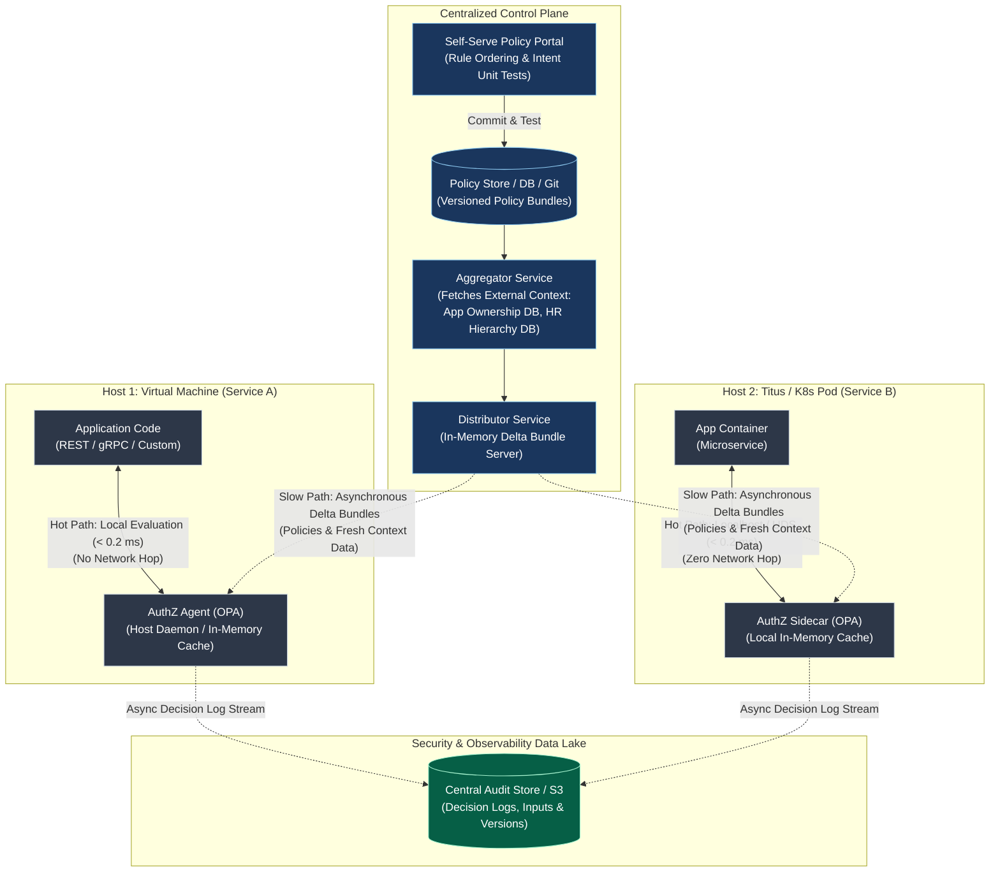

# Module 12-5: Distributed Cloud-Native Authorization Architecture at Netflix Scale (CNCF Talk)

**Breadcrumbs:** [[12-Index - CNCF References|🏠 CNCF References Index]] > **Distributed Cloud-Native Authorization Architecture at Netflix Scale**

---

> [!NOTE]
> **Source Citation**
> This reference module is compiled from the CNCF KubeCon presentation: *"How Netflix Is Solving Authorization Across Their Cloud [I]"* presented by **Manish Mehta** (Senior Security Software Engineer, Netflix) and **Torin Sandall** (Technical Lead & Co-creator of the Open Policy Agent project).
> * **Source Presentation:** [YouTube - CNCF KubeCon Talk](https://www.youtube.com/watch?v=R6tUNpRpdnY)
> * **Inflow Source:** `inflow/How Netflix Is Solving Authorization Across Their Cloud I - Manish Mehta & Torin Sandall, Netflix.md`

---

## 🏛️ 1. Authentication (AuthN) vs. Authorization (AuthZ): The Decoupling Principle

A foundational tenet of distributed systems engineering is that **Authentication and Authorization must be architecturally decoupled**:

```
+-----------------------------------+        +----------------------------------------+
| 1. Authentication (AuthN)         |        | 2. Authorization (AuthZ)               |
| "Who is making this request?"     |  --->  | "Is this identity permitted to perform |
| Cryptographic Identity / mTLS /   |        |  operation 'O' on resource 'R'?"       |
| Tokens (JWT, X.509, Spiffe/Spire) |        | Contextual Rules, ABAC, RBAC, Claims   |
+-----------------------------------+        +----------------------------------------+
```

* **The Anti-Pattern (Coupled AuthN/AuthZ):** Binding authorization directly into the authentication service or identity provider (e.g. LDAP/Active Directory group queries embedded directly in network firewalls or gateways). As services evolve across multiple protocols and cloud accounts, coupled systems rapidly lose flexibility, create single points of failure, and bottleneck engineering teams.
* **The Decoupled Pattern:** Authentication verifies the caller's identity and issues a cryptographically signed identity proof (e.g. mTLS SAN identity or JWT claims). The target application offloads authorization to an independent, context-aware policy engine.

> [!WARNING]
> **The Network Reachability Trap**
> In traditional datacenters, network reachability was often conflated with authorization: *"If host A can route packets to host B, host A is authorized."* In modern cloud-native environments, network reachability is merely transport. Authorization requires fine-grained introspection into request methods, resource IDs, payloads, and contextual metadata.

---

## 🧩 2. The Universal AuthZ Problem at Scale

In a massive enterprise microservices ecosystem (thousands of heterogeneous services, containers, VMs, batch jobs, and message brokers), the authorization problem must be modeled universally:

$$\text{Identity } (I) \text{ can / cannot perform Operation } (O) \text{ on Resource } (R) \quad \forall \; (I, O, R)$$

If an organization builds fragmented, point-to-point authorization mechanisms for different sub-combinations of $I$, $O$, and $R$, it ends up maintaining a dozen incompatible solutions with zero unified auditability, fragmented visibility, and high security operational overhead. A unified, general-purpose policy framework is an architectural necessity.

---

## 📐 3. Netflix Core Design Considerations

| Design Dimension | Technical Constraint | Architectural Solution |
| :--- | :--- | :--- |
| **Organizational Culture** | *Freedom and Responsibility:* Teams own their services end-to-end; no centralized security gatekeeping bottlenecks allowed. | Self-service policy authoring where service owners define and manage their own authorization boundaries via UI/GitOps. |
| **Resource & Protocol Heterogeneity** | Traffic spans REST endpoints, gRPC calls, custom binary protocols, message queues (Kafka topics), and host-level SSH access. | Domain-agnostic policy abstraction. Policy engine evaluates arbitrary JSON data structures rather than being tied to HTTP semantics. |
| **Caller Identities** | Callers include human employees, external contractors, long-running microservices, scheduled batch jobs, and short-lived containers. | Unified identity abstraction decoupled from directory structures. |
| **Extreme Latency Constraints** | High-throughput services (e.g. Kafka clusters handling thousands of requests/sec per node) thrash if AuthZ takes $> 1\text{ ms}$. | **Zero network roundtrip during evaluation:** The policy engine runs host-locally as a sidecar or daemon with all policies and context held entirely in memory ($< 0.2\text{ ms}$ evaluation). |
| **Rule Flexibility** | Access requirements change rapidly; static RBAC matrices cannot model dynamic organizational relationships. | Declarative, Turing-incomplete policy language (Rego) supporting Attribute-Based Access Control (ABAC) and hierarchical graph traversal. |
| **Intent Capture & Safety** | Self-serve users can introduce catastrophic misconfigurations or unintended rule combinations. | Built-in automated unit testing frameworks run against policies before deployment to production. |

---

## 🏛️ 4. High-Level Distributed Architecture

Netflix solved distributed authorization by bifurcating the system into a **Centralized Control Plane** (for policy authoring, data aggregation, and distribution) and a **Decentralized Data Plane** (for sub-millisecond, in-memory local decision-making):



---

## ⚙️ 5. Control Plane vs. Data Plane Mechanics

### A. The Control Plane
1. **Self-Serve Policy Portal:** Developers author rules using a graphical interface with built-in intent guardrails. Policies are version-controlled, auditable, and backed by a database/Git repository.
2. **The Aggregator Service:** Authorization often relies on facts that are not present in incoming request payloads (e.g. *"Who is the application owner?"* or *"Who is in Alice's management reporting chain?"*). The Aggregator regularly extracts facts from external identity/HR databases, enterprise CMDBs, and cloud metadata APIs, transforming them into structured JSON.
3. **The Distributor Service:** Ingests compiled policy rules from storage and structured facts from the Aggregator. The Distributor caches these bundles in memory and serves **delta updates** (only transmitting modified rules and changed data) down to local agents across multiple cloud regions and accounts.

### B. The Data Plane (Hot Path vs. Slow Path)
* **The Hot Path (Synchronous Evaluation):** When an incoming client request hits an application (Service A on a VM or Service B in a container pod), the application immediately invokes the local authorization agent (Open Policy Agent) via localhost HTTP, gRPC, or Unix Domain Socket (UDS). The agent evaluates the request against in-memory policies and local context data, returning an `allow`/`deny` decision in **under 0.2 milliseconds**.
* **The Slow Path (Asynchronous Synchronization):** The local agent runs background polling loops to fetch delta bundles from the Distributor. If the network partition drops or the Distributor goes offline, the local agent continues evaluating requests using its current in-memory snapshot, guaranteeing **100% data plane availability**.

---

## 💻 6. Production Scenario: The Payroll Service

To illustrate the expressive power of Rego in Netflix's distributed architecture, consider an internal Payroll service exposing two endpoints:
* `GET /salary/{id}`: View salary records.
* `POST /salary`: Update salary records.

### Security Requirements:
1. **Employees:** May read their own salary (`GET /salary/bob` by user `bob`).
2. **Managers:** May read salaries of direct and indirect reports in their organizational tree (`GET /salary/bob` by user `alice` where `bob` reports to `alice`).
3. **Audit / Reporting Batch Job:** May read all salary records (`GET /salary/*` by ServiceAccount `report-generator-service`).
4. **Compensation Application:** Only the official performance review application may write updates (`POST /salary` by ServiceAccount `compensation-app`).

### Rego Policy Implementation:

```rego
package netflix.payroll.authz

# Default to secure deny
default allow = false

# Rule 1: Employees can read their own salary
allow {
    input.method == "GET"
    input.path = ["salary", employee_id]
    input.user == employee_id
}

# Rule 2: Managers can read salaries of employees in their reporting chain
allow {
    input.method == "GET"
    input.path = ["salary", employee_id]
    is_manager(input.user, employee_id)
}

# Rule 3: Automated report generator service can read any salary
allow {
    input.method == "GET"
    input.user == "report-generator-service"
}

# Rule 4: Performance review application can update salaries
allow {
    input.method == "POST"
    input.path = ["salary"]
    input.user == "compensation-app"
}

# Composable helper function evaluating external management hierarchy context
# data.management_chain is populated asynchronously by the Aggregator/Distributor
is_manager(manager, employee) {
    # Check if 'manager' is present in employee's management chain array
    data.management_chain[employee][_] == manager
}
```

### Contextual Data Structure (`data.json` cached in local agent):

```json
{
  "management_chain": {
    "bob": ["alice", "ken"],
    "alice": ["ken"],
    "charlie": ["alice", "ken"]
  }
}
```

---

## 🛡️ 7. Intent Capture & Safety Guardrails

In a self-service cloud environment governed by "Freedom and Responsibility," engineers must be given guardrails to prevent accidental security breaches:

1. **Deterministic Rule Ordering:** Similar to Linux `iptables` or cloud firewall chains, rules are structured from most specific (top) to most general (bottom), ensuring predictable evaluation paths.
2. **Automated Intent Unit Testing:** Before any policy modification can be committed to the central repository or pushed to the Distributor, the author MUST write unit tests asserting both positive test cases (authorized calls succeed) and negative test cases (unauthorized attempts fail):
   ```rego
   package netflix.payroll.authz

   test_employee_read_own_salary {
       allow with input as {"method": "GET", "path": ["salary", "bob"], "user": "bob"}
   }

   test_stranger_cannot_read_salary {
       not allow with input as {"method": "GET", "path": ["salary", "bob"], "user": "eve"}
           with data.management_chain as {"bob": ["alice"]}
   }

   test_manager_can_read_subordinate_salary {
       allow with input as {"method": "GET", "path": ["salary", "bob"], "user": "alice"}
           with data.management_chain as {"bob": ["alice", "ken"]}
   }
   ```
3. **Immutable Regression Safety:** When an engineer modifies an existing policy six months later, the CI/CD pipeline executes all historical unit tests, preventing regressions.

---

## 🔬 8. Deep-Intuition Documentation (AARF Analysis)

### Decentralized Sidecar AuthZ vs. Centralized AuthZ Gateway

* **The Answer:** Deploy Open Policy Agent as a local sidecar container (in Kubernetes/Titus pods) or as a local systemd daemon (on VMs). Synchronize policies and external facts asynchronously via delta bundles, and execute policy decisions purely in memory over localhost or Unix domain sockets.
* **The Assumptions:** The host/pod has sufficient memory to cache the requisite contextual data (e.g. a few tens of megabytes of team/role graphs). The application runtime can perform a local loopback HTTP/UDS request.
* **The Rationale (Why):** If a microservices call graph involves 10 hops to fulfill a user request, and every hop requires a network call to a centralized AuthZ service with $15\text{ ms}$ latency, authorization alone adds $150\text{ ms}$ to total request latency. Furthermore, any network partition or load spike on the centralized AuthZ service takes down the entire cloud. In-memory local sidecar evaluation executes in $< 0.2\text{ ms}$ ($20\text{--}50\text{ }\mu\text{s}$ for indexed lookups) and is immune to network partitions.
* **The Failure Loop (What if not):** Centralized authorization services suffer cascading failures during traffic surges (thundering herd problem). Kafka brokers and real-time streaming engines thrash and drop messages because authorization overhead exceeds maximum queueing service rates.
* **The Alternative Case (When to use 'if not'):** If the authorization context requires multi-terabyte datasets that cannot fit into local container memory (e.g. analyzing global historical fraud databases), queries must be partially evaluated or directed to a centralized data warehouse.
* **The Evolutionary Bridge:** 
  - *Legacy Classical Systems:* Coarse-grained network firewall perimeters (IP/Port subnets) and centralized LDAP/AD domain controller bind queries.
  - *Modern Cloud-Native Systems:* Zero-Trust distributed architectures using mTLS identity bootstrapping (Spire/Istio) paired with localized, in-memory Policy-as-Code engines (OPA).

---

## 🧪 9. Hands-on Proof of Concept / Verification Recipe

To simulate the Netflix authorization sidecar locally using Docker and OPA:

### Step 1: Create Policy and Test Data

```bash
mkdir -p /tmp/netflix-authz
cd /tmp/netflix-authz

# Write the Rego policy
cat <<'EOF' > policy.rego
package netflix.payroll.authz

default allow = false

allow {
    input.method == "GET"
    input.path = ["salary", employee_id]
    input.user == employee_id
}

allow {
    input.method == "GET"
    input.path = ["salary", employee_id]
    data.management_chain[employee_id][_] == input.user
}

allow {
    input.method == "GET"
    input.user == "report-generator-service"
}

allow {
    input.method == "POST"
    input.path = ["salary"]
    input.user == "compensation-app"
}
EOF

# Write contextual data
cat <<'EOF' > data.json
{
  "management_chain": {
    "bob": ["alice", "ken"],
    "alice": ["ken"],
    "charlie": ["alice", "ken"]
  }
}
EOF
```

### Step 2: Validate Policy Locally Using OPA CLI / Docker

```bash
# Execute unit tests using official OPA container
docker run --rm -v $(pwd):/workspace openpolicyagent/opa:latest test /workspace/policy.rego -v
```

### Step 3: Run OPA as Local Server and Query Hot Path

```bash
# Start OPA server with policy and data pre-loaded
docker run -d --name opa-authz -p 8181:8181 \
  -v $(pwd)/policy.rego:/policy.rego \
  -v $(pwd)/data.json:/data.json \
  openpolicyagent/opa:latest run --server /policy.rego /data.json

# Test 1: Bob reads Bob's salary (Expected: true)
curl -s -X POST http://localhost:8181/v1/data/netflix/payroll/authz/allow \
  -H "Content-Type: application/json" \
  -d '{"input": {"method": "GET", "path": ["salary", "bob"], "user": "bob"}}' | jq .

# Test 2: Alice reads Bob's salary (Bob reports to Alice) (Expected: true)
curl -s -X POST http://localhost:8181/v1/data/netflix/payroll/authz/allow \
  -H "Content-Type: application/json" \
  -d '{"input": {"method": "GET", "path": ["salary", "bob"], "user": "alice"}}' | jq .

# Test 3: Eve attempts to read Bob's salary (Expected: false)
curl -s -X POST http://localhost:8181/v1/data/netflix/payroll/authz/allow \
  -H "Content-Type: application/json" \
  -d '{"input": {"method": "GET", "path": ["salary", "bob"], "user": "eve"}}' | jq .

# Clean up
docker stop opa-authz && docker rm opa-authz
```

---

## 🔗 Related Vault References
* **Open Policy Agent (OPA) Internals & Deep Dive:** [[12-6_open_policy_agent_architecture_and_deep_dive|Module 12-6: Open Policy Agent (OPA) Deep Dive]]
* **Dynamic Webhook Security:** [[Digital Garden/Pattern - Dynamic Security Admission and Webhook TLS Verification|Pattern: Dynamic Security Admission and Webhook TLS Verification]]
* **Kubernetes RBAC Architecture:** [[Reference Notes/0-7-1_rbac_service_accounts_and_certificates|Module 0-7-1: Kubernetes RBAC & ServiceAccounts]]
* **Distributed Systems Pattern:** [[Digital Garden/Pattern - Distributed Policy as Code and Sidecar Authorization|Pattern: Distributed Policy as Code and Sidecar Authorization]]
