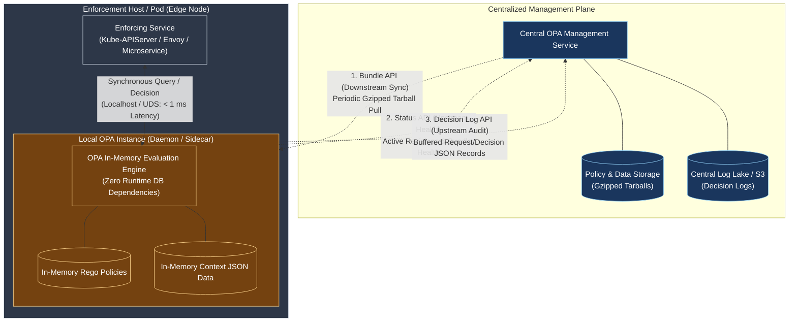
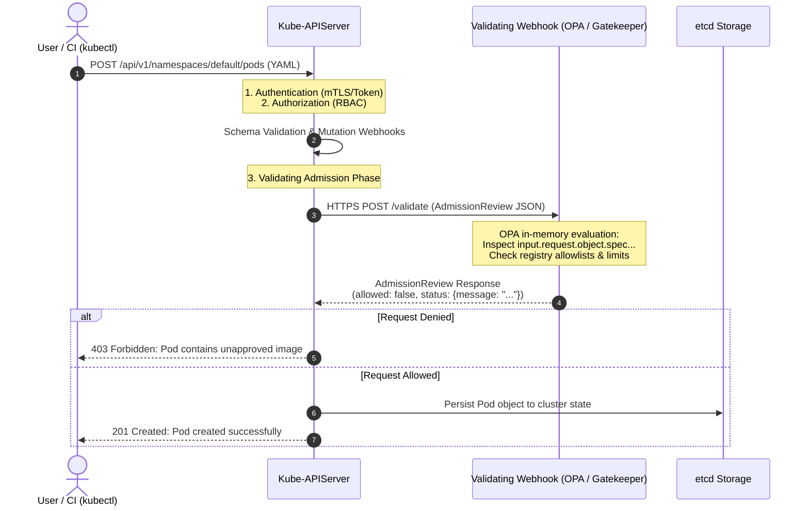

# Module 12-6: Open Policy Agent (OPA) Internals & Policy-as-Code Engine (CNCF Deep Dive)

**Breadcrumbs:** [[12-Index - CNCF References|🏠 CNCF References Index]] > **Open Policy Agent (OPA) Internals & Policy-as-Code Engine**

---

> [!NOTE]
> **Source Citation**
> This reference module is compiled from the CNCF KubeCon presentation: *"OPA Deep Dive"* presented by the co-creators of the Open Policy Agent project: **Tim Hinrichs** (CTO, Styra) and **Torin Sandall** (Tech Lead, Styra / OPA).
> * **Source Presentation:** [YouTube - CNCF KubeCon Talk](https://www.youtube.com/watch?v=Uj2N9S58GLU)
> * **Conference Schedule:** [KubeCon Session Archive](https://sched.co/Uafr)
> * **Inflow Source:** `inflow/OPA Deep Dive - Tim Hinrichs, Styra & Torin Sandall, Styra.md`

---

## 🏛️ 1. The Cloud-Native Policy Dilemma & OPA's Philosophy

In the modern cloud-native ecosystem, enterprise platforms encompass hundreds of disparate tools: container orchestrators (Kubernetes), API gateways / service meshes (Envoy, Istio), CI/CD pipelines (GitHub Actions, Jenkins, Spinnaker), public cloud infrastructure (AWS, Azure), databases, and bare-metal hosts (Linux PAM, SSH).

```
Traditional Fragmented Policy:
[ Kubernetes ] ---> Embedded Custom RBAC / Admission Webhook Scripts
[ Envoy Mesh ] ---> Hardcoded Lua Filters / Custom Envoy Auth Plugins
[ CI/CD Gate ] ---> Shell script regex checks in Jenkinsfiles
[ Linux PAM  ] ---> Custom C-modules / LDAP configs
===> Result: Fragmented security posture, unmaintainable spreadsheets & wiki policies.

Unified Policy as Code (OPA Decoupled Model):
[ Kubernetes ] --+
[ Envoy Mesh ] --+---> [ Query: Arbitrary JSON ] ---> [ OPA Engine ] ---> [ Decision: Arbitrary JSON ]
[ CI/CD Gate ] --+                                   (Rego Rules +
[ Linux PAM  ] --+                                    Cached Data)
```

### The Decoupling Principle
OPA decouples **Policy Decision-Making** from **Policy Enforcement**:
1. **The Service (Enforcer):** Handles application logic, protocol parsing, and execution. When an operation occurs, the service sends a policy query containing arbitrary JSON input to OPA.
2. **The Policy Engine (Decider):** Evaluates the query against declarative rules and context data stored in memory, producing a structured JSON decision.
3. **Domain Agnosticism:** OPA has **no built-in domain data model**. It does not know what a "Pod", an "HTTP request", or an "SSH session" is. It treats all inputs, policies, and outputs as structured JSON documents.

---

## ⚙️ 2. Architectural Design: The Host-Local Cache Principle

A critical architectural constraint in distributed authorization is avoiding network hops in the synchronous data path. 



### Key Architectural Tenets:
1. **Zero Runtime Database Dependencies:** OPA keeps all policies and contextual data in-memory. During query evaluation, OPA never makes external network calls (unless explicitly forced via the `http.send` built-in).
2. **Sub-Millisecond Evaluation:** In-memory evaluations execute in tens of microseconds ($10\text{--}50\text{ }\mu\text{s}$), making OPA suitable for high-throughput service meshes and message brokers.
3. **Partition Resilience:** If the central control plane or wide-area network fails, the local OPA instance continues enforcing policies using its latest in-memory state.

---

## 📡 3. OPA Management APIs

To manage hundreds or thousands of distributed OPA sidecars without operational chaos, OPA exposes three standard management APIs:

| Management API | Communication Direction | Technical Purpose |
| :--- | :--- | :--- |
| **Bundle API** | Central Service $\rightarrow$ OPA (Downstream) | OPA periodically queries an HTTP endpoint to download gzipped tarballs (`.tar.gz`) containing versioned Rego policy files and static `data.json` context. OPA atomically validates and activates bundles. Supports multiple scoped bundles. |
| **Status API** | OPA $\rightarrow$ Central Service (Upstream) | OPA reports its operational status: currently active bundle version, last download timestamp, and detailed compilation errors if a bundle failed activation. |
| **Decision Log API** | OPA $\rightarrow$ Central Service (Upstream) | OPA buffers decision records in memory and periodically uploads batches to an HTTP endpoint. Each log record contains the full incoming `input` JSON, the bundle revision, and the exact output decision, providing a complete non-repudiation audit trail. |

---

## ☸️ 4. Kubernetes Admission Control Deep Dive

One of OPA's primary production use cases is serving as a dynamic Admission Controller in Kubernetes (embodied as OPA Gatekeeper or standalone OPA):



### The `AdmissionReview` Payload Structure
* **Input to OPA (`input`):** The API server serializes the admission request into an `AdmissionReview` JSON document containing:
  - `input.request.kind`: Object kind (e.g. `{"group": "", "version": "v1", "kind": "Pod"}`).
  - `input.request.namespace`: Target namespace.
  - `input.request.operation`: `CREATE`, `UPDATE`, `DELETE`, or `CONNECT`.
  - `input.request.object`: The entire manifest spec submitted by the user.
* **Output from OPA:** Rather than returning a boolean, OPA can return a structured admission review response containing a list of descriptive error strings, allowing Kubernetes to output human-friendly terminal rejection messages.

---

## 💻 5. Rego Language Mechanics: Image Registry Policy Walkthrough

The following step-by-step example walks through the KubeCon live coding demonstration, showing how to enforce that **all container and initContainer images come from an approved registry (`hooli.com`)**, complete with set comprehension and helper abstractions.

### Step 1: The Naive Rule (Single Container Loop)

```rego
package kubernetes.admission

import future.keywords.in

# Default deny is NOT required when returning a set of violations
# 'deny' evaluates to a set of formatted error messages

deny contains msg if {
    # 1. Ensure target resource is a Pod
    input.request.kind.kind == "Pod"
    
    # 2. Iterate through containers
    some container in input.request.object.spec.containers
    
    # 3. Check if image fails to start with approved registry
    not startswith(container.image, "hooli.com/")
    
    # 4. Construct human-readable violation message
    msg := sprintf("Pod contains container '%v' with unapproved image '%v'. Images must come from 'hooli.com/'.", [container.name, container.image])
}
```

### Step 2: The Production Abstraction (Unified `containers` and `initContainers`)
A common security bug in custom admission webhooks is inspecting `spec.containers` while ignoring `spec.initContainers` or `spec.ephemeralContainers`. In Rego, we define a reusable set abstraction:

```rego
package kubernetes.admission

import future.keywords.in

# Helper set: captures all containers regardless of lifecycle phase
all_containers contains c if {
    some c in input.request.object.spec.containers
}

all_containers contains c if {
    some c in input.request.object.spec.initContainers
}

all_containers contains c if {
    some c in input.request.object.spec.ephemeralContainers
}

# Master admission denial rule
deny contains msg if {
    input.request.kind.kind == "Pod"
    some container in all_containers
    not startswith(container.image, "hooli.com/")
    msg := sprintf("Security Violation: Container '%v' uses unauthorized image '%v'. Approved registry is 'hooli.com/'.", [container.name, container.image])
}
```

### Rego Language Principles Illustrated:
1. **Undefined Field Handling:** If a pod does not have `initContainers`, `input.request.object.spec.initContainers` does not evaluate to `null` or trigger a runtime NullPointerException. In Rego, missing fields evaluate to **undefined**. An undefined expression causes the containing rule condition to fail safely (evaluates to false/empty set).
2. **Incremental Set Definition:** Multiple rule declarations with the same name (`all_containers contains c if ...`) act as an **OR** operation, collecting all elements satisfying any of the conditions into a single set.
3. **No Keyword Allow/Deny:** `deny` and `allow` are not reserved keywords; they are user-defined document variables. OPA can output booleans, sets of strings, or complex nested JSON objects.

---

## ⚡ 6. Advanced Performance Innovations

### A. WebAssembly (Wasm) Compilation
OPA supports compiling Rego policies directly into WebAssembly bytecode:

```
[ Rego Policy Files ] ---> [ OPA Compiler (opa build -t wasm) ] ---> [ policy.wasm Binary ]
                                                                             |
                     +-----------------------+-------------------------------+
                     |                       |                               |
              [ Node.js SDK ]           [ Go Runtime ]                 [ C / C++ / Rust ]
```

* **Zero-Dependency Embedding:** The compiled `.wasm` binary requires only memory and a standard Wasm virtual machine (no Go runtime required).
* **Microsecond Latency:** Bypasses HTTP/JSON parsing overheads by executing natively inside host application memory in single-digit microseconds.
* **Non-Web Embeddings:** Used to embed policy checks into proxies (Envoy Wasm filters), edge computing runtimes (Cloudflare Workers, Fastly Compute@Edge), and foreign language microservices (Node.js, C#, Python).

### B. Partial Evaluation & Database Query Pushdown
When enforcing policies over massive datasets (e.g. millions of rows in a SQL database), replicating the entire database into OPA's memory is impossible. 

* **How Partial Evaluation Works:** OPA pre-evaluates a policy by separating **Known Data** (user identity, roles, static business rules) from **Unknown Data** (the rows/resources stored in the database).
* **Residual Generation:** OPA reduces the policy down to a set of simple residual equality conditions (e.g. `status == "published" AND (department == "engineering" OR owner == "alice")`).
* **Query Pushdown:** The application compiles the residual conditions directly into a `WHERE` clause in SQL or an Elasticsearch filter, offloading evaluation to the database engine at wire speed.

### C. Automated Complexity Analysis
OPA's declarative nature allows the compiler to perform static analysis on policy complexity:
* **$O(1)$ Constant Time:** Policies verifying fixed-depth fields (e.g. checking if a specific pod label exists).
* **$O(N)$ Linear Time:** Policies iterating over dynamic arrays (e.g. scanning through all containers or volume mounts in a pod spec).
* **Governance Application:** Platform administrators can configure admission rules requiring that user-submitted policies run in at most $O(N)$ time, guaranteeing that custom policies cannot cause CPU exhaustion in the control plane.

---

## 🔬 7. Deep-Intuition Documentation (AARF Analysis)

### OPA Policy-as-Code vs. Native Kubernetes RBAC

* **The Answer:** Use Kubernetes RBAC strictly for coarse-grained API verb and resource authorization (`User X can create Pods in Namespace Y`). Use Open Policy Agent (Gatekeeper) for fine-grained payload and semantic admission validation (`Pods must have CPU limits, must not run as root, and must only pull images from approved registries`).
* **The Assumptions:** The cluster runs a Kubernetes version with dynamic admission control enabled (`ValidatingAdmissionWebhook` / `MutatingAdmissionWebhook`).
* **The Rationale (Why):** RBAC is architecturally blind to manifest contents; it only inspects the "envelope" (the API group, resource, and verb). RBAC cannot evaluate whether a pod runs in privileged mode or which image registry is used. OPA inspects the entire deserialized JSON object tree.
* **The Failure Loop (What if not):** Relying solely on RBAC allows any authorized developer to deploy containers running as root (`privileged: true`), mount host paths (`/etc/shadow`), or download backdoored images from public registries, leading to total node and cluster compromise.
* **The Alternative Case (When to use 'if not'):** If the security requirement is purely standard OS isolation levels (Privileged, Baseline, Restricted) without custom organizational rules or registry allowlists, use built-in **Pod Security Admission (PSA)** to avoid running external webhook pods.
* **The Evolutionary Bridge:** 
  - *Legacy Classical Systems:* Hardcoded shell scripts in CI/CD, manual spreadsheet audits, and deprecated `PodSecurityPolicies` (PSPs).
  - *Modern Cloud-Native Systems:* Declarative Policy-as-Code engines (OPA, Kyverno) enforcing immutable constraints across CI, admission, and runtime.

---

## 🧪 8. Hands-on Proof of Concept: OPA Unit Testing & Policy Validation

To test the Kubernetes image validation policy locally using the OPA CLI:

### Step 1: Write Policy (`k8s_image_policy.rego`)

```bash
mkdir -p /tmp/opa-deep-dive
cd /tmp/opa-deep-dive

cat <<'EOF' > k8s_image_policy.rego
package kubernetes.admission

import future.keywords.in

# Collect all containers
all_containers contains c if {
    some c in input.request.object.spec.containers
}

all_containers contains c if {
    some c in input.request.object.spec.initContainers
}

# Deny if any container image is not from hooli.com/
deny contains msg if {
    input.request.kind.kind == "Pod"
    some container in all_containers
    not startswith(container.image, "hooli.com/")
    msg := sprintf("Security Violation: Container '%v' uses unapproved image '%v'. Approved registry: 'hooli.com/'.", [container.name, container.image])
}
EOF
```

### Step 2: Write Comprehensive Unit Tests (`k8s_image_policy_test.rego`)

```bash
cat <<'EOF' > k8s_image_policy_test.rego
package kubernetes.admission

# Test 1: Compliant pod with approved image should produce no violations
test_allow_valid_image {
    test_input := {
        "request": {
            "kind": {"kind": "Pod"},
            "object": {
                "spec": {
                    "containers": [
                        {"name": "web", "image": "hooli.com/frontend:v1.0"}
                    ]
                }
            }
        }
    }
    count(deny) == 0 with input as test_input
}

# Test 2: Unapproved container image should be caught
test_deny_unapproved_container {
    test_input := {
        "request": {
            "kind": {"kind": "Pod"},
            "object": {
                "spec": {
                    "containers": [
                        {"name": "web", "image": "docker.io/library/nginx:latest"}
                    ]
                }
            }
        }
    }
    count(deny) == 1 with input as test_input
}

# Test 3: Unapproved initContainer image should also be caught
test_deny_unapproved_init_container {
    test_input := {
        "request": {
            "kind": {"kind": "Pod"},
            "object": {
                "spec": {
                    "containers": [
                        {"name": "web", "image": "hooli.com/frontend:v1.0"}
                    ],
                    "initContainers": [
                        {"name": "init-db", "image": "malicious-repo/busybox:latest"}
                    ]
                }
            }
        }
    }
    count(deny) == 1 with input as test_input
}
EOF
```

### Step 3: Run OPA Unit Tests

```bash
# Execute unit tests with verbose coverage
docker run --rm -v $(pwd):/workspace openpolicyagent/opa:latest test /workspace -v --coverage
```

### Expected Output:
```
data.kubernetes.admission.test_allow_valid_image: PASS (432µs)
data.kubernetes.admission.test_deny_unapproved_container: PASS (291µs)
data.kubernetes.admission.test_deny_unapproved_init_container: PASS (304µs)
--------------------------------------------------------------------------------
PASS: 3/3
Coverage: 100.00%
```

---

## ❓ 9. Key Architectural Q&A Insights

1. **External HTTP Queries (`http.send`):**
   * *Question:* Can OPA query an external database or service during policy evaluation?
   * *Answer:* Yes, via the `http.send` built-in function. However, the OPA maintainers strongly discourage this pattern because it violates the host-local cache principle, introducing network latency and failure cascades into the synchronous data path. The recommended architecture is to push data asynchronously into OPA via the **Bundle API**.
2. **Cryptographic Validation (JWTs):**
   * *Question:* Does OPA support validating digital signatures?
   * *Answer:* Yes, OPA includes built-in functions (`io.jwt.decode_verify`) to validate JSON Web Tokens using RSA/ECDSA public keys and inspect token claims without calling out to an identity provider.
3. **Blacklisting Namespaces for RBAC:**
   * *Question:* Can OPA be used as an authorization webhook rather than an admission webhook?
   * *Answer:* Yes. While Kubernetes RBAC is strictly additive (allow-only), OPA can be deployed as an authorization webhook to enforce blacklists (e.g. *"grant developers access to all namespaces except `kube-system`"*). However, authorization webhooks cannot be dynamically configured via CRDs and require control plane flag configuration.
4. **Binary Protocol Support:**
   * *Question:* Does OPA support binary protocols (gRPC / Protobuf)?
   * *Answer:* OPA's HTTP daemon accepts JSON. When using OPA as a Go library or using the Envoy external authorization plugin (`envoy.service.auth.v3.AttributeContext`), binary Protobuf payloads are deserialized directly into memory and evaluated natively.

---

## 🔗 Related Vault References
* **Netflix Authorization Architecture:** [[12-5_netflix_cloud_native_authorization_architecture|Module 12-5: Distributed Cloud-Native Authorization at Netflix Scale]]
* **Dynamic Webhook Security:** [[Digital Garden/Pattern - Dynamic Security Admission and Webhook TLS Verification|Pattern: Dynamic Security Admission and Webhook TLS Verification]]
* **Kubernetes ImagePolicyWebhook & Security:** [[Reference Notes/0-7-5_supply_chain_security_and_imagepolicywebhook|Module 0-7-5: Supply Chain Security & ImagePolicyWebhook]]
* **Admission Controllers Masterclass:** [[Reference Notes/0-16_admission_controllers|Module 0-16: Kubernetes Admission Controllers]]
