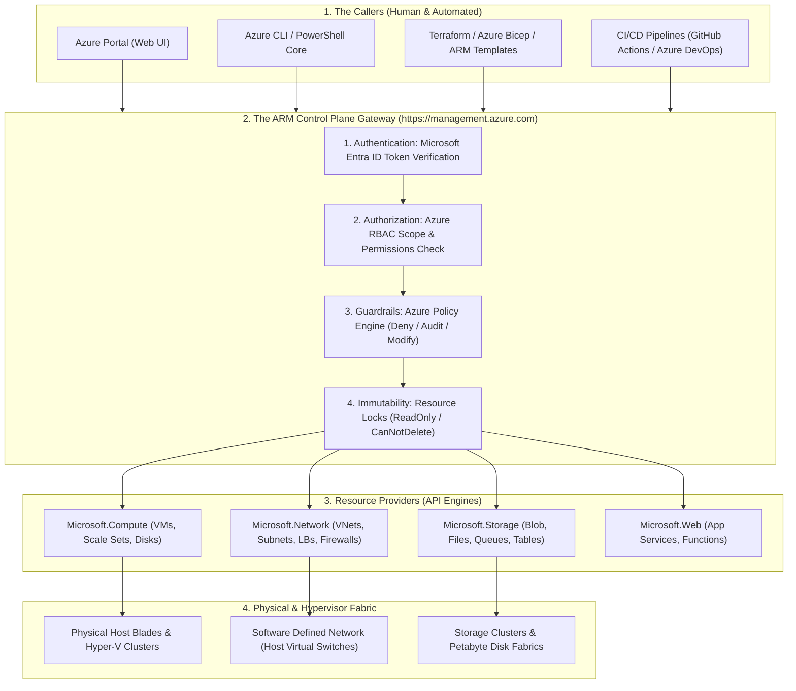

# Module 13-104-01: Azure Administration Architecture, Operations & Certification Framework

**Breadcrumbs:** [[13-Index - Azure|☁️ Azure Reference MOC]] > [[13-Index - AZ-104|📘 AZ-104 Exam Track]] > **01 - Azure Administration Architecture & Certification**

---

## 🎯 Executive Overview & The Cloud Administration Lecture

When engineers first begin working with cloud computing, they often view it through a lens of abstract magic. But in enterprise reality, **cloud computing is physical infrastructure operated through software APIs**. Microsoft Azure is composed of hundreds of physical, hyper-scale datacenters across the globe, interconnected by Microsoft's private global optical fiber backbone—one of the largest private WAN networks on Earth.

In traditional on-premises computing, an IT administrator personally racked servers, wired physical patch cables, installed hypervisors, and provisioned local storage arrays. In Microsoft Azure, that entire physical infrastructure is abstracted behind a single, unified HTTPS REST API endpoint: the **Azure Resource Manager (ARM) Control Plane** (`https://management.azure.com`).

As an Azure Administrator preparing for the **AZ-104 Microsoft Certified: Azure Administrator Associate** certification, your role is not simply clicking buttons in a web console. You are the architect and guardian of the ARM control plane—responsible for identity security, resource organization, network routing, compute elasticity, data protection, and financial predictability.



---

## 🏛️ Stage 1: The Core Mental Model — Control Plane vs. Data Plane

Understanding the separation between the **Control Plane (Management Plane)** and the **Data Plane (Runtime Plane)** is the single most important architectural concept in cloud operations. It dictates how permissions are evaluated, how resource locks behave, and why system outages occur:

```text
+---------------------------------------------------------------------------------------------------+
|                           CONTROL PLANE vs. DATA PLANE IN MICROSOFT AZURE                         |
+---------------------------------------------------------------------------------------------------+
| Operational Dimension | Control Plane (Management Plane)       | Data Plane (Runtime Plane)       |
+-----------------------+----------------------------------------+----------------------------------+
| Primary Endpoint      | https://management.azure.com           | Service-specific endpoints       |
|                       |                                        | (e.g. <account>.blob.core...     |
|                       |                                        | <app>.azurewebsites.net)         |
+-----------------------+----------------------------------------+----------------------------------+
| Governing Engine      | Azure Resource Manager (ARM)           | Service Daemon, Hypervisor, or   |
|                       |                                        | Application Runtime Engine       |
+-----------------------+----------------------------------------+----------------------------------+
| Identity & Auth       | Microsoft Entra ID + Azure RBAC        | Entra ID DataActions, Service    |
|                       | (Actions: Microsoft.Compute/.../write) | Keys, SAS Tokens, SQL Logins     |
+-----------------------+----------------------------------------+----------------------------------+
| Management Governance | Governed by Azure Policy initiatives   | Governed by runtime firewalls,   |
|                       | and Resource Locks                     | TLS settings, and ACLs           |
+-----------------------+----------------------------------------+----------------------------------+
| Operational Example   | A ReadOnly lock on a resource group    | Existing VMs continue processing |
|                       | blocks creating or resizing VMs.       | packets, and databases continue  |
|                       |                                        | answering queries unimpeded!     |
+-----------------------+----------------------------------------+----------------------------------+
```

---

## 🏛️ Stage 2: The 4-Tier Enterprise Management Hierarchy

Every Azure resource exists inside a strictly governed 4-tier structural hierarchy. This structure determines how access permissions (RBAC) and compliance rules (Azure Policy) inherit downward:

```text
[ Tenant Root Group ] (1 per Microsoft Entra ID Organization)
         │
         ├── [ Management Groups ] (Hierarchical containers, up to 6 levels deep)
         │         │
         │         ├── Platform Management Group ──► Connectivity, Security, Identity Subscriptions
         │         └── Workloads Management Group
         │                   │
         │                   ├── Production Sub-MG  ──► Prod Workload Subscriptions
         │                   └── Development Sub-MG ──► Dev/Test Subscriptions
         │                                                    │
         │                                                    ▼
         │                                      [ Subscriptions ] (Billing & Quota Isolation)
         │                                                    │
         │                                                    ▼
         │                                      [ Resource Groups ] (Lifecycle Containers)
         │                                                    │
         │                                                    ▼
         │                                         [ Azure Resources ]
         │                               (VMs, VNets, Storage Accounts, Key Vaults)
```

### The Architectural Roles of Each Tier:
1.  **Tenant Root Group:** The absolute root of the management hierarchy. Policies assigned here propagate to every subscription in the entire organization.
    *   *Architectural Rule:* Assign only universal security guardrails at the Root (e.g. restricting deployment locations to approved geographic regions, enforcing TLS 1.2 minimum). Never grant broad `Contributor` or `Owner` roles at the Root Group!
2.  **Management Groups (MGs):** Containers used to govern multiple subscriptions simultaneously. They allow centralized policy enforcement, RBAC inheritance, and departmental billing tracking.
3.  **Subscriptions (The Fundamental Isolation Boundary):** A subscription serves three distinct boundaries:
    *   **Financial Boundary:** Invoices, credit limits, and billing meters exist at the subscription level.
    *   **Quota Boundary:** Regional core quotas (e.g. maximum 100 vCPUs for D-series VMs) and resource limits (e.g. max 800 Resource Groups) are enforced per subscription.
    *   **Administrative Security Boundary:** Full control-plane isolation between operational environments (e.g., Production vs. Staging vs. Developer Sandboxes).
4.  **Resource Groups (Lifecycle Containers):** Logical groupings of resources that **share the same lifecycle, deployment cadence, and management lifecycle**.
    *   *The Golden Rule of Resource Groups:* Group resources together because they are deployed, updated, and deleted together (e.g., a Web App and its dedicated App Service Plan), **NOT** by resource type (do not put all VMs in one group and all storage accounts in another!).
    *   *Location Decoupling:* A Resource Group located in `East US` stores its management metadata in East US, but can contain a VM deployed in `West Europe` and a Database in `Southeast Asia`. If the East US metadata plane experiences an outage, the European VM continues running unimpeded!

---

## 🌍 Stage 3: Azure Physical Topology — Geographies, Regions & Zones

To design high availability and avoid regional downtime, an Azure Administrator must understand Microsoft's physical datacenter architecture:

```text
Geographies (e.g., United States, Europe, Asia Pacific)
  │  (Data sovereignty, geopolitical compliance boundaries)
  │
  ├── Regional Pairs (Separated by at least 300 miles, e.g., East US ◄─► West US)
  │     │  (Sequential platform patching; pairs are never updated concurrently)
  │     │
  │     ├── Region A (e.g., East US)
  │     │     ├── Availability Zone 1 (Physical datacenter building: power, cooling, fiber)
  │     │     ├── Availability Zone 2 (Physical datacenter building: < 2ms latency from AZ1)
  │     │     └── Availability Zone 3 (Physical datacenter building: independent utility)
  │     │
  │     └── Region B (e.g., West US - Paired Region for GRS replication)
  │           └── Availability Zones 1, 2, 3
```

*   **Geographies:** Geopolitical regions that preserve data residency and sovereignty laws (e.g., GDPR data never leaves the European geography).
*   **Regions:** A cluster of datacenters deployed within a latency-defined perimeter connected over a dedicated low-latency optical network (< 2ms).
*   **Regional Pairs:** Each region is paired with another region within the same geography at least 300 miles away. Microsoft updates Azure host platforms sequentially across pairs so that maintenance never impacts both paired regions at the same time.
*   **Availability Zones (AZs):** Physically separate datacenter facilities within the same region, equipped with independent power, cooling, and network generators. Spreading workloads across 3 AZs provides a **99.99% availability SLA**.

---

### 1. Sovereign & Specialized Clouds
In addition to the public Azure cloud, Microsoft operates physically and logically isolated sovereign clouds to meet stringent national security and legal regulatory requirements:
1. **Azure Government (US Gov):** A physically isolated cloud instance reserved exclusively for US federal, state, local, and tribal governments and their screened contractors. Meets rigorous compliance standards including FedRAMP High, DoD Impact Level 2, 4, 5, and 6, and CJIS.
2. **Azure China 21Vianet:** A physically separated, legally independent cloud environment operated by 21Vianet (in accordance with Chinese telecommunications regulations). Customer data is strictly isolated within mainland China.

---

### 2. Service Level Agreements (SLAs) & Composite SLA Calculation
Microsoft publishes guaranteed monthly uptime commitments (Service Level Agreements) for each individual service:
* **Single VM SLA:** 99.9% uptime (with Premium SSD / Ultra Disk OS and data disks).
* **Availability Set SLA:** 99.95% uptime (for 2+ VMs distributed across Fault Domains).
* **Availability Zone SLA:** 99.99% uptime (for 2+ VMs distributed across Availability Zones).

#### Composite SLA Mathematics (Crucial Exam Core):
When an application architecture depends on multiple sequential services, the overall availability of the system is the **product of the individual SLAs**:

$$\text{Composite SLA} = \text{SLA}_1 \times \text{SLA}_2 \times \dots \times \text{SLA}_n$$

```text
Example 1: Serial Dependencies (E-Commerce Web App)
[ App Service: 99.95% ] ──► [ Azure SQL Database: 99.99% ]
Calculation:
Composite SLA = 0.9995 * 0.9999 = 0.9994 = 99.94% (Notice that composite SLA is LOWER than any single component!)

Example 2: Resiliency with Fallback Redundancy (Active / Standby or Queue Buffer)
If an application uses a fallback path when the primary service is unavailable:
SLA_Composite = (1 - (Unavailability of Primary * Unavailability of Fallback))
If Queue has 99.9% availability, Unavailability = 1 - 0.999 = 0.001
Redundant Component SLA = 1 - (0.0001 * 0.001) = 99.9999%
```

---

## 💰 Stage 4: Cloud Economics & FinOps Governance

Cost optimization is an active operational engineering discipline in Microsoft Azure:

### 1. Azure Free Account Spending Guardrails & Tier Mechanics
*   **The Initial 30-Day Window:** Microsoft provides **$200 USD in cloud credits** valid for exactly 30 days.
*   **The Strict Spending Limit ($0 Guardrail):** By default, the free subscription includes a hard spending limit set to $0. If experimental workloads consume all $200 credits within 30 days, Azure automatically suspends all compute instances (VMs deallocate, websites stop responding) to prevent unauthorized credit card billing.
*   **12 Months Free Services & Always Free Tier:**
    *   *12 Months Free:* Standard B1s Linux/Windows VMs (up to 750 hours/month), 5 GB LRS Blob storage, 5 GB Azure Files.
    *   *Always Free Tier (55+ Services):* Azure App Services (up to 10 apps on F1 tier), Azure Functions (1,000,000 executions/month), Azure Cosmos DB (1,000 RU/s throughput + 25 GB storage), Azure Event Grid (100,000 operations/month).

### 2. Multi-Threshold Budgeting
Cost budgets must be set at the Subscription or Resource Group level with 4 progressive threshold alerts:
*   `50% Forecasted/Actual`: Early warning notification sent to engineering teams.
*   `75% Actual`: FinOps review alert dispatched to department lead.
*   `90% Actual`: Deployment freeze or scaling throttle notice.
*   `100% Actual`: Automated Action Group trigger executing an Azure Automation Runbook to deallocate non-essential dev/test virtual machines.

### 3. Compute Cost Optimization Hierarchy
1.  **Pay-As-You-Go:** Highest hourly cost, maximum flexibility.
2.  **Azure Reserved Instances (RIs):** 1-year or 3-year commitment on predictable baseline VM series in a specific region, saving up to **72%**.
3.  **Azure Savings Plans for Compute:** Flexible dollar-per-hour spend commitment across compute types (VMs, App Services, Container Apps), saving up to **65%**.
4.  **Azure Hybrid Benefit (AHB):** Reusing existing on-premises Windows Server or SQL Server licenses covered by Software Assurance (SA). When combined with 3-year Reservations, compute costs drop by up to **80–85%**!
5.  **Azure Spot Virtual Machines:** Purchasing unused spare Azure compute capacity at up to a **90% discount**. Evicted with a 30-second warning via the Azure Instance Metadata Service (IMDS) at `http://169.254.169.254/metadata/scheduledevents`.

---

## ⚙️ Stage 5: The Administrator Tooling Ecosystem

Enterprise cloud operations require mastering a hybrid administrative toolchain:

```text
[ Visual & Exploratory Management ]
  ├── Azure Portal (Web UI, Interactive Blades, Guided Wizards, Resource Exploration)
  └── Azure Cloud Shell (Browser-based Bash/PowerShell with persistent storage)
        │
        ▼
[ Programmatic & Command-Line Automation ]
  ├── Azure CLI (`az`) ──► Cross-platform, Linux/macOS, CI/CD pipelines, JSON outputs
  ├── Azure PowerShell (`Az`) ──► Object-oriented .NET pipelines, Windows enterprise scripts
  └── Declarative IaC ──► Azure Bicep & Terraform (Idempotent state automation)
```

### 1. Azure CLI (`az`) Production Commands
```bash
# Verify CLI installation
az version

# Interactive authentication
az login

# List subscriptions and set active context
az account list --output table
az account set --subscription "Production-Core-Infrastructure"

# Set persistent CLI defaults to prevent deploying to the wrong region or resource group
az configure --defaults location=eastus group=rg-production-networking
```

### 2. Azure PowerShell Core (`Az` Module) Commands
PowerShell operates on structured .NET objects rather than raw text streams:
```powershell
# Install Az module strictly for the current user (avoids local admin requirements)
Install-Module -Name Az -Scope CurrentUser -Repository PSGallery -Force -AllowClobber

# Interactive login
Connect-AzAccount

# Query and switch active subscription context
Get-AzSubscription | Select-Object Name, Id, State | Format-Table
Set-AzContext -SubscriptionId "00000000-0000-0000-0000-000000000000"

# Enterprise FinOps script: Find all unattached Managed Disks causing cost leaks
Get-AzDisk | Where-Object { $_.ManagedBy -eq $null } | Select-Object Name, ResourceGroupName, DiskSizeGB
```

### 3. Azure Cloud Shell Persistence Architecture
When you click the Cloud Shell icon (`>_`) in the Azure Portal toolbar for the first time:
*   ARM requires provisioning an Azure Storage Account and a dedicated **`5 GB` Azure File Share**.
*   This file share is automatically mounted to `/home/<username>` inside the Cloud Shell container (Linux Bash or PowerShell Core), persisting your scripts, Git repositories, and SSH keys across ephemeral browser sessions!

---

## 🖥️ Stage 6: Step-by-Step Azure Portal GUI Walkthrough

To navigate the foundational governance hierarchy in the Azure Portal GUI:

```
Azure Portal Navigation Path: Governance Baseline
 1. Search Bar ➔ "Subscriptions"
    ├── Select Subscription ➔ Under "Settings", click "Resource providers"
    │     └── Verify providers are registered (e.g. Microsoft.Compute, Microsoft.Network)
    └── Under "Cost Management", click "Budgets" ➔ "+ Add"
          ├── Scope: Subscription
          ├── Amount: $500 / Month
          └── Alert conditions: 50%, 75%, 90%, 100% ➔ Enter notification email
 2. Search Bar ➔ "Management groups"
    ├── Click "+ Create" ➔ Name: "mg-platform" ➔ Move connectivity subscriptions inside
 3. Search Bar ➔ "Resource groups"
    ├── Click "+ Create" ➔ Resource group: "rg-core-eastus" ➔ Region: East US
    └── Tags tab: Environment=Production, CostCenter=FinOps-01, Owner=PlatformTeam
```

---

## 🔬 Hands-On Enterprise Lab Bridge

To put these governance, budgeting, and tooling foundations into practical action, execute the complete production lab in your workspace:

👉 **Corresponding Hands-On Lab:** [[Projects/AZ-104/01_Cloud_Governance_and_Tooling/Lab-01_Enterprise_Subscription_Baseline_and_Tooling|Lab 01: Enterprise Subscription Baseline and Tooling]]

### Lab Deliverables in `Lab-01`:
1.  **Task 1:** Configure persistent Azure Cloud Shell storage with dedicated storage account and file share.
2.  **Task 2:** Set up multi-threshold Azure Cost Management budgets ($500 ceiling with 50/75/90/100% notification gates).
3.  **Task 3:** Configure resource providers (`Microsoft.Compute`, `Microsoft.Network`, `Microsoft.Storage`) and verify registration states.
4.  **Task 4:** Deploy management groups and organize subscriptions into a 4-tier hierarchy.
5.  **Task 5:** Execute automated orphan disk and idle public IP discovery scripts via Azure CLI and PowerShell.

---

## ⚠️ "See It in Action" Real-World Failure & Recovery Loop (AARF)

### Scenario: The Orphaned Disks Billing Surprise
*   **The Assumption:** A cloud engineer deletes 20 test virtual machines using `az vm delete --yes`. They assume that deleting the VM stops all associated cloud billing.
*   **The Architecture:**
    `Virtual Machine` ➔ attached to `OS Managed Disk (128 GB Premium SSD)` + `Data Disks (512 GB)` + `Network Interface Card (NIC)` + `Standard Public IP`.
*   **The Root Cause Failure:**
    *   ARM treats Managed Disks, NICs, and Public IPs as **independent, standalone child resources**.
    *   Deleting the VM compute resource terminates the CPU and RAM allocation, but leaves the Managed Disks, NICs, and Public IPs sitting idle in the Resource Group!
    *   The enterprise continues to receive invoices for hundreds of gigabytes of provisioned Premium SSD storage and reserved Public IPs month after month!
*   **The Live Remediation:**
    *   When deleting VMs via CLI, always supply the `--delete-disks` and `--delete-public-ips` flags:
        ```bash
        az vm delete --resource-group rg-prod --name vm-test --delete-disks all --delete-ip-addresses --yes
        ```
    *   Run regular automated FinOps audit scripts (or Azure Policy) to detect and purge unattached disks (`Get-AzDisk | Where-Object { $_.ManagedBy -eq $null }`).

---

## 💡 High-Yield AZ-104 Exam Scenarios & Keyword Traps

> [!TIP]
> **Resource Group Location vs. Resource Location:**
> - A Resource Group located in `East US` stores its management metadata in East US, but can house resources located in `West Europe`, `Japan East`, or any other global region.
> - An outage in East US impacts **Control Plane operations** (you cannot add or modify resources in that group), but resources in West Europe continue running and serving traffic (**Data Plane continuity**).

> [!WARNING]
> **The Case Study Gauntlet:**
> - Case studies contain 4 to 8 tabs of business and technical requirements.
> - *Tactical Rule:* Never read the entire case study first. Jump directly to the question, identify the exact constraint (e.g. "minimize cost", "ensure zero downtime"), and navigate straight to the relevant tab. Once submitted, case studies lock permanently!

> [!IMPORTANT]
> **Keyword Decoupling Cheat-Sheet:**
> - *"Minimize administrative effort"* $\rightarrow$ Prefer built-in Azure features, Azure Policy, or PaaS services over custom scripts or IaaS VMs.
> - *"Lowest cost with regional redundancy"* $\rightarrow$ Prefer ZRS over GRS; prefer Standard SSD over Premium SSD v2.
> - *"Reusing existing on-premises server licenses"* $\rightarrow$ Select **Azure Hybrid Benefit (AHB)**.

---

## 🌐 Authoritative References & Citations

- [Microsoft Learn: Study Guide for Exam AZ-104: Microsoft Azure Administrator](https://learn.microsoft.com/en-us/credentials/certifications/resources/study-guides/az-104)
- [Microsoft Azure Well-Architected Framework](https://learn.microsoft.com/en-us/azure/well-architected/)
- [Microsoft Cloud Adoption Framework (CAF) for Azure](https://learn.microsoft.com/en-us/azure/cloud-adoption-framework/)
- [John Savill: AZ-104 Administrator Certification Study Playlist & Master Class](https://www.youtube.com/playlist?list=PLlVtbbG169nGlGPWs9xaLKT1KfwqREHbs)
- [KodeKloud AZ-104: Microsoft Azure Administrator Complete Course](https://notes.kodekloud.com/docs/Updated-AZ-104-Microsoft-Azure-Administrator/Introduction/Course-Introduction/page)
- [Moe Intelligence: Comprehensive AZ-104 & Cloud Engineering Lecture Series](https://www.youtube.com/playlist?list=PLczK3J2J4clmeh328CC13dJrcALcSFZFb)
- [Azure Architecture Center](https://learn.microsoft.com/en-us/azure/architecture/)
- Udemy AZ-104 Microsoft Azure Administrator Course by Scott Duffy ([Inflow: Module 01](file:///F:/Dump%20one/BrainDump/inflow/AZ-104-ScottDuffy/01_Course_Introduction_Budgeting_and_Tooling.md))
