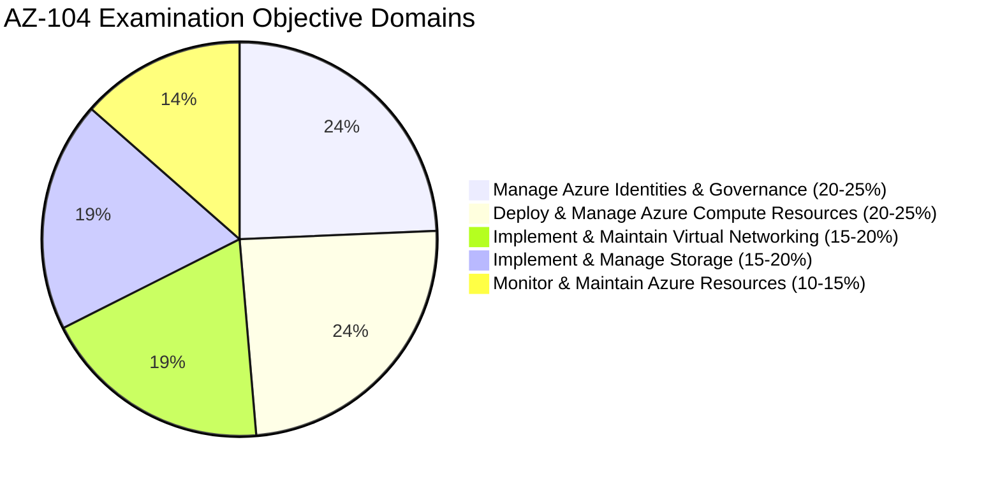
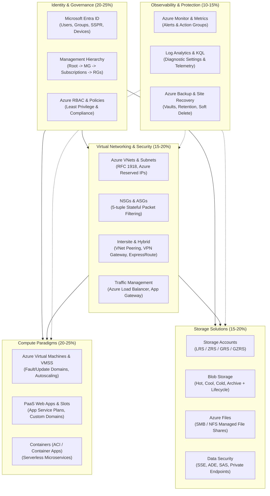

# Module 13-104-01: AZ-104 Course Introduction & Certification Framework

**Breadcrumbs:** [[13-Index - Azure|☁️ Azure Reference MOC]] > [[13-Index - AZ-104|📘 AZ-104 Exam Track]] > **01 - Course Introduction & Certification**

---

## 🎯 Executive Overview & Exam Objectives

The **Microsoft Certified: Azure Administrator Associate (AZ-104)** credential validates the foundational and intermediate administrative capabilities required to implement, manage, and monitor an enterprise's Microsoft Azure environment. The Azure Administrator manages the full lifecycle of identity, governance, compute, storage, virtual networking, and operational observability across cloud and hybrid environments.

### Exam Domain Breakdown & Weightings



| Functional Domain | Exam Weight | Core Architectural Components |
| :--- | :---: | :--- |
| **Manage Azure Identities & Governance** | **20–25%** | Microsoft Entra ID (users, groups, SSPR, device identities), Azure RBAC (built-in and custom roles), Azure Policy definitions and initiatives, Management Groups, Subscriptions, Resource Groups, ARM Templates, Bicep. |
| **Deploy & Manage Azure Compute Resources** | **20–25%** | Azure Virtual Machines (sizing, deployment, disks, high availability, extensions), Virtual Machine Scale Sets (VMSS), Azure App Service plans and web apps, Azure Container Instances (ACI), Azure Container Apps (ACA). |
| **Implement & Maintain Virtual Networking** | **15–20%** | Virtual Networks (VNets), subnets, Public/Private IP allocation, Network Security Groups (NSGs), Application Security Groups (ASGs), VNet Peering, VPN Gateway, UDRs, Azure Load Balancer, Application Gateway, Azure DNS, Private Endpoints. |
| **Implement & Manage Storage** | **15–20%** | Azure Storage Accounts (General Purpose v2, Premium), data redundancy (LRS, ZRS, GRS, GZRS), Blob Storage access tiers & lifecycle rules, Azure Files SMB/NFS shares, Storage security (SSE, ADE, SAS tokens, Entra ID auth). |
| **Monitor & Maintain Azure Resources** | **10–15%** | Azure Monitor, Activity Logs, Diagnostic Settings, Log Analytics Workspaces, Kusto Query Language (KQL), Metric & Log Alerts, Action Groups, Azure Backup (VMs, files), Azure Site Recovery (ASR). |

---

## 🏛️ AZ-104 Administration Competency Architecture

An Azure Administrator acts as the central orchestrator across infrastructure, security, operations, and development teams. The following architecture map illustrates how administrative domains interconnect:



---

## ⚙️ Foundational Prerequisites & Tooling Setup

To effectively prepare for AZ-104, administrators must be fluent across four core administration tools:

1. **Azure Portal:** Web-based GUI for graphical configuration and exploration.
2. **Azure Cloud Shell:** Browser-accessible terminal pre-authenticated with Bash and PowerShell runtimes, persistent storage mounted via Azure Files.
3. **Azure CLI (`az`):** Cross-platform Python-based CLI optimized for POSIX environments.
4. **Azure PowerShell Module (`Az`):** PowerShell module providing declarative object-based cmdlets for automation and Windows system integration.

### Core CLI & PowerShell Initialization Recipe

```bash
# Verify Azure CLI version and installed extensions
az version

# Interactive login to tenant
az login

# List and set target subscription context
az account list --output table
az account set --subscription "<SUBSCRIPTION_ID_OR_NAME>"

# Verify active account
az account show --output jsonc
```

```powershell
# Verify Az module installation
Get-InstalledModule -Name Az -AllVersions

# Interactive authentication
Connect-AzAccount

# Retrieve and select subscription context
Get-AzSubscription | Format-Table Name, Id, State
Set-AzContext -SubscriptionId "<SUBSCRIPTION_ID>"
```

---

## 💡 AZ-104 Exam Tactical Blueprint & Speed Hacks

> [!TIP]
> **Microsoft Entra ID Rebranding Note:** Microsoft renamed *Azure Active Directory (Azure AD)* to *Microsoft Entra ID*. While names in documentation and portal interfaces have updated, technical mechanics (such as Graph API URIs, PowerShell cmdlets `Get-MgUser`, and core architectural properties) remain consistent.

> [!IMPORTANT]
> **Scoring & Question Types:**
> - Passing score: **700 / 1000** (scaled score).
> - Exam duration: Typically 100–120 minutes with 40–60 questions.
> - Question formats: Case studies (cannot backtrack once completed), multiple-choice, drag-and-drop build lists, drop-down code completions (JSON ARM / Bicep / PowerShell), and repeated scenario questions (yes/no questions where you cannot return to change your answer).

---

## 🎙️ Video Deep Dive & Real-World Builds (Moe Intelligence Series)

> [!NOTE]
> **Source Attribution:** Transcripts and architectural walkthroughs synthesized from *Moe Intelligence (Arabic Comprehensive AZ-104 Series)*, Lessons 01, 36, and 41/42 ([Playlist Reference](https://www.youtube.com/playlist?list=PLczK3J2J4clmeh328CC13dJrcALcSFZFb)). Translated to English while preserving technical taxonomy.

### 1. The Cloud Engineering Progression Blueprint
- **Fundamentals to Administration Bridge:** AZ-900 introduces conceptual "what" (what is cloud computing, SLA, CapEx vs. OpEx), while AZ-104 requires engineering "how" (how to plan CIDR blocks, configure hybrid identity sync, script ARM/Bicep, build resilient multi-region architectures).
- **The Administration Core vs. Solution Architecture:** AZ-104 serves as the operational baseline required before attempting the AZ-305 (Azure Solutions Architect Expert) or AZ-400 (DevOps Engineer Expert). Without mastering AZ-104 day-to-day administration (specifically VNets, UDRs, and RBAC), high-level architectural design remains abstract.

### 2. High-Yield Exam Day Tactics
- **The Case Study Gauntlet:**
  - Case studies present 4–8 tabs of detailed business requirements, technical requirements, planned changes, and existing network topologies.
  - *Golden Rule:* Do not read all case study text word-for-word initially. Instead, jump straight to the specific question, identify the exact requirement constraint (e.g., "minimize administrative effort", "prevent single point of failure", "ensure least privilege"), and search the relevant tab for that specific technical constraint.
  - *Unidirectional Trap:* Once you exit the Case Study section of the exam, the testing engine locks those questions permanently; you cannot return to review them later. Allocate 25–30 dedicated minutes exclusively for the Case Study.
- **Repeated Scenario Questions (Yes/No):**
  - These questions present an identical business problem across 3 successive screens with different proposed technical solutions (e.g., "Does this meet the goal? Yes/No").
  - Once answered and submitted, you cannot go back to change your answer, even if a subsequent question clarifies the scenario. Evaluate each proposed solution independently against all stated requirements.

---

## 🌐 Authoritative References & Citations

- [KodeKloud AZ-104 Course - Course Introduction](https://notes.kodekloud.com/docs/Updated-AZ-104-Microsoft-Azure-Administrator/Introduction/Course-Introduction/page.md)
- [KodeKloud AZ-104 Course - Certification Details](https://notes.kodekloud.com/docs/Updated-AZ-104-Microsoft-Azure-Administrator/Introduction/Certification-Details/page.md)
- [Moe Intelligence AZ-104 Video Series (Lessons 01, 36, 42)](https://www.youtube.com/playlist?list=PLczK3J2J4clmeh328CC13dJrcALcSFZFb)
- [Microsoft Learn: Study Guide for Exam AZ-104](https://learn.microsoft.com/en-us/credentials/certifications/resources/study-guides/az-104)
- [Microsoft Azure Documentation](https://learn.microsoft.com/azure/)
