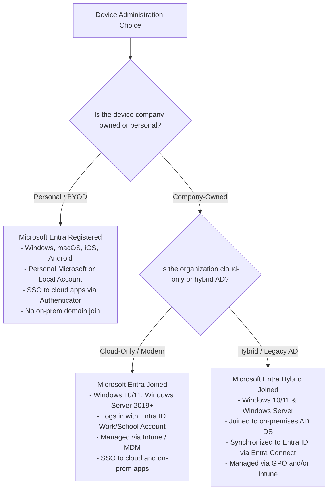
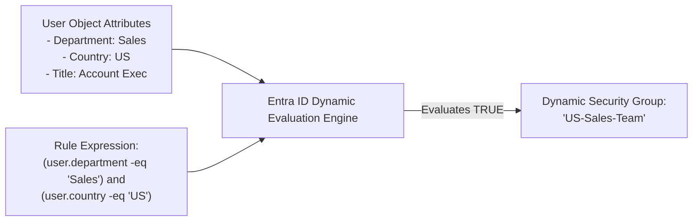
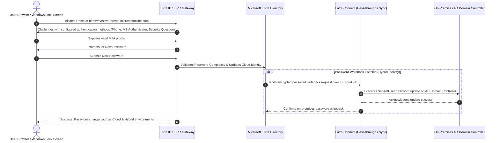
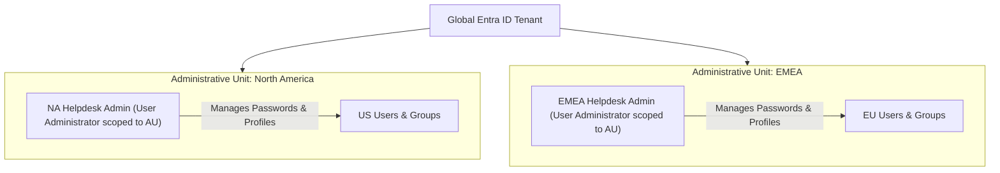

# Module 13-104-02: Administer Identity with Microsoft Entra ID

**Breadcrumbs:** [[13-Index - Azure|☁️ Azure Reference MOC]] > [[13-Index - AZ-104|📘 AZ-104 Exam Track]] > **02 - Administer Identity**

---

## 🎯 Executive Overview & Architectural Foundations

Identity is the primary security perimeter in modern cloud architectures. In Microsoft Azure, identity and access management is governed by **Microsoft Entra ID** (formerly *Azure Active Directory / Azure AD*). Unlike traditional on-premises directory services designed around network perimeters and LDAP/Kerberos protocols, Microsoft Entra ID is a multi-tenant, cloud-native Identity-as-a-Service (IDaaS) platform leveraging internet-standard protocols (OAuth 2.0, OpenID Connect, and SAML 2.0) across HTTPS.

```mermaid
flowchart TD
    subgraph EnterpriseBoundary ["Hybrid Identity Boundary"]
        OnPremAD["On-Premises Active Directory (AD DS)\n- Kerberos / NTLM / LDAP\n- Group Policy Objects (GPOs)\n- Hierarchical OUs"]
        Connect["Microsoft Entra Connect\n(Password Hash Sync / PTA / Federation)"]
    end

    subgraph EntraCloud ["Microsoft Entra ID Tenant"]
        TenantRoot["Tenant Namespace (tenant.onmicrosoft.com)\n- Flat Directory Structure\n- REST API (Microsoft Graph)"]
        
        subgraph DirectoryObjects ["Directory Objects"]
            Users["User Accounts\n(Member vs. Guest / B2B)"]
            Groups["Groups\n(Security vs. M365)\n(Assigned vs. Dynamic)"]
            Devices["Device Identities\n(Registered vs. Joined vs. Hybrid)"]
            ServicePrincipals["Service Principals &\nManaged Identities"]
        end

        subgraph SecurityControls ["Identity Protection & Governance"]
            MFA["Multi-Factor Authentication (MFA)"]
            SSPR["Self-Service Password Reset (SSPR)"]
            CA["Conditional Access Policies (P1/P2)"]
            PIM["Privileged Identity Management (P2)"]
        end
    end

    subgraph TargetWorkloads ["Target Secured Workloads"]
        AzureSub["Azure Subscriptions (ARM Control Plane)"]
        M365["Microsoft 365 (Exchange, SharePoint, Teams)"]
        SaaS["External SaaS (Salesforce, GitHub, ServiceNow)"]
        CustomApp["Custom Cloud Applications (App Registrations)"]
    end

    OnPremAD -->|Synchronizes via| Connect
    Connect -->|Populates| TenantRoot
    TenantRoot --> DirectoryObjects
    DirectoryObjects --> SecurityControls
    SecurityControls -->|Grants Authenticated Claims To| TargetWorkloads
```



---

## 🏛️ Core Concepts: Directory Hierarchy & Terminology

Understanding the distinctions among identity abstractions is essential for passing AZ-104:

1. **Identity:** A digital entity that can be authenticated (e.g., human user, group, containerized service, virtual machine, or automated process).
2. **Account:** An identity enriched with identifying metadata, credentials, and organizational attributes (e.g., `userPrincipalName`, department, usage location, manager).
3. **Microsoft Entra ID Account:** An account created in Microsoft Entra ID or a connected Microsoft cloud service:
   - *Work or School Account:* Provisioned and managed by an organization (e.g., `alice@contoso.onmicrosoft.com`).
   - *Personal Microsoft Account (MSA):* Managed by the individual for consumer services (e.g., `@outlook.com`, `@live.com`, `@hotmail.com`).
4. **Tenant (Directory):** A dedicated, isolated instance of Microsoft Entra ID created when an organization signs up for Azure or Microsoft 365. It represents the top-level boundary of identity ownership.
5. **Subscription Mapping:** An Azure Subscription trusts exactly **one** Entra ID tenant for authentication, though an Entra ID tenant can be associated with **multiple** Azure Subscriptions.

---

## ⚖️ Architectural Comparison: Entra ID vs. Active Directory Domain Services (AD DS)

```mermaid
flowchart LR
    subgraph AD_DS ["Active Directory Domain Services (AD DS)"]
        AD1["LDAP, Kerberos, NTLM"]
        AD2["Requires Domain Controllers (IaaS/Hardware)"]
        AD3["Hierarchical OUs & Group Policies (GPOs)"]
        AD4["Internal Corporate Network Bound"]
    end

    subgraph Entra_ID ["Microsoft Entra ID"]
        E1["HTTPS, REST, OAuth 2.0, OIDC, SAML"]
        E2["Fully Managed Multi-Tenant SaaS"]
        E3["Flat Structure, Dynamic Rules, Administrative Units"]
        E4["Globally Accessible Internet-First Perimeter"]
    end

    AD_DS -.->|Bridge via Entra Connect| Entra_ID
```



| Dimension | Active Directory Domain Services (AD DS) | Microsoft Entra ID (Azure AD) |
| :--- | :--- | :--- |
| **Communication Protocol** | LDAP, Kerberos, NTLM over TCP/UDP ports (389, 636, 88). | HTTP/HTTPS (REST APIs via Microsoft Graph), OAuth 2.0, OpenID Connect (OIDC), SAML 2.0. |
| **Infrastructure Overhead** | Requires physical/virtual Domain Controllers, backup, patching, replication topologies. | Fully managed SaaS; high availability and disaster recovery managed natively by Microsoft. |
| **Directory Structure** | Hierarchical tree: Forest $\rightarrow$ Domain $\rightarrow$ Organizational Units (OUs). | Flat structure: Users, Groups, Devices, and Administrative Units (AUs). No traditional OUs. |
| **Device Governance** | Group Policy Objects (GPOs), Kerberos machine accounts, Domain Join. | Microsoft Intune, MDM policies, Entra Registration, Entra Join, Conditional Access. |
| **Query Language** | LDAP search filters. | Microsoft Graph API REST queries, OData v4.0 query parameters. |
| **Network Boundary** | On-premises corporate network; requires VPN/DirectAccess for remote clients. | Universal cloud boundary; accessible securely anywhere over public TLS endpoints. |

---

## 💎 Microsoft Entra ID Licensing Editions

AZ-104 requires administrators to identify the minimum licensing tier required for specific identity features:

| Feature / Capability | Free | Microsoft 365 Apps | P1 (Premium Plan 1) | P2 (Premium Plan 2) |
| :--- | :---: | :---: | :---: | :---: |
| **Object Limit** | Up to 500,000 objects | 500,000+ objects | No object limit | No object limit |
| **User & Group Management** | ✅ Included | ✅ Included | ✅ Included | ✅ Included |
| **Cloud Self-Service Password Reset (SSPR)** | Change password only | Change password only | ✅ Full SSPR + On-prem Writeback | ✅ Full SSPR + On-prem Writeback |
| **Dynamic Group Membership** | ❌ No | ❌ No | ✅ Supported | ✅ Supported |
| **Conditional Access Policies** | ❌ Security Defaults only | ❌ Security Defaults only | ✅ Full Custom Policies | ✅ Full Custom Policies |
| **Identity Protection (Risk-Based Conditional Access)** | ❌ No | ❌ No | ❌ No | ✅ Real-time & sign-in risk |
| **Privileged Identity Management (PIM)** | ❌ No | ❌ No | ❌ No | ✅ Just-in-Time role elevation |
| **Access Reviews & Entitlement Management** | ❌ No | ❌ No | ❌ No | ✅ Supported |

> [!IMPORTANT]
> **Licensing Exam Heuristics:**
> - If an exam question mentions **Dynamic Groups**, **Conditional Access**, or **On-premises SSPR Password Writeback**, the minimum required license is **Entra ID P1**.
> - If an exam question mentions **Privileged Identity Management (PIM)**, **Risk-based Conditional Access**, **User/Sign-in Risk Detection**, or **Vulnerability Lifecycle Reviews**, the minimum required license is **Entra ID P2**.

---

## 📱 Device Identities: Registered vs. Joined vs. Hybrid Joined



| Attribute | Microsoft Entra Registered | Microsoft Entra Joined | Microsoft Entra Hybrid Joined |
| :--- | :--- | :--- | :--- |
| **Ownership** | Personal / Bring Your Own Device (BYOD). | Organization-owned. | Organization-owned. |
| **Target OS** | Windows 10/11, macOS, iOS, Android, Linux. | Windows 10/11, Windows Server 2019/2022. | Windows 10/11, Windows Server (2012 R2+). |
| **Sign-in Credential** | Local OS account or personal Microsoft Account (MSA). | Microsoft Entra ID Work or School Account. | Active Directory Domain Account (`CONTOSO\username`). |
| **Device Management** | Lightweight Mobile Device Management (MDM) enrollment. | Microsoft Intune / MDM. | Active Directory Group Policy (GPO) + Intune co-management. |
| **SSO Capability** | SSO to cloud applications (via PRT and browser extensions). | Seamless SSO to cloud resources and on-prem Kerberos resources. | Seamless SSO to on-prem Kerberos and cloud resources. |

---

## 👥 User Account Administration & Bulk Operations

### 1. User Account Types
- **Member Users:** Native directory users created directly in the tenant or synchronized from on-premises AD. They possess standard directory read permissions.
- **Guest Users (B2B):** External users invited into the directory (e.g., contractors, vendors). Default guest user permissions are restricted from enumerating other users, groups, or tenant properties.

### 2. Bulk User Creation Workflow
Administrators use CSV templates in the Azure Portal or command line to provision hundreds of users simultaneously.

**Required CSV Headers for Entra ID Bulk Import:**
```csv
version:v1.0
Name [displayName] Required,User principal name [userPrincipalName] Required,Initial password [passwordProfile] Required,Block sign in (Yes/No) [accountEnabled] Required,First name [givenName],Last name [surname],Department [department],Usage location [usageLocation]
John Doe,jdoe@contoso.onmicrosoft.com,TempPassw0rd!2026,No,John,Doe,Engineering,US
Jane Smith,jsmith@contoso.onmicrosoft.com,TempPassw0rd!2026,No,Jane,Smith,Finance,US
```

> [!CAUTION]
> The **Usage Location** property (`usageLocation`) is mandatory before assigning any Microsoft 365 or feature license to a user. Attempting to assign a license without setting `usageLocation` will trigger a hard failure.

---

## 🛡️ Group Management & Dynamic Membership Rules

### Group Types
1. **Security Groups:** Used for granting access to resources (Azure RBAC, application access, SharePoint sites) and assigning licenses.
2. **Microsoft 365 Groups:** Collaborative groups providing shared mailboxes, calendars, SharePoint document libraries, and OneNote workspaces.

### Assignment Types
- **Assigned:** Static membership. Administrators manually add or remove members.
- **Dynamic User / Dynamic Device:** Rule-driven membership evaluated automatically by Entra ID background processes. Requires **Entra ID P1**.



### Dynamic Membership Rule Syntax Examples

```text
# Match all users in Engineering located in United States
(user.department -eq "Engineering") and (user.country -eq "US")

# Match all users whose job title starts with 'Manager'
(user.jobTitle -startsWith "Manager")

# Match all guest accounts
(user.userType -eq "Guest")

# Dynamic Device Rule: Match all Windows 11 corporate devices
(device.deviceOSType -eq "Windows") and (device.deviceOSVersion -startsWith "10.0.22")
```

---

## 🔑 Self-Service Password Reset (SSPR) Architecture

SSPR allows users to reset their forgotten passwords without contacting IT support.



### Critical SSPR Prerequisites & Parameters
1. **Target Group Assignment:** SSPR can be enabled for `None`, `Selected` (a single designated group), or `All`. In production, pilots are conducted by setting SSPR to `Selected` pointing to a pilot security group.
2. **Authentication Methods Available:**
   - Mobile app notification / Mobile app code (Microsoft Authenticator).
   - Email (alternate email address).
   - Mobile phone (SMS or automated voice call).
   - Office phone.
   - Security questions (minimum 3 required to register, minimum 3 required to reset; not recommended for zero-trust architectures).
3. **Password Writeback Requirements:**
   - Microsoft Entra ID P1 license.
   - Entra Connect configured with the *Password writeback* feature checked.
   - Entra Connect service account granted *Reset password* and *Write lockoutTime* permissions on on-premises user OUs.

---

## 🏢 Multi-Tenant Environments & Administrative Units

### Cross-Tenant Collaboration (B2B)
- **Microsoft Entra B2B:** Enables sharing applications and resources with external guest users from partner organizations using their own home credentials.
- **Cross-Tenant Access Settings:** Allows administrators to define inbound and outbound access rules, trust MFA claims from partner tenants, and streamline federation.

### Administrative Units (AUs)
Administrative Units allow delegating administrative control over a specific subset of users and groups (e.g., scoping a Regional Helpdesk Admin to manage only users in the "EMEA" unit without granting global tenant-level admin rights).



---

## 🛠️ Contextual Proof of Concept: CLI & PowerShell Recipes

### 1. Azure CLI: User & Group Management

```bash
# 1. Create a new cloud-only user
az ad user create \
  --display-name "Michael Chang" \
  --user-principal-name "mchang@contoso.onmicrosoft.com" \
  --password "SecureP@ssw0rd2026!" \
  --force-change-password-next-sign-in true \
  --mail-nickname "mchang"

# 2. Update user location (mandatory before licensing)
az ad user update \
  --id "mchang@contoso.onmicrosoft.com" \
  --usage-location "US"

# 3. Create a Security Group
az ad group create \
  --display-name "Sec-DevOps-Engineers" \
  --mail-nickname "sec-devops"

# 4. Add member to group
az ad group member add \
  --group "Sec-DevOps-Engineers" \
  --member-object-id $(az ad user show --id "mchang@contoso.onmicrosoft.com" --query id -o tsv)

# 5. Invite a B2B Guest User
az ad invtation create \
  --invited-user-display-name "Partner External Consultant" \
  --invited-user-email "consultant@partnerfirm.com" \
  --send-invitation-message true \
  --invite-redirect-url "https://myapps.microsoft.com"
```

### 2. Microsoft Graph PowerShell: Dynamic Group & AU Setup

```powershell
# Connect to Microsoft Graph with Directory Administration scopes
Connect-MgGraph -Scopes "User.ReadWrite.All", "Group.ReadWrite.All", "AdministrativeUnit.ReadWrite.All"

# Create a dynamic security group for all cloud DevOps users
$dynamicGroupParams = @{
    DisplayName = "Dynamic-Cloud-Architects"
    MailEnabled = $false
    MailNickname = "dyn-cloud-arch"
    SecurityEnabled = $true
    GroupTypes = @("DynamicMembership")
    MembershipRule = '(user.department -eq "CloudPlatform") and (user.accountEnabled -eq true)'
    MembershipRuleProcessingState = "On"
}
New-MgGroup @dynamicGroupParams

# Create an Administrative Unit
$auParams = @{
    DisplayName = "AU-APAC-Engineering"
    Description = "Administrative boundary for Asia-Pacific engineers"
}
$apacAU = New-MgDirectoryAdministrativeUnit @auParams

# Add a user into the Administrative Unit
New-MgDirectoryAdministrativeUnitMemberByRef -AdministrativeUnitId $apacAU.Id `
    -BodyParameter @{"@odata.id" = "https://graph.microsoft.com/v1.0/users/mchang@contoso.onmicrosoft.com"}
```

---

## 🔍 Deep-Intuition AARF Framework

### Scenario: Configuring Self-Service Password Reset with On-Premises Writeback

- **The Answer (Core Configuration):** Enable SSPR for the target group in the Microsoft Entra admin center (`Protection -> Password reset -> Properties -> Selected: Pilot-SSPR-Users`). On the Entra Connect server, run the Azure AD Connect wizard, select *Customize synchronization options*, and check **Password writeback**.
- **The Assumptions (Prerequisites):** 
  - Tenant possesses at least **Microsoft Entra ID P1** licenses for all enabled users.
  - On-premises AD DS service account used by Entra Connect has been delegated the *Reset password* and *Write lockoutTime* extended rights on the target organizational units.
  - Outbound TCP port 443 connectivity is permitted from the Entra Connect host to Azure Service Bus endpoints.
- **The Rationale (Why):** Without password writeback enabled, an on-premises user who changes their password in the cloud will only update the Entra ID cloud hash. The next time they attempt to log into their on-premises workstation via Kerberos/NTLM, the on-premises Domain Controller will reject the authentication because the on-prem hash remained unchanged. Password writeback synchronizes the change backwards in real-time.
- **The Failure Loop (What if misconfigured):**
  - *Error in event log:* `Event ID 33001: The password reset writeback service encountered an error while attempting to connect to Azure Service Bus.`
  - *User portal experience:* User receives error `SSPR_0011: We're sorry, but we can't reset your password right now because your administrator has not configured your account for password reset.`
- **The Alternative Case (When to use 'if not'):** For pure cloud-native organizations that do not operate on-premises Active Directory Domain Controllers, password writeback is completely unnecessary and should remain disabled to avoid unnecessary sync agent overhead.

---

## 💡 AZ-104 Exam Tips & Gotchas

> [!TIP]
> **SSPR Group Limitation:** In the Azure Portal SSPR configuration blade, you can select only **one single group** under the `Selected` option. If you need to enable SSPR for multiple teams during a staged rollout, you must create a consolidated "All-SSPR-Pilots" group and nest or dynamically populate the target users into that single group.

> [!WARNING]
> **Nested Groups in Azure RBAC and Dynamic Groups:**
> - Azure RBAC assignments support nested groups for access assignment.
> - **Dynamic Groups DO NOT support nesting.** You cannot add a group into a dynamic group rule; rules evaluate only discrete user or device attributes.
> - Application access assignment via nested groups requires an Entra ID Premium license.

---

## 🎙️ Video Deep Dive & Real-World Builds (Moe Intelligence Series)

> [!NOTE]
> **Source Attribution:** Transcripts and architectural walkthroughs synthesized from *Moe Intelligence (Arabic Comprehensive AZ-104 Series)*, Lessons 02–07 ([Playlist Reference](https://www.youtube.com/playlist?list=PLczK3J2J4clmeh328CC13dJrcALcSFZFb)). Translated to English while preserving technical taxonomy.

### 1. Architectural Boundary: Tenant vs. Subscription
- **Core Decoupling:** In enterprise cloud operations, Microsoft Entra ID is the **identity directory**, while Azure Subscriptions are **billing and resource containers**.
- **1-to-Many Relationship:** A single Entra ID tenant can support multiple isolated subscriptions (e.g., `sub-prod-01`, `sub-dev-01`, `sub-shared-01`), allowing centralized identity management and Single Sign-On (SSO) across segregated operational budgets.
- **Independent Security Planes:** Global Administrator in Entra ID does *not* automatically grant permission to deploy or view resources within child subscriptions unless the administrator explicitly activates the **Access management for Azure resources** toggle in Entra ID properties (which grants `User Access Administrator` at the Tenant Root Group).

### 2. Custom Domain Onboarding & DNS Handshake
- **Default Namespace:** Initial directories default to `[name].onmicrosoft.com`.
- **Validation Workflow:**
  1. Add domain (e.g., `contoso.com`) in Entra ID admin center.
  2. Retrieve the required DNS record generated by Azure:
     - `Record Type:` TXT
     - `Alias / Host Name:` `@`
     - `Value:` `MS=msXXXXXXXX`
     - `TTL:` 3600
  3. Publish the TXT record at the public registrar (e.g., GoDaddy, Cloudflare, Namecheap).
  4. Complete verification in Azure Portal. Once verified, designate as **Primary Domain** to ensure newly provisioned users default to the corporate email suffix.

### 3. Microsoft Entra Connect: Deep-Dive Sync Mechanics
- **The Three Hybrid Auth Models Compared:**
  - **Password Hash Synchronization (PHS):** Entra Connect retrieves password hashes from on-premises AD DS, extracts the MD4 hash, calculates a SHA-256 hash, and transmits it via TLS 443 to Entra ID. *Resilience Advantage:* Users can authenticate to cloud services even during complete on-premises datacenter network failures.
  - **Pass-Through Authentication (PTA):** Authentication requests hit Entra ID, which places them into an Azure Service Bus queue. Lightweight on-premises agents poll the queue, validate credentials against local Domain Controllers via Kerberos, and return success/failure. Passwords are never hashed or stored in cloud storage.
  - **Active Directory Federation Services (AD FS):** Complete claim-based redirection to on-premises farm. High administrative complexity, requires public SSL certificates and dedicated WAP proxies.
- **Identity Matching Nuances:**
  - *Soft Match:* Compares `UserPrincipalName` and `mail` attribute. Permitted only for users that have not yet been tied to a source anchor.
  - *Hard Match:* Binds cloud object to on-premises object via `mS-DS-ConsistencyGuid`. Prevents account takeover attacks where an external cloud admin creates a matching email address.

---

## 🌐 Authoritative References & Citations

- [KodeKloud AZ-104 Course - Administer Identity Module](https://notes.kodekloud.com/docs/Updated-AZ-104-Microsoft-Azure-Administrator/Administer-Identity/Module-Introduction/page.md)
- [Moe Intelligence AZ-104 Video Series (Lessons 02–07)](https://www.youtube.com/playlist?list=PLczK3J2J4clmeh328CC13dJrcALcSFZFb)
- [Microsoft Entra ID Documentation - Fundamentals](https://learn.microsoft.com/en-us/azure/active-directory/fundamentals/active-directory-whatis)
- [Microsoft Learn: Manage user and group accounts in Microsoft Entra ID](https://learn.microsoft.com/en-us/training/modules/manage-users-and-groups-in-azure-active-directory/)
- [Microsoft Learn: Configure self-service password reset](https://learn.microsoft.com/en-us/training/modules/configure-self-service-password-reset/)
