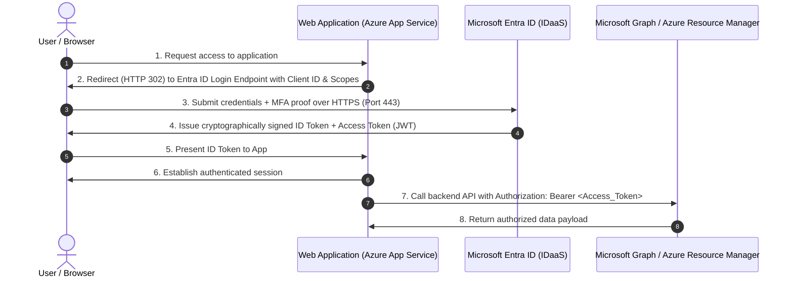
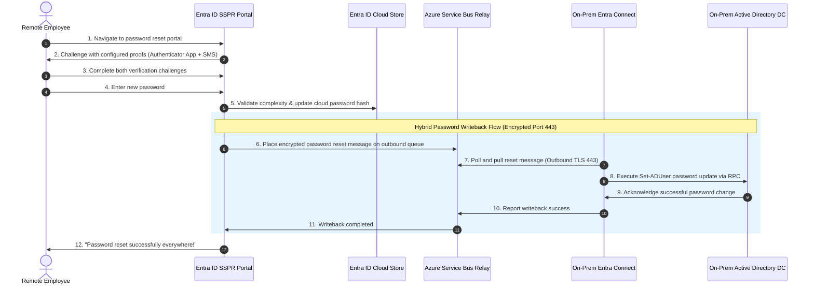
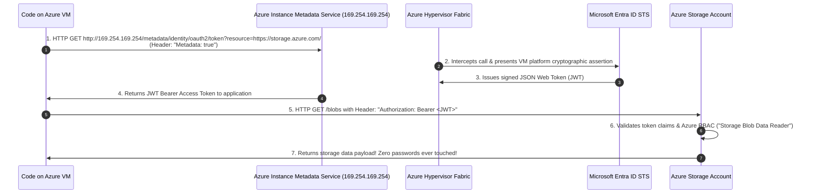
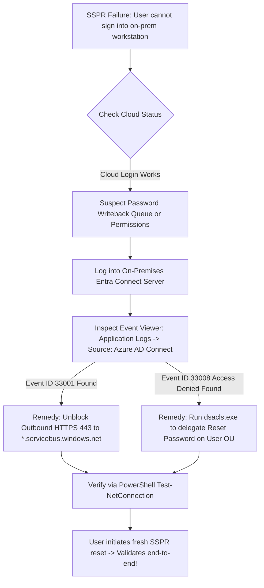

# Module 13-104-02: Administer Identity with Microsoft Entra ID

**Breadcrumbs:** [[13-Index - Azure|☁️ Azure Reference MOC]] > [[13-Index - AZ-104|📘 AZ-104 Exam Track]] > **02 - Administer Identity**

---

## 🎯 Stage 1: Executive Overview & The Conceptual Lecture

### 1. The Zero-Knowledge Starting Point: Why Cloud Identity Exists
Imagine you run a traditional enterprise datacenter located inside a physical corporate office. Every morning, employees badge into the physical building, connect their desktop PCs to an Ethernet cable, and log into a Windows domain. 

In that legacy world, authentication was anchored to a physical network perimeter guarded by **Active Directory Domain Services (AD DS)** running on local servers called Domain Controllers (DCs):
* The protocols used were **Kerberos, NTLM, and LDAP**.
* These protocols were strictly designed for local local-area networks (LANs). They rely on chatty TCP/UDP port handshakes (Port 88 for Kerberos tickets, Port 389/636 for LDAP queries, Port 445 for SMB).
* If an employee traveled to a coffee shop or worked from home, they were completely disconnected from the Domain Controller unless they fired up a clunky, high-latency Virtual Private Network (VPN) tunnel back into the corporate headquarters.

Now consider the modern cloud era:
* Employees operate laptops from airports, homes, branch offices, and mobile devices across iOS and Android.
* Applications are no longer hosted inside a server closet in the basement; they are delivered as global Software-as-a-Service (Microsoft 365, Salesforce, ServiceNow) or deployed in public cloud platforms like Microsoft Azure, AWS, and GCP.
* **The physical network perimeter has vanished.** You cannot run Kerberos over the public internet—firewalls, internet routers, and web proxies routinely block legacy ports (like port 88 or 445) for basic security hygiene.

To survive in this reality, the industry underwent a fundamental paradigm shift: **Identity is the new security perimeter.** Rather than asking *"Are you inside the corporate office network?"*, modern systems ask *"Who are you, what device are you using, what is your contextual risk score, and what specific claims prove your identity?"*

### 2. Decoding the Nomenclature: Azure AD vs. Microsoft Entra ID
Historically, Microsoft called its cloud identity service **Azure Active Directory (Azure AD)**. In late 2023, Microsoft rebranded the entire identity and access suite under the product umbrella **Microsoft Entra**:
* **Microsoft Entra ID:** The foundational Identity-as-a-Service (IDaaS) platform (formerly Azure AD).
* **Microsoft Entra ID Governance:** Identity lifecycle, entitlement management, and access reviews.
* **Microsoft Entra External ID:** Customer and partner identity management (B2B collaboration and B2C / customer-facing apps).
* **Microsoft Entra Verified ID:** Decentralized identity verification based on open standards.
* **Microsoft Entra Permissions Management:** Cloud Infrastructure Entitlement Management (CIEM) across Azure, AWS, and GCP.

> [!NOTE]
> For the **AZ-104 exam**, Microsoft Entra ID covers core directory administration: Users, Groups, Devices, Custom Domains, Self-Service Password Reset (SSPR), Administrative Units (AUs), Hybrid Identity Synchronization (Entra Connect), Conditional Access, and Role-Based Access.

### 3. High-Level Terminology Matrix: Zero-Knowledge to Enterprise Architect

| Terminology | What It Means to a Beginner | Real-World Analog | Enterprise Architecture Reality |
| :--- | :--- | :--- | :--- |
| **Tenant (Directory)** | A private dedicated database of users and groups. | A corporate building where only authorized employees have records. | A multi-tenant, cloud-native directory instance (`tenant.onmicrosoft.com`) globally replicated across Microsoft datacenters. |
| **User Principal Name (UPN)** | The username used to log in. | An email-style passport stamp. | An internet-standard RFC 822 formatted string (`username@domain.com`) that uniquely identifies an account across cloud endpoints. |
| **Administrative Unit (AU)** | A locked drawer inside the filing cabinet. | A regional office manager who can only fire/hire staff in their local branch. | An administrative container within an Entra tenant used to scope directory administrative privileges (e.g., User Administrator) to a subset of users and groups. |
| **Dynamic Group** | A club where membership updates automatically based on rules. | An automated email list for "All Texas Employees" that updates when HR changes your state. | An Entra ID P1-driven group whose membership evaluates OData attribute queries asynchronously without administrative intervention. |
| **SSPR (Self-Service Password Reset)** | A webpage where users reset their own forgotten passwords. | An automated ATM PIN reset kiosk. | A secure cloud identity workflow enabling end users to complete multi-factor verification proofs and update their cloud and on-prem AD credentials. |
| **Password Writeback** | Pushing a password change made in the cloud back into the on-premises DC. | Writing in a duplicate ledger kept back at headquarters. | Real-time bi-directional synchronization over an encrypted outbound TLS queue (Azure Service Bus) from Entra ID to on-prem AD DS. |
| **B2B Guest** | An external contractor invited to access company apps. | A visitor badge given to an outside vendor that expires when they finish the job. | An Entra ID external user representation (`#EXT#`) authenticated by their home identity provider (e.g., partner Entra tenant, Google, or OTP) but authorized in your tenant. |
| **Managed Identity** | An identity given directly to a cloud server or application. | A company vehicle with a pre-programmed electronic toll transponder. | An automated Entra ID Service Principal provisioned for an Azure resource (e.g., VM, App Service) that eliminates hardcoded API secrets from code. |

---

## 🏛️ Stage 2: Core Mental Model & Component Architecture

### 1. Tenant vs. Subscription Separation (The Most Critical Mental Model)
One of the most frequent misconceptions among junior cloud administrators is confusing an **Azure Subscription** with an **Entra ID Tenant**. They are two completely distinct planes of existence:

```text
+---------------------------------------------------------------------------------+
|                       Microsoft Entra ID Tenant (Directory)                     |
|                              (e.g., contoso.onmicrosoft.com)                    |
|                                                                                 |
|  - Users: Alice, Bob, Charlie                                                   |
|  - Groups: Security Groups, Dynamic Groups                                      |
|  - Directory Roles: Global Admin, User Admin, Helpdesk Admin                    |
|  - Security: SSPR, Conditional Access, Multi-Factor Authentication              |
+---------------------------------------------------------------------------------+
               │                                                    │
               │ Authenticates & Issues Tokens                      │ Authenticates & Issues Tokens
               ▼                                                    ▼
+-------------------------------+                  +-------------------------------+
|    Azure Subscription A       |                  |    Azure Subscription B       |
|        (Production)           |                  |         (Non-Prod)            |
|                               |                  |                               |
| - Resource Group: rg-prod-db  |                  | - Resource Group: rg-dev-vm   |
| - VNet: 10.0.0.0/16           |                  | - VNet: 172.16.0.0/16         |
| - Azure RBAC: Owner, Contrib  |                  | - Azure RBAC: Owner, Reader   |
+-------------------------------+                  +-------------------------------+
```

* **Microsoft Entra ID is the Identity Plane:** It holds users, groups, devices, and application registrations. It is responsible for **Authentication (AuthN)**—proving *who you are*.
* **Azure Subscriptions are the Resource and Billing Plane:** They hold Virtual Machines, Storage Accounts, Virtual Networks, and Databases. They are responsible for **Authorization (AuthZ)**—determining *what you can do* via Azure Role-Based Access Control (Azure RBAC).
* **The Relationship Rules:**
  1. An Azure Subscription **trusts exactly one** Entra ID tenant for authentication.
  2. A single Entra ID tenant can be trusted by **multiple** Azure Subscriptions.
  3. A **Global Administrator** in Entra ID does **NOT** automatically have permissions to read, create, or delete resources inside child Azure Subscriptions! (They can, however, elevate their own permissions to `User Access Administrator` at the Tenant Root Group if emergency intervention is required).

### 2. Entra ID Directory Object Anatomy

```text
Microsoft Entra ID Tenant
  ├── User Objects
  │     ├── Cloud-Only Users (created directly in Entra ID)
  │     ├── Synced Users (synchronized from on-premises AD via Entra Connect)
  │     └── Guest Users (B2B invited from external organizations, e.g., user_partner.com#EXT#)
  │
  ├── Group Objects
  │     ├── Security Groups (used for RBAC, application assignment, licensing)
  │     │     ├── Assigned Membership (manually managed list of members)
  │     │     └── Dynamic Membership (automated attribute-based rules, requires P1)
  │     └── Microsoft 365 Groups (collaborative: provides Shared Mailbox, Teams, SharePoint)
  │
  ├── Device Objects
  │     ├── Entra Registered (BYOD: personal phones/laptops, user logs in with local account)
  │     ├── Entra Joined (Corporate-owned, cloud-native: user logs in with Entra UPN)
  │     └── Entra Hybrid Joined (Corporate-owned, domain-joined to on-premises AD DS + synced to cloud)
  │
  └── Workload Identities
        ├── Application Registrations & Service Principals (app identities)
        └── Managed Identities (System-Assigned & User-Assigned)
```

### 3. Entra ID Licensing Editions Architecture Matrix
The AZ-104 exam requires knowing which features demand which license tier:

```text
Entra ID Free            Entra ID P1                       Entra ID P2
+--------------------+   +-----------------------------+   +------------------------------------+
| Up to 500k objects |   | Unlimited objects           |   | All P1 Features PLUS:              |
| User/Group Mgmt    |   | Dynamic Group Rules         |   | Privileged Identity Mgmt (PIM)     |
| Cloud-only SSPR    |   | SSPR with On-Prem Writeback |   | Risk-Based Conditional Access      |
| Security Defaults  |   | Full Conditional Access     |   | Identity Protection Risk Engine    |
| (Binary MFA rules) |   | Microsoft Entra Connect Sync|   | Access Reviews & Lifecycle Mgmt    |
+--------------------+   +-----------------------------+   +------------------------------------+
```

| Architectural Capability | Entra ID Free | Microsoft 365 Apps | Entra ID P1 | Entra ID P2 |
| :--- | :---: | :---: | :---: | :---: |
| **Object Limit** | 500,000 objects | 500,000+ objects | Unlimited | Unlimited |
| **SSO Applications** | Unlimited | Unlimited | Unlimited | Unlimited |
| **Cloud Self-Service Password Reset (SSPR)** | Change password only | Change password only | ✅ Full SSPR + Reset | ✅ Full SSPR + Reset |
| **On-Premises Password Writeback** | ❌ No | ❌ No | ✅ Supported | ✅ Supported |
| **Dynamic Group Membership** | ❌ No | ❌ No | ✅ Supported | ✅ Supported |
| **Conditional Access Policies** | ❌ Security Defaults only | ❌ Security Defaults only | ✅ Full Granular Engine | ✅ Full Granular Engine |
| **Privileged Identity Management (PIM)** | ❌ No | ❌ No | ❌ No | ✅ Just-in-Time elevation |
| **Identity Protection (User & Sign-In Risk)** | ❌ No | ❌ No | ❌ No | ✅ Real-time risk detection |
| **Entitlement Management & Access Reviews** | ❌ No | ❌ No | ❌ No | ✅ Supported |

---

## 🏢 Stage 3: Deep-Intuition Platform Mechanics & Topology

### 1. Modern Web Authentication Protocols vs. Legacy Kerberos
Why could cloud identity not just use Kerberos?
* **Kerberos** issues cryptographic tickets based on symmetric key encryption shared between domain controllers and client machines. It requires direct line-of-sight network connectivity over port 88. It cannot cross NAT boundaries or web proxy servers cleanly.
* **Microsoft Entra ID** speaks web-native protocols running entirely over standard **HTTPS (port 443)**:
  1. **OAuth 2.0:** An industry-standard authorization framework. It issues **Access Tokens** (JSON Web Tokens - JWT) that allow an application to access APIs on behalf of a user.
  2. **OpenID Connect (OIDC):** A simple identity layer built directly on top of OAuth 2.0. It issues **ID Tokens** (JWTs) that prove to a client application that the user has successfully authenticated.
  3. **SAML 2.0:** An XML-based federated standard commonly used by legacy enterprise SaaS applications (e.g., Salesforce, SAP).
  4. **Microsoft Graph API:** The unified REST API endpoint (`https://graph.microsoft.com/v1.0`) used to programmatically query and modify every user, group, and policy object in the directory.



---

### 2. Hybrid Identity Architecture: Bridging On-Premises Active Directory
Most established enterprises do not operate solely in the cloud. They have thousands of existing user accounts in on-premises AD DS. Rather than forcing employees to remember two separate sets of usernames and passwords, organizations synchronize identities to Entra ID using **Microsoft Entra Connect Sync** (or the lightweight Entra Cloud Sync agent).

```text
[ On-Premises Corporate Datacenter ]                    [ Microsoft Cloud Perimeter ]
+--------------------------------------+                +------------------------------------+
| Active Directory Domain Controllers  |                |     Microsoft Entra ID Tenant      |
|  - Users, Groups, Computers (OUs)    |                |      (contoso.onmicrosoft.com)     |
|  - Kerberos & NTLM Authentication    |                |                                    |
+--------------------------------------+                +------------------------------------+
                   ▲                                                       ▲
                   │ (Read attributes / Write passwords)                  │ (Outbound HTTPS 443)
+--------------------------------------------------------------------------+
|                     Microsoft Entra Connect Sync Server                  |
|  - Sync Engine: Extracts user objects, filters OUs, strips attributes    |
|  - Authentication Mechanism Options:                                     |
|      1. Password Hash Sync (PHS) -> Default & Recommended                |
|      2. Pass-Through Authentication (PTA)                                |
|      3. Active Directory Federation Services (AD FS)                     |
+--------------------------------------------------------------------------+
```

#### Hybrid Authentication Comparison Matrix

| Parameter | Password Hash Sync (PHS) | Pass-Through Authentication (PTA) | Active Directory Federation Services (AD FS) |
| :--- | :--- | :--- | :--- |
| **Authentication Authority** | **Cloud (Microsoft Entra ID)** | **On-Premises Domain Controllers** | **On-Premises AD FS Farm** |
| **How Passwords Work** | Entra Connect extracts the MD4 password hash, hashes it 1,000 times with SHA-256, and sends that cryptographic hash to the cloud. | Passwords never reside in the cloud. Cloud forwards auth requests via an encrypted outbound Azure Service Bus queue to local on-prem agents. | User browser is redirected to on-premises federated sign-in webpage. Tokens issued on-prem. |
| **Offline Resilience** | **Highest:** If the on-premises datacenter or internet connection goes down, cloud users can still log into Microsoft 365 and Azure without interruption! | **Low:** If on-prem connection drops, cloud logins fail (unless PHS fallback is enabled). | **Low:** If AD FS servers fail, all enterprise authentication halts globally. |
| **Infrastructure Footprint** | Built into the single Entra Connect server. | Requires 2–3 lightweight agent VMs behind firewalls. | Massive: Multi-tier DMZ proxies (WAP), internal AD FS farms, hardware load balancers, public SSL certs. |
| **Leaked Credential Detection**| ✅ Supported by Entra ID Protection. | ❌ Not supported (Cloud has no hash). | ❌ Not supported. |
| **AZ-104 Recommendation** | **Default recommended choice** for enterprise identity. | Only used when strict regulatory rules prohibit hashes in cloud. | Legacy; only for smart-card auth or custom third-party federation. |

#### Object Matching Mechanics: Soft-Match vs. Hard-Match
When synchronizing an on-premises user to an already existing cloud user account:
* **Soft Match:** Matches based on identical `userPrincipalName` or primary SMTP `mail` address. Permitted only if the cloud object does not yet have an anchor assigned.
* **Hard Match:** Binds the cloud user object to the on-prem user via the on-prem `objectGUID` (written into the cloud user's `mS-DS-ConsistencyGuid` or `ImmutableId` in base64). Once hard matched, the cloud user is permanently anchored to that specific on-premises account.

---

### 3. Self-Service Password Reset (SSPR) & Password Writeback Mechanics
Without SSPR, forgotten passwords represent up to 40% of all IT helpdesk service tickets. SSPR allows users to reset their own passwords from any web browser (`https://passwordreset.microsoftonline.com`).



#### SSPR Architectural Rules & Prerequisites:
1. **Scope Selection:** In the portal, SSPR can be enabled for `None`, `Selected`, or `All`. **Crucial Exam Rule:** The `Selected` option accepts **only ONE group**. If you need to enable SSPR for 5 pilot departments, you must create a single parent group (e.g., `grp-sspr-pilot`) and nest or populate those users into that single group!
2. **Number of Authentication Methods Required:** Administrators configure whether users must provide **1 method** or **2 methods** to reset their password.
3. **Available Methods:**
   * Mobile app notification (Microsoft Authenticator - most secure).
   * Mobile app code (TOTP).
   * Email (alternate personal email address).
   * Mobile phone (SMS or automated voice call).
   * Office phone (call only).
   * Security questions (requires 3 to register, 3 to reset; strongly discouraged in Zero-Trust).
4. **Password Writeback Requirements:**
   * Requires **Microsoft Entra ID P1** (or P2) license.
   * Entra Connect server must have **Password Writeback** enabled in the setup wizard.
   * Entra Connect service account in on-prem AD must be granted `Reset Password` and `Write lockoutTime` permissions on target User OUs.
   * Requires outbound TLS port 443 connectivity to Azure Service Bus endpoints (no inbound firewall ports need to be opened).

---

### 4. Dynamic Group Membership Engine
Rather than having administrators manually add and remove users from groups whenever employees join, transfer, or leave, **Dynamic Groups** automatically evaluate OData queries against user and device attributes.

```text
[ HR System / IT Administrator ]
Updates user account: Sarah Jenkins
- Department: "Engineering"
- Usage Location: "US"
- Job Title: "Senior DevOps Engineer"
               │
               ▼
[ Entra ID Dynamic Evaluation Engine ] (Runs background poll every few minutes)
Evaluates Group Rule:
(user.department -eq "Engineering") and (user.usageLocation -eq "US")
               │
               ▼ Result: TRUE
[ Dynamic Security Group: grp-us-engineering ]
Sarah is automatically added as a member!
Licenses and Azure RBAC assigned to this group immediately apply to Sarah.
```

#### Key Dynamic Rule Syntax & Operators:
* `-eq` (Equals): `user.department -eq "Finance"`
* `-ne` (Not Equals): `user.department -ne "Contractor"`
* `-startsWith`: `user.jobTitle -startsWith "Senior"`
* `-contains`: `user.mail -contains "partner"`
* `-match`: Uses regular expressions.
* Logical operators: `and`, `or`, `not`

> [!WARNING]
> **Dynamic Group Rules & Nesting Limitations:**
> 1. Dynamic groups require an **Entra ID P1** license for every distinct member who matches the rule.
> 2. **Dynamic groups CANNOT contain other groups.** A dynamic rule evaluates only individual *User* or *Device* objects, never group objects.
> 3. Group membership is calculated asynchronously in the background. It is **not instantaneous**—after creating a dynamic rule or modifying a user attribute, membership updates can take between 5 to 15 minutes to evaluate across large directories.

---

### 5. Administrative Units (AUs): Regional Delegation
In massive multinational enterprises, the centralized IT department cannot handle everyday user support for offices in London, Tokyo, and New York. However, assigning an IT technician in London the tenant-wide **User Administrator** directory role is dangerous—they would have the power to reset the CEO's password or delete executive accounts!

**Administrative Units (AUs)** solve this by creating an administrative perimeter within the tenant:

```text
[ Global Microsoft Entra ID Tenant ]
  │
  ├── Administrative Unit: "AU-London-Office"
  │     ├── Member Users: All UK employees
  │     ├── Member Groups: UK Security Groups
  │     └── Scoped Role Assignment:
  │           Local Admin: Arthur Dent
  │           Assigned Role: "User Administrator" scoped strictly to AU-London-Office
  │           Result: Arthur can reset passwords and update profiles ONLY for UK staff!
  │
  └── Administrative Unit: "AU-Tokyo-Office"
        ├── Member Users: All Japan employees
        └── Scoped Role Assignment:
              Local Admin: Kenji Sato
              Assigned Role: "User Administrator" scoped strictly to AU-Tokyo-Office
```

> [!IMPORTANT]
> **AU Architecture Laws:**
> 1. An AU can contain Users, Groups, and Devices.
> 2. **AU membership is not transitive:** If Group A is inside an AU, the group object itself is managed by the AU admin, but members of Group A are **NOT** automatically managed by the AU admin unless those individual user objects are also explicitly added to the AU!
> 3. AU scoped roles can be assigned using standard built-in directory roles: *User Administrator, Helpdesk Administrator, Groups Administrator, License Administrator*.

---

### 6. Managed Identities for Azure Workloads (Deep-Dive Mechanics)
In modern application architecture, applications running on Virtual Machines, App Services, or Kubernetes clusters frequently need to call other Azure services (e.g., pulling a connection string from Azure Key Vault or reading a blob from Azure Storage).

* **The Anti-Pattern (Vulnerable):** The developer creates an Entra ID Service Principal with a client secret or certificate, copies that secret into a `config.json` or `web.config` file on the VM. If a hacker breaches the VM, the secret is stolen. When the secret expires after 1 year, the production app crashes.
* **The Cloud-Native Architecture (Managed Identity):** Eliminates hardcoded credentials completely. Azure manages the identity lifecycle, secret generation, and internal token rotation automatically!



#### System-Assigned vs. User-Assigned Managed Identities Matrix

| Architectural Feature | System-Assigned Managed Identity | User-Assigned Managed Identity |
| :--- | :--- | :--- |
| **Creation & Lifecycle** | Enabled directly via a toggle on the Azure resource. **Tied 1:1 to resource lifecycle.** | Created independently as an ARM standalone resource (`Microsoft.ManagedIdentity/userAssignedIdentities`). |
| **Deletion Behavior** | Automatically deleted by Azure when the VM/App is deleted. | Persists independently. Deleting the VM does **not** delete the identity. |
| **Cardinality** | Exactly **one** per Azure resource. Cannot be shared. | Can be assigned to **multiple** Azure resources simultaneously. |
| **Primary Use Case** | Dedicated single-purpose VMs or App Services. | Clustered fleets, Virtual Machine Scale Sets (VMSS), container pools where hundreds of instances need identical permissions. |

---

## ⚙️ Stage 4: Declarative & Automation Engine (CLI & PowerShell Core)

### 1. Azure CLI: Enterprise Identity Recipes

```bash
# ==============================================================================
# 1. USER LIFECYCLE MANAGEMENT
# ==============================================================================

# Create a cloud-only user with initial temporary password
az ad user create \
  --display-name "Marcus Brody" \
  --user-principal-name "mbrody@contoso.onmicrosoft.com" \
  --password "TempSecureP@ssw0rd2026!" \
  --force-change-password-next-sign-in true \
  --mail-nickname "mbrody"

# Update mandatory user attributes (Usage Location is REQUIRED before assigning any license!)
az ad user update \
  --id "mbrody@contoso.onmicrosoft.com" \
  --department "Engineering" \
  --job-title "Cloud Solutions Architect" \
  --usage-location "US"

# ==============================================================================
# 2. GROUP MANAGEMENT (ASSIGNED & DYNAMIC)
# ==============================================================================

# Create a standard Assigned Security Group
az ad group create \
  --display-name "grp-sec-cloud-engineers" \
  --mail-nickname "sec-cloud-eng"

# Add a user to the security group
USER_ID=$(az ad user show --id "mbrody@contoso.onmicrosoft.com" --query id -o tsv)
az ad group member add \
  --group "grp-sec-cloud-engineers" \
  --member-id "${USER_ID}"

# ==============================================================================
# 3. EXTERNAL B2B COLLABORATION
# ==============================================================================

# Invite an external partner contractor (B2B Guest)
az ad invitation create \
  --invited-user-display-name "External Consultant" \
  --invited-user-email "contractor@externalconsulting.com" \
  --send-invitation-message true \
  --invite-redirect-url "https://portal.azure.com"
```

### 2. Microsoft Graph PowerShell Core: Dynamic Groups & Administrative Units

```powershell
# ==============================================================================
# Connect to Microsoft Graph API with required administrative scopes
# ==============================================================================
Connect-MgGraph -Scopes "User.ReadWrite.All", "Group.ReadWrite.All", "AdministrativeUnit.ReadWrite.All", "RoleManagement.ReadWrite.Directory"

# ==============================================================================
# 1. CREATE A DYNAMIC SECURITY GROUP
# ==============================================================================
$dynamicGroupParams = @{
    DisplayName                   = "grp-dynamic-us-devops"
    Description                   = "Automatically populates all US engineers with DevOps title"
    MailEnabled                   = $false
    MailNickname                  = "dyn-us-devops"
    SecurityEnabled               = $true
    GroupTypes                    = @("DynamicMembership")
    MembershipRule                = '(user.department -eq "Engineering") and (user.usageLocation -eq "US")'
    MembershipRuleProcessingState = "On"
}

$newGroup = New-MgGroup @dynamicGroupParams
Write-Host "Created Dynamic Group with ID: $($newGroup.Id)"

# ==============================================================================
# 2. CREATE AN ADMINISTRATIVE UNIT & DELEGATE SCOPED ROLE
# ==============================================================================
# Step A: Create the Administrative Unit
$auParams = @{
    DisplayName = "AU-North-America"
    Description = "Administrative Unit isolating North American user operations"
}
$northAmericaAU = New-MgDirectoryAdministrativeUnit @auParams

# Step B: Add user member to Administrative Unit
$userPrincipal = "mbrody@contoso.onmicrosoft.com"
$targetUser = Get-MgUser -UserId $userPrincipal
New-MgDirectoryAdministrativeUnitMemberByRef `
    -AdministrativeUnitId $northAmericaAU.Id `
    -BodyParameter @{"@odata.id" = "https://graph.microsoft.com/v1.0/users/$($targetUser.Id)"}

# Step C: Assign Scoped "User Administrator" role to a regional admin strictly on this AU
$scopedAdmin = Get-MgUser -UserId "regional.admin@contoso.onmicrosoft.com"
$userAdminRole = Get-MgRoleManagementDirectoryRoleDefinition -Filter "displayName eq 'User Administrator'"

$roleAssignment = @{
    PrincipalId        = $scopedAdmin.Id
    RoleDefinitionId   = $userAdminRole.Id
    DirectoryScopeId   = "/administrativeUnits/$($northAmericaAU.Id)"
}
New-MgRoleManagementDirectoryRoleAssignment -BodyParameter $roleAssignment
Write-Host "Successfully delegated Scoped User Administrator on AU-North-America!"
```

---

## 🖥️ Stage 5: Step-by-Step Azure Portal GUI Walkthrough

To prepare for hands-on production administration and the AZ-104 case study simulations, follow this exact click path in the **Microsoft Entra admin center** (`https://entra.microsoft.com` or `https://portal.azure.com`):

### Task 1: Provisioning a Cloud-Only User Account
1. In the search bar at the top, type **Microsoft Entra ID** and press Enter.
2. In the left navigation pane, under **Manage**, select **Users** $\rightarrow$ **All users**.
3. On the top command bar, click **+ New user** $\rightarrow$ **Create new user**.
4. In the **Basics** tab:
   - **User principal name:** Enter `jdoe`. In the domain dropdown, keep default `<tenant>.onmicrosoft.com`.
   - **Display name:** Enter `John Doe`.
   - **Password:** Select *Auto-generate password* or *Let me create the password*. Ensure *Must change password at next sign-in* is checked.
5. In the **Properties** tab:
   - Under **Job information**, set **Department** to `Engineering` and **Job title** to `Systems Engineer`.
   - Under **Settings**, scroll down to **Usage location** and select **United States** (critical for license assignments!).
6. Click **Review + create** $\rightarrow$ **Create**.

### Task 2: Building a Dynamic Security Group via the Visual Rule Builder
1. In the left navigation pane under **Manage**, select **Groups** $\rightarrow$ **All groups**.
2. Click **+ New group**.
3. Configure group properties:
   - **Group type:** Select `Security`.
   - **Group name:** Enter `grp-dynamic-engineering`.
   - **Membership type:** Click the dropdown and change from *Assigned* to **Dynamic User**.
4. Under **Dynamic user members**, click **Add dynamic query**.
5. In the Rule Builder interface:
   - *Property:* Select `department` from dropdown.
   - *Operator:* Select `Equals`.
   - *Value:* Enter `Engineering`.
   - Click **+ Add expression**.
   - *And/Or:* Select `And`.
   - *Property:* Select `usageLocation`.
   - *Operator:* Select `Equals`.
   - *Value:* Enter `US`.
6. Notice the **Rule syntax** box automatically updates to: `(user.department -eq "Engineering") and (user.usageLocation -eq "US")`.
7. Click **Save** on the query blade, then click **Create**. Entra ID will begin background rule evaluation.

### Task 3: Configuring Self-Service Password Reset (SSPR)
1. In the left navigation pane, navigate to **Protection** $\rightarrow$ **Password reset**.
2. On the **Properties** blade:
   - Under *Self service password reset enabled*, observe the options: `None`, `Selected`, `All`.
   - Select **Selected**.
   - In the group picker, search for and select your pilot group (e.g., `grp-dynamic-engineering`). Click **Select**.
   - Click **Save** on the top toolbar.
3. Click on the **Authentication methods** blade:
   - *Number of methods required to reset:* Select **2**.
   - *Methods available to users:* Check **Mobile app notification**, **Mobile app code**, and **Email**.
   - Click **Save**.
4. Click on the **On-premises integration** blade:
   - Inspect the status of **Password writeback**. In hybrid setups, this toggle verifies that the on-prem Entra Connect agent is connected to Azure Service Bus.

### Task 4: Creating an Administrative Unit and Delegating Scoped Roles
1. In the left navigation pane under **Identity**, expand **Roles & admins** $\rightarrow$ **Administrative units**.
2. Click **+ Add**.
3. In the **Basics** tab, name the AU `AU-Engineering-US` and enter a description. Click **Next: Assign roles >**.
4. In the **Assign roles** tab:
   - Search for the role **User Administrator**.
   - Click on the role name, then click **+ Add assignments**.
   - Select the designated local team lead (e.g., `Sarah Jenkins`). Click **Select**.
5. Click **Review + create** $\rightarrow$ **Create**.
6. Open your newly created `AU-Engineering-US` unit:
   - Under **Manage**, select **Users** $\rightarrow$ click **+ Add member**.
   - Add `John Doe` into this Administrative Unit.
   - Result: Sarah Jenkins can now reset John Doe's password, but she has zero administrative permissions over users in other departments or outside this AU!

---

## 🔬 Stage 6: Hands-On Enterprise Lab Bridge

To put these architectural principles into active practice, proceed directly to the comprehensive hands-on lab in your project repository:

> [!TIP]
> **Practical Implementation Companion:**
> Access the step-by-step engineering lab at:
> **[[Lab-02_Enterprise_Identity_SSPR_and_Administrative_Units|Lab 02: Enterprise Identity, Dynamic Security Groups, SSPR & Administrative Units]]**
> 
> *Target Lab File:* `Projects/AZ-104/02_Identity_and_Entra_ID/Lab-02_Enterprise_Identity_SSPR_and_Administrative_Units.md`

### Lab Objectives Matrix:

```text
+---------------------------------------------------------------------------------------+
| Lab 02 Enterprise Milestone Goals                                                     |
+---------------------------------------------------------------------------------------+
| 1. Execute Azure Cloud Shell Bootstrap to stage realistic test users with HR metadata |
| 2. Construct Dynamic Membership Rules and observe asynchronous background sync timing |
| 3. Establish SSPR authentication policies and verify end-user challenge gates         |
| 4. Deploy Administrative Units (AUs) and prove scoped privilege boundary containment  |
| 5. Onboard B2B Guest identities and inspect the external '#EXT#' UPN claim format     |
+---------------------------------------------------------------------------------------+
```

---

## ⚠️ Stage 7: "See It in Action" Real-World Failure & Recovery Loop (AARF)

### Scenario: SSPR Password Writeback Failure in a Hybrid Enterprise

#### 1. The Architectural Setup & Assumptions
An enterprise with 5,000 users operates on-premises Active Directory Domain Controllers running Windows Server 2022. They deploy Microsoft Entra Connect with **Password Hash Synchronization (PHS)** and enable **Self-Service Password Reset (SSPR) with Password Writeback** so hybrid employees working from home can reset forgotten passwords in the cloud. All target users are licensed with **Entra ID P1**.

#### 2. The Production Failure Manifestation
A remote user logs into `https://passwordreset.microsoftonline.com`, completes their two-factor authentication challenge via Microsoft Authenticator, and successfully enters a new password. The web portal displays:
> *"Your password has been reset successfully."*

However, 20 minutes later, when the user attempts to sign into their corporate Windows 11 laptop or establish an on-premises VPN session, the login is rejected with:
> `The user name or password is incorrect.`

Simultaneously, the on-premises Entra Connect server's Windows Application Event Log is flooded with critical errors:
```text
Log Name:      Application
Source:        Azure AD Connect
Event ID:      33001
Level:         Error
Description:   The password reset writeback service encountered an error while attempting to connect to Azure Service Bus endpoint:
System.ServiceModel.EndpointNotFoundException: The message could not be dispatched because the service at the endpoint was not listening...
```

#### 3. Root Cause Analysis (RCA) & Deep Investigation
Why did this fail when the cloud web page showed success?
1. **The Cloud vs. On-Prem Decoupling:** Entra ID immediately updated the cloud password hash in the tenant directory. The user's cloud logins (Microsoft 365, Teams) worked.
2. **The Asynchronous Queue Failure:** Entra ID attempted to deliver the writeback message to an Azure Service Bus relay queue. The on-premises Entra Connect agent is responsible for continuously polling this queue over outbound HTTPS.
3. **The Network Perimeter Root Cause:** A security engineer at the corporate headquarters updated the corporate perimeter firewall to restrict outbound egress traffic. The firewall began blocking outbound TCP port 443 connections destined for the Azure Service Bus IP ranges (`*.servicebus.windows.net`), believing it was unauthorized cloud traffic.
4. **The Secondary Permission Hazard:** Even when the network was unblocked, a second error appeared: `Event ID 33008: Tracking ID: xxxxx. Access is denied.` The Active Directory service account used by Entra Connect (`MSOL_xxxx`) had not been granted the extended rights **"Reset password"** and **"Write lockoutTime"** on the specific Organizational Unit (OU) where remote users resided!

#### 4. Remediation & Diagnostic Verification Loop



```powershell
# Diagnostic Script: Run on the on-premises Entra Connect Host
# 1. Test outbound network connectivity to Azure Service Bus over Port 443
Test-NetConnection -ComputerName "servicebus.windows.net" -Port 443

# 2. Grant required writeback delegation rights on target on-premises OU
$ouDn = "OU=RemoteUsers,DC=contoso,DC=com"
$serviceAccount = "CONTOSO\MSOL_SyncServiceAccount"

# Delegate Reset Password permission
dsacls $ouDn /G "$($serviceAccount):CA;Reset Password;user"

# Delegate Write lockoutTime permission (unlock accounts)
dsacls $ouDn /G "$($serviceAccount):RPWP;lockoutTime;user"
```

---

## 💡 Stage 8: High-Yield AZ-104 Exam Scenarios & Trick Question Traps

### Trick Question Trap 1: The SSPR Single Group Selection Constraint
* **The Scenario:** Contoso has 4 regional sales departments (Sales-East, Sales-West, Sales-North, Sales-South). Management wants to enable Self-Service Password Reset for all four sales departments, but leave it disabled for Finance and Engineering.
* **The Trap:** An exam question offers answers like:
  - *A:* Navigate to Password reset $\rightarrow$ Properties $\rightarrow$ Selected $\rightarrow$ Select all 4 groups.
  - *B:* Create a single group named `grp-all-sales`, add the 4 regional groups as members, and select `grp-all-sales` under SSPR Selected.
* **The Correct Answer:** **Option B.** In the Azure Portal SSPR configuration blade, you can choose **exactly ONE group** under the `Selected` option. To roll out SSPR to multiple departments, you must nest those groups or add all users into a single master pilot security group.

### Trick Question Trap 2: Dynamic Group Nesting Impossibility
* **The Scenario:** An administrator creates a dynamic group named `grp-dynamic-engineers` with the rule `user.department -eq "Engineering"`. They also create a security group named `grp-contractors`. The administrator attempts to add `grp-contractors` as a member inside `grp-dynamic-engineers`.
* **The Trap:** The question asks why the contractors are not receiving group licenses.
* **The Ground Truth:** **Dynamic Groups DO NOT support nesting.** A dynamic group can evaluate only discrete User objects or Device objects. You cannot nest a group inside a dynamic group, nor can dynamic membership rules query the membership of another group.

### Trick Question Trap 3: Administrative Unit (AU) Transitive Membership Myth
* **The Scenario:** Administrator Sarah is assigned the `User Administrator` role scoped to `AU-Finance`. Inside `AU-Finance`, there is a security group named `grp-finance-payroll`. Bob is a member of `grp-finance-payroll`, but Bob's individual user account was never directly added to `AU-Finance`. Sarah attempts to reset Bob's password.
* **The Trap:** Will Sarah be able to reset Bob's password?
* **The Ground Truth:** **NO (HTTP 403 Access Denied).** AU membership is **strictly non-transitive**. Managing a group object within an AU allows you to modify the group's properties or membership, but it grants **zero authority** over the user accounts that belong to that group unless those users are also individually added to the AU!

### Trick Question Trap 4: The Mandatory `usageLocation` Rule
* **The Scenario:** An administrator creates 50 new user accounts using an automated script. The script successfully creates the users, but when the administrator runs a batch command to assign Microsoft 365 or Entra ID P1 licenses, every single assignment fails with an error.
* **The Ground Truth:** You **CANNOT assign a license** to an Entra ID user account unless the **Usage Location (`usageLocation`)** property is set! Microsoft uses this attribute to comply with regional telecommunications and cryptographic software export laws. Always set `usageLocation` (e.g., `US`, `GB`, `DE`) before attempting to license an account.

### Trick Question Trap 5: Custom Domain Deletion Blockers
* **The Scenario:** An administrator wants to remove an old domain suffix (`contoso.org`) from the Entra ID tenant. They click *Delete* in the portal, but Azure blocks the deletion with an error stating the domain is in use.
* **The Ground Truth:** You **cannot delete a custom domain** if even a single user, group, application registration, or license references that domain. You must bulk-update all user UPNs and primary SMTP addresses back to the default `*.onmicrosoft.com` suffix before Azure ARM will permit deleting the domain.

---

## 🌐 Authoritative References & Inflow Citations

* **Udemy AZ-104 Master Class by Scott Duffy:** [Inflow: Module 02 - Administer Identity](file:///F:/Dump%20one/BrainDump/inflow/AZ-104-ScottDuffy/02_Administer_Identity_Entra_ID.md)
* **John Savill’s Azure Master Class & Deep Dives:** Hybrid Identity, PHS vs PTA, Managed Identities Architecture, and Continuous Access Evaluation (CAE).
* **Moe Intelligence AZ-104 Video Curriculum:** Lessons 02 through 07 (Directory Hierarchy, Dynamic Groups, AUs, SSPR).
* **KodeKloud AZ-104 Course:** [Administer Identity Module](https://notes.kodekloud.com/docs/Updated-AZ-104-Microsoft-Azure-Administrator/Administer-Identity/Module-Introduction/page.md)
* **Official Microsoft Learn Documentation:**
  - [Microsoft Entra ID Fundamentals](https://learn.microsoft.com/en-us/azure/active-directory/fundamentals/active-directory-whatis)
  - [Manage users and groups in Microsoft Entra ID](https://learn.microsoft.com/en-us/training/modules/manage-users-and-groups-in-azure-active-directory/)
  - [Configure Self-Service Password Reset (SSPR)](https://learn.microsoft.com/en-us/training/modules/configure-self-service-password-reset/)
  - [Administrative Units in Microsoft Entra ID](https://learn.microsoft.com/en-us/entra/identity/role-based-access-control/administrative-units)
  - [Managed Identities for Azure Resources](https://learn.microsoft.com/en-us/entra/identity/managed-identities-azure-resources/overview)