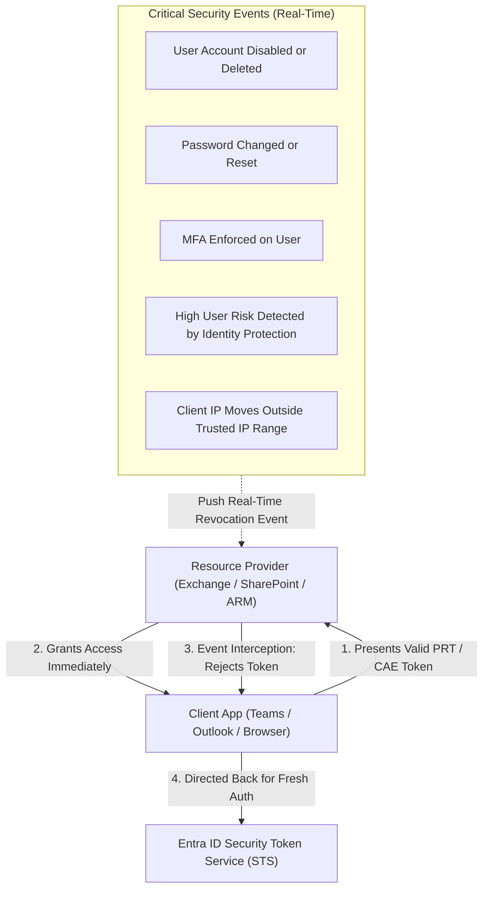

# Module 13-104-02: Administer Identity with Microsoft Entra ID

**Breadcrumbs:** [[13-Index - Azure|☁️ Azure Reference MOC]] > [[13-Index - AZ-104|📘 AZ-104 Exam Track]] > **02 - Administer Identity**

---

## 🎯 Executive Overview & Architectural Foundations

Identity is the primary security perimeter in modern cloud architectures. In Microsoft Azure, identity and access management is governed by **Microsoft Entra ID** (formerly *Azure Active Directory / Azure AD*). Unlike traditional on-premises directory services designed around network perimeters and LDAP/Kerberos protocols, Microsoft Entra ID is a multi-tenant, cloud-native Identity-as-a-Service (IDaaS) platform leveraging internet-standard protocols (OAuth 2.0, OpenID Connect, and SAML 2.0) across HTTPS.

```text
[ On-Premises Active Directory (AD DS) ]
  ├── Kerberos / NTLM / LDAP authentication
  ├── Hierarchical Organizational Units (OUs) & Group Policies (GPOs)
  └── Synchronizes via Microsoft Entra Connect (PHS / PTA / AD FS)
            │
            ▼
[ Microsoft Entra ID Cloud Tenant (tenant.onmicrosoft.com) ]
  ├── Directory Objects:
  │     ├── Users (Members, Synced, Guests / B2B)
  │     ├── Groups (Security Groups, M365 Groups, Dynamic Groups)
  │     ├── Devices (Registered, Entra Joined, Hybrid Joined)
  │     └── Service Principals & Managed Identities
  │
  ├── Security & Governance Controls:
  │     ├── Multi-Factor Authentication (MFA)
  │     ├── Self-Service Password Reset (SSPR) + Password Writeback
  │     ├── Conditional Access Policies (P1 / P2)
  │     └── Privileged Identity Management (PIM - P2)
  │
  └── Grants Authenticated Claims (OAuth 2.0 / OIDC / SAML) To:
        ├── Azure Subscriptions (ARM Control Plane via Azure RBAC)
        ├── Microsoft 365 (Exchange, SharePoint, Teams)
        ├── Enterprise SaaS (Salesforce, GitHub, ServiceNow)
        └── Custom Cloud Applications (App Registrations)
```

---

## 🏛️ Core Concepts: Directory Hierarchy & Terminology

Understanding the distinctions among identity abstractions is essential for passing AZ-104:

1. **Identity:** A digital entity that can be authenticated (e.g., human user, group, containerized service, virtual machine, or automated process).
2. **Account:** An identity enriched with identifying metadata, credentials, and organizational attributes (e.g., `userPrincipalName`, department, usage location, manager).
3. **Microsoft Entra ID Account:** An account created in Microsoft Entra ID or a connected Microsoft cloud service:
   - *Work or School Account:* Provisioned and managed by an organization (e.g., `alice@contoso.onmicrosoft.com`).
   - *Personal Microsoft Account (MSA):* Managed by the individual for consumer services (e.g., `@outlook.com`, `@live.com`, `@hotmail.com`).
4. **Tenant (Directory):** A dedicated, isolated instance of Microsoft Entra ID created when an organization signs up for Azure or Microsoft 365. It represents the top-level boundary of identity ownership.
5. **Subscription Mapping:** An Azure Subscription trusts exactly **one** Entra ID tenant for authentication, though an Entra ID tenant can be associated with **multiple** Azure Subscriptions.

---

## ⚖️ Architectural Comparison: Entra ID vs. Active Directory Domain Services (AD DS)

```	ext
[ Active Directory Domain Services (AD DS) ]
  ├── Protocols: LDAP, Kerberos, NTLM over TCP/UDP ports
  ├── Hosting: Requires physical/virtual Domain Controllers (IaaS/Hardware)
  ├── Hierarchy: Forest -> Domain -> Organizational Units (OUs)
  └── Boundary: Bound to internal corporate LAN / VPN
            │
            │ Synchronized via Microsoft Entra Connect
            ▼
[ Microsoft Entra ID ]
  ├── Protocols: HTTPS REST APIs (Microsoft Graph), OAuth 2.0, OIDC, SAML
  ├── Hosting: Fully managed multi-tenant SaaS (Zero DC infrastructure)
  ├── Hierarchy: Flat structure, Dynamic Groups, Administrative Units (AUs)
  └── Boundary: Global cloud perimeter accessible anywhere over TLS
```

| Dimension | Active Directory Domain Services (AD DS) | Microsoft Entra ID (Azure AD) |
| :--- | :--- | :--- |
| **Communication Protocol** | LDAP, Kerberos, NTLM over TCP/UDP ports (389, 636, 88). | HTTP/HTTPS (REST APIs via Microsoft Graph), OAuth 2.0, OpenID Connect (OIDC), SAML 2.0. |
| **Infrastructure Overhead** | Requires physical/virtual Domain Controllers, backup, patching, replication topologies. | Fully managed SaaS; high availability and disaster recovery managed natively by Microsoft. |
| **Directory Structure** | Hierarchical tree: Forest $\rightarrow$ Domain $\rightarrow$ Organizational Units (OUs). | Flat structure: Users, Groups, Devices, and Administrative Units (AUs). No traditional OUs. |
| **Device Governance** | Group Policy Objects (GPOs), Kerberos machine accounts, Domain Join. | Microsoft Intune, MDM policies, Entra Registration, Entra Join, Conditional Access. |
| **Query Language** | LDAP search filters. | Microsoft Graph API REST queries, OData v4.0 query parameters. |
| **Network Boundary** | On-premises corporate network; requires VPN/DirectAccess for remote clients. | Universal cloud boundary; accessible securely anywhere over public TLS endpoints. |

---

## 💎 Microsoft Entra ID Licensing Editions

AZ-104 requires administrators to identify the minimum licensing tier required for specific identity features:

| Feature / Capability                                    |           Free           |    Microsoft 365 Apps    |       P1 (Premium Plan 1)       |       P2 (Premium Plan 2)       |
| :------------------------------------------------------ | :----------------------: | :----------------------: | :-----------------------------: | :-----------------------------: |
| **Object Limit**                                        |  Up to 500,000 objects   |     500,000+ objects     |         No object limit         |         No object limit         |
| **User & Group Management**                             |        ✅ Included        |        ✅ Included        |           ✅ Included            |           ✅ Included            |
| **Cloud Self-Service Password Reset (SSPR)**            |   Change password only   |   Change password only   | ✅ Full SSPR + On-prem Writeback | ✅ Full SSPR + On-prem Writeback |
| **Dynamic Group Membership**                            |           ❌ No           |           ❌ No           |           ✅ Supported           |           ✅ Supported           |
| **Conditional Access Policies**                         | ❌ Security Defaults only | ❌ Security Defaults only |     ✅ Full Custom Policies      |     ✅ Full Custom Policies      |
| **Identity Protection (Risk-Based Conditional Access)** |           ❌ No           |           ❌ No           |              ❌ No               |   ✅ Real-time & sign-in risk    |
| **Privileged Identity Management (PIM)**                |           ❌ No           |           ❌ No           |              ❌ No               |  ✅ Just-in-Time role elevation  |
| **Access Reviews & Entitlement Management**             |           ❌ No           |           ❌ No           |              ❌ No               |           ✅ Supported           |

> [!IMPORTANT]
> **Licensing Exam Heuristics:**
> - If an exam question mentions **Dynamic Groups**, **Conditional Access**, or **On-premises SSPR Password Writeback**, the minimum required license is **Entra ID P1**.
> - If an exam question mentions **Privileged Identity Management (PIM)**, **Risk-based Conditional Access**, **User/Sign-in Risk Detection**, or **Vulnerability Lifecycle Reviews**, the minimum required license is **Entra ID P2**.

---

## 📱 Device Identities: Registered vs. Joined vs. Hybrid Joined

```text
Device Administration Decision Tree:
  │
  ├── Personal / BYOD Device (Windows, macOS, iOS, Android)
  │     └── Microsoft Entra Registered
  │           - Local or Personal Microsoft Account login
  │           - SSO to cloud applications via Microsoft Authenticator
  │           - No on-premises domain join
  │
  └── Organization-Owned Corporate Device
        │
        ├── Cloud-Only / Modern Management
        │     └── Microsoft Entra Joined
        │           - Windows 10/11 & Windows Server 2019+
        │           - Log in with Entra ID Work/School account
        │           - Managed via Microsoft Intune / MDM
        │           - Seamless SSO to cloud and on-premises resources
        │
        └── Hybrid / Legacy Active Directory Environment
              └── Microsoft Entra Hybrid Joined
                    - Joined to on-premises AD DS Domain Controllers
                    - Synchronized to Entra ID via Entra Connect
                    - Managed concurrently via Group Policy (GPO) and Intune
```

| Attribute              | Microsoft Entra Registered                                  | Microsoft Entra Joined                                          | Microsoft Entra Hybrid Joined                               |
| :--------------------- | :---------------------------------------------------------- | :-------------------------------------------------------------- | :---------------------------------------------------------- |
| **Ownership**          | Personal / Bring Your Own Device (BYOD).                    | Organization-owned.                                             | Organization-owned.                                         |
| **Target OS**          | Windows 10/11, macOS, iOS, Android, Linux.                  | Windows 10/11, Windows Server 2019/2022.                        | Windows 10/11, Windows Server (2012 R2+).                   |
| **Sign-in Credential** | Local OS account or personal Microsoft Account (MSA).       | Microsoft Entra ID Work or School Account.                      | Active Directory Domain Account (`CONTOSO\username`).       |
| **Device Management**  | Lightweight Mobile Device Management (MDM) enrollment.      | Microsoft Intune / MDM.                                         | Active Directory Group Policy (GPO) + Intune co-management. |
| **SSO Capability**     | SSO to cloud applications (via PRT and browser extensions). | Seamless SSO to cloud resources and on-prem Kerberos resources. | Seamless SSO to on-prem Kerberos and cloud resources.       |

---

## 👥 User Account Administration & Bulk Operations

### 1. User Account Types
- **Member Users:** Native directory users created directly in the tenant or synchronized from on-premises AD. They possess standard directory read permissions.
- **Guest Users (B2B):** External users invited into the directory (e.g., contractors, vendors). Default guest user permissions are restricted from enumerating other users, groups, or tenant properties.

### 2. Bulk User Creation Workflow
Administrators use CSV templates in the Azure Portal or command line to provision hundreds of users simultaneously.

**Required CSV Headers for Entra ID Bulk Import:**
```csv
version:v1.0
Name [displayName] Required,User principal name [userPrincipalName] Required,Initial password [passwordProfile] Required,Block sign in (Yes/No) [accountEnabled] Required,First name [givenName],Last name [surname],Department [department],Usage location [usageLocation]
John Doe,jdoe@contoso.onmicrosoft.com,TempPassw0rd!2026,No,John,Doe,Engineering,US
Jane Smith,jsmith@contoso.onmicrosoft.com,TempPassw0rd!2026,No,Jane,Smith,Finance,US
```

> [!CAUTION]
> The **Usage Location** property (`usageLocation`) is mandatory before assigning any Microsoft 365 or feature license to a user. Attempting to assign a license without setting `usageLocation` will trigger a hard failure.

---

## 🛡️ Group Management & Dynamic Membership Rules

### Group Types
1. **Security Groups:** Used for granting access to resources (Azure RBAC, application access, SharePoint sites) and assigning licenses.
2. **Microsoft 365 Groups:** Collaborative groups providing shared mailboxes, calendars, SharePoint document libraries, and OneNote workspaces.

### Assignment Types
- **Assigned:** Static membership. Administrators manually add or remove members.
- **Dynamic User / Dynamic Device:** Rule-driven membership evaluated automatically by Entra ID background processes. Requires **Entra ID P1**.

```text
[ User Object Attributes ]
  Department : "Sales"
  Country    : "US"
  Title      : "Account Executive"
        │
        ▼
[ Entra ID Dynamic Evaluation Engine ]
  Rule: (user.department -eq "Sales") and (user.country -eq "US")
        │
        ▼ Evaluates TRUE
[ Dynamic Security Group: "US-Sales-Team" ]
```

### Dynamic Membership Rule Syntax Examples

```text
# Match all users in Engineering located in United States
(user.department -eq "Engineering") and (user.country -eq "US")

# Match all users whose job title starts with 'Manager'
(user.jobTitle -startsWith "Manager")

# Match all guest accounts
(user.userType -eq "Guest")

# Dynamic Device Rule: Match all Windows 11 corporate devices
(device.deviceOSType -eq "Windows") and (device.deviceOSVersion -startsWith "10.0.22")
```

---

## 🔑 Self-Service Password Reset (SSPR) Architecture

SSPR allows users to reset their forgotten passwords without contacting IT support.

```	ext
Self-Service Password Reset (SSPR) Protocol Flow:
  1. User initiates password reset at https://passwordreset.microsoftonline.com
  2. Entra ID SSPR Gateway challenges user with configured authentication methods (Authenticator, SMS, Security Questions)
  3. User completes required MFA verification proofs
  4. User enters and confirms new password
  5. Entra ID validates password complexity and updates cloud identity store
  [ If Password Writeback is Enabled for Hybrid Identity ]:
  6. Entra ID sends encrypted password writeback request over outbound TLS port 443
  7. On-premises Entra Connect agent executes Set-ADUser password update on AD Domain Controller
  8. Domain Controller acknowledges password change
  9. Entra Connect confirms writeback completion to Entra ID
  10. User receives success confirmation across cloud and on-premises environments
```

### Critical SSPR Prerequisites & Parameters
1. **Target Group Assignment:** SSPR can be enabled for `None`, `Selected` (a single designated group), or `All`. In production, pilots are conducted by setting SSPR to `Selected` pointing to a pilot security group.
2. **Authentication Methods Available:**
   - Mobile app notification / Mobile app code (Microsoft Authenticator).
   - Email (alternate email address).
   - Mobile phone (SMS or automated voice call).
   - Office phone.
   - Security questions (minimum 3 required to register, minimum 3 required to reset; not recommended for zero-trust architectures).
3. **Password Writeback Requirements:**
   - Microsoft Entra ID P1 license.
   - Entra Connect configured with the *Password writeback* feature checked.
   - Entra Connect service account granted *Reset password* and *Write lockoutTime* permissions on on-premises user OUs.

---

## 🏢 Multi-Tenant Environments & Administrative Units

### Cross-Tenant Collaboration (B2B)
- **Microsoft Entra B2B:** Enables sharing applications and resources with external guest users from partner organizations using their own home credentials.
- **Cross-Tenant Access Settings:** Allows administrators to define inbound and outbound access rules, trust MFA claims from partner tenants, and streamline federation.

### Administrative Units (AUs)
Administrative Units allow delegating administrative control over a specific subset of users and groups (e.g., scoping a Regional Helpdesk Admin to manage only users in the "EMEA" unit without granting global tenant-level admin rights).

```	ext
[ Global Microsoft Entra ID Tenant ]
  │
  ├── Administrative Unit: 'North America'
  │     ├── Scoped Admin: NA Helpdesk Administrator (User Admin scoped to AU)
  │     └── Managed Scope: US Users & Groups Only
  │
  └── Administrative Unit: 'EMEA'
        ├── Scoped Admin: EMEA Helpdesk Administrator (User Admin scoped to AU)
        └── Managed Scope: EU Users & Groups Only
```

---

## 🛠️ Contextual Proof of Concept: CLI & PowerShell Recipes

### 1. Azure CLI: User & Group Management

```bash
# 1. Create a new cloud-only user
az ad user create \
  --display-name "Michael Chang" \
  --user-principal-name "mchang@contoso.onmicrosoft.com" \
  --password "SecureP@ssw0rd2026!" \
  --force-change-password-next-sign-in true \
  --mail-nickname "mchang"

# 2. Update user location (mandatory before licensing)
az ad user update \
  --id "mchang@contoso.onmicrosoft.com" \
  --usage-location "US"

# 3. Create a Security Group
az ad group create \
  --display-name "Sec-DevOps-Engineers" \
  --mail-nickname "sec-devops"

# 4. Add member to group
az ad group member add \
  --group "Sec-DevOps-Engineers" \
  --member-object-id $(az ad user show --id "mchang@contoso.onmicrosoft.com" --query id -o tsv)

# 5. Invite a B2B Guest User
az ad invtation create \
  --invited-user-display-name "Partner External Consultant" \
  --invited-user-email "consultant@partnerfirm.com" \
  --send-invitation-message true \
  --invite-redirect-url "https://myapps.microsoft.com"
```

### 2. Microsoft Graph PowerShell: Dynamic Group & AU Setup

```powershell
# Connect to Microsoft Graph with Directory Administration scopes
Connect-MgGraph -Scopes "User.ReadWrite.All", "Group.ReadWrite.All", "AdministrativeUnit.ReadWrite.All"

# Create a dynamic security group for all cloud DevOps users
$dynamicGroupParams = @{
    DisplayName = "Dynamic-Cloud-Architects"
    MailEnabled = $false
    MailNickname = "dyn-cloud-arch"
    SecurityEnabled = $true
    GroupTypes = @("DynamicMembership")
    MembershipRule = '(user.department -eq "CloudPlatform") and (user.accountEnabled -eq true)'
    MembershipRuleProcessingState = "On"
}
New-MgGroup @dynamicGroupParams

# Create an Administrative Unit
$auParams = @{
    DisplayName = "AU-APAC-Engineering"
    Description = "Administrative boundary for Asia-Pacific engineers"
}
$apacAU = New-MgDirectoryAdministrativeUnit @auParams

# Add a user into the Administrative Unit
New-MgDirectoryAdministrativeUnitMemberByRef -AdministrativeUnitId $apacAU.Id `
    -BodyParameter @{"@odata.id" = "https://graph.microsoft.com/v1.0/users/mchang@contoso.onmicrosoft.com"}
```

---

## 🔍 Deep-Intuition AARF Framework

### Scenario: Configuring Self-Service Password Reset with On-Premises Writeback

- **The Answer (Core Configuration):** Enable SSPR for the target group in the Microsoft Entra admin center (`Protection -> Password reset -> Properties -> Selected: Pilot-SSPR-Users`). On the Entra Connect server, run the Azure AD Connect wizard, select *Customize synchronization options*, and check **Password writeback**.
- **The Assumptions (Prerequisites):** 
  - Tenant possesses at least **Microsoft Entra ID P1** licenses for all enabled users.
  - On-premises AD DS service account used by Entra Connect has been delegated the *Reset password* and *Write lockoutTime* extended rights on the target organizational units.
  - Outbound TCP port 443 connectivity is permitted from the Entra Connect host to Azure Service Bus endpoints.
- **The Rationale (Why):** Without password writeback enabled, an on-premises user who changes their password in the cloud will only update the Entra ID cloud hash. The next time they attempt to log into their on-premises workstation via Kerberos/NTLM, the on-premises Domain Controller will reject the authentication because the on-prem hash remained unchanged. Password writeback synchronizes the change backwards in real-time.
- **The Failure Loop (What if misconfigured):**
  - *Error in event log:* `Event ID 33001: The password reset writeback service encountered an error while attempting to connect to Azure Service Bus.`
  - *User portal experience:* User receives error `SSPR_0011: We're sorry, but we can't reset your password right now because your administrator has not configured your account for password reset.`
- **The Alternative Case (When to use 'if not'):** For pure cloud-native organizations that do not operate on-premises Active Directory Domain Controllers, password writeback is completely unnecessary and should remain disabled to avoid unnecessary sync agent overhead.

---

## 💡 AZ-104 Exam Tips & Gotchas

> [!TIP]
> **SSPR Group Limitation:** In the Azure Portal SSPR configuration blade, you can select only **one single group** under the `Selected` option. If you need to enable SSPR for multiple teams during a staged rollout, you must create a consolidated "All-SSPR-Pilots" group and nest or dynamically populate the target users into that single group.

> [!WARNING]
> **Nested Groups in Azure RBAC and Dynamic Groups:**
> - Azure RBAC assignments support nested groups for access assignment.
> - **Dynamic Groups DO NOT support nesting.** You cannot add a group into a dynamic group rule; rules evaluate only discrete user or device attributes.
> - Application access assignment via nested groups requires an Entra ID Premium license.

---

## 🌉 Hybrid Identity Engineering: Deep-Dive Synchronization & Auth Models

In enterprise environments, cloud migration rarely starts from a clean slate. Organizations bridge existing Active Directory Domain Services (AD DS) environments to Microsoft Entra ID using **Microsoft Entra Connect** (or the lightweight Entra Cloud Sync Agent). Understanding the internal mechanics of these architectures is crucial for articulating enterprise identity solutions:

```text
[ On-Premises Datacenter ]
  Active Directory Domain Controller (Kerberos, NTLM, LDAP)
        │
        ├── Entra Connect Sync Engine (Extracts objects, filters OUs/attributes)
        │     └── Pushes via Outbound HTTPS (Port 443) ──► Microsoft Entra Cloud Directory
        │
        └── Pass-Through Auth (PTA) Agent
              └── Polls Azure Service Bus Queue ◄── Encrypted Auth Challenges from Cloud
```

### 1. Hybrid Authentication Model Selection Matrix

| Architectural Parameter | Password Hash Synchronization (PHS) | Pass-Through Authentication (PTA) | Active Directory Federation Services (AD FS) |
| :--- | :--- | :--- | :--- |
| **Authentication Authority** | Microsoft Entra ID (Cloud) | On-Premises Domain Controllers | On-Premises Federation Farm |
| **Offline Resilience** | **Highest:** Authentication functions during complete on-premises datacenter network loss. | **Low:** Outages in on-prem connectivity block cloud logins unless fallback to PHS is enabled. | **Low:** Requires highly available redundant on-premises infrastructure. |
| **Password Storage** | SHA-256 hash of MD4 password hash stored in cloud directory. | Passwords never reside in or pass through cloud storage. | Passwords never leave the on-premises AD DS perimeter. |
| **Infrastructure Overhead** | Zero additional infrastructure (built into Entra Connect server). | Requires 2–3 lightweight outbound-only agent VMs on-prem. | Heavy: Requires WAP proxies, ADFS servers, internal/external load balancers, public SSL certificates. |
| **Best-Fit Enterprise Use Case** | **Recommended Default:** High resilience, lowest administrative overhead, enables Leaked Credential Detection. | Highly regulated industries with strict compliance mandates prohibiting password hashes in cloud. | Complex smart-card/certificate auth or legacy third-party MFA engines. |

### 2. Identity Object Matching Mechanics: Soft-Match vs. Hard-Match
When synchronizing on-premises identities to existing cloud accounts:
* **Soft Match (Attribute Matching):** Evaluates matching `userPrincipalName` or `mail` attributes. Soft matching is only permitted for cloud users that do not already have an immutable anchor assigned.
* **Hard Match (Immutable Anchor):** Binds the cloud user object to the on-premises user object via the `mS-DS-ConsistencyGuid` attribute (stored as `ImmutableId` in base64 in Entra ID). Hard matching prevents account hijacking where an external admin might provision a user with a matching corporate email address.

---

## 🏷️ Custom Domain Architecture & Administrative Tenant Boundaries

### 1. Tenant vs. Subscription Separation
* **Core Decoupling:** Microsoft Entra ID is the **identity directory**, while Azure Subscriptions are **billing and resource containers**.
* **1-to-Many Relationship:** A single Entra ID tenant can support multiple isolated subscriptions (e.g., `sub-prod-01`, `sub-dev-01`, `sub-shared-01`), allowing centralized identity management and Single Sign-On (SSO) across segregated operational budgets.
* **Independent Security Planes:** A Global Administrator in Entra ID does *not* automatically have permissions to deploy or view resources in child subscriptions. To manage resources, the administrator must explicitly activate the **Access management for Azure resources** toggle in Entra ID properties (elevating permissions to `User Access Administrator` at the Tenant Root Group).

### 2. Custom Domain Verification Workflow
1. Initial tenant directories default to `[name].onmicrosoft.com`.
2. Add custom domain (e.g., `company.com`) in Entra ID admin center.
3. Retrieve the generated DNS TXT record:
   - `Record Type:` `TXT`
   - `Host / Name:` `@`
   - `Value:` `MS=msXXXXXXXX`
   - `TTL:` `3600`
4. Publish the record at the public DNS registrar.
5. Complete verification and designate the domain as **Primary Domain** so newly provisioned accounts default to the corporate email suffix.

---

## 💡 Architectural Articulation & Decision Tree

```text
Identity Architecture Decision Tree:
  │
  ├── Need to delegate user administration for a branch office without tenant-wide rights?
  │     └── YES ──► Deploy Administrative Units (AUs) with scoped directory roles.
  │
  ├── Need group membership to automatically adjust when user attributes change?
  │     └── YES ──► Configure Dynamic Security Groups via OData rules (Requires Entra ID P1).
  │
  ├── Need on-premises users to reset passwords in the cloud and sync back to on-prem AD?
  │     └── YES ──► Enable SSPR with Password Writeback via Entra Connect (Requires Entra ID P1).
  │
  └── Need zero-credential authentication for workloads calling Azure APIs?
        └── YES ──► Deploy Managed Identities (System-Assigned or User-Assigned).
```

---


---

## 🏛️ Deep-Dive Architecture: Managed Identities & External Collaboration (John Savill Master Class Insights)

### 1. Microsoft Azure Managed Identities: Under-The-Hood Architecture
John Savill highlights that **Managed Identities eliminate all credential management** for applications running on Azure. In traditional application architectures, developers store client IDs and client secrets in configuration files, creating credential leak vulnerabilities and secret rotation burdens.

```text
[ Application Code inside Azure VM or App Service ]
  │
  │ 1. HTTP GET http://169.254.169.254/metadata/identity/oauth2/token?resource=https://storage.azure.com/
  │    (Header: "Metadata: true")
  ▼
[ Azure Instance Metadata Service (IMDS) ] (Link-Local Non-Routable IP: 169.254.169.254)
  │
  │ 2. Azure Hypervisor intercepts request and authenticates VM identity with Entra ID
  ▼
[ Microsoft Entra ID Token Issuing Service ]
  │
  │ 3. Issues signed JSON Web Token (JWT Bearer Token)
  ▼
[ Application Code ]
  │
  │ 4. Calls Azure Resource API: GET /blobs HTTP/1.1
  │    Header: "Authorization: Bearer <JWT_Token>"
  ▼
[ Target Azure Resource: Azure Storage Account (Data Plane) ]
  Validates token claims via Azure RBAC -> Grants access
```

#### Under-The-Hood Mechanics:
1. **The Instance Metadata Service (IMDS):** Azure exposes a link-local, non-routable IP address (`169.254.169.254`). Because link-local traffic cannot cross routers or traverse the public internet, only code executing on that exact host can access the endpoint.
2. **The Metadata Header Requirement:** All requests to IMDS must include the HTTP header `Metadata: true`. This prevents Server-Side Request Forgery (SSRF) vulnerabilities where an external attacker might trick a web application into making GET requests to local loopback addresses.
3. **No Secrets in Storage:** Azure automatically handles token acquisition, caching, and background token rotation before expiration. No human ever sees, manages, or rotates a password or certificate.

#### System-Assigned vs. User-Assigned Managed Identity Matrix:

| Architectural Dimension | System-Assigned Managed Identity | User-Assigned Managed Identity |
| :--- | :--- | :--- |
| **Creation & Lifecycle** | Created directly on the resource; lifecycle is **strictly tied 1:1** to the resource. | Created independently as an ARM resource (`Microsoft.ManagedIdentity/userAssignedIdentities`). |
| **Deletion Behavior** | Automatically purged by Azure when the parent VM/App is deleted. | Persists independently; deleting the VM does **not** delete the identity. |
| **Sharing / Cardinality** | Can only be assigned to **one** Azure resource. | Can be shared across **multiple** Azure resources (e.g., 50 VMs in a scale set). |
| **Common Enterprise Use Case** | Dedicated single-purpose workloads (e.g., a specific database maintenance VM). | Scaled multi-instance fleets, VMSS deployments, and container pools needing uniform permissions. |

---

### 2. External Identities & B2B Collaboration Architecture
In enterprise ecosystems, organizations must collaborate with external partners, contractors, and vendors without provisioning separate internal AD accounts:
- **The Guest Object (`userType: Guest`):** When an external partner (`contractor@partner.com`) is invited:
  1. Entra ID creates a user object representation in the resource tenant.
  2. The User Principal Name (UPN) is formatted as: `contractor_partner.com#EXT#@yourcompany.onmicrosoft.com`.
- **Authentication vs. Authorization Decoupling:**
  - *Authentication:* Handled entirely by the user's **Home Identity Provider** (e.g., partner company's Entra ID, Google identity, or one-time email passcode). If the contractor is terminated at their employer, their home account is disabled, immediately blocking them from logging into your Azure tenant.
  - *Authorization:* Managed entirely inside **your Resource Tenant** using Azure RBAC, Conditional Access, and group memberships.

---

### 3. The Line Between Active Directory (AD DS) and Microsoft Entra ID
John Savill articulates the fundamental divide between legacy enterprise directory services and cloud identity:

| Architectural Component | On-Premises Active Directory (AD DS) | Microsoft Entra ID |
| :--- | :--- | :--- |
| **Primary Design Philosophy** | Designed for private enterprise intranets and local network perimeters. | Designed for internet-first, cloud-native SaaS and multi-tenant architectures. |
| **Authentication Tokens** | Kerberos Tickets (Ticket Granting Tickets - TGT, Service Tickets). | OAuth 2.0 Access Tokens & OpenID Connect ID Tokens (JSON Web Tokens - JWT). |
| **Computer Management** | Domain Join via Kerberos machine accounts; controlled via Group Policy (GPO). | Entra Joined / Entra Registered; governed via Microsoft Intune and Conditional Access. |
| **Query & RPC Protocols** | LDAP (Lightweight Directory Access Protocol) and RPC over static TCP ports. | REST APIs via Microsoft Graph over standard HTTPS (TLS port 443). |
| **Directory Topology** | Hierarchical Tree and Forest structure with Parent/Child domain trusts. | Flat multi-tenant directory with Administrative Units for administrative segregation. |

---

## 🚀 Going the Extra Mile: Architectural Deep Dive - Advanced Entra ID Security & Resiliency

> [!IMPORTANT]
> **Going the Extra Mile:** In this section, we are taking an extra mile on this topic and start deep diving into the foundational security protocols, token lifecycles, cross-tenant boundary federation, Continuous Access Evaluation (CAE), and multi-cloud CIEM based on John Savill's Azure Deep Dives Master Class.

### 1. Microsoft Entra Privileged Identity Management (PIM)
* **Zero Permanent Standing Privileges:** Eliminates the vulnerability of having permanent Global Administrators or Subscription Owners. Users are configured as **Eligible** rather than **Active**.
* **Just-In-Time (JIT) Activation Engine:**
  * Requires explicit activation via the portal, CLI, or Microsoft Graph API.
  * Enforces mandatory **MFA re-authentication**, ticket numbering/business justification, and optional multi-stage managerial approval.
  * Time-bounded duration (e.g., maximum 4 to 8 hours), after which Entra automatically revokes the role assignment without administrator intervention.
* **Access Reviews & Blast-Radius Auditing:** Automated periodic re-certification workflows demanding resource owners to approve or revoke continuing role eligibility.

---

### 2. Entra ID Token Resiliency & Continuous Access Evaluation (CAE)
Historically, OAuth access tokens had a static 60-minute lifespan. If an employee was terminated or compromised 2 minutes into an active session, they could continue accessing data until the token expired.



* **Continuous Access Evaluation (CAE - RFC 8693):**
  * Microsoft Entra ID and supporting Microsoft 365 / Azure Resource Manager APIs communicate bidirectionally.
  * When a critical event occurs (User account disabled, password changed, high user risk detected, or user leaves a trusted IP range), the resource provider terminates the session **in real-time (sub-second)**, overriding the unexpired access token.

---

### 3. Microsoft Entra Identity Protection & Risk Engine
* **User Risk (Identity Posture):** Calculated asynchronously / offline by scanning the dark web, compromised credential feeds, and cross-enterprise attack patterns. Represents the probability that the identity's credentials have been leaked.
* **Sign-In Risk (Session Context):** Calculated in real-time during authentication. Factors include anonymous IP (Tor browser), unfamiliar sign-in properties, atypical travel speed (impossible velocity, e.g., logging in from New York and 10 minutes later from Tokyo), and malware-linked IP addresses.
* **Risk-Based Conditional Access Policies:**
  * *High Sign-In Risk:* Enforce step-up Multi-Factor Authentication.
  * *High User Risk:* Enforce secure password reset requiring self-service identity verification.

---

### 4. Cross-Tenant Access Settings & B2B Direct Connect
* **Inbound & Outbound Trust Boundaries:** Allows organizations to define granular trust relationships with specific external Entra ID tenants.
* **MFA and Compliance Trust:** Organizations can check `Trust multi-factor authentication from external Microsoft Entra tenants` and `Trust compliant devices`. When a partner engineer signs in, Azure accepts their home tenant's MFA claim rather than forcing them to register a second authenticator in the host tenant.
* **B2B Direct Connect (Teams Shared Channels):** Establishes mutual federated trust without provisioning guest user objects (`#EXT#`) in the host directory, enabling seamless cross-organization collaboration.

---

### 5. Microsoft Entra Application Proxy: Secure Hybrid Access
* **Architecture:** Provides secure remote access to on-premises legacy web applications (HTTP/HTTPS, Kerberos) without opening inbound firewall ports or deploying a perimeter DMZ reverse proxy.
* **Outbound-Only Connectors:** Lightweight connectors installed on-premises initiate **outbound-only HTTPS connections (port 443)** to the Entra Application Proxy cloud service.
* **Single Sign-On (SSO):** Pre-authenticates the user in the cloud using Entra ID (MFA, Conditional Access), converts the cloud SAML/OIDC claim into a local Kerberos ticket via **Kerberos Constrained Delegation (KCD)**, and forwards the request securely to internal IIS / Apache servers.

---

### 6. Cloud Infrastructure Entitlement Management (CIEM): Entra Permissions Management
* **Multi-Cloud Permission Sprawl:** Organizations running across Azure, AWS, and GCP face immense security debt from over-permissioned service principals, roles, and users.
* **Permission Creep Index (PCI):** Quantifies risk on a scale of 0 to 100 based on the gap between permissions granted and permissions actually exercised over 90 days.
* **Automated Least Privilege:** Identifies unused administrative privileges and generates right-sized role definitions to shrink the multi-cloud attack surface.


## 🌐 Authoritative References & Citations

- [KodeKloud AZ-104 Course - Administer Identity Module](https://notes.kodekloud.com/docs/Updated-AZ-104-Microsoft-Azure-Administrator/Administer-Identity/Module-Introduction/page.md)
- [Moe Intelligence AZ-104 Video Series (Lessons 02–07)](https://www.youtube.com/playlist?list=PLczK3J2J4clmeh328CC13dJrcALcSFZFb)
- [Microsoft Entra ID Documentation - Fundamentals](https://learn.microsoft.com/en-us/azure/active-directory/fundamentals/active-directory-whatis)
- [Microsoft Learn: Manage user and group accounts in Microsoft Entra ID](https://learn.microsoft.com/en-us/training/modules/manage-users-and-groups-in-azure-active-directory/)
- [Microsoft Learn: Configure self-service password reset](https://learn.microsoft.com/en-us/training/modules/configure-self-service-password-reset/)
