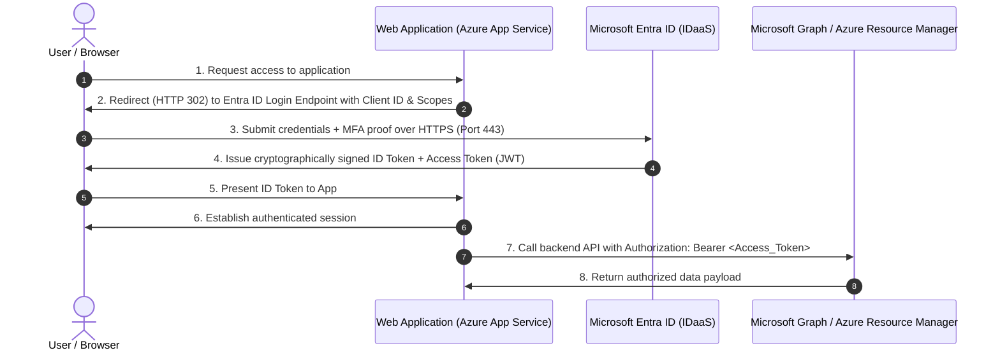
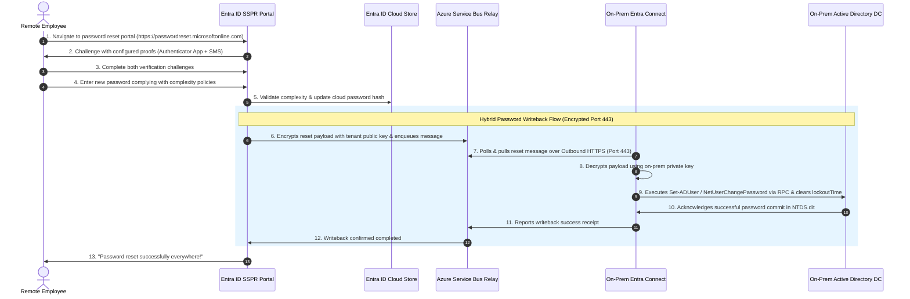
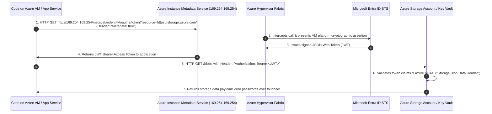
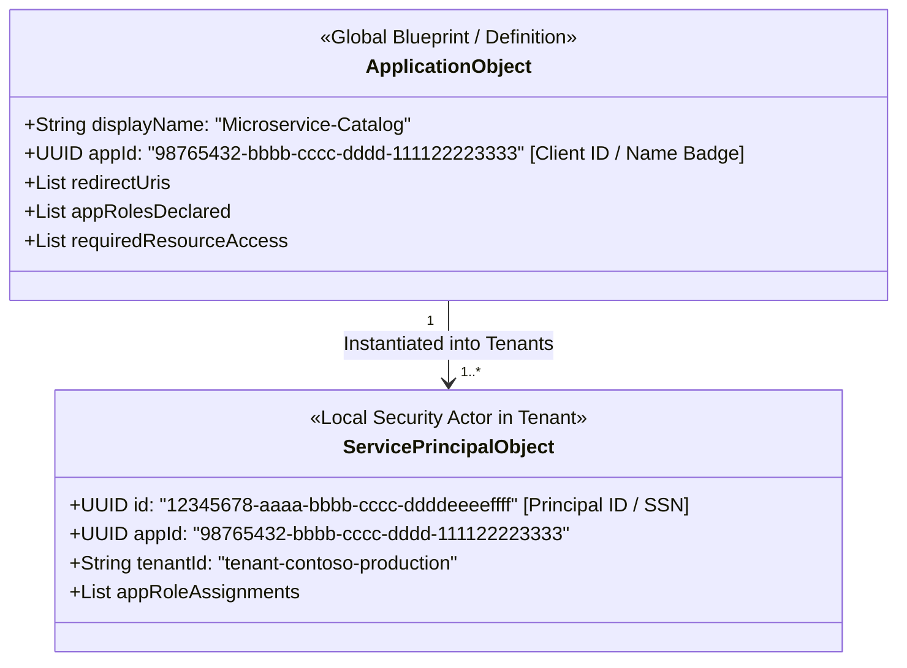
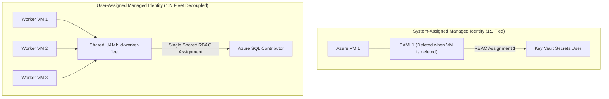
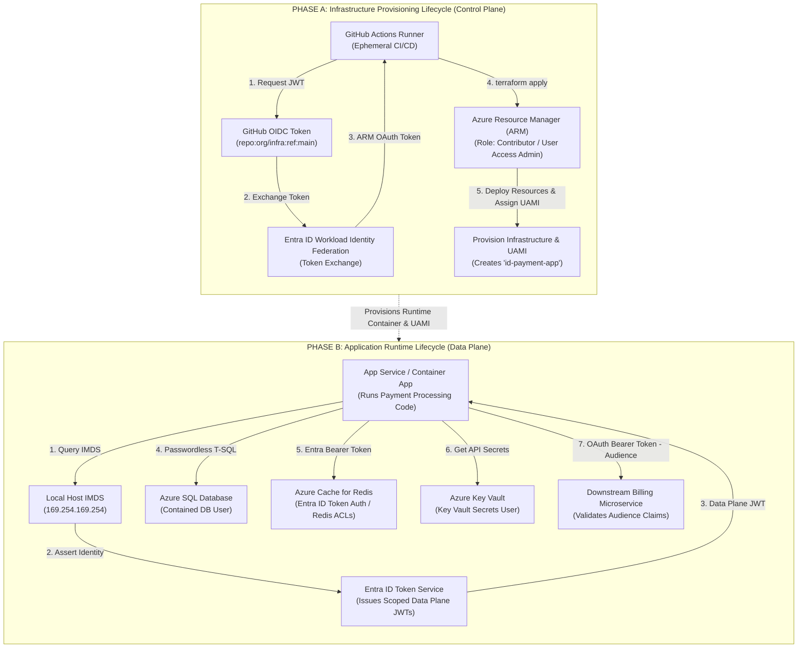
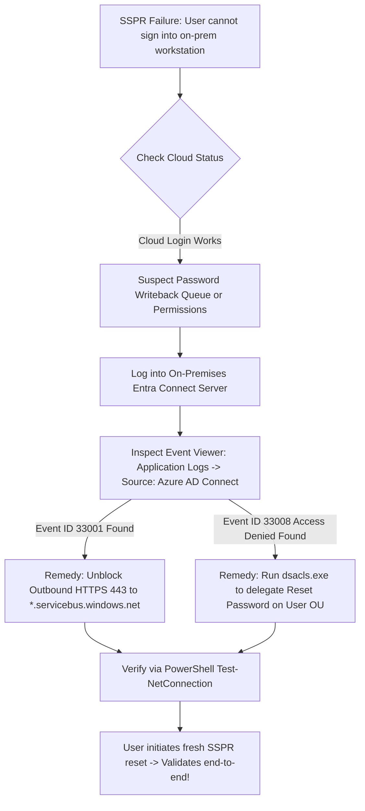

# Module 13-104-02: Administer Identity with Microsoft Entra ID

**Breadcrumbs:** [[13-Index - Azure|☁️ Azure Reference MOC]] > [[13-Index - AZ-104|📘 AZ-104 Exam Track]] > **02 - Administer Identity**

---

## 🎯 Stage 1: Executive Overview & The Conceptual Lecture

### 1. The Zero-Knowledge Starting Point: Why Cloud Identity Exists
Imagine you run a traditional enterprise datacenter located inside a physical corporate office. Every morning, employees badge into the physical building, connect their desktop PCs to an Ethernet cable, and log into a Windows domain. 

In that legacy world, authentication was anchored to a physical network perimeter guarded by **Active Directory Domain Services (AD DS)** running on local servers called Domain Controllers (DCs):
* The protocols used were **Kerberos, NTLM, and LDAP**.
* These protocols were strictly designed for local local-area networks (LANs). They rely on chatty TCP/UDP port handshakes (Port 88 for Kerberos tickets, Port 389/636 for LDAP queries, Port 445 for SMB).
* If an employee traveled to a coffee shop or worked from home, they were completely disconnected from the Domain Controller unless they fired up a clunky, high-latency Virtual Private Network (VPN) tunnel back into the corporate headquarters.

Now consider the modern cloud era:
* Employees operate laptops from airports, homes, branch offices, and mobile devices across iOS and Android.
* Applications are no longer hosted inside a server closet in the basement; they are delivered as global Software-as-a-Service (Microsoft 365, Salesforce, ServiceNow) or deployed in public cloud platforms like Microsoft Azure, AWS, and GCP.
* **The physical network perimeter has vanished.** You cannot run Kerberos over the public internet—firewalls, internet routers, and web proxies routinely block legacy ports (like port 88 or 445) for basic security hygiene.

To survive in this reality, the industry underwent a fundamental paradigm shift: **Identity is the new security perimeter.** Rather than asking *"Are you inside the corporate office network?"*, modern systems ask *"Who are you, what device are you using, what is your contextual risk score, and what specific claims prove your identity?"*

### 2. Decoding the Nomenclature: Azure AD vs. Microsoft Entra ID
Historically, Microsoft called its cloud identity service **Azure Active Directory (Azure AD)**. In late 2023, Microsoft rebranded the entire identity and access suite under the product umbrella **Microsoft Entra**:
* **Microsoft Entra ID:** The foundational Identity-as-a-Service (IDaaS) platform (formerly Azure AD).
* **Microsoft Entra ID Governance:** Identity lifecycle, entitlement management, and access reviews.
* **Microsoft Entra External ID:** Customer and partner identity management (B2B collaboration and B2C / customer-facing apps).
* **Microsoft Entra Verified ID:** Decentralized identity verification based on open standards.
* **Microsoft Entra Permissions Management:** Cloud Infrastructure Entitlement Management (CIEM) across Azure, AWS, and GCP.

> [!NOTE]
> For the **AZ-104 exam**, Microsoft Entra ID covers core directory administration: Users, Groups, Devices, Custom Domains, Self-Service Password Reset (SSPR), Administrative Units (AUs), Hybrid Identity Synchronization (Entra Connect), Conditional Access, and Role-Based Access.

### 3. High-Level Terminology Matrix: Zero-Knowledge to Enterprise Architect

| Terminology | What It Means to a Beginner | Real-World Analog | Enterprise Architecture Reality |
| :--- | :--- | :--- | :--- |
| **Tenant (Directory)** | A private dedicated database of users and groups. | A corporate building where only authorized employees have records. | A multi-tenant, cloud-native directory instance (`tenant.onmicrosoft.com`) globally replicated across Microsoft datacenters. |
| **User Principal Name (UPN)** | The username used to log in. | An email-style passport stamp. | An internet-standard RFC 822 formatted string (`username@domain.com`) that uniquely identifies an account across cloud endpoints. |
| **Administrative Unit (AU)** | A locked drawer inside the filing cabinet. | A regional office manager who can only fire/hire staff in their local branch. | An administrative container within an Entra tenant used to scope directory administrative privileges (e.g., User Administrator) to a subset of users and groups. |
| **Dynamic Group** | A club where membership updates automatically based on rules. | An automated email list for "All Texas Employees" that updates when HR changes your state. | An Entra ID P1-driven group whose membership evaluates OData attribute queries asynchronously without administrative intervention. |
| **SSPR (Self-Service Password Reset)** | A webpage where users reset their own forgotten passwords. | An automated ATM PIN reset kiosk. | A secure cloud identity workflow enabling end users to complete multi-factor verification proofs and update their cloud and on-prem AD credentials. |
| **Password Writeback** | Pushing a password change made in the cloud back into the on-premises DC. | Writing in a duplicate ledger kept back at headquarters. | Real-time bi-directional synchronization over an encrypted outbound TLS queue (Azure Service Bus) from Entra ID to on-prem AD DS. |
| **B2B Guest** | An external contractor invited to access company apps. | A visitor badge given to an outside vendor that expires when they finish the job. | An Entra ID external user representation (`#EXT#`) authenticated by their home identity provider (e.g., partner Entra tenant, Google, or OTP) but authorized in your tenant. |
| **Managed Identity** | An identity given directly to a cloud server or application. | A company vehicle with a pre-programmed electronic toll transponder. | An automated Entra ID Service Principal provisioned for an Azure resource (e.g., VM, App Service) that eliminates hardcoded API secrets from code. |

---

## 🏛️ Stage 2: Core Mental Model & Component Architecture

### 1. Tenant vs. Subscription Separation (The Most Critical Mental Model)
One of the most frequent misconceptions among junior cloud administrators is confusing an **Azure Subscription** with an **Entra ID Tenant**. They are two completely distinct planes of existence:

```text
+---------------------------------------------------------------------------------+
|                       Microsoft Entra ID Tenant (Directory)                     |
|                              (e.g., contoso.onmicrosoft.com)                    |
|                                                                                 |
|  - Users: Alice, Bob, Charlie                                                   |
|  - Groups: Security Groups, Dynamic Groups                                      |
|  - Directory Roles: Global Admin, User Admin, Helpdesk Admin                    |
|  - Security: SSPR, Conditional Access, Multi-Factor Authentication              |
+---------------------------------------------------------------------------------+
               │                                                    │
               │ Authenticates & Issues Tokens                      │ Authenticates & Issues Tokens
               ▼                                                    ▼
+-------------------------------+                  +-------------------------------+
|    Azure Subscription A       |                  |    Azure Subscription B       |
|        (Production)           |                  |         (Non-Prod)            |
|                               |                  |                               |
| - Resource Group: rg-prod-db  |                  | - Resource Group: rg-dev-vm   |
| - VNet: 10.0.0.0/16           |                  | - VNet: 172.16.0.0/16         |
| - Azure RBAC: Owner, Contrib  |                  | - Azure RBAC: Owner, Reader   |
+-------------------------------+                  +-------------------------------+
```

* **Microsoft Entra ID is the Identity Plane:** It holds users, groups, devices, and application registrations. It is responsible for **Authentication (AuthN)**—proving *who you are*.
* **Azure Subscriptions are the Resource and Billing Plane:** They hold Virtual Machines, Storage Accounts, Virtual Networks, and Databases. They are responsible for **Authorization (AuthZ)**—determining *what you can do* via Azure Role-Based Access Control (Azure RBAC).
* **The Relationship Rules:**
  1. An Azure Subscription **trusts exactly one** Entra ID tenant for authentication.
  2. A single Entra ID tenant can be trusted by **multiple** Azure Subscriptions.
  3. A **Global Administrator** in Entra ID does **NOT** automatically have permissions to read, create, or delete resources inside child Azure Subscriptions! (They can, however, elevate their own permissions to `User Access Administrator` at the Tenant Root Group if emergency intervention is required).

### 2. Entra ID Directory Object Anatomy

```text
Microsoft Entra ID Tenant
  ├── User Objects
  │     ├── Cloud-Only Users (created directly in Entra ID)
  │     ├── Synced Users (synchronized from on-premises AD via Entra Connect)
  │     └── Guest Users (B2B invited from external organizations, e.g., user_partner.com#EXT#)
  │
  ├── Group Objects
  │     ├── Security Groups (used for RBAC, application assignment, licensing)
  │     │     ├── Assigned Membership (manually managed list of members)
  │     │     └── Dynamic Membership (automated attribute-based rules, requires P1)
  │     └── Microsoft 365 Groups (collaborative: provides Shared Mailbox, Teams, SharePoint)
  │
  ├── Device Objects
  │     ├── Entra Registered (BYOD: personal phones/laptops, user logs in with local account)
  │     ├── Entra Joined (Corporate-owned, cloud-native: user logs in with Entra UPN)
  │     └── Entra Hybrid Joined (Corporate-owned, domain-joined to on-premises AD DS + synced to cloud)
  │
  └── Workload Identities
        ├── Application Registrations & Service Principals (app identities)
        └── Managed Identities (System-Assigned & User-Assigned)
```

### 3. Entra ID Licensing Editions Architecture Matrix
The AZ-104 exam requires knowing which features demand which license tier:

```text
Entra ID Free            Entra ID P1                       Entra ID P2
+--------------------+   +-----------------------------+   +------------------------------------+
| Up to 500k objects |   | Unlimited objects           |   | All P1 Features PLUS:              |
| User/Group Mgmt    |   | Dynamic Group Rules         |   | Privileged Identity Mgmt (PIM)     |
| Cloud-only SSPR    |   | SSPR with On-Prem Writeback |   | Risk-Based Conditional Access      |
| Security Defaults  |   | Full Conditional Access     |   | Identity Protection Risk Engine    |
| (Binary MFA rules) |   | Microsoft Entra Connect Sync|   | Access Reviews & Lifecycle Mgmt    |
+--------------------+   +-----------------------------+   +------------------------------------+
```

| Architectural Capability | Entra ID Free | Microsoft 365 Apps | Entra ID P1 | Entra ID P2 |
| :--- | :---: | :---: | :---: | :---: |
| **Object Limit** | 500,000 objects | 500,000+ objects | Unlimited | Unlimited |
| **SSO Applications** | Unlimited | Unlimited | Unlimited | Unlimited |
| **Cloud Self-Service Password Reset (SSPR)** | Change password only | Change password only | ✅ Full SSPR + Reset | ✅ Full SSPR + Reset |
| **On-Premises Password Writeback** | ❌ No | ❌ No | ✅ Supported | ✅ Supported |
| **Dynamic Group Membership** | ❌ No | ❌ No | ✅ Supported | ✅ Supported |
| **Conditional Access Policies** | ❌ Security Defaults only | ❌ Security Defaults only | ✅ Full Granular Engine | ✅ Full Granular Engine |
| **Privileged Identity Management (PIM)** | ❌ No | ❌ No | ❌ No | ✅ Just-in-Time elevation |
| **Identity Protection (User & Sign-In Risk)** | ❌ No | ❌ No | ❌ No | ✅ Real-time risk detection |
| **Entitlement Management & Access Reviews** | ❌ No | ❌ No | ❌ No | ✅ Supported |

---

## 🏢 Stage 3: Deep-Intuition Platform Mechanics & Topology

### 1. Cloud Identity vs. Active Directory Domain Services (Kerberos vs. Modern Web Auth)

#### 1. The Real-World Dilemma (The 'Why')
In a traditional enterprise datacenter, authentication was physically anchored to a closed corporate Local Area Network (LAN). Active Directory Domain Services (AD DS) relied on domain controllers serving Kerberos, LDAP, and NTLM. This model worked when every employee sat at a physical desk plugged into an RJ-45 Ethernet wall jack.
However, modern enterprises operate across mobile laptops, branch offices, airport Wi-Fi, and public SaaS platforms (Microsoft 365, Salesforce, ServiceNow). Legacy protocols fundamentally cannot survive over the public internet:
* **The Network Boundary Collapse:** Kerberos requires direct line-of-sight network connectivity to a Key Distribution Center (KDC) over TCP/UDP Port 88. LDAP directory queries run over TCP Port 389/636, and SMB file sharing over TCP Port 445. Corporate firewalls, home routers, NAT gateways, and public Wi-Fi hotspots universally block ports 88 and 445 for basic security hygiene (preventing worm propagation like WannaCry).
* **The VPN Bottleneck:** Forcing thousands of remote workers to hairpin all application traffic through high-latency Virtual Private Network (VPN) concentrators creates massive performance bottlenecks, single points of failure, and multi-thousand-dollar bandwidth bills.
* **The Cloud Identity Imperative:** Cloud identity had to abandon closed-network chatty binary protocols and adopt web-native, stateless, internet-routable protocols running entirely over standard HTTPS (Port 443). Identity—not the corporate firewall—became the new security perimeter.

#### 2. The Concrete Metaphor (Everyday Intuitive Parallel)
* **Active Directory Domain Services (AD DS) is a Local Office Keycard & Physical Intercom:**
  - To enter the building, you must physically present your badge at the company turnstile. The badge only works inside that specific building. If you travel to another city or work from a coffee shop, your local keycard is completely useless unless you pay an armed courier (VPN) to escort you back to the corporate lobby every time you want to open a drawer.
* **Microsoft Entra ID is a Universal Cryptographic Passport & Digital Visa:**
  - You carry an internationally recognized passport equipped with cryptographic tamper-proof seals (OpenID Connect ID Token). Wherever you travel globally—airports, hotels, foreign embassies—border control agents verify your identity over standard diplomatic channels (HTTPS 443) without needing a direct phone call to your hometown police station. If you need to access a specific building (an API), you receive a time-stamped, single-purpose entry visa (OAuth 2.0 Access Token).

#### 3. The Mechanical & Topological Reality (Tokens, Claims & Directory Schemas)
Entra ID replaces binary LAN protocols with internet-standard, RESTful authentication frameworks operating exclusively over **HTTPS (Port 443)**:

```text
+----------------------------------------------------------------------------------------------------+
|                         PROTOCOL & ARCHITECTURAL TOPOLOGY COMPARISON                               |
+----------------------------------------------------------------------------------------------------+
| Feature / Protocol        | Active Directory Domain Services (AD DS) | Microsoft Entra ID          |
+---------------------------+------------------------------------------+-----------------------------+
| Transport & Ports         | TCP/UDP 88 (Kerberos), 389 (LDAP),       | HTTPS (Port 443) exclusively|
|                           | 445 (SMB), 135 (RPC/DCOM)                |                             |
| Architectural Topology    | Hierarchical Forest/Domain/OU tree       | Flat multi-tenant directory |
|                           | with Kerberos Trust Relationships        | with Administrative Units   |
| Primary Protocols         | Kerberos v5, NTLM, LDAPv3                | OAuth 2.0, OpenID Connect,  |
|                           |                                          | SAML 2.0, WS-Federation     |
| Credential Proofs         | Ticket Granting Ticket (TGT),            | JSON Web Tokens (JWT),      |
|                           | Service Tickets (ST) via KDC             | SAML XML Assertions         |
| Device Management         | Group Policy Objects (GPO) applied       | Intune MDM/MAM, Entra Join, |
|                           | during boot/login via domain join        | Conditional Access policies |
| Programmatic Query Engine | LDAP search filters (sAMAccountName)     | Microsoft Graph REST API    |
|                           |                                          | (`graph.microsoft.com/v1.0`)|
+----------------------------------------------------------------------------------------------------+
```

##### Token Anatomy & The OIDC/OAuth 2.0 Sequence:
1. **OAuth 2.0:** An authorization framework issuing **Access Tokens** formatted as cryptographically signed JSON Web Tokens (JWT). The token contains structured claims:
   - `iss` (Issuer): `https://login.microsoftonline.com/{tenantId}/v2.0`
   - `sub` (Subject): The immutable unique user identifier in the directory.
   - `aud` (Audience): The target resource API (e.g., `https://graph.microsoft.com` or `https://management.azure.com`).
   - `roles` / `scp` (Scopes): Delegated or application permissions granted to the caller.
2. **OpenID Connect (OIDC):** The identity layer extending OAuth 2.0. It delivers an **ID Token** to the client application proving that authentication succeeded, containing user metadata (`name`, `preferred_username`, `email`).
3. **Microsoft Graph REST API:** The programmatic gateway (`https://graph.microsoft.com/v1.0`). Every directory object (user, group, administrative unit, policy) is addressed as an OData REST entity, eliminating legacy LDAP queries.



#### 4. The Production Failure Loop & Exam Trap
* **The "Entra ID is Just Cloud LDAP" Misconception:**
  - *The Failure:* An organization attempts to migrate an on-premises legacy CRM or Java application to an Azure VM and points its configuration to `ldap://contoso.onmicrosoft.com:389` or expects Kerberos SPNs to function. The application immediately fails with network timeouts and connection refusal.
  - *The Reality:* **Microsoft Entra ID DOES NOT expose native LDAP, Kerberos, or NTLM endpoints.** It only speaks HTTP-based OAuth 2.0, OIDC, and SAML. To support legacy applications requiring Kerberos/LDAP without deploying Windows Server domain controllers, you must deploy **Microsoft Entra Domain Services** (a managed PaaS instance of traditional AD DS), which provisions managed domain controllers in your VNet.
* **The Kerberos Double-Hop & Port 88 Firewalls Trap:**
  - *The Failure:* Remote employees accessing cloud web applications fail when the application attempts to delegate credentials to a backend database using Windows Integrated Authentication.
  - *The Reality:* Kerberos delegation fails across non-domain-joined remote devices, and Port 88 is blocked by home ISPs and mobile hotspots. Modern cloud architectures mandate OAuth 2.0 On-Behalf-Of (OBO) flow, exchanging the user's initial bearer token for a downstream API token over HTTPS 443.
* **Stateless Token Lifetime vs. Continuous Access Evaluation (CAE):**
  - *The Trap:* In AD DS, disabling a user account in Active Directory immediately terminates active Kerberos service ticket requests. In Entra ID, because JWT access tokens are stateless and cryptographically signed, a issued access token remains valid for its entire default lifetime (60 to 90 minutes) even if an admin resets the user's password or revokes their session!
  - *The Fix:* **Continuous Access Evaluation (CAE)** establishes real-time event communication between the token issuer (Entra ID) and the resource provider (Microsoft Graph, Exchange, SharePoint), instantly revoking access upon critical events (user account deleted/disabled, password changed, IP address change outside trusted location).

---

### 2. Hybrid Identity Architecture: Bridging On-Premises Active Directory
Most established enterprises do not operate solely in the cloud. They have thousands of existing user accounts in on-premises AD DS. Rather than forcing employees to remember two separate sets of usernames and passwords, organizations synchronize identities to Entra ID using **Microsoft Entra Connect Sync** (or the lightweight Entra Cloud Sync agent).

```text
[ On-Premises Corporate Datacenter ]                    [ Microsoft Cloud Perimeter ]
+--------------------------------------+                +------------------------------------+
| Active Directory Domain Controllers  |                |     Microsoft Entra ID Tenant      |
|  - Users, Groups, Computers (OUs)    |                |      (contoso.onmicrosoft.com)     |
|  - Kerberos & NTLM Authentication    |                |                                    |
+--------------------------------------+                +------------------------------------+
                   ▲                                                       ▲
                   │ (Read attributes / Write passwords)                   │ (Outbound HTTPS 443)
+--------------------------------------------------------------------------+
|                     Microsoft Entra Connect Sync Server                  |
|  - Sync Engine: Extracts user objects, filters OUs, strips attributes    |
|  - Authentication Mechanism Options:                                     |
|      1. Password Hash Sync (PHS) -> Default & Recommended                |
|      2. Pass-Through Authentication (PTA)                                |
|      3. Active Directory Federation Services (AD FS)                     |
+--------------------------------------------------------------------------+
```

#### Hybrid Authentication Comparison Matrix

| Parameter | Password Hash Sync (PHS) | Pass-Through Authentication (PTA) | Active Directory Federation Services (AD FS) |
| :--- | :--- | :--- | :--- |
| **Authentication Authority** | **Cloud (Microsoft Entra ID)** | **On-Premises Domain Controllers** | **On-Premises AD FS Farm** |
| **How Passwords Work** | Entra Connect extracts the MD4 password hash, hashes it 1,000 times with SHA-256, and sends that cryptographic hash to the cloud. | Passwords never reside in the cloud. Cloud forwards auth requests via an encrypted outbound Azure Service Bus queue to local on-prem agents. | User browser is redirected to on-premises federated sign-in webpage. Tokens issued on-prem. |
| **Offline Resilience** | **Highest:** If the on-premises datacenter or internet connection goes down, cloud users can still log into Microsoft 365 and Azure without interruption! | **Low:** If on-prem connection drops, cloud logins fail (unless PHS fallback is enabled). | **Low:** If AD FS servers fail, all enterprise authentication halts globally. |
| **Infrastructure Footprint** | Built into the single Entra Connect server. | Requires 2–3 lightweight agent VMs behind firewalls. | Massive: Multi-tier DMZ proxies (WAP), internal AD FS farms, hardware load balancers, public SSL certs. |
| **Leaked Credential Detection**| ✅ Supported by Entra ID Protection. | ❌ Not supported (Cloud has no hash). | ❌ Not supported. |
| **AZ-104 Recommendation** | **Default recommended choice** for enterprise identity. | Only used when strict regulatory rules prohibit hashes in cloud. | Legacy; only for smart-card auth or custom third-party federation. |

#### Object Matching Mechanics: Soft-Match vs. Hard-Match
When synchronizing an on-premises user to an already existing cloud user account:
* **Soft Match:** Matches based on identical `userPrincipalName` or primary SMTP `mail` address. Permitted only if the cloud object does not yet have an anchor assigned.
* **Hard Match:** Binds the cloud user object to the on-prem user via the on-prem `objectGUID` (written into the cloud user's `mS-DS-ConsistencyGuid` or `ImmutableId` in base64). Once hard matched, the cloud user is permanently anchored to that specific on-premises account.

---

### 3. Self-Service Password Reset (SSPR) & Password Writeback Mechanics

#### 1. The Real-World Dilemma (The 'Why')
In large enterprises, forgotten passwords and account lockouts account for **30% to 40% of all IT helpdesk service tickets**, costing organizations hundreds of thousands of dollars annually in administrative toil and lost employee productivity:
* **The Remote Worker Lockout:** In a hybrid enterprise, when an employee travels or works from home, their domain-joined Windows laptop uses cached credentials. When the password expires, the user cannot change it because the machine has no direct line-of-sight to an on-premises Domain Controller over RPC/SMB.
* **The Split-Brain Desynchronization Trap:** If an organization enables cloud password resets without bidirectional synchronization, a user resets their password in Microsoft 365, but their on-premises Active Directory still holds the old password. The user is left in a frustrating split-brain state: their new password works for Teams and Outlook, but fails for their corporate laptop login, office Wi-Fi (802.1X), and internal file shares.
* **The Cloud Dilemma:** Enterprises need a secure mechanism allowing users to prove their identity over the internet from any device, reset their password self-service, and have that change instantaneously written back to both cloud and on-premises directories without opening risky inbound firewall ports into corporate datacenters.

#### 2. The Concrete Metaphor (Everyday Intuitive Parallel)
* **SSPR & Password Writeback is an Automated 24/7 ATM PIN Reset Kiosk & Encrypted Pneumatic Tube:**
  - Instead of waiting in a long line at a physical bank branch during business hours to have a human teller (Helpdesk) verify your photo ID and reset your banking PIN, you walk up to an automated ATM kiosk anywhere in the world.
  - You provide two independent cryptographic proofs (your physical debit card + a one-time OTP sent to your phone).
  - Once verified, you enter your new PIN. The ATM updates the global cloud banking ledger immediately.
  - Simultaneously, a secure, tamper-proof pneumatic courier tube (Azure Service Bus outbound TLS queue) shoots an encrypted dispatch down into the bank’s subterranean vault (on-premises Active Directory Domain Controller), updating the master ledger.
  - Crucially, the bank vault **never opens its blast doors to the outside street** (zero inbound firewall ports); the vault’s internal security guard periodically checks the private output hopper for new orders.

#### 3. The Mechanical & Topological Reality (Tokens, Claims & Service Bus Relay)
SSPR operates via two distinct architectural implementations depending on the enterprise topology:

```text
+----------------------------------------------------------------------------------------------------+
|                                SSPR ARCHITECTURAL MODES COMPARISON                                 |
+----------------------------------------------------------------------------------------------------+
| Architectural Dimension   | Cloud-Only SSPR                          | Hybrid SSPR with Password Writeback |
+---------------------------+------------------------------------------+-----------------------------+
| Directory Authority       | Microsoft Entra ID                       | On-Premises Active Directory (AD DS)|
| Password Storage Plane    | Entra ID Cloud Store                     | Dual: Cloud Store + On-Prem NTDS.dit|
| Network Traversal         | HTTPS 443 to login.microsoftonline.com   | Outbound TLS 443 to Azure Service   |
|                           |                                          | Bus Relay (No Inbound Ports)        |
| Inbound Ports Required    | None (Zero)                              | None (Zero inbound firewall rules)  |
| Minimum Licensing Tier    | Free (for Cloud Admins) / P1 for users   | Microsoft Entra ID P1 or P2 (Strict)|
| Agent Requirement         | None (PaaS cloud service)                | Microsoft Entra Connect Sync Server |
| Unlock Account Capability | Unlocks cloud account only               | Unlocks both cloud and on-prem AD   |
+----------------------------------------------------------------------------------------------------+
```

##### End-to-End Hybrid Writeback Sequence:


##### SSPR Architectural Rules & Prerequisites:
1. **Scope Selection:** In the portal, SSPR can be enabled for `None`, `Selected`, or `All`. **Crucial Exam Rule:** The `Selected` option accepts **only ONE group**. If you need to enable SSPR for 5 pilot departments, you must create a single master parent group (e.g., `grp-sspr-pilot`) and nest or populate those users into that single group!
2. **Number of Authentication Methods Required:** Administrators configure whether users must provide **1 method** or **2 methods** to reset their password.
3. **Available Methods:**
   * Mobile app notification (Microsoft Authenticator push - recommended).
   * Mobile app code (TOTP software token).
   * Email (alternate personal email address).
   * Mobile phone (SMS or automated voice call).
   * Office phone (automated voice call only).
   * Security questions (requires 3 to register, 3 to reset; deprecated in Zero-Trust).
4. **Password Writeback Requirements:**
   * Requires **Microsoft Entra ID P1** (or P2) license for every synchronized user utilizing writeback.
   * Entra Connect server must have **Password Writeback** toggled `ON` in the setup wizard.
   * Entra Connect service account (`MSOL_xxxx`) in on-prem AD must be granted `Reset Password` and `Write lockoutTime` permissions on target User OUs.
   * Requires outbound TLS port 443 connectivity to Azure Service Bus endpoints (`*.servicebus.windows.net`).

#### 4. The Production Failure Loop & Exam Trap
* **The SSPR Single Group Selection Constraint Trap:**
  - *The Scenario:* The enterprise wants to deploy SSPR to the Sales, Marketing, and Support teams during Phase 1. An administrator attempts to select all three security groups in the Azure Portal SSPR blade.
  - *The Reality:* The Azure Portal interface allows choosing **exactly ONE group** under the `Selected` option. To roll out SSPR to multiple groups, you must create a dedicated master security group (e.g., `grp-sspr-rollout`), add the departmental groups as members (or add users directly), and assign that single group.
* **Firewall Blocking Azure Service Bus (Event ID 33001):**
  - *The Failure:* A user successfully resets their password in the web portal, but cannot log into on-prem workstations. On-premises Entra Connect logs error `Event ID 33001: The password reset writeback service encountered an error while attempting to connect to Azure Service Bus endpoint: System.ServiceModel.EndpointNotFoundException`.
  - *The Root Cause:* Network security blocked outbound traffic on TCP port 443 to `*.servicebus.windows.net`. Cloud resets work, but on-prem writeback fails asynchronously.
* **Missing Active Directory Permissions (Event ID 33008):**
  - *The Failure:* Entra Connect connects to Service Bus, but logs `Event ID 33008: Tracking ID: xxxxx. Access is denied.`
  - *The Root Cause:* When moving users into new on-premises OUs, inheritance was disabled. The `MSOL_xxxx` Entra Connect service account lacks `Reset Password` and `Write lockoutTime` permissions on that specific OU. Solution: run `dsacls.exe` to explicitly delegate permissions.
* **The License Gate Trap:**
  - If synchronized hybrid users do not have an **Entra ID P1 or P2** license assigned, password writeback fails silently or Entra Connect skips writeback for those accounts. Cloud-only users can change their password on the Free tier, but hybrid on-prem writeback is strictly locked behind P1/P2.

---

### 4. Dynamic Group Membership Engine

#### 1. The Real-World Dilemma (The 'Why')
In enterprise environments with thousands of employees, organizational turnover, promotions, departmental transfers, and contractor onboarding occur daily:
* **The Manual Administration Toil:** In traditional static groups, IT administrators must manually add and remove users for every onboarding, role change, and departure. This generates hundreds of helpdesk tickets weekly.
* **The Privilege Creep Hazard:** When an engineer transfers from Core Infrastructure to Product Marketing, administrators frequently add them to marketing groups but forget to remove them from infrastructure security groups. Over time, the employee accumulates dangerous, unnecessary administrative privileges (privilege creep) across production subscriptions.
* **Licensing Waste:** In organizations that use group-based licensing (e.g., assigning Microsoft 365 E5 or Entra ID P2 to security groups), failing to remove departed or transferred staff leads to thousands of dollars in wasted subscription fees every month on dormant accounts.
* **The Dynamic Solution:** Organizations require an automated, deterministic rule engine where group membership is an exact mathematical function of user and device attributes synchronized from authoritative HR databases (such as Workday or SAP SuccessFactors).

#### 2. The Concrete Metaphor (Everyday Intuitive Parallel)
* **Dynamic Groups are the Automated Airport Sorting Hat / RFID Gate:**
  - In a manual group, a human bouncer sits at the door with a clipboard and handwritten pencil marks. If your name is on the list, you enter; if you switch flights, someone must remember to erase your name with an eraser.
  - In a Dynamic Group, the door is equipped with an automated optical scanner. As you approach, the scanner reads the cryptographic digital stamp on your passport:
    $$\text{IF } (\text{Department} == \text{"Engineering"} \land \text{Country} == \text{"US"}) \implies \text{Door Unlocks}$$
  - You do not need to ask permission. The moment HR updates your title to "Sales" in the global directory, your badge instantly stops opening the engineering door on your next scan—without any human bouncer touching a keyboard.

#### 3. The Mechanical & Topological Reality (Rule Syntax, Attribute Triggers & Evaluation Queue)
The Entra ID Dynamic Membership Engine evaluates declarative queries written in **OData v3 query syntax** against directory object metadata:

```text
+----------------------------------------------------------------------------------------------------+
|                       DYNAMIC MEMBERSHIP ASYNCHRONOUS EVALUATION ENGINE                            |
+----------------------------------------------------------------------------------------------------+
  [ HR System / IT Administrator ]
  Mutates User Object: Sarah Jenkins
  ├── department: "Engineering"
  ├── usageLocation: "US"
  └── jobTitle: "Senior DevOps Engineer"
                │
                ▼ REST POST / PATCH (Microsoft Graph API)
  [ Microsoft Entra ID Directory Data Store ]
                │
                ▼ Change Feed Notification Trigger
  [ Dynamic Rule Evaluation Worker Queue ]
  (Asynchronous background processing worker polls directory changes every 5 to 15 minutes)
                │
                ├── Compiles Rule: (user.department -eq "Engineering") and (user.usageLocation -eq "US")
                ├── Evaluates against Sarah's updated attribute payload ──► Result: TRUE
                ▼
  [ Dynamic Security Group: grp-us-engineering ]
  Sarah Jenkins is automatically appended to group member table!
  Azure RBAC roles & license allocations assigned to this group immediately apply to Sarah!
+----------------------------------------------------------------------------------------------------+
```

##### Dynamic Rule Syntax & Operators:
* **Comparison Operators:**
  - `-eq` (Equals) / `-ne` (Not Equals): `user.department -eq "Finance"`
  - `-startsWith` / `-notStartsWith`: `user.jobTitle -startsWith "Senior"`
  - `-contains` / `-notContains`: `user.mail -contains "@contoso.com"`
  - `-match` / `-notMatch`: Regular expression matching: `user.userPrincipalName -match "(.*)@corp.contoso.com"`
  - `-in` / `-notIn`: Set inclusion: `user.department -in ["Finance", "HumanResources", "Legal"]`
* **Logical Operators:** `-and`, `-or`, `-not`
* **Parentheses Precedence:** Used to enforce strict logical evaluation ordering:
  `((user.department -eq "Sales") -or (user.department -eq "Marketing")) -and (user.usageLocation -eq "US")`

##### User vs. Device Attribute Target Rules:
* **User Rules evaluate User Attributes:** `user.department`, `user.jobTitle`, `user.usageLocation`, `user.city`, `user.country`, `user.employeeId`, `user.accountEnabled`, `user.userType` (`"Member"` or `"Guest"`).
* **Device Rules evaluate Device Attributes:** `device.deviceOSType` (`"Windows"`, `"Mac"`, `"iOS"`), `device.deviceOSVersion`, `device.deviceTrustType` (`"AzureAD"`, `"ServerAD"`, `"Workplace"`), `device.isCompliant` (`true` or `false`).

##### The Licensing Gate:
Dynamic group evaluation strictly requires a **Microsoft Entra ID P1 or P2 license** for **each individual user** who is a member of one or more dynamic groups. If an enterprise has 1,000 users and 400 are members of dynamic groups, at least 400 P1 licenses must be assigned in the tenant.

#### 4. The Production Failure Loop & Exam Trap
* **The Dynamic Group Nesting Impossibility Trap (#1 AZ-104 Exam Favorite):**
  - *The Trap:* An administrator creates dynamic group `grp-dyn-engineers` with rule `user.department -eq "Engineering"`. They also have an existing static group `grp-contractors`. The administrator attempts to add `grp-contractors` as a member into `grp-dyn-engineers` or tries writing a rule referencing `user.memberOf`.
  - *The Reality:* **Dynamic Groups CANNOT contain other groups, and dynamic rules CANNOT evaluate group membership.** Dynamic groups evaluate *only discrete individual User or Device objects*. Nesting is strictly prohibited in dynamic membership!
* **The User vs. Device Schema Mixing Trap:**
  - *The Trap:* An engineer attempts to create a single group containing "Windows laptops used by Engineering staff" with rule: `(user.department -eq "Engineering") -and (device.deviceOSType -eq "Windows")`.
  - *The Failure:* The Azure Portal and Graph API reject the rule immediately with a schema parsing error. A dynamic group must be created as **Dynamic User** (evaluating only `user.*` properties) OR **Dynamic Device** (evaluating only `device.*` properties). You cannot mix both entity types in a single group rule.
* **The Asynchronous Evaluation Latency Panic:**
  - *The Failure:* An HR administrator updates a new hire’s department to "Sales". The user immediately attempts to access Salesforce and is blocked. The helpdesk opens a Sev-1 ticket believing dynamic groups are broken.
  - *The Root Cause:* Dynamic group membership is **not calculated in real-time on write**. It runs on an asynchronous queue that typically takes between **5 to 15 minutes** (and up to 24 hours during massive bulk updates of 100,000+ users). Administrators must account for this evaluation latency before assuming a rule failed.
* **The Trial License Expiration Freeze:**
  - If a company's Entra ID P1 trial expires, existing dynamic groups do not get deleted, but the background evaluation engine **halts**. New users matching the criteria will not be added, and transferred users will retain memberships indefinitely, silently reintroducing privilege creep!

---

### 5. Administrative Units (AUs): Regional Delegation

#### 1. The Real-World Dilemma (The 'Why')
In large multinational organizations operating across continents, everyday IT identity operations (password resets, mobile device registrations, departmental profile updates) must be handled locally:
* **The Centralized Bottleneck:** A centralized global IT service desk in headquarters cannot keep up with thousands of routine user management tickets generated daily across London, Tokyo, Frankfurt, and New York.
* **The Tenant-Wide Privilege Blast Radius:** Historically, Entra ID directory roles were global across the entire directory. Granting a junior helpdesk technician in the London branch the standard built-in **User Administrator** or **Helpdesk Administrator** role gave that technician tenant-wide authority:
  - The London technician had the technical power to reset the password of the Chief Executive Officer, delete global executive directors, or lock out security architects in Tokyo!
* **The Multi-Tenant Fallacy:** Creating separate Entra ID tenants for each regional branch isolates administrative control, but completely destroys seamless cross-company collaboration, unified Microsoft 365 licensing, and enterprise-wide Single Sign-On (SSO).
* **The AU Solution:** Enterprises require a fine-grained administrative perimeter within a single tenant that strictly scopes directory administrative authority to a defined subset of users, groups, or devices without granting tenant-wide permissions.

#### 2. The Concrete Metaphor (Everyday Intuitive Parallel)
* **Administrative Units are Regional Precinct Lockers vs. The Federal Marshal:**
  - A Federal Marshal (tenant-wide Global Administrator or User Administrator) holds unrestricted jurisdictional authority across every state, city, and building in the country.
  - An Administrative Unit is a regional police precinct evidence locker labeled "London Branch".
  - The precinct sergeant (AU Scoped Administrator) is issued a key that physically fits **only the London locker**.
  - They can inspect records, reissue identity passes, and update profiles for personnel stored inside that specific locker.
  - If the precinct sergeant attempts to insert their key into the New York locker or modify the file of the Federal Chief of Police (executive account), the key will not turn in the cylinder (HTTP 403 Forbidden).

#### 3. The Mechanical & Topological Reality (Directory Scopes & Role Bindings)
Administrative Units establish a formal directory boundary (`/administrativeUnits/{au-id}`) within the Entra ID schema:

```text
+----------------------------------------------------------------------------------------------------+
|                         ADMINISTRATIVE UNIT (AU) HIERARCHICAL TOPOLOGY                             |
+----------------------------------------------------------------------------------------------------+
[ Global Microsoft Entra ID Tenant ] (Directory Scope: "/")
  │
  ├── Tenant-Wide Directory Roles (Global Admin, Tenant-Wide User Admin) ──► Unbounded Scope
  │
  ├── Administrative Unit: "AU-London-Office" (Scope: "/administrativeUnits/1111-2222-3333")
  │     ├── Member Objects: UK Employees (User IDs), UK Security Groups, Corporate UK Laptops
  │     └── Scoped Role Assignment:
  │           Principal: Arthur Dent (London IT Tech)
  │           Role: "User Administrator"
  │           DirectoryScopeId: "/administrativeUnits/1111-2222-3333"
  │           Result: Arthur can reset passwords ONLY for objects contained inside AU-London-Office!
  │
  └── Administrative Unit: "AU-Tokyo-Office" (Scope: "/administrativeUnits/4444-5555-6666")
        ├── Member Objects: Japan Employees, Japan Mobile Devices
        └── Scoped Role Assignment:
              Principal: Kenji Sato (Tokyo IT Tech)
              Role: "User Administrator"
              DirectoryScopeId: "/administrativeUnits/4444-5555-6666"
+----------------------------------------------------------------------------------------------------+
```

##### Mechanical Mechanics & Graph REST Implementation:
When an administrator is assigned a scoped role on an AU, ARM and Microsoft Graph write a role assignment record:
```json
{
  "principalId": "87654321-bbbb-cccc-dddd-999988887777",
  "roleDefinitionId": "fe930be7-5e62-47db-91af-98c3a49a38b1",
  "directoryScopeId": "/administrativeUnits/1111-2222-3333-4444-555566667777"
}
```
* **Supported Directory Objects in an AU:** Users, Groups, and Devices.
* **Dynamic Membership AUs:** AUs can populate members dynamically via attribute-based rules (e.g., `user.city -eq "London"`), automatically maintaining regional containment without manual intervention.
* **Restricted Management Administrative Units:**
  - A specialized security capability where objects placed inside the AU are shielded from tenant-level administrators!
  - In a standard AU, a tenant-level User Administrator can still modify AU members.
  - In a **Restricted Management AU**, tenant-level administrators are blocked; **only administrators explicitly assigned a role on that specific AU** can modify its members. This is used to protect C-suite executives, high-security R&D personnel, and board members.

##### Supported Scoped Directory Roles for AUs:
Not every directory role can be scoped to an AU. Only specific identity roles are supported:
* `User Administrator` (Create/manage users, reset passwords, update profiles).
* `Helpdesk Administrator` (Reset passwords for non-administrators).
* `Groups Administrator` (Manage group properties, memberships, and lifecycle).
* `License Administrator` (Assign/remove group and user licenses).
* `Authentication Administrator` (Manage non-privileged authentication methods).
* `Device Administrator` (Manage and wipe corporate devices).

#### 4. The Production Failure Loop & Exam Trap
* **The AU Non-Transitive Membership Fallacy (#1 AZ-104 Exam Trick Question!):**
  - *The Scenario:* Administrator Sarah is assigned the `User Administrator` role scoped to `AU-Finance`. Inside `AU-Finance`, there is a security group named `grp-payroll-staff`. Bob is a member of `grp-payroll-staff`, but Bob's discrete user object was never directly added to `AU-Finance`. Sarah attempts to reset Bob's password.
  - *The Failure:* Sarah receives `HTTP 403 Forbidden: Insufficient privileges to complete the operation.`
  - *The Ground Truth:* **AU membership is strictly non-transitive!** Managing a group object within an AU allows an admin to modify group properties or add/remove group members. However, it grants **zero administrative authority** over the user accounts that belong to that group! To manage Bob, Bob's individual user account must be explicitly added as a member of `AU-Finance`.
* **The Unsupported Role Assignment Trap:**
  - *The Scenario:* A platform architect attempts to assign the `Security Administrator` or `Global Administrator` role scoped to an Administrative Unit to allow regional security teams to manage local alert policies.
  - *The Trap:* Microsoft Graph and the Azure Portal reject the assignment. Roles that control directory-wide security postures, application registrations, conditional access, or tenant root configurations cannot be scoped to an AU.
* **The Privileged Account Protection Gate:**
  - If a user inside an AU is assigned a higher-level directory role (e.g., an engineer who is also an `Exchange Administrator`), an AU-scoped `User Administrator` cannot reset their password. Entra ID enforces a strict hierarchy: a scoped administrator can never modify an object that possesses higher directory privileges than the scoped administrator holds.

---

### 6. Workload Identities & Managed Identities (Deep-Dive Mechanics)
In modern cloud and application architecture, applications running on Virtual Machines, App Services, Container Apps, or Kubernetes clusters frequently need to interact with other Azure services (e.g., retrieving secrets from Azure Key Vault, querying an Azure SQL database, writing blobs to Azure Storage, or caching data in Azure Cache for Redis).

* **The Anti-Pattern (Vulnerable):** The developer creates an Entra ID Service Principal with a client secret or certificate, copies that secret into a `config.json`, `appsettings.json`, or environment variables on the VM. If a hacker breaches the VM or extracts memory dumps, the secret is compromised. When the secret expires unannounced after 12 months, the production application crashes.
* **The Cloud-Native Architecture (Managed Identity):** Eliminates hardcoded credentials completely. Azure natively manages the identity lifecycle, secret generation, and internal token rotation automatically behind the scenes.



---

#### 6.1 The Host-Isolation Physical Barrier: Why IMDS (169.254.169.254) Cannot Reach Outside Azure
A fundamental networking principle governing Managed Identities is the **Instance Metadata Service (IMDS)** endpoint at `169.254.169.254`:
1. **RFC 3927 Link-Local Addressing:** `169.254.0.0/16` is designated by IETF standards as link-local IPv4 space. Routers, firewalls, and network switches are strictly prohibited from routing packets destined for link-local addresses across subnets or out to the internet.
2. **Hypervisor Packet Interception:** Packets sent to `169.254.169.254` never touch a physical network wire or transit Azure Virtual Networks (VNets). The local Azure Hypervisor virtual switch running on the physical hardware host traps these packets before they leave the virtual NIC.
3. **The Physical Barrier for External Runners:** Because `169.254.169.254` is physically non-routable over the internet, external workloads—such as GitHub Actions cloud-hosted runners, developer workstations, on-premises datacenters, or AWS/GCP workloads—**cannot query IMDS**. Attempting an HTTP GET to `169.254.169.254` from an external runner immediately drops at the local host operating system.
4. **The External Solution (OIDC Federation):** Because external compute cannot use Azure IMDS Managed Identities, cloud platform engineers historically resorted to generating static Service Principal secrets. Today, **OpenID Connect (OIDC) Workload Identity Federation** bridges this exact gap: it provides passwordless, cryptographic token exchange without needing access to Azure's hypervisor IMDS.

---

#### 6.2 Principal ID (Object ID) vs. Client ID (Application ID): The "Social Security vs. Name Badge" Analogy
One of the most frequent points of confusion in Entra ID administration and Infrastructure as Code is distinguishing between an **Application ID (Client ID)** and a **Principal ID (Object ID)**.



* **Application ID / Client ID (`appId`): The "Company Name Badge / Job Title":**
  - Represents the **Application Object**—the logical definition, blueprint, or schema of what an application *is*.
  - It specifies what API permissions the application requests, its branding, and its redirect URIs.
  - In multi-tenant enterprise architectures, an application has **exactly one Application ID** globally across all tenants.
* **Principal ID / Object ID (`id` / `objectId`): The "Social Security Number (SSN)":**
  - Represents the **Service Principal Object**—the actual, concrete, living security agent instantiated inside a specific Entra ID tenant.
  - It holds the actual credentials, token signing keys, and group memberships inside that specific directory.
  - Every tenant where the application is installed gets a **unique Principal ID (Object ID)**, even though the Application ID remains identical!

> [!IMPORTANT]
> **Why Azure RBAC Strictly Requires Principal IDs (Object IDs):**
> Azure Role-Based Access Control (ARM) operates strictly on the tenant security directory plane. When granting permissions (e.g., `Contributor` or `Key Vault Secrets User`), ARM writes an authorization entry linking the resource scope, role definition, and **the local tenant Principal ID (Object ID)**.
> - If you pass an Application ID to an RBAC engine that requires an Object ID (e.g. `az role assignment create --assignee-object-id <ID>`), the command will fail or corrupt the role binding.
> - In multi-tenant software, granting a role to an Application ID would pose an existential security risk because that Application ID is shared across thousands of foreign companies; binding strictly to the **Principal ID** guarantees that only the local tenant instance receives permissions.

---

#### 6.3 What IDs Human Users Have vs. Software Applications

| Identity Attribute             | Human User Object                                             | Software Application (App Registration)                       | Managed Identity (SAMI / UAMI)                                |
| :----------------------------- | :------------------------------------------------------------ | :------------------------------------------------------------ | :------------------------------------------------------------ |
| **Object ID (Principal ID)**   | ✅ **YES** (The primary immutable security GUID in the tenant) | ✅ **YES** (The GUID of the instantiated Service Principal)    | ✅ **YES** (The GUID used for all Azure RBAC role assignments) |
| **Application ID (Client ID)** | ❌ **NO** (Humans are not application blueprints)              | ✅ **YES** (The GUID identifying the application definition)   | ✅ **YES** (Assigned by Entra ID; used in code to select UAMI) |
| **User Principal Name (UPN)**  | ✅ **YES** (`alice@contoso.com`)                               | ❌ **NO**                                                      | ❌ **NO**                                                      |
| **Tenant Multi-Instantiation** | ❌ **NO** (B2B guests create a foreign `#EXT#` user object)    | ✅ **YES** (1 App Object can instantiate N Service Principals) | ❌ **NO** (Single-tenant managed resource)                     |
| **Credentials Held**           | Passwords, FIDO2 WebAuthn keys, Authenticator TOTP            | Client secrets, X.509 certs, or Federated OIDC claims         | 🔒 **ZERO** (Managed entirely by Azure Fabric / IMDS)         |

---

#### 6.4 System-Assigned vs. User-Assigned Managed Identities (Architectural Trade-Offs)



| Architectural Dimension                 | System-Assigned Managed Identity (SAMI)                                                                                                                                                                                                                                   | User-Assigned Managed Identity (UAMI)                                                                                                                                                             |
| :-------------------------------------- | :------------------------------------------------------------------------------------------------------------------------------------------------------------------------------------------------------------------------------------------------------------------------ | :------------------------------------------------------------------------------------------------------------------------------------------------------------------------------------------------ |
| **Creation & ARM Resource**             | Enabled via a checkbox/flag directly on the Azure resource. No standalone ARM resource ID.                                                                                                                                                                                | Created as an independent standalone ARM resource (`Microsoft.ManagedIdentity/userAssignedIdentities`).                                                                                           |
| **Lifecycle & Deletion**                | **Tied 1:1:** Deleting the Azure resource instantly deletes the Entra ID Service Principal.                                                                                                                                                                               | **Decoupled:** Deleting compute instances does **not** delete the identity or its RBAC permissions.                                                                                               |
| **Cardinality**                         | Exactly **one** per Azure resource. Cannot be shared across resources.                                                                                                                                                                                                    | **One-to-Many (1:N):** Can be bound to hundreds of VMs, Container Apps, or App Services.                                                                                                          |
| **The IaC / Terraform Dependency Trap** | ⚠️ **Severe Chicken-and-Egg Loop:** The Principal ID is unknown until the VM is created. You cannot pre-grant RBAC before VM provisioning; boot scripts that run on initial launch will crash with 403 authorization errors before Terraform creates the role assignment. | ✅ **Clean DAG Dependency Ordering:** In Terraform, provision the UAMI first, grant all RBAC role assignments second, and deploy the compute resource third with pre-authorized identity attached. |
| **Azure RBAC Quota Impact**             | ⚠️ **High Risk of Quota Exhaustion:** Each VM requires independent role assignments. In a fleet of 500 VMs requiring 3 roles, you consume **1,500 role assignments** (approaching the subscription limit of 4,000).                                                       | ✅ **Quota Efficient:** The entire fleet of 500 VMs shares **1 identity and 3 role assignments**, saving 1,497 quota slots.                                                                        |
| **Blast Radius & Governance**           | Minimal blast radius: compromising one VM only compromises that VM's identity. Automatic cleanup prevents orphaned identities.                                                                                                                                            | Broader blast radius: compromising one node in the fleet compromises the shared identity. Requires governance audits to prevent orphaned identity rot.                                            |

---

#### 6.5 The Two Identity Lifecycles in Cloud Engineering: Provisioning (Phase A) vs. Runtime (Phase B)
A resilient cloud architecture strictly bifurcates operations into two non-overlapping identity lifecycles:



##### 1. Phase A: Infrastructure Provisioning Lifecycle (Control Plane)
* **Identity Used:** Ephemeral CI/CD Runner authenticated via **OIDC Workload Identity Federation** (e.g. GitHub Actions federated credential).
* **Permissions Level:** Broad **Azure Resource Manager (ARM) Control-Plane permissions** (`Contributor`, `Network Contributor`, `User Access Administrator`) scoped to subscriptions or resource groups.
* **Objective:** Compiles HCL code, establishes VNets, deploys databases, instantiates Key Vaults, and provisions the User-Assigned Managed Identity (`id-payment-app`).

##### 2. Phase B: Application Runtime Lifecycle (Data Plane)
* **Identity Used:** The runtime **User-Assigned Managed Identity** attached to the App Service or Container App, fetching tokens from **IMDS (`169.254.169.254`)**.
* **Permissions Level:** Strict, least-privilege **Data-Plane permissions**. The runtime application has **zero ARM control-plane privileges** (cannot create, reboot, or delete Azure resources).
* **Workload-Specific Passwordless Integrations:**
  1. **Azure SQL Database (Contained Database Users):** Rather than storing an `sa` password or SQL user in connection strings, a database user is provisioned directly inside SQL tied to the Managed Identity:
     ```sql
     CREATE USER [id-payment-app] FROM EXTERNAL PROVIDER;
     ALTER ROLE db_datareader ADD MEMBER [id-payment-app];
     ALTER ROLE db_datawriter ADD MEMBER [id-payment-app];
     ```
  2. **Azure Cache for Redis:** Integrates with Entra ID using Redis Access Control Lists (ACLs). Applications authenticate using short-lived Entra Bearer tokens rather than static 512-bit access keys.
  3. **Azure Key Vault:** Governed via Azure RBAC role `Key Vault Secrets User` scoped to the vault resource ID, eliminating legacy access policies.
  4. **Downstream Microservices:** When calling internal microservices, the application requests an access token scoped to the downstream API's Application ID URI (`api://microservice-billing/.default`). The receiving service verifies the `aud` (audience) and `iss` (issuer) claims to guarantee Zero-Trust service-to-service authorization.

---

### 7. Entra ID Privileged Identity Management (PIM) & Access Reviews

Granting permanent, standing administrative privileges (e.g., permanent *Global Administrator* or *Contributor* roles) violates the core tenant of Zero-Trust architecture: **Assume Breach**. If an administrator's credentials are leaked, attackers gain instant, uninhibited enterprise control.

**Microsoft Entra Privileged Identity Management (PIM)** enforces the principle of **Just-In-Time (JIT) Access**:

```text
+-------------------------------------------------------------------------------------------------+
|                   PRIVILEGED IDENTITY MANAGEMENT (PIM) JUST-IN-TIME LIFECYCLE                   |
+-------------------------------------------------------------------------------------------------+
[ Standing Posture: Standard User ] (Zero Administrative Privileges)
                │
                ▼ Admin requires elevated access to perform scheduled maintenance
[ 1. User Requests Role Activation ] (e.g., User Administrator for 4 hours)
   ├── Provide Business Justification & Incident Ticket #
   ├── Mandatory Multi-Factor Authentication (MFA Step-Up)
   └── (Optional) Routing to Designated Approver for Authorization
                │
                ▼ Approved!
[ 2. Temporary Elevation (Active Role) ]
   ├── Time-Bound Token Issued (Maximum lifetime: e.g., 8 hours)
   ├── Full Audit Trail Logged in Entra ID Audit Logs
   └── Automatic Expiration!
                │
                ▼ Time expires
[ 3. Demoted back to Standard User ] (Zero Standing Access Restored!)
```

#### Eligible vs. Active Assignments:
* **Eligible Assignment:** The user has the *right* to activate the role when needed, but holds **zero active permissions** during day-to-day operations.
* **Active Assignment:** The user currently holds the role permissions. Active assignments should only occur via time-bound JIT activations or temporary emergency grants.

#### Entra ID Access Reviews:
* Over time, organizations suffer from **privilege creep**—employees change departments or finish consulting projects but retain high-privilege access.
* **Access Reviews** automate recurring attestation campaigns (weekly, monthly, or quarterly):
  - Reviewers can be the resource owner, manager, or self-review.
  - If a reviewer does not respond within the review period, administrators can configure **Automated Remediation**: automatically revoke the user's role or remove them from the security group!

---

### 8. Emergency Access ("Break-Glass") Accounts Architecture

Every production Microsoft Entra ID tenant must maintain dedicated **Emergency Access Accounts** (commonly called **Break-Glass Accounts**) to recover from catastrophic authentication lockouts:
* **The Lockout Scenarios:**
  - An administrator creates a misconfigured Conditional Access policy that inadvertently blocks all users from signing in (`Block Access` applied to *All Users* without exclusions).
  - Federated identity outage (on-premises ADFS/PingFederate fails, blocking hybrid sign-ins).
* **Break-Glass Architectural Mandates:**
  1. **Quantity:** Exactly **two** emergency access accounts per tenant.
  2. **Domain Suffix:** Must be **cloud-only** accounts using the initial tenant domain (`*.onmicrosoft.com`). Never federate emergency accounts!
  3. **Role Assignment:** Assigned permanent **Global Administrator** role.
  4. **Conditional Access Exclusion:** Must be **explicitly excluded from EVERY Conditional Access policy**!
  5. **Credential Management:** Passwords must be 30+ random characters. Credentials (and hardware FIDO2 keys) are split and stored in physical tamper-evident safes across separate secure facilities.
  6. **Monitoring & Alerting:** Monitored 24/7 with dedicated Azure Monitor / Log Analytics alert rules that trigger a P1 incident if any sign-in event is detected for a break-glass account.

---

### 9. External Identities: B2B Collaboration vs. B2C Architecture

#### 1. The Real-World Dilemma (The 'Why')
Modern organizations never work in complete isolation. They collaborate with external software vendors, auditing firms, joint-venture partners, and independent contractors, while simultaneously hosting consumer applications for millions of public retail customers:
* **The Shadow Credential & Offboarding Nightmare:** Historically, when an outside vendor needed access to an internal application, IT created a standard internal domain account (`john_vendor@contoso.com`). This required managing an internal password, enrolling a second MFA device, and paying for redundant enterprise licenses. Most critically, when the vendor fired John, Contoso was never notified. John retained active corporate credentials to Contoso's infrastructure for months or years!
* **The Consumer Pollution Hazard:** Mixing millions of retail e-commerce shoppers or mobile app users into the primary corporate employee directory is catastrophic. It exhausts directory object limits (500k in Free), exposes corporate directory schemas, complicates employee Conditional Access policies, and introduces massive compliance liabilities (GDPR/CCPA privacy breaches).
* **The Architectural Need:** Organizations require two strictly bifurcated external identity models:
  1. A federated partner collaboration engine (**B2B**) that delegates authentication back to the partner's authoritative home directory.
  2. A highly scalable, decoupled consumer customer identity pool (**B2C / External ID**) supporting self-service sign-up and social logins.

#### 2. The Concrete Metaphor (Everyday Intuitive Parallel)
* **B2B Collaboration is a Foreign Diplomatic Visa:**
  - When an ambassador from France arrives at a US government office, the US does not issue them a new US birth certificate or social security number.
  - The security guard inspects their official French passport (authentication at partner home IdP).
  - The guard stamps an entry visa into their passport (`#EXT#` guest representation) and issues a visitor badge restricting access to designated conference rooms (local tenant authorization).
  - If the French government revokes the diplomat’s passport tomorrow (employee terminated), their entry visa is instantly dead at the US border—without anyone in the US needing to take manual action.
* **B2C / External ID is an Amusement Park Wristband:**
  - A commercial theme park (retail web app) welcomes millions of public visitors.
  - The park does not ask visitors to present corporate employment credentials. Visitors sign up at an automated kiosk or scan their Google, Apple, or Facebook accounts.
  - Visitors receive an inexpensive paper wristband (consumer JWT) that lets them onto roller coasters, but completely denies entry to the administrative corporate executive offices.

#### 3. The Mechanical & Topological Reality (Guest Schemas, Claims & Cross-Tenant Access)
Microsoft Entra External Identities provides two fundamentally distinct operational topologies:

```text
+----------------------------------------------------------------------------------------------------+
|                         EXTERNAL IDENTITIES ARCHITECTURAL TOPOLOGY                                 |
+----------------------------------------------------------------------------------------------------+
| Architectural Dimension   | Microsoft Entra B2B Collaboration       | Azure AD B2C / Entra External ID     |
+---------------------------+------------------------------------------+-----------------------------+
| Target Audience           | Business partners, vendors, contractors  | Consumers, citizens, retail shoppers|
| Directory Location        | Instantiated inside your primary tenant  | Dedicated separate consumer tenant  |
| UPN Representation        | `user_domain.com#EXT#@contoso.onmicrosoft`| Custom local email or social ID     |
| Authentication Authority  | External Home IdP (Entra, Google, SAML)  | Social IdPs, local username/password|
| Authorization Plane       | Standard Azure RBAC, Entra Groups, Apps  | Application-level API scopes        |
| Directory Access          | Governed by Guest User access permissions| Zero access to corporate directory  |
| Licensing Model           | First 50,000 Monthly Active Users (MAU)  | First 50,000 MAU free, then tiered  |
|                           | free, then P1/P2 MAU billing rates       | per-authentication pricing          |
+----------------------------------------------------------------------------------------------------+
```

##### 1. B2B Guest Object Anatomy & UPN Mangling:
When an administrator invites an external user (e.g., `carol@adatum.com`) into `contoso.onmicrosoft.com`:
* Entra ID provisions a User object with `userType`: `"Guest"`.
* The User Principal Name (UPN) is automatically transformed ("mangled"):
  $$\text{UPN} = \text{carol\_adatum.com\#EXT\#@contoso.onmicrosoft.com}$$
* **Authentication vs. Authorization Separation:**
  - **Authentication (AuthN):** Delegated 100% to Carol's home identity provider (`adatum.com`). When Carol logs in, she is redirected to Adatum’s sign-in page to enter her password and satisfy Adatum’s MFA.
  - **Authorization (AuthZ):** Governed 100% by the resource tenant (`contoso.onmicrosoft.com`). Contoso assigns Carol to security groups, grants Azure RBAC roles on subscriptions, and scopes access to internal applications.

##### 2. Cross-Tenant Access Settings (Deep-Dive Mechanics):
Cross-Tenant Access Settings allow enterprise platform administrators to granularly configure how their organization collaborates with specific external Entra ID tenants:
* **Inbound Access Settings:** Dictates what users and groups from external tenants can access resources inside your tenant.
* **Outbound Access Settings:** Dictates which internal users and devices can access external applications hosted in foreign partner tenants.
* **Trust Settings (MFA & Device Inbound Trust):**
  - By default, if your tenant enforces Conditional Access with MFA, an external guest must register a second MFA authenticator inside your tenant!
  - By enabling **Trust multi-factor authentication from Microsoft Entra tenants**, your tenant cryptographically accepts the MFA claim issued by the partner's home tenant, eliminating redundant MFA prompts.
  - Can also trust **compliant devices** and **hybrid Entra joined devices** from external tenants.
* **Tenant Restrictions:** Configured on corporate firewalls/proxies (via HTTP header injection: `Restrict-Access-To-Tenants`) to prevent employees on corporate devices from signing into unauthorized foreign tenants or personal accounts.

#### 4. The Production Failure Loop & Exam Trap
* **Privilege Plane Bleeding via Default Guest Directory Permissions (#1 Security Audit Finding):**
  - *The Failure:* An external contractor invited via B2B logs into the Azure Portal or runs `Get-MgUser` in PowerShell and successfully enumerates the names, email addresses, and group memberships of all corporate employees!
  - *The Root Cause:* By default in Entra ID, guest users possess basic directory read permissions.
  - *The Remediation:* In Entra ID $\rightarrow$ User settings $\rightarrow$ External collaboration settings, set **Guest user access restrictions** to:
    `Guest user access is restricted to properties and memberships of their own directory objects (Most restrictive)`.
* **The Missing MFA Trust Infinite Loop:**
  - *The Scenario:* Partner engineers complain that when accessing Contoso’s Azure portal, they are blocked or repeatedly forced to register phone numbers, despite having already completed FIDO2/MFA in their home tenant.
  - *The Trap:* Contoso configured a Conditional Access policy requiring MFA for *All Users* (including Guests), but failed to configure **Cross-Tenant Access Trust Settings** for that partner domain. Contoso’s STS drops the partner’s external MFA claim because inbound trust was not explicitly enabled.
* **The Expired Invitation / Redemption Failure Trap:**
  - When a B2B invitation is issued via email, Entra ID generates a cryptographic redemption URL. If the guest does not click the link before expiration, or if their corporate email security gateway mangles the URL query parameters, status remains `PendingAcceptance`. Administrators must use `Reset-MgInvitation` or generate a direct deep link to the resource application rather than relying on standard email delivery.

---

## ⚙️ Stage 4: Declarative & Automation Engine (CLI & PowerShell Core)

### 1. Azure CLI: Enterprise Identity Recipes

```bash
# ==============================================================================
# 1. USER LIFECYCLE MANAGEMENT
# ==============================================================================

# Create a cloud-only user with initial temporary password
az ad user create \
  --display-name "Marcus Brody" \
  --user-principal-name "mbrody@contoso.onmicrosoft.com" \
  --password "TempSecureP@ssw0rd2026!" \
  --force-change-password-next-sign-in true \
  --mail-nickname "mbrody"

# Update mandatory user attributes (Usage Location is REQUIRED before assigning any license!)
az ad user update \
  --id "mbrody@contoso.onmicrosoft.com" \
  --department "Engineering" \
  --job-title "Cloud Solutions Architect" \
  --usage-location "US"

# ==============================================================================
# 2. GROUP MANAGEMENT (ASSIGNED & DYNAMIC)
# ==============================================================================

# Create a standard Assigned Security Group
az ad group create \
  --display-name "grp-sec-cloud-engineers" \
  --mail-nickname "sec-cloud-eng"

# Add a user to the security group
USER_ID=$(az ad user show --id "mbrody@contoso.onmicrosoft.com" --query id -o tsv)
az ad group member add \
  --group "grp-sec-cloud-engineers" \
  --member-id "${USER_ID}"

# ==============================================================================
# 3. EXTERNAL B2B COLLABORATION
# ==============================================================================

# Invite an external partner contractor (B2B Guest)
az ad invitation create \
  --invited-user-display-name "External Consultant" \
  --invited-user-email "contractor@externalconsulting.com" \
  --send-invitation-message true \
  --invite-redirect-url "https://portal.azure.com"
```

### 2. Microsoft Graph PowerShell Core: Dynamic Groups & Administrative Units

```powershell
# ==============================================================================
# Connect to Microsoft Graph API with required administrative scopes
# ==============================================================================
Connect-MgGraph -Scopes "User.ReadWrite.All", "Group.ReadWrite.All", "AdministrativeUnit.ReadWrite.All", "RoleManagement.ReadWrite.Directory"

# ==============================================================================
# 1. CREATE A DYNAMIC SECURITY GROUP
# ==============================================================================
$dynamicGroupParams = @{
    DisplayName                   = "grp-dynamic-us-devops"
    Description                   = "Automatically populates all US engineers with DevOps title"
    MailEnabled                   = $false
    MailNickname                  = "dyn-us-devops"
    SecurityEnabled               = $true
    GroupTypes                    = @("DynamicMembership")
    MembershipRule                = '(user.department -eq "Engineering") and (user.usageLocation -eq "US")'
    MembershipRuleProcessingState = "On"
}

$newGroup = New-MgGroup @dynamicGroupParams
Write-Host "Created Dynamic Group with ID: $($newGroup.Id)"

# ==============================================================================
# 2. CREATE AN ADMINISTRATIVE UNIT & DELEGATE SCOPED ROLE
# ==============================================================================
# Step A: Create the Administrative Unit
$auParams = @{
    DisplayName = "AU-North-America"
    Description = "Administrative Unit isolating North American user operations"
}
$northAmericaAU = New-MgDirectoryAdministrativeUnit @auParams

# Step B: Add user member to Administrative Unit
$userPrincipal = "mbrody@contoso.onmicrosoft.com"
$targetUser = Get-MgUser -UserId $userPrincipal
New-MgDirectoryAdministrativeUnitMemberByRef `
    -AdministrativeUnitId $northAmericaAU.Id `
    -BodyParameter @{"@odata.id" = "https://graph.microsoft.com/v1.0/users/$($targetUser.Id)"}

# Step C: Assign Scoped "User Administrator" role to a regional admin strictly on this AU
$scopedAdmin = Get-MgUser -UserId "regional.admin@contoso.onmicrosoft.com"
$userAdminRole = Get-MgRoleManagementDirectoryRoleDefinition -Filter "displayName eq 'User Administrator'"

$roleAssignment = @{
    PrincipalId        = $scopedAdmin.Id
    RoleDefinitionId   = $userAdminRole.Id
    DirectoryScopeId   = "/administrativeUnits/$($northAmericaAU.Id)"
}
New-MgRoleManagementDirectoryRoleAssignment -BodyParameter $roleAssignment
Write-Host "Successfully delegated Scoped User Administrator on AU-North-America!"
```

---

## 🖥️ Stage 5: Step-by-Step Azure Portal GUI Walkthrough

To prepare for hands-on production administration and the AZ-104 case study simulations, follow this exact click path in the **Microsoft Entra admin center** (`https://entra.microsoft.com` or `https://portal.azure.com`):

### Task 1: Provisioning a Cloud-Only User Account
1. In the search bar at the top, type **Microsoft Entra ID** and press Enter.
2. In the left navigation pane, under **Manage**, select **Users** $\rightarrow$ **All users**.
3. On the top command bar, click **+ New user** $\rightarrow$ **Create new user**.
4. In the **Basics** tab:
   - **User principal name:** Enter `jdoe`. In the domain dropdown, keep default `<tenant>.onmicrosoft.com`.
   - **Display name:** Enter `John Doe`.
   - **Password:** Select *Auto-generate password* or *Let me create the password*. Ensure *Must change password at next sign-in* is checked.
5. In the **Properties** tab:
   - Under **Job information**, set **Department** to `Engineering` and **Job title** to `Systems Engineer`.
   - Under **Settings**, scroll down to **Usage location** and select **United States** (critical for license assignments!).
6. Click **Review + create** $\rightarrow$ **Create**.

### Task 2: Building a Dynamic Security Group via the Visual Rule Builder
1. In the left navigation pane under **Manage**, select **Groups** $\rightarrow$ **All groups**.
2. Click **+ New group**.
3. Configure group properties:
   - **Group type:** Select `Security`.
   - **Group name:** Enter `grp-dynamic-engineering`.
   - **Membership type:** Click the dropdown and change from *Assigned* to **Dynamic User**.
4. Under **Dynamic user members**, click **Add dynamic query**.
5. In the Rule Builder interface:
   - *Property:* Select `department` from dropdown.
   - *Operator:* Select `Equals`.
   - *Value:* Enter `Engineering`.
   - Click **+ Add expression**.
   - *And/Or:* Select `And`.
   - *Property:* Select `usageLocation`.
   - *Operator:* Select `Equals`.
   - *Value:* Enter `US`.
6. Notice the **Rule syntax** box automatically updates to: `(user.department -eq "Engineering") and (user.usageLocation -eq "US")`.
7. Click **Save** on the query blade, then click **Create**. Entra ID will begin background rule evaluation.

### Task 3: Configuring Self-Service Password Reset (SSPR)
1. In the left navigation pane, navigate to **Protection** $\rightarrow$ **Password reset**.
2. On the **Properties** blade:
   - Under *Self service password reset enabled*, observe the options: `None`, `Selected`, `All`.
   - Select **Selected**.
   - In the group picker, search for and select your pilot group (e.g., `grp-dynamic-engineering`). Click **Select**.
   - Click **Save** on the top toolbar.
3. Click on the **Authentication methods** blade:
   - *Number of methods required to reset:* Select **2**.
   - *Methods available to users:* Check **Mobile app notification**, **Mobile app code**, and **Email**.
   - Click **Save**.
4. Click on the **On-premises integration** blade:
   - Inspect the status of **Password writeback**. In hybrid setups, this toggle verifies that the on-prem Entra Connect agent is connected to Azure Service Bus.

### Task 4: Creating an Administrative Unit and Delegating Scoped Roles
1. In the left navigation pane under **Identity**, expand **Roles & admins** $\rightarrow$ **Administrative units**.
2. Click **+ Add**.
3. In the **Basics** tab, name the AU `AU-Engineering-US` and enter a description. Click **Next: Assign roles >**.
4. In the **Assign roles** tab:
   - Search for the role **User Administrator**.
   - Click on the role name, then click **+ Add assignments**.
   - Select the designated local team lead (e.g., `Sarah Jenkins`). Click **Select**.
5. Click **Review + create** $\rightarrow$ **Create**.
6. Open your newly created `AU-Engineering-US` unit:
   - Under **Manage**, select **Users** $\rightarrow$ click **+ Add member**.
   - Add `John Doe` into this Administrative Unit.
   - Result: Sarah Jenkins can now reset John Doe's password, but she has zero administrative permissions over users in other departments or outside this AU!

---

## 🔬 Stage 6: Hands-On Enterprise Lab Bridge

To put these architectural principles into active practice, proceed directly to the comprehensive hands-on lab in your project repository:

> [!TIP]
> **Practical Implementation Companion:**
> Access the step-by-step engineering lab at:
> **[[Lab-02_Enterprise_Identity_SSPR_and_Administrative_Units|Lab 02: Enterprise Identity, Dynamic Security Groups, SSPR & Administrative Units]]**
> 
> *Target Lab File:* `Projects/AZ-104/02_Identity_and_Entra_ID/Lab-02_Enterprise_Identity_SSPR_and_Administrative_Units.md`

### Lab Objectives Matrix:

```text
+---------------------------------------------------------------------------------------+
| Lab 02 Enterprise Milestone Goals                                                     |
+---------------------------------------------------------------------------------------+
| 1. Execute Azure Cloud Shell Bootstrap to stage realistic test users with HR metadata |
| 2. Construct Dynamic Membership Rules and observe asynchronous background sync timing |
| 3. Establish SSPR authentication policies and verify end-user challenge gates         |
| 4. Deploy Administrative Units (AUs) and prove scoped privilege boundary containment  |
| 5. Onboard B2B Guest identities and inspect the external '#EXT#' UPN claim format     |
+---------------------------------------------------------------------------------------+
```

---

## ⚠️ Stage 7: "See It in Action" Real-World Failure & Recovery Loop (AARF)

### Scenario: SSPR Password Writeback Failure in a Hybrid Enterprise

#### 1. The Architectural Setup & Assumptions
An enterprise with 5,000 users operates on-premises Active Directory Domain Controllers running Windows Server 2022. They deploy Microsoft Entra Connect with **Password Hash Synchronization (PHS)** and enable **Self-Service Password Reset (SSPR) with Password Writeback** so hybrid employees working from home can reset forgotten passwords in the cloud. All target users are licensed with **Entra ID P1**.

#### 2. The Production Failure Manifestation
A remote user logs into `https://passwordreset.microsoftonline.com`, completes their two-factor authentication challenge via Microsoft Authenticator, and successfully enters a new password. The web portal displays:
> *"Your password has been reset successfully."*

However, 20 minutes later, when the user attempts to sign into their corporate Windows 11 laptop or establish an on-premises VPN session, the login is rejected with:
> `The user name or password is incorrect.`

Simultaneously, the on-premises Entra Connect server's Windows Application Event Log is flooded with critical errors:
```text
Log Name:      Application
Source:        Azure AD Connect
Event ID:      33001
Level:         Error
Description:   The password reset writeback service encountered an error while attempting to connect to Azure Service Bus endpoint:
System.ServiceModel.EndpointNotFoundException: The message could not be dispatched because the service at the endpoint was not listening...
```

#### 3. Root Cause Analysis (RCA) & Deep Investigation
Why did this fail when the cloud web page showed success?
1. **The Cloud vs. On-Prem Decoupling:** Entra ID immediately updated the cloud password hash in the tenant directory. The user's cloud logins (Microsoft 365, Teams) worked.
2. **The Asynchronous Queue Failure:** Entra ID attempted to deliver the writeback message to an Azure Service Bus relay queue. The on-premises Entra Connect agent is responsible for continuously polling this queue over outbound HTTPS.
3. **The Network Perimeter Root Cause:** A security engineer at the corporate headquarters updated the corporate perimeter firewall to restrict outbound egress traffic. The firewall began blocking outbound TCP port 443 connections destined for the Azure Service Bus IP ranges (`*.servicebus.windows.net`), believing it was unauthorized cloud traffic.
4. **The Secondary Permission Hazard:** Even when the network was unblocked, a second error appeared: `Event ID 33008: Tracking ID: xxxxx. Access is denied.` The Active Directory service account used by Entra Connect (`MSOL_xxxx`) had not been granted the extended rights **"Reset password"** and **"Write lockoutTime"** on the specific Organizational Unit (OU) where remote users resided!

#### 4. Remediation & Diagnostic Verification Loop



```powershell
# Diagnostic Script: Run on the on-premises Entra Connect Host
# 1. Test outbound network connectivity to Azure Service Bus over Port 443
Test-NetConnection -ComputerName "servicebus.windows.net" -Port 443

# 2. Grant required writeback delegation rights on target on-premises OU
$ouDn = "OU=RemoteUsers,DC=contoso,DC=com"
$serviceAccount = "CONTOSO\MSOL_SyncServiceAccount"

# Delegate Reset Password permission
dsacls $ouDn /G "$($serviceAccount):CA;Reset Password;user"

# Delegate Write lockoutTime permission (unlock accounts)
dsacls $ouDn /G "$($serviceAccount):RPWP;lockoutTime;user"
```

---

## 💡 Stage 8: High-Yield AZ-104 Exam Scenarios & Trick Question Traps

### Trick Question Trap 1: The SSPR Single Group Selection Constraint
* **The Scenario:** Contoso has 4 regional sales departments (Sales-East, Sales-West, Sales-North, Sales-South). Management wants to enable Self-Service Password Reset for all four sales departments, but leave it disabled for Finance and Engineering.
* **The Trap:** An exam question offers answers like:
  - *A:* Navigate to Password reset $\rightarrow$ Properties $\rightarrow$ Selected $\rightarrow$ Select all 4 groups.
  - *B:* Create a single group named `grp-all-sales`, add the 4 regional groups as members, and select `grp-all-sales` under SSPR Selected.
* **The Correct Answer:** **Option B.** In the Azure Portal SSPR configuration blade, you can choose **exactly ONE group** under the `Selected` option. To roll out SSPR to multiple departments, you must nest those groups or add all users into a single master pilot security group.

### Trick Question Trap 2: Dynamic Group Nesting Impossibility
* **The Scenario:** An administrator creates a dynamic group named `grp-dynamic-engineers` with the rule `user.department -eq "Engineering"`. They also create a security group named `grp-contractors`. The administrator attempts to add `grp-contractors` as a member inside `grp-dynamic-engineers`.
* **The Trap:** The question asks why the contractors are not receiving group licenses.
* **The Ground Truth:** **Dynamic Groups DO NOT support nesting.** A dynamic group can evaluate only discrete User objects or Device objects. You cannot nest a group inside a dynamic group, nor can dynamic membership rules query the membership of another group.

### Trick Question Trap 3: Administrative Unit (AU) Transitive Membership Myth
* **The Scenario:** Administrator Sarah is assigned the `User Administrator` role scoped to `AU-Finance`. Inside `AU-Finance`, there is a security group named `grp-finance-payroll`. Bob is a member of `grp-finance-payroll`, but Bob's individual user account was never directly added to `AU-Finance`. Sarah attempts to reset Bob's password.
* **The Trap:** Will Sarah be able to reset Bob's password?
* **The Ground Truth:** **NO (HTTP 403 Access Denied).** AU membership is **strictly non-transitive**. Managing a group object within an AU allows you to modify the group's properties or membership, but it grants **zero authority** over the user accounts that belong to that group unless those users are also individually added to the AU!

### Trick Question Trap 4: The Mandatory `usageLocation` Rule
* **The Scenario:** An administrator creates 50 new user accounts using an automated script. The script successfully creates the users, but when the administrator runs a batch command to assign Microsoft 365 or Entra ID P1 licenses, every single assignment fails with an error.
* **The Ground Truth:** You **CANNOT assign a license** to an Entra ID user account unless the **Usage Location (`usageLocation`)** property is set! Microsoft uses this attribute to comply with regional telecommunications and cryptographic software export laws. Always set `usageLocation` (e.g., `US`, `GB`, `DE`) before attempting to license an account.

### Trick Question Trap 5: Custom Domain Deletion Blockers
* **The Scenario:** An administrator wants to remove an old domain suffix (`contoso.org`) from the Entra ID tenant. They click *Delete* in the portal, but Azure blocks the deletion with an error stating the domain is in use.
* **The Ground Truth:** You **cannot delete a custom domain** if even a single user, group, application registration, or license references that domain. You must bulk-update all user UPNs and primary SMTP addresses back to the default `*.onmicrosoft.com` suffix before Azure ARM will permit deleting the domain.

### Trick Question Trap 6: PIM Eligible vs. Active Role Permissions
* **The Scenario:** User Kevin is assigned an **Eligible** role assignment for `Security Administrator` via Entra ID Privileged Identity Management (PIM). Kevin attempts to access Microsoft Defender for Cloud to modify security recommendations without activating his role.
* **The Trap:** Why does Kevin receive an Access Denied error?
* **The Ground Truth:** An **Eligible** assignment provides **zero operational permissions** during day-to-day work! An eligible user must open the Entra ID portal, navigate to *Privileged Identity Management* $\rightarrow$ *My roles*, and explicitly execute the **Activate** workflow (supplying justification and completing MFA) before the security permissions take effect.

### Trick Question Trap 7: Break-Glass Account Conditional Access Exclusion Mandate
* **The Scenario:** A security officer configures a Conditional Access policy requiring all users to sign in from compliant corporate-managed Windows laptops with FIDO2 MFA. During a malware outbreak, the MDM device management system goes offline, blocking all IT staff from authenticating.
* **The Trap:** How does the enterprise recover administrative access to the tenant?
* **The Ground Truth:** The enterprise authenticates using their designated **Emergency Access (Break-Glass) Account**. Break-glass accounts must be **explicitly listed in the Exclude section of EVERY Conditional Access policy**. If an administrator accidentally checks *All Users* without excluding the emergency accounts, a complete tenant lockout can occur requiring Microsoft engineering intervention.

---

## 🌐 Authoritative References & Inflow Citations

* **Udemy AZ-104 Master Class by Scott Duffy:** [Inflow: Module 02 - Administer Identity](file:///F:/Dump%20one/BrainDump/inflow/AZ-104-ScottDuffy/02_Administer_Identity_Entra_ID.md)
* **John Savill’s Azure Master Class & Deep Dives:** Hybrid Identity, PHS vs PTA, Managed Identities Architecture, and Continuous Access Evaluation (CAE).
* **Moe Intelligence AZ-104 Video Curriculum:** Lessons 02 through 07 (Directory Hierarchy, Dynamic Groups, AUs, SSPR).
* **KodeKloud AZ-104 Course:** [Administer Identity Module](https://notes.kodekloud.com/docs/Updated-AZ-104-Microsoft-Azure-Administrator/Administer-Identity/Module-Introduction/page.md)
* **Official Microsoft Learn Documentation:**
  - [Microsoft Entra ID Fundamentals](https://learn.microsoft.com/en-us/azure/active-directory/fundamentals/active-directory-whatis)
  - [Manage users and groups in Microsoft Entra ID](https://learn.microsoft.com/en-us/training/modules/manage-users-and-groups-in-azure-active-directory/)
  - [Configure Self-Service Password Reset (SSPR)](https://learn.microsoft.com/en-us/training/modules/configure-self-service-password-reset/)
  - [Administrative Units in Microsoft Entra ID](https://learn.microsoft.com/en-us/entra/identity/role-based-access-control/administrative-units)
  - [Managed Identities for Azure Resources](https://learn.microsoft.com/en-us/entra/identity/managed-identities-azure-resources/overview)
  - [What is Microsoft Entra Privileged Identity Management?](https://learn.microsoft.com/en-us/entra/id-governance/privileged-identity-management/pim-configure)
  - [Manage emergency access accounts in Microsoft Entra ID](https://learn.microsoft.com/en-us/entra/identity/role-based-access-control/security-planning-cold-disaster-recovery)
