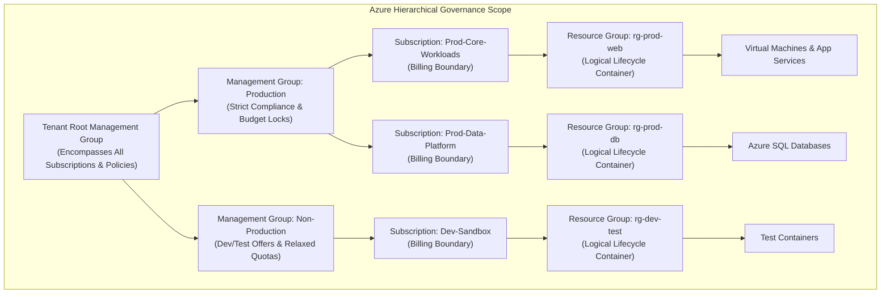
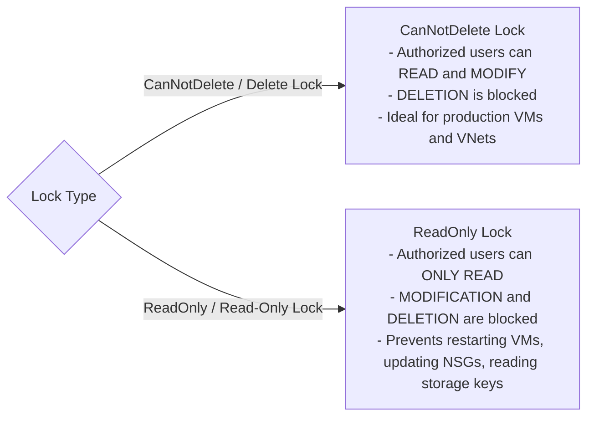
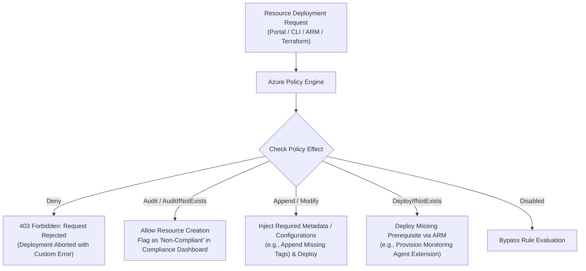
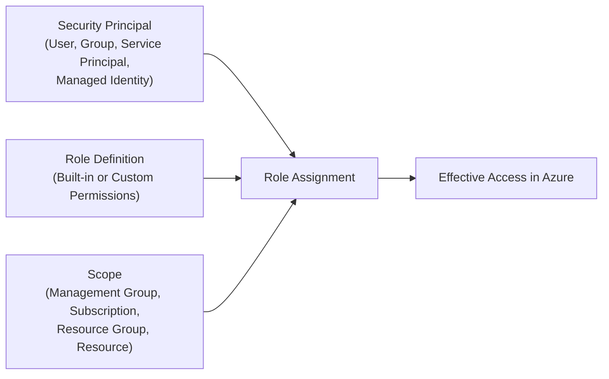

# Module 13-104-03: Administer Governance, Compliance & Access Control

**Breadcrumbs:** [[13-Index - Azure|☁️ Azure Reference MOC]] > [[13-Index - AZ-104|📘 AZ-104 Exam Track]] > **03 - Administer Governance and Compliance**

---

## 🎯 Executive Overview & Governance Architecture

Cloud governance ensures organizational compliance, cost transparency, and access security across multi-subscription enterprise architectures. Azure provides a four-level hierarchical management structure that enables centralized policy enforcement, resource lifecycle control, and least-privilege Role-Based Access Control (RBAC).



---

## 🏛️ Subscriptions & Management Hierarchy

### 1. Subscription Functions
An Azure Subscription serves three distinct functions:
1. **Billing Boundary:** Cost accumulation, invoicing, currency, and payment methods are separated per subscription.
2. **Access Control Boundary:** Azure RBAC permissions assigned at the subscription level cascade down to all enclosed resource groups and resources.
3. **Quotas and Service Limits:** Resource limits (e.g., regional vCPU caps, storage accounts, network interfaces) are enforced per subscription.

### 2. Subscription Offer Types
- **Enterprise Agreement (EA):** For large enterprises committing to predetermined upfront monetary commitments with negotiated tier discounts.
- **Pay-As-You-Go (PAYG):** Direct credit card or invoice billing with no upfront commitment.
- **Cloud Solution Provider (CSP):** Managed through a certified Microsoft partner providing consolidated billing and value-added support.
- **Visual Studio / MSDN Subscriptions:** Developer-oriented subscriptions providing recurring monthly credits ($50–$150/month) with discounted Dev/Test software rates.
- **Azure for Students & Free Trial:** Academic ($100 credit) or introductory trial ($200 credit for 30 days plus 12 months of popular free services).

### 3. Management Groups Hierarchy Rules
- Management Groups provide governance scoping above subscriptions.
- Up to **6 levels of depth** can be created below the Tenant Root Management Group (excluding root and subscription levels).
- A single management group tree supports up to 10,000 management groups per directory.
- Subscriptions belong to exactly **one** management group at a time.
- All subscriptions within a tenant automatically roll up to the **Tenant Root Management Group**.

---

## 📦 Resource Groups & Lifecycle Management

A **Resource Group (RG)** is a logical container for managing the lifecycle, permissions, and deployment of Azure resources:

| Property | Rule / Constraint |
| :--- | :--- |
| **Lifecycle Binding** | Resources sharing the same lifecycle (e.g., deployment, update, deletion) should be grouped together. Deleting a resource group irrevocably deletes all child resources within it. |
| **Geographic Flexibility** | A resource group has a metadata location (e.g., `East US`), but the resources inside it can reside in **any region globally** (e.g., a VM running in `West Europe`). |
| **Immutability Constraints** | Resource group names **cannot be renamed** once created. Resource groups **cannot be nested** inside other resource groups. |
| **Resource Moving** | Resources can be transferred between Resource Groups or between Subscriptions using the `Move-AzResource` cmdlet or Azure Portal without rebuilding infrastructure (subject to resource provider move support). |

---

## 🏷️ Azure Resource Tags

Tags are metadata name-value pairs (maximum 50 tags per resource/resource group) used for cost allocation, operational monitoring, environment categorization, and compliance tracking:

```json
{
  "Environment": "Production",
  "CostCenter": "CC-9042",
  "Owner": "devops-leads@contoso.com",
  "Application": "BillingEngine"
}
```

> [!WARNING]
> **No Automatic Tag Inheritance:** Unlike RBAC and Azure Policies, **Tags applied to a Resource Group are NOT automatically inherited by the resources inside that group**. To enforce tag inheritance, administrators must deploy an Azure Policy with the `Modify` or `Append` effect.

---

## 🔒 Azure Resource Locks

Resource locks protect critical Azure resources against accidental deletion or unauthorized configuration changes. Locks apply to **all users and roles**, including Subscription Owners and Global Administrators:



### Resource Lock Mechanics & Inheritance
1. **Inheritance:** Locks applied at higher scopes (Subscription or Resource Group) are automatically inherited by all child resources.
2. **Precedence:** The most restrictive lock wins. If a Resource Group has a `ReadOnly` lock and a VM inside has a `CanNotDelete` lock, the effective permission is `ReadOnly`.
3. **Control Plane vs. Data Plane Impact:** A `ReadOnly` lock on a Storage Account prevents modifying account properties and **also blocks listing storage access keys** (because listing keys requires an HTTP POST action, which ARM treats as a write operation).
4. **Bypassing / Removing:** To modify or delete a locked resource, a user with the `Microsoft.Authorization/locks/*` permission (Owner or User Access Administrator) must explicitly delete the lock first.

---

## 📜 Azure Policy & Policy Initiatives

Azure Policy is a governance engine that evaluates resource configurations against organizational rules and business compliance standards.



### Policy Effects Explained
- **Deny:** Intercepts the ARM request and fails the deployment before resources are created.
- **Audit:** Permits the deployment, but records a non-compliance event in the Azure Policy compliance portal.
- **Append:** Adds required fields (such as default subnet configurations or tags) during creation.
- **Modify:** Updates or adds tags and attributes on resources before or after deployment via remediation tasks.
- **DeployIfNotExists (DINE):** Deploys dependent resources (e.g., Log Analytics VM extension or Network Watcher) if missing when the parent resource is created.

### Policy Definition JSON Schema

```json
{
  "properties": {
    "displayName": "Enforce Allowed Virtual Machine SKUs",
    "description": "Restricts VM deployments to cost-effective B-series and D-series instances.",
    "mode": "Indexed",
    "parameters": {
      "listOfAllowedSKUs": {
        "type": "Array",
        "metadata": { "description": "Allowed VM Size SKUs" },
        "defaultValue": ["Standard_B2s", "Standard_D2s_v5"]
      }
    },
    "policyRule": {
      "if": {
        "allOf": [
          { "field": "type", "equals": "Microsoft.Compute/virtualMachines" },
          { "field": "Microsoft.Compute/virtualMachines/sku.name", "notIn": "[parameters('listOfAllowedSKUs')]" }
        ]
      },
      "then": {
        "effect": "deny"
      }
    }
  }
}
```

### Policy Initiatives (Policy Sets)
An **Initiative** is a collection of related policy definitions grouped together to fulfill a single compliance goal (e.g., "ISO 27001 Compliance", "CIS Azure Benchmark", or "Enterprise Cost Optimization"). Assigning an initiative applies all included policies across the designated scope simultaneously.

---

## 🛡️ Azure Role-Based Access Control (RBAC)

Azure RBAC is an authorization system built on Azure Resource Manager (ARM) that grants fine-grained access management to Azure resources.



### The Three Components of Azure RBAC
1. **Security Principal:** The entity requesting access (User, Group, Service Principal, or System/User-assigned Managed Identity).
2. **Role Definition:** A collection of permissions (`actions`, `notActions`, `dataActions`, `notDataActions`).
3. **Scope:** The boundary of resources where the access applies:
   $$\text{Management Group} \longrightarrow \text{Subscription} \longrightarrow \text{Resource Group} \longrightarrow \text{Resource}$$

### Core Built-In Roles

| Role Name | Scope of Permissions | Key Capabilities |
| :--- | :--- | :--- |
| **Owner** | Full access to all resources | Can create, modify, delete resources **and grant/delegate access** to other users via RBAC. |
| **Contributor** | Full access to all resources | Can create, modify, and delete resources, but **CANNOT grant or delegate access** to others. |
| **Reader** | Read-only view | Can view existing resources, but cannot make modifications or create resources. |
| **User Access Administrator** | Access delegation | Can manage user access to Azure resources (RBAC assignments), but cannot manage resources themselves. |

### Custom RBAC Role Definition JSON

```json
{
  "Name": "Custom Virtual Machine Operator",
  "IsCustom": true,
  "Description": "Allows starting, stopping, and restarting virtual machines without granting modification access.",
  "Actions": [
    "Microsoft.Compute/*/read",
    "Microsoft.Compute/virtualMachines/start/action",
    "Microsoft.Compute/virtualMachines/restart/action",
    "Microsoft.Compute/virtualMachines/powerOff/action"
  ],
  "NotActions": [
    "Microsoft.Compute/virtualMachines/delete"
  ],
  "DataActions": [],
  "NotDataActions": [],
  "AssignableScopes": [
    "/subscriptions/00000000-0000-0000-0000-000000000000",
    "/subscriptions/00000000-0000-0000-0000-000000000000/resourceGroups/rg-prod-compute"
  ]
}
```

> [!IMPORTANT]
> **Understanding `NotActions`:** `NotActions` is **not a deny rule**. It simply subtracts specific operations from the `Actions` list. If a user is assigned another role (such as Contributor) that grants `Microsoft.Compute/virtualMachines/delete`, the user **can still delete the VM**. To enforce absolute blocks, you must use an Azure Policy (`Deny` effect) or an Azure Blueprints / ARM Deny Assignment.

---

## ⚖️ Azure RBAC vs. Microsoft Entra ID Roles

| Category | Azure RBAC Roles | Microsoft Entra ID Roles |
| :--- | :--- | :--- |
| **Governed Plane** | Azure Resource Manager (ARM) Control & Data Plane. | Microsoft Entra ID Identity Directory Plane. |
| **Target Resources** | Virtual Machines, Storage Accounts, Virtual Networks, SQL, App Services. | Users, Groups, Enterprise Applications, Domains, Licenses, SSPR. |
| **Scope Hierarchy** | Management Group $\rightarrow$ Subscription $\rightarrow$ RG $\rightarrow$ Resource. | Tenant-wide or scoped to specific Administrative Units (AUs). |
| **Example Roles** | Owner, Contributor, Reader, Storage Blob Data Contributor. | Global Administrator, User Administrator, Helpdesk Administrator, Application Administrator. |
| **Elevation Bridge** | Global Administrators do not manage Azure resources by default, but can elevate access to **User Access Administrator** at the Tenant Root Management Group via the *Access management for Azure resources* toggle. |

---

## 🛠️ Contextual Proof of Concept: CLI & PowerShell Automation

### 1. Azure CLI: Governance & Compliance Management

```bash
# 1. Create a Resource Group in East US with mandatory organizational tags
az group create \
  --name "rg-enterprise-core" \
  --location "eastus" \
  --tags Environment=Production CostCenter=CC-8042 Department=Infrastructure

# 2. Apply a CanNotDelete lock to prevent accidental deletion
az lock create \
  --name "lock-prevent-deletion" \
  --lock-type "CanNotDelete" \
  --resource-group "rg-enterprise-core" \
  --notes "Core infrastructure protected by policy"

# 3. Assign the built-in 'Reader' role to a group at the resource group scope
GROUP_ID=$(az ad group show --group "Sec-DevOps-Engineers" --query id -o tsv)
SUB_ID=$(az account show --query id -o tsv)

az role assignment create \
  --assignee "$GROUP_ID" \
  --role "Reader" \
  --scope "/subscriptions/$SUB_ID/resourceGroups/rg-enterprise-core"

# 4. Assign an Azure Policy to restrict VM sizes
POLICY_DEF_ID=$(az policy definition list --query "[?displayName=='Allowed virtual machine size SKUs'].id" -o tsv)

az policy assignment create \
  --name "enforce-allowed-vm-skus" \
  --policy "$POLICY_DEF_ID" \
  --params '{"listOfAllowedSKUs": {"value": ["Standard_B2s", "Standard_D2s_v5"]}}' \
  --scope "/subscriptions/$SUB_ID/resourceGroups/rg-enterprise-core"
```

### 2. Azure PowerShell: Cost Budget & Alert Configuration

```powershell
# Create an Azure Cost Management budget with automated alert thresholds
$subId = (Get-AzContext).Subscription.Id

$budgetParams = @{
    Name = "Quarterly-Infra-Budget"
    Amount = 5000
    TimeGrain = "Quarterly"
    StartDate = (Get-Date -Day 1).ToString("yyyy-MM-dd")
    EndDate = (Get-Date).AddYears(1).ToString("yyyy-MM-dd")
    ResourceGroupName = "rg-enterprise-core"
    NotificationKey = "AlertOn80Percent"
    NotificationThreshold = 80
    ContactEmail = @("finops-alerts@contoso.com", "lead-admin@contoso.com")
}

# Note: Managed via New-AzConsumptionBudget cmdlet in production workflows
```

---

## 🔍 Deep-Intuition AARF Framework

### Scenario: Implementing Resource Lock Inheritance and Key Access Diagnostics

- **The Answer (Core Configuration):** Apply a `ReadOnly` lock at the Resource Group scope using `az lock create --name "rg-freeze" --lock-type ReadOnly --resource-group "rg-production"`.
- **The Assumptions (Prerequisites):** 
  - Applying user must possess `Microsoft.Authorization/locks/*` write permissions (Owner or User Access Administrator).
  - Storage accounts, VMs, and application services within `rg-production` must be capable of operating without control plane state updates.
- **The Rationale (Why):** Locks are enforced by the Azure Resource Manager (ARM) routing fabric before any action reaches the resource provider (`Microsoft.Compute`, `Microsoft.Storage`). An ARM `ReadOnly` lock intercepts and denies all HTTP methods except `GET`.
- **The Failure Loop (What if misconfigured):**
  - *Symptom:* An application or administrator attempts to retrieve Storage Account access keys via `az storage account keys list`.
  - *Exact Error:* `Error: The scope '/subscriptions/.../resourceGroups/rg-production/providers/Microsoft.Storage/storageAccounts/stprod01' cannot perform write operation because following scope(s) are locked: 'rg-production: ReadOnly'.`
  - *Root Cause:* Key listing is an HTTP `POST` operation which can regenerate or expose secrets, classified by ARM as a state mutation.
- **The Alternative Case (When to use 'if not'):** If operational applications require automated access to storage keys or VM restarts, use a **`CanNotDelete`** lock instead of `ReadOnly`. `CanNotDelete` protects resources from catastrophic removal while permitting ongoing operational state changes and restarts.

---

## 💡 AZ-104 Exam Tips & Gotchas

> [!TIP]
> **Owner vs. Contributor Gotcha:** The ONLY operational difference between the built-in **Owner** and **Contributor** roles is that the Owner can grant and revoke access permissions via Azure RBAC (`Microsoft.Authorization/*`). A Contributor can deploy, modify, and delete every resource in the subscription, but cannot assign roles to other users.

> [!WARNING]
> **Policy Enforcement vs. Resource Locks:**
> - If an exam question asks how to **prevent deployment of unapproved resource types or sizes**, the answer is **Azure Policy** (`Deny` effect).
> - If the question asks how to **prevent deletion of an existing production database**, the answer is an **Azure Resource Lock** (`CanNotDelete`).
> - If the question asks to **ensure all newly created resources receive a specific department tag**, the answer is an **Azure Policy** with the `Modify` or `Append` effect.

---

## 🎙️ Video Deep Dive & Real-World Builds (Moe Intelligence Series)

> [!NOTE]
> **Source Attribution:** Transcripts and architectural walkthroughs synthesized from *Moe Intelligence (Arabic Comprehensive AZ-104 Series)*, Lessons 08–14 ([Playlist Reference](https://www.youtube.com/playlist?list=PLczK3J2J4clmeh328CC13dJrcALcSFZFb)). Translated to English while preserving technical taxonomy.

### 1. Management Groups Architecture & Scaling Limits
- **The 6-Level Depth Rule:** Management Groups support an organizational hierarchy up to **6 levels of depth** (excluding the Root group and subscription endpoints), allowing large enterprises to mirror complex global reporting lines (e.g., `Tenant Root Group ➔ Geography (EMEA) ➔ Country (Egypt) ➔ Environment (Prod) ➔ Department (Billing)`).
- **The Tenant Root Group Elevation Mechanism:** Global Administrators in Entra ID do not automatically have access to subscription control planes. To resolve orphan subscriptions or perform enterprise security audits:
  1. Navigate to *Microsoft Entra ID ➔ Properties*.
  2. Toggle **Access management for Azure resources** to **Yes**.
  3. Azure automatically assigns the user the `User Access Administrator` role at the Tenant Root Group (`/`), allowing them to assign RBAC roles across all subscriptions in the tenant.

### 2. Subscription Transfer Hazards
- **Tenant Migration Impact:** When an Azure Subscription is transferred to a different Microsoft Entra ID tenant:
  - All existing Azure RBAC role assignments are **permanently removed** and must be recreated in the target tenant.
  - User-assigned Managed Identities are broken and must be reprovisioned.
  - Key Vault access policies and Entra ID-integrated storage authentication must be updated to target the new tenant ID.

### 3. Resource Locks & Operational Traps
- **Why `ReadOnly` Breaks VM Operations:** An administrator attempting to stop or restart a virtual machine protected by a `ReadOnly` lock will encounter an error. Changing VM state (e.g., running to deallocated) updates resource allocation properties in ARM, which is classified as a write mutation.
- **The Absolute Authority of Locks:** Locks override all RBAC permissions. Even an administrator with the `Owner` role cannot delete a resource locked with `CanNotDelete` without first explicitly navigating to the Locks blade and deleting the lock artifact.

### 4. Tagging Governance & Azure Policy Coupling
- **The Tag Inheritance Myth:** A widespread misconception among junior administrators is that resources automatically inherit tags from their parent Resource Group. In ARM architecture, resources **never inherit tags** by default.
- **Enforcing Tagging via Policy:** To establish automated cost allocation and FinOps compliance, deploy an Azure Policy with the `Modify` effect that checks if a resource lacks the `CostCenter` or `Environment` tag, and automatically copies the parent Resource Group's tag value during deployment.

---

## 🌐 Authoritative References & Citations

- [KodeKloud AZ-104 Course - Administer Governance and Compliance Module](https://notes.kodekloud.com/docs/Updated-AZ-104-Microsoft-Azure-Administrator/Administer-Governance-and-Compliance/Module-Introduction/page.md)
- [Moe Intelligence AZ-104 Video Series (Lessons 08–14)](https://www.youtube.com/playlist?list=PLczK3J2J4clmeh328CC13dJrcALcSFZFb)
- [Microsoft Learn: Manage subscriptions and governance in Azure](https://learn.microsoft.com/en-us/training/modules/manage-subscriptions-and-resources/)
- [Microsoft Learn: Control access to Azure resources with RBAC](https://learn.microsoft.com/en-us/training/modules/secure-azure-resources-with-rbac/)
- [Microsoft Azure Documentation - Azure Policy Overview](https://learn.microsoft.com/en-us/azure/governance/policy/overview)
