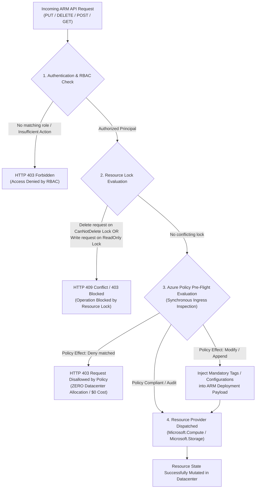
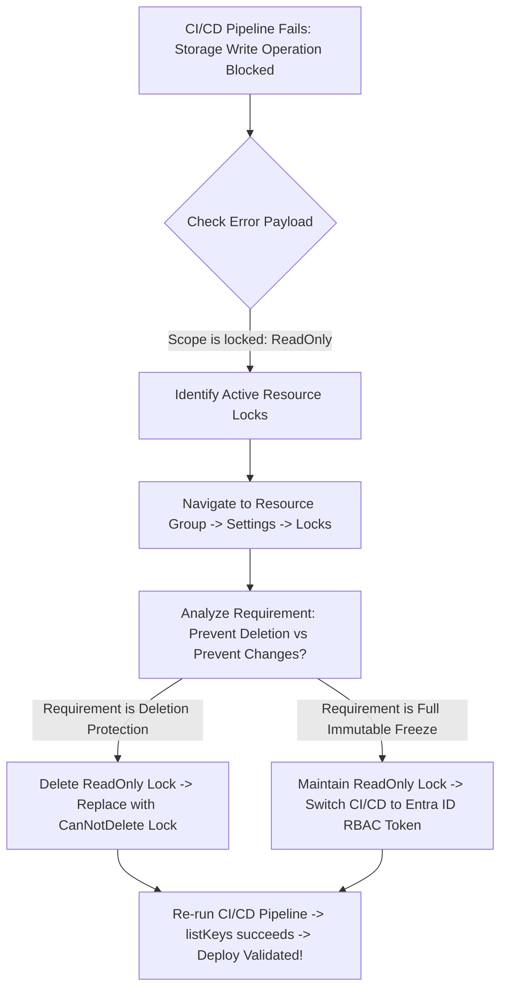

# Module 13-104-03: Administer Governance, Compliance & Access Control

**Breadcrumbs:** [[13-Index - Azure|☁️ Azure Reference MOC]] > [[13-Index - AZ-104|📘 AZ-104 Exam Track]] > **03 - Administer Governance and Compliance**

---

## 🎯 Stage 1: Executive Overview & The Conceptual Lecture

### 1. The Zero-Knowledge Starting Point: Why Cloud Governance Exists
Imagine you hand your company credit card and the keys to a brand-new corporate vehicle to every developer and contractor who joins the engineering team. Without any speed limiters, GPS geo-fencing, or spending caps, what inevitably happens?
* An engineer spinning up a test environment accidentally leaves a cluster of 8-GPU virtual machines running over a 4-day weekend, racking up a $40,000 cloud bill.
* A junior developer mistakenly deploys customer databases to an overseas region, violating international data sovereignty laws (such as GDPR).
* An automated cleanup script goes rogue and deletes the company's primary production storage account containing mission-critical financial ledgers.

In a traditional on-premises datacenter, governance was naturally enforced through **physical scarcity and bureaucratic procurement**:
* To get a server, an engineer had to submit a purchase order, wait 6 weeks for hardware delivery, have the networking team physically plug in cables, and have the storage team zone LUNs on a SAN.
* Security and compliance were audited through physical gates, badge readers, and change advisory boards (CABs).

In the cloud, **procurement is instantaneous software code**:
* Any user with API access can spin up massive compute clusters or delete terabytes of storage with a single command line script.
* **Governance cannot be an afterthought.** Cloud Governance is the automated system of guardrails, access boundaries, and compliance rules that empowers developers to move at maximum speed while preventing catastrophic accidents and budget bankruptcies.

### 2. The Three Pillars of Azure Governance (Decoding the Core Triad)
Every cloud administrator must memorize the fundamental distinction between the three primary governance mechanisms in Microsoft Azure:

```text
+------------------------------------------------------------------------------------------------+
|                             THE THREE PILLARS OF AZURE GOVERNANCE                              |
+------------------------------------------------------------------------------------------------+
|  1. Azure RBAC               |  2. Azure Policy             |  3. Azure Resource Locks         |
|     (Who Can Do What)        |     (What Can Be Deployed)   |     (Protect What Already Exists)|
+------------------------------+------------------------------+----------------------------------+
| - Focus: Identity & Actions  | - Focus: Resource Properties | - Focus: Accidental Mutation     |
| - Answers: "Can Bob deploy   | - Answers: "Is this VM SKU   | - Answers: "Can ANYONE delete    |
|   or delete a VM?"           |   allowed in this region?"   |   this production resource?"     |
| - Controls: Authorization at | - Controls: Property guard-  | - Controls: Control plane state  |
|   the ARM control plane      |   rails & compliance tags    |   freezes (Delete / ReadOnly)    |
| - Overridden by: Locks!      | - Evaluates: JSON manifests  | - Overrides: ALL RBAC Owners!    |
+------------------------------------------------------------------------------------------------+
```

### 3. Terminology Matrix: Zero-Knowledge to Enterprise Architect

| Terminology | What It Means to a Beginner | Real-World Analog | Enterprise Architecture Reality |
| :--- | :--- | :--- | :--- |
| **Management Group** | A master folder that groups multiple subscriptions. | A corporate division (e.g., "Retail Banking" vs "Commercial Banking"). | A governance boundary container above subscriptions that enables policy and RBAC inheritance across up to 6 levels of depth. |
| **Subscription** | The company billing account and credit card container. | A separate company credit card invoice for each department. | A dual boundary in Azure: it is both the ultimate billing/invoice container and a top-level quota and RBAC boundary. |
| **Resource Group (RG)** | A folder that holds related resources for an app. | A box holding all parts of a model airplane (wings, engine, cockpit). | A logical lifecycle container; deleting the Resource Group irrevocably deletes every resource contained inside it. |
| **Azure RBAC** | Giving specific keys to specific employees. | Hotel keycard that unlocks only Room 402 and the gym, but not the penthouse. | An authorization system built on Azure Resource Manager (ARM) assigning `Actions` and `DataActions` to security principals across a defined scope. |
| **Azure Policy** | Automated traffic cameras and speed limiters. | Building code inspector who blocks construction if walls aren't fireproof. | An ARM-integrated rules engine that evaluates resource configurations against JSON rules and enforces `Deny`, `Audit`, `Modify`, or `DeployIfNotExists`. |
| **Resource Lock** | A physical padlock over the power switch. | A safety cap over the red nuclear launch button. | An ARM control plane flag (`CanNotDelete` or `ReadOnly`) that intercepts and denies delete or update requests regardless of the user's RBAC role. |
| **Resource Tags** | Sticky notes attached to each server. | Price tags and barcode labels on grocery store items. | Key-value string pairs (up to 50 per resource) indexed by ARM to enable FinOps cost allocation, chargebacks, and operational filtering. |

---

## 🏛️ Stage 2: Core Mental Model & Component Architecture

### 1. The 4-Tier Management Hierarchy

#### 1. The Real-World Dilemma (The 'Why')
As enterprises expand into the cloud, they quickly outgrow a single Azure subscription. Organizations typically operate dozens or hundreds of subscriptions separated by business units, billing cost centers, regulatory boundaries, and deployment environments (Production, Staging, Development):
* **The Subscription Sprawl Anarchy:** Without a centralized organizational structure, security teams must manually configure Azure RBAC role assignments, Azure Policies, and compliance baselines on 200+ distinct subscriptions individually.
* **Configuration Drift & Audit Failure:** Inevitably, manual configuration leads to dangerous drift: a dev/test subscription is left without audit logging, an unapproved storage account is exposed to the public internet, or a junior engineer assigns themselves `Owner` on a critical workload.
* **The Governance Imperative:** Enterprises require an authoritative, hierarchical container model that allows security, compliance, and FinOps policies defined once at an executive tier to automatically cascade downward and enforce guardrails across every current and future cloud resource.

#### 2. The Concrete Metaphor (Everyday Intuitive Parallel)
* **The Multinational Holding Conglomerate Organizational Chart:**
  - Imagine a global holding conglomerate (Tenant Root Group) that oversees continental subsidiary corporations (Platform vs. Workloads Management Groups), which in turn own business divisions (Production vs. Non-Production Management Groups).
  - Each division maintains specific corporate credit card accounts (Azure Subscriptions), which hold departmental project containers (Resource Groups), filled with physical assets like machinery and computers (Resources).
  - If the conglomerate’s global board of directors passes a corporate anti-bribery and compliance mandate ("No investments outside North America"), that rule **instantly binds every subsidiary, bank account, and departmental cabinet** across the globe without anyone needing to visit 500 individual branch offices.

#### 3. The Mechanical & Topological Reality (Tenant Root Group, Cascades & Depth Limits)
To govern enterprise cloud assets at hyperscale, Azure enforces an immutable 4-level hierarchical management tree:

```text
+----------------------------------------------------------------------------------------------------+
|                         THE 4-TIER AZURE GOVERNANCE & INHERITANCE TOPOLOGY                         |
+----------------------------------------------------------------------------------------------------+
Level 1: Tenant Root Management Group (All subscriptions roll up here; Scope: "/")
             │
             ├── Management Group: "Core Platform" (Hub Networking, Shared Identity, Security)
             │     └── Subscription: "Shared-Networking-Hub" (Billing & Quota Boundary)
             │           └── Resource Group: "rg-hub-firewall" (Lifecycle Container)
             │                 └── Resource: Azure Firewall (Resource Provider Asset)
             │
             └── Management Group: "Enterprise Workloads"
                   │
                   ├── Management Group: "Production" (Strict Deny Policies & CanNotDelete Locks)
                   │     └── Subscription: "Prod-Billing-System"
                   │           └── Resource Group: "rg-prod-db"
                   │                 └── Resource: Azure SQL Database
                   │
                   └── Management Group: "Non-Production" (Dev/Test Offers, Audit Policies)
                         └── Subscription: "Dev-Sandbox"
                               └── Resource Group: "rg-dev-sandbox"
                                     └── Resource: Test Linux VM
+----------------------------------------------------------------------------------------------------+
```

##### Hierarchy Architecture Laws & Topological Constraints:
1. **The Downward Inheritance Law:**
   - RBAC role assignments, Azure Policy assignments, and Initiative assignments applied at a parent scope cascade strictly downward to all child containers:
     $$\text{Management Group} \longrightarrow \text{Child Management Group} \longrightarrow \text{Subscription} \longrightarrow \text{Resource Group} \longrightarrow \text{Resource}$$
   - Permissions and policies are strictly inherited; a child container cannot break inheritance or opt out of a parent policy unless an explicit **Policy Exemption** is applied.
2. **Management Group Topological Limits:**
   - **6-Level Nesting Depth Limit:** Management Groups can nest up to **6 levels of depth** (excluding the Tenant Root Group and the Subscriptions themselves).
   - **Directory Capacity:** A single Entra ID tenant tree supports up to **10,000 management groups**.
   - **Strict Cardinality:** Each subscription belongs to **exactly one** management group at any given time. Subscriptions are strictly terminal leaves in the MG tree; a subscription cannot parent another subscription or management group.
3. **The Tenant Root Group Elevation Mechanism:**
   - By default, an Entra ID Global Administrator has **zero access** to Azure Subscriptions or child resources!
   - In emergency disaster recovery or governance auditing scenarios, a Global Administrator can toggle **Access management for Azure resources** in the Entra ID Portal properties.
   - This API call elevates the user’s identity to the **User Access Administrator** role scoped directly to the **Tenant Root Group (`/`)**.
   - This elevation grants the authority to assign Azure RBAC roles (such as `Owner` or `Contributor`) across every management group and subscription in the entire tenant.

#### 4. The Production Failure Loop & Exam Trap
* **The Subscription Migration Governance Shockwave:**
  - *The Failure:* An administrator moves a subscription from `mg-non-production` to `mg-production`. Suddenly, developers can no longer deploy VMs, and production CI/CD pipelines crash.
  - *The Root Cause:* Moving a subscription immediately **detaches all inherited policies and RBAC roles** from the old management group and **instantly attaches all inherited policies from the new parent**. If `mg-production` enforces strict `Deny` policies (e.g., mandatory disk encryption with CMK, restricted SKUs, or required tags), any pre-flight deployment lacking those configurations fails immediately.
* **The Root Group Lockout Catastrophe:**
  - *The Trap:* An over-enthusiastic security officer applies an Azure Policy with the `Deny` effect or a `ReadOnly` resource lock at the **Tenant Root Group (`/`)**.
  - *The Blast Radius:* The policy or lock cascades downward to **every single subscription, resource group, and resource in the enterprise**, halting deployments, billing upgrades, and automated patching tenant-wide! Policies and locks at the root group must be reserved strictly for universal, audited enterprise guardrails.
* **The 6-Level Depth Limit Exceeded in IaC:**
  - Automated Terraform or Bicep modules generating nested organizational units for multi-tenant SaaS architectures fail with ARM API error `ManagementGroupDepthLimitExceeded` when attempting to provision a 7th layer of management groups. Organizations must design wide, balanced trees rather than deeply nested structures.

---

### 2. Resource Groups: The Lifecycle Law
A **Resource Group** is a fundamental container in ARM. Junior administrators frequently make the mistake of grouping resources by *type* (e.g., putting all virtual machines in one group, and all databases in another). 

> [!IMPORTANT]
> **The Golden Rule of Resource Groups (Lifecycle Binding):**
> Resources that share the **same deployment lifecycle, management lifecycle, and decommissioning schedule** should reside in the same Resource Group!
> - If an application consists of a Web App, a Database, and an App Insights instance that are deployed together and will be decommissioned together when the project finishes, **put them in the same Resource Group**.
> - When the project is retired, deleting that single Resource Group cleanly purges all associated resources, leaving zero orphaned disks or lingering cost leaks!

#### Resource Group Architectural Rules:
* **Region Decoupling:** A Resource Group has a metadata location (e.g., `East US`), but the resources inside it can reside in **any geographic region worldwide** (e.g., a VM in `West Europe` and a storage account in `Japan East`).
* **No Nesting:** Resource Groups cannot be nested inside other Resource Groups.
* **No Renaming:** Once created, a Resource Group **cannot be renamed**.
* **Resource Moving:** Resources can be moved to another Resource Group or another Subscription without rebuilding, provided the resource provider supports the move operation (`Move-AzResource`).

---

### 3. Azure Resource Tags & The Tag Inheritance Myth
Tags are metadata key-value pairs (maximum 50 tags per resource/resource group) used extensively for cost center chargebacks, environment tracking, and automation:

```json
{
  "Environment": "Production",
  "CostCenter": "CC-FIN-9042",
  "Owner": "data-platform-leads@contoso.com",
  "DisasterRecovery": "Tier-1-Mission-Critical"
}
```

> [!CAUTION]
> **The Tag Inheritance Myth:**
> In Azure, **resources DO NOT inherit tags from their parent Resource Group!**
> If you apply the tag `Environment: Production` to the Resource Group `rg-prod-web`, a Virtual Machine deployed inside that group will have **zero tags** by default!
> To enforce tag inheritance, you must deploy an **Azure Policy** with the `Modify` or `Append` effect that copies the tag from the resource group down to child resources during deployment.

---

## 🏢 Stage 3: Deep-Intuition Platform Mechanics & Topology

### 1. The ARM Ingress Pipeline & Azure Policy Pre-Flight Evaluation

#### 1. The Real-World Dilemma (The 'Why')
In cloud computing, deploying infrastructure is as fast as executing a script. However, this velocity creates severe operational risks:
* **The Costly Reactive Remediation Trap:** Historically, security teams relied on post-deployment security scanners that ran nightly. By the time a scanner flagged that a developer spun up an unapproved $15,000/month multi-GPU cluster or deployed an unencrypted database into an unauthorized foreign jurisdiction, the company had already incurred massive cloud bills and breached regulatory data residency laws (such as HIPAA or GDPR).
* **Datacenter Capacity & Waste:** Cloud providers allocate physical blade hardware, IP address ranges, and storage blocks the moment a deployment is accepted. Remediating bad configurations after the fact wastes engineering time, triggers painful rollback cycles, and exposes attack surfaces during the window between deployment and detection.
* **The Pre-Flight Gatekeeper Solution:** Organizations require an authoritative, synchronous control-plane gateway that evaluates every incoming API request in real-time, enforcing security baselines, tag schemas, and SKU boundaries **before** physical datacenter resources, hypervisor blades, or billing meters are ever provisioned!

#### 2. The Concrete Metaphor (Everyday Intuitive Parallel)
* **The International Airport Pre-Flight Customs & TSA Checkpoint:**
  - Imagine arriving at an international airport. You are not allowed to board an aircraft, fly across the ocean, and then find out upon arrival in Tokyo that your passport is expired or your luggage contains contraband.
  - Instead, you must pass through a strict, multi-stage pre-flight security screening before you ever set foot on the boarding bridge:
    1. **Identity & Ticket Gate (Azure RBAC):** Verifies that your ticket matches your ID and you have a valid seat reservation.
    2. **Physical Turnstile Lock (Resource Locks):** If the terminal door is chained shut (`CanNotDelete` / `ReadOnly`), nobody passes regardless of ticket class.
    3. **Luggage X-Ray & Tagging (Azure Policy):**
       - If you lack a required baggage routing label, the airline agent automatically prints and sticks one onto your suitcase (**`Modify` / `Append`**).
       - If your luggage contains hazardous explosives (**`Deny`**), TSA confiscates it and immediately halts your boarding with a security violation. You never reach the aircraft.
  - Only when all pre-flight inspections pass does the gate agent dispatch you onto the airplane (**Resource Provider Dispatch**).

#### 3. The Mechanical & Topological Reality (Pre-Flight Gateway & Evaluation Sequence)
Whenever an administrator, a CI/CD pipeline, an ARM template, or a Terraform script executes an operation (`PUT`, `POST`, `DELETE`, `PATCH`), the request hits the **Azure Resource Manager (ARM)** REST front-end (`management.azure.com`). ARM processes every request through a rigid 4-step synchronous pipeline:



##### Policy Evaluation Order & Pre-Flight Stopping Mechanics:
During Step 3 of the ingress pipeline, ARM compares the incoming JSON payload against all compiled policy rules assigned to that resource's scope:
1. **`Disabled`:** The policy rule is skipped.
2. **`Append` & `Modify`:** Intercepts the deployment payload and injects required properties (e.g., adding mandatory cost-center tags or enabling HTTPS-only traffic) *before* the payload is handed to the resource provider.
3. **`Deny` (Pre-Flight Execution Halt):**
   - If the request violates a `Deny` policy (e.g., attempting to deploy an unapproved `Standard_M128ms` VM size or deploying outside `East US`), ARM **aborts the request immediately**.
   - ARM returns an **HTTP 403 Forbidden** with payload:
     `{"code": "RequestDisallowedByPolicy", "message": "Resource was disallowed by policy..."}`
   - **The Pre-Flight Reality:** The request is terminated entirely at the ARM front-end API gateway. The request is **never dispatched to the physical compute fabric or storage cluster**. Zero hardware blades are energized, zero vCPUs are reserved, and zero billing meters are activated!
4. **`Audit`:** Evaluated during deployment and recorded in the Compliance Engine without blocking execution.
5. **`DeployIfNotExists (DINE)`:** Allows the parent resource to be deployed first; once successful, an asynchronous background trigger deploys the required dependent child resource (e.g., Log Analytics VM extension) via a Managed Identity.

#### 4. The Production Failure Loop & Exam Trap
* **The Retroactive Non-Compliance Trap (#1 Administrator Misconception):**
  - *The Trap:* An administrator assigns an Azure Policy with the `Deny` effect to block virtual machines larger than 4 vCPUs. The administrator checks the resource group and is shocked to discover that three pre-existing 16-vCPU machines are still running and racking up charges!
  - *The Ground Truth:* **Azure Policy `Deny` ONLY intercepts and blocks active, incoming ARM deployment and mutation requests.** It **NEVER retroactively deletes, shuts down, or alters pre-existing resources!** Pre-existing non-compliant resources are simply flagged as "Non-Compliant" in the Compliance Dashboard. To remediate existing resources, administrators must manually resize or decommission them.
* **The CI/CD Pipeline Breakage Trap (`enforcementMode`):**
  - *The Failure:* A security engineer enables a new policy requiring an `Owner` tag on all storage accounts with enforcement enabled (`Default`). Within 5 minutes, 20 production CI/CD pipelines crash because their automated Terraform code did not declare that tag.
  - *The Best Practice:* Always roll out new governance policies with **`enforcementMode: DoNotEnforce`** (Disabled in GUI) first. This generates audit compliance data without blocking deployments. Once DevOps teams update their IaC codebases, the policy is safely switched to `Default`.
* **DINE Silent Remediation Failure via Missing RBAC:**
  - When an Azure Policy uses `DeployIfNotExists` or `Modify`, it provisions a Managed Identity. If an administrator fails to grant this Managed Identity the required Azure RBAC role (e.g., `Contributor` or `Monitoring Contributor`) at the target subscription scope, the automated remediation task fails silently with authorization errors.

---

### 2. Azure RBAC Mechanics, Action Grammar & Principal ID Isolation

#### 1. The Real-World Dilemma (The 'Why')
In enterprise cloud operations, granting uninhibited administrative power to every team member violates the core tenet of least privilege:
* **The Over-Privileged Administrator Hazard:** Granting engineers broad `Owner` or `Contributor` access at the subscription level means a single compromised developer credential or rogue script can delete databases, reconfigure firewalls, or spin up unauthorized crypto-mining clusters.
* **The Management Plane vs. Data Plane Conflict:** Infrastructure platform engineers must deploy, scale, and patch Azure resources (Management Plane) without having access to read, exfiltrate, or alter sensitive financial records, medical documents, or customer PII stored inside databases and storage blobs (Data Plane).
* **The Multi-Tenant SaaS Security Challenge:** In modern cloud computing, enterprises use dozens of multi-tenant SaaS applications (such as Datadog, HashiCorp Terraform Cloud, or GitHub Actions). If authorization systems cannot cleanly isolate tenant identities, granting permissions to a third-party software vendor could expose company assets to other customers of that same vendor.

#### 2. The Concrete Metaphor (Everyday Intuitive Parallel)
* **The Facilities Maintenance Master Key vs. The Bank Safe Deposit Box Key:**
  - The Facilities Maintenance Engineer (**Management Plane - `Actions`**) holds the master brass key that unlocks the exterior bank doors, services the HVAC system, replaces light fixtures, and paints the vault walls. However, they **do not possess the brass key to unlock your individual safe deposit box inside the vault** (**Data Plane - `DataActions`**).
  - The Bank Customer (**Data Plane**) holds the private safety deposit key (`Storage Blob Data Contributor`) to deposit and withdraw cash, but possesses zero authority to demolish the bank walls or rewire the building's electrical circuit breakers (`Microsoft.Storage/storageAccounts/delete`).
* **The Coupon Subtraction Ledger vs. The Absolute Red Padlock:**
  - Imagine a restaurant coupon that says: *"Valid for all items on the dinner menu (`Actions`), EXCEPT the 32oz Porterhouse Steak (`NotActions`)"*.
  - This coupon merely subtracts the steak from that specific voucher's discount.
  - If your colleague hands you a second coupon that says: *"Valid for ANY meat dish on the menu (`Contributor`)"*, **you can order the steak!**
  - Why? The second coupon explicitly allows it. The subtraction on the first coupon does not cancel out the allowance on the second coupon. `NotActions` is mathematical subtraction, never an absolute prohibition!

#### 3. The Mechanical & Topological Reality (Action Grammar, Planes & Object ID Isolation)
Azure Role-Based Access Control (Azure RBAC) is an authorization system built natively into the Azure Resource Manager (ARM) fabric. It decouples access into a 3-component model:

```text
+----------------------------------------------------------------------------------------------------+
|                         AZURE RBAC 3-COMPONENT AUTHORIZATION MODEL                                 |
+----------------------------------------------------------------------------------------------------+
[ 1. Security Principal (Who) ]       [ 2. Role Definition (What) ]          [ 3. Scope (Where) ]
  - User Account (Alice)                - Actions (Control plane writes)        - Management Group ("/")
  - Security Group (DevOps Leads)       - NotActions (Subtractions)             - Subscription (sub-prod)
  - Service Principal (CI/CD GitHub)    - DataActions (Data plane reads/writes) - Resource Group (rg-db)
  - Managed Identity (VM App)           - NotDataActions                        - Resource (sql-server-01)
                     \                           |                           /
                      \                          |                          /
                       ▼                         ▼                         ▼
                      +-----------------------------------------------------+
                      |                   ROLE ASSIGNMENT                   |
                      |  "Principal Alice is granted Contributor on rg-db"  |
                      +-----------------------------------------------------+
```

##### 1. Action Grammar: Management Plane vs. Data Plane
Permissions in Azure RBAC follow a standardized REST operational syntax:
$$\text{ProviderNamespace} / \text{ResourceType} / \text{ActionVerb}$$

* **Management Plane (`Actions` & `NotActions`):**
  - Evaluated exclusively by **Azure Resource Manager (ARM)** at `https://management.azure.com`.
  - Governs resource lifecycle: creation, reconfiguration, tagging, networking rules, and deletion.
  - *Examples:*
    - `Microsoft.Compute/virtualMachines/start/action`
    - `Microsoft.Storage/storageAccounts/write`
    - `Microsoft.Network/virtualNetworks/subnets/join/action`
* **Data Plane (`DataActions` & `NotDataActions`):**
  - Evaluated directly by the **Resource Provider’s internal data service engine** (e.g., Azure Storage front-end at `*.blob.core.windows.net`, or Azure Key Vault at `*.vault.azure.net`).
  - Governs access to actual payload data, records, secrets, and messages inside the resource.
  - *Examples:*
    - `Microsoft.Storage/storageAccounts/blobServices/containers/blobs/read`
    - `Microsoft.KeyVault/vaults/secrets/getSecret/action`

##### 2. Why RBAC Strictly Requires Local Principal IDs (Object IDs) and Never Application IDs:
When configuring role assignments programmatically via ARM REST API, Bicep, or Terraform, administrators encounter two distinct GUIDs for service principals:
1. **Application ID (`appId` / Client ID):** The global blueprint definition of the software application registered in Entra ID. In multi-tenant enterprise software, **one single Application ID is shared globally across millions of customer directories!**
2. **Principal ID (`id` / Object ID):** The unique, concrete security actor instantiated inside a *specific* local Entra ID tenant directory.
* **The Multi-Tenant Isolation Guarantee:**
  - ARM role assignments strictly require the local **Principal ID (`principalId`)**:
    `/subscriptions/{sub}/providers/Microsoft.Authorization/roleAssignments/{assignmentId}`
  - If Azure RBAC accepted Application IDs for role assignments, granting `Contributor` to a SaaS security application in your subscription would grant that exact same permission to **every other company in the world running that same third-party application!**
  - By anchoring role assignments strictly to the local tenant **Principal ID (Object ID)**, Azure guarantees cryptographic isolation: only your local tenant instance of the service principal can exercise the role.

##### 3. The `NotActions` Mathematical Subtraction Set:
When constructing custom RBAC roles:
```json
{
  "Name": "Custom VM Operator",
  "IsCustom": true,
  "Actions": [
    "Microsoft.Compute/*"
  ],
  "NotActions": [
    "Microsoft.Compute/virtualMachines/delete"
  ],
  "AssignableScopes": [
    "/subscriptions/00000000-0000-0000-0000-000000000000"
  ]
}
```
* In Azure RBAC, permissions are **purely additive**.
* `NotActions` is **NOT a Deny rule**. It is purely mathematical set subtraction from the `Actions` array in that specific role definition:
  $$\text{Effective Role Permissions} = \text{Actions} - \text{NotActions}$$
* If a security principal is assigned multiple roles across overlapping scopes, ARM calculates the mathematical union of all role allowances:
  $$\text{Total Permissions} = \bigcup_{i=1}^{n} \Big( \text{Actions}_i - \text{NotActions}_i \Big)$$

#### 4. The Production Failure Loop & Exam Trap
* **The "NotActions is NOT a Deny" Additive Evaluation Fallacy (#1 AZ-104 Exam Trick Question!):**
  - *The Scenario:* To prevent junior administrators from deleting production virtual machines, an architect creates the `Custom VM Operator` role with `NotActions: ["Microsoft.Compute/virtualMachines/delete"]` and assigns it to junior admins. However, the junior admins are also members of the "DevOps Engineers" group, which is assigned the standard built-in `Contributor` role at the subscription level.
  - *The Question:* Can a junior administrator delete the production virtual machine?
  - *The Ground Truth:* **YES, THEY CAN DELETE THE VM!** Why? Because Azure RBAC permissions are purely additive. The `Contributor` role explicitly grants `Microsoft.Compute/virtualMachines/delete`. The `NotActions` on the custom role only subtracts delete from that single custom role; it has **zero effect on permissions granted by other roles**!
  - *The Fix:* To guarantee that nobody can delete the VM, administrators must apply an **Azure Resource Lock (`CanNotDelete`)** or an **Azure Policy (`Deny`)**.
* **The Control Plane vs. Data Plane Access Denied Trap:**
  - *The Failure:* An engineer assigned the built-in `Contributor` or `Owner` role on a Resource Group attempts to download a backup file from an Azure Storage Account container using the Azure Portal. The portal displays: `You do not have permissions to list data with your Microsoft Entra user account`.
  - *The Reality:* `Contributor` and `Owner` grant control-plane permissions (`Actions: ["*"]`), but contain **ZERO data-plane permissions (`DataActions: []`)**! To view blob contents using Entra ID credentials, the user must be assigned the dedicated data-plane role **`Storage Blob Data Contributor`** or **`Storage Blob Data Reader`**.
* **Passing `appId` Instead of `principalId` in Automation:**
  - Running `az role assignment create --assignee <Application_ID>` in CI/CD scripts without ensuring the local Service Principal exists causes CLI failures or ambiguous binding errors. In automated Terraform / Bicep code, always bind to `azuread_service_principal.example.object_id`.

---

### 3. Azure Policy Architecture & Policy Effects
Azure Policy evaluates the **properties and configuration** of resources during creation and on a continuous 24-hour background cycle.

#### Policy Structure Anatomy:
A policy consists of an `if` condition and a `then` effect:
```json
{
  "properties": {
    "displayName": "Deny Unapproved VM Sizes",
    "policyRule": {
      "if": {
        "allOf": [
          { "field": "type", "equals": "Microsoft.Compute/virtualMachines" },
          { "field": "Microsoft.Compute/virtualMachines/sku.name", "notIn": "[parameters('allowedSKUs')]" }
        ]
      },
      "then": {
        "effect": "deny"
      }
    }
  }
}
```

#### Policy Effects Matrix:
* **`Deny`:** Evaluated during the ARM ingress pipeline. If the condition matches, ARM immediately aborts the deployment and returns `HTTP 403 Request Disallowed by Policy`.
* **`Audit`:** Evaluated during deployment and background scans. Allows the resource to be created, but marks the resource as non-compliant in the Compliance Dashboard.
* **`Append`:** Automatically injects required properties into the deployment payload (e.g., adding default subnet rules).
* **`Modify`:** Adds or replaces tags and properties on resources during creation or via automated remediation tasks.
* **`DeployIfNotExists (DINE)`:** If a parent resource is created without an expected child resource (e.g., deploying a VM without the Azure Monitor Agent extension), DINE automatically triggers an ARM template deployment to provision the missing component using a Managed Identity.
* **`Disabled`:** Disables rule evaluation.

#### Policy Initiatives (Policy Sets):
An **Initiative** is an aggregation of multiple individual policy definitions bundled together to satisfy an overarching compliance mandate (e.g., *NIST SP 800-53 Compliance*, *ISO 27001*, or *Enterprise Cost Guardrails*). Assigning an initiative applies all included policies simultaneously across the target scope.

#### Policy Enforcement Modes:
When assigning an Azure Policy or Initiative, administrators select an **Enforcement Mode**:
* **`Default` (Enabled):** The policy rule is actively enforced during ARM request evaluation. Any deployment violating a `Deny` policy is actively blocked (`HTTP 403`).
* **`DoNotEnforce` (Disabled / Audit-First Rollout):** The policy rule effect is not enforced during deployment (i.e., ARM will NOT block requests). However, the Azure Policy evaluation engine still assesses resource compliance and reports non-compliant resources in the Compliance Dashboard. This allows enterprise platform teams to safely test and observe policy impacts before turning on active blocking!

#### Azure Policy Remediation Mechanics:
* **The Retroactive Limitation:** When an Azure Policy with `DeployIfNotExists` or `Modify` is assigned, it automatically affects **newly created or updated resources**. However, existing pre-existing resources that are non-compliant are **NOT automatically altered**!
* **Remediation Tasks:** To bring existing legacy resources into compliance, an administrator must explicitly trigger a **Remediation Task** (`az policy remediation create` or `Start-AzPolicyRemediation`).
* **Managed Identity Prerequisite:** For policies utilizing `DeployIfNotExists` or `Modify`, Azure Policy requires a **Managed Identity** (System-Assigned or User-Assigned) granted appropriate Azure RBAC roles on the target scope to perform template deployments or modify resource tags on behalf of the platform.

---

### 4. Resource Locks: CanNotDelete vs. ReadOnly Mechanics

#### 1. The Real-World Dilemma (The 'Why')
In fast-paced enterprise environments, human error is the single greatest cause of cloud outages:
* **The Fatal Typo Disaster:** Even the most experienced cloud architect can accidentally run `az group delete --name rg-production` when they intended to delete `rg-sandbox`, or a misconfigured Terraform cleanup script can accidentally destroy production databases during a pipeline run.
* **The Failure of RBAC to Protect Infrastructure:** Azure RBAC is fundamentally incapable of preventing accidental deletion because administrators require `Owner` or `Contributor` permissions to carry out their daily operational tasks. An engineer with `Contributor` has full authority to delete any resource they manage.
* **The Need for an Immutable Circuit Breaker:** Organizations need an out-of-band, immutable governance lock enforced directly at the ARM API gateway that overrides all RBAC roles—stopping deletion and modification even if the person issuing the command is a Subscription Owner or Entra ID Global Administrator!

#### 2. The Concrete Metaphor (Everyday Intuitive Parallel)
* **The Spring-Loaded Missile Switch Cover (`CanNotDelete`) vs. Casting the Control Panel in Concrete (`ReadOnly`):**
  - **`CanNotDelete` (Delete Lock) is a Spring-Loaded Safety Flap Over an Emergency Button:**
    - The industrial control panel remains fully functional: operators can adjust speed knobs, scale power, replace fuses, and reboot machines (read, update, scale, restart VMs).
    - However, the red self-destruct button (`DELETE`) is shielded beneath a heavy metal safety cover secured with a physical padlock.
    - To press that button, an authorized engineer must deliberately find the key, unlock and remove the safety shield (delete the resource lock), and only then press the self-destruct button.
  - **`ReadOnly` (Read-Only Lock) is Encasing the Dashboard in Solid Bulletproof Glass:**
    - Transparent liquid resin has been poured over the entire control room and cured into solid glass.
    - Operators can look through the glass and inspect all gauges, read LED dials, and take notes (**`GET` operations**).
    - However, nobody can turn a knob, flip a switch, press a button, or restart an engine (**`PUT`, `PATCH`, `POST`, `DELETE` are physically frozen**).

#### 3. The Mechanical & Topological Reality (ARM REST Gateway Interception & Lock Semantics)
Resource Locks operate at Step 2 of the synchronous ARM Ingress Pipeline (`https://management.azure.com`). ARM intercepts incoming HTTP requests **before** they are ever routed to the backend resource provider:

```text
+----------------------------------------------------------------------------------------------------+
|                         RESOURCE LOCK ARM REST GATEWAY INTERCEPTION                                 |
+----------------------------------------------------------------------------------------------------+
Incoming ARM REST API Request:
├── GET   https://management.azure.com/.../virtualMachines/vm-prod ──► ALLOWED under ALL locks
├── PUT   https://management.azure.com/.../virtualMachines/vm-prod ──► BLOCKED under ReadOnly
├── POST  https://management.azure.com/.../storageAccounts/st/listKeys ─► BLOCKED under ReadOnly
├── POST  https://management.azure.com/.../virtualMachines/vm-prod/restart ─► BLOCKED under ReadOnly
└── DELETE https://management.azure.com/.../virtualMachines/vm-prod ──► BLOCKED under CanNotDelete & ReadOnly
                                                                        (HTTP 409 Conflict: ScopeLocked)
+----------------------------------------------------------------------------------------------------+
```

##### 1. Comparative Operational Matrix:
| Operational Action | No Lock Present | `CanNotDelete` (Delete Lock) | `ReadOnly` (Read-Only Lock) |
| :--- | :---: | :---: | :---: |
| **Read Configurations (`GET`)** | ✅ Allowed | ✅ Allowed | ✅ Allowed |
| **Modify Resource Tags (`PATCH`)** | ✅ Allowed | ✅ Allowed | ❌ **Blocked** |
| **Resize / Scale Virtual Machine (`PUT`)** | ✅ Allowed | ✅ Allowed | ❌ **Blocked** |
| **Restart / Stop / Deallocate VM (`POST`)** | ✅ Allowed | ✅ Allowed | ❌ **Blocked (Mutates allocation state!)** |
| **List Storage Account Keys (`POST /listKeys`)** | ✅ Allowed | ✅ Allowed | ❌ **Blocked (HTTP POST write action!)** |
| **Write Blobs via Storage Data Plane** | ✅ Allowed | ✅ Allowed | ✅ **Allowed (Data plane bypasses ARM!)** |
| **Delete Resource or Resource Group (`DELETE`)** | ✅ Allowed | ❌ **Blocked (HTTP 409)** | ❌ **Blocked (HTTP 409)** |

##### 2. Lock Inheritance & Precedence Laws:
1. **Strict Downward Cascading:** A lock applied at a parent Management Group or Subscription automatically locks all child Resource Groups and resources. A lock applied at a Resource Group automatically cascades to all resources contained inside that group.
2. **Most Restrictive Precedence:** If multiple locks apply to a resource (e.g., a `CanNotDelete` lock on the subscription and a `ReadOnly` lock on the resource group), the most restrictive lock (**`ReadOnly`**) wins.
3. **RBAC Immunity:** Resource locks apply equally to **ALL users**, including Subscription `Owner`, `Contributor`, and `Global Administrator`. Nobody can bypass a lock without first possessing `Microsoft.Authorization/locks/*` permissions to explicitly delete the lock itself!

#### 4. The Production Failure Loop & Exam Trap
* **The Storage Account `listKeys` / HTTP POST Write Trap (#1 AZ-104 Exam Trick Question!):**
  - *The Scenario:* To prevent junior administrators from modifying an Azure Storage Account hosting critical application logs, a security engineer applies a **`ReadOnly`** lock to the parent Resource Group.
  - *The Production Crash:* Immediately, nightly automated backup scripts and CI/CD deployment pipelines crash with error:
    `ScopeLocked: The scope ... cannot perform write operation because following scope(s) are locked: 'ReadOnly'.`
  - *The Root Cause:* Automated scripts authenticate using storage account keys retrieved via `az storage account keys list` or PowerShell `Get-AzStorageAccountKey`. In the ARM REST API, retrieving keys is an **HTTP POST** operation (`Microsoft.Storage/storageAccounts/listKeys/action`). ARM treats POST requests as write/mutation operations because keys grant root administrative data access or can regenerate secrets. Under a `ReadOnly` lock, **ARM blocks all POST operations**, breaking key retrieval!
  - *The Remediation:* Replace the `ReadOnly` lock with a **`CanNotDelete`** lock. `CanNotDelete` permits HTTP POST operations (allowing `listKeys` to succeed) while strictly preventing deletion.
* **The VM Power State Mutation Failure under `ReadOnly`:**
  - *The Trap:* An administrator applies a `ReadOnly` lock to a production virtual machine. That night, automated patch management or an engineer clicks **Restart** or **Stop (Deallocate)** in the portal. The operation fails with an HTTP 409 conflict.
  - *The Ground Truth:* In cloud architecture, stopping, starting, or deallocating a VM requires ARM to update hardware allocation leases and compute state in the fabric controller. These are HTTP POST write operations. Under a `ReadOnly` lock, **you cannot start, stop, or restart a virtual machine!**
* **The Resource Move Blockade:**
  - Attempting to transfer a resource between subscriptions or resource groups (`Move-AzResource`) fails immediately if a lock exists on either the source or target container. You must delete the lock, complete the transfer, and re-create the lock.

---

### 5. Resource Moving Prerequisites & Constraints
When transferring resources between Resource Groups or Subscriptions:
1. **Dependency Bundling:** Resources that depend on one another must move together in the same operation. For example, moving an Azure Virtual Machine requires moving the VM, the OS disk, all attached data disks, the Network Interface Card (NIC), and any attached Public IP address simultaneously.
2. **Lock Clearance:** All Resource Locks must be removed from both the source and destination Resource Groups before the move operation can proceed.
3. **Tenant Boundary Law:** Resources cannot be moved directly across different Entra ID tenants. The subscription containing the resources must first be reassigned to the target tenant.

---

## ⚙️ Stage 4: Declarative & Automation Engine (CLI & PowerShell Core)

### 1. Azure CLI: Governance & Compliance Recipes

```bash
# ==============================================================================
# 1. RESOURCE GROUP & TAGGING MANAGEMENT
# ==============================================================================

# Create a production resource group with corporate compliance tags
az group create \
  --name "rg-enterprise-workloads" \
  --location "eastus" \
  --tags Environment=Production CostCenter=CC-8042 Owner=cloud-ops@contoso.com

# Apply a CanNotDelete lock to protect the entire resource group
az lock create \
  --name "lock-prevent-accidental-delete" \
  --lock-type "CanNotDelete" \
  --resource-group "rg-enterprise-workloads" \
  --notes "Protects production database and compute assets from accidental deletion"

# ==============================================================================
# 2. CUSTOM AZURE RBAC ROLE DEPLOYMENT
# ==============================================================================

# Create a custom role definition JSON file
cat << 'EOF' > custom-vm-operator.json
{
  "Name": "Custom VM Operator (No Delete)",
  "IsCustom": true,
  "Description": "Allows starting, restarting, and stopping VMs without deletion authority.",
  "Actions": [
    "Microsoft.Compute/virtualMachines/read",
    "Microsoft.Compute/virtualMachines/start/action",
    "Microsoft.Compute/virtualMachines/restart/action",
    "Microsoft.Compute/virtualMachines/powerOff/action"
  ],
  "NotActions": [
    "Microsoft.Compute/virtualMachines/delete"
  ],
  "AssignableScopes": [
    "/subscriptions/SUBSCRIPTION_ID_REPLACE"
  ]
}
EOF

# Substitute your active subscription ID and create the role
SUB_ID=$(az account show --query id -o tsv)
sed -i "s/SUBSCRIPTION_ID_REPLACE/${SUB_ID}/g" custom-vm-operator.json
az role definition create --role-definition custom-vm-operator.json

# ==============================================================================
# 3. AZURE POLICY ASSIGNMENT (ALLOWED LOCATIONS)
# ==============================================================================

# Retrieve the built-in policy definition ID for allowed locations
POLICY_DEF_ID=$(az policy definition list --query "[?displayName=='Allowed locations'].id" -o tsv)

# Assign the policy to enforce deployments strictly in East US and West US
az policy assignment create \
  --name "enforce-allowed-regions" \
  --display-name "Enforce US Regions Only" \
  --policy "${POLICY_DEF_ID}" \
  --params '{"listOfAllowedLocations": {"value": ["eastus", "westus"]}}' \
  --scope "/subscriptions/${SUB_ID}/resourceGroups/rg-enterprise-workloads"

# ==============================================================================
# 4. AZURE POLICY REMEDIATION TASK AUTOMATION
# ==============================================================================
# Trigger an explicit remediation task for existing non-compliant resources (DINE/Modify)
az policy remediation create \
  --name "remediate-non-compliant-resources" \
  --policy-assignment "enforce-allowed-regions" \
  --resource-group "rg-enterprise-workloads"
```

### 2. Azure PowerShell: Management Group & Cost Budget Engine

```powershell
# ==============================================================================
# 1. MANAGEMENT GROUP CREATION & SUBSCRIPTION PLACEMENT
# ==============================================================================
# Create an Enterprise Workloads Management Group
$mgParams = @{
    GroupName   = "mg-enterprise-workloads"
    DisplayName = "Enterprise Workloads Division"
}
New-AzManagementGroup @mgParams

# Move active subscription into the new Management Group
$subId = (Get-AzContext).Subscription.Id
New-AzManagementGroupSubscription -GroupName "mg-enterprise-workloads" -SubscriptionId $subId

# ==============================================================================
# 2. COST MANAGEMENT BUDGET & ALERT THRESHOLDS
# ==============================================================================
# Define a $5,000 monthly budget with multi-threshold email notifications
$budgetParams = @{
    Name                  = "Monthly-Ops-Budget"
    Amount                = 5000
    TimeGrain             = "Monthly"
    StartDate             = (Get-Date -Day 1).ToString("yyyy-MM-dd")
    EndDate               = (Get-Date).AddYears(1).ToString("yyyy-MM-dd")
    ResourceGroupName     = "rg-enterprise-workloads"
    NotificationKey       = "Threshold85Percent"
    NotificationThreshold = 85
    ContactEmail          = @("finops-alerts@contoso.com", "billing-owner@contoso.com")
}
# Executed via New-AzConsumptionBudget in production automation
```

---

## 🖥️ Stage 5: Step-by-Step Azure Portal GUI Walkthrough

Follow these exact navigation steps in the **Azure Portal** (`https://portal.azure.com`) to master governance workflows:

### Task 1: Building a Management Group Hierarchy
1. In the search bar at the top, type **Management groups** and select it.
2. In the tree view, locate the **Tenant Root Group**. Click on the root group, then click **+ Create**.
3. In the creation pane:
   - **Management group ID:** `mg-workloads-prod`.
   - **Management group display name:** `Production Workloads`.
4. Click **Submit**.
5. Once created, click on `Production Workloads` $\rightarrow$ click **+ Add subscription** $\rightarrow$ select your target subscription $\rightarrow$ click **Save**.

### Task 2: Creating a Custom RBAC Role Using the Visual Builder
1. Navigate to **Subscriptions** (or search for your specific Resource Group).
2. Click on **Access control (IAM)** in the left navigation menu.
3. Click **+ Add** on the command bar $\rightarrow$ select **Add custom role**.
4. In the **Basics** tab:
   - **Custom role name:** `Virtual Machine Operator (No Delete)`.
   - **Description:** `Can start, restart, and deallocate VMs but cannot delete them`.
   - **Baseline permissions:** Leave as *Start from scratch*. Click **Next**.
5. In the **Permissions** tab:
   - Click **+ Add permissions**.
   - In the search box, type `Microsoft.Compute/virtualMachines`.
   - Check the boxes for:
     - `Microsoft.Compute/virtualMachines/read`
     - `Microsoft.Compute/virtualMachines/start/action`
     - `Microsoft.Compute/virtualMachines/restart/action`
     - `Microsoft.Compute/virtualMachines/powerOff/action`
   - Click **Add**.
6. In the **Assignable scopes** tab, verify that your subscription or resource group scope is listed.
7. In the **JSON** tab, review the generated role definition schema. Click **Review + create** $\rightarrow$ **Create**.

### Task 3: Applying and Testing Resource Locks
1. Navigate to your target Resource Group (e.g., `rg-enterprise-workloads`).
2. In the left navigation menu, scroll down to **Settings** $\rightarrow$ click **Locks**.
3. On the top command bar, click **+ Add**.
4. Configure the lock:
   - **Lock name:** `lock-prevent-deletion`.
   - **Lock type:** Select **Delete** (`CanNotDelete`).
   - **Notes:** `Mission critical production container`.
5. Click **OK**.
6. **Test the Lock:** Go back to the **Overview** blade of the Resource Group and click **Delete resource group**. Type the name of the group and click **Delete**. Notice that Azure immediately halts the deletion with an error stating the resource group is locked!

### Task 4: Assigning an Azure Policy with the Deny Effect
1. In the portal search bar, type **Policy** and select it.
2. In the left navigation menu, click **Definitions** under *Authoring*.
3. In the search box, type `Allowed locations` and click on the built-in policy definition.
4. On the top command bar, click **Assign**.
5. In the **Basics** tab:
   - **Scope:** Click the ellipsis (`...`) and select your subscription and Resource Group.
   - **Assignment name:** `Enforce East US and West US Only`.
   - **Policy enforcement:** Ensure it is set to **Enabled**. Click **Next**.
6. In the **Parameters** tab:
   - Deselect *Only show parameters that need input*.
   - In the **Allowed locations** multi-select dropdown, check **East US** and **West US**.
7. Click **Review + create** $\rightarrow$ **Create**. Any subsequent attempt to deploy a resource in `Central US` or `North Europe` will be immediately rejected with an HTTP 403 policy violation!

---

## 🔬 Stage 6: Hands-On Enterprise Lab Bridge

To implement these governance mechanisms in a live sandbox environment, transition directly to the practical enterprise lab:

> [!TIP]
> **Practical Implementation Companion:**
> Access the comprehensive engineering lab at:
> **[[Lab-03_Custom_RBAC_Resource_Locks_and_Azure_Policy|Lab 03: Custom RBAC Role Engineering, Resource Locks & Azure Policy Governance]]**
> 
> *Target Lab File:* `Projects/AZ-104/03_Governance_and_Compliance/Lab-03_Custom_RBAC_Resource_Locks_and_Azure_Policy.md`

### Lab Objectives Matrix:

```text
+-----------------------------------------------------------------------------------------+
| Lab 03 Enterprise Milestone Goals                                                       |
+-----------------------------------------------------------------------------------------+
| 1. Construct a multi-tier Management Group hierarchy in the Azure Portal GUI            |
| 2. Engineer and assign a Custom RBAC Role via the visual JSON/IAM builder               |
| 3. Apply CanNotDelete and ReadOnly resource locks to observe ARM control plane freezes  |
| 4. Deploy Azure Policy with Deny effect to block unauthorized geographic deployments    |
| 5. Execute Policy Remediation Tasks with Managed Identity to inject missing tags        |
+-----------------------------------------------------------------------------------------+
```

---

## ⚠️ Stage 7: "See It in Action" Real-World Failure & Recovery Loop (AARF)

### Scenario: The "Locked Storage & Broken CI/CD Pipeline" Outage

#### 1. The Architectural Setup & Assumptions
An enterprise hosting a critical customer portal implements an automated CI/CD pipeline using GitHub Actions to deploy web artifacts into an Azure Storage Account static website (`$web` container). To protect the production storage account from accidental deletion by junior staff, a senior security engineer applies a **`ReadOnly`** lock to the parent Resource Group `rg-customer-portal`.

#### 2. The Production Failure Manifestation
That night, the software development team pushes an emergency hotfix. The CI/CD pipeline runs `az storage blob upload-batch` to upload new JavaScript and HTML files. The pipeline crashes with the following error:

```text
ERROR: The scope '/subscriptions/00000000-0000-0000-0000-000000000000/resourceGroups/rg-customer-portal/providers/Microsoft.Storage/storageAccounts/stportalprod' cannot perform write operation because following scope(s) are locked: 'rg-customer-portal: ReadOnly'. Please remove the lock and try again.
Exit code: 1
Workflow failed: Step 'Deploy to Azure Storage' failed.
```

#### 3. Root Cause Analysis (RCA) & Deep Investigation
Why did blob upload fail when the engineer only intended to prevent someone from deleting the storage account?
1. **The CLI Authentication Mechanism:** The CI/CD script used Azure CLI with storage account keys (`--account-key`). To execute the command, the CLI automatically performed an ARM call:
   `POST https://management.azure.com/.../storageAccounts/stportalprod/listKeys?api-version=2023-01-01`
2. **The ReadOnly Lock Interception:** In ARM architecture, `listKeys` is an **HTTP POST** operation. Because listing keys can expose or regenerate secrets, ARM classifies all POST operations as write/mutation events.
3. **The Control Plane Freeze:** A `ReadOnly` lock strictly denies all HTTP methods except `GET`. When ARM received the POST request for `listKeys`, it intercepted and blocked the call at the control plane before the request could ever reach the storage data plane!
4. **The Second Failure (Power States):** Virtual Machines residing in that same resource group were also unable to be restarted or deallocated during nightly patching because stopping a VM changes compute allocation properties in ARM.

#### 4. Remediation & Diagnostic Verification Loop



```bash
# Diagnostic & Remediation Script (Run in Azure Cloud Shell)

# 1. Inspect existing locks on the Resource Group
az lock list --resource-group "rg-customer-portal" --output table

# 2. Delete the disruptive ReadOnly lock
az lock delete --name "rg-freeze-lock" --resource-group "rg-customer-portal"

# 3. Apply the correct CanNotDelete lock (permits updates & key listing, blocks deletion)
az lock create \
  --name "lock-protect-production-storage" \
  --lock-type "CanNotDelete" \
  --resource-group "rg-customer-portal" \
  --notes "Permits CI/CD updates while strictly blocking resource group deletion"
```

---

## 💡 Stage 8: High-Yield AZ-104 Exam Scenarios & Trick Question Traps

### Trick Question Trap 1: The Only Operational Difference Between Owner and Contributor
* **The Scenario:** A question presents two engineers, Alice (assigned `Owner`) and Bob (assigned `Contributor`). Both have access to Subscription A. The question asks which specific tasks Alice can perform that Bob cannot.
* **The Trap:** The question offers answers like "Alice can delete the subscription, Bob cannot", or "Alice can deploy ExpressRoute, Bob cannot".
* **The Ground Truth:** A **Contributor can do EVERYTHING an Owner can do** in terms of deploying, modifying, stopping, starting, and deleting Azure resources. The **ONLY** operational difference is that the Owner possesses `Microsoft.Authorization/*` permissions, meaning **Owner can assign RBAC roles and delegate access to others**, whereas Contributor cannot assign roles or modify access policies!

### Trick Question Trap 2: Tagging Inheritance on Newly Created VMs
* **The Scenario:** The Resource Group `rg-analytics` has the tags `CostCenter: 991` and `Environment: Prod`. An administrator deploys an Azure Virtual Machine named `vm-worker-01` into `rg-analytics` using an ARM template without specifying any tags in the template.
* **The Question:** What tags exist on `vm-worker-01` after deployment?
* **The Trap:** The exam suggests the VM automatically has `CostCenter: 991` and `Environment: Prod`.
* **The Ground Truth:** **Zero tags exist on the VM!** Resource tags are **never inherited** from parent resource groups. To enforce tag inheritance, you must deploy an **Azure Policy** with the `Modify` or `Append` effect.

### Trick Question Trap 3: Policy Enforcement vs. Resource Locks (Scenario Disambiguation)
* **Rule 1:** If the requirement is to **prevent the deployment of unauthorized resource sizes, SKUs, or geographic regions**, the answer is **Azure Policy (`Deny` effect)**.
* **Rule 2:** If the requirement is to **prevent accidental deletion of an existing production database**, the answer is an **Azure Resource Lock (`CanNotDelete`)**.
* **Rule 3:** If the requirement is to **prevent anyone from modifying configurations or restarting a VM**, the answer is an **Azure Resource Lock (`ReadOnly`)**.
* **Rule 4:** If the requirement is to **ensure resources are automatically deployed with a Log Analytics agent**, the answer is an **Azure Policy (`DeployIfNotExists`)**.

### Trick Question Trap 4: Moving Resources Across Subscriptions with Locks Attached
* **The Scenario:** You need to transfer a virtual machine and its disks from Subscription A to Subscription B. The parent Resource Group has a `CanNotDelete` lock applied. You attempt to initiate the move via `Move-AzResource`.
* **The Trap:** Why does the move fail?
* **The Ground Truth:** Moving a resource involves unlinking it from the source container and registering it in the target container. An active Resource Lock on the source or destination Resource Group will **block the move operation**. You must **temporarily delete the lock**, execute the transfer, and then re-apply the lock on the destination resource group.

### Trick Question Trap 5: Policy Retroactive Evaluation vs. Remediation Tasks
* **The Scenario:** An administrator assigns a new Azure Policy with the `Modify` effect that adds a mandatory tag (`Environment: Prod`) to all virtual machines. The administrator checks existing VMs created last week and notices that none of them have received the tag.
* **The Trap:** Did the policy fail to apply?
* **The Ground Truth:** **NO! Azure Policy `Modify` and `DeployIfNotExists` do NOT retroactively alter existing resources automatically!** They only evaluate and modify resources created or updated *after* the assignment. To remediate existing legacy resources, the administrator must explicitly launch a **Remediation Task** (`az policy remediation create` or via the Azure Portal Remediation tab).

### Trick Question Trap 6: Policy EnforcementMode: Default vs. DoNotEnforce in CI/CD Pre-flight
* **The Scenario:** A DevOps team complains that their CI/CD deployment pipeline failed because an administrator assigned a strict `Deny` policy without giving the developers time to update their Terraform templates. The platform team wants to test future policies and identify non-compliant workloads in dashboards without breaking developer deployments.
* **The Trap:** Which configuration should the platform team use when assigning the policy?
* **The Ground Truth:** Set **`enforcementMode` to `DoNotEnforce`** (Disabled in the GUI). This mode instructs ARM to evaluate compliance and flag non-compliant resources in Azure Policy reports, but it **will not block** resource deployments or API requests!

---

## 🌐 Authoritative References & Inflow Citations

* **Udemy AZ-104 Master Class by Scott Duffy:** [Inflow: Module 03 - Administer Governance and Compliance](file:///F:/Dump%20one/BrainDump/inflow/AZ-104-ScottDuffy/03_Administer_Governance_and_Compliance.md)
* **John Savill’s Azure Master Class & Deep Dives:** Governance Architecture, Management Groups Hierarchy, RBAC Action vs NotAction Mechanics, and Key Vault Security Boundaries.
* **Moe Intelligence AZ-104 Video Curriculum:** Lessons 08 through 14 (Subscriptions, Resource Groups, Azure Policy, RBAC, Locks).
* **KodeKloud AZ-104 Course:** [Administer Governance and Compliance Module](https://notes.kodekloud.com/docs/Updated-AZ-104-Microsoft-Azure-Administrator/Administer-Governance-and-Compliance/Module-Introduction/page.md)
* **Official Microsoft Learn Documentation:**
  - [Azure Governance Documentation](https://learn.microsoft.com/en-us/azure/governance/)
  - [Manage subscriptions and governance in Azure](https://learn.microsoft.com/en-us/training/modules/manage-subscriptions-and-resources/)
  - [Control access to Azure resources with RBAC](https://learn.microsoft.com/en-us/training/modules/secure-azure-resources-with-rbac/)
  - [Azure Policy Overview & Effects](https://learn.microsoft.com/en-us/azure/governance/policy/overview)
  - [Remediate non-compliant resources with Azure Policy](https://learn.microsoft.com/en-us/azure/governance/policy/how-to/remediate-resources)
  - [Lock your resources to prevent unexpected changes](https://learn.microsoft.com/en-us/azure/azure-resource-manager/management/lock-resources)
  - [Plan and manage Azure costs](https://learn.microsoft.com/en-us/azure/cost-management-billing/costs/quick-acm-cost-analysis)
