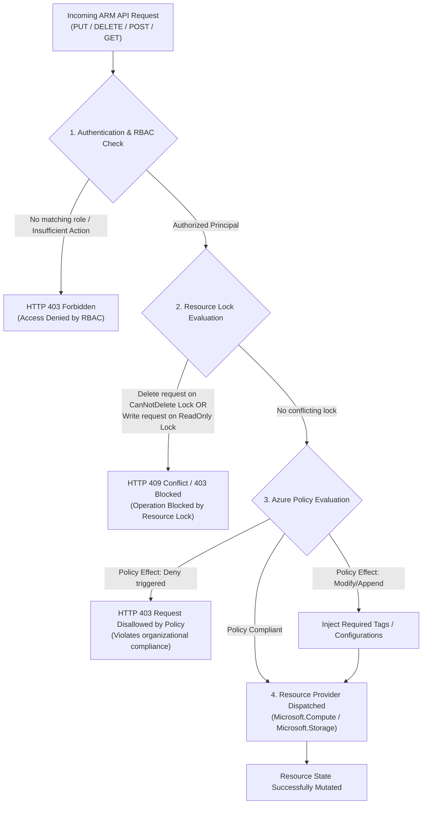
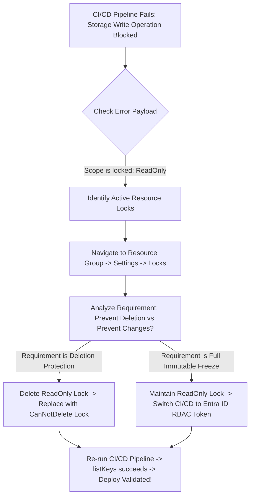

# Module 13-104-03: Administer Governance, Compliance & Access Control

**Breadcrumbs:** [[13-Index - Azure|☁️ Azure Reference MOC]] > [[13-Index - AZ-104|📘 AZ-104 Exam Track]] > **03 - Administer Governance and Compliance**

---

## 🎯 Stage 1: Executive Overview & The Conceptual Lecture

### 1. The Zero-Knowledge Starting Point: Why Cloud Governance Exists
Imagine you hand your company credit card and the keys to a brand-new corporate vehicle to every developer and contractor who joins the engineering team. Without any speed limiters, GPS geo-fencing, or spending caps, what inevitably happens?
* An engineer spinning up a test environment accidentally leaves a cluster of 8-GPU virtual machines running over a 4-day weekend, racking up a $40,000 cloud bill.
* A junior developer mistakenly deploys customer databases to an overseas region, violating international data sovereignty laws (such as GDPR).
* An automated cleanup script goes rogue and deletes the company's primary production storage account containing mission-critical financial ledgers.

In a traditional on-premises datacenter, governance was naturally enforced through **physical scarcity and bureaucratic procurement**:
* To get a server, an engineer had to submit a purchase order, wait 6 weeks for hardware delivery, have the networking team physically plug in cables, and have the storage team zone LUNs on a SAN.
* Security and compliance were audited through physical gates, badge readers, and change advisory boards (CABs).

In the cloud, **procurement is instantaneous software code**:
* Any user with API access can spin up massive compute clusters or delete terabytes of storage with a single command line script.
* **Governance cannot be an afterthought.** Cloud Governance is the automated system of guardrails, access boundaries, and compliance rules that empowers developers to move at maximum speed while preventing catastrophic accidents and budget bankruptcies.

### 2. The Three Pillars of Azure Governance (Decoding the Core Triad)
Every cloud administrator must memorize the fundamental distinction between the three primary governance mechanisms in Microsoft Azure:

```text
+------------------------------------------------------------------------------------------------+
|                             THE THREE PILLARS OF AZURE GOVERNANCE                              |
+------------------------------------------------------------------------------------------------+
|  1. Azure RBAC               |  2. Azure Policy             |  3. Azure Resource Locks         |
|     (Who Can Do What)        |     (What Can Be Deployed)   |     (Protect What Already Exists)|
+------------------------------+------------------------------+----------------------------------+
| - Focus: Identity & Actions  | - Focus: Resource Properties | - Focus: Accidental Mutation     |
| - Answers: "Can Bob deploy   | - Answers: "Is this VM SKU   | - Answers: "Can ANYONE delete    |
|   or delete a VM?"           |   allowed in this region?"   |   this production resource?"     |
| - Controls: Authorization at | - Controls: Property guard-  | - Controls: Control plane state  |
|   the ARM control plane      |   rails & compliance tags    |   freezes (Delete / ReadOnly)    |
| - Overridden by: Locks!      | - Evaluates: JSON manifests  | - Overrides: ALL RBAC Owners!    |
+------------------------------------------------------------------------------------------------+
```

### 3. Terminology Matrix: Zero-Knowledge to Enterprise Architect

| Terminology | What It Means to a Beginner | Real-World Analog | Enterprise Architecture Reality |
| :--- | :--- | :--- | :--- |
| **Management Group** | A master folder that groups multiple subscriptions. | A corporate division (e.g., "Retail Banking" vs "Commercial Banking"). | A governance boundary container above subscriptions that enables policy and RBAC inheritance across up to 6 levels of depth. |
| **Subscription** | The company billing account and credit card container. | A separate company credit card invoice for each department. | A dual boundary in Azure: it is both the ultimate billing/invoice container and a top-level quota and RBAC boundary. |
| **Resource Group (RG)** | A folder that holds related resources for an app. | A box holding all parts of a model airplane (wings, engine, cockpit). | A logical lifecycle container; deleting the Resource Group irrevocably deletes every resource contained inside it. |
| **Azure RBAC** | Giving specific keys to specific employees. | Hotel keycard that unlocks only Room 402 and the gym, but not the penthouse. | An authorization system built on Azure Resource Manager (ARM) assigning `Actions` and `DataActions` to security principals across a defined scope. |
| **Azure Policy** | Automated traffic cameras and speed limiters. | Building code inspector who blocks construction if walls aren't fireproof. | An ARM-integrated rules engine that evaluates resource configurations against JSON rules and enforces `Deny`, `Audit`, `Modify`, or `DeployIfNotExists`. |
| **Resource Lock** | A physical padlock over the power switch. | A safety cap over the red nuclear launch button. | An ARM control plane flag (`CanNotDelete` or `ReadOnly`) that intercepts and denies delete or update requests regardless of the user's RBAC role. |
| **Resource Tags** | Sticky notes attached to each server. | Price tags and barcode labels on grocery store items. | Key-value string pairs (up to 50 per resource) indexed by ARM to enable FinOps cost allocation, chargebacks, and operational filtering. |

---

## 🏛️ Stage 2: Core Mental Model & Component Architecture

### 1. The 4-Tier Management Hierarchy
To govern thousands of resources across global enterprises, Azure organizes resources into an immutable 4-level hierarchy. Governance policies, permissions, and compliance rules **cascade downward by inheritance**:

```text
Level 1: Tenant Root Management Group (All subscriptions roll up here)
             │
             ├── Management Group: "Core Platform"
             │     └── Subscription: "Shared-Networking-Hub"
             │           └── Resource Group: "rg-hub-firewall"
             │                 └── Resource: Azure Firewall
             │
             └── Management Group: "Enterprise Workloads"
                   │
                   ├── Management Group: "Production" (Strict Policies & Locks)
                   │     └── Subscription: "Prod-Billing-System"
                   │           └── Resource Group: "rg-prod-db"
                   │                 └── Resource: Azure SQL Database
                   │
                   └── Management Group: "Non-Production" (Dev/Test Offers)
                         └── Subscription: "Dev-Sandbox"
                               └── Resource Group: "rg-dev-sandbox"
                                     └── Resource: Test Linux VM
```

#### Hierarchy Architecture Laws:
1. **Inheritance Law:** An RBAC role assignment or Azure Policy assigned at a parent level (e.g., Tenant Root or Management Group) is automatically inherited by all child Management Groups, Subscriptions, Resource Groups, and Resources.
2. **Management Group Constraints:**
   - Management Groups can nest up to **6 levels of depth** (excluding the Root group and the Subscriptions themselves).
   - A single directory tree supports up to 10,000 management groups.
   - Each subscription belongs to **exactly one** management group at any given time.
3. **The Tenant Root Group Elevation:** By default, an Entra ID Global Administrator does **NOT** have access to Azure Subscriptions. However, in emergency or governance scenarios, a Global Administrator can toggle **Access management for Azure resources** in Entra ID Properties. This elevates the administrator to the **User Access Administrator** role at the Tenant Root Group (`/`), allowing them to assign RBAC roles across every subscription in the entire tenant.

---

### 2. Resource Groups: The Lifecycle Law
A **Resource Group** is a fundamental container in ARM. Junior administrators frequently make the mistake of grouping resources by *type* (e.g., putting all virtual machines in one group, and all databases in another). 

> [!IMPORTANT]
> **The Golden Rule of Resource Groups (Lifecycle Binding):**
> Resources that share the **same deployment lifecycle, management lifecycle, and decommissioning schedule** should reside in the same Resource Group!
> - If an application consists of a Web App, a Database, and an App Insights instance that are deployed together and will be decommissioned together when the project finishes, **put them in the same Resource Group**.
> - When the project is retired, deleting that single Resource Group cleanly purges all associated resources, leaving zero orphaned disks or lingering cost leaks!

#### Resource Group Architectural Rules:
* **Region Decoupling:** A Resource Group has a metadata location (e.g., `East US`), but the resources inside it can reside in **any geographic region worldwide** (e.g., a VM in `West Europe` and a storage account in `Japan East`).
* **No Nesting:** Resource Groups cannot be nested inside other Resource Groups.
* **No Renaming:** Once created, a Resource Group **cannot be renamed**.
* **Resource Moving:** Resources can be moved to another Resource Group or another Subscription without rebuilding, provided the resource provider supports the move operation (`Move-AzResource`).

---

### 3. Azure Resource Tags & The Tag Inheritance Myth
Tags are metadata key-value pairs (maximum 50 tags per resource/resource group) used extensively for cost center chargebacks, environment tracking, and automation:

```json
{
  "Environment": "Production",
  "CostCenter": "CC-FIN-9042",
  "Owner": "data-platform-leads@contoso.com",
  "DisasterRecovery": "Tier-1-Mission-Critical"
}
```

> [!CAUTION]
> **The Tag Inheritance Myth:**
> In Azure, **resources DO NOT inherit tags from their parent Resource Group!**
> If you apply the tag `Environment: Production` to the Resource Group `rg-prod-web`, a Virtual Machine deployed inside that group will have **zero tags** by default!
> To enforce tag inheritance, you must deploy an **Azure Policy** with the `Modify` or `Append` effect that copies the tag from the resource group down to child resources during deployment.

---

## 🏢 Stage 3: Deep-Intuition Platform Mechanics & Topology

### 1. The ARM Ingress Pipeline: How Azure Decides Allow vs. Deny
Whenever an administrator, a CI/CD pipeline, or a Terraform script attempts to deploy, modify, or delete a resource in Azure, the request hits the **Azure Resource Manager (ARM)** control plane. ARM processes every request through a rigid 4-step pipeline:



---

### 2. Azure RBAC Mechanics: The 3-Component Model
Azure RBAC governs who can execute actions on Azure resources. It is decoupled into three independent components:

```text
[ 1. Security Principal (Who) ]       [ 2. Role Definition (What) ]          [ 3. Scope (Where) ]
  - User Account (Alice)                - Actions (Control plane writes)        - Management Group
  - Security Group (DevOps Leads)       - NotActions (Subtractions)             - Subscription
  - Service Principal (CI/CD GitHub)    - DataActions (Data plane access)       - Resource Group
  - Managed Identity (VM App)           - NotDataActions                        - Resource
                     \                           |                           /
                      \                          |                          /
                       ▼                         ▼                         ▼
                      +-----------------------------------------------------+
                      |                   ROLE ASSIGNMENT                   |
                      |  "Principal Alice is granted Contributor on rg-db"  |
                      +-----------------------------------------------------+
```

#### Core Built-In Roles Reference:
* **Owner:** Full access to all resources + **can grant/delegate permissions to other users** via RBAC (`Microsoft.Authorization/*`).
* **Contributor:** Full access to manage all resources (create, start, stop, delete), but **CANNOT grant access to others**.
* **Reader:** Read-only access to view resources; cannot deploy or modify anything.
* **User Access Administrator:** Can grant and manage access permissions (RBAC), but cannot deploy or manage the actual compute/storage resources themselves.

#### The `NotActions` Subtraction Trap (High-Yield Concept!)
When constructing Custom RBAC roles, administrators frequently misunderstand the `NotActions` property:

```json
{
  "Name": "Custom VM Operator",
  "IsCustom": true,
  "Actions": [
    "Microsoft.Compute/*"
  ],
  "NotActions": [
    "Microsoft.Compute/virtualMachines/delete"
  ],
  "AssignableScopes": [
    "/subscriptions/00000000-0000-0000-0000-000000000000"
  ]
}
```

> [!WARNING]
> **`NotActions` is NOT a Deny rule!**
> In Azure RBAC, permissions are purely **additive**.
> `NotActions` simply performs mathematical subtraction from the `Actions` array:
> $$\text{Effective Permissions} = \text{Actions} - \text{NotActions}$$
> If a user is assigned this Custom VM Operator role AND also assigned the standard **Contributor** role, **the user CAN delete the virtual machine!** Why? Because the Contributor role explicitly grants the delete action, and `NotActions` does not block permissions granted by other role assignments.
> The only way to enforce an absolute block regardless of roles is via **Azure Policy (`Deny`)** or an ARM **Resource Lock**.

---

### 3. Azure Policy Architecture & Policy Effects
Azure Policy evaluates the **properties and configuration** of resources during creation and on a continuous 24-hour background cycle.

#### Policy Structure Anatomy:
A policy consists of an `if` condition and a `then` effect:
```json
{
  "properties": {
    "displayName": "Deny Unapproved VM Sizes",
    "policyRule": {
      "if": {
        "allOf": [
          { "field": "type", "equals": "Microsoft.Compute/virtualMachines" },
          { "field": "Microsoft.Compute/virtualMachines/sku.name", "notIn": "[parameters('allowedSKUs')]" }
        ]
      },
      "then": {
        "effect": "deny"
      }
    }
  }
}
```

#### Policy Effects Matrix:
* **`Deny`:** Evaluated during the ARM ingress pipeline. If the condition matches, ARM immediately aborts the deployment and returns `HTTP 403 Request Disallowed by Policy`.
* **`Audit`:** Evaluated during deployment and background scans. Allows the resource to be created, but marks the resource as non-compliant in the Compliance Dashboard.
* **`Append`:** Automatically injects required properties into the deployment payload (e.g., adding default subnet rules).
* **`Modify`:** Adds or replaces tags and properties on resources during creation or via automated remediation tasks.
* **`DeployIfNotExists (DINE)`:** If a parent resource is created without an expected child resource (e.g., deploying a VM without the Azure Monitor Agent extension), DINE automatically triggers an ARM template deployment to provision the missing component using a Managed Identity.
* **`Disabled`:** Disables rule evaluation.

#### Policy Initiatives (Policy Sets):
An **Initiative** is an aggregation of multiple individual policy definitions bundled together to satisfy an overarching compliance mandate (e.g., *NIST SP 800-53 Compliance*, *ISO 27001*, or *Enterprise Cost Guardrails*). Assigning an initiative applies all included policies simultaneously across the target scope.

#### Policy Enforcement Modes:
When assigning an Azure Policy or Initiative, administrators select an **Enforcement Mode**:
* **`Default` (Enabled):** The policy rule is actively enforced during ARM request evaluation. Any deployment violating a `Deny` policy is actively blocked (`HTTP 403`).
* **`DoNotEnforce` (Disabled / Audit-First Rollout):** The policy rule effect is not enforced during deployment (i.e., ARM will NOT block requests). However, the Azure Policy evaluation engine still assesses resource compliance and reports non-compliant resources in the Compliance Dashboard. This allows enterprise platform teams to safely test and observe policy impacts before turning on active blocking!

#### Azure Policy Remediation Mechanics:
* **The Retroactive Limitation:** When an Azure Policy with `DeployIfNotExists` or `Modify` is assigned, it automatically affects **newly created or updated resources**. However, existing pre-existing resources that are non-compliant are **NOT automatically altered**!
* **Remediation Tasks:** To bring existing legacy resources into compliance, an administrator must explicitly trigger a **Remediation Task** (`az policy remediation create` or `Start-AzPolicyRemediation`).
* **Managed Identity Prerequisite:** For policies utilizing `DeployIfNotExists` or `Modify`, Azure Policy requires a **Managed Identity** (System-Assigned or User-Assigned) granted appropriate Azure RBAC roles on the target scope to perform template deployments or modify resource tags on behalf of the platform.

---

### 4. Resource Locks: CanNotDelete vs. ReadOnly
Resource Locks protect against accidental modification or deletion. **Locks apply to ALL users, including Subscription Owners and Global Admins!**

```text
Lock Type: CanNotDelete (Delete Lock)
├── Read Resource Configurations?    ==> ALLOWED
├── Modify / Update / Scale VM?      ==> ALLOWED
├── Restart / Stop Virtual Machine?   ==> ALLOWED
└── Delete Resource or Resource Group?==> BLOCKED (HTTP 409 Conflict)

Lock Type: ReadOnly (Read-Only Lock)
├── Read Resource Configurations?    ==> ALLOWED
├── Modify / Update / Scale VM?      ==> BLOCKED
├── Restart / Stop Virtual Machine?   ==> BLOCKED (Updating power state is a write action!)
├── List Storage Account Keys?       ==> BLOCKED (listKeys is an HTTP POST write action!)
└── Delete Resource or Resource Group?==> BLOCKED
```

> [!IMPORTANT]
> **The Storage Account `listKeys` ReadOnly Trap:**
> When a `ReadOnly` lock is placed on a Resource Group containing an Azure Storage Account, users cannot retrieve the account access keys via the portal or CLI (`az storage account keys list`).
> Why? Because retrieving keys is an `HTTP POST` operation (`Microsoft.Storage/storageAccounts/listKeys/action`). ARM treats POST actions as write operations because they expose or can regenerate secrets. Under a `ReadOnly` lock, all POST and PUT actions are blocked!

---

### 5. Resource Moving Prerequisites & Constraints
When transferring resources between Resource Groups or Subscriptions:
1. **Dependency Bundling:** Resources that depend on one another must move together in the same operation. For example, moving an Azure Virtual Machine requires moving the VM, the OS disk, all attached data disks, the Network Interface Card (NIC), and any attached Public IP address simultaneously.
2. **Lock Clearance:** All Resource Locks must be removed from both the source and destination Resource Groups before the move operation can proceed.
3. **Tenant Boundary Law:** Resources cannot be moved directly across different Entra ID tenants. The subscription containing the resources must first be reassigned to the target tenant.

---

## ⚙️ Stage 4: Declarative & Automation Engine (CLI & PowerShell Core)

### 1. Azure CLI: Governance & Compliance Recipes

```bash
# ==============================================================================
# 1. RESOURCE GROUP & TAGGING MANAGEMENT
# ==============================================================================

# Create a production resource group with corporate compliance tags
az group create \
  --name "rg-enterprise-workloads" \
  --location "eastus" \
  --tags Environment=Production CostCenter=CC-8042 Owner=cloud-ops@contoso.com

# Apply a CanNotDelete lock to protect the entire resource group
az lock create \
  --name "lock-prevent-accidental-delete" \
  --lock-type "CanNotDelete" \
  --resource-group "rg-enterprise-workloads" \
  --notes "Protects production database and compute assets from accidental deletion"

# ==============================================================================
# 2. CUSTOM AZURE RBAC ROLE DEPLOYMENT
# ==============================================================================

# Create a custom role definition JSON file
cat << 'EOF' > custom-vm-operator.json
{
  "Name": "Custom VM Operator (No Delete)",
  "IsCustom": true,
  "Description": "Allows starting, restarting, and stopping VMs without deletion authority.",
  "Actions": [
    "Microsoft.Compute/virtualMachines/read",
    "Microsoft.Compute/virtualMachines/start/action",
    "Microsoft.Compute/virtualMachines/restart/action",
    "Microsoft.Compute/virtualMachines/powerOff/action"
  ],
  "NotActions": [
    "Microsoft.Compute/virtualMachines/delete"
  ],
  "AssignableScopes": [
    "/subscriptions/SUBSCRIPTION_ID_REPLACE"
  ]
}
EOF

# Substitute your active subscription ID and create the role
SUB_ID=$(az account show --query id -o tsv)
sed -i "s/SUBSCRIPTION_ID_REPLACE/${SUB_ID}/g" custom-vm-operator.json
az role definition create --role-definition custom-vm-operator.json

# ==============================================================================
# 3. AZURE POLICY ASSIGNMENT (ALLOWED LOCATIONS)
# ==============================================================================

# Retrieve the built-in policy definition ID for allowed locations
POLICY_DEF_ID=$(az policy definition list --query "[?displayName=='Allowed locations'].id" -o tsv)

# Assign the policy to enforce deployments strictly in East US and West US
az policy assignment create \
  --name "enforce-allowed-regions" \
  --display-name "Enforce US Regions Only" \
  --policy "${POLICY_DEF_ID}" \
  --params '{"listOfAllowedLocations": {"value": ["eastus", "westus"]}}' \
  --scope "/subscriptions/${SUB_ID}/resourceGroups/rg-enterprise-workloads"

# ==============================================================================
# 4. AZURE POLICY REMEDIATION TASK AUTOMATION
# ==============================================================================
# Trigger an explicit remediation task for existing non-compliant resources (DINE/Modify)
az policy remediation create \
  --name "remediate-non-compliant-resources" \
  --policy-assignment "enforce-allowed-regions" \
  --resource-group "rg-enterprise-workloads"
```

### 2. Azure PowerShell: Management Group & Cost Budget Engine

```powershell
# ==============================================================================
# 1. MANAGEMENT GROUP CREATION & SUBSCRIPTION PLACEMENT
# ==============================================================================
# Create an Enterprise Workloads Management Group
$mgParams = @{
    GroupName   = "mg-enterprise-workloads"
    DisplayName = "Enterprise Workloads Division"
}
New-AzManagementGroup @mgParams

# Move active subscription into the new Management Group
$subId = (Get-AzContext).Subscription.Id
New-AzManagementGroupSubscription -GroupName "mg-enterprise-workloads" -SubscriptionId $subId

# ==============================================================================
# 2. COST MANAGEMENT BUDGET & ALERT THRESHOLDS
# ==============================================================================
# Define a $5,000 monthly budget with multi-threshold email notifications
$budgetParams = @{
    Name                  = "Monthly-Ops-Budget"
    Amount                = 5000
    TimeGrain             = "Monthly"
    StartDate             = (Get-Date -Day 1).ToString("yyyy-MM-dd")
    EndDate               = (Get-Date).AddYears(1).ToString("yyyy-MM-dd")
    ResourceGroupName     = "rg-enterprise-workloads"
    NotificationKey       = "Threshold85Percent"
    NotificationThreshold = 85
    ContactEmail          = @("finops-alerts@contoso.com", "billing-owner@contoso.com")
}
# Executed via New-AzConsumptionBudget in production automation
```

---

## 🖥️ Stage 5: Step-by-Step Azure Portal GUI Walkthrough

Follow these exact navigation steps in the **Azure Portal** (`https://portal.azure.com`) to master governance workflows:

### Task 1: Building a Management Group Hierarchy
1. In the search bar at the top, type **Management groups** and select it.
2. In the tree view, locate the **Tenant Root Group**. Click on the root group, then click **+ Create**.
3. In the creation pane:
   - **Management group ID:** `mg-workloads-prod`.
   - **Management group display name:** `Production Workloads`.
4. Click **Submit**.
5. Once created, click on `Production Workloads` $\rightarrow$ click **+ Add subscription** $\rightarrow$ select your target subscription $\rightarrow$ click **Save**.

### Task 2: Creating a Custom RBAC Role Using the Visual Builder
1. Navigate to **Subscriptions** (or search for your specific Resource Group).
2. Click on **Access control (IAM)** in the left navigation menu.
3. Click **+ Add** on the command bar $\rightarrow$ select **Add custom role**.
4. In the **Basics** tab:
   - **Custom role name:** `Virtual Machine Operator (No Delete)`.
   - **Description:** `Can start, restart, and deallocate VMs but cannot delete them`.
   - **Baseline permissions:** Leave as *Start from scratch*. Click **Next**.
5. In the **Permissions** tab:
   - Click **+ Add permissions**.
   - In the search box, type `Microsoft.Compute/virtualMachines`.
   - Check the boxes for:
     - `Microsoft.Compute/virtualMachines/read`
     - `Microsoft.Compute/virtualMachines/start/action`
     - `Microsoft.Compute/virtualMachines/restart/action`
     - `Microsoft.Compute/virtualMachines/powerOff/action`
   - Click **Add**.
6. In the **Assignable scopes** tab, verify that your subscription or resource group scope is listed.
7. In the **JSON** tab, review the generated role definition schema. Click **Review + create** $\rightarrow$ **Create**.

### Task 3: Applying and Testing Resource Locks
1. Navigate to your target Resource Group (e.g., `rg-enterprise-workloads`).
2. In the left navigation menu, scroll down to **Settings** $\rightarrow$ click **Locks**.
3. On the top command bar, click **+ Add**.
4. Configure the lock:
   - **Lock name:** `lock-prevent-deletion`.
   - **Lock type:** Select **Delete** (`CanNotDelete`).
   - **Notes:** `Mission critical production container`.
5. Click **OK**.
6. **Test the Lock:** Go back to the **Overview** blade of the Resource Group and click **Delete resource group**. Type the name of the group and click **Delete**. Notice that Azure immediately halts the deletion with an error stating the resource group is locked!

### Task 4: Assigning an Azure Policy with the Deny Effect
1. In the portal search bar, type **Policy** and select it.
2. In the left navigation menu, click **Definitions** under *Authoring*.
3. In the search box, type `Allowed locations` and click on the built-in policy definition.
4. On the top command bar, click **Assign**.
5. In the **Basics** tab:
   - **Scope:** Click the ellipsis (`...`) and select your subscription and Resource Group.
   - **Assignment name:** `Enforce East US and West US Only`.
   - **Policy enforcement:** Ensure it is set to **Enabled**. Click **Next**.
6. In the **Parameters** tab:
   - Deselect *Only show parameters that need input*.
   - In the **Allowed locations** multi-select dropdown, check **East US** and **West US**.
7. Click **Review + create** $\rightarrow$ **Create**. Any subsequent attempt to deploy a resource in `Central US` or `North Europe` will be immediately rejected with an HTTP 403 policy violation!

---

## 🔬 Stage 6: Hands-On Enterprise Lab Bridge

To implement these governance mechanisms in a live sandbox environment, transition directly to the practical enterprise lab:

> [!TIP]
> **Practical Implementation Companion:**
> Access the comprehensive engineering lab at:
> **[[Lab-03_Custom_RBAC_Resource_Locks_and_Azure_Policy|Lab 03: Custom RBAC Role Engineering, Resource Locks & Azure Policy Governance]]**
> 
> *Target Lab File:* `Projects/AZ-104/03_Governance_and_Compliance/Lab-03_Custom_RBAC_Resource_Locks_and_Azure_Policy.md`

### Lab Objectives Matrix:

```text
+-----------------------------------------------------------------------------------------+
| Lab 03 Enterprise Milestone Goals                                                       |
+-----------------------------------------------------------------------------------------+
| 1. Construct a multi-tier Management Group hierarchy in the Azure Portal GUI            |
| 2. Engineer and assign a Custom RBAC Role via the visual JSON/IAM builder               |
| 3. Apply CanNotDelete and ReadOnly resource locks to observe ARM control plane freezes  |
| 4. Deploy Azure Policy with Deny effect to block unauthorized geographic deployments    |
| 5. Execute Policy Remediation Tasks with Managed Identity to inject missing tags        |
+-----------------------------------------------------------------------------------------+
```

---

## ⚠️ Stage 7: "See It in Action" Real-World Failure & Recovery Loop (AARF)

### Scenario: The "Locked Storage & Broken CI/CD Pipeline" Outage

#### 1. The Architectural Setup & Assumptions
An enterprise hosting a critical customer portal implements an automated CI/CD pipeline using GitHub Actions to deploy web artifacts into an Azure Storage Account static website (`$web` container). To protect the production storage account from accidental deletion by junior staff, a senior security engineer applies a **`ReadOnly`** lock to the parent Resource Group `rg-customer-portal`.

#### 2. The Production Failure Manifestation
That night, the software development team pushes an emergency hotfix. The CI/CD pipeline runs `az storage blob upload-batch` to upload new JavaScript and HTML files. The pipeline crashes with the following error:

```text
ERROR: The scope '/subscriptions/00000000-0000-0000-0000-000000000000/resourceGroups/rg-customer-portal/providers/Microsoft.Storage/storageAccounts/stportalprod' cannot perform write operation because following scope(s) are locked: 'rg-customer-portal: ReadOnly'. Please remove the lock and try again.
Exit code: 1
Workflow failed: Step 'Deploy to Azure Storage' failed.
```

#### 3. Root Cause Analysis (RCA) & Deep Investigation
Why did blob upload fail when the engineer only intended to prevent someone from deleting the storage account?
1. **The CLI Authentication Mechanism:** The CI/CD script used Azure CLI with storage account keys (`--account-key`). To execute the command, the CLI automatically performed an ARM call:
   `POST https://management.azure.com/.../storageAccounts/stportalprod/listKeys?api-version=2023-01-01`
2. **The ReadOnly Lock Interception:** In ARM architecture, `listKeys` is an **HTTP POST** operation. Because listing keys can expose or regenerate secrets, ARM classifies all POST operations as write/mutation events.
3. **The Control Plane Freeze:** A `ReadOnly` lock strictly denies all HTTP methods except `GET`. When ARM received the POST request for `listKeys`, it intercepted and blocked the call at the control plane before the request could ever reach the storage data plane!
4. **The Second Failure (Power States):** Virtual Machines residing in that same resource group were also unable to be restarted or deallocated during nightly patching because stopping a VM changes compute allocation properties in ARM.

#### 4. Remediation & Diagnostic Verification Loop



```bash
# Diagnostic & Remediation Script (Run in Azure Cloud Shell)

# 1. Inspect existing locks on the Resource Group
az lock list --resource-group "rg-customer-portal" --output table

# 2. Delete the disruptive ReadOnly lock
az lock delete --name "rg-freeze-lock" --resource-group "rg-customer-portal"

# 3. Apply the correct CanNotDelete lock (permits updates & key listing, blocks deletion)
az lock create \
  --name "lock-protect-production-storage" \
  --lock-type "CanNotDelete" \
  --resource-group "rg-customer-portal" \
  --notes "Permits CI/CD updates while strictly blocking resource group deletion"
```

---

## 💡 Stage 8: High-Yield AZ-104 Exam Scenarios & Trick Question Traps

### Trick Question Trap 1: The Only Operational Difference Between Owner and Contributor
* **The Scenario:** A question presents two engineers, Alice (assigned `Owner`) and Bob (assigned `Contributor`). Both have access to Subscription A. The question asks which specific tasks Alice can perform that Bob cannot.
* **The Trap:** The question offers answers like "Alice can delete the subscription, Bob cannot", or "Alice can deploy ExpressRoute, Bob cannot".
* **The Ground Truth:** A **Contributor can do EVERYTHING an Owner can do** in terms of deploying, modifying, stopping, starting, and deleting Azure resources. The **ONLY** operational difference is that the Owner possesses `Microsoft.Authorization/*` permissions, meaning **Owner can assign RBAC roles and delegate access to others**, whereas Contributor cannot assign roles or modify access policies!

### Trick Question Trap 2: Tagging Inheritance on Newly Created VMs
* **The Scenario:** The Resource Group `rg-analytics` has the tags `CostCenter: 991` and `Environment: Prod`. An administrator deploys an Azure Virtual Machine named `vm-worker-01` into `rg-analytics` using an ARM template without specifying any tags in the template.
* **The Question:** What tags exist on `vm-worker-01` after deployment?
* **The Trap:** The exam suggests the VM automatically has `CostCenter: 991` and `Environment: Prod`.
* **The Ground Truth:** **Zero tags exist on the VM!** Resource tags are **never inherited** from parent resource groups. To enforce tag inheritance, you must deploy an **Azure Policy** with the `Modify` or `Append` effect.

### Trick Question Trap 3: Policy Enforcement vs. Resource Locks (Scenario Disambiguation)
* **Rule 1:** If the requirement is to **prevent the deployment of unauthorized resource sizes, SKUs, or geographic regions**, the answer is **Azure Policy (`Deny` effect)**.
* **Rule 2:** If the requirement is to **prevent accidental deletion of an existing production database**, the answer is an **Azure Resource Lock (`CanNotDelete`)**.
* **Rule 3:** If the requirement is to **prevent anyone from modifying configurations or restarting a VM**, the answer is an **Azure Resource Lock (`ReadOnly`)**.
* **Rule 4:** If the requirement is to **ensure resources are automatically deployed with a Log Analytics agent**, the answer is an **Azure Policy (`DeployIfNotExists`)**.

### Trick Question Trap 4: Moving Resources Across Subscriptions with Locks Attached
* **The Scenario:** You need to transfer a virtual machine and its disks from Subscription A to Subscription B. The parent Resource Group has a `CanNotDelete` lock applied. You attempt to initiate the move via `Move-AzResource`.
* **The Trap:** Why does the move fail?
* **The Ground Truth:** Moving a resource involves unlinking it from the source container and registering it in the target container. An active Resource Lock on the source or destination Resource Group will **block the move operation**. You must **temporarily delete the lock**, execute the transfer, and then re-apply the lock on the destination resource group.

### Trick Question Trap 5: Policy Retroactive Evaluation vs. Remediation Tasks
* **The Scenario:** An administrator assigns a new Azure Policy with the `Modify` effect that adds a mandatory tag (`Environment: Prod`) to all virtual machines. The administrator checks existing VMs created last week and notices that none of them have received the tag.
* **The Trap:** Did the policy fail to apply?
* **The Ground Truth:** **NO! Azure Policy `Modify` and `DeployIfNotExists` do NOT retroactively alter existing resources automatically!** They only evaluate and modify resources created or updated *after* the assignment. To remediate existing legacy resources, the administrator must explicitly launch a **Remediation Task** (`az policy remediation create` or via the Azure Portal Remediation tab).

### Trick Question Trap 6: Policy EnforcementMode: Default vs. DoNotEnforce in CI/CD Pre-flight
* **The Scenario:** A DevOps team complains that their CI/CD deployment pipeline failed because an administrator assigned a strict `Deny` policy without giving the developers time to update their Terraform templates. The platform team wants to test future policies and identify non-compliant workloads in dashboards without breaking developer deployments.
* **The Trap:** Which configuration should the platform team use when assigning the policy?
* **The Ground Truth:** Set **`enforcementMode` to `DoNotEnforce`** (Disabled in the GUI). This mode instructs ARM to evaluate compliance and flag non-compliant resources in Azure Policy reports, but it **will not block** resource deployments or API requests!

---

## 🌐 Authoritative References & Inflow Citations

* **Udemy AZ-104 Master Class by Scott Duffy:** [Inflow: Module 03 - Administer Governance and Compliance](file:///F:/Dump%20one/BrainDump/inflow/AZ-104-ScottDuffy/03_Administer_Governance_and_Compliance.md)
* **John Savill’s Azure Master Class & Deep Dives:** Governance Architecture, Management Groups Hierarchy, RBAC Action vs NotAction Mechanics, and Key Vault Security Boundaries.
* **Moe Intelligence AZ-104 Video Curriculum:** Lessons 08 through 14 (Subscriptions, Resource Groups, Azure Policy, RBAC, Locks).
* **KodeKloud AZ-104 Course:** [Administer Governance and Compliance Module](https://notes.kodekloud.com/docs/Updated-AZ-104-Microsoft-Azure-Administrator/Administer-Governance-and-Compliance/Module-Introduction/page.md)
* **Official Microsoft Learn Documentation:**
  - [Azure Governance Documentation](https://learn.microsoft.com/en-us/azure/governance/)
  - [Manage subscriptions and governance in Azure](https://learn.microsoft.com/en-us/training/modules/manage-subscriptions-and-resources/)
  - [Control access to Azure resources with RBAC](https://learn.microsoft.com/en-us/training/modules/secure-azure-resources-with-rbac/)
  - [Azure Policy Overview & Effects](https://learn.microsoft.com/en-us/azure/governance/policy/overview)
  - [Remediate non-compliant resources with Azure Policy](https://learn.microsoft.com/en-us/azure/governance/policy/how-to/remediate-resources)
  - [Lock your resources to prevent unexpected changes](https://learn.microsoft.com/en-us/azure/azure-resource-manager/management/lock-resources)
  - [Plan and manage Azure costs](https://learn.microsoft.com/en-us/azure/cost-management-billing/costs/quick-acm-cost-analysis)
