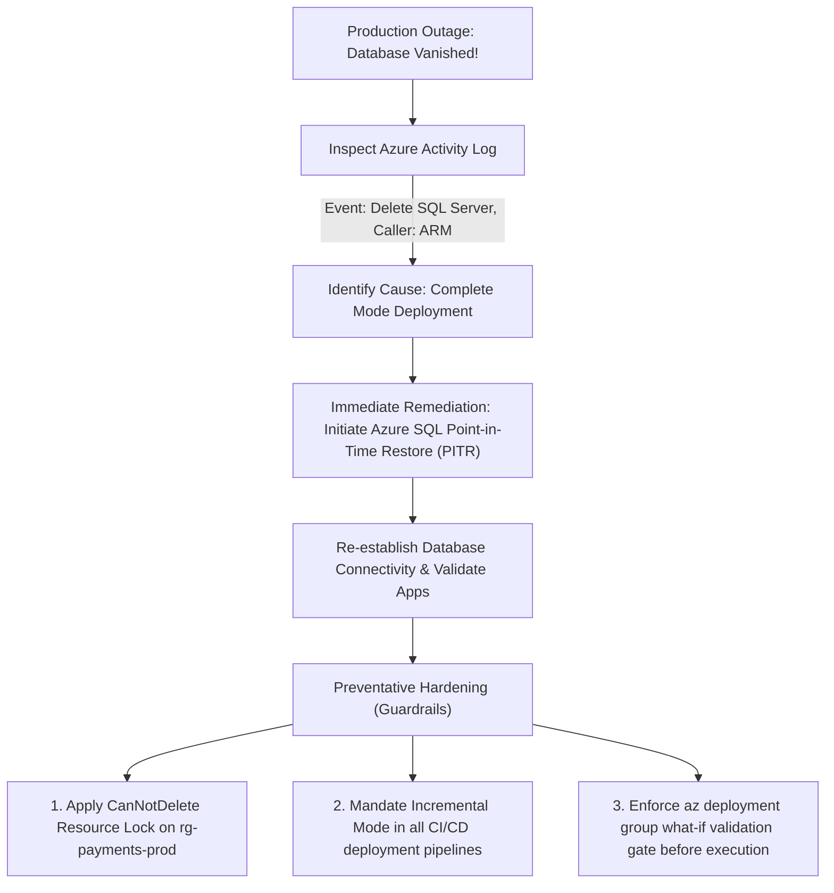

# Module 13-104-04: Administer Azure Resources, ARM & Bicep

**Breadcrumbs:** [[13-Index - Azure|☁️ Azure Reference MOC]] > [[13-Index - AZ-104|📘 AZ-104 Exam Track]] > **04 - Administer Azure Resources**

---

## 🎯 Stage 1: Executive Overview & The Conceptual Lecture

### 1. The Zero-Knowledge Starting Point: Imperative vs. Declarative Infrastructure
When engineers first start with cloud computing, they typically open a web browser, log into the Azure Portal, and click buttons:
1. *Click "Create a resource"* $\rightarrow$ *Virtual Machine*
2. *Type in VM name, choose Ubuntu, pick Standard_B2s, configure disks...*
3. *Click "Next: Networking", choose subnet...*
4. *Click "Review + Create"*

This manual, point-and-click workflow is called **Click-Ops** (or manual administration). While fine for experimenting with a single test VM, it completely collapses in enterprise environments:
* **Human Error:** If you must deploy identical environments across Development, Staging, and Production across 3 global regions, human administrators will inevitably mistype an IP address, forget a security rule, or pick the wrong disk SKU.
* **Lack of Auditability:** There is no record of who changed a setting or why.
* **Zero Scalability:** You cannot manually click 500 times to rebuild infrastructure during a catastrophic regional disaster recovery failover.

To solve this, modern cloud operations embrace two distinct automation paradigms:

```text
+------------------------------------------------------------------------------------------------+
|                         IMPERATIVE SCRIPTING vs. DECLARATIVE CODE                              |
+------------------------------------------------------------------------------------------------+
|  1. Imperative (Step-by-Step Instructions)    |  2. Declarative (Desired End-State Blueprint)  |
+-----------------------------------------------+------------------------------------------------+
| - Paradigm: "Tell the computer HOW to do it"  | - Paradigm: "Tell the computer WHAT you want"  |
| - Examples: Bash, Python, PowerShell scripts, | - Examples: ARM Templates, Bicep, Terraform    |
|   raw Azure CLI commands                      |                                                |
| - Mechanics:                                  | - Mechanics:                                   |
|   1. Create resource group rg-web             |   "I declare that rg-web must contain a VNet   |
|   2. Create VNet 10.0.0.0/16                  |    and a Standard_B2s VM with Ubuntu 22.04"    |
|   3. IF VNet fails, script crashes or creates |                                                |
|      half-baked orphaned resources            | - The platform engine figures out how to reach |
| - Re-running: Might fail with "Resource       |   that state, in what order, and skips items   |
|   already exists" errors                      |   that already match! (Idempotent)             |
+-----------------------------------------------+------------------------------------------------+
```

### 2. The Baking Analogy: Imperative Recipe vs. Declarative Blueprint
* **Imperative:** *"Take 2 cups of flour, crack 2 eggs, whisk for 3 minutes, set oven to 350°F, bake for 25 minutes."* If you get interrupted halfway through, you don't know whether the eggs were added or not.
* **Declarative:** *"Here is a 3D scan and chemical specification of a baked chocolate cake. Platform, make the environment match this specification."*

In Microsoft Azure, the unified engine that evaluates declarative blueprints is the **Azure Resource Manager (ARM)**.

### 3. Terminology Matrix: Zero-Knowledge to Enterprise Architect

| Terminology | What It Means to a Beginner | Real-World Analog | Enterprise Architecture Reality |
| :--- | :--- | :--- | :--- |
| **Azure Resource Manager (ARM)** | The brain of Azure that receives all commands. | The air traffic control tower at an international airport. | The centralized control plane REST API gateway through which all authentication, RBAC, policy, and resource mutations are processed. |
| **Resource Provider (RP)** | The specific department in Azure managing a service. | The Department of Motor Vehicles vs. The Tax Authority. | An ARM backend service (e.g., `Microsoft.Compute`, `Microsoft.Network`, `Microsoft.Storage`) that exposes resource types and API versions. |
| **ARM Template (JSON)** | A big JSON text file describing your servers. | An architectural blueprint drawn on a scroll. | A declarative JavaScript Object Notation (JSON) manifest declaring resources, parameters, variables, and outputs for ARM deployment. |
| **Azure Bicep** | A cleaner, easier way to write ARM templates. | Modern CAD software replacing hand-drawn blueprints. | A domain-specific language (DSL) that transpiles transparently into ARM JSON, eliminating verbose JSON syntax and managing dependencies automatically. |
| **Template Spec** | Saving an ARM template directly in the Azure portal. | Storing approved blueprints in the corporate library. | A first-class Azure resource (`Microsoft.Resources/templateSpecs`) storing versioned ARM/Bicep templates secured by Azure RBAC. |
| **Incremental Mode** | Deploy new things without touching existing things. | Adding a new chair to an existing furnished room. | Default ARM deployment mode that adds or updates declared resources while leaving undeclared existing resources completely untouched. |
| **Complete Mode** | Make the resource group look EXACTLY like the file, deleting everything else. | Bulldozing the entire room and installing ONLY what is on the inventory list. | An aggressive ARM deployment mode that deletes any existing resource in the Resource Group that is omitted from the deployment template. |
| **What-If Analysis** | Asking Azure "What will happen if I run this template?" | A flight simulator preview before taking off. | An ARM control plane pre-flight evaluation predicting additions, modifications, and deletions without changing live state. |

---

## 🏛️ Stage 2: Core Mental Model & Component Architecture

### 1. The ARM Control Plane: One API to Rule Them All
Regardless of which tool an administrator or pipeline uses—the Azure Portal GUI, the Azure CLI (`az`), Azure PowerShell (`Az`), an SDK, or an ARM/Bicep template—**every single request reaches the exact same ARM REST API endpoint**:

```text
[ Azure Portal GUI ]    [ Azure CLI ]    [ Azure PowerShell ]    [ Bicep / ARM ]    [ Terraform ]
         │                    │                   │                     │                 │
         └────────────────────┼───────────────────┼─────────────────────┴─────────────────┘
                              │ HTTPS REST Calls (Port 443)
                              ▼
        +-------------------------------------------------------------+
        |             Azure Resource Manager (ARM Control Plane)      |
        |             Endpoint: management.azure.com                  |
        |                                                             |
        |  1. Authenticates Identity via Microsoft Entra ID           |
        |  2. Evaluates Azure RBAC Permissions (Allow/Deny)           |
        |  3. Inspects Resource Locks (CanNotDelete / ReadOnly)       |
        |  4. Enforces Azure Policies (Deny / Audit / Modify)         |
        |  5. Logs Operation to Azure Activity Log                    |
        +-------------------------------------------------------------+
                                      │
                     Dispatches to Resource Providers (RPs)
                                      ▼
        +--------------------+--------------------+--------------------+
        |  Microsoft.Compute | Microsoft.Network  | Microsoft.Storage  |
        |  - virtualMachines | - virtualNetworks  | - storageAccounts  |
        |  - disks           | - networkSecurity  | - blobServices     |
        |  - vmScaleSets     |   Groups           | - fileShares       |
        +--------------------+--------------------+--------------------+
```

### 2. Resource Provider Registration: The Pre-Flight Gate
Before you can deploy any resource, your subscription must have the responsible **Resource Provider** registered.
* Most common providers (`Microsoft.Compute`, `Microsoft.Network`, `Microsoft.Storage`, `Microsoft.Web`) are registered automatically when you create a subscription.
* Less common or newer services (such as `Microsoft.CostManagementExports`, `Microsoft.ContainerService`, or `Microsoft.KubernetesConfiguration`) often show a state of `NotRegistered`.
* If a deployment fails with `MissingSubscriptionRegistration: The subscription is not registered to use namespace 'Microsoft.X'`, an administrator must register the provider:

```bash
# Check provider registration state
az provider show --namespace "Microsoft.ContainerService" --query "registrationState"

# Register the resource provider
az provider register --namespace "Microsoft.ContainerService"
```

---

### 3. Anatomy of an ARM JSON Template
An ARM JSON template consists of six standardized top-level sections:

```text
{
  "$schema": "https://schema.management.azure.com/schemas/2019-04-01/deploymentTemplate.json#",
  "contentVersion": "1.0.0.0",
  "parameters": { ... },    <-- Values passed in at deployment time (e.g., environment, SKU)
  "variables": { ... },     <-- Computed values / strings constructed dynamically inside
  "functions": [ ... ],     <-- Custom reusable user functions
  "resources": [ ... ],     <-- The actual Azure resources to deploy (VM, VNet, Storage)
  "outputs": { ... }        <-- Return values sent back to user/pipeline (e.g., Public IP, FQDN)
}
```

#### Core Built-In Template Functions Reference:
* `parameters('paramName')`: Retrieves the value supplied to a parameter.
* `variables('varName')`: Retrieves the calculated value of a variable.
* `concat('a', 'b', ...)`: Concatenates strings together.
* `uniqueString(resourceGroup().id)`: Generates a deterministic, collision-resistant 13-character alphanumeric hash based on the resource group's unique internal ID. Commonly used to ensure global uniqueness for Storage Account and DNS names!
* `resourceGroup()`: Returns the metadata of the current target resource group (e.g., `resourceGroup().location`).
* `subscription()`: Returns the metadata of the current subscription (`subscription().subscriptionId`).
* `resourceId('Microsoft.Network/virtualNetworks', 'vnet-prod')`: Constructs the fully qualified ARM resource ID string.

---

## 🏢 Stage 3: Deep-Intuition Platform Mechanics & Topology

### 1. Azure Bicep: The Modern Transparent Abstraction
While ARM JSON templates are powerful, JSON was never designed as an Infrastructure-as-Code programming language. JSON is verbose, requires heavy quotation, lacks native comments, and escaping nested expressions like `[concat('str', uniqueString(resourceGroup().id))]` is notoriously error-prone.

Microsoft engineered **Azure Bicep** as a first-class, domain-specific language (DSL) that runs directly on ARM:

```text
[ Developer writes 'main.bicep' ]
  - Clean syntax (no curly braces/quotes on identifiers)
  - Native comments (// or /* */)
  - Automatic dependency ordering
             │
             │ Azure CLI / Bicep Compiler (Transpilation)
             ▼
[ Transpiled 'main.json' ARM Template ]
             │
             │ Dispatched over HTTPS REST
             ▼
[ Azure Resource Manager (ARM Engine) ]
```

#### Bicep vs. ARM JSON: Code Comparison

```carousel
<!-- slide -->
### ARM JSON Syntax (Verbose & Complex)
```json
{
  "$schema": "https://schema.management.azure.com/schemas/2019-04-01/deploymentTemplate.json#",
  "contentVersion": "1.0.0.0",
  "parameters": {
    "storageName": { "type": "string" }
  },
  "resources": [
    {
      "type": "Microsoft.Storage/storageAccounts",
      "apiVersion": "2023-01-01",
      "name": "[parameters('storageName')]",
      "location": "[resourceGroup().location]",
      "sku": { "name": "Standard_LRS" },
      "kind": "StorageV2"
    }
  ]
}
```
<!-- slide -->
### Azure Bicep Syntax (Clean, Concise, Modular)
```bicep
param storageName string
param location string = resourceGroup().location

resource storageAccount 'Microsoft.Storage/storageAccounts@2023-01-01' = {
  name: storageName
  location: location
  sku: {
    name: 'Standard_LRS'
  }
  kind: 'StorageV2'
}

output storageId string = storageAccount.id
```
````

#### Architectural Advantages of Bicep:
1. **Zero State File Management:** Unlike HashiCorp Terraform (which maintains a `terraform.tfstate` file that can get out of sync, corrupted, or leak secrets), Bicep has **no state file**. ARM itself is the single live source of truth.
2. **Day-Zero Provider Support:** The instant Microsoft releases a new Azure service or preview API, it is immediately usable in Bicep on Day 0 without waiting for a third-party plugin to be updated.
3. **Automatic Dependency Resolution:** In ARM JSON, you often had to declare `"dependsOn": ["[resourceId('Microsoft.Network/virtualNetworks', 'vnet-01')]"]`. In Bicep, referencing `vnet.id` automatically instructs the ARM engine to deploy the VNet first before deploying child resources!

---

### 2. Deployment Modes: Incremental vs. Complete (High-Yield Concept!)
When an ARM or Bicep deployment executes, ARM can operate in one of two modes:

```text
Existing State in Resource Group:
[ VM-01 ]   [ VNet-01 ]   [ Database-01 ]
                     │
Deploying Template containing:
[ VNet-01 (Updated) ]   [ Storage-01 (New) ]
                     │
                     ▼
+-----------------------------------------------------------------------------------+
| Mode 1: INCREMENTAL (Default & Safe)                                              |
+-----------------------------------------------------------------------------------+
| - VNet-01 is updated with new properties.                                         |
| - Storage-01 is created.                                                          |
| - VM-01 and Database-01 are LEFT COMPLETELY UNTOUCHED!                            |
+-----------------------------------------------------------------------------------+
| Mode 2: COMPLETE (Aggressive Reconciliation & Catastrophic Hazard!)               |
+-----------------------------------------------------------------------------------+
| - VNet-01 is updated.                                                             |
| - Storage-01 is created.                                                          |
| - VM-01 and Database-01 are PERMANENTLY DELETED because they are not in template! |
+-----------------------------------------------------------------------------------+
```

> [!CAUTION]
> **Complete Mode Production Hazard:**
> Complete mode deletes **any resource in the target resource group that is not declared in the deployment template**. If an engineer accidentally deploys an ARM template using Complete mode against a shared production resource group, ARM will immediately begin issuing DELETE calls against production databases, VMs, and firewalls! Always use **Incremental** mode unless building isolated, ephemeral test environments.

---

### 3. Azure Template Specs: Centralizing Enterprise IaC
In enterprise landing zones, how do central architecture teams ensure branch offices deploy secure, standardized resources?
* **Old Way:** Emailing `.json` files or storing them in private GitHub repos that require personal access tokens or SAS-token-protected storage accounts.
* **Modern Way (Template Specs):** Template Specs (`Microsoft.Resources/templateSpecs`) store ARM and Bicep templates as **first-class native Azure resources** within a resource group:
  * Protected by standard **Azure RBAC** (e.g., granting `Reader` to developer groups so they can deploy, but not modify the template).
  * Native **Semantic Versioning** (`1.0.0`, `1.1.0`, `2.0.0`).
  * **One-Click Portal Deployment:** Users can navigate to the Template Spec in the Azure Portal GUI and click *Deploy* directly from their browser!

---

### 4. Custom Script Extensions (CSE) Runtime Architecture
When deploying virtual machines via IaC, administrators frequently need to run post-deployment bootstrap scripts (e.g., installing NGINX, joining a domain, cloning a Git repository). Azure provides the **Custom Script Extension (CSE)** for Windows and Linux VMs:
* **The 90-Minute Timeout Rule:** A Custom Script Extension has a hardcoded maximum execution timeout of **90 minutes**. If the script takes 90 minutes and 1 second, ARM terminates the extension process and marks the entire VM deployment as `Failed`.
* **The Exit Code 0 Contract:** ARM evaluates script execution based strictly on OS exit codes. The script **must exit with code `0`**. If the script encounters an unhandled error and exits with any non-zero code, ARM reports extension failure.
* **Storage Access:** Scripts can be downloaded from Azure Storage Accounts (using SAS tokens or VM Managed Identities) or public GitHub repositories.

---

## ⚙️ Stage 4: Declarative & Automation Engine (CLI & PowerShell Core)

### 1. Azure CLI: Enterprise IaC & Bicep Recipes

```bash
# ==============================================================================
# 1. TEMPLATE VALIDATION & PREDICTIVE WHAT-IF ANALYSIS
# ==============================================================================

# Validate syntax and parameters before deploying (pre-flight check)
az deployment group validate \
  --resource-group "rg-iac-lab" \
  --template-file "main.bicep" \
  --parameters environmentName="prod" storageSKU="Standard_GRS"

# Run What-If analysis to preview additions (+), modifications (*), and deletions (-)
az deployment group what-if \
  --resource-group "rg-iac-lab" \
  --template-file "main.bicep" \
  --parameters environmentName="prod"

# ==============================================================================
# 2. EXECUTING BICEP / ARM DEPLOYMENTS
# ==============================================================================

# Execute an Incremental deployment directly from a Bicep file
az deployment group create \
  --name "deploy-core-infra-v1" \
  --resource-group "rg-iac-lab" \
  --template-file "main.bicep" \
  --parameters storagePrefix="corpsql" \
  --mode "Incremental"

# ==============================================================================
# 3. BICEP COMPILATION & REVERSE-ENGINEERING
# ==============================================================================

# Transpile Bicep into native ARM JSON
az bicep build --file "main.bicep" --outfile "azuredeploy.json"

# Decompile an existing legacy ARM JSON template into clean Bicep code!
az bicep decompile --file "legacy-template.json"

# ==============================================================================
# 4. TEMPLATE SPECS MANAGEMENT
# ==============================================================================

# Create a published Template Spec with version 1.0.0
az ts create \
  --name "ts-standard-workload" \
  --resource-group "rg-iac-templates" \
  --version "1.0.0" \
  --template-file "main.bicep" \
  --location "eastus" \
  --description "Enterprise standard web and storage baseline"
```

### 2. Azure PowerShell: Deployment & Export Engine

```powershell
# ==============================================================================
# 1. TEST & DEPLOY BICEP TEMPLATES VIA POWERSHELL
# ==============================================================================

# Test template syntax against live subscription
Test-AzResourceGroupDeployment `
  -ResourceGroupName "rg-iac-lab" `
  -TemplateFile "main.bicep"

# Execute Bicep deployment with parameters
New-AzResourceGroupDeployment `
  -Name "deploy-ps-infra-01" `
  -ResourceGroupName "rg-iac-lab" `
  -TemplateFile "main.bicep" `
  -storagePrefix "psinfra" `
  -Mode Incremental

# ==============================================================================
# 2. EXPORT RUNNING RESOURCE GROUP TO ARM TEMPLATE
# ==============================================================================

# Export existing live infrastructure into declarative JSON
Export-AzResourceGroup `
  -ResourceGroupName "rg-iac-lab" `
  -Path "C:\AzureIaC\exported-rg-lab.json" `
  -IncludeParameterDefaultValue
```

---

## 🖥️ Stage 5: Step-by-Step Azure Portal GUI Walkthrough

Follow these exact navigation steps in the **Azure Portal** (`https://portal.azure.com`) to master IaC and resource administration:

### Task 1: Deploying a Custom Template Using the Built-In Portal Editor
1. In the top search bar, type **Deploy a custom template** and select it.
2. Under *Select a template*, click **Build your own template in the editor**.
3. In the template editor window:
   - Notice the visual JSON structure (`parameters`, `variables`, `resources`, `outputs`).
   - Click **+ Add resource** on the toolbar $\rightarrow$ select **Storage account**.
   - Review how Azure automatically injects the standard storage resource block into the JSON schema!
4. Click **Save** on the bottom left.
5. In the **Custom deployment** form:
   - **Subscription:** Select your target subscription.
   - **Resource group:** Select `rg-iac-lab` (or click *Create new*).
   - **Region:** `East US`.
6. Click **Review + create** $\rightarrow$ **Create**.

### Task 2: Inspecting Live Deployment History & Telemetry
1. Navigate to your target Resource Group (e.g., `rg-iac-lab`).
2. In the left navigation menu, under **Settings**, click **Deployments**.
3. You will see a chronological list of every deployment that ever touched this resource group:
   - Click on the most recent deployment name (e.g., `Microsoft.Template-...`).
4. On the deployment details blade:
   - **Inputs:** Review the exact parameter values passed to the template.
   - **Outputs:** Review any return values (e.g., generated storage endpoints, resource IDs).
   - **Operation details:** Click on individual resources to see execution duration, start time, and ARM correlation IDs. If a deployment fails, clicking here reveals the exact JSON error payload returned by the Resource Provider!

### Task 3: Authoring and Publishing an Azure Template Spec
1. In the top search bar, type **Template Specs** and select it.
2. Click **+ Create** $\rightarrow$ **Template Spec**.
3. In the **Basics** tab:
   - **Resource group:** Select `rg-iac-templates`.
   - **Name:** `ts-secure-storage`.
   - **Region:** `East US`.
   - **Version:** `1.0.0`.
   - **Description:** `Production compliant Storage Account with HTTPS and TLS 1.2 enforced`.
4. In the **Template** tab:
   - Paste in your Bicep or JSON template definition.
5. Click **Review + create** $\rightarrow$ **Create**.
6. Once created, click on `ts-secure-storage` $\rightarrow$ click **Deploy** on the command bar to launch a GUI deployment wizard powered directly by your enterprise Template Spec!

### Task 4: Exporting Existing Infrastructure into Declarative Code
1. Navigate to an existing active Resource Group (e.g., `rg-iac-lab`).
2. In the left navigation menu, scroll down to the **Automation** section.
3. Click **Export template**.
4. ARM automatically scans every physical resource in the group, analyzes dependencies, and reverse-engineers a complete ARM JSON template.
5. On the top toolbar, you can click **Download** to save the `.zip` archive, or click **Deploy** to immediately redeploy a clone of this infrastructure into another region!

---

## 🔬 Stage 6: Hands-On Enterprise Lab Bridge

To implement Infrastructure as Code and experience Bicep compilation and Template Specs firsthand, proceed directly to the comprehensive practical lab:

> [!TIP]
> **Practical Implementation Companion:**
> Access the comprehensive engineering lab at:
> **[[Lab-04_Declarative_IaC_with_Bicep_and_ARM|Lab 04: Declarative IaC with ARM Templates, Bicep & Azure Template Specs]]**
> 
> *Target Lab File:* `Projects/AZ-104/04_Azure_Resources_and_Bicep/Lab-04_Declarative_IaC_with_Bicep_and_ARM.md`

### Lab Objectives Matrix:

```text
+-----------------------------------------------------------------------------------------+
| Lab 04 Enterprise Milestone Goals                                                       |
+-----------------------------------------------------------------------------------------+
| 1. Author and deploy modular Bicep templates with parameters and outputs                |
| 2. Execute Bicep CLI commands: build, transpile to JSON, and decompile legacy templates |
| 3. Run predictive What-If drift analysis to evaluate deployment impact before execution |
| 4. Publish versioned Azure Template Specs (v1.0.0) into the Azure Portal control plane  |
| 5. Inspect the Deployments telemetry blade to diagnose ARM provisioning error codes     |
+-----------------------------------------------------------------------------------------+
```

---

## ⚠️ Stage 7: "See It in Action" Real-World Failure & Recovery Loop (AARF)

### Scenario: The Catastrophic "Complete Mode" Database Purge

#### 1. The Architectural Setup & Assumptions
A financial software firm maintains a production Resource Group named `rg-payments-prod`. Inside this resource group reside:
* An Azure Virtual Network (`vnet-payments-prod`)
* An Azure App Service Plan with two web apps
* An Azure SQL Database server and primary transactional database (`sql-payments-db`)

A DevOps engineer authors a new ARM template designed to deploy an Azure Storage Account for storing invoice PDFs. The engineer commits the template to the CI/CD pipeline.

#### 2. The Production Failure Manifestation
The CI/CD pipeline script executes:
```bash
az deployment group create \
  --name "deploy-invoicing-storage" \
  --resource-group "rg-payments-prod" \
  --template-file "storage.json" \
  --mode "Complete"
```
The pipeline completes with status `Succeeded`. Ten minutes later, emergency monitoring alerts fire across the company: **All payment transactions are failing with database connection timeouts.**

The database administrator navigates to the Azure Portal: **The production Azure SQL Database server has completely vanished from the resource group!**

#### 3. Root Cause Analysis (RCA) & Deep Investigation
Why did deploying a storage account delete the production database?
1. **The Complete Mode Specification:** The engineer explicitly specified `--mode Complete`.
2. **The Reconciliation Law of Complete Mode:** In Complete mode, ARM compares the resources declared in the template against the resources physically present in the Resource Group. Any resource existing in the group that is **omitted from the template is permanently deleted by ARM**.
3. **The Incomplete Inventory:** The template `storage.json` only declared the new storage account; it contained zero definitions for the SQL Database or App Services.
4. **The Control Plane Execution:** ARM faithfully performed its contract: it created the storage account, and immediately dispatched asynchronous `DELETE` calls to `Microsoft.Sql/servers/sql-payments-db`!

#### 4. Remediation & Diagnostic Verification Loop



```bash
# Preventative Hardening Script: Run immediately across all production containers

# 1. Apply a CanNotDelete Resource Lock (even Complete Mode CANNOT delete locked resources!)
az lock create \
  --name "lock-protect-prod-db" \
  --lock-type "CanNotDelete" \
  --resource-group "rg-payments-prod" \
  --notes "Prevents accidental Complete Mode template deletions"

# 2. Safe Deployment Practice: Always default to Incremental mode
az deployment group create \
  --name "deploy-invoicing-storage-safe" \
  --resource-group "rg-payments-prod" \
  --template-file "storage.json" \
  --mode "Incremental"
```

---

## 💡 Stage 8: High-Yield AZ-104 Exam Scenarios & Trick Question Traps

### Trick Question Trap 1: The Deployment Scope Cmdlet Mismatch
* **The Scenario:** You need to deploy an Azure Policy definition or a custom RBAC role across all subscriptions in a Management Group using the Azure CLI.
* **The Trap:** The question offers `az deployment group create`, `az deployment sub create`, and `az deployment mg create`.
* **The Ground Truth:**
  - `az deployment group create`: Deploys resources into a **Resource Group** (VMs, VNets, Storage).
  - `az deployment sub create`: Deploys resources at the **Subscription** level (creating Resource Groups, subscription-level RBAC).
  - `az deployment mg create`: Deploys resources at the **Management Group** level (assigning policies and roles across multiple subscriptions).
  - `az deployment tenant create`: Deploys resources at the **Tenant Root** level.

### Trick Question Trap 2: Custom Script Extension 90-Minute Timeout
* **The Scenario:** An administrator deploys an Azure VM via an ARM template with a Custom Script Extension. The script compiles a large legacy C++ codebase and takes 95 minutes to finish. The script finishes successfully with exit code 0 on the VM.
* **The Trap:** What is the status of the ARM deployment?
* **The Ground Truth:** The deployment **FAILS**! Azure Custom Script Extensions enforce an immutable **90-minute hard execution timeout**. If a script exceeds 90 minutes, ARM flags the deployment as failed regardless of whether the script eventually completed inside the OS.

### Trick Question Trap 3: The Complete Mode Deletion Immunity Myth
* **The Scenario:** You run an ARM template in Complete mode against a resource group. Does Complete mode delete EVERYTHING not in the template?
* **The Ground Truth:**
  1. Complete mode deletes undeclared resources **unless** they are protected by an active **Resource Lock (`CanNotDelete` or `ReadOnly`)**. If locked, the deletion fails and ARM aborts!
  2. If a resource type is not supported by Complete mode evaluation (rare edge-case providers), ARM leaves it untouched.
  3. Resources residing in **different** resource groups referenced across the template are never deleted.

### Trick Question Trap 4: UniqueString Function Output Determinism
* **The Scenario:** An administrator uses `uniqueString(resourceGroup().id)` to name a storage account. They redeploy the same template to the same resource group 10 times.
* **The Trap:** Will `uniqueString()` generate 10 different random names?
* **The Ground Truth:** **NO!** `uniqueString()` is **deterministic**, not random. Passing the exact same input string (`resourceGroup().id`) will always output the exact same 13-character hash. This guarantees idempotency so resources are not recreated under new names on subsequent runs!

---

## 🌐 Authoritative References & Inflow Citations

* **Udemy AZ-104 Master Class by Scott Duffy:** [Inflow: Module 06 - Administer Automation, ARM Templates and Bicep](file:///F:/Dump%20one/BrainDump/inflow/AZ-104-ScottDuffy/06_Administer_Automation_ARM_Templates_and_Bicep.md)
* **John Savill’s Azure Master Class & Deep Dives:** ARM Control Plane Architecture, Bicep Transpilation, What-If Analysis, and Template Specs.
* **KodeKloud AZ-104 Course:** [Administer Azure Resources Module](https://notes.kodekloud.com/docs/Updated-AZ-104-Microsoft-Azure-Administrator/Administer-Azure-Resources/Module-introduction/page.md)
* **Official Microsoft Learn Documentation:**
  - [Azure Resource Manager Overview](https://learn.microsoft.com/en-us/azure/azure-resource-manager/)
  - [Manage resources with ARM templates](https://learn.microsoft.com/en-us/training/modules/manage-resources-with-arm-templates/)
  - [Introduction to Bicep](https://learn.microsoft.com/en-us/training/modules/introduction-to-bicep/)
  - [Azure Template Specs Overview](https://learn.microsoft.com/en-us/azure/azure-resource-manager/templates/template-specs)
  - [Custom Script Extension for Windows / Linux](https://learn.microsoft.com/en-us/azure/virtual-machines/extensions/custom-script-windows)