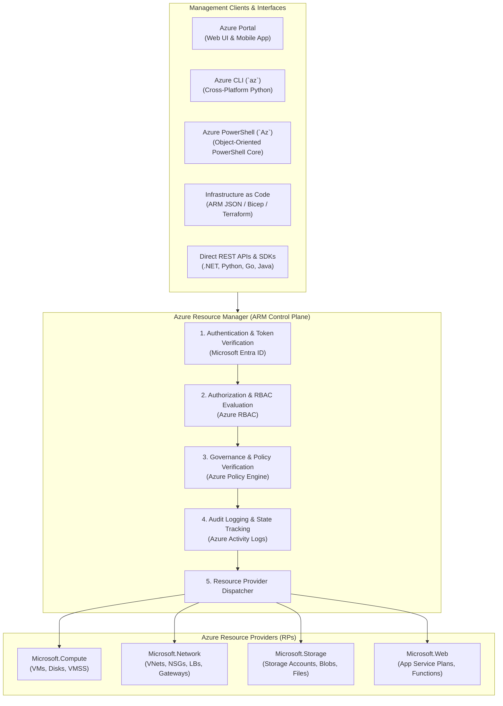
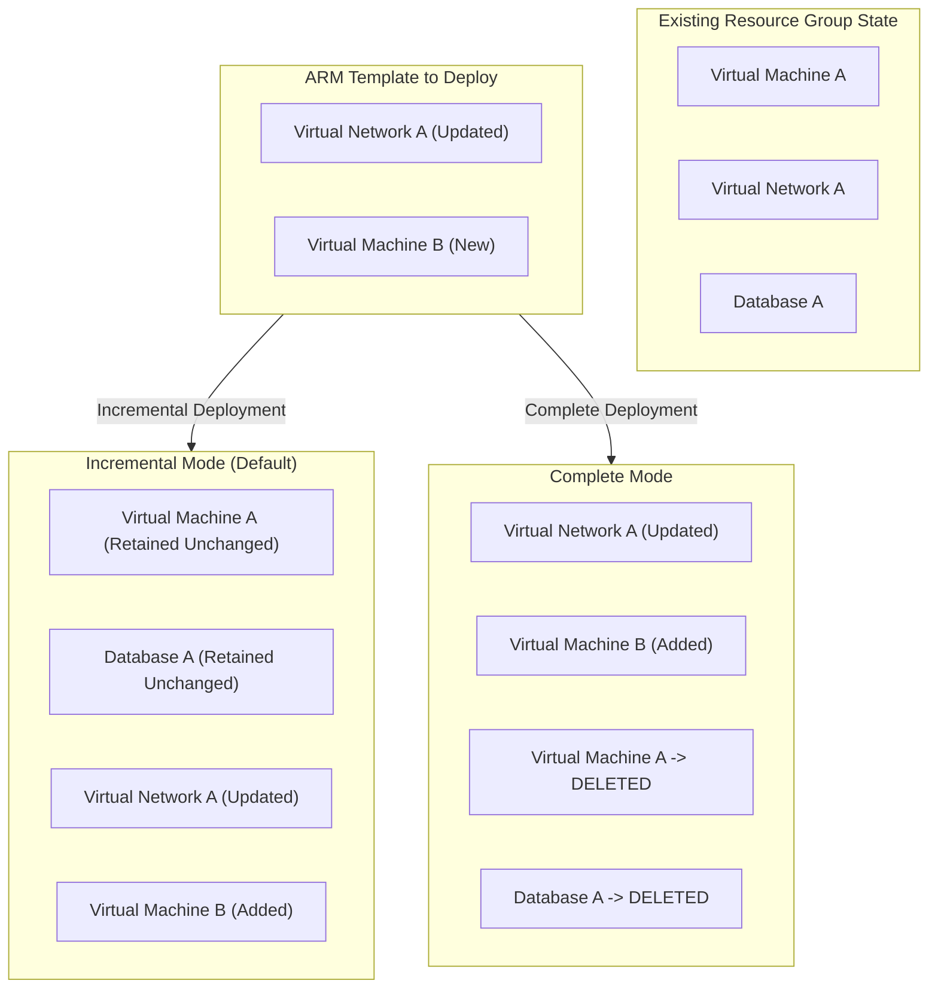
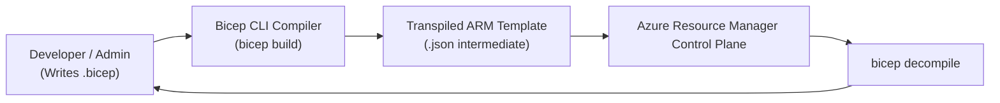
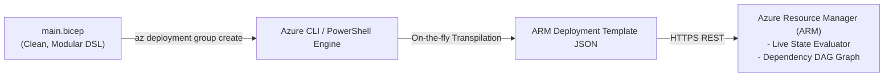

# Module 13-104-04: Administer Azure Resources, ARM & Bicep

**Breadcrumbs:** [[13-Index - Azure|☁️ Azure Reference MOC]] > [[13-Index - AZ-104|📘 AZ-104 Exam Track]] > **04 - Administer Azure Resources**

---

## 🎯 Executive Overview & Control Plane Architecture

Every interaction with Microsoft Azure—whether through the Azure Portal, Azure CLI, Azure PowerShell, SDKs, or third-party orchestrators like Terraform—is routed through a single centralized control plane: the **Azure Resource Manager (ARM)**. ARM serves as the unified deployment, access control, and resource management layer for all Azure services.



---

## 🛠️ Comparing Administrator Tools

Azure provides four primary administrative tools, each optimized for specific operational workflows:

| Administrator Tool | Runtime & Architecture | Ideal Use Cases | Limitations / Constraints |
| :--- | :--- | :--- | :--- |
| **Azure Portal** | Web-based graphical interface (React/SPA). | Resource discovery, visual topology inspection, graphical monitoring, learning new service options. | Difficult to scale, prone to manual human error, not suitable for automated CI/CD pipelines. |
| **Azure Cloud Shell** | Browser-accessible shell hosted inside a lightweight container (Alpine Linux). | Quick terminal access from any device without local software installation; pre-authenticated. | Requires an Azure Storage Account file share (`clouddrive`); 20-minute inactivity timeout terminates background jobs. |
| **Azure CLI (`az`)** | Cross-platform Python-based CLI tool. | POSIX scripting, Linux bash pipelines, container deployments, fast JSON text output parsing (`--query` JMESPath). | String/text-based pipe handling in Windows environments. |
| **Azure PowerShell (`Az`)** | PowerShell module running on PowerShell 7+ (Core). | Windows enterprise environments, complex object-oriented automation pipelines (`$res.Properties...`). | Higher initialization and execution overhead compared to lightweight CLI scripts. |

---

## 🏛️ Azure Resource Manager (ARM) Mechanics

### 1. Resource Providers (RPs)
Every Azure resource is managed by a specific Resource Provider (e.g., `Microsoft.Compute`, `Microsoft.Storage`, `Microsoft.Network`).
- **Resource Types:** Expressed in the format `ResourceProvider/resourceType` (e.g., `Microsoft.Network/virtualNetworks`).
- **Registration:** Before a subscription can deploy resources from an uncommonly used provider, the provider must be registered:
  ```bash
  az provider register --namespace "Microsoft.CostManagementExports"
  az provider show --namespace "Microsoft.Compute" --query "registrationState"
  ```

### 2. Idempotency & Declarative State
ARM deployments are **idempotent**: executing the same template multiple times against a target environment produces the exact same infrastructure state without recreating or corrupting unchanged resources.

### 3. Deployment Modes: Incremental vs. Complete



> [!CAUTION]
> **Complete Mode Hazard:** In **Complete mode**, ARM deletes **any resource in the resource group that is not defined in the template**. If used inadvertently in production, it will permanently delete production databases, storage accounts, or network adapters not present in the template.

---

## 📜 ARM Template JSON Anatomy

ARM templates are JSON documents defining infrastructure and dependencies.

### Top-Level JSON Structure

```json
{
  "$schema": "https://schema.management.azure.com/schemas/2019-04-01/deploymentTemplate.json#",
  "contentVersion": "1.0.0.0",
  "parameters": {
    "storagePrefix": {
      "type": "string",
      "minLength": 3,
      "maxLength": 11,
      "metadata": { "description": "Prefix for the unique storage account name" }
    },
    "storageSKU": {
      "type": "string",
      "defaultValue": "Standard_LRS",
      "allowedValues": ["Standard_LRS", "Standard_GRS", "Standard_ZRS"]
    }
  },
  "variables": {
    "uniqueStorageName": "[concat(parameters('storagePrefix'), uniqueString(resourceGroup().id))]"
  },
  "functions": [],
  "resources": [
    {
      "type": "Microsoft.Storage/storageAccounts",
      "apiVersion": "2023-01-01",
      "name": "[variables('uniqueStorageName')]",
      "location": "[resourceGroup().location]",
      "sku": {
        "name": "[parameters('storageSKU')]"
      },
      "kind": "StorageV2",
      "properties": {
        "supportsHttpsTrafficOnly": true,
        "minimumTlsVersion": "TLS1_2"
      }
    }
  ],
  "outputs": {
    "storageAccountId": {
      "type": "string",
      "value": "[resourceId('Microsoft.Storage/storageAccounts', variables('uniqueStorageName'))]"
    }
  }
}
```

### Essential ARM Template Built-in Functions
- `parameters('paramName')`: Resolves a parameter value passed at deployment time.
- `variables('varName')`: Resolves a computed internal variable.
- `resourceGroup()`: Returns the metadata object of the target resource group (e.g., `resourceGroup().location`, `resourceGroup().id`).
- `subscription()`: Returns the metadata of the current subscription (`subscription().subscriptionId`).
- `uniqueString(x)`: Generates a deterministic, 13-character hash string based on the input string (frequently combined with `resourceGroup().id` to guarantee globally unique DNS names).
- `resourceId('resourceType', 'resourceName')`: Constructs the fully qualified ARM resource identifier string.
- `concat(a, b, ...)`: Concatenates multiple strings into a single string.

---

## 🚀 Azure Bicep: Next-Generation Infrastructure as Code

**Bicep** is Microsoft's domain-specific language (DSL) designed to replace the verbosity and complexity of JSON ARM templates.



### Bicep vs. ARM JSON Syntax Comparison

```bicep
// main.bicep: Equivalent deployment to the JSON template above
@minLength(3)
@maxLength(11)
param storagePrefix string

@allowed([
  'Standard_LRS'
  'Standard_GRS'
  'Standard_ZRS'
])
param storageSKU string = 'Standard_LRS'
param location string = resourceGroup().location

var uniqueStorageName = '${storagePrefix}${uniqueString(resourceGroup().id)}'

resource storageAccount 'Microsoft.Storage/storageAccounts@2023-01-01' = {
  name: uniqueStorageName
  location: location
  sku: {
    name: storageSKU
  }
  kind: 'StorageV2'
  properties: {
    supportsHttpsTrafficOnly: true
    minimumTlsVersion: 'TLS1_2'
  }
}

output storageAccountId string = storageAccount.id
output storageAccountPrimaryEndpoint string = storageAccount.properties.primaryEndpoints.blob
```

### Key Advantages of Bicep Over JSON
1. **Concise Syntax:** Eliminates boilerplate JSON quotes, brackets, schema URLs, and escape sequences. Reduces template line count by 40–60%.
2. **Automatic Dependency Resolution:** Bicep automatically determines dependencies when one resource references properties of another (e.g., `server.id`), removing the need for manual `dependsOn` arrays.
3. **First-Class Modularization:** Reusable `.bicep` files can be consumed as modules using the `module` keyword.
4. **Day-Zero Resource Provider Support:** Every new Azure feature or API version available in ARM is immediately supported in Bicep without waiting for provider updates.

---

## 🛠️ Contextual Proof of Concept: Deploying ARM & Bicep

### 1. Azure CLI Deployment Commands

```bash
# 1. Validate an ARM template before deployment (pre-flight check)
az deployment group validate \
  --resource-group "rg-enterprise-core" \
  --template-file "azuredeploy.json" \
  --parameters storagePrefix="mystore" storageSKU="Standard_GRS"

# 2. Deploy using Incremental mode (default)
az deployment group create \
  --name "deploy-storage-v1" \
  --resource-group "rg-enterprise-core" \
  --template-file "azuredeploy.json" \
  --parameters storagePrefix="mystore"

# 3. Direct deployment of Bicep file (CLI transpiles on-the-fly)
az deployment group create \
  --name "deploy-bicep-infra" \
  --resource-group "rg-enterprise-core" \
  --template-file "main.bicep" \
  --parameters storagePrefix="bicepstore"

# 4. Decompile an existing JSON template into Bicep
az bicep decompile --file "azuredeploy.json"
```

### 2. Azure PowerShell Deployment Commands

```powershell
# Validate template syntax
Test-AzResourceGroupDeployment `
  -ResourceGroupName "rg-enterprise-core" `
  -TemplateFile "main.bicep"

# Execute Bicep deployment
New-AzResourceGroupDeployment `
  -Name "deploy-ps-bicep" `
  -ResourceGroupName "rg-enterprise-core" `
  -TemplateFile "main.bicep" `
  -storagePrefix "psstore" `
  -Mode Incremental
```

---

## 🔍 Deep-Intuition AARF Framework

### Scenario: Diagnosing Complete Mode Deployment and Unexpected Resource Deletion

- **The Answer (Core Configuration):** When executing resource deployments, explicitly specify `--mode Incremental` in CLI or `-Mode Incremental` in PowerShell.
- **The Assumptions (Prerequisites):** 
  - Operator has Contributor or Owner rights on the target Resource Group.
  - Target resource group contains existing resources (e.g., an unmanaged virtual network or legacy database).
- **The Rationale (Why):** In Complete mode, ARM reconciles the target Resource Group so that its end state is an exact mirror of the template. Any resource existing in the group that is omitted from the template file is marked for deletion and purged by ARM.
- **The Failure Loop (What if misconfigured):**
  - *Symptom:* A secondary VM or diagnostic storage account previously deployed manually in `rg-enterprise-core` disappears immediately following a pipeline run.
  - *Activity Log Event:* `Operation: Delete Virtual Machine, Status: Succeeded, Caller: Azure Resource Manager (Complete Mode Reconciler).`
- **The Alternative Case (When to use 'if not'):** Complete mode is appropriate for strict GitOps pipelines where the repository is the absolute single source of truth, and unmanaged "configuration drift" or orphaned resources must be aggressively pruned to reduce cost and security exposure.

---

## 💡 AZ-104 Exam Tips & Gotchas

> [!TIP]
> **Cloud Shell Storage Mount:** The first time any user launches Azure Cloud Shell, Azure requires creating an **Azure Storage Account** with an Azure File share. The files persisted inside `~/clouddrive` survive session restarts. If Cloud Shell fails to open, verify that the subscription has registered the `Microsoft.CloudShell` resource provider and that storage quotas in that region are not exhausted.

> [!WARNING]
> **ARM Scope Hierarchy for Deployments:**
> Deployments can be targeted at four distinct scopes:
> 1. `az deployment mg create` (Management Group level - for assigning policies/RBAC across subscriptions).
> 2. `az deployment sub create` (Subscription level - for creating Resource Groups or role assignments).
> 3. `az deployment group create` (Resource Group level - for creating VMs, VNets, Storage).
> 4. `az deployment tenant create` (Tenant level - for root management group configurations).
> Make sure to choose the correct scope cmdlet when reviewing exam questions.

---

---

## 🏛️ Deep-Dive IaC & Resource Deployment Architecture (John Savill Master Class Insights)

### 1. Why Bicep is the Preferred IaC for Azure: The Transparent Abstraction
John Savill emphasizes that Bicep is not a separate orchestrator like Terraform; it is a **transparent domain-specific language (DSL) on top of the ARM API**:
- **Zero State File:** Terraform requires maintaining a `terraform.tfstate` file (which contains secrets and requires remote locking in storage blobs). Bicep has **no state file**; the live Azure Resource Manager is the single source of truth.
- **Day-0 Resource Provider Support:** The moment Microsoft releases a new Azure service or API version, it is immediately usable in Bicep without waiting for a third-party provider plugin update.
- **Transpilation Pipeline:** Writing `.bicep` is compiled down directly to ARM JSON (`bicep build`), meaning any valid ARM template feature works identically in Bicep.



### 2. Multi-Scope Deployments in Bicep
Bicep templates can be targeted at scopes above the Resource Group:
```bicep
// Target entire subscription to create Resource Groups and RBAC roles
targetScope = 'subscription'

param resourceGroupName string = 'rg-core-networking'
param location string = 'eastus'

resource newRG 'Microsoft.Resources/resourceGroups@2021-04-01' = {
  name: resourceGroupName
  location: location
}

// Deploy a child module into the newly created resource group
module vnetModule 'modules/vnet.bicep' = {
  scope: newRG
  name: 'vnetDeploy'
  params: {
    vnetName: 'vnet-hub'
  }
}
```

### 3. What-If Analysis for Drift Detection
Before executing any deployment in production, administrators run the **What-If** operation (`az deployment group what-if`):
- Analyzes template changes against the live state of Azure resources.
- Highlights:
  - `+ Create`: New resources that will be added.
  - `* Modify`: Resources where properties will be updated in-place.
  - `~ Ignore`: Resources with no changes.
  - `- Delete`: Resources that will be permanently removed (critical when using `Complete` deployment mode).

## 🌐 Authoritative References & Citations

- [John Savill: Azure Master Class v2 - Module 11 - IaC & DevOps](https://www.youtube.com/playlist?list=PLlVtbbG169nGlGPWs9xaLKT1KfwqREHbs)

- [KodeKloud AZ-104 Course - Administer Azure Resources Module](https://notes.kodekloud.com/docs/Updated-AZ-104-Microsoft-Azure-Administrator/Administer-Azure-Resources/Module-introduction/page.md)
- [Microsoft Learn: Manage resources in Azure](https://learn.microsoft.com/en-us/training/modules/manage-resources-with-arm-templates/)
- [Microsoft Learn: Introduction to Bicep](https://learn.microsoft.com/en-us/training/modules/introduction-to-bicep/)
- [Azure Resource Manager Documentation](https://learn.microsoft.com/en-us/azure/azure-resource-manager/)
