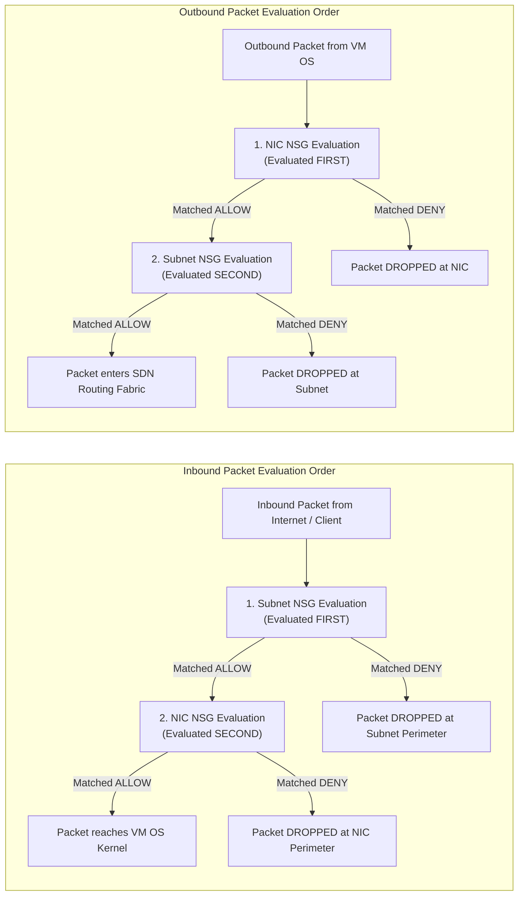
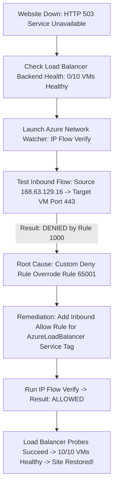

# Module 13-104-05: Administer Azure Virtual Networking, NSGs & DNS

**Breadcrumbs:** [[13-Index - Azure|☁️ Azure Reference MOC]] > [[13-Index - AZ-104|📘 AZ-104 Exam Track]] > **05 - Administer Virtual Networking**

---

## 🎯 Stage 1: Executive Overview & The Conceptual Lecture

### 1. The Zero-Knowledge Starting Point: What is a Network in the Cloud?
In a traditional physical corporate office or private datacenter, networking was physical:
* Network engineers ran yellow Cat6 copper cables from server network cards into physical Top-of-Rack (ToR) switches.
* Traffic was segmented into **VLANs (Virtual Local Area Networks)** by tagging ethernet frames with 802.1Q headers.
* Inter-VLAN routing required physical core routers or hardware firewalls (like Cisco ASA or Palo Alto networks).
* If a server wanted to find another server on the local network, it shouted an **Ethernet Broadcast (ARP request)**: *"Who has IP 10.0.1.5? Tell 10.0.1.4!"* Every single server plugged into that switch had to wake up, inspect the frame, and discard it if it wasn't for them.

Now imagine Microsoft Azure:
* A single Azure region contains hundreds of thousands of physical servers across football-field-sized datacenters.
* If customer servers could broadcast Ethernet frames across the physical datacenter, the entire Azure network would immediately collapse under a catastrophic **broadcast storm**!
* Furthermore, Customer A and Customer B both want to use the standard private IP address range `10.0.0.0/16`. If they were on the same physical switches, their traffic would cross paths and corrupt each other's networks.

To make the cloud possible, Microsoft engineered **Azure Software Defined Networking (SDN)**. In Azure:
* **Physical cables and switches are completely hidden.**
* There are **no physical VLANs** that you can configure.
* The foundational unit of network isolation in Azure is the **Virtual Network (VNet)**.
* A VNet is an isolated private software overlay. Virtual machines running inside your VNet can communicate with each other securely, while being 100% logically invisible and unreachable by other customers sharing the same physical datacenter hardware.

### 2. The Hotel Telephone System Analogy
Think of an Azure Virtual Network like a modern luxury hotel:
* **The Entire Hotel (Azure Datacenter):** Houses thousands of guests from different companies.
* **Your Private Suite (Your VNet):** A completely isolated apartment inside the hotel.
* **Room Extensions (Subnets & Private IPs):** Inside your suite, Room 1 (Web) has extension `101`, and Room 2 (Database) has extension `102`. You can call between rooms instantly. Another guest in a completely different suite can also have rooms `101` and `102`, and your calls will never mix up!
* **The Switchboard / Concierge (`168.63.129.16` Wire Server):** A special internal speed-dial that handles hotel services (DHCP room assignment, room service health checks, and telephone directory DNS).
* **The Security Guard at the Door (Network Security Group - NSG):** Checks every visitor's ID against a list of rules before letting them into a specific room.

### 3. Terminology Matrix: Zero-Knowledge to Enterprise Architect

| Terminology | What It Means to a Beginner | Real-World Analog | Enterprise Architecture Reality |
| :--- | :--- | :--- | :--- |
| **Virtual Network (VNet)** | A private walled-off network in Azure. | A private fenced-in corporate office campus. | An isolated Layer 3 overlay network running on Microsoft's global SDN fabric using Geneve/VXLAN encapsulation. |
| **Subnet** | A smaller section of your network for specific servers. | A designated floor in the office building (e.g., 2nd Floor for Accounting). | A contiguous CIDR IP range carved out of a parent VNet used to segment workloads and apply security boundaries. |
| **Reserved IPs (5 IPs)** | Five IP addresses Azure steals from every subnet. | Reserved parking spaces for ambulances and fire trucks. | The `.0` (Network), `.1` (Gateway), `.2` (DNS), `.3` (DNS), and `.255` (Broadcast) addresses reserved by the Azure platform fabric. |
| **Network Security Group (NSG)** | A virtual firewall with Allow and Deny rules. | A security guard holding a clipboard of permitted visitors. | A stateful Layer 4 packet-filtering firewall evaluating 5-tuple rules with numerical priorities (100–4096). |
| **Application Security Group (ASG)** | Labeling servers with a tag instead of remembering their IPs. | Putting "Finance Staff" badges on employees so the guard lets them in. | A logical grouping of virtual network interfaces (NICs) allowing NSG rules to reference workload functions instead of static CIDR lists. |
| **Wire Server (`168.63.129.16`)** | The hidden platform brain inside every Azure subnet. | The building's hidden maintenance and concierge service shaft. | A protected non-routable virtual IP that provides DHCP leases, recursive DNS, Load Balancer health probes, and VM agent heartbeats. |
| **Private DNS Zone** | An internal phonebook for your servers. | An internal company telephone directory (`web.corp.internal`). | An authoritative private DNS domain hosted on Azure Anycast resolvers that automatically creates and deletes A records for connected VMs. |

---

## 🏛️ Stage 2: Core Mental Model & Component Architecture

### 1. VNet Architecture & The CIDR Addressing Model
Azure Virtual Networks are defined using standard **Classless Inter-Domain Routing (CIDR)** notation based on private RFC 1918 address space:
* `10.0.0.0/8` (Large enterprises: 16.7 million IPs)
* `172.16.0.0/12` (Mid-sized networks: 1 million IPs)
* `192.168.0.0/16` (Small networks / branch offices: 65,536 IPs)

```text
+-------------------------------------------------------------------------------------------------+
|                       Azure Virtual Network: vnet-enterprise (10.0.0.0/16)                      |
|                                                                                                 |
|   Subnet 1: snet-frontend (10.0.1.0/24)             Subnet 2: snet-backend (10.0.2.0/24)        |
|   ├── Total IPs: 256                                ├── Total IPs: 256                          |
|   ├── Reserved by Azure: 5                          ├── Reserved by Azure: 5                    |
|   ├── Usable IPs: 251 (10.0.1.4 to 10.0.1.254)      ├── Usable IPs: 251 (10.0.2.4 to 10.0.2.254)|
|   └── Workload: Web Servers & Load Balancer         └── Workload: Database Clusters             |
|                                                                                                 |
|   Subnet 3: AzureBastionSubnet (10.0.10.0/26)       Subnet 4: GatewaySubnet (10.0.255.0/27)     |
|   ├── Total IPs: 64 | Usable: 59                    ├── Total IPs: 32 | Usable: 27              |
|   └── Workload: Dedicated Bastion Host PaaS         └── Workload: VPN / ExpressRoute Gateway    |
+-------------------------------------------------------------------------------------------------+
```

#### The Subnet Math Formula:
$$\text{Host Bits} = 32 - \text{Prefix Length}$$
$$\text{Total Addresses} = 2^{\text{Host Bits}}$$
$$\text{Usable Host Count} = 2^{(32 - \text{Prefix})} - 5$$

* For a `/24` subnet: $32 - 24 = 8$ host bits $\rightarrow 2^8 = 256$ total IPs $\rightarrow 256 - 5 = \mathbf{251\text{ usable IPs}}$.
* For a `/27` subnet: $32 - 27 = 5$ host bits $\rightarrow 2^5 = 32$ total IPs $\rightarrow 32 - 5 = \mathbf{27\text{ usable IPs}}$.
* For a `/29` subnet: $32 - 29 = 3$ host bits $\rightarrow 2^3 = 8$ total IPs $\rightarrow 8 - 5 = \mathbf{3\text{ usable IPs}}$ *(The absolute minimum subnet size in Azure!)*.

---

### 2. The 5 Azure Reserved IP Addresses (High-Yield Concept!)
In **every single subnet** created in Azure, exactly **5 IP addresses** are reserved by the platform and cannot be assigned to any virtual machine or service:

| Reserved Address (in `10.0.1.0/24`) | Platform Function in Azure SDN Fabric |
| :---: | :--- |
| **`10.0.1.0`** | **Network Address:** The RFC 1122 network identifier for the subnet boundary. |
| **`10.0.1.1`** | **Default Gateway:** The virtual router interface automatically provisioned by Azure SDN. |
| **`10.0.1.2`** | **Azure DNS Resolver:** Primary DNS mapping to the internal Azure recursive resolver (`168.63.129.16`). |
| **`10.0.1.3`** | **Azure DNS Resolver:** Secondary DNS mapping for high-availability DNS routing. |
| **`10.0.1.255`** | **Broadcast Address:** Network broadcast identifier (Azure SDN intercepts and drops all broadcast packets). |

> [!IMPORTANT]
> **First Usable IP Rule:**
> Because the first 4 addresses (`.0` through `.3`) are reserved by Azure, the **very first virtual machine or network interface** deployed into any Azure subnet will **always receive IP `.4`** (e.g., `10.0.1.4`)!

---

### 3. Public vs. Private IP Addresses & SKU Comparison

#### Private IP Addresses:
* Used for internal communication across VNets, on-premises networks (via VPN/ExpressRoute), and Private Endpoints.
* **Dynamic Allocation (Default):** Assigned by Azure DHCP. If a VM is stopped (deallocated), Azure may release the IP address and assign a new one upon startup.
* **Static Allocation:** Permanently reserves the IP address. Even if the VM is stopped/deallocated for months, the IP address is guaranteed never to change (essential for Domain Controllers, NVA firewalls, and internal database servers).

#### Public IP Addresses (Basic vs. Standard SKU):

```text
Basic Public IP SKU (Deprecated / Legacy)         Standard Public IP SKU (Mandatory Modern Standard)
+---------------------------------------+         +-------------------------------------------------+
| - Open to the Internet by default     |         | - Closed to the Internet by default (Secure!)   |
|   (Insecure: exposes ports unless NSG)|         |   (Drops all packets until NSG explicitly allows|
| - Supports Dynamic or Static IP       |         | - Static allocation ONLY (never changes)        |
| - Single datacenter bound (No Zones)  |         | - Zone-Redundant (Resilient across AZ 1, 2, 3)  |
| - Works only with Basic Load Balancer |         | - Required for Standard Load Balancers & Bastion|
+---------------------------------------+         +-------------------------------------------------+
```

---

### 4. Azure NAT Gateway (Virtual Network NAT): The Definitive Outbound SNAT Engine

In production enterprise architectures, virtual machines often need to initiate outbound internet connections (e.g., downloading OS security patches, updating package registries like `npm` or `pip`, communicating with external third-party REST APIs) without accepting unsolicited inbound internet connections.

#### The Outbound SNAT Problem & Port Exhaustion:
* **Source Network Address Translation (SNAT):** When a private IP (`10.0.1.4`) communicates with a public internet host (`203.0.113.1`), Azure must translate the private IP into a routable public IP and assign an ephemeral TCP port.
* **Default Outbound Internet Access Bottleneck:** Azure's legacy default outbound access provides a dynamically rotating public IP with a static pre-allocation of only **1,024 SNAT ports per VM**.
* **SNAT Port Exhaustion Failure:** If a backend application opens hundreds of concurrent microservice API calls, database pooling connections, or webhooks, the 1,024 pre-allocated ports quickly deplete. Subsequent outbound connection attempts will fail with timeout errors (`SocketException: Address already in use` or connection dropped) until existing connections close or time out.

#### The NAT Gateway Solution:
**Azure NAT Gateway** is a fully managed, software-defined outbound egress service designed specifically to eliminate SNAT port exhaustion:

```text
+-------------------------------------------------------------------------------------------------+
|                             AZURE NAT GATEWAY EGRESS ARCHITECTURE                               |
+-------------------------------------------------------------------------------------------------+
[ Subnet: snet-workload (10.0.1.0/24) ]
   ├── VM 01 (10.0.1.4) ───────┐
   ├── VM 02 (10.0.1.5) ───────┼──► [ Associated NAT Gateway: ngw-prod-eastus ]
   └── VM 03 (10.0.1.6) ───────┘         ├── Dynamic SNAT Allocation (On-Demand)
                                         ├── Attached to Standard Public IP or Prefix
                                         └── Up to 64,512 SNAT Ports per Public IP!
                                                       │
                                                       ▼ Outbound Only (Wire Speed)
                                         [ External Internet / Third-Party APIs ]
```

#### Architectural Rules & Properties:
1. **Dynamic Port Allocation:** Instead of statically pre-allocating a small chunk of ports per VM, NAT Gateway dynamically allocates SNAT ports on-demand from a shared pool. An individual VM can consume as many ports as it needs up to the capacity of the gateway.
2. **Port Scalability:**
   $$\text{Usable Outbound Flows per Public IP} = 64,512\text{ concurrent TCP/UDP ports}$$
   * A single NAT Gateway can attach up to **16 Standard Public IP addresses** (or a Public IP Prefix up to `/28`), providing over **$1,000,000$ concurrent outbound SNAT flows**!
3. **Subnet-Level Association:** NAT Gateway attaches at the **Subnet level**. All network interfaces attached to that subnet automatically utilize the NAT Gateway for outbound traffic.
4. **Outbound Precedence Hierarchy (AZ-104 Golden Rule):**
   When multiple outbound methods exist on a single virtual machine, Azure evaluates outbound routing using the following absolute priority hierarchy:
   $$\mathbf{Azure\text{ }NAT\text{ }Gateway} \quad > \quad \mathbf{Instance\text{-}Level\text{ }Public\text{ }IP\text{ }(NIC)} \quad > \quad \mathbf{Load\text{ }Balancer\text{ }Outbound\text{ }Rules} \quad > \quad \mathbf{Default\text{ }Outbound\text{ }Access}$$
   * If a NAT Gateway is associated with the subnet, it **overrides any Public IP on the VM's NIC and any Load Balancer outbound rules** for outbound internet traffic!
5. **Purely Outbound (Zero Inbound):** A NAT Gateway does not accept or route unsolicited inbound connections from the internet. Inbound traffic requires an Instance-Level Public IP, Azure Load Balancer, or Application Gateway.
6. **Subnet Restrictions:** A NAT Gateway cannot be associated with `GatewaySubnet`, `AzureFirewallSubnet`, `AzureFirewallManagementSubnet`, or `AzureBastionSubnet`.

---

### 5. Azure DDoS Protection: Infrastructure vs. Network Protection vs. IP Protection

Distributed Denial of Service (DDoS) attacks attempt to exhaust network bandwidth or hypervisor connection tables by flooding Azure public endpoints with malicious volumetric or protocol traffic. Microsoft Azure provides three distinct tiers of DDoS defense:

```text
+-------------------------------------------------------------------------------------------------+
|                                AZURE DDOS PROTECTION SPECTRUM                                   |
+-------------------------------------------------------------------------------------------------+
| Tier 1: Infrastructure Protection  | Tier 2: DDoS IP Protection       | Tier 3: DDoS Network Protection |
|------------------------------------+----------------------------------+---------------------------------|
| - Included Free (Platform Wide)    | - Per Public IP Address Billing  | - Per Virtual Network Billing   |
| - Protects Azure Fabric Hypervisors| - Protects Standard Public IPs   | - Protects ALL Public IPs in VNet|
| - No Customer Telemetry or Reports | - Full L3/L4 Adaptive Profiling  | - Adaptive Profiling & Tuning   |
| - High-Volume Thresholds           | - Azure Monitor Metrics & Alerts | - DDoS Rapid Response (DRR)     |
| - No Cost Protection SLA           | - No Cost Protection / No DRR    | - Cost Protection SLA Included! |
+-------------------------------------------------------------------------------------------------+
```

#### Detailed Architectural Comparison Matrix:

| Architectural Feature | Infrastructure Protection (Basic) | DDoS IP Protection | DDoS Network Protection (Standard) |
| :--- | :--- | :--- | :--- |
| **Target Scope** | Entire Azure Cloud Platform | Individual Standard Public IP | Entire Virtual Network (VNet) |
| **Billing Model** | **Free** (Always-on built-in) | Fixed monthly fee per protected Public IP (Cost-effective for 1–2 IPs) | Flat monthly fee (covers up to 100 Public IPs across tenant) |
| **Adaptive ML Profiling** | Generic platform thresholds | Workload-specific traffic profiling and auto-tuning | Workload-specific adaptive machine learning baselines |
| **Telemetry & Metrics** | None (Hidden inside platform) | Detailed Azure Monitor metrics and mitigation logs | Full mitigation analytics, packet captures, and attack telemetry |
| **DDoS Rapid Response (DRR)**| None | Not included | **Included:** Direct 24/7 engagement with Microsoft DDoS Engineering team during an active attack |
| **Cost Protection SLA** | None | Not included | **Included:** Cloud credits granted for scale-out compute resources incurred due to a verified attack |

> [!TIP]
> **Enterprise Decision Formula:**
> * For single-VM production workloads or SMBs running 1 or 2 public endpoints: Choose **DDoS IP Protection** to gain adaptive L3/L4 mitigation without committing to the multi-thousand-dollar monthly fee of Network Protection.
> * For enterprise multi-tier environments with extensive public load balancers, firewalls, and application gateways across multiple VNets: Choose **DDoS Network Protection** to leverage tenant-wide pooling, DDoS Rapid Response engineer escalation, and Cost Protection guarantees.

---

## 🏢 Stage 3: Deep-Intuition Platform Mechanics & Topology

### 1. Azure SDN Hypervisor Packet Flow & The Wire Server
How does Azure actually route packets without physical routers or cables?

```text
[ Virtual Machine A ] (Private IP: 10.0.1.4)
          │
          ▼
[ Virtual NIC ]
          │
          ▼
[ Source Hypervisor (SDN Virtual Filter Driver) ]
  ├── 1. Intercepts outgoing Ethernet frame
  ├── 2. Drops any Layer 2 broadcast/multicast packets
  ├── 3. Evaluates Outbound NSG Rules on the NIC
  ├── 4. Evaluates Outbound NSG Rules on the Subnet
  ├── 5. Checks Route Table (System Routes / UDR) via Longest Prefix Match
  └── 6. Encapsulates customer packet inside Geneve / VXLAN outer IP packet
          │
          ▼
[ Azure Physical IP Fabric (Underlay Datacenter Backbone) ]
          │
          ▼
[ Destination Hypervisor ]
  ├── 1. Strips outer Geneve / VXLAN header
  ├── 2. Evaluates Inbound NSG Rules on the Subnet
  ├── 3. Evaluates Inbound NSG Rules on the NIC
  └── 4. Injects packet into destination Virtual NIC
          │
          ▼
[ Virtual Machine B ] (Private IP: 10.0.2.4)
```

#### The Wire Server IP (`168.63.129.16`) Mechanics:
In every Azure VNet, a special non-routable virtual IP exists: **`168.63.129.16`**:
* **It is NOT a physical server in the corner of a room.** It is a virtual routing construct implemented directly in the hypervisor SDN code.
* It answers DHCP lease renewals for every VM.
* It serves as the authoritative resolver for Azure Private DNS Zones.
* It originates Azure Load Balancer **Health Probes** (represented by the `AzureLoadBalancer` service tag in NSG rules).
* It communicates with the Azure Virtual Machine Agent.
* **Critical Rule:** Never block `168.63.129.16` in custom firewalls or NSG rules, as doing so will break VM networking and health probes.

---

### 2. Network Security Groups (NSGs): Stateful Inspection & Evaluation Order
An NSG is a stateful Layer 4 firewall. Each rule is defined by a **5-tuple**:
$$\text{5-Tuple} = (\text{Source IP}, \text{Source Port}, \text{Destination IP}, \text{Destination Port}, \text{Protocol})$$



#### The Stateful Law of NSGs:
* Network Security Groups are **fully stateful**.
* When an inbound packet is permitted (e.g., a client connects to web port 443), the hypervisor registers the connection in its active state table.
* The response packet originating from the VM back to the client is **automatically permitted**, bypassing outbound NSG rules entirely!

#### Default NSG Rules (Immutable Built-ins):
Every NSG comes with 3 default inbound rules that cannot be deleted (priority 65000–65500):
1. **`65000: AllowVNetInBound`:** Allows all traffic between any subnets in the VNet, peered VNets, and connected VPNs.
2. **`65001: AllowAzureLoadBalancerInBound`:** Allows health probe packets originating from `168.63.129.16` to reach backend servers.
3. **`65500: DenyAllInBound`:** Default-deny posture that drops all other incoming traffic from the internet or unapproved networks.

---

### 3. Application Security Groups (ASGs): Eliminating Static IP Rules
In large environments with hundreds of VMs, writing NSG rules based on IP addresses is brittle and dangerous:
* When a web server is replaced or autoscaled, its IP address changes. If an admin forgets to update the NSG rule, traffic breaks.
* **Application Security Groups (ASGs)** provide application-centric micro-segmentation. You group virtual network cards (NICs) under a logical label (e.g., `asg-web-tier`, `asg-db-tier`):

```text
Without ASGs (Brittle & Hard to Maintain):
Rule 100: Allow Source 10.0.1.4, 10.0.1.5, 10.0.1.6 to Dest 10.0.2.4 on Port 1433
(If a 4th web server is added, someone must manually edit the firewall rule!)

With ASGs (Declarative & Automated):
Rule 100: Allow Source 'asg-web-tier' to Dest 'asg-db-tier' on Port 1433
(Any new VM whose NIC is labeled 'asg-web-tier' is INSTANTLY permitted without touching the NSG!)
```

> [!IMPORTANT]
> **The ASG Boundary Rule:**
> All network interfaces assigned to an Application Security Group must reside in the **same Virtual Network**. An ASG cannot span across different VNets, even if the VNets are peered!

---

### 4. Azure Private DNS Zones: Split-Horizon Name Resolution
Azure Private DNS Zones provide private domain name resolution (e.g., `corp.internal`, `privatelink.database.windows.net`) without running expensive custom DNS servers or Domain Controllers.

```text
[ Private DNS Zone: corp.internal ]
  ├── Auto-Registered Records:
  │     ├── vm-web-01.corp.internal  --> 10.0.1.4 (Managed by Azure)
  │     └── vm-db-01.corp.internal   --> 10.0.2.4 (Managed by Azure)
  └── Manual Custom Records:
        └── api.corp.internal        --> 10.0.1.100 (CNAME / Static A)
                    ▲                                      ▲
                    │                                      │
    Virtual Network Link: REGISTRATION      Virtual Network Link: RESOLUTION ONLY
                    │                                      │
    [ vnet-production (10.0.0.0/16) ]      [ vnet-analytics (172.16.0.0/16) ]
    - VMs register their own hostnames      - VMs can resolve 'vm-web-01.corp.internal'
    - Only ONE registration VNet allowed    - Up to 1,000 resolution VNets allowed!
```

---

### 5. PaaS Integration: Service Endpoints vs. Private Endpoints (Private Link)
When virtual machines inside a subnet need to communicate with Azure PaaS data services (Azure Storage, Azure SQL Database, Azure Key Vault), two primary network integration methods exist:

```text
+-------------------------------------------------------------------------------------------------+
|                        SERVICE ENDPOINTS VS. PRIVATE ENDPOINTS (PRIVATE LINK)                   |
+-------------------------------------------------------------------------------------------------+
| Approach 1: Service Endpoints                     | Approach 2: Private Endpoints (Private Link)|
|---------------------------------------------------+---------------------------------------------|
| - Traffic routes over Azure private backbone      | - Injects a real private NIC into the subnet|
| - PaaS service retains its PUBLIC IP address      | - PaaS service is assigned a PRIVATE IP     |
| - Service firewall restricts to Subnet CIDR       | - PaaS service public access is 100% disabled|
| - Free of charge (No hourly cost)                 | - Hourly charge per endpoint + data fees    |
| - UNSUPPORTED over on-prem VPN / ExpressRoute     | - FULLY SUPPORTED over hybrid VPN/ER tunnels|
| - Potential data exfiltration to rogue accounts   | - Strictly bound to ONE specific PaaS resource|
+-------------------------------------------------------------------------------------------------+
```

#### Detailed Architectural Comparison Matrix:

| Evaluation Dimension | Service Endpoints (`Microsoft.Storage`, `Microsoft.Sql`) | Private Endpoints (Azure Private Link) |
| :--- | :--- | :--- |
| **IP Address Model** | Target PaaS resource retains its **Public IP address**. | Injects a private Virtual Network Interface (NIC) with a **Private IP** from your subnet. |
| **Network Security Posture** | PaaS firewall restricts incoming requests to specific subnet CIDRs, but public IP remains exposed. | Public network access can be **100% Disabled** on the PaaS resource. |
| **On-Premises / Hybrid Access** | **UNSUPPORTED:** On-premises clients cannot reach Service Endpoints over VPN or ExpressRoute. | **FULLY SUPPORTED:** On-premises clients traverse VPN or ExpressRoute directly to the private IP! |
| **Data Exfiltration Risk** | **High:** Workloads in the subnet can connect to *any* storage account in any customer tenant over the backbone. | **Zero:** The Private Endpoint is cryptographically bound strictly to **one specific resource instance ID**. |
| **DNS Requirements** | Standard public DNS (`<name>.blob.core.windows.net`). | Requires **Azure Private DNS Zone** (`privatelink.blob.core.windows.net`) to map the FQDN to the private IP. |
| **Cost** | **Free** (No hourly charges). | Small hourly fee per Private Endpoint + inbound/outbound data processing fees. |

---

## ⚙️ Stage 4: Declarative & Automation Engine (CLI & PowerShell Core)

### 1. Azure CLI: Complete VNet, NSG, and DNS Automation

```bash
# ==============================================================================
# 1. RESOURCE GROUP & APPLICATION SECURITY GROUPS (ASGs)
# ==============================================================================
az group create --name "rg-network-prod" --location "eastus"

# Create ASGs for Web and Database tiers
az network asg create --resource-group "rg-network-prod" --name "asg-web-tier" --location "eastus"
az network asg create --resource-group "rg-network-prod" --name "asg-db-tier" --location "eastus"

# ==============================================================================
# 2. NETWORK SECURITY GROUP (NSG) WITH ASG-DRIVEN RULES
# ==============================================================================
az network nsg create --resource-group "rg-network-prod" --name "nsg-backend-tier" --location "eastus"

# Allow PostgreSQL traffic (TCP 5432) strictly from Web ASG to Database ASG
az network nsg rule create \
  --resource-group "rg-network-prod" \
  --nsg-name "nsg-backend-tier" \
  --name "Allow-Web-to-Postgres" \
  --priority 100 \
  --direction Inbound \
  --access Allow \
  --protocol Tcp \
  --source-asg-names "asg-web-tier" \
  --destination-asg-names "asg-db-tier" \
  --destination-port-ranges 5432

# ==============================================================================
# 3. VIRTUAL NETWORK & SUBNET CARVING
# ==============================================================================
# Create parent VNet (10.50.0.0/16) with Frontend Subnet (10.50.1.0/24)
az network vnet create \
  --resource-group "rg-network-prod" \
  --name "vnet-enterprise-eastus" \
  --address-prefixes "10.50.0.0/16" \
  --subnet-name "snet-web" \
  --subnet-prefixes "10.50.1.0/24"

# Carve Backend Subnet and associate the backend NSG
az network vnet subnet create \
  --resource-group "rg-network-prod" \
  --vnet-name "vnet-enterprise-eastus" \
  --name "snet-db" \
  --address-prefixes "10.50.2.0/24" \
  --network-security-group "nsg-backend-tier"

# ==============================================================================
# 4. AZURE PRIVATE DNS ZONE & AUTO-REGISTRATION LINK
# ==============================================================================
az network private-dns zone create \
  --resource-group "rg-network-prod" \
  --name "corp.internal"

VNET_ID=$(az network vnet show --resource-group "rg-network-prod" --name "vnet-enterprise-eastus" --query id -o tsv)

az network private-dns link vnet create \
  --resource-group "rg-network-prod" \
  --zone-name "corp.internal" \
  --name "link-vnet-enterprise" \
  --virtual-network "${VNET_ID}" \
  --registration-enabled true

# ==============================================================================
# 5. AZURE NAT GATEWAY FOR SECURE OUTBOUND SNAT
# ==============================================================================
# Create a Standard Public IP for the NAT Gateway
az network public-ip create \
  --resource-group "rg-network-prod" \
  --name "pip-natgw-prod" \
  --location "eastus" \
  --sku Standard \
  --allocation-method Static

# Provision Azure NAT Gateway with 10-minute idle timeout
az network nat gateway create \
  --resource-group "rg-network-prod" \
  --name "natgw-prod-eastus" \
  --location "eastus" \
  --public-ip-addresses "pip-natgw-prod" \
  --idle-timeout 10

# Attach the NAT Gateway to the workload subnet
az network vnet subnet update \
  --resource-group "rg-network-prod" \
  --vnet-name "vnet-enterprise-eastus" \
  --name "snet-web" \
  --nat-gateway "natgw-prod-eastus"

# ==============================================================================
# 6. AZURE DDOS PROTECTION PLAN DEPLOYMENT
# ==============================================================================
# Create DDoS Network Protection Plan
az network ddos-protection create \
  --resource-group "rg-network-prod" \
  --name "ddos-plan-enterprise" \
  --location "eastus"

# Associate DDoS Protection Plan with Virtual Network
az network vnet update \
  --resource-group "rg-network-prod" \
  --name "vnet-enterprise-eastus" \
  --ddos-protection-plan "ddos-plan-enterprise" \
  --ddos-protection true
```

### 2. Azure PowerShell: Subnet Inspection & Static IP Reservation

```powershell
# ==============================================================================
# INSPECT SUBNETS & RESERVE STATIC PRIVATE IP ON A NIC
# ==============================================================================
$rgName = "rg-network-prod"
$vnetName = "vnet-enterprise-eastus"

# Retrieve VNet and calculate usable IPs
$vnet = Get-AzVirtualNetwork -ResourceGroupName $rgName -Name $vnetName
$subnet = Get-AzVirtualNetworkSubnetConfig -VirtualNetwork $vnet -Name "snet-db"
Write-Host "Subnet Prefix: $($subnet.AddressPrefix)"

# Convert VM NIC private IP from Dynamic to Static
$nic = Get-AzNetworkInterface -ResourceGroupName $rgName -Name "nic-db-primary"
$nic.IpConfigurations[0].PrivateIpAllocationMethod = "Static"
$nic.IpConfigurations[0].PrivateIpAddress = "10.50.2.10"
Set-AzNetworkInterface -NetworkInterface $nic
Write-Host "Successfully converted nic-db-primary to Static Private IP 10.50.2.10!"

# ==============================================================================
# POWERSHELL: PROVISION & ATTACH AZURE NAT GATEWAY
# ==============================================================================
# Create Standard Public IP
$pip = New-AzPublicIpAddress `
  -ResourceGroupName $rgName `
  -Name "pip-natgw-ps" `
  -Location "eastus" `
  -AllocationMethod Static `
  -Sku Standard

# Create NAT Gateway
$natGateway = New-AzNatGateway `
  -ResourceGroupName $rgName `
  -Name "natgw-prod-ps" `
  -Location "eastus" `
  -PublicIpAddress $pip `
  -IdleTimeoutInMinutes 15 `
  -Sku Standard

# Associate with target subnet
$vnet = Get-AzVirtualNetwork -ResourceGroupName $rgName -Name $vnetName
$targetSubnet = Get-AzVirtualNetworkSubnetConfig -VirtualNetwork $vnet -Name "snet-web"
$targetSubnet.NatGateway = $natGateway
$vnet | Set-AzVirtualNetwork
Write-Host "NAT Gateway successfully bound to snet-web!"
Write-Host "Successfully converted nic-db-primary to Static Private IP 10.50.2.10!"
```

---

## 🖥️ Stage 5: Step-by-Step Azure Portal GUI Walkthrough

Follow these exact navigation steps in the **Azure Portal** (`https://portal.azure.com`) to master virtual network administration:

### Task 1: Creating a Virtual Network & Subnets in the GUI
1. In the top search bar, type **Virtual networks** and select it.
2. Click **+ Create** on the command bar.
3. In the **Basics** tab:
   - **Resource group:** Select `rg-network-prod`.
   - **Name:** `vnet-enterprise-eastus`.
   - **Region:** `East US`.
4. In the **IP addresses** tab:
   - Notice the default IPv4 address space `10.0.0.0/16`. Change it to `10.50.0.0/16`.
   - Under *Subnets*, click **+ Add subnet**:
     - **Subnet purpose:** Select *Default*.
     - **Name:** `snet-web`.
     - **Starting address:** `10.50.1.0`.
     - **Subnet size:** `/24 (251 addresses)`.
     - Click **Add**.
   - Click **+ Add subnet** again:
     - **Name:** `snet-db`.
     - **Starting address:** `10.50.2.0`.
     - **Subnet size:** `/24 (251 addresses)`.
     - Click **Add**.
5. Click **Review + create** $\rightarrow$ **Create**.

### Task 2: Creating Application Security Groups (ASGs)
1. In the top search bar, type **Application security groups** and select it.
2. Click **+ Create**.
3. In the **Basics** tab, name the first ASG `asg-web-tier` in region `East US`. Click **Review + create** $\rightarrow$ **Create**.
4. Repeat the process to create a second ASG named `asg-db-tier`.

### Task 3: Building NSG Rules Referencing ASGs
1. In the top search bar, type **Network security groups** and select it.
2. Click **+ Create** $\rightarrow$ name it `nsg-backend-tier` $\rightarrow$ click **Review + create** $\rightarrow$ **Create**.
3. Open `nsg-backend-tier` from the list:
   - In the left navigation menu under **Settings**, click **Inbound security rules**.
   - Click **+ Add**.
   - **Source:** Select **Application security group** from the dropdown.
   - **Source application security group:** Select `asg-web-tier`.
   - **Source port ranges:** `*`.
   - **Destination:** Select **Application security group**.
   - **Destination application security group:** Select `asg-db-tier`.
   - **Service:** Select *Custom*.
   - **Destination port ranges:** `5432` (or `1433` for SQL).
   - **Protocol:** `TCP`.
   - **Action:** `Allow`.
   - **Priority:** `100`.
   - **Name:** `Allow-Web-to-Database`.
   - Click **Add**.
4. In the left navigation menu under **Settings**, click **Subnets**:
   - Click **+ Associate**.
   - Select Virtual network `vnet-enterprise-eastus` $\rightarrow$ select Subnet `snet-db` $\rightarrow$ click **OK**.

### Task 4: Configuring an Azure Private DNS Zone
1. In the top search bar, type **Private DNS zones** and select it.
2. Click **+ Create** $\rightarrow$ select Resource group `rg-network-prod` $\rightarrow$ **Name:** `corp.internal` $\rightarrow$ click **Review + create** $\rightarrow$ **Create**.
3. Open `corp.internal`:
   - In the left navigation menu under **Settings**, click **Virtual network links**.
   - Click **+ Add**.
   - **Link name:** `link-vnet-enterprise`.
   - **Virtual network:** Select `vnet-enterprise-eastus`.
   - **Enable auto registration:** Check the box!
   - Click **OK**.
4. Any VM subsequently deployed into `vnet-enterprise-eastus` will automatically appear in this DNS zone with an `A` record!

### Task 5: Deploying an Azure NAT Gateway and Associating with a Subnet
1. In the top search bar, type **NAT gateways** and select it.
2. Click **+ Create** on the command bar.
3. In the **Basics** tab:
   - **Resource group:** `rg-network-prod`.
   - **NAT gateway name:** `natgw-prod-eastus`.
   - **Region:** `East US`.
   - **Availability zone:** `None` (or select Zone 1, 2, or 3).
   - **TCP idle timeout (minutes):** Change to `15` (default is 4).
4. In the **Outbound IP** tab:
   - Under *Public IP addresses*, click **Create a new public IP**.
   - **Name:** `pip-natgw-prod` (Standard SKU, Static allocation automatically enforced).
   - Click **OK**.
5. In the **Subnet** tab:
   - **Virtual network:** Select `vnet-enterprise-eastus`.
   - Check the box next to **`snet-web`**.
6. Click **Review + create** $\rightarrow$ **Create**.
7. All virtual machines deployed in `snet-web` now immediately egress through `pip-natgw-prod` with dynamic on-demand SNAT and zero port exhaustion!

---

## 🔬 Stage 6: Hands-On Enterprise Lab Bridge

To apply these networking principles in a real-world sandbox environment, transition directly to the practical enterprise lab:

> [!TIP]
> **Practical Implementation Companion:**
> Access the comprehensive engineering lab at:
> **[[Lab-05_VNet_Architecture_Subnetting_NSG_and_Private_DNS|Lab 05: VNet Architecture, VLSM Subnetting, NSGs, ASGs & Azure Private DNS]]**
> 
> *Target Lab File:* `Projects/AZ-104/05_Virtual_Networking_and_DNS/Lab-05_VNet_Architecture_Subnetting_NSG_and_Private_DNS.md`

### Lab Objectives Matrix:

```text
+-----------------------------------------------------------------------------------------+
| Lab 05 Enterprise Milestone Goals                                                       |
+-----------------------------------------------------------------------------------------+
| 1. Design a multi-tier VNet with VLSM subnetting and verify the 5 reserved IP addresses|
| 2. Deploy Application Security Groups (asg-web-tier, asg-db-tier) and map VM interfaces |
| 3. Author priority-spaced stateful NSG rules and analyze Subnet vs NIC evaluation order |
| 4. Deploy an Azure Private DNS Zone (corp.internal) with automated A-record registration|
| 5. Execute Network Watcher IP Flow Verify to diagnose network drops at the hypervisor   |
+-----------------------------------------------------------------------------------------+
```

---

## ⚠️ Stage 7: "See It in Action" Real-World Failure & Recovery Loop (AARF)

### Scenario: The "Silent Health Probe Blackhole" Production Outage

#### 1. The Architectural Setup & Assumptions
An e-commerce retailer deploys an Azure Standard Load Balancer distributing traffic to an autoscale pool of 10 virtual machines. The security compliance team demands a strict "Zero-Trust default-deny" posture. A security engineer attaches an NSG to the backend VM subnet and creates a custom inbound rule:
* *Priority:* `1000`
* *Name:* `Deny-All-Inbound-Strict`
* *Source:* `*`, *Destination:* `*`, *Action:* `Deny`

The engineer intends to override the loose default rules, and creates a rule at Priority `100` allowing traffic from the Internet on port 443.

#### 2. The Production Failure Manifestation
Within 60 seconds of applying the NSG, the entire e-commerce website goes dark. External clients receive:
> `HTTP 503 Service Unavailable`

In the Azure Portal, the Load Balancer's **Insights** blade reports that **100% of backend pool VMs are Unhealthy**, even though the VMs are powered on, CPU usage is at 2%, and NGINX is actively listening on port 443!

#### 3. Root Cause Analysis (RCA) & Deep Investigation
Why did the Load Balancer declare the healthy VMs dead?
1. **The Health Probe Protocol:** Azure Load Balancers determine whether a backend VM is alive by sending continuous TCP/HTTP health probes from the underlying Azure platform node.
2. **The Wire Server VIP:** Health probes originate from virtual IP `168.63.129.16`. In Azure NSG architecture, this IP is encapsulated inside the built-in service tag `AzureLoadBalancer`.
3. **The Built-In Default Rule:** By default, Azure includes immutable rule `65001: AllowAzureLoadBalancerInBound` at priority 65001.
4. **The Custom Override Trap:** The engineer created `Deny-All-Inbound-Strict` at **Priority 1000**. Because 1000 is lower than 65001, ARM evaluates the custom Deny rule first. The health probe packets from `168.63.129.16` were immediately dropped at the hypervisor!
5. **The Fail-Closed Mechanism:** Because the Load Balancer received zero health probe responses, it marked all 10 VMs dead and severed client traffic.

#### 4. Remediation & Diagnostic Verification Loop



```bash
# Diagnostic & Remediation Script (Azure CLI)

# 1. Diagnose packet drop using Network Watcher IP Flow Verify
az network watcher test-ip-flow \
  --resource-group "rg-network-prod" \
  --vm "vm-web-01" \
  --nic "vm-web-01-nic" \
  --direction "Inbound" \
  --protocol "TCP" \
  --local-port 443 \
  --remote-port 50000 \
  --remote-ip-address "168.63.129.16"

# 2. Remediate: Add an explicit Allow rule for AzureLoadBalancer before the Deny rule
az network nsg rule create \
  --resource-group "rg-network-prod" \
  --nsg-name "nsg-backend-tier" \
  --name "Allow-LB-HealthProbes" \
  --priority 110 \
  --direction Inbound \
  --access Allow \
  --protocol "*" \
  --source-address-prefixes "AzureLoadBalancer" \
  --destination-address-prefixes "*" \
  --destination-port-ranges "*"
```

---

## 💡 Stage 8: High-Yield AZ-104 Exam Scenarios & Trick Question Traps

### Trick Question Trap 1: Subnet Sizing with Azure Reserved IPs
* **The Scenario:** A company needs to deploy 28 virtual machines into a new subnet. What is the smallest CIDR prefix that can accommodate this requirement?
* **The Trap:** A `/27` provides $2^{(32-27)} = 32$ total addresses. A student thinks $32 > 28$ and chooses `/27`.
* **The Ground Truth:** Azure **reserves 5 IP addresses in EVERY subnet**!
  - Total addresses in `/27`: $32 - 5 = \mathbf{27\text{ usable IPs}}$ (Cannot fit 28 VMs!).
  - Total addresses in `/26`: $64 - 5 = \mathbf{59\text{ usable IPs}}$.
  - **Correct Answer:** **`/26`**!

### Trick Question Trap 2: Subnet NSG vs. NIC NSG Inbound Conflict
* **The Scenario:** Subnet A has an NSG with rule `Priority 100: Allow TCP Port 80 from Any`. VM 1 attached to Subnet A has a NIC NSG with rule `Priority 100: Deny TCP Port 80 from Any`.
* **The Trap:** Can an external client connect to VM 1 on Port 80?
* **The Ground Truth:** **NO (Packet Dropped)!** For inbound traffic, Azure evaluates the **Subnet NSG first**, and if allowed, it evaluates the **NIC NSG second**. Both firewalls must evaluate to `Allow`. Because the NIC NSG evaluates to `Deny`, the packet is dropped before reaching the OS!

### Trick Question Trap 3: Application Security Group (ASG) Across Peered VNets
* **The Scenario:** VNet A and VNet B are connected via Global VNet Peering. An administrator attempts to assign a NIC in VNet B to an ASG created in VNet A.
* **The Trap:** Why does the assignment fail in the portal?
* **The Ground Truth:** **ASGs CANNOT cross VNet boundaries.** All NICs belonging to an ASG must reside within the **same Virtual Network**. Even with VNet peering active, ASG membership cannot span across different VNets.

### Trick Question Trap 4: Private DNS Auto-Registration Limits
* **The Scenario:** An enterprise creates a Private DNS Zone named `corp.internal`. They link VNet 1 with *Auto-Registration enabled*. They now attempt to link VNet 2 with *Auto-Registration enabled* to that same zone.
* **The Trap:** Will Azure permit this?
* **The Ground Truth:** **NO!** Exactly **ONE virtual network can be designated as the auto-registration network** per Private DNS Zone. You can link up to 1,000 additional VNets for **resolution only**, but only one VNet can auto-register its VMs' hostnames into that zone.

### Trick Question Trap 5: NAT Gateway Egress Precedence over Public IP on NIC
* **The Scenario:** Virtual Machine `vm-backend-01` has an Instance-Level Public IP (`52.140.10.20`) directly attached to its NIC. The VM resides in `snet-backend`, which is associated with Azure NAT Gateway `natgw-prod` (Public IP: `20.100.5.50`). The VM makes an outbound HTTPS call to an external partner API.
* **The Trap:** What source IP does the external partner API see in its firewall logs?
* **The Ground Truth:** The partner API sees **`20.100.5.50` (The NAT Gateway IP)**! In Azure routing precedence, **NAT Gateway takes absolute priority** over the VM's instance-level public IP and Load Balancer outbound rules for outbound egress. The instance-level public IP is still used for inbound connections, but outbound packets are routed through the NAT Gateway.

### Trick Question Trap 6: DDoS Network Protection vs. DDoS IP Protection Scope & Cost
* **The Scenario:** A startup has a single VM running a public web application with one Standard Public IP. The CEO wants DDoS protection with adaptive ML tuning and telemetry, but the budget cannot justify the fixed ~$3,000/month flat fee for DDoS Network Protection.
* **The Trap:** Does the startup have to run without adaptive DDoS protection?
* **The Ground Truth:** **NO!** The startup should enable **Azure DDoS IP Protection**. This SKU provides workload-specific adaptive tuning and Azure Monitor metrics per individual Standard Public IP at a low monthly rate, without requiring an expensive tenant-wide DDoS Network Protection plan.

### Trick Question Trap 7: Subnet Restrictions for Azure NAT Gateway
* **The Scenario:** An administrator wants to provide outbound internet access for virtual machines residing in `GatewaySubnet` and `AzureBastionSubnet` by associating the existing NAT Gateway with those subnets.
* **The Trap:** Why does Azure ARM reject the configuration?
* **The Ground Truth:** Azure platform architecture **strictly forbids** attaching a NAT Gateway to special infrastructure subnets, including:
  - `GatewaySubnet` (VPN / ExpressRoute gateways manage their own routing)
  - `AzureFirewallSubnet` (Azure Firewall uses its own public IPs for SNAT)
  - `AzureFirewallManagementSubnet`
  - `AzureBastionSubnet` (Bastion requires direct platform internet connectivity)

---

## 🌐 Authoritative References & Inflow Citations

* **Udemy AZ-104 Master Class by Scott Duffy:** [Inflow: Module 08 - Administer Virtual Networking](file:///F:/Dump%20one/BrainDump/inflow/AZ-104-ScottDuffy/08_Administer_Virtual_Networking_and_InterSite_Connectivity.md)
* **John Savill’s Azure Master Class & Deep Dives:** SDN Hypervisor Packet Transformations, Wire Server `168.63.129.16` VIP, NSG Stateful Tracking, and Azure NAT Gateway Architecture.
* **Moe Intelligence AZ-104 Video Curriculum:** Lessons 15 through 18, 25 (Virtual Networks, Subnets, NSGs, ASGs, Private DNS).
* **KodeKloud AZ-104 Course:** [Administer Virtual Networking Module](https://notes.kodekloud.com/docs/Updated-AZ-104-Microsoft-Azure-Administrator/Administer-Virtual-Networking/Module-Introduction/page.md)
* **Official Microsoft Learn Documentation:**
  - [Azure Virtual Network Concepts](https://learn.microsoft.com/en-us/azure/virtual-network/virtual-networks-overview)
  - [Network Security Groups Overview](https://learn.microsoft.com/en-us/azure/virtual-network/network-security-groups-overview)
  - [Application Security Groups](https://learn.microsoft.com/en-us/azure/virtual-network/application-security-groups)
  - [What is Azure Private DNS?](https://learn.microsoft.com/en-us/azure/dns/private-dns-overview)
  - [Azure IP Address Types and Allocation Methods](https://learn.microsoft.com/en-us/azure/virtual-network/public-ip-addresses)
  - [What is Azure Virtual Network NAT?](https://learn.microsoft.com/en-us/azure/virtual-network/nat-gateway/nat-overview)
  - [Azure DDoS Protection Overview](https://learn.microsoft.com/en-us/azure/ddos-protection/ddos-protection-overview)
