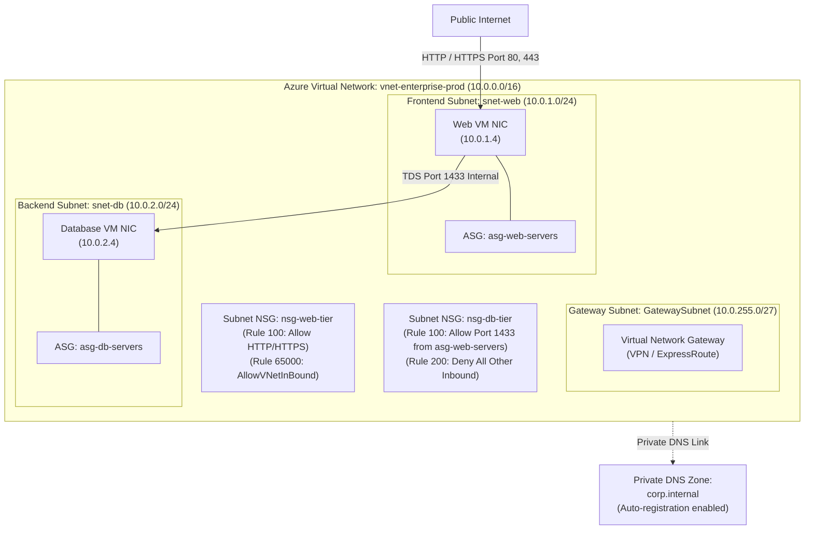
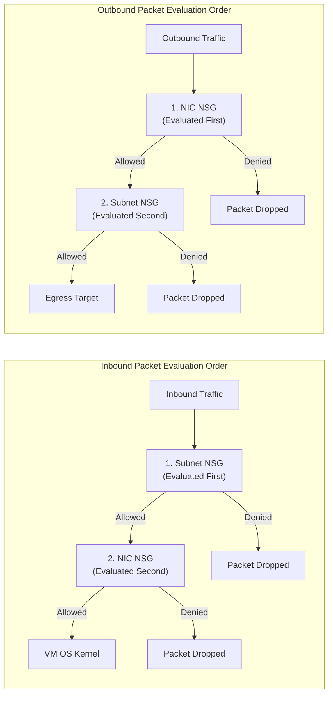
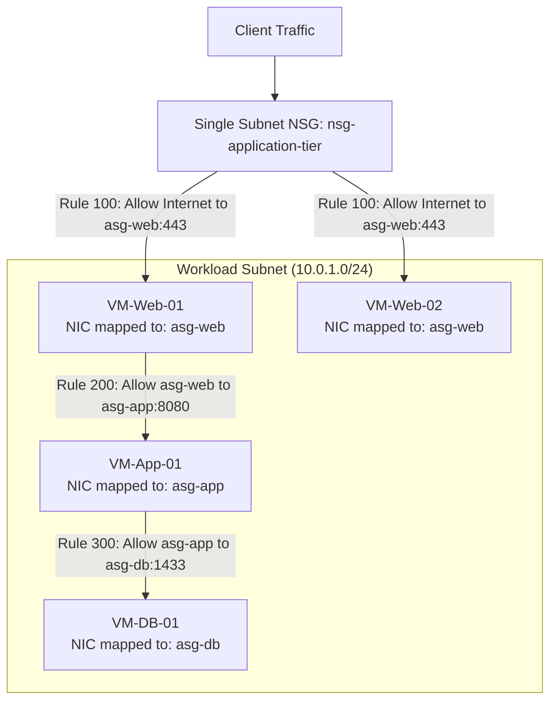
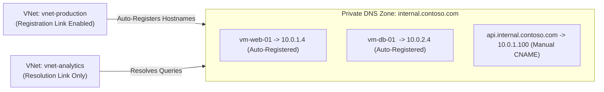
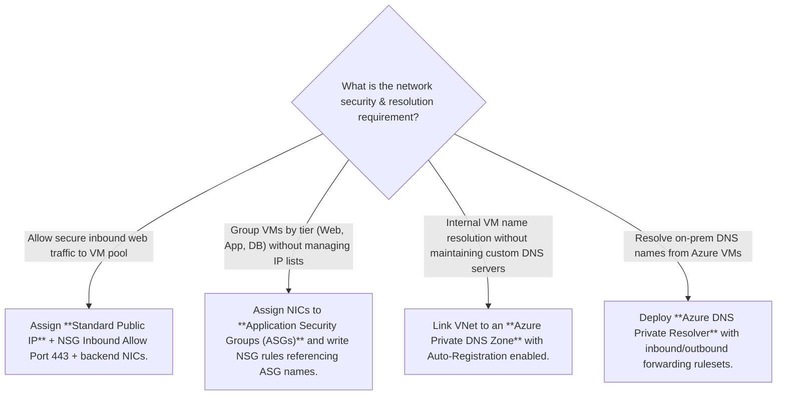
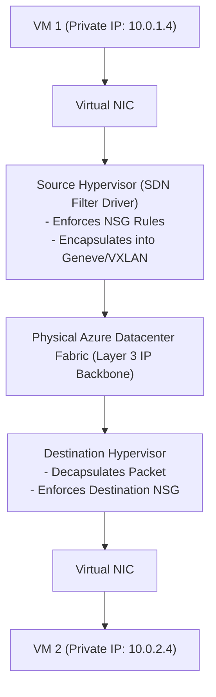

# Module 13-104-05: Administer Azure Virtual Networking, NSGs & DNS

**Breadcrumbs:** [[13-Index - Azure|☁️ Azure Reference MOC]] > [[13-Index - AZ-104|📘 AZ-104 Exam Track]] > **05 - Administer Virtual Networking**

---

## 🎯 Executive Overview & Network Fabric Architecture

The **Azure Virtual Network (VNet)** is the foundational building block for private cloud infrastructure in Microsoft Azure. A VNet provides complete logical isolation within the Microsoft enterprise backbone (Azure SDN), enabling Virtual Machines (VMs), containers, PaaS services, and hybrid connections to communicate securely.



---

## 🏛️ VNet Architecture, CIDR Planning & Reserved IPs

Azure Virtual Networks use standard Classless Inter-Domain Routing (CIDR) blocks based on private RFC 1918 allocations (`10.0.0.0/8`, `172.16.0.0/12`, `192.168.0.0/16`) or custom address spaces:
- Supported subnet mask ranges: Between `/8` (largest) and `/29` (smallest).

### 1. Subnet Bit Allocation Math & VLSM Carving
An IPv4 address consists of exactly 32 bits divided between the **network prefix** and the **host bits**:
$$\text{Host Bits} = 32 - \text{Prefix Length}$$
$$\text{Total Addresses} = 2^{\text{Host Bits}}$$
$$\text{Usable Host Count} = 2^{(32 - \text{Prefix})} - 5$$

* **Host Bit Calculations:**
  - A `/24` subnet leaves $32 - 24 = 8$ host bits $\rightarrow 2^8 = 256$ total IPs ($251$ usable).
  - A `/26` subnet leaves $32 - 26 = 6$ host bits $\rightarrow 2^6 = 64$ total IPs ($59$ usable).
  - A `/28` subnet leaves $32 - 28 = 4$ host bits $\rightarrow 2^4 = 16$ total IPs ($11$ usable).
  - A `/29` subnet leaves $32 - 29 = 3$ host bits $\rightarrow 2^3 = 8$ total IPs ($3$ usable — Azure minimum size).

* **VLSM Slicing Example:**
  If an organization carves a `10.12.0.0/26` block into smaller `/28` subnets, it borrows 2 bits for the network ($28 - 26 = 2$). This divides the `/26` block into four distinct, contiguous subnets of 16 IPs each:
  - **Subnet 1:** `10.12.0.0/28` (IPs `10.12.0.0` to `10.12.0.15` — Usable: `.4` to `.14`)
  - **Subnet 2:** `10.12.0.16/28` (IPs `10.12.0.16` to `10.12.0.31` — Usable: `.20` to `.30`)
  - **Subnet 3:** `10.12.0.32/28` (IPs `10.12.0.32` to `10.12.0.47` — Usable: `.36` to `.46`)
  - **Subnet 4:** `10.12.0.48/28` (IPs `10.12.0.48` to `10.12.0.63` — Usable: `.52` to `.62`)

### 2. The 4 Immutable Architectural Laws of Azure VNet Subnetting
1. **Strict Flat Topology (No Subnet Nesting):** In Azure, subnets cannot be nested inside other subnets. You cannot define a `/26` subnet and then attempt to place `/28` subnets *inside* of it. All subnets must sit side-by-side in a flat, parallel hierarchy.
2. **VNet is the Master Address Boundary:** You assign the broad CIDR block directly to the Virtual Network (e.g., `10.12.0.0/16`).
3. **Zero-Overlap Heterogeneous Slicing:** Subnets are carved directly out of the VNet space. You can freely mix subnet sizes (e.g., a `/24` for workloads, a `/26` for Azure Bastion, and a `/28` for Application Gateway), provided none of their address ranges overlap.
4. **Automated Longest Prefix Match (LPM) System Mesh:** Azure automatically provisions default system routes (`Next Hop: Virtual network`) so that all subnets within a VNet can communicate directly without deploying routers. Under the hood, the routing fabric evaluates destination packets using **Longest Prefix Match (LPM)**:
   - When a packet is destined for `10.12.0.20`, it matches the broad `/16` VNet block, a `/26` range, and the specific `10.12.0.16/28` subnet.
   - The virtual router selects the most specific route (the highest prefix length `/28`), routing traffic directly to the target subnet interface with zero packet ambiguity.

### 3. The 5 Azure Reserved IP Addresses
In every Azure subnet, **5 IP addresses** are reserved by the platform and cannot be assigned to any virtual machine or service:

| Reserved Offset | Address in `10.0.1.0/24` | Dedicated Function within Azure SDN |
| :---: | :---: | :--- |
| **x.x.x.0** | `10.0.1.0` | **Network Address:** RFC boundary identifier. |
| **x.x.x.1** | `10.0.1.1` | **Default Gateway:** Internal virtual router interface provisioned by Azure. |
| **x.x.x.2** | `10.0.1.2` | **Azure DNS:** DNS mapping to Azure recursive resolver (`168.63.129.16`). |
| **x.x.x.3** | `10.0.1.3` | **Azure DNS:** Secondary internal DNS mapping. |
| **x.x.x.255** | `10.0.1.255` | **Broadcast Address:** Network broadcast identifier (Azure SDN does not support native L2 broadcast/multicast). |

---

## 🌐 Public vs. Private IP Addresses & SKUs

### 1. Private IP Addresses
Private IPs facilitate internal communication across VNets, connected on-premises systems, and linked PaaS endpoints.
- **Dynamic Allocation (Default):** Azure DHCP assigns the next available IP address in the subnet. The IP is released only if the VM is deleted or stopped (deallocated).
- **Static Allocation:** Guarantees that the IP remains fixed even when the virtual machine is stopped/deallocated (essential for Domain Controllers, NVA firewalls, and internal database listeners).

### 2. Public IP Address SKUs

| Feature / Metric | Basic SKU (Legacy / Deprecated) | Standard SKU (Modern Enterprise) |
| :--- | :--- | :--- |
| **Allocation Method** | Dynamic or Static. | **Static ONLY** (assigned permanently on creation). |
| **Security Posture** | Open by default (insecure unless blocked by NSG). | **Secure by default** (closed to all inbound traffic until explicitly permitted by an NSG). |
| **Zone Redundancy** | None (Single datacenter bound). | Zone-redundant or pinned to a specific Availability Zone (1, 2, or 3). |
| **Service Integration** | Basic Load Balancer only. | Standard Load Balancer, Azure Application Gateway v2, NAT Gateway, Azure Bastion. |
| **Retirement Horizon** | Retired across all clouds. | Long-term production standard. |

---

## 🛡️ Network Security Groups (NSGs)

An NSG is a stateful Layer 4 packet-filtering firewall that controls inbound and outbound network traffic to Azure resources.



### NSG 5-Tuple Rule Structure
Each rule contains:
1. **Source:** IP Address, CIDR block, Service Tag (e.g., `Internet`, `VirtualNetwork`, `AzureLoadBalancer`), or Application Security Group.
2. **Source Port Range:** Single port (`80`), range (`1000-2000`), or wildcard (`*`).
3. **Destination:** IP Address, CIDR, Service Tag, or Application Security Group.
4. **Destination Port Range:** Port number or wildcard.
5. **Protocol:** TCP, UDP, ICMP, or Any.
6. **Action:** `Allow` or `Deny`.
7. **Priority:** An integer from **100 to 4096**. Lower numbers have higher priority; evaluation stops at the first matching rule.

### Default Inbound Rules (Cannot be deleted, but can be overridden)

| Priority | Rule Name | Source | Destination | Protocol | Action | Architectural Intent |
| :---: | :--- | :---: | :---: | :---: | :---: | :--- |
| **65000** | `AllowVNetInBound` | `VirtualNetwork` | `VirtualNetwork` | Any | **Allow** | Permits all internal traffic across the entire VNet, peered VNets, and connected VPN networks. |
| **65001** | `AllowAzureLoadBalancerInBound` | `AzureLoadBalancer` | `Any` | Any | **Allow** | Enables Azure Load Balancer health probe checks (`168.63.129.16`) to reach backend nodes. |
| **65500** | `DenyAllInBound` | `Any` | `Any` | Any | **Deny** | Default-deny posture: blocks all other unpermitted inbound internet/external traffic. |

---

## 🏷️ Application Security Groups (ASGs)

Application Security Groups provide application-centric security policies. Instead of writing NSG rules with hardcoded, fragile IP addresses, administrators group virtual network adapters (NICs) into logical tiers:



> [!IMPORTANT]
> **ASG Constraints:**
> - All network interfaces attached to an ASG must reside in the **same Virtual Network**.
> - An ASG cannot span multiple VNets, even if the VNets are peered.
> - Multiple ASGs can be assigned to a single NIC (e.g., a server can be a member of both `asg-web` and `asg-monitored`).

---

## 🧭 Azure DNS & Azure Private DNS Zones

### 1. Azure Public DNS Zones
Azure DNS hosts public DNS domains, leveraging Microsoft's global Anycast network of name servers to resolve domain names with high performance and 100% availability SLA.
- **Alias Records:** Specialized Azure DNS records that reference Azure resources directly (e.g., an Azure Public IP, Azure Traffic Manager profile, or Azure CDN). When the underlying resource's IP changes, the alias record updates automatically without TTL propagation lag.

### 2. Azure Private DNS Zones
Provides secure, authoritative name resolution for VMs and services within private VNets without requiring custom IaaS domain controllers or BIND servers.



| Dimension | Registration Virtual Network | Resolution Virtual Network |
| :--- | :--- | :--- |
| **Functionality** | VMs deployed in this VNet automatically register their A records (`hostname.domain`) and clean them up on VM deletion. | Resolves DNS queries against the private zone, but **does not** register its own VM hostnames automatically. |
| **Limit per Zone** | Exactly **1 VNet** can have registration enabled per private DNS zone. | Up to **1,000 VNets** can be linked for resolution. |

---

## 🛠️ Contextual Proof of Concept: CLI & PowerShell Recipes

### 1. Azure CLI: Complete Virtual Network & NSG Provisioning

```bash
# 1. Create a Resource Group
az group create --name "rg-networking-poc" --location "eastus"

# 2. Create an Application Security Group for Web and DB tiers
az network asg create --resource-group "rg-networking-poc" --name "asg-web" --location "eastus"
az network asg create --resource-group "rg-networking-poc" --name "asg-db" --location "eastus"

# 3. Create a Network Security Group with an ASG-driven rule
az network nsg create --resource-group "rg-networking-poc" --name "nsg-backend" --location "eastus"

# Allow TCP 1433 from Web ASG to Database ASG
az network nsg rule create \
  --resource-group "rg-networking-poc" \
  --nsg-name "nsg-backend" \
  --name "Allow-Web-to-SQL" \
  --priority 100 \
  --direction Inbound \
  --access Allow \
  --protocol Tcp \
  --source-asg-names "asg-web" \
  --destination-asg-names "asg-db" \
  --destination-port-ranges 1433

# 4. Create Virtual Network with subnets and associate NSG
az network vnet create \
  --resource-group "rg-networking-poc" \
  --name "vnet-enterprise" \
  --address-prefixes "10.0.0.0/16" \
  --subnet-name "snet-web" \
  --subnet-prefixes "10.0.1.0/24"

az network vnet subnet create \
  --resource-group "rg-networking-poc" \
  --vnet-name "vnet-enterprise" \
  --name "snet-db" \
  --address-prefixes "10.0.2.0/24" \
  --network-security-group "nsg-backend"

# 5. Create a Private DNS Zone and link with auto-registration
az network private-dns zone create \
  --resource-group "rg-networking-poc" \
  --name "corp.internal"

VNET_ID=$(az network vnet show --resource-group "rg-networking-poc" --name "vnet-enterprise" --query id -o tsv)

az network private-dns link vnet create \
  --resource-group "rg-networking-poc" \
  --zone-name "corp.internal" \
  --name "link-vnet-enterprise" \
  --virtual-network "$VNET_ID" \
  --registration-enabled true
```

---

## 🔍 Deep-Intuition AARF Framework

### Scenario: Diagnosing Azure Load Balancer Health Probe Failure Due to Custom NSG Rules

- **The Answer (Core Configuration):** Ensure that any custom NSG priority rule does NOT override default rule `65001: AllowAzureLoadBalancerInBound` (or explicitly create an inbound rule: Priority `110`, Source `AzureLoadBalancer`, Destination `*`, Port `*`, Protocol `*`, Action `Allow`).
- **The Assumptions (Prerequisites):** 
  - Virtual machine is a backend pool member behind an Azure Standard Load Balancer.
  - An aggressive custom default-deny rule was added at Priority `1000` (`DenyAll`).
- **The Rationale (Why):** Azure Load Balancer health probes originate from the physical host routing infrastructure mapped to virtual IP `168.63.129.16`. In NSG rule definitions, this traffic is encapsulated under the `AzureLoadBalancer` service tag. If a custom deny rule blocks this traffic before default rule 65001 is evaluated, the health probe fails.
- **The Failure Loop (What if misconfigured):**
  - *Symptom:* The load balancer marks all backend VMs as "Unhealthy" and stops distributing web traffic, returning `HTTP 503 Service Unavailable`.
  - *Diagnostic Verification:* In Azure Network Watcher *IP flow verify*, testing inbound traffic from `168.63.129.16` on port 80 reports `Denied by Rule: Custom-Deny-All (Priority 1000)`.
- **The Alternative Case (When to use 'if not'):** When operating internal backend pools that receive traffic purely through Application Gateway or Private Link, direct Azure Load Balancer health probes are not used, and traffic must instead be permitted from the specific Application Gateway subnet CIDR.

---

## 💡 AZ-104 Exam Tips & Gotchas

> [!TIP]
> **Subnet Sizing Calculation:** Always remember that Azure reserves **5 IP addresses** per subnet. If an exam question asks: *"You need to deploy 28 virtual machines into a new subnet. What is the minimum CIDR prefix required?"*
> - A `/27` provides $2^{(32-27)} = 32$ total addresses.
> - $32 - 5 = 27$ usable addresses. (Cannot fit 28 VMs!)
> - A `/26` provides $64 - 5 = 59$ usable addresses.
> - **Correct Answer:** `/26`.

> [!WARNING]
> **Subnet NSG vs. NIC NSG Inbound Conflict:**
> If a Subnet NSG has an inbound rule: `Priority 100, Port 80, Allow`, but the VM's NIC NSG has an inbound rule: `Priority 100, Port 80, Deny`:
> - Traffic arrives at the subnet: **Permitted**.
> - Traffic arrives at the NIC: **Blocked**.
> - Result: **Packet is dropped**. Both NSGs must evaluate to `Allow` for inbound packets to reach the VM.

---

## 🏛️ Enterprise Network Planning, IP Allocation & DNS Architecture

### 1. VNet Planning & RFC 1918 CIDR Allocation
- **RFC 1918 Private Ranges:** Always plan address spaces using standard private CIDR blocks (`10.0.0.0/8`, `172.16.0.0/12`, `192.168.0.0/16`).
- **Overlapping Address Space Warning:** If two VNets have overlapping address spaces (e.g., both use `10.1.0.0/16`), they **cannot be peered**. Always establish a centralized IP address management (IPAM) inventory before provisioning production networks.
- **The Reserved IP Footprint (5 Addresses per Subnet):**
  - `x.x.x.0`: Network identifier.
  - `x.x.x.1`: Default gateway for the subnet.
  - `x.x.x.2` & `x.x.x.3`: Mapped to internal Azure DNS routing fabric (`168.63.129.16`).
  - `x.x.x.255`: Subnet broadcast address.
  - *Usable host formula:* Usable capacity is strictly $2^{(32 - \text{prefix})} - 5$.

### 2. Public vs. Private IP Addresses & Standard SKU Security
- **Basic vs. Standard Public IP SKUs:**
  - *Basic SKU (Deprecated):* Open by default (allowed inbound traffic unless blocked by an NSG), supported dynamic allocation, non-zone-redundant.
  - *Standard SKU (Mandatory Modern Standard):* **Secure by default** (drops all inbound traffic until an explicit NSG rule allows it), static allocation only, zone-redundant, required for Standard Load Balancers and NAT Gateways.
- **Dynamic vs. Static Private IP Allocation:** By default, VMs receive dynamic private IPs assigned via Azure DHCP lease. If the VM is stopped/deallocated, a dynamic IP may be released. For domain controllers, database servers, and NVAs, change private IP allocation to **Static** in the NIC IP Configuration blade.

### 3. NSG Rule Engineering & Stateful Inspection
- **Rule Priority Spacing:** Never create rules with consecutive priority numbers (e.g., 100, 101, 102). Always space priority numbers by increments of 10 or 20 (e.g., 100, 120, 140) to leave room for emergency overriding rules.
- **Service Tags:** Use built-in service tags (e.g., `VirtualNetwork`, `Internet`, `AzureLoadBalancer`) instead of hardcoding IP ranges to automatically adapt to Azure datacenter updates.
- **Stateful Connection Tracking:** NSGs are stateful. If an inbound packet is permitted (e.g., HTTP on port 80), the outbound response packet on the dynamic return port is automatically allowed, regardless of outbound NSG rules.

### 4. Azure Private DNS Zones & Auto-Registration Architecture
- **Split-Horizon DNS:** Enables using internal domain names (e.g., `corp.internal`) without registering public TLDs or routing lookups over the public internet.
- **Virtual Network Links:**
  - **Resolution Links:** Allows VMs in the linked VNet to resolve DNS records in the private zone (up to 1,000 VNets per zone).
  - **Auto-Registration Links:** Azure automatically creates and deletes `A` records matching VM hostnames when VMs are provisioned or deallocated. A Private DNS zone can support multiple resolution links, but **only one virtual network can be designated as the auto-registration network** per zone.

---

## 💡 Networking Decision Framework & Articulation Tree



---

---

## 🏛️ Deep-Dive SDN & Hypervisor Packet Flow (John Savill Master Class Insights)

### 1. Azure Software Defined Networking (SDN) Architecture
John Savill explains that Azure virtual networks do not exist as physical VLANs or virtual switches in datacenter racks:
- **Overlay Networking Fabric:** Physical Azure servers run on an optimized Layer 3 IP network.
- **Hypervisor Packet Encapsulation:** When a VM sends an IP packet to another VM on the same VNet:
  1. The packet enters the hypervisor's virtual filter driver.
  2. The hypervisor encapsulates the customer packet inside an outer Geneve / VXLAN packet addressed to the physical host IP of the destination hypervisor.
  3. The destination hypervisor strips the outer header and delivers the original packet directly to the target VM's virtual NIC.
- **Zero Broadcast / Multicast:** Physical datacenters cannot scale with traditional Layer 2 broadcast domains. Therefore, Azure SDN intercepts and **drops all broadcast (`255.255.255.255`) and multicast packets**. This is why the `.255` address in every Azure subnet is permanently reserved and unusable.



### 2. The Special Wire Server IP (`168.63.129.16`)
In any Azure VNet, administrators frequently observe connections to `168.63.129.16`. This is a **special non-routable virtual IP address** that represents the underlying Azure platform node:
- **DHCP Services:** Provides DHCP dynamic IP leases to all virtual machine NICs.
- **DNS Resolution:** Acts as the recursive resolver for Azure internal DNS and Azure Private DNS Zones.
- **Health Probes:** Azure Load Balancer health probes originate from `168.63.129.16`.
- **VM Agent Heartbeat:** Communicates with the guest Azure VM Agent for telemetry and extension provisioning.
- *Security Rule:* **Never block `168.63.129.16` in custom NSGs**; blocking this IP will break VM networking, DHCP renewals, and load balancer health probes.

### 3. NSG Stateful Connection Tracking Tables
- Network Security Groups are enforced directly within the hypervisor packet inspection pipeline.
- When an inbound packet matches an `Allow` rule (e.g., port 443):
  - The hypervisor creates an entry in its stateful connection tracking table recording the 5-tuple flow.
  - Return traffic from the VM back to the client is **automatically permitted**, bypassing outbound NSG rules entirely.

---

## 🚀 Going the Extra Mile: Architectural Deep Dive - Enterprise Virtual Network Engineering & AVNM

> [!IMPORTANT]
> **Going the Extra Mile:** In this section, we are taking an extra mile on this topic and start deep diving into the foundational SDN hypervisor packet transformations, Longest Prefix Match (LPM) packet path resolution, Wire Server VIP internals, and Azure Virtual Network Manager (AVNM) enterprise mesh topologies based on John Savill's Azure Deep Dives Master Class.

### 1. Azure Virtual Network Manager (AVNM) Enterprise Mesh Architecture
* **Centralized Network Governance:** At scale with hundreds of VNets across subscriptions, managing individual VNet peerings and distributed NSGs becomes an operational nightmare.
* **Network Groups & Dynamic Membership:** Aggregates VNets dynamically using conditional rules (e.g., all VNets in region `East US` with tag `Environment = Production`).
* **Automated Topologies:**
  - **Hub-and-Spoke:** Automatically deploys and configures peering, Gateway Transit, and routing between hub and spokes.
  - **Global Mesh:** Establishes a direct, fully meshed peering fabric across all member VNets with a single declarative configuration, eliminating hub hair-pinning latency for inter-spoke communications.

### 2. Security Admin Rules (SAR) vs. Network Security Groups (NSG)
AVNM introduces Security Admin Rules that evaluate *before* local subnet NSGs:
* **Centralized Enforcement:** Central security teams create global guardrails (e.g., permanently blocking inbound SSH port 22 or RDP port 3389 from the Internet across the enterprise).
* **Deterministic Priority:** If a Security Admin Rule evaluates to `Deny`, the packet is terminated at the hypervisor. A local development team cannot override or bypass it, even if they create an NSG rule with priority `100` allowing port 22.
* **Three SAR Rule Actions:**
  1. `Deny`: Unconditionally drops the packet immediately.
  2. `Allow`: Unconditionally permits the packet, bypassing all lower NSG rules.
  3. `Pass`: Defers evaluation down to the local Subnet and NIC NSG rules.


## 🌐 Authoritative References & Citations

- [John Savill: Azure Master Class v3 - Part 6 - Networking](https://www.youtube.com/playlist?list=PLlVtbbG169nGlGPWs9xaLKT1KfwqREHbs)
- [John Savill: AZ-700 Azure Networking Study Super Guide](https://www.youtube.com/playlist?list=PLlVtbbG169nGlGPWs9xaLKT1KfwqREHbs)

- [KodeKloud AZ-104 Course - Administer Virtual Networking Module](https://notes.kodekloud.com/docs/Updated-AZ-104-Microsoft-Azure-Administrator/Administer-Virtual-Networking/Module-Introduction/page.md)
- [Moe Intelligence AZ-104 Video Series (Lessons 15–18, 25)](https://www.youtube.com/playlist?list=PLczK3J2J4clmeh328CC13dJrcALcSFZFb)
- [Microsoft Learn: Configure virtual networks and subnets](https://learn.microsoft.com/en-us/training/modules/configure-virtual-networks/)
- [Microsoft Learn: Secure and govern network traffic with NSGs](https://learn.microsoft.com/en-us/training/modules/secure-and-isolate-with-nsg-and-service-endpoints/)
- [Azure Virtual Network Documentation](https://learn.microsoft.com/en-us/azure/virtual-network/)
