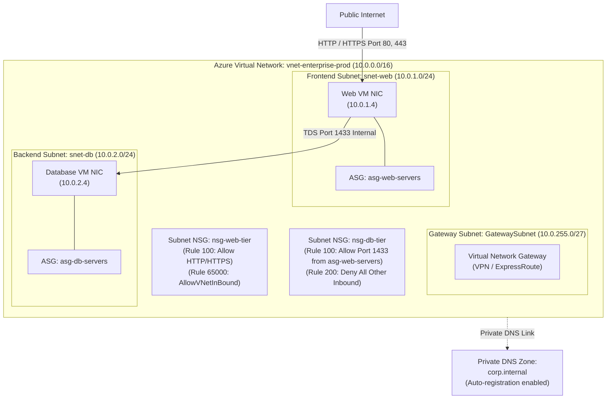
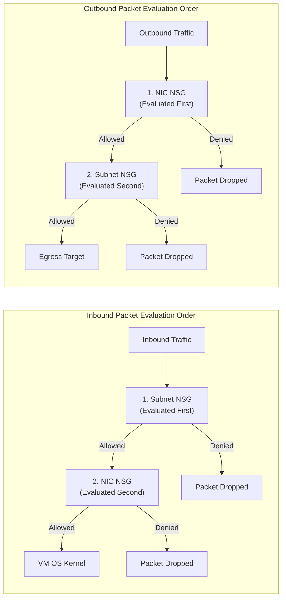
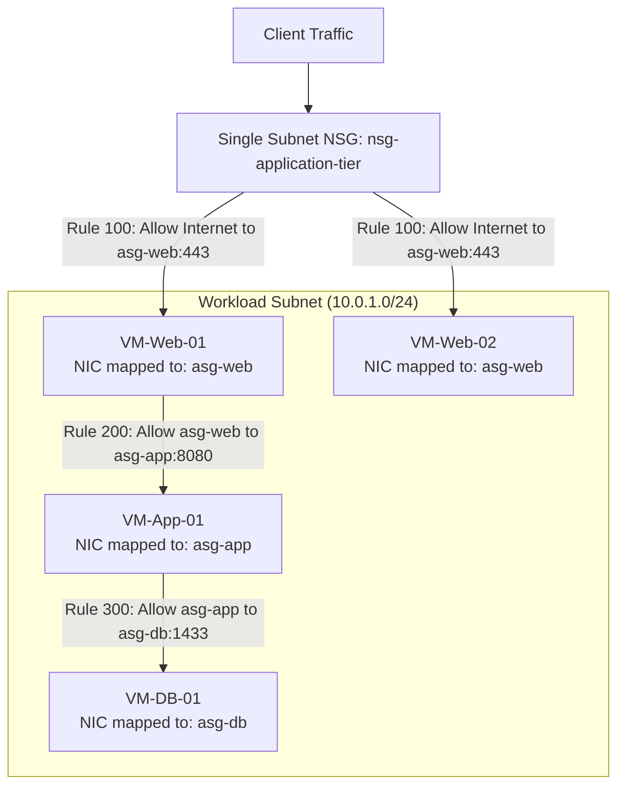
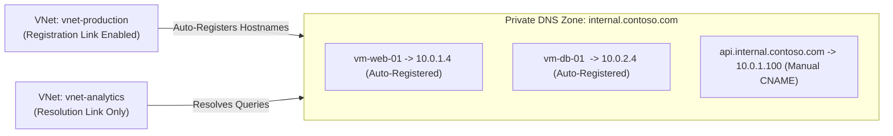

# Module 13-104-05: Administer Azure Virtual Networking, NSGs & DNS

**Breadcrumbs:** [[13-Index - Azure|☁️ Azure Reference MOC]] > [[13-Index - AZ-104|📘 AZ-104 Exam Track]] > **05 - Administer Virtual Networking**

---

## 🎯 Executive Overview & Network Fabric Architecture

The **Azure Virtual Network (VNet)** is the foundational building block for private cloud infrastructure in Microsoft Azure. A VNet provides complete logical isolation within the Microsoft enterprise backbone (Azure SDN), enabling Virtual Machines (VMs), containers, PaaS services, and hybrid connections to communicate securely.



---

## 🏛️ VNet Architecture, CIDR Planning & Reserved IPs

Azure Virtual Networks use standard Classless Inter-Domain Routing (CIDR) blocks based on private RFC 1918 allocations (`10.0.0.0/8`, `172.16.0.0/12`, `192.168.0.0/16`) or custom address spaces:
- Supported subnet mask ranges: Between `/8` (largest) and `/29` (smallest).
- **The 5 Azure Reserved IP Addresses:** In every Azure subnet, **5 IP addresses** are reserved by the platform and cannot be assigned to any virtual machine or service:

| Reserved Offset | Address in `10.0.1.0/24` | Dedicated Function within Azure SDN |
| :---: | :---: | :--- |
| **x.x.x.0** | `10.0.1.0` | **Network Address:** RFC boundary identifier. |
| **x.x.x.1** | `10.0.1.1` | **Default Gateway:** Internal virtual router interface provisioned by Azure. |
| **x.x.x.2** | `10.0.1.2` | **Azure DNS:** DNS mapping to Azure recursive resolver (`168.63.129.16`). |
| **x.x.x.3** | `10.0.1.3` | **Azure DNS:** Secondary internal DNS mapping. |
| **x.x.x.255** | `10.0.1.255` | **Broadcast Address:** Network broadcast identifier (Azure SDN does not support native L2 broadcast/multicast). |

$$\text{Usable Host Count} = 2^{(32 - \text{Prefix})} - 5$$
*Example: A `/24` subnet ($2^8 = 256$) provides exactly $256 - 5 = 251$ usable host IP addresses ($10.0.1.4 \rightarrow 10.0.1.254$).*

---

## 🌐 Public vs. Private IP Addresses & SKUs

### 1. Private IP Addresses
Private IPs facilitate internal communication across VNets, connected on-premises systems, and linked PaaS endpoints.
- **Dynamic Allocation (Default):** Azure DHCP assigns the next available IP address in the subnet. The IP is released only if the VM is deleted or stopped (deallocated).
- **Static Allocation:** Guarantees that the IP remains fixed even when the virtual machine is stopped/deallocated (essential for Domain Controllers, NVA firewalls, and internal database listeners).

### 2. Public IP Address SKUs

| Feature / Metric | Basic SKU (Legacy / Deprecated) | Standard SKU (Modern Enterprise) |
| :--- | :--- | :--- |
| **Allocation Method** | Dynamic or Static. | **Static ONLY** (assigned permanently on creation). |
| **Security Posture** | Open by default (insecure unless blocked by NSG). | **Secure by default** (closed to all inbound traffic until explicitly permitted by an NSG). |
| **Zone Redundancy** | None (Single datacenter bound). | Zone-redundant or pinned to a specific Availability Zone (1, 2, or 3). |
| **Service Integration** | Basic Load Balancer only. | Standard Load Balancer, Azure Application Gateway v2, NAT Gateway, Azure Bastion. |
| **Retirement Horizon** | Retired across all clouds. | Long-term production standard. |

---

## 🛡️ Network Security Groups (NSGs)

An NSG is a stateful Layer 4 packet-filtering firewall that controls inbound and outbound network traffic to Azure resources.



### NSG 5-Tuple Rule Structure
Each rule contains:
1. **Source:** IP Address, CIDR block, Service Tag (e.g., `Internet`, `VirtualNetwork`, `AzureLoadBalancer`), or Application Security Group.
2. **Source Port Range:** Single port (`80`), range (`1000-2000`), or wildcard (`*`).
3. **Destination:** IP Address, CIDR, Service Tag, or Application Security Group.
4. **Destination Port Range:** Port number or wildcard.
5. **Protocol:** TCP, UDP, ICMP, or Any.
6. **Action:** `Allow` or `Deny`.
7. **Priority:** An integer from **100 to 4096**. Lower numbers have higher priority; evaluation stops at the first matching rule.

### Default Inbound Rules (Cannot be deleted, but can be overridden)

| Priority | Rule Name | Source | Destination | Protocol | Action | Architectural Intent |
| :---: | :--- | :---: | :---: | :---: | :---: | :--- |
| **65000** | `AllowVNetInBound` | `VirtualNetwork` | `VirtualNetwork` | Any | **Allow** | Permits all internal traffic across the entire VNet, peered VNets, and connected VPN networks. |
| **65001** | `AllowAzureLoadBalancerInBound` | `AzureLoadBalancer` | `Any` | Any | **Allow** | Enables Azure Load Balancer health probe checks (`168.63.129.16`) to reach backend nodes. |
| **65500** | `DenyAllInBound` | `Any` | `Any` | Any | **Deny** | Default-deny posture: blocks all other unpermitted inbound internet/external traffic. |

---

## 🏷️ Application Security Groups (ASGs)

Application Security Groups provide application-centric security policies. Instead of writing NSG rules with hardcoded, fragile IP addresses, administrators group virtual network adapters (NICs) into logical tiers:



> [!IMPORTANT]
> **ASG Constraints:**
> - All network interfaces attached to an ASG must reside in the **same Virtual Network**.
> - An ASG cannot span multiple VNets, even if the VNets are peered.
> - Multiple ASGs can be assigned to a single NIC (e.g., a server can be a member of both `asg-web` and `asg-monitored`).

---

## 🧭 Azure DNS & Azure Private DNS Zones

### 1. Azure Public DNS Zones
Azure DNS hosts public DNS domains, leveraging Microsoft's global Anycast network of name servers to resolve domain names with high performance and 100% availability SLA.
- **Alias Records:** Specialized Azure DNS records that reference Azure resources directly (e.g., an Azure Public IP, Azure Traffic Manager profile, or Azure CDN). When the underlying resource's IP changes, the alias record updates automatically without TTL propagation lag.

### 2. Azure Private DNS Zones
Provides secure, authoritative name resolution for VMs and services within private VNets without requiring custom IaaS domain controllers or BIND servers.



| Dimension | Registration Virtual Network | Resolution Virtual Network |
| :--- | :--- | :--- |
| **Functionality** | VMs deployed in this VNet automatically register their A records (`hostname.domain`) and clean them up on VM deletion. | Resolves DNS queries against the private zone, but **does not** register its own VM hostnames automatically. |
| **Limit per Zone** | Exactly **1 VNet** can have registration enabled per private DNS zone. | Up to **1,000 VNets** can be linked for resolution. |

---

## 🛠️ Contextual Proof of Concept: CLI & PowerShell Recipes

### 1. Azure CLI: Complete Virtual Network & NSG Provisioning

```bash
# 1. Create a Resource Group
az group create --name "rg-networking-poc" --location "eastus"

# 2. Create an Application Security Group for Web and DB tiers
az network asg create --resource-group "rg-networking-poc" --name "asg-web" --location "eastus"
az network asg create --resource-group "rg-networking-poc" --name "asg-db" --location "eastus"

# 3. Create a Network Security Group with an ASG-driven rule
az network nsg create --resource-group "rg-networking-poc" --name "nsg-backend" --location "eastus"

# Allow TCP 1433 from Web ASG to Database ASG
az network nsg rule create \
  --resource-group "rg-networking-poc" \
  --nsg-name "nsg-backend" \
  --name "Allow-Web-to-SQL" \
  --priority 100 \
  --direction Inbound \
  --access Allow \
  --protocol Tcp \
  --source-asg-names "asg-web" \
  --destination-asg-names "asg-db" \
  --destination-port-ranges 1433

# 4. Create Virtual Network with subnets and associate NSG
az network vnet create \
  --resource-group "rg-networking-poc" \
  --name "vnet-enterprise" \
  --address-prefixes "10.0.0.0/16" \
  --subnet-name "snet-web" \
  --subnet-prefixes "10.0.1.0/24"

az network vnet subnet create \
  --resource-group "rg-networking-poc" \
  --vnet-name "vnet-enterprise" \
  --name "snet-db" \
  --address-prefixes "10.0.2.0/24" \
  --network-security-group "nsg-backend"

# 5. Create a Private DNS Zone and link with auto-registration
az network private-dns zone create \
  --resource-group "rg-networking-poc" \
  --name "corp.internal"

VNET_ID=$(az network vnet show --resource-group "rg-networking-poc" --name "vnet-enterprise" --query id -o tsv)

az network private-dns link vnet create \
  --resource-group "rg-networking-poc" \
  --zone-name "corp.internal" \
  --name "link-vnet-enterprise" \
  --virtual-network "$VNET_ID" \
  --registration-enabled true
```

---

## 🔍 Deep-Intuition AARF Framework

### Scenario: Diagnosing Azure Load Balancer Health Probe Failure Due to Custom NSG Rules

- **The Answer (Core Configuration):** Ensure that any custom NSG priority rule does NOT override default rule `65001: AllowAzureLoadBalancerInBound` (or explicitly create an inbound rule: Priority `110`, Source `AzureLoadBalancer`, Destination `*`, Port `*`, Protocol `*`, Action `Allow`).
- **The Assumptions (Prerequisites):** 
  - Virtual machine is a backend pool member behind an Azure Standard Load Balancer.
  - An aggressive custom default-deny rule was added at Priority `1000` (`DenyAll`).
- **The Rationale (Why):** Azure Load Balancer health probes originate from the physical host routing infrastructure mapped to virtual IP `168.63.129.16`. In NSG rule definitions, this traffic is encapsulated under the `AzureLoadBalancer` service tag. If a custom deny rule blocks this traffic before default rule 65001 is evaluated, the health probe fails.
- **The Failure Loop (What if misconfigured):**
  - *Symptom:* The load balancer marks all backend VMs as "Unhealthy" and stops distributing web traffic, returning `HTTP 503 Service Unavailable`.
  - *Diagnostic Verification:* In Azure Network Watcher *IP flow verify*, testing inbound traffic from `168.63.129.16` on port 80 reports `Denied by Rule: Custom-Deny-All (Priority 1000)`.
- **The Alternative Case (When to use 'if not'):** When operating internal backend pools that receive traffic purely through Application Gateway or Private Link, direct Azure Load Balancer health probes are not used, and traffic must instead be permitted from the specific Application Gateway subnet CIDR.

---

## 💡 AZ-104 Exam Tips & Gotchas

> [!TIP]
> **Subnet Sizing Calculation:** Always remember that Azure reserves **5 IP addresses** per subnet. If an exam question asks: *"You need to deploy 28 virtual machines into a new subnet. What is the minimum CIDR prefix required?"*
> - A `/27` provides $2^{(32-27)} = 32$ total addresses.
> - $32 - 5 = 27$ usable addresses. (Cannot fit 28 VMs!)
> - A `/26` provides $64 - 5 = 59$ usable addresses.
> - **Correct Answer:** `/26`.

> [!WARNING]
> **Subnet NSG vs. NIC NSG Inbound Conflict:**
> If a Subnet NSG has an inbound rule: `Priority 100, Port 80, Allow`, but the VM's NIC NSG has an inbound rule: `Priority 100, Port 80, Deny`:
> - Traffic arrives at the subnet: **Permitted**.
> - Traffic arrives at the NIC: **Blocked**.
> - Result: **Packet is dropped**. Both NSGs must evaluate to `Allow` for inbound packets to reach the VM.

---

## 🌐 Authoritative References & Citations

- [KodeKloud AZ-104 Course - Administer Virtual Networking Module](https://notes.kodekloud.com/docs/Updated-AZ-104-Microsoft-Azure-Administrator/Administer-Virtual-Networking/Module-Introduction/page.md)
- [Microsoft Learn: Configure virtual networks and subnets](https://learn.microsoft.com/en-us/training/modules/configure-virtual-networks/)
- [Microsoft Learn: Secure and govern network traffic with NSGs](https://learn.microsoft.com/en-us/training/modules/secure-and-isolate-with-nsg-and-service-endpoints/)
- [Azure Virtual Network Documentation](https://learn.microsoft.com/en-us/azure/virtual-network/)
