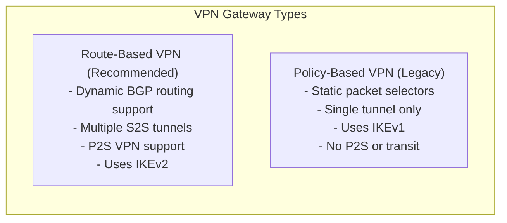
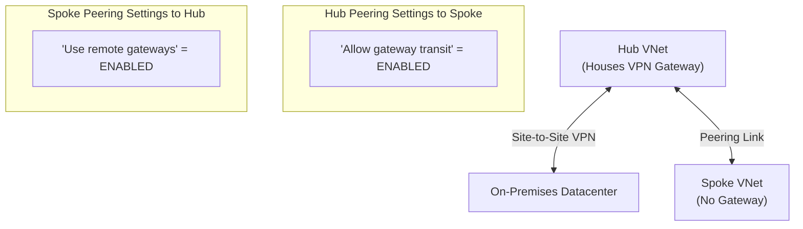
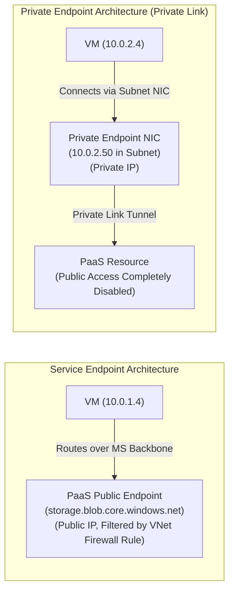

# Module 13-104-06: Administer Intersite Connectivity, Routing & Private Link

**Breadcrumbs:** [[13-Index - Azure|☁️ Azure Reference MOC]] > [[13-Index - AZ-104|📘 AZ-104 Exam Track]] > **06 - Administer Intersite Connectivity**

---

## 🎯 Executive Overview & Connectivity Matrix

Enterprise cloud architectures require secure, high-throughput communication across multiple Azure Virtual Networks (VNet-to-VNet), between hybrid on-premises datacenters and Azure, and toward cloud-hosted PaaS services. Azure provides a tiered set of intersite connectivity and routing mechanisms:

```mermaid
flowchart TD
    subgraph OnPremDatacenter ["On-Premises Corporate Datacenter"]
        LocalGW["Local Network Gateway\n(Public IP: 203.0.113.1)\n(Subnets: 192.168.0.0/16)"]
        OnPremFirewall["On-Prem VPN Appliance\n(IPsec / IKEv2)"]
    end

    subgraph HubVNet ["Hub Virtual Network: vnet-hub (10.0.0.0/16)"]
        GatewaySubnet["GatewaySubnet (10.0.255.0/27)\nAzure Virtual Network Gateway"]
        NVA["Firewall / NVA Subnet\nAzure Firewall (10.0.100.4)"]
    end

    subgraph Spoke1 ["Spoke VNet 1: vnet-workloads (10.1.0.0/16)"]
        VM1["App Virtual Machines\n(UDR: 0.0.0.0/0 -> 10.0.100.4)"]
    end

    subgraph Spoke2 ["Spoke VNet 2: vnet-data (10.2.0.0/16)"]
        PrivEndpoint["Private Endpoint (NIC)\n(10.2.1.50 -> Storage Account)"]
    end

    OnPremFirewall <-->|Site-to-Site IPsec VPN| GatewaySubnet
    HubVNet <-->|VNet Peering (Gateway Transit)| Spoke1
    HubVNet <-->|VNet Peering (Gateway Transit)| Spoke2
    Spoke1 -.->|Routed via NVA UDR| Spoke2
```

---

## 🌐 Virtual Network Peering (Regional & Global)

Virtual Network Peering connects two Azure Virtual Networks directly across the private Microsoft global backbone without routing traffic through gateways or public internet transit:

- **Regional VNet Peering:** Connects VNets within the **same Azure region**.
- **Global VNet Peering:** Connects VNets across **different Azure regions** (e.g., East US to West Europe).

### Core Peering Rules & Constraints
1. **Non-Overlapping Address Space:** The IP address spaces of peered VNets **must not overlap**. Peering creation is blocked if CIDR ranges conflict.
2. **Two-Way Symmetric Requirement:** Peering links must be configured in **both directions** (`VNet1 -> VNet2` and `VNet2 -> VNet1`). Peering status shows `Initiated` until the reverse link is created, whereupon it transitions to `Connected`.
3. **Non-Transitive Nature:** Peering is strictly non-transitive:
   $$\text{VNet A} \longleftrightarrow \text{VNet B} \quad \text{and} \quad \text{VNet B} \longleftrightarrow \text{VNet C} \quad \centernot\implies \quad \text{VNet A} \longleftrightarrow \text{VNet C}$$
   *Traffic between A and C cannot cross B unless an explicit router or Network Virtual Appliance (NVA) is placed in VNet B with User-Defined Routes.*

---

## 🚪 Virtual Network Gateways & VPN Architecture

A Virtual Network Gateway provides cross-premises and encrypted VNet-to-VNet connectivity. It must be deployed into a dedicated subnet named exactly **`GatewaySubnet`** (recommended sizing: `/27` or `/28`).



### 1. Site-to-Site (S2S) VPN
Connects on-premises network appliances to an Azure VPN Gateway across the public internet via encrypted IPsec/IKE tunnels.
- **Local Network Gateway:** An Azure configuration object representing the on-premises VPN device's public IP address and local IP address prefixes.

### 2. Point-to-Site (P2S) VPN
Connects individual remote client devices (laptops) securely into an Azure VNet.
- **Protocols Supported:** OpenVPN (SSL-based), SSTP (Windows native over TCP 443), IKEv2.
- **Authentication Options:** Azure Certificate authentication (root/client certificates), RADIUS domain authentication, or **Microsoft Entra ID authentication** (via Azure VPN Client).

---

## 🔄 Hub-and-Spoke Topology & Gateway Transit

In enterprise multi-VNet environments, deploying a separate VPN Gateway in every spoke VNet is cost-prohibitive. **Gateway Transit** enables spoke VNets to share a single centralized Virtual Network Gateway hosted in the hub VNet:



> [!IMPORTANT]
> **Gateway Transit Configuration Rules:**
> - On the **Hub VNet Peering to Spoke**: Enable **"Allow gateway transit"**.
> - On the **Spoke VNet Peering to Hub**: Enable **"Use the remote virtual network's gateway"** (or *Use remote gateways*).
> - A spoke VNet cannot use remote gateways if it already possesses its own Virtual Network Gateway.

---

## 🗺️ User-Defined Routes (UDRs) & Custom Route Tables

Azure automatically creates default system routes for every subnet. To enforce centralized traffic inspection or redirect egress flows through a firewall or Network Virtual Appliance (NVA), administrators attach **User-Defined Route Tables (UDRs)** to subnets.

### System Default Routes vs. User-Defined Overrides

| Destination Prefix | Default Next Hop Type | Custom Override Behavior |
| :--- | :--- | :--- |
| **Inside VNet CIDR** | `VirtualNetwork` | Custom UDR can redirect internal traffic to `VirtualAppliance` (e.g., Azure Firewall). |
| **0.0.0.0/0 (Internet)** | `Internet` | Custom UDR can route default internet traffic to an on-premises firewall (`VirtualNetworkGateway`) or cloud NVA (`VirtualAppliance`). |
| **RFC 1918 Private Ranges** | `None` (Drop) | Overridden by VNet peering or VPN gateway routes. |

### Routing Precedence (Longest Prefix Match)
When routing packets, Azure selects the route based on the **longest prefix match (LPM)**. If multiple routes share identical destination prefixes:
1. **User-Defined Route (UDR)** has the highest priority and overrides BGP and System routes.
2. **BGP Route** (propagated via ExpressRoute or VPN Gateway) has the second priority.
3. **System Default Route** has the lowest priority.

---

## 🔌 PaaS Ingress: Service Endpoints vs. Private Endpoints

Securing access to Azure PaaS services (e.g., Azure Storage, Azure SQL Database) is a major focus of AZ-104:



| Evaluation Criteria | Service Endpoints (`Microsoft.Storage`, `Microsoft.Sql`) | Private Endpoints (Azure Private Link) |
| :--- | :--- | :--- |
| **IP Address Model** | Target PaaS resource retains its **Public IP address**. | Target PaaS service is assigned a **Private IP address** from your subnet. |
| **Network Path** | Traffic routes over the optimized Microsoft backbone instead of public internet. | Traffic stays entirely within your VNet private address space. |
| **Public Network Access** | Public IP remains routable, but PaaS firewall denies requests unless originating from the enabled subnet. | Public access can be **100% disabled** on the PaaS service. |
| **Cross-Premises / VPN Access** | **Not accessible** from on-premises over VPN or ExpressRoute (unless using complex NAT). | **Fully accessible** from on-premises over VPN, ExpressRoute, and peered VNets. |
| **DNS Requirements** | Standard public DNS resolution (`storage.blob.core.windows.net`). | Requires **Private DNS Zone** (`privatelink.blob.core.windows.net`) to resolve FQDN to the subnet private IP. |
| **Cost** | Free (no additional hourly charge). | Hourly charge per Private Endpoint + inbound/outbound data processing fees. |

---

## 🛠️ Contextual Proof of Concept: CLI & PowerShell Automation

### 1. Azure CLI: VNet Peering & Gateway Transit Setup

```bash
# 1. Create Hub VNet and Spoke VNet
az network vnet create --resource-group "rg-networking-poc" --name "vnet-hub" \
  --address-prefixes "10.0.0.0/16" --subnet-name "snet-shared" --subnet-prefixes "10.0.1.0/24"

az network vnet create --resource-group "rg-networking-poc" --name "vnet-spoke1" \
  --address-prefixes "10.1.0.0/16" --subnet-name "snet-workloads" --subnet-prefixes "10.1.1.0/24"

# 2. Peer Hub to Spoke (Allow Gateway Transit)
az network vnet peering create \
  --resource-group "rg-networking-poc" \
  --name "hub-to-spoke1" \
  --vnet-name "vnet-hub" \
  --remote-vnet "vnet-spoke1" \
  --allow-vnet-access \
  --allow-gateway-transit

# 3. Peer Spoke to Hub (Use Remote Gateway)
az network vnet peering create \
  --resource-group "rg-networking-poc" \
  --name "spoke1-to-hub" \
  --vnet-name "vnet-spoke1" \
  --remote-vnet "vnet-hub" \
  --allow-vnet-access \
  --use-remote-gateways
```

### 2. Azure CLI: Custom Route Table (UDR) to Network Virtual Appliance

```bash
# 1. Create a custom Route Table
az network route-table create \
  --resource-group "rg-networking-poc" \
  --name "rt-spoke-egress" \
  --location "eastus"

# 2. Add default 0.0.0.0/0 route to forward traffic to Azure Firewall NVA
az network route-table route create \
  --resource-group "rg-networking-poc" \
  --route-table-name "rt-spoke-egress" \
  --name "Default-Egress-to-NVA" \
  --address-prefix "0.0.0.0/0" \
  --next-hop-type "VirtualAppliance" \
  --next-hop-ip-address "10.0.100.4"

# 3. Associate Route Table with Spoke Subnet
az network vnet subnet update \
  --resource-group "rg-networking-poc" \
  --vnet-name "vnet-spoke1" \
  --name "snet-workloads" \
  --route-table "rt-spoke-egress"
```

---

## 🔍 Deep-Intuition AARF Framework

### Scenario: Diagnosing Private Endpoint DNS Resolution Failure

- **The Answer (Core Configuration):** Ensure that the Private Endpoint's Private DNS Zone `privatelink.blob.core.windows.net` has a **Virtual Network Link** attached to the client VNet, and that the client resolves the standard FQDN `storageacc.blob.core.windows.net` (which canonicalizes via CNAME to `storageacc.privatelink.blob.core.windows.net` and resolves to the private IP).
- **The Assumptions (Prerequisites):** 
  - Storage account has public network access disabled.
  - Private Endpoint is provisioned in `snet-data` with private IP `10.2.1.50`.
- **The Rationale (Why):** Storage SDKs and TLS certificates validate against the public FQDN `storageacc.blob.core.windows.net`. When a private endpoint is created, Azure updates public DNS to return a CNAME to `storageacc.privatelink.blob.core.windows.net`. If the client VNet is not linked to the Private DNS Zone, it falls back to public DNS, resolves to the public VIP, and receives a `403 Forbidden` firewall block.
- **The Failure Loop (What if misconfigured):**
  - *Symptom:* `curl https://storageacc.blob.core.windows.net` fails from inside the VM with `Client with IP address '52.x.x.x' is not allowed to access the server.`
  - *Diagnostic:* Running `nslookup storageacc.blob.core.windows.net` inside the VM returns a public IP instead of `10.2.1.50`.
- **The Alternative Case (When to use 'if not'):** If clients reside entirely on-premises without Azure Private DNS forwarders, administrators must configure on-premises DNS conditional forwarders pointing `privatelink.blob.core.windows.net` to an Azure DNS Private Resolver inside the hub VNet.

---

## 💡 AZ-104 Exam Tips & Gotchas

> [!TIP]
> **Peering Status Gotcha:** If you configure VNet Peering in the Azure Portal from VNet A to VNet B, the peering state is **Initiated**. It will NOT work until peering is also created from VNet B to VNet A, moving the state to **Connected** on both sides.

> [!WARNING]
> **Service Endpoints vs. On-Premises Connectivity:**
> Remember for exam scenarios: **Service Endpoints CANNOT be used across on-premises VPN or ExpressRoute connections**. If an exam question asks how on-premises branch offices can privately access an Azure Storage Account or Azure SQL Database without traversing the public internet, the ONLY correct answer is **Azure Private Endpoints (Private Link)**.

---

## 🌐 Authoritative References & Citations

- [KodeKloud AZ-104 Course - Administer Intersite Connectivity Module](https://notes.kodekloud.com/docs/Updated-AZ-104-Microsoft-Azure-Administrator/Administer-Intersite-Connectivity/Module-Introduction/page.md)
- [Microsoft Learn: Connect services together with VNet Peering](https://learn.microsoft.com/en-us/training/modules/integrate-vnets-with-vnet-peering/)
- [Microsoft Learn: Manage and control traffic flow with routes](https://learn.microsoft.com/en-us/training/modules/manage-and-control-traffic-with-route-tables/)
- [Microsoft Azure Documentation - Private Link & Private Endpoints](https://learn.microsoft.com/en-us/azure/private-link/)
