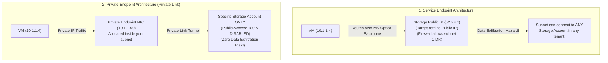
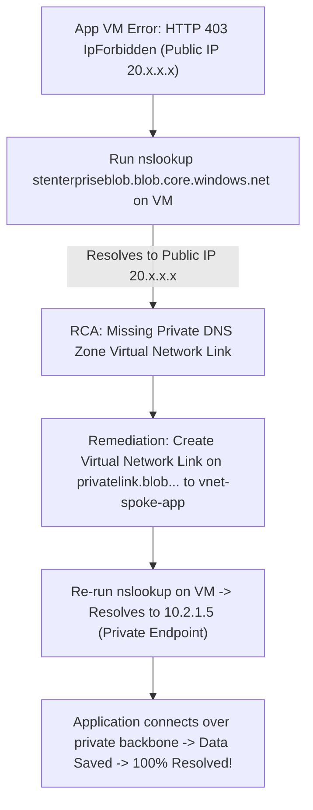

# Module 13-104-06: Administer Intersite Connectivity, Routing & Private Link

**Breadcrumbs:** [[13-Index - Azure|☁️ Azure Reference MOC]] > [[13-Index - AZ-104|📘 AZ-104 Exam Track]] > **06 - Administer Intersite Connectivity**

---

## 🎯 Stage 1: Executive Overview & The Conceptual Lecture

### 1. The Zero-Knowledge Starting Point: Why Virtual Networks Are Isolated
In Module 05, we established that an **Azure Virtual Network (VNet)** is a private software-defined boundary. By default:
* Workloads inside VNet A can communicate freely with each other.
* Workloads inside VNet B can communicate freely with each other.
* **VNet A and VNet B CANNOT communicate with each other under any circumstances!** They are completely separated by the underlying hypervisor fabric.

In an enterprise cloud landing zone, however, organizations do not deploy everything into a single massive VNet:
* The **Security & Networking Team** owns a centralized Hub VNet containing corporate firewalls, intrusion detection systems (IDS), and VPN connections to the on-premises corporate headquarters.
* The **E-Commerce Application Team** owns a Spoke VNet containing frontend web servers and backend APIs.
* The **Data Analytics Team** owns a separate Spoke VNet containing machine learning clusters and data lakes.

How do these separate networks talk to each other securely without exposing traffic to the public internet?
* If you connect them using traditional internet-facing VPNs, you introduce bandwidth throttles, CPU serialization bottlenecks, and high latency.
* If you peer every VNet with every other VNet in an unmanaged full-mesh, you create an unmanageable web of hundreds of peering connections where security teams cannot inspect cross-tier traffic.

To solve this, Microsoft Azure provides a spectrum of high-speed intersite connectivity options: **VNet Peering**, **Hub-and-Spoke Topologies**, **User-Defined Routes (UDRs)**, and **Azure Private Link**.

### 2. The Highway Toll Bridge Analogy
* **Isolated VNets:** Two separate sovereign islands separated by water. No cars can cross.
* **VNet Peering:** Building a direct high-speed express highway bridge between Island A and Island B. Cars zoom across at 100 mph with zero stoplights or tolls.
* **The Non-Transitive Rule:** Island A has a bridge to Island B, and Island B has a bridge to Island C. A driver on Island A **is legally prohibited from driving across Island B to get to Island C**! Azure's SDN blocks this transit unless you place an active router/firewall in the middle.
* **User-Defined Routes (UDRs):** A road sign placed at an intersection that forces all traffic heading toward the public internet or other islands to divert through a central border control checkpoint (the Firewall / NVA).
* **Private Link (Private Endpoints):** Instead of employees taking a boat into international waters (the public internet) to pick up supplies from a public warehouse (PaaS Storage), you build a private underground tunnel that brings a dedicated loading dock directly into your private basement.

### 3. Terminology Matrix: Zero-Knowledge to Enterprise Architect

| Terminology | What It Means to a Beginner | Real-World Analog | Enterprise Architecture Reality |
| :--- | :--- | :--- | :--- |
| **VNet Peering** | Connecting two Azure VNets directly together. | An express highway bridge connecting two adjacent islands. | Direct hypervisor-level SDN route programming allowing workloads across VNets to communicate at private line-rate speeds over Microsoft's optical WAN. |
| **Global VNet Peering** | Peering two VNets located in different geographic regions. | An international direct underwater bullet train tunnel. | Peering across different Azure regions (e.g., East US to West Europe) over Microsoft's global fiber backbone without touching the public internet. |
| **Non-Transitive Peering** | Peering does not allow jumping through the middle VNet. | A bridge from A to B and B to C does not give you permission to cross from A to C. | The fundamental SDN routing law where peered packets cannot transit across intermediate networks without an explicit Layer 3 router (NVA). |
| **Gateway Transit** | Letting Spoke networks share one expensive VPN Gateway in the Hub. | A neighborhood carpool van sharing the cost of a highway toll pass. | Peering configuration flags (`Allow gateway transit` on Hub, `Use remote gateways` on Spoke) enabling spokes to route through a central Hub gateway. |
| **User-Defined Route (UDR)** | Custom road signs that tell Azure routers where to send packets. | A detour sign forcing all city traffic through a security inspection gate. | A custom routing table attached to a subnet that overrides Azure system default routes by directing traffic to a `VirtualAppliance` or VPN gateway. |
| **Service Endpoint** | A private highway lane to public Azure services. | A VIP fast-track lane on the public highway reserved for authorized cars. | An SDN route that forwards subnet traffic to Azure PaaS services over the Microsoft backbone while retaining the service's public IP address. |
| **Private Endpoint (Private Link)** | Bringing a private IP from an Azure PaaS service into your subnet. | Installing a private ATM inside your corporate office cafeteria. | An unmanaged virtual network interface (NIC) allocated in your subnet with a private IP, securely tunneling traffic to a specific PaaS instance. |

---

## 🏛️ Stage 2: Core Mental Model & Component Architecture

### 1. The Hub-and-Spoke Enterprise Architecture
The gold-standard architectural pattern for enterprise cloud deployments is the **Hub-and-Spoke Topology**:

```text
+-------------------------------------------------------------------------------------------------+
|                                 HUB-AND-SPOKE ENTERPRISE TOPOLOGY                               |
+-------------------------------------------------------------------------------------------------+
                               [ On-Premises Corporate Datacenter ]
                                                │
                                                │ Site-to-Site IPsec VPN / ExpressRoute
                                                ▼
                         +-----------------------------------------------+
                         |           Hub VNet: vnet-hub (10.0.0.0/16)    |
                         |                                               |
                         | - GatewaySubnet: Virtual Network Gateway      |
                         |   (Gateway Transit: ENABLED)                  |
                         | - snet-firewall: Azure Firewall (10.0.1.4)    |
                         |   (Central Traffic Inspection & Routing)      |
                         +-----------------------------------------------+
                                         ▲               ▲
                                         │ Peering Link  │ Peering Link
                     (Forwarded Traffic) │               │ (Forwarded Traffic)
                                         ▼               ▼
        +---------------------------------+     +---------------------------------+
        | Spoke 1: vnet-app (10.1.0.0/16) |     | Spoke 2: vnet-data (10.2.0.0/16)|
        |                                 |     |                                 |
        | - snet-workload (10.1.1.0/24)   |     | - snet-endpoints (10.2.1.0/24)  |
        | - App VM: 10.1.1.4              |     | - Private Endpoint: 10.2.1.5    |
        | - UDR: 0.0.0.0/0 -> 10.0.1.4    |     |   (Azure Storage Blob Account)  |
        +---------------------------------+     +---------------------------------+
                         │                                       ▲
                         └─────────── BLOCKED ───────────────────┘
                             (Peering is Non-Transitive!)
                        Spoke 1 cannot talk directly to Spoke 2
                        without routing through the Hub Firewall!
```

#### Core Components of the Architecture:
1. **The Hub VNet:** Acts as the central point of connectivity. It houses shared enterprise services:
   - **Virtual Network Gateway:** Terminates Site-to-Site VPN or ExpressRoute connections from on-premises.
   - **Network Virtual Appliance (NVA) / Azure Firewall:** Centrally inspects, logs, and filters all inter-spoke and egress internet traffic.
2. **Spoke VNets:** Host isolated workloads, application tiers, or departmental environments. Spokes do not peer directly with each other; they peer strictly with the Hub.
3. **Gateway Transit:** Allows all Spoke VNets to leverage the Hub's VPN Gateway, eliminating the need to pay for and manage separate gateways in every spoke!

---

### 2. The Non-Transitive Law of VNet Peering
One of the most frequently tested concepts on the AZ-104 exam is **Peering Non-Transitivity**:

$$\text{VNet A} \longleftrightarrow \text{VNet B} \quad \text{and} \quad \text{VNet B} \longleftrightarrow \text{VNet C} \quad \centernot\implies \quad \text{VNet A} \longleftrightarrow \text{VNet C}$$

* If VNet A is peered with VNet B, and VNet B is peered with VNet C, **packets from VNet A CANNOT reach VNet C** across VNet B by default!
* Azure's software-defined hypervisors will drop the packets.
* **How to make Spoke-to-Spoke communication work:**
  1. Deploy a **Network Virtual Appliance (NVA)** or Azure Firewall in the Hub VNet.
  2. Enable **`Allow forwarded traffic`** on the peering links.
  3. Deploy a **User-Defined Route (UDR)** in Spoke A setting the route to Spoke C's CIDR (`10.2.0.0/16`) with Next Hop: `VirtualAppliance` (`10.0.1.4`).

---

### 3. VNet Peering Architectural Rules & Constraints
1. **Non-Overlapping Address Space:** The IP address spaces of peered VNets **must not overlap**. If VNet A uses `10.0.0.0/16` and VNet B uses `10.0.50.0/24`, Azure will reject peering creation with an address space conflict error.
2. **Two-Way Symmetric Requirement:** Peering links must be configured in **both directions** (`VNet1 -> VNet2` and `VNet2 -> VNet1`). When only one side is configured, the status shows `Initiated`. Only when both sides are created does the status transition to `Connected`.
3. **Bandwidth & Latency:** Traffic between peered VNets traverses Microsoft's private optical WAN backbone. There is **zero bandwidth throttling** imposed by a gateway—traffic moves at full virtual machine NIC wire speeds (up to 100 Gbps).

---

## 🏢 Stage 3: Deep-Intuition Platform Mechanics & Topology

### 1. Gateway Transit Handshake: The Peering Flags
To allow spoke VNets to share a central Virtual Network Gateway in the Hub, administrators must configure two complementary peering flags:

```text
Hub VNet Peering Link (vnet-hub -> vnet-spoke):
  [X] Allow 'vnet-hub' to access 'vnet-spoke'
  [X] Allow forwarded traffic from 'vnet-spoke'
  [X] ALLOW GATEWAY TRANSIT  <-- Instructs Hub to share its gateway with the Spoke!

Spoke VNet Peering Link (vnet-spoke -> vnet-hub):
  [X] Allow 'vnet-spoke' to access 'vnet-hub'
  [X] Allow forwarded traffic from 'vnet-hub'
  [X] USE THE REMOTE VIRTUAL NETWORK'S GATEWAY  <-- Tells Spoke to adopt the Hub's gateway!
```

> [!IMPORTANT]
> **Gateway Transit Prerequisites:**
> 1. The Hub VNet **must already possess** an active Virtual Network Gateway provisioned in its `GatewaySubnet`.
> 2. The Spoke VNet **must NOT** have its own Virtual Network Gateway. A VNet cannot simultaneously host a gateway and use a remote gateway.

---

### 2. User-Defined Routes (UDRs) & Longest Prefix Match (LPM)
By default, Azure automatically generates **System Routes** for every subnet:
* Route for VNet CIDR $\rightarrow$ Next Hop: `Virtual network`
* Route for `0.0.0.0/0` $\rightarrow$ Next Hop: `Internet`

To redirect traffic through an Azure Firewall or third-party NVA, administrators create a **Route Table** and associate it with target subnets.

#### The Routing Precedence Engine:
When a packet leaves a VM interface, Azure evaluates routing using two strict rules:
1. **Longest Prefix Match (LPM):** The most specific CIDR route (highest prefix number) **always wins**, regardless of route type! (e.g., a `/24` route always overrides a `/16` route).
2. **Tie-Breaking Precedence (When prefixes are identical):**
   $$\mathbf{User\text{-}Defined\text{ }Route\text{ }(UDR)} \quad > \quad \mathbf{BGP\text{ }Route\text{ }(ExpressRoute/VPN)} \quad > \quad \mathbf{System\text{ }Default\text{ }Route}$$

```text
Example Routing Decision Table on VM NIC (10.1.1.4):
Destination IP of Packet: 10.2.1.50

Route 1 (System Default):  10.1.0.0/16   --> Next Hop: Virtual network (Mismatch)
Route 2 (System Default):  0.0.0.0/0     --> Next Hop: Internet (Prefix length: /0)
Route 3 (Custom UDR):      10.2.0.0/16   --> Next Hop: Virtual Appliance 10.0.1.4 (Prefix length: /16)

Decision: Route 3 wins because /16 is longer than /0! The packet is dispatched to the Firewall.
```

---

### 3. PaaS Connectivity: Service Endpoints vs. Private Endpoints (Private Link)
When your workloads need to access Azure PaaS services (e.g., Azure Storage, Azure SQL Database, Azure Key Vault), how should they connect?



#### Detailed Architectural Comparison:

| Evaluation Dimension | Service Endpoints (`Microsoft.Storage`, `Microsoft.Sql`) | Private Endpoints (Azure Private Link) |
| :--- | :--- | :--- |
| **IP Address Model** | Target PaaS resource retains its **Public IP address**. | Injects a private Virtual Network Interface (NIC) with a **Private IP** from your subnet. |
| **Network Security Posture** | PaaS firewall restricts incoming requests to specific subnet CIDRs, but public IP remains exposed. | Public network access can be **100% Disabled** on the PaaS resource. |
| **On-Premises / Hybrid Access** | **UNSUPPORTED:** On-premises clients cannot reach Service Endpoints over VPN or ExpressRoute. | **FULLY SUPPORTED:** On-premises clients traverse VPN or ExpressRoute directly to the private IP! |
| **Data Exfiltration Risk** | **High:** Workloads in the subnet can connect to *any* storage account in any customer tenant over the backbone. | **Zero:** The Private Endpoint is cryptographically bound strictly to **one specific resource instance ID**. |
| **DNS Requirements** | Standard public DNS (`<name>.blob.core.windows.net`). | Requires **Azure Private DNS Zone** (`privatelink.blob.core.windows.net`) to map the FQDN to the private IP. |
| **Cost** | **Free** (No hourly charges). | Small hourly fee per Private Endpoint + inbound/outbound data processing fees. |

---

## ⚙️ Stage 4: Declarative & Automation Engine (CLI & PowerShell Core)

### 1. Azure CLI: Complete Hub-and-Spoke Peering & UDR Automation

```bash
# ==============================================================================
# 1. BIDIRECTIONAL PEERING WITH GATEWAY TRANSIT
# ==============================================================================

# Hub to Spoke Peering (Allow Gateway Transit)
az network vnet peering create \
  --resource-group "rg-intersite-lab" \
  --name "hub-to-spoke-app" \
  --vnet-name "vnet-hub" \
  --remote-vnet "vnet-spoke-app" \
  --allow-vnet-access \
  --allow-forwarded-traffic \
  --allow-gateway-transit

# Spoke to Hub Peering (Use Remote Gateway)
az network vnet peering create \
  --resource-group "rg-intersite-lab" \
  --name "spoke-app-to-hub" \
  --vnet-name "vnet-spoke-app" \
  --remote-vnet "vnet-hub" \
  --allow-vnet-access \
  --allow-forwarded-traffic \
  --use-remote-gateways

# ==============================================================================
# 2. USER-DEFINED ROUTE TABLE (UDR) FOR FORCED EGRESS
# ==============================================================================

# Create custom Route Table
az network route-table create \
  --resource-group "rg-intersite-lab" \
  --name "rt-spoke-to-firewall" \
  --location "eastus"

# Add Default 0.0.0.0/0 route forwarding all outbound traffic to Central Firewall NVA
az network route-table route create \
  --resource-group "rg-intersite-lab" \
  --route-table-name "rt-spoke-to-firewall" \
  --name "Force-Default-Egress-to-NVA" \
  --address-prefix "0.0.0.0/0" \
  --next-hop-type "VirtualAppliance" \
  --next-hop-ip-address "10.0.1.4"

# Associate Route Table with Spoke Subnet
az network vnet subnet update \
  --resource-group "rg-intersite-lab" \
  --vnet-name "vnet-spoke-app" \
  --name "snet-workload" \
  --route-table "rt-spoke-to-firewall"
```

### 2. Azure CLI: Private Endpoint & Private DNS Zone Automation

```bash
# ==============================================================================
# 3. PRIVATE ENDPOINT CREATION FOR PAAS STORAGE ACCOUNT
# ==============================================================================

# Retrieve resource ID of the target storage account
STORAGE_ID=$(az storage account show --resource-group "rg-intersite-lab" --name "stenterpriseblob" --query id -o tsv)
SUBNET_DATA_ID=$(az network vnet subnet show --resource-group "rg-intersite-lab" --vnet-name "vnet-spoke-data" --name "snet-endpoints" --query id -o tsv)

# Create the Private Endpoint
az network private-endpoint create \
  --resource-group "rg-intersite-lab" \
  --name "pe-storage-blob" \
  --vnet-name "vnet-spoke-data" \
  --subnet "snet-endpoints" \
  --private-connection-resource-id "${STORAGE_ID}" \
  --group-id "blob" \
  --connection-name "conn-storage-blob"

# Create Private DNS Zone for Private Link
az network private-dns zone create \
  --resource-group "rg-intersite-lab" \
  --name "privatelink.blob.core.windows.net"

# Link Private DNS Zone to both Hub and Spoke VNets
az network private-dns link vnet create \
  --resource-group "rg-intersite-lab" \
  --zone-name "privatelink.blob.core.windows.net" \
  --name "link-to-hub" \
  --virtual-network "vnet-hub" \
  --registration-enabled false

# Integrate Private Endpoint with the Private DNS Zone
az network private-endpoint dns-zone-group create \
  --resource-group "rg-intersite-lab" \
  --endpoint-name "pe-storage-blob" \
  --name "zone-group-blob" \
  --private-dns-zone "privatelink.blob.core.windows.net" \
  --zone-name "blob"
```

---

## 🖥️ Stage 5: Step-by-Step Azure Portal GUI Walkthrough

Follow these exact navigation steps in the **Azure Portal** (`https://portal.azure.com`) to master intersite connectivity and routing:

### Task 1: Configuring VNet Peering with Gateway Transit in the GUI
1. In the top search bar, type **Virtual networks** and select **vnet-hub**.
2. In the left navigation menu under **Settings**, click **Peerings**.
3. On the top command bar, click **+ Add**:
4. In the peering configuration pane:
   - **This virtual network (vnet-hub):**
     - *Peering link name:* `hub-to-spoke-app`.
     - *Traffic to remote virtual network:* Select **Allow (default)**.
     - *Traffic forwarded from remote virtual network:* Select **Allow**.
     - *Virtual network gateway:* Select **Use this virtual network's gateway** (or *Allow gateway transit*).
   - **Remote virtual network (vnet-spoke-app):**
     - *Peering link name:* `spoke-app-to-hub`.
     - *Virtual network deployment model:* *Resource manager*.
     - *Subscription & Virtual network:* Select `vnet-spoke-app`.
     - *Traffic to remote virtual network:* Select **Allow (default)**.
     - *Traffic forwarded from remote virtual network:* Select **Allow**.
     - *Virtual network gateway:* Select **Use the remote virtual network's gateway**.
5. Click **Add**. Notice that Azure creates both peering links simultaneously and their status changes to **Connected**!

### Task 2: Creating a Custom Route Table (UDR) and Associating with a Subnet
1. In the top search bar, type **Route tables** and select it.
2. Click **+ Create**.
3. In the **Basics** tab:
   - **Resource group:** `rg-intersite-lab`.
   - **Region:** `East US`.
   - **Name:** `rt-spoke-to-firewall`.
   - **Propagate gateway routes:** *Yes*.
4. Click **Review + create** $\rightarrow$ **Create**.
5. Once provisioned, open `rt-spoke-to-firewall`:
   - Under **Settings**, click **Routes** $\rightarrow$ click **+ Add**.
   - *Route name:* `Force-Egress-to-NVA`.
   - *Destination type:* Select **IP Addresses**.
   - *Destination IP addresses/CIDR ranges:* `0.0.0.0/0`.
   - *Next hop type:* Select **Virtual appliance**.
   - *Next hop address:* `10.0.1.4` (Internal IP of Firewall).
   - Click **Add**.
6. In the left menu under **Settings**, click **Subnets** $\rightarrow$ click **+ Associate**:
   - *Virtual network:* Select `vnet-spoke-app`.
   - *Subnet:* Select `snet-workload`.
   - Click **OK**.

### Task 3: Inspecting Effective Routes on a Live VM NIC
1. In the search bar, search for your test virtual machine (e.g., `vm-spoke-app`).
2. In the left navigation menu under **Networking**, click **Network settings**.
3. Click on the hyperlink for the **Network interface** (e.g., `vm-spoke-app-nic`).
4. On the Network Interface blade, under **Help**, click **Effective routes**.
5. Inspect the routing table:
   - Notice the system routes for the local VNet (`10.1.0.0/16`) and peered Hub (`10.0.0.0/16`).
   - Notice that your custom UDR for `0.0.0.0/0` appears with **Source: User** and **State: Active**, overriding the default system route to the Internet!

### Task 4: Deploying a Private Endpoint for Azure Storage
1. Navigate to your target Azure Storage Account (e.g., `stenterpriseblob`).
2. In the left navigation menu under **Security + networking**, click **Networking**.
3. Click on the **Private endpoint connections** tab on top $\rightarrow$ click **+ Private endpoint**.
4. In the wizard:
   - **Basics:** Name it `pe-storage-blob` in region `East US`.
   - **Resource:** *Target sub-resource:* Select `blob`.
   - **Virtual Network:** Select `vnet-spoke-data` $\rightarrow$ Subnet: `snet-endpoints`.
   - **DNS:** *Integrate with private DNS zone:* Select **Yes**. Azure will automatically link `privatelink.blob.core.windows.net`.
5. Click **Review + create** $\rightarrow$ **Create**.
6. In the storage account's **Firewalls and virtual networks** tab, change *Public network access* to **Disabled**. The storage account is now 100% private!

---

## 🔬 Stage 6: Hands-On Enterprise Lab Bridge

To implement this full Hub-and-Spoke architecture, configure custom UDRs, and deploy private endpoints, proceed directly to the comprehensive practical lab:

> [!TIP]
> **Practical Implementation Companion:**
> Access the comprehensive engineering lab at:
> **[[Lab-06_Hub_and_Spoke_Peering_UDR_and_Private_Link|Lab 06: Hub-and-Spoke VNet Peering, Custom UDRs & Azure Private Link]]**
> 
> *Target Lab File:* `Projects/AZ-104/06_Intersite_Connectivity_and_Private_Link/Lab-06_Hub_and_Spoke_Peering_UDR_and_Private_Link.md`

### Lab Objectives Matrix:

```text
+-----------------------------------------------------------------------------------------+
| Lab 06 Enterprise Milestone Goals                                                       |
+-----------------------------------------------------------------------------------------+
| 1. Interconnect Hub VNet and two Spoke VNets via Bidirectional VNet Peering             |
| 2. Configure Gateway Transit flags and prove the Non-Transitivity Law of peering        |
| 3. Author a Custom Route Table (UDR) redirecting 0.0.0.0/0 traffic to a central NVA    |
| 4. Validate hypervisor routing decisions using Network Interface Effective Routes      |
| 5. Provision an Azure Private Endpoint for PaaS storage and disable public access      |
+-----------------------------------------------------------------------------------------+
```

---

## ⚠️ Stage 7: "See It in Action" Real-World Failure & Recovery Loop (AARF)

### Scenario: The "Invisible PaaS 403 Forbidden" DNS Failure Loop

#### 1. The Architectural Setup & Assumptions
An enterprise provisions an Azure Storage Account containing sensitive HR payroll files. To comply with corporate infosec mandates, the network team:
* Deploys an Azure **Private Endpoint** for the storage account into `vnet-spoke-data` with private IP `10.2.1.5`.
* Sets **Public network access** on the storage account to **Disabled**.
* Connects `vnet-spoke-app` and `vnet-spoke-data` via VNet Peering.

#### 2. The Production Failure Manifestation
An application running on a virtual machine in `vnet-spoke-app` attempts to write payroll reports to the storage account via standard Python SDK / HTTPS calls. The application crashes with the following error:
```text
azure.core.exceptions.HttpResponseError: Operation returned an invalid status 'Forbidden'
ErrorCode: IpForbidden
ErrorMessage: Client with IP address '20.50.112.44' is not allowed to access the server.
```

The developers are confused: *"Why is the error showing an external public IP when we deployed a Private Endpoint?"*

#### 3. Root Cause Analysis (RCA) & Deep Investigation
Why did the application attempt to connect via a public IP address?
1. **The SDK Connection Target:** The application code connects to `stenterpriseblob.blob.core.windows.net`.
2. **The DNS Resolution Fallback:** When a Private Endpoint is created, Azure updates public DNS with a CNAME record pointing `stenterpriseblob.blob.core.windows.net` to `stenterpriseblob.privatelink.blob.core.windows.net`.
3. **The Missing DNS Zone Link:** The network team created the Private DNS Zone `privatelink.blob.core.windows.net` in the data spoke, but **forgot to add a Virtual Network Link to `vnet-spoke-app`**!
4. **The Public Fallback:** When the app VM performed a DNS lookup, the query fell back to public Azure recursive resolvers. Public DNS returned the **Public Virtual IP (VIP)** of the storage account (`20.50.112.44`).
5. **The Firewall Interception:** The packet traveled over the internet gateway toward the public IP. Because public access was **Disabled** on the storage account, Azure's public frontend immediately dropped the connection and returned `HTTP 403 IpForbidden`!

#### 4. Remediation & Diagnostic Verification Loop



```bash
# Diagnostic & Remediation Commands (Run inside Cloud Shell / CLI)

# 1. Verify that the Private DNS Zone is missing the link to the client VNet
az network private-dns link vnet list \
  --resource-group "rg-intersite-lab" \
  --zone-name "privatelink.blob.core.windows.net" \
  --output table

# 2. Remediate: Add Virtual Network Link to the client spoke VNet
VNET_CLIENT_ID=$(az network vnet show --resource-group "rg-intersite-lab" --name "vnet-spoke-app" --query id -o tsv)

az network private-dns link vnet create \
  --resource-group "rg-intersite-lab" \
  --zone-name "privatelink.blob.core.windows.net" \
  --name "link-to-spoke-app" \
  --virtual-network "${VNET_CLIENT_ID}" \
  --registration-enabled false
```

---

## 💡 Stage 8: High-Yield AZ-104 Exam Scenarios & Trick Question Traps

### Trick Question Trap 1: Service Endpoints Across On-Premises VPNs
* **The Scenario:** An on-premises branch office connects to an Azure Hub VNet via a Site-to-Site VPN tunnel. The company wants on-premises employees to securely access an Azure Storage Account without traversing the public internet. The administrator proposes enabling a **Service Endpoint** on the Hub VNet.
* **The Trap:** Will this solution work?
* **The Ground Truth:** **NO! Service Endpoints CANNOT be used across on-premises VPN or ExpressRoute connections!** Service Endpoints only route traffic originating from within the Azure VNet fabric. The **ONLY** way to allow on-premises clients to privately access PaaS storage over a VPN or ExpressRoute is by deploying an **Azure Private Endpoint (Private Link)**.

### Trick Question Trap 2: The Non-Transitive Peering Jump
* **The Scenario:** VNet 1 is peered with VNet 2. VNet 2 is peered with VNet 3. An engineer attempts to SSH from VM 1 in VNet 1 to VM 3 in VNet 3 using private IP addresses.
* **The Trap:** The question asks why the SSH connection times out.
* **The Ground Truth:** **Peering is non-transitive.** Traffic cannot transit through an intermediate VNet without an active Layer 3 router (NVA or Azure Firewall) and custom User-Defined Routes (UDRs) deployed in the spoke subnets!

### Trick Question Trap 3: UDR Routing Priority over BGP and System Routes
* **The Scenario:** An Azure subnet receives a route for `10.2.0.0/16` via BGP from an on-premises ExpressRoute circuit. The administrator also attaches a custom Route Table (UDR) to that subnet with a route for `10.2.0.0/16` targeting a virtual firewall (`VirtualAppliance`).
* **The Trap:** Which path does traffic take?
* **The Ground Truth:** Traffic takes the **User-Defined Route (UDR)**! When destination CIDR prefixes are identical, **UDRs always override BGP routes and System Default routes**.

### Trick Question Trap 4: Gateway Transit with Existing Gateway Conflict
* **The Scenario:** Spoke VNet A already has its own VPN Gateway deployed. The administrator attempts to configure VNet Peering to Hub VNet B and check the option **"Use the remote virtual network's gateway"**.
* **The Trap:** Why does Azure throw an error?
* **The Ground Truth:** A VNet **cannot use a remote gateway if it already has its own gateway**! You must delete the local Virtual Network Gateway in Spoke A before Azure ARM will permit configuring *Use remote gateways*.

---

## 🌐 Authoritative References & Inflow Citations

* **Udemy AZ-104 Master Class by Scott Duffy:** [Inflow: Module 08 - Intersite Connectivity and VNet Peering](file:///F:/Dump%20one/BrainDump/inflow/AZ-104-ScottDuffy/08_Administer_Virtual_Networking_and_InterSite_Connectivity.md)
* **John Savill’s Azure Master Class & Deep Dives:** Intersite Routing Architecture, Non-Transitivity Law, Service Endpoints vs. Private Link, and Gateway Transit.
* **Moe Intelligence AZ-104 Video Curriculum:** Lessons 19 through 22 (VNet Peering, Gateway Transit, Route Tables, UDRs).
* **KodeKloud AZ-104 Course:** [Administer Intersite Connectivity Module](https://notes.kodekloud.com/docs/Updated-AZ-104-Microsoft-Azure-Administrator/Administer-Intersite-Connectivity/Module-Introduction/page.md)
* **Official Microsoft Learn Documentation:**
  - [Virtual network peering overview](https://learn.microsoft.com/en-us/azure/virtual-network/virtual-network-peering-overview)
  - [Configure VPN gateway transit for virtual network peering](https://learn.microsoft.com/en-us/azure/vpn-gateway/vpn-gateway-peering-gateway-transit)
  - [Virtual network traffic routing (UDRs)](https://learn.microsoft.com/en-us/azure/virtual-network/virtual-networks-udr-overview)
  - [What is Azure Private Link?](https://learn.microsoft.com/en-us/azure/private-link/private-link-overview)