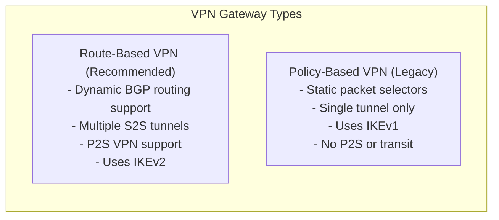
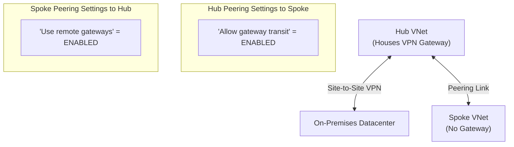
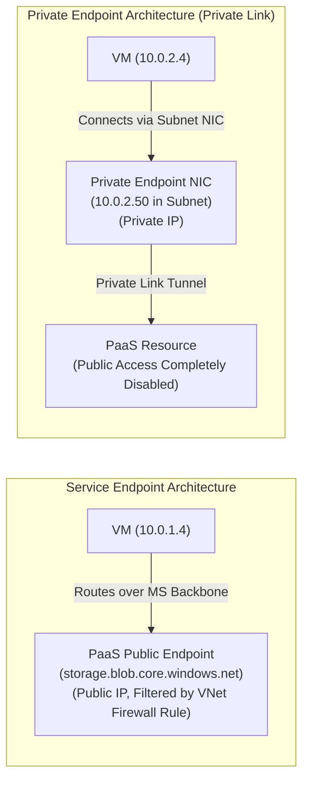
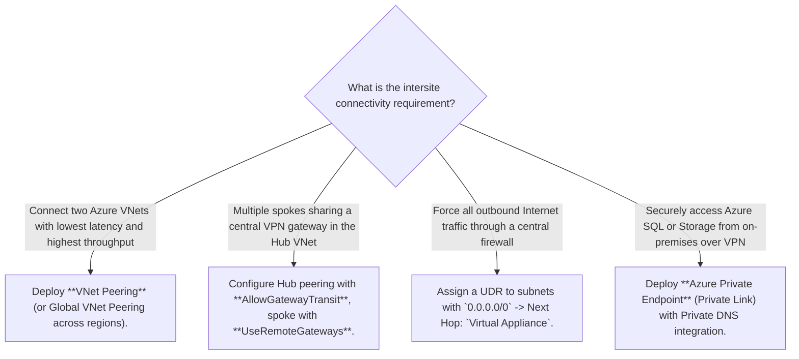
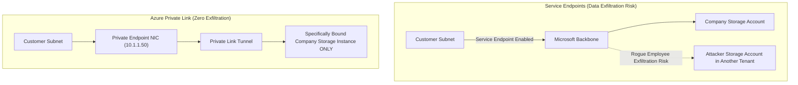
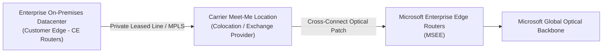

# Module 13-104-06: Administer Intersite Connectivity, Routing & Private Link

**Breadcrumbs:** [[13-Index - Azure|☁️ Azure Reference MOC]] > [[13-Index - AZ-104|📘 AZ-104 Exam Track]] > **06 - Administer Intersite Connectivity**

---

## 🎯 Executive Overview & Connectivity Matrix

Enterprise cloud architectures require secure, high-throughput communication across multiple Azure Virtual Networks (VNet-to-VNet), between hybrid on-premises datacenters and Azure, and toward cloud-hosted PaaS services. Azure provides a tiered set of intersite connectivity and routing mechanisms:

```mermaid
flowchart TD
    subgraph OnPremDatacenter ["On-Premises Corporate Datacenter"]
        LocalGW["Local Network Gateway\n(Public IP: 203.0.113.1)\n(Subnets: 192.168.0.0/16)"]
        OnPremFirewall["On-Prem VPN Appliance\n(IPsec / IKEv2)"]
    end

    subgraph HubVNet ["Hub Virtual Network: vnet-hub (10.0.0.0/16)"]
        GatewaySubnet["GatewaySubnet (10.0.255.0/27)\nAzure Virtual Network Gateway"]
        NVA["Firewall / NVA Subnet\nAzure Firewall (10.0.100.4)"]
    end

    subgraph Spoke1 ["Spoke VNet 1: vnet-workloads (10.1.0.0/16)"]
        VM1["App Virtual Machines\n(UDR: 0.0.0.0/0 -> 10.0.100.4)"]
    end

    subgraph Spoke2 ["Spoke VNet 2: vnet-data (10.2.0.0/16)"]
        PrivEndpoint["Private Endpoint (NIC)\n(10.2.1.50 -> Storage Account)"]
    end

    OnPremFirewall <-->|Site-to-Site IPsec VPN| GatewaySubnet
    HubVNet <-->|VNet Peering (Gateway Transit)| Spoke1
    HubVNet <-->|VNet Peering (Gateway Transit)| Spoke2
    Spoke1 -.->|Routed via NVA UDR| Spoke2
```

---

## 🌐 Virtual Network Peering (Regional & Global)

Virtual Network Peering connects two Azure Virtual Networks directly across the private Microsoft global backbone without routing traffic through gateways or public internet transit:

- **Regional VNet Peering:** Connects VNets within the **same Azure region**.
- **Global VNet Peering:** Connects VNets across **different Azure regions** (e.g., East US to West Europe).

### Core Peering Rules & Constraints
1. **Non-Overlapping Address Space:** The IP address spaces of peered VNets **must not overlap**. Peering creation is blocked if CIDR ranges conflict.
2. **Two-Way Symmetric Requirement:** Peering links must be configured in **both directions** (`VNet1 -> VNet2` and `VNet2 -> VNet1`). Peering status shows `Initiated` until the reverse link is created, whereupon it transitions to `Connected`.
3. **Non-Transitive Nature:** Peering is strictly non-transitive:
   $$\text{VNet A} \longleftrightarrow \text{VNet B} \quad \text{and} \quad \text{VNet B} \longleftrightarrow \text{VNet C} \quad \centernot\implies \quad \text{VNet A} \longleftrightarrow \text{VNet C}$$
   *Traffic between A and C cannot cross B unless an explicit router or Network Virtual Appliance (NVA) is placed in VNet B with User-Defined Routes.*

---

## 🚪 Virtual Network Gateways & VPN Architecture

A Virtual Network Gateway provides cross-premises and encrypted VNet-to-VNet connectivity. It must be deployed into a dedicated subnet named exactly **`GatewaySubnet`** (recommended sizing: `/27` or `/28`).



### 1. Site-to-Site (S2S) VPN
Connects on-premises network appliances to an Azure VPN Gateway across the public internet via encrypted IPsec/IKE tunnels.
- **Local Network Gateway:** An Azure configuration object representing the on-premises VPN device's public IP address and local IP address prefixes.

### 2. Point-to-Site (P2S) VPN
Connects individual remote client devices (laptops) securely into an Azure VNet.
- **Protocols Supported:** OpenVPN (SSL-based), SSTP (Windows native over TCP 443), IKEv2.
- **Authentication Options:** Azure Certificate authentication (root/client certificates), RADIUS domain authentication, or **Microsoft Entra ID authentication** (via Azure VPN Client).

---

## 🔄 Hub-and-Spoke Topology & Gateway Transit

In enterprise multi-VNet environments, deploying a separate VPN Gateway in every spoke VNet is cost-prohibitive. **Gateway Transit** enables spoke VNets to share a single centralized Virtual Network Gateway hosted in the hub VNet:



> [!IMPORTANT]
> **Gateway Transit Configuration Rules:**
> - On the **Hub VNet Peering to Spoke**: Enable **"Allow gateway transit"**.
> - On the **Spoke VNet Peering to Hub**: Enable **"Use the remote virtual network's gateway"** (or *Use remote gateways*).
> - A spoke VNet cannot use remote gateways if it already possesses its own Virtual Network Gateway.

---

## 🗺️ User-Defined Routes (UDRs) & Custom Route Tables

Azure automatically creates default system routes for every subnet. To enforce centralized traffic inspection or redirect egress flows through a firewall or Network Virtual Appliance (NVA), administrators attach **User-Defined Route Tables (UDRs)** to subnets.

### System Default Routes vs. User-Defined Overrides

| Destination Prefix | Default Next Hop Type | Custom Override Behavior |
| :--- | :--- | :--- |
| **Inside VNet CIDR** | `VirtualNetwork` | Custom UDR can redirect internal traffic to `VirtualAppliance` (e.g., Azure Firewall). |
| **0.0.0.0/0 (Internet)** | `Internet` | Custom UDR can route default internet traffic to an on-premises firewall (`VirtualNetworkGateway`) or cloud NVA (`VirtualAppliance`). |
| **RFC 1918 Private Ranges** | `None` (Drop) | Overridden by VNet peering or VPN gateway routes. |

### Routing Precedence (Longest Prefix Match)
When routing packets, Azure selects the route based on the **longest prefix match (LPM)**. If multiple routes share identical destination prefixes:
1. **User-Defined Route (UDR)** has the highest priority and overrides BGP and System routes.
2. **BGP Route** (propagated via ExpressRoute or VPN Gateway) has the second priority.
3. **System Default Route** has the lowest priority.

---

## 🔌 PaaS Ingress: Service Endpoints vs. Private Endpoints

Securing access to Azure PaaS services (e.g., Azure Storage, Azure SQL Database) is a major focus of AZ-104:



| Evaluation Criteria | Service Endpoints (`Microsoft.Storage`, `Microsoft.Sql`) | Private Endpoints (Azure Private Link) |
| :--- | :--- | :--- |
| **IP Address Model** | Target PaaS resource retains its **Public IP address**. | Target PaaS service is assigned a **Private IP address** from your subnet. |
| **Network Path** | Traffic routes over the optimized Microsoft backbone instead of public internet. | Traffic stays entirely within your VNet private address space. |
| **Public Network Access** | Public IP remains routable, but PaaS firewall denies requests unless originating from the enabled subnet. | Public access can be **100% disabled** on the PaaS service. |
| **Cross-Premises / VPN Access** | **Not accessible** from on-premises over VPN or ExpressRoute (unless using complex NAT). | **Fully accessible** from on-premises over VPN, ExpressRoute, and peered VNets. |
| **DNS Requirements** | Standard public DNS resolution (`storage.blob.core.windows.net`). | Requires **Private DNS Zone** (`privatelink.blob.core.windows.net`) to resolve FQDN to the subnet private IP. |
| **Cost** | Free (no additional hourly charge). | Hourly charge per Private Endpoint + inbound/outbound data processing fees. |

---

## 🛠️ Contextual Proof of Concept: CLI & PowerShell Automation

### 1. Azure CLI: VNet Peering & Gateway Transit Setup

```bash
# 1. Create Hub VNet and Spoke VNet
az network vnet create --resource-group "rg-networking-poc" --name "vnet-hub" \
  --address-prefixes "10.0.0.0/16" --subnet-name "snet-shared" --subnet-prefixes "10.0.1.0/24"

az network vnet create --resource-group "rg-networking-poc" --name "vnet-spoke1" \
  --address-prefixes "10.1.0.0/16" --subnet-name "snet-workloads" --subnet-prefixes "10.1.1.0/24"

# 2. Peer Hub to Spoke (Allow Gateway Transit)
az network vnet peering create \
  --resource-group "rg-networking-poc" \
  --name "hub-to-spoke1" \
  --vnet-name "vnet-hub" \
  --remote-vnet "vnet-spoke1" \
  --allow-vnet-access \
  --allow-gateway-transit

# 3. Peer Spoke to Hub (Use Remote Gateway)
az network vnet peering create \
  --resource-group "rg-networking-poc" \
  --name "spoke1-to-hub" \
  --vnet-name "vnet-spoke1" \
  --remote-vnet "vnet-hub" \
  --allow-vnet-access \
  --use-remote-gateways
```

### 2. Azure CLI: Custom Route Table (UDR) to Network Virtual Appliance

```bash
# 1. Create a custom Route Table
az network route-table create \
  --resource-group "rg-networking-poc" \
  --name "rt-spoke-egress" \
  --location "eastus"

# 2. Add default 0.0.0.0/0 route to forward traffic to Azure Firewall NVA
az network route-table route create \
  --resource-group "rg-networking-poc" \
  --route-table-name "rt-spoke-egress" \
  --name "Default-Egress-to-NVA" \
  --address-prefix "0.0.0.0/0" \
  --next-hop-type "VirtualAppliance" \
  --next-hop-ip-address "10.0.100.4"

# 3. Associate Route Table with Spoke Subnet
az network vnet subnet update \
  --resource-group "rg-networking-poc" \
  --vnet-name "vnet-spoke1" \
  --name "snet-workloads" \
  --route-table "rt-spoke-egress"
```

---

## 🔍 Deep-Intuition AARF Framework

### Scenario: Diagnosing Private Endpoint DNS Resolution Failure

- **The Answer (Core Configuration):** Ensure that the Private Endpoint's Private DNS Zone `privatelink.blob.core.windows.net` has a **Virtual Network Link** attached to the client VNet, and that the client resolves the standard FQDN `storageacc.blob.core.windows.net` (which canonicalizes via CNAME to `storageacc.privatelink.blob.core.windows.net` and resolves to the private IP).
- **The Assumptions (Prerequisites):** 
  - Storage account has public network access disabled.
  - Private Endpoint is provisioned in `snet-data` with private IP `10.2.1.50`.
- **The Rationale (Why):** Storage SDKs and TLS certificates validate against the public FQDN `storageacc.blob.core.windows.net`. When a private endpoint is created, Azure updates public DNS to return a CNAME to `storageacc.privatelink.blob.core.windows.net`. If the client VNet is not linked to the Private DNS Zone, it falls back to public DNS, resolves to the public VIP, and receives a `403 Forbidden` firewall block.
- **The Failure Loop (What if misconfigured):**
  - *Symptom:* `curl https://storageacc.blob.core.windows.net` fails from inside the VM with `Client with IP address '52.x.x.x' is not allowed to access the server.`
  - *Diagnostic:* Running `nslookup storageacc.blob.core.windows.net` inside the VM returns a public IP instead of `10.2.1.50`.
- **The Alternative Case (When to use 'if not'):** If clients reside entirely on-premises without Azure Private DNS forwarders, administrators must configure on-premises DNS conditional forwarders pointing `privatelink.blob.core.windows.net` to an Azure DNS Private Resolver inside the hub VNet.

---

## 💡 AZ-104 Exam Tips & Gotchas

> [!TIP]
> **Peering Status Gotcha:** If you configure VNet Peering in the Azure Portal from VNet A to VNet B, the peering state is **Initiated**. It will NOT work until peering is also created from VNet B to VNet A, moving the state to **Connected** on both sides.

> [!WARNING]
> **Service Endpoints vs. On-Premises Connectivity:**
> Remember for exam scenarios: **Service Endpoints CANNOT be used across on-premises VPN or ExpressRoute connections**. If an exam question asks how on-premises branch offices can privately access an Azure Storage Account or Azure SQL Database without traversing the public internet, the ONLY correct answer is **Azure Private Endpoints (Private Link)**.

---

## 🏛️ Hub-and-Spoke Topology, Routing Precedence & Private Link Architecture

### 1. VNet Peering Mechanics & Advanced Flags
- **Bidirectional Handshake:** Peering requires two independent peering links (VNet1 ➔ VNet2 and VNet2 ➔ VNet1). Connectivity is established only when both links display state `Connected`.
- **The Three Critical Peering Flags:**
  1. *Allow Virtual Network access:* Grants direct IP-to-IP communication between workloads across the two VNets.
  2. *Allow Forwarded Traffic:* Crucial for Hub-and-Spoke topologies. Allows traffic that did *not* originate from the peered VNet (e.g., packets forwarded by a central NVA or firewall) to flow through. Without this enabled, spoke VNets drop packets forwarded by a central firewall.
  3. *Allow Gateway Transit & Use Remote Gateway:* Enables spoke VNets to share a single central VPN Gateway or ExpressRoute circuit deployed in the hub VNet, saving thousands of dollars per month in gateway licensing.

### 2. User-Defined Routes (UDRs) & Priority Resolution Engine
Azure determines packet next-hops using strict routing precedence:
1. **Longest Prefix Match (LPM):** The most specific route (highest CIDR prefix length, e.g. `/28` over `/24`) always wins.
2. **Tie-Breaking Order (When prefixes are identical):**
   - **User-Defined Route (UDR)** *(Highest Priority - always overrides Azure defaults and BGP)*.
   - **BGP Route** *(ExpressRoute or VPN Gateway)*.
   - **System Default Route** *(Lowest Priority - e.g., Azure default `0.0.0.0/0` to Internet)*.
- **Forced Egress Inspection Recipe:** To route all spoke traffic through a central hub firewall:
  - Destination: `0.0.0.0/0`
  - Next Hop Type: `Virtual Appliance`
  - Next Hop IP: `10.0.1.4` (Internal IP of Firewall / NVA)

### 3. Service Endpoints vs. Private Link Architectural Matrix

| Dimension | Service Endpoints | Private Endpoints (Azure Private Link) |
| :--- | :--- | :--- |
| **Endpoint Location** | PaaS service remains external with public IP | Injects a private virtual NIC (`10.x.x.x`) into the subnet |
| **Routing Fabric** | Microsoft optical backbone (bypasses public internet) | Private IP routing within VNet, peered VNets, and on-premises |
| **On-Premises / VPN Access** | **Unsupported:** On-prem clients cannot route to Service Endpoints | **Fully Supported:** On-premises routes traverse VPN/ExpressRoute directly |
| **Public Network Access** | Must remain enabled on PaaS firewall | Can be set to **Disabled** (Zero Internet Attack Surface) |
| **Data Exfiltration Risk** | Subnet can connect to *any* Azure storage account in any tenant | Locked to the exact specified resource instance (prevents data exfiltration) |
| **DNS Resolution** | Standard public DNS (`<name>.blob.core.windows.net`) | Private DNS Zone (`privatelink.blob...`) resolves to private IP |

---

## 💡 Intersite Connectivity Decision Tree



---

---

## 🏛️ Deep-Dive Intersite Architecture & Private Link (John Savill Master Class Insights)

### 1. VNet Peering: Direct Hypervisor Encapsulation
John Savill dispels the myth that VNet Peering routes traffic through a gateway router:
- **No Gateway In Path:** VNet Peering configures the SDN tables of the hypervisors hosting the VMs.
- **Wire-Speed Throughput:** Traffic between peered VNets flows directly host-to-host across Microsoft's high-speed global optical network.
- **No MTU Degradation:** Standard 1,500-byte MTU is preserved without fragmentation.
- **Non-Transitive Nature:** If VNet A is peered with VNet B, and VNet B is peered with VNet C, VNet A **cannot communicate with VNet C** through VNet B unless a Network Virtual Appliance (NVA) and User-Defined Routes (UDRs) are deployed in VNet B.

```mermaid
flowchart LR
    VNetA["Spoke VNet A (10.1.0.0/16)"] <-->|VNet Peering (Wire Speed)| HubVNet["Hub VNet (10.0.0.0/16)<br/>- Central Azure Firewall / NVA<br/>- ExpressRoute / VPN Gateway"]
    HubVNet <-->|VNet Peering (Wire Speed)| VNetB["Spoke VNet B (10.2.0.0/16)"]
    VNetA -.->|Blocked by Non-Transitivity| VNetB
    VNetA -->|Route 10.2.0.0/16 via UDR to Firewall| HubVNet
```

### 2. Service Endpoints vs. Private Link: The Data Exfiltration Defense
John Savill provides the definitive architectural rationale for choosing Private Link over Service Endpoints:



- **Why Service Endpoints Permit Data Exfiltration:** When you enable a Service Endpoint for `Microsoft.Storage` on a subnet, any workload in that subnet can connect to **any Azure Storage Account anywhere in the world** over the Microsoft backbone. A rogue employee or compromised process can upload confidential database backups to their personal external storage account.
- **Why Private Link Prevents Data Exfiltration:** A Private Endpoint injects an explicit virtual NIC mapped strictly to **one specific Azure resource instance ID**. The subnet route connects exclusively to that single resource instance, mathematically preventing data exfiltration to unauthorized storage accounts.

---

## 🚀 Going the Extra Mile: Architectural Deep Dive - Enterprise Hybrid & Core Connectivity

> [!IMPORTANT]
> **Going the Extra Mile:** In this section, we are taking an extra mile on this topic and start deep diving into the under-the-hood packet flow of ExpressRoute FastPath, Azure Virtual Network Manager (AVNM) Security Admin Rules, Private Link TCP proxy v2 mechanics, and Azure Firewall deep inspection based on John Savill's Azure Deep Dives Master Class.

### 1. ExpressRoute Deep Dive: Architecture, Peering & FastPath

#### A. The Physical Interconnect Architecture
ExpressRoute provides dedicated, private optical connectivity to Microsoft Cloud services without traversing the public internet.



* **Meet-Me Exchange:** Connectivity is terminated at a carrier colocation facility (Equinix, Megaport, AT&T) onto redundant **Microsoft Enterprise Edge (MSEE)** routers.
* **Peering Models:**
  * **Private Peering:** Connects on-premises directly to private VNets (RFC 1918 space). Requires an Azure Virtual Network Gateway (`VpnGw` or `ErGw`).
  * **Microsoft Peering:** Connects to Microsoft public PaaS services (Storage, SQL, Cosmos DB) and Microsoft 365 over private BGP route filters using registered public ASNs.

#### B. ExpressRoute FastPath: Bypassing the Gateway CPU Bottleneck
* **The Traditional Bottleneck:** In standard ExpressRoute setups, every packet between on-premises and an Azure VM must traverse the Virtual Network Gateway compute instances, which caps maximum throughput to 10 Gbps (`ErGw3AZ`) and adds serialization latency.
* **The FastPath Optimization:** FastPath configures the MSEE routers to inject routes directly into the Azure physical hypervisors hosting the workload VMs.
* **Data Path:** Packets flow directly from MSEE to the VM hypervisor network interface, **completely bypassing the gateway CPU**, achieving up to 100 Gbps line-rate throughput with microsecond latency.

---

### 2. Azure Virtual Network Manager (AVNM): Enterprise Scale Mesh & Security Enforcement

At enterprise scale with hundreds of subscriptions and VNets, managing manual peering connections and decentralized NSGs becomes unmanageable.

#### A. Automated Connectivity Topologies
* **Network Groups:** Dynamic collections of VNets aggregated via Azure Resource Graph queries (e.g., all VNets with tag `Environment = Production`).
* **Hub-and-Spoke Automation:** Automatically establishes and tears down peering links, Gateway Transit, and direct spoke-to-spoke connectivity without manual script orchestration.
* **Global Mesh:** With a single configuration click, AVNM configures full-mesh peering across all member VNets within or across Azure regions.

#### B. Security Admin Rules (SAR) vs. Network Security Groups (NSG)
AVNM introduces a new administrative security layer that executes **before** local subnet NSGs:

```text
[Inbound Packet]
       │
       ▼
[AVNM Security Admin Rules (SAR)]  <── Enforced by Central Cloud SecOps Team
       │
       ├── Match: Action = "Deny"   ──► DROPPED IMMEDIATELY (Local NSG cannot allow!)
       ├── Match: Action = "Allow"  ──► ALLOWED DIRECTLY (Bypasses lower NSG rules)
       └── Match: Action = "Pass"   ──► Passes down to lower layers
               │
               ▼
[Subnet Network Security Group (NSG)]  <── Managed by Application Team
               │
               ▼
[NIC Network Security Group (NSG)]
               │
               ▼
[Virtual Machine Workload]
```

* **The Guardrail Advantage:** A centralized security administrator can deploy a Security Admin Rule denying inbound SSH (Port 22) from the internet across all 500 company VNets. Even if a local project team creates an NSG rule with priority `100` allowing port 22, the SAR intercepts and drops the packet.

---

### 3. Microsoft Azure Private Link: Under the Hood

Private Link enables private access to Azure PaaS services, customer-owned services, or third-party Marketplace SaaS:
* **The Private Endpoint:** An unmanaged Virtual Network Interface (NIC) allocated directly inside your private subnet with a private IPv4 address.
* **Private Link Service (Provider Plane):** The service owner provisions a Standard Internal Load Balancer in front of their backend workloads and binds it to a Private Link Service.
* **TCP Proxy v2 Header (Preserving Client IP):**
  * When client traffic enters a Private Endpoint, the Private Link software switch performs **Source NAT** to a private IP from the provider's subnet.
  * To prevent the backend service from losing the client's original identity, Private Link encapsulates the client's actual Source IP and Source Port inside a **Proxy Protocol v2 header** prepended to the TCP packet.

---

### 4. Azure Firewall Deep-Dive: Enterprise Inspection Engine
* **TLS Inspection (Premium SKU):** Performs complete SSL/TLS decryption and re-encryption. Azure Firewall acts as an intermediate Certificate Authority (using enterprise root certificates in Key Vault), decrypting outbound traffic to inspect cleartext payloads for malware signatures.
* **Intrusion Detection and Prevention System (IDPS):** Signature-based deep packet inspection monitoring exploit attempts across thousands of CVE vulnerabilities in real time.
* **DNS Proxy & FQDN Filtering:** Listens as a local DNS resolver on the VNet, forwarding queries to Azure DNS or custom resolvers while intercepting malicious domain name lookups before network egress occurs.


## 🌐 Authoritative References & Citations

- [John Savill: Azure Master Class v3 - Part 6 - Networking](https://www.youtube.com/playlist?list=PLlVtbbG169nGlGPWs9xaLKT1KfwqREHbs)

- [KodeKloud AZ-104 Course - Administer Intersite Connectivity Module](https://notes.kodekloud.com/docs/Updated-AZ-104-Microsoft-Azure-Administrator/Administer-Intersite-Connectivity/Module-Introduction/page.md)
- [Moe Intelligence AZ-104 Video Series (Lessons 19–22)](https://www.youtube.com/playlist?list=PLczK3J2J4clmeh328CC13dJrcALcSFZFb)
- [Microsoft Learn: Connect services together with VNet Peering](https://learn.microsoft.com/en-us/training/modules/integrate-vnets-with-vnet-peering/)
- [Microsoft Learn: Manage and control traffic flow with routes](https://learn.microsoft.com/en-us/training/modules/manage-and-control-traffic-with-route-tables/)
- [Microsoft Azure Documentation - Private Link & Private Endpoints](https://learn.microsoft.com/en-us/azure/private-link/)
