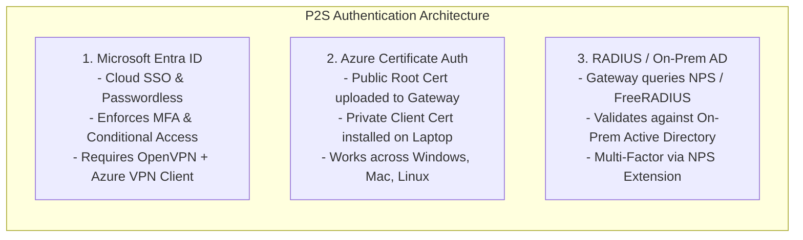
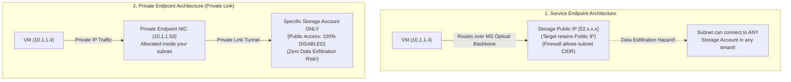
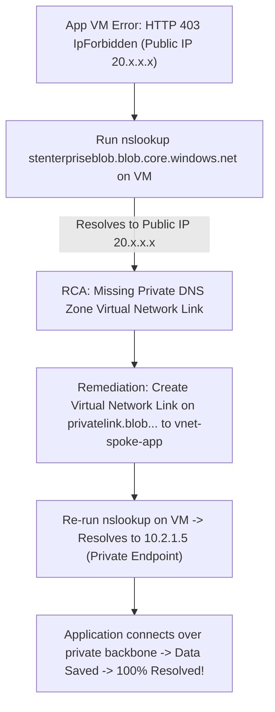

# Module 13-104-06: Administer Intersite Connectivity, Routing & Private Link

**Breadcrumbs:** [[13-Index - Azure|☁️ Azure Reference MOC]] > [[13-Index - AZ-104|📘 AZ-104 Exam Track]] > **06 - Administer Intersite Connectivity**

---

## 🎯 Stage 1: Executive Overview & The Conceptual Lecture

### 1. The Zero-Knowledge Starting Point: Why Virtual Networks Are Isolated
In Module 05, we established that an **Azure Virtual Network (VNet)** is a private software-defined boundary. By default:
* Workloads inside VNet A can communicate freely with each other.
* Workloads inside VNet B can communicate freely with each other.
* **VNet A and VNet B CANNOT communicate with each other under any circumstances!** They are completely separated by the underlying hypervisor fabric.

In an enterprise cloud landing zone, however, organizations do not deploy everything into a single massive VNet:
* The **Security & Networking Team** owns a centralized Hub VNet containing corporate firewalls, intrusion detection systems (IDS), and VPN connections to the on-premises corporate headquarters.
* The **E-Commerce Application Team** owns a Spoke VNet containing frontend web servers and backend APIs.
* The **Data Analytics Team** owns a separate Spoke VNet containing machine learning clusters and data lakes.

How do these separate networks talk to each other securely without exposing traffic to the public internet?
* If you connect them using traditional internet-facing VPNs, you introduce bandwidth throttles, CPU serialization bottlenecks, and high latency.
* If you peer every VNet with every other VNet in an unmanaged full-mesh, you create an unmanageable web of hundreds of peering connections where security teams cannot inspect cross-tier traffic.

To solve this, Microsoft Azure provides a spectrum of high-speed intersite connectivity options: **VNet Peering**, **Hub-and-Spoke Topologies**, **User-Defined Routes (UDRs)**, and **Azure Private Link**.

### 2. The Highway Toll Bridge Analogy
* **Isolated VNets:** Two separate sovereign islands separated by water. No cars can cross.
* **VNet Peering:** Building a direct high-speed express highway bridge between Island A and Island B. Cars zoom across at 100 mph with zero stoplights or tolls.
* **The Non-Transitive Rule:** Island A has a bridge to Island B, and Island B has a bridge to Island C. A driver on Island A **is legally prohibited from driving across Island B to get to Island C**! Azure's SDN blocks this transit unless you place an active router/firewall in the middle.
* **User-Defined Routes (UDRs):** A road sign placed at an intersection that forces all traffic heading toward the public internet or other islands to divert through a central border control checkpoint (the Firewall / NVA).
* **Private Link (Private Endpoints):** Instead of employees taking a boat into international waters (the public internet) to pick up supplies from a public warehouse (PaaS Storage), you build a private underground tunnel that brings a dedicated loading dock directly into your private basement.

### 3. Terminology Matrix: Zero-Knowledge to Enterprise Architect

| Terminology                         | What It Means to a Beginner                                        | Real-World Analog                                                                  | Enterprise Architecture Reality                                                                                                                        |
| :---------------------------------- | :----------------------------------------------------------------- | :--------------------------------------------------------------------------------- | :----------------------------------------------------------------------------------------------------------------------------------------------------- |
| **VNet Peering**                    | Connecting two Azure VNets directly together.                      | An express highway bridge connecting two adjacent islands.                         | Direct hypervisor-level SDN route programming allowing workloads across VNets to communicate at private line-rate speeds over Microsoft's optical WAN. |
| **Global VNet Peering**             | Peering two VNets located in different geographic regions.         | An international direct underwater bullet train tunnel.                            | Peering across different Azure regions (e.g., East US to West Europe) over Microsoft's global fiber backbone without touching the public internet.     |
| **Non-Transitive Peering**          | Peering does not allow jumping through the middle VNet.            | A bridge from A to B and B to C does not give you permission to cross from A to C. | The fundamental SDN routing law where peered packets cannot transit across intermediate networks without an explicit Layer 3 router (NVA).             |
| **Gateway Transit**                 | Letting Spoke networks share one expensive VPN Gateway in the Hub. | A neighborhood carpool van sharing the cost of a highway toll pass.                | Peering configuration flags (`Allow gateway transit` on Hub, `Use remote gateways` on Spoke) enabling spokes to route through a central Hub gateway.   |
| **User-Defined Route (UDR)**        | Custom road signs that tell Azure routers where to send packets.   | A detour sign forcing all city traffic through a security inspection gate.         | A custom routing table attached to a subnet that overrides Azure system default routes by directing traffic to a `VirtualAppliance` or VPN gateway.    |
| **Service Endpoint**                | A private highway lane to public Azure services.                   | A VIP fast-track lane on the public highway reserved for authorized cars.          | An SDN route that forwards subnet traffic to Azure PaaS services over the Microsoft backbone while retaining the service's public IP address.          |
| **Private Endpoint (Private Link)** | Bringing a private IP from an Azure PaaS service into your subnet. | Installing a private ATM inside your corporate office cafeteria.                   | An unmanaged virtual network interface (NIC) allocated in your subnet with a private IP, securely tunneling traffic to a specific PaaS instance.       |

---

## 🏛️ Stage 2: Core Mental Model & Component Architecture

### 1. The Hub-and-Spoke Enterprise Architecture
The gold-standard architectural pattern for enterprise cloud deployments is the **Hub-and-Spoke Topology**:

```text
+-------------------------------------------------------------------------------------------------+
|                                 HUB-AND-SPOKE ENTERPRISE TOPOLOGY                               |
+-------------------------------------------------------------------------------------------------+
                               [ On-Premises Corporate Datacenter ]
                                                │
                                                │ Site-to-Site IPsec VPN / ExpressRoute
                                                ▼
                         +-----------------------------------------------+
                         |           Hub VNet: vnet-hub (10.0.0.0/16)    |
                         |                                               |
                         | - GatewaySubnet: Virtual Network Gateway      |
                         |   (Gateway Transit: ENABLED)                  |
                         | - snet-firewall: Azure Firewall (10.0.1.4)    |
                         |   (Central Traffic Inspection & Routing)      |
                         +-----------------------------------------------+
                                         ▲               ▲
                                         │ Peering Link  │ Peering Link
                     (Forwarded Traffic) │               │ (Forwarded Traffic)
                                         ▼               ▼
        +---------------------------------+     +---------------------------------+
        | Spoke 1: vnet-app (10.1.0.0/16) |     | Spoke 2: vnet-data (10.2.0.0/16)|
        |                                 |     |                                 |
        | - snet-workload (10.1.1.0/24)   |     | - snet-endpoints (10.2.1.0/24)  |
        | - App VM: 10.1.1.4              |     | - Private Endpoint: 10.2.1.5    |
        | - UDR: 0.0.0.0/0 -> 10.0.1.4    |     |   (Azure Storage Blob Account)  |
        +---------------------------------+     +---------------------------------+
                         │                                       ▲
                         └─────────── BLOCKED ───────────────────┘
                             (Peering is Non-Transitive!)
                        Spoke 1 cannot talk directly to Spoke 2
                        without routing through the Hub Firewall!
```

#### Core Components of the Architecture:
1. **The Hub VNet:** Acts as the central point of connectivity. It houses shared enterprise services:
   - **Virtual Network Gateway:** Terminates Site-to-Site VPN or ExpressRoute connections from on-premises.
   - **Network Virtual Appliance (NVA) / Azure Firewall:** Centrally inspects, logs, and filters all inter-spoke and egress internet traffic.
2. **Spoke VNets:** Host isolated workloads, application tiers, or departmental environments. Spokes do not peer directly with each other; they peer strictly with the Hub.
3. **Gateway Transit:** Allows all Spoke VNets to leverage the Hub's VPN Gateway, eliminating the need to pay for and manage separate gateways in every spoke!

---

### 2. The Non-Transitive Law of VNet Peering
One of the most frequently tested concepts on the AZ-104 exam is **Peering Non-Transitivity**:

$$\text{VNet A} \longleftrightarrow \text{VNet B} \quad \text{and} \quad \text{VNet B} \longleftrightarrow \text{VNet C} \quad \centernot\implies \quad \text{VNet A} \longleftrightarrow \text{VNet C}$$

* If VNet A is peered with VNet B, and VNet B is peered with VNet C, **packets from VNet A CANNOT reach VNet C** across VNet B by default!
* Azure's software-defined hypervisors will drop the packets.
* **How to make Spoke-to-Spoke communication work:**
  1. Deploy a **Network Virtual Appliance (NVA)** or Azure Firewall in the Hub VNet.
  2. Enable **`Allow forwarded traffic`** on the peering links.
  3. Deploy a **User-Defined Route (UDR)** in Spoke A setting the route to Spoke C's CIDR (`10.2.0.0/16`) with Next Hop: `VirtualAppliance` (`10.0.1.4`).

---

### 3. VNet Peering Architectural Rules & Constraints
1. **Non-Overlapping Address Space:** The IP address spaces of peered VNets **must not overlap**. If VNet A uses `10.0.0.0/16` and VNet B uses `10.0.50.0/24`, Azure will reject peering creation with an address space conflict error.
2. **Two-Way Symmetric Requirement:** Peering links must be configured in **both directions** (`VNet1 -> VNet2` and `VNet2 -> VNet1`). When only one side is configured, the status shows `Initiated`. Only when both sides are created does the status transition to `Connected`.
3. **Bandwidth & Latency:** Traffic between peered VNets traverses Microsoft's private optical WAN backbone. There is **zero bandwidth throttling** imposed by a gateway—traffic moves at full virtual machine NIC wire speeds (up to 100 Gbps).

---

### 4. Hybrid Intersite Connectivity: Azure Virtual Network Gateway Architecture

When organizations extend on-premises corporate datacenters, remote branch offices, or a mobile workforce into an Azure Virtual Network, they deploy an **Azure Virtual Network Gateway** (`Microsoft.Network/virtualNetworkGateways`). Rather than treating hybrid connectivity as a black box, enterprise cloud engineers must understand the software-defined components, routing mechanics, protocol stacks, and high-availability options that govern Azure VPN architecture.

```text
+-------------------------------------------------------------------------------------------------+
|                       AZURE HYBRID CONNECTIVITY ARCHITECTURAL SPECTRUM                          |
+-------------------------------------------------------------------------------------------------+
| Connectivity Option        | Transport Medium       | Bandwidth Limits     | Primary Use Case   |
|----------------------------+------------------------+----------------------+--------------------|
| Site-to-Site (S2S) VPN     | Public Internet (IPsec)| Up to 10 Gbps (VpnGw5)| Branch/HQ to Azure |
| Point-to-Site (P2S) VPN    | Public Internet (TLS)  | Shared Gateway Bandwidth| Remote Teleworkers|
| ExpressRoute (Dedicated)   | Private Telco Circuit  | Up to 100 Gbps       | Mission-Critical HQ|
+-------------------------------------------------------------------------------------------------+
```

---

#### 4.1 The 3-Piece Puzzle of Azure VPN Architecture

In traditional on-premises networking, establishing an IPsec VPN tunnel involves configuring two physical peer routers directly against each other. In Azure's software-defined networking (SDN) fabric, Microsoft decouples this relationship into **three distinct ARM resources** that must be individually provisioned and cryptographically bound together:

```text
+--------------------------------------------------------------------------------------------------------+
|                               THE 3-PIECE AZURE VPN ARCHITECTURAL PUZZLE                                |
+--------------------------------------------------------------------------------------------------------+

  [ ON-PREMISES DATACENTER ]                                            [ AZURE CLOUD ]
+----------------------------+                               +-------------------------------------+
| On-Premises Edge Router /  |                               | Virtual Network: vnet-hub           |
| Firewall (Cisco/Fortinet)  |                               | (10.0.0.0/16)                       |
|                            |                               |                                     |
| Public IP: 203.0.113.1     |                               |   +-------------------------------+ |
| Private LAN: 192.168.1.0/24|                               |   | Subnet: GatewaySubnet (/27)   | |
| BGP ASN: 65020             |                               |   |                               | |
+--------------┬-------------+                               |   |   +-----------------------+   | |
               │                                             |   |   | PIECE 1:              |   | |
               │                                             |   |   | Virtual Network       |   | |
               │           IPsec / IKEv2 Encrypted Tunnel    |   |   | Gateway (VpnGw2)      |   | |
               │◄==========================================►│   |   | - Active/Standby VMs  |   | |
               │               (Public Internet)             |   |   | - Azure PIP: 20.50.1.5|   | |
               │                                             |   |   | - Azure ASN: 65515    |   | |
               │                                             |   |   +-----------▲-----------+   | |
               │                                             |   +---------------│---------------+ |
               │                                             +-------------------│-----------------+
               │                                                                 │
               │                                                Bound Together   │
               │                                                via Azure ARM    │
               │                                                                 ▼
+--------------▼-----------------------------------------------------------------┴-----------------+
| PIECE 3: Connection Resource (Microsoft.Network/connections)                                     |
| - ConnectionType: IPsec (Site-to-Site)                                                           |
| - Shared Key (PSK): "EnterpriseCrypt0P@ssw0rd!"                                                  |
| - IPsec / IKE Policy: IKEv2, AES-256, SHA-256, DH Group 14                                       |
| - Dynamic Routing: EnableBGP = True                                                              |
+------------------------------------------------▲-------------------------------------------------+
                                                 │
                                                 │ Binds Gateway to
                                                 │ On-Prem Metadata
                                                 │
+------------------------------------------------┴-------------------------------------------------+
| PIECE 2: Local Network Gateway (Microsoft.Network/localNetworkGateways)                          |
| * DEMYSTIFYING THE NAMING TRAP: Purely an Azure-side configuration placeholder representing     |
|   the ON-PREMISES edge device. It contains NO compute and runs NO software in Azure!            |
|                                                                                                  |
| - Gateway IP / FQDN: 203.0.113.1 (Public IP of on-premises firewall)                             |
| - Address Space: 192.168.1.0/24 (On-prem CIDRs for static routing; omitted if dynamic BGP used) |
| - BGP Settings: Peer ASN = 65020, BGP Peering IP = 192.168.1.254 (or APIPA 169.254.21.2)        |
+--------------------------------------------------------------------------------------------------+
```

##### Piece 1: `GatewaySubnet` & `Virtual Network Gateway`
* **Managed Compute Architecture:** When you provision a Virtual Network Gateway (`Microsoft.Network/virtualNetworkGateways`), Azure automatically deploys and manages a dedicated pair of high-availability Linux/Windows VMs running internal routing processes. Administrators cannot SSH, RDP, or access the underlying operating systems.
* **The `GatewaySubnet` Naming Law:** The gateway **must** reside in a dedicated subnet named *strictly and exactly* `GatewaySubnet` (case-sensitive). Azure's SDN routing engine specifically monitors this name to inject gateway routes and manage IP allocations.
* **Subnet Sizing & The `/29` Trap:**
  - Azure reserves 5 IP addresses in every subnet (network, default gateway, two DNS, and broadcast).
  - A `/29` subnet provides only $8 - 5 = 3$ usable IP addresses. While Azure historically allowed `/29`, deploying an Active-Active gateway, performing rolling OS maintenance upgrades, or adding an ExpressRoute Gateway for coexistence requires additional IP allocations. If the subnet runs out of addresses, the gateway deployment or upgrade **fails irreversibly**!
  - **Enterprise Standard:** Provision `GatewaySubnet` with **`/27` (32 IPs)** or **`/26` (64 IPs)**.
* **Zero Workload Policy:** Never deploy virtual machines, application runtimes, or internal load balancers into `GatewaySubnet`.
* **Zero Network Security Groups (NSGs):** **NEVER attach an NSG or UDR to `GatewaySubnet`!** Attaching an NSG blocks internal gateway management endpoints, health probes, and IKE/IPsec control planes, causing tunnel failure or black-holing traffic.

##### Piece 2: Demystifying the `Local Network Gateway` Naming Trap
* **The Semantic Trap:** The name "Local Network Gateway" confuses nearly every junior engineer. It sounds like a gateway that is *local to Azure*.
* **The Reality:** A Local Network Gateway (`Microsoft.Network/localNetworkGateways`) **is NOT a gateway running in Azure**. It contains zero compute, zero VMs, and consumes zero Azure bandwidth.
* **The Definition:** It is an Azure Resource Manager **metadata configuration object that represents the ON-PREMISES network and firewall to Azure**.
* **Configuration Parameters Stored Inside:**
  1. **Public Edge IP or FQDN:** The public IP address (or Dynamic DNS FQDN) of your on-premises edge router/firewall.
  2. **Address Spaces:** The on-premises private CIDRs (e.g., `192.168.1.0/24`, `10.50.0.0/16`). Azure uses these prefixes to automatically generate routes in the VNet routing table, instructing VMs that traffic destined for these prefixes must route to the Virtual Network Gateway. (If using dynamic BGP, these can be omitted or left as a fallback).
  3. **BGP Settings (Dynamic Routing):** The on-premises Autonomous System Number (ASN) and the on-premises BGP peer IP address.

##### Piece 3: The `Connection` Resource
* **The Cryptographic Glue:** A Connection resource (`Microsoft.Network/connections`) links Piece 1 (Virtual Network Gateway) and Piece 2 (Local Network Gateway) together.
* **Connection Types:** `IPsec` (Site-to-Site VPN), `Vnet2Vnet` (Azure VNet to Azure VNet), or `ExpressRoute`.
* **Security Association & Parameters:**
  - **Pre-Shared Key (PSK):** An alphanumeric shared secret configured identically on both Azure's connection resource and the on-premises firewall.
  - **Protocol Engine:** IKEv2 (Internet Key Exchange version 2) for modern route-based connections, or IKEv1 for legacy policy-based connections.
  - **Custom IPsec/IKE Policies:** Allows cryptographic hardening to enforce AES-256 encryption, SHA-384 hashing, Diffie-Hellman Group 14 or 24, and Perfect Forward Secrecy (PFS).
  - **BGP Toggle:** Flag enabling dynamic route exchange across the tunnel.

---

#### 4.2 The 3 Connectivity Modes: S2S, P2S, and VNet-to-VNet

Azure Virtual Network Gateways support three operational connectivity modes designed for distinct enterprise use cases:

| Architectural Dimension | Site-to-Site (S2S) VPN | Point-to-Site (P2S) VPN | VNet-to-VNet Connection |
| :--- | :--- | :--- | :--- |
| **Topology Scope** | **Network-to-Network** (Branch/HQ to Azure) | **Host-to-Network** (Remote user to Azure) | **Network-to-Network** (Azure VNet to Azure VNet) |
| **End Devices** | On-premises router, firewall, or VPN appliance | Laptops, mobile devices, developer workstations | Another Azure Virtual Network Gateway |
| **Client Software** | **None** on end-user machines (routed via on-prem gateway) | Azure VPN Client, native OS VPN, or OpenVPN client | **None** (Cloud-native gateway peering) |
| **Protocols** | IPsec / IKEv1, IKEv2 | OpenVPN (SSL/TLS), IKEv2 (IPsec), SSTP (SSL) | IPsec / IKEv2 |
| **Routing Model** | Route-Based (BGP or static) or Policy-Based | Leased private IP from Gateway Client Address Pool | Route-Based (Static or dynamic BGP) |
| **Scale & Capacity** | Up to 30 tunnels per gateway (100 in large SKUs) | Up to 128 (Basic) or 250–1,000 concurrent clients | Up to 30 VNet-to-VNet tunnels |
| **Transport Medium** | Public Internet (Encrypted tunnel) | Public Internet (Encrypted tunnel) | Microsoft Global Backbone (Encrypted tunnel) |
| **Primary Use Case** | Permanent corporate WAN connection to cloud | Remote teleworkers, contractors, emergency admin access | Cross-region/cross-subscription connectivity with encryption |
| **Peering Comparison** | N/A (Connects cloud to physical on-prem) | N/A (Connects individual mobile road warriors) | **Slower & costlier than VNet Peering** (use Peering unless IPsec encryption is mandatory) |

---

#### 4.3 Gateway Transit in Hub-and-Spoke Topologies (AZ-104 Core Exam Trap)

Deploying a Virtual Network Gateway in every spoke VNet is economically and architecturally unacceptable (gateways cost $100s/month each and duplicate routing complexity). Enterprise landing zones centralize hybrid connectivity in the **Hub VNet** and enable **Gateway Transit** across VNet Peering links.

```text
+---------------------------------------------------------------------------------------------------------+
|                                    GATEWAY TRANSIT ARCHITECTURE                                         |
+---------------------------------------------------------------------------------------------------------+

              [ On-Premises Corporate Headquarters (192.168.0.0/16) ]
                                         │
                                         │ S2S IPsec VPN Tunnel / ExpressRoute
                                         ▼
+─────────────────────────────────────────────────────────────────────────────────────────────────────────+
| Hub VNet: vnet-hub (10.0.0.0/16)                                                                        |
|                                                                                                         |
|   GatewaySubnet: Virtual Network Gateway (VpnGw2)                                                       |
|   ├── Public IP: 20.50.1.5                                                                              |
|   └── Internal IP: 10.0.0.4                                                                             |
|                                                                                                         |
|   PEERING CONFIGURATION ON HUB SIDE:                                                                    |
|   ├── Link: hub-to-spoke1                                                                               |
|   └── [X] allowGatewayTransit = TRUE  (Shares this Gateway with the Spoke!)                             |
+─────────────────────────────────────────────────────────────────────────────────────────────────────────+
                                         ▲
                                         │ Peering Link
                                         │ (Gateway Transit Enabled)
                                         ▼
+─────────────────────────────────────────────────────────────────────────────────────────────────────────+
| Spoke VNet: vnet-spoke-app (10.1.0.0/16)                                                                |
|                                                                                                         |
|   PEERING CONFIGURATION ON SPOKE SIDE:                                                                  |
|   ├── Link: spoke1-to-hub                                                                               |
|   └── [X] useRemoteGateways = TRUE   (Adopts the Hub's Gateway as its default exit path to on-prem!)    |
|                                                                                                         |
|   Workload Subnet: snet-workload (10.1.1.0/24)                                                          |
|   └── App VM (10.1.1.4) ──► Traffic destined for 192.168.0.0/16 automatically routes through            |
|                             the Hub's Gateway to reach On-Premises!                                     |
+─────────────────────────────────────────────────────────────────────────────────────────────────────────+
```

##### The Two Complementary Peering Flags:
1. **On the Hub VNet Peering Link (`vnet-hub -> vnet-spoke`):**
   - Flag: **`allowGatewayTransit = true`** (Portal: *"Use this virtual network's gateway or Route Server"* or *"Allow gateway transit"*).
   - Meaning: Tells Azure SDN: *"I possess a Virtual Network Gateway, and I grant permission for peered spoke networks to route hybrid traffic through it."*
2. **On the Spoke VNet Peering Link (`vnet-spoke -> vnet-hub`):**
   - Flag: **`useRemoteGateways = true`** (Portal: *"Use the remote virtual network's gateway"*).
   - Meaning: Tells Azure SDN: *"I do not have my own gateway; inject the Hub's gateway routes into my subnets so my workloads can reach on-premises."*

##### The Three Critical Constraints & Exam Traps:
> [!IMPORTANT]
> 1. **The Existence Requirement:** You **cannot** set `useRemoteGateways = true` on a spoke peering link until the Virtual Network Gateway in the Hub has completed provisioning! If no gateway exists in the Hub, Azure rejects the configuration.
> 2. **The Mutual Exclusivity Rule:** A Spoke VNet **CANNOT have its own Virtual Network Gateway if it sets `useRemoteGateways = true`**! If a VNet already has a gateway, Azure will throw an error: `A virtual network cannot have both a gateway and use remote gateways`.
> 3. **Non-Transitive Chaining Limit:** A spoke can only use a gateway in a directly peered Hub. It cannot jump across multiple peering hops to reach a gateway in another spoke or a secondary hub without Azure Virtual WAN or Azure Route Server.

---

#### 4.4 Deep Dive: BGP (Border Gateway Protocol) with Azure VPN Gateway

In production enterprise networks, relying on static routing introduces operational fragility. When on-premises subnets are added, modified, or migrated, administrators must manually update the address prefixes in Azure's Local Network Gateway. **Border Gateway Protocol (BGP)** automates dynamic route exchange over TCP port 179.

##### Static Routing vs. Dynamic BGP Routing:

| Feature Dimension | Static Policy/Route-Based Routing | Dynamic BGP Routing |
| :--- | :--- | :--- |
| **Prefix Discovery** | Manual entry of CIDRs in Local Network Gateway | Automatic advertisement via BGP Update messages |
| **Failover Detection** | Relies on tunnel down status (slow: up to 60s) | Sub-second path failure detection using BGP Keepalives |
| **Maintenance Burden** | High (Every new on-prem subnet requires Azure change) | Zero (New subnets advertised dynamically into Azure SDN) |
| **Multi-Path Routing** | Active-Standby only | Supports Active-Active Equal-Cost Multi-Path (ECMP) |
| **AWS / Multi-Cloud** | Complex, prone to routing loops | Seamless interop with AWS VPG, GCP Cloud Router, Fortinet |

##### Autonomous System Numbers (ASNs) & The Collision Trap:
* **Azure Default ASN:** Azure assigns an ASN of **`65515`** by default (from the RFC 6996 private ASN block `64512–65534`).
* **Custom ASN Support:** You can assign a custom private ASN to Azure's VPN Gateway (e.g., `65010`), except for reserved values (`65515` default, `65520` internal, and public ASNs).
* **The ASN Collision Law (AZ-104 Exam Trap):**
  $$\text{Azure VPN Gateway ASN} \neq \text{On-Premises Router ASN}$$
  The on-premises router and the Azure VPN Gateway **MUST NOT share the same ASN**! Under BGP loop prevention rules (the `AS_PATH` attribute), any BGP router that receives a route advertisement containing its own ASN immediately discards the packet to prevent infinite routing loops. If both Azure and on-prem use `65515`, all routes are dropped and no traffic flows!

##### BGP Peering IP & Custom APIPA BGP Addresses:
* **Default BGP IP:** Azure automatically assigns a BGP IP address from the `GatewaySubnet` address space (e.g., `10.0.0.4` or `10.0.0.5`).
* **The Interoperability Problem:** Many enterprise hardware firewalls and third-party cloud services (including **AWS Virtual Private Gateway (VGW)**, Cisco ASA, and Check Point) strictly require BGP peering over IPsec tunnels to use link-local **APIPA (Automatic Private IP Addressing)** addresses in the `169.254.x.x` range (specifically `169.254.21.0/24` to `169.254.22.255/24`). They cannot peer across routable private IPs.
* **Azure's Custom APIPA Solution:** Azure allows network engineers to configure **Custom APIPA BGP IP Addresses** on the VPN Gateway (e.g., instance 0: `169.254.21.1`, instance 1: `169.254.21.5`). This enables native, high-performance dynamic routing with AWS, Cisco, and corporate SD-WAN appliances without NAT workarounds.

##### Active-Active Dual BGP High Availability:
```text
+-------------------------------------------------------------------------------------------------+
|                       ACTIVE-ACTIVE DUAL BGP ARCHITECTURAL PATTERN                              |
+-------------------------------------------------------------------------------------------------+

   [ On-Premises Router 1 ] ◄────────────────────────────────► [ On-Premises Router 2 ]
   (Public IP: 203.0.113.1, ASN 65020)                        (Public IP: 203.0.113.2, ASN 65020)
            │                  ╲                            ╱                  │
            │ Tunnel 1          ╲ Tunnel 2        Tunnel 3 ╱                   │ Tunnel 4
            │                    ╲                        ╱                    │
            ▼                     ▼                      ▼                     ▼
+─────────────────────────────────────────────────────────────────────────────────────────────────+
| Azure GatewaySubnet: Active-Active Virtual Network Gateway (ASN 65515)                          |
|                                                                                                 |
|   Gateway Instance 0:                                  Gateway Instance 1:                      |
|   ├── Public IP 1: 20.50.1.1                           ├── Public IP 2: 20.50.1.2               |
|   ├── BGP Endpoint 1: 10.0.0.4                         ├── BGP Endpoint 2: 10.0.0.5             |
|   └── (or APIPA: 169.254.21.1)                         └── (or APIPA: 169.254.21.5)             |
+─────────────────────────────────────────────────────────────────────────────────────────────────+
                                    (Equal-Cost Multi-Path / ECMP)
                                     Sub-Second Dynamic Failover!
```
* Azure provisions **two distinct Public IP addresses** and two independent gateway compute instances.
* Four cross-connected IPsec tunnels provide full dual-mesh resiliency between two on-premises firewalls and both Azure gateway instances.
* BGP actively monitors all paths; if any single physical cable, ISP link, or firewall crashes, BGP dynamically reroutes traffic across the surviving path with **zero user disruption**.

---

#### 4.5 Deep Dive: Point-to-Site (P2S) VPN Architecture

Point-to-Site (P2S) enables remote employees, teleworkers, mobile developers, and field technicians to establish secure encrypted tunnels directly to an Azure VNet from anywhere in the world over untrusted public Wi-Fi networks.

##### The Client Address Pool:
* When configuring P2S, the administrator defines a dedicated private IP range called the **Client Address Pool** (e.g., `172.16.201.0/24`).
* As remote users connect, Azure's gateway dynamically leases an IP address from this pool to the virtual network adapter on the user's laptop.
* **The Non-Overlapping Cardinal Rule:** The Client Address Pool **must not overlap** with:
  1. Any subnet inside the Hub VNet.
  2. Any subnet inside any peered Spoke VNet.
  3. Any on-premises corporate IP network.

##### Tunnel Protocols:

```text
+-------------------------------------------------------------------------------------------------+
|                                 P2S TUNNEL PROTOCOL SPECTRUM                                    |
+-------------------------------------------------------------------------------------------------+
| Protocol      | Ports & Transport       | Client OS Support          | Firewall Traversal       |
|---------------+-------------------------+----------------------------+--------------------------|
| OpenVPN®      | TCP / UDP Port 443      | Windows, macOS, Linux,     | Exceptional: Disguised   |
|               | (SSL / TLS)             | Android, iOS               | as standard HTTPS        |
|---------------+-------------------------+----------------------------+--------------------------|
| IKEv2         | UDP Port 500 & 4500     | Native Windows & macOS     | Poor: UDP ports often    |
| (IPsec)       | (MOBIKE Roaming)        | (No extra client software) | blocked by public Wi-Fi  |
|---------------+-------------------------+----------------------------+--------------------------|
| SSTP          | TCP Port 443            | Windows ONLY               | Exceptional: Traverses   |
|               | (SSL 3.0 / TLS)         | (Microsoft Proprietary)    | corporate HTTP proxies   |
+-------------------------------------------------------------------------------------------------+
```

1. **OpenVPN (SSL/TLS):**
   - Transports encrypted packets over TCP or UDP port 443.
   - **Firewall Traversal:** Because traffic traverses standard HTTPS port 443, it effortlessly bypasses restrictive airport, hotel, coffee shop, and enterprise corporate proxy firewalls.
   - **Cross-Platform:** Supported on Windows, macOS, Linux, iOS, and Android using the Azure VPN Client or open-source OpenVPN clients.
   - **Identity Integration:** Mandatory protocol when authenticating with **Microsoft Entra ID**.
2. **IKEv2 (IPsec):**
   - High-speed, hardware-accelerated encryption operating over UDP ports 500 and 4500.
   - **Native OS Support:** Built natively into Windows 10/11 and macOS without installing third-party agent software.
   - **MOBIKE (Mobility and Multihoming Protocol):** If a user switches from corporate office Wi-Fi to a 5G mobile hotspot, IKEv2 seamlessly shifts the tunnel session to the new network interface without terminating active SSH or database sessions.
   - **Drawback:** Many public Wi-Fi hotspots and hospitality networks block UDP 500/4500.
3. **SSTP (Secure Socket Tunneling Protocol):**
   - Encapsulates PPP traffic over an SSL/TLS 443 session.
   - **Platform Locked:** Proprietary to Microsoft; strictly supported on Windows operating systems.
   - Considered a legacy fallback when OpenVPN or IKEv2 cannot be deployed.

##### Authentication Options:



1. **Microsoft Entra ID Authentication (Modern Gold Standard):**
   - Authenticates remote teleworkers using corporate Microsoft Entra credentials.
   - **Enterprise Security Policy Enforcement:** Directly enforces **Conditional Access policies**, Multi-Factor Authentication (MFA), compliant Intune device requirements, and risk-based sign-in blocks.
   - **Prerequisites:** Must use **OpenVPN** as the tunnel protocol and the **Azure VPN Client** desktop application.
2. **Azure Certificate Authentication:**
   - Passwordless cryptographic validation using X.509 public-key certificates.
   - **Workflow:** An administrator generates a Root Certificate (using an Enterprise PKI like Active Directory Certificate Services, or self-signed OpenSSL) and uploads the public key (`.cer` base-64 string) into Azure's gateway configuration.
   - A Child (Client) Certificate is generated and installed into the local certificate store of each user's laptop.
   - When connecting, Azure verifies that the client certificate chains up to the trusted root certificate.
   - **Revocation:** Administrators can instantly revoke an employee's access by uploading the thumbprint of their client certificate to the gateway revocation list.
3. **RADIUS Authentication (Active Directory Integration):**
   - Integrates Azure VPN Gateway with an existing corporate RADIUS server (such as Windows Server Network Policy Server - NPS) deployed on-premises or in an Azure VM.
   - The gateway forwards authentication requests over UDP 1812/1813 across the hybrid network to the RADIUS server, allowing organizations to validate credentials against legacy on-premises Active Directory Domain Services (AD DS).

---

#### 4.6 High Availability Topologies & Gateway Coexistence

Enterprise architectures require robust fault-tolerant designs to survive maintenance events, fiber cuts, and regional hardware failures.

##### Active-Standby vs. Active-Active Topologies:

```text
Active-Standby (Default):
[ Azure VNet ] ──► [ GatewaySubnet ] ──► [ Active VM (PIP 1) ] ════► On-Premises Router
                                        [ Standby VM (Idle) ]
- Single Public IP address.
- During host maintenance or hypervisor crash, standby VM takes over.
- Failover Time: 60 to 90 seconds (TCP sessions reset).

Active-Active (Mission-Critical):
[ Azure VNet ] ──► [ GatewaySubnet ] ──► [ Active VM 1 (PIP 1) ] ═══► On-Premises Router 1
                                    └──► [ Active VM 2 (PIP 2) ] ═══► On-Premises Router 2
- Dual Public IP addresses, dual compute instances active concurrently.
- Traffic load-balanced via BGP Equal-Cost Multi-Path (ECMP).
- Failover Time: Sub-second to a few seconds (Dynamic BGP route withdrawal).
```

##### ExpressRoute and VPN Gateway Coexistence:
In enterprise architectures requiring zero-downtime guarantees, organizations establish **ExpressRoute and VPN Gateway Coexistence** inside the exact same `GatewaySubnet`:

```text
+-------------------------------------------------------------------------------------------------+
|                         EXPRESSROUTE & VPN GATEWAY COEXISTENCE                                  |
+-------------------------------------------------------------------------------------------------+

                               [ On-Premises Corporate Datacenter ]
                                         │              │
                   Primary Path          │              │ Encrypted Backup Path
             (Private Fiber 10 Gbps)     │              │ (Public Internet IPsec S2S)
                                         ▼              ▼
+─────────────────────────────────────────────────────────────────────────────────────────────────+
| Azure Hub VNet: vnet-hub                                                                        |
|                                                                                                         |
|   GatewaySubnet (/27 minimum)                                                                   |
|   ├── [ ExpressRoute Gateway ] ◄── (Primary Route: Higher Routing Preference)                   |
|   └── [ VPN Gateway (VpnGw2) ] ◄── (Standby Backup: Lower Routing Preference)                  |
+─────────────────────────────────────────────────────────────────────────────────────────────────+
```

* **The Problem:** ExpressRoute provides dedicated, high-speed, SLA-backed private connectivity. However, if physical fiber lines are cut outside an enterprise datacenter or a carrier peering facility experiences an outage, cloud connectivity is severed.
* **The Architecture:** Azure supports deploying **both an ExpressRoute Gateway AND a Virtual Network (VPN) Gateway within the same `GatewaySubnet`** of the same VNet.
* **Failover Mechanics & Routing Precedence:**
  - Both gateways propagate on-premises routes into the VNet routing table via dynamic BGP.
  - Azure SDN's routing precedence naturally prefers **ExpressRoute BGP routes over VPN BGP routes** when prefixes match!
  - Under normal operations, 100% of hybrid traffic travels over the high-speed ExpressRoute circuit.
  - If the ExpressRoute circuit experiences physical failure, BGP withdraws the ExpressRoute routes within seconds, and Azure SDN **automatically fails over all corporate traffic to the Site-to-Site VPN tunnel across the public internet**!
  - Once the ExpressRoute circuit recovers, BGP re-advertises the routes, and traffic seamlessly reverts to ExpressRoute.
* **Sizing Rule:** Because both gateway VM clusters reside in `GatewaySubnet`, the subnet **must be `/27` or larger**.

---

#### 4.7 High-Yield AZ-104 Exam Traps & Architectural Anti-Patterns

```text
+----------------------------------------------------------------------------------------------------+
|                               AZ-104 VPN GATEWAY EXAM TRAP MATRIX                                  |
+----------------------------------------------------------------------------------------------------+
| Architecture Component     | The Fatal Mistake / Exam Trap            | Correct Architectural Rule  |
|----------------------------+------------------------------------------+-----------------------------|
| Network Security Group     | Attaching an NSG to GatewaySubnet to     | NEVER attach an NSG to      |
|                            | "secure" the VPN Gateway.                | GatewaySubnet! Breaks IKE,  |
|                            |                                          | health probes, and control. |
|----------------------------+------------------------------------------+-----------------------------|
| Subnet Sizing              | Carving GatewaySubnet as /29 (8 IPs)     | Provision GatewaySubnet as  |
|                            | because "we only have 1 gateway".        | /27 (32 IPs) or /26. /29    |
|                            |                                          | breaks upgrades & ER coexist|
|----------------------------+------------------------------------------+-----------------------------|
| Basic VPN Gateway SKU      | Choosing Basic SKU to save money when    | Basic SKU does NOT support  |
|                            | dynamic BGP or Entra ID P2S is required. | BGP, Active-Active, SLA, or |
|                            |                                          | Entra ID / OpenVPN auth!    |
|----------------------------+------------------------------------------+-----------------------------|
| BGP Autonomous System Num  | Configuring on-premises router ASN as    | On-prem ASN and Azure ASN   |
|                            | 65515 (matching Azure's default ASN).    | MUST BE DIFFERENT, or BGP   |
|                            |                                          | drops all routes (loop det).|
|----------------------------+------------------------------------------+-----------------------------|
| Gateway Transit in Spokes  | Attempting to enable useRemoteGateways   | Spoke CANNOT have its own   |
|                            | when Spoke already has a local Gateway.  | gateway when adopting Hub's!|
+----------------------------------------------------------------------------------------------------+
```

1. **The NSG on `GatewaySubnet` Trap:**
   - *Exam Scenario:* A network administrator attempts to increase security by creating a Network Security Group (NSG) and applying it to `GatewaySubnet`. Immediately afterward, the VPN tunnels drop and gateway provisioning enters a `Failed` state.
   - *Why it fails:* The underlying gateway VM infrastructure relies on internal Azure management ports, host-to-gateway health probes, and dynamic control planes. Applying an NSG blocks these platform channels.
   - *Rule:* **Never associate an NSG with `GatewaySubnet`.**
2. **The `/29` Prefix Sizing Trap:**
   - *Exam Scenario:* An architect provisions `GatewaySubnet` with prefix `10.0.0.0/29`. Later, when trying to upgrade from `VpnGw1` to `VpnGw2AZ` or deploy an ExpressRoute Gateway for coexistence, the deployment fails with `SubnetFull` or `InsufficientIPAddresses`.
   - *Why it fails:* A `/29` provides 8 total addresses, but Azure reserves 5 (leaving only 3). Platform maintenance and multi-gateway deployments provision new VM instances *before* terminating old ones, requiring more than 3 available IPs.
   - *Rule:* **Always allocate `/27` (32 IPs) or `/26` (64 IPs) for `GatewaySubnet`.**
3. **The Basic SKU Feature Void:**
   - *Exam Scenario:* A customer deploys a Basic SKU VPN Gateway and complains that they cannot configure BGP routing, cannot configure Active-Active redundancy, cannot configure Entra ID authentication for remote workers, and experienced a 4-hour uncompensated outage.
   - *Why it fails:* The Basic SKU is a legacy budget tier:
     - **No BGP support** (static routing only).
     - **No Active-Active support** (Active-Standby only).
     - **Max 10 S2S tunnels** (vs. 30 on VpnGw1-5).
     - **No OpenVPN support** (SSTP and IKEv2 only; cannot use Microsoft Entra ID authentication).
     - **Zero SLA** (Basic SKU is excluded from Microsoft's 99.9% / 99.95% uptime financial SLA).
     - Uses legacy Basic Public IPs (not zone-redundant).
4. **The BGP ASN Collision Trap:**
   - *Exam Scenario:* An engineer configures Azure VPN Gateway with default ASN `65515` and sets the on-premises firewall's BGP ASN to `65515`. The IPsec tunnel establishes (`Connected`), but neither Azure nor on-prem can ping each other's private subnets.
   - *Why it fails:* BGP uses the `AS_PATH` attribute for loop prevention. When a BGP router receives an advertisement that already lists its own ASN in the path, it assumes a routing loop exists and silently discards the prefixes.
   - *Rule:* **Azure ASN and On-Premises ASN must be strictly distinct!**

---

### 5. Azure Virtual WAN (vWAN): Scaled Automated Transitive Architecture

In large enterprises with dozens of branch offices, multiple global datacenters, and hundreds of Azure VNets, traditional manual Hub-and-Spoke peering architectures encounter operational limits:
* VNet peering is non-transitive, requiring complex full-mesh peerings or manual UDR routing tables on every subnet.
* Managing multiple VPN gateways, ExpressRoute circuits, and firewalls across regions becomes brittle and labor-intensive.

**Azure Virtual WAN (vWAN)** is a Microsoft-managed networking fabric that brings automated, branch-to-Azure and branch-to-branch transit over Microsoft's global optical backbone.

```text
+-------------------------------------------------------------------------------------------------+
|                                AZURE VIRTUAL WAN (vWAN) TOPOLOGY                                |
+-------------------------------------------------------------------------------------------------+
               [ Regional Branches ]       [ Remote Workers (P2S) ]       [ Datacenter (ER) ]
                        │                             │                            │
                        ▼                             ▼                            ▼
+─────────────────────────────────────────────────────────────────────────────────────────────────+
| Virtual WAN Hub (vHub East US)                                                                  |
|   ├── Managed VPN Gateway (Scale units 1-10)                                                    |
|   ├── Managed ExpressRoute Gateway                                                              |
|   ├── Azure Firewall (Secured Virtual Hub)                                                      |
|   └── Native Dynamic Routing Engine (Any-to-Any Transitive Routing!)                            |
+─────────────────────────────────────────────────────────────────────────────────────────────────+
                 ▲                                                             ▲
                 │ VNet Connection                                             │ VNet Connection
                 ▼                                                             ▼
  [ Spoke VNet: Production ]                                    [ Spoke VNet: Analytics ]
```

#### Basic vs. Standard Virtual WAN Comparison:

| Architectural Feature | Basic Virtual WAN | Standard Virtual WAN |
| :--- | :--- | :--- |
| **Site-to-Site (S2S) VPN** | Supported | Supported (Scale units up to 20 Gbps) |
| **Point-to-Site (P2S) VPN** | Not supported | Supported (Up to 10,000 users per hub) |
| **ExpressRoute Connectivity** | Not supported | Supported (Up to 20 Gbps per hub) |
| **VNet-to-VNet Transitive Routing**| **No** (Non-transitive) | **Yes! Automatic any-to-any transit** |
| **Secured Virtual Hub (Azure Firewall)**| Not supported | Supported (Integrated deep traffic inspection)|
| **Custom Hub Routing Tables** | Single default route table | Multi-routing tables for complex hub isolation|

> [!NOTE]
> In **Standard Virtual WAN**, spokes connected to the virtual hub can automatically communicate with each other **without creating manual VNet-to-VNet peering links or configuring custom UDRs**!

---

### 6. Azure Route Server: Dynamic BGP Peering for Third-Party NVAs

In enterprise landing zones utilizing third-party Network Virtual Appliances (NVAs) like Palo Alto, Check Point, Fortinet, or Cisco, high availability routing has historically required brittle workarounds:
* Static User-Defined Routes (UDRs) pointing to an NVA primary IP address.
* Custom automation scripts or Azure Functions monitoring NVA health to rewrite UDR next hops upon failure.

**Azure Route Server** completely eliminates manual UDR maintenance by establishing a native **BGP (Border Gateway Protocol) peering session** between Azure SDN and the third-party NVA!

```text
+-------------------------------------------------------------------------------------------------+
|                             AZURE ROUTE SERVER (BGP CONTROL PLANE)                              |
+-------------------------------------------------------------------------------------------------+
[ Hub VNet: vnet-hub ]
   ├── RouteServerSubnet (/27 minimum)
   │     └── [ Azure Route Server ] (ASN 65515)
   │               ▲                     ▲
   │               │ BGP Peering         │ BGP Peering
   │               │ (Port 179)          │ (Port 179)
   │               ▼                     ▼
   ├── snet-nva: [ Primary NVA ]    [ Secondary NVA ] (Dynamic BGP Route Advertisements)
   │                     │                 │
   │                     └────────┬────────┘
   │                              │ (Data Plane at Wire Speed!)
   ▼                              ▼
[ Spoke VNet 1 ] ◄─────────────────────────────────────────────► [ Spoke VNet 2 ]
```

#### Key Architectural Properties of Route Server:
1. **Control Plane Only (Zero Data Path Bottleneck):**
   - Azure Route Server exchanges BGP routing information only.
   - Data packets **do not flow through the Route Server**. Instead, Route Server directly updates the hypervisor SDN routing tables across the VNet and all peered spoke VNets! Workloads send traffic directly to the NVAs at wire speed.
2. **Dedicated Subnet Requirement:**
   - Must be deployed into a dedicated subnet named **`RouteServerSubnet`** with a minimum prefix of `/27`.
3. **Dual BGP Endpoints:**
   - Azure Route Server provisions two IP endpoints in `RouteServerSubnet` for high availability BGP peering sessions with both NVA cluster nodes.
4. **BGP Route Exchange with VPN/ExpressRoute:**
   - By enabling **`Branch-to-branch`**, Route Server learns on-premises routes from VPN/ExpressRoute gateways and advertises them to NVAs, and advertises NVA routes back to on-premises routers dynamically!

---

## 🏢 Stage 3: Deep-Intuition Platform Mechanics & Topology

### 1. Gateway Transit Handshake: The Peering Flags
To allow spoke VNets to share a central Virtual Network Gateway in the Hub, administrators must configure two complementary peering flags:

```text
Hub VNet Peering Link (vnet-hub -> vnet-spoke):
  [X] Allow 'vnet-hub' to access 'vnet-spoke'
  [X] Allow forwarded traffic from 'vnet-spoke'
  [X] ALLOW GATEWAY TRANSIT  <-- Instructs Hub to share its gateway with the Spoke!

Spoke VNet Peering Link (vnet-spoke -> vnet-hub):
  [X] Allow 'vnet-spoke' to access 'vnet-hub'
  [X] Allow forwarded traffic from 'vnet-hub'
  [X] USE THE REMOTE VIRTUAL NETWORK'S GATEWAY  <-- Tells Spoke to adopt the Hub's gateway!
```

> [!IMPORTANT]
> **Gateway Transit Prerequisites:**
> 1. The Hub VNet **must already possess** an active Virtual Network Gateway provisioned in its `GatewaySubnet`.
> 2. The Spoke VNet **must NOT** have its own Virtual Network Gateway. A VNet cannot simultaneously host a gateway and use a remote gateway.

---

### 2. User-Defined Routes (UDRs) & Longest Prefix Match (LPM)
By default, Azure automatically generates **System Routes** for every subnet:
* Route for VNet CIDR $\rightarrow$ Next Hop: `Virtual network`
* Route for `0.0.0.0/0` $\rightarrow$ Next Hop: `Internet`

To redirect traffic through an Azure Firewall or third-party NVA, administrators create a **Route Table** and associate it with target subnets.

#### The Routing Precedence Engine:
When a packet leaves a VM interface, Azure evaluates routing using two strict rules:
1. **Longest Prefix Match (LPM):** The most specific CIDR route (highest prefix number) **always wins**, regardless of route type! (e.g., a `/24` route always overrides a `/16` route).
2. **Tie-Breaking Precedence (When prefixes are identical):**
   $$\mathbf{User\text{-}Defined\text{ }Route\text{ }(UDR)} \quad > \quad \mathbf{BGP\text{ }Route\text{ }(ExpressRoute/VPN)} \quad > \quad \mathbf{System\text{ }Default\text{ }Route}$$

```text
Example Routing Decision Table on VM NIC (10.1.1.4):
Destination IP of Packet: 10.2.1.50

Route 1 (System Default):  10.1.0.0/16   --> Next Hop: Virtual network (Mismatch)
Route 2 (System Default):  0.0.0.0/0     --> Next Hop: Internet (Prefix length: /0)
Route 3 (Custom UDR):      10.2.0.0/16   --> Next Hop: Virtual Appliance 10.0.1.4 (Prefix length: /16)

Decision: Route 3 wins because /16 is longer than /0! The packet is dispatched to the Firewall.
```

---

### 3. PaaS Connectivity: Service Endpoints vs. Private Endpoints (Private Link)
When your workloads need to access Azure PaaS services (e.g., Azure Storage, Azure SQL Database, Azure Key Vault), how should they connect?



#### Detailed Architectural Comparison:

| Evaluation Dimension | Service Endpoints (`Microsoft.Storage`, `Microsoft.Sql`) | Private Endpoints (Azure Private Link) |
| :--- | :--- | :--- |
| **IP Address Model** | Target PaaS resource retains its **Public IP address**. | Injects a private Virtual Network Interface (NIC) with a **Private IP** from your subnet. |
| **Network Security Posture** | PaaS firewall restricts incoming requests to specific subnet CIDRs, but public IP remains exposed. | Public network access can be **100% Disabled** on the PaaS resource. |
| **On-Premises / Hybrid Access** | **UNSUPPORTED:** On-premises clients cannot reach Service Endpoints over VPN or ExpressRoute. | **FULLY SUPPORTED:** On-premises clients traverse VPN or ExpressRoute directly to the private IP! |
| **Data Exfiltration Risk** | **High:** Workloads in the subnet can connect to *any* storage account in any customer tenant over the backbone. | **Zero:** The Private Endpoint is cryptographically bound strictly to **one specific resource instance ID**. |
| **DNS Requirements** | Standard public DNS (`<name>.blob.core.windows.net`). | Requires **Azure Private DNS Zone** (`privatelink.blob.core.windows.net`) to map the FQDN to the private IP. |
| **Cost** | **Free** (No hourly charges). | Small hourly fee per Private Endpoint + inbound/outbound data processing fees. |

---

## ⚙️ Stage 4: Declarative & Automation Engine (CLI & PowerShell Core)

### 1. Azure CLI: Complete Hub-and-Spoke Peering & UDR Automation

```bash
# ==============================================================================
# 1. BIDIRECTIONAL PEERING WITH GATEWAY TRANSIT
# ==============================================================================

# Hub to Spoke Peering (Allow Gateway Transit)
az network vnet peering create \
  --resource-group "rg-intersite-lab" \
  --name "hub-to-spoke-app" \
  --vnet-name "vnet-hub" \
  --remote-vnet "vnet-spoke-app" \
  --allow-vnet-access \
  --allow-forwarded-traffic \
  --allow-gateway-transit

# Spoke to Hub Peering (Use Remote Gateway)
az network vnet peering create \
  --resource-group "rg-intersite-lab" \
  --name "spoke-app-to-hub" \
  --vnet-name "vnet-spoke-app" \
  --remote-vnet "vnet-hub" \
  --allow-vnet-access \
  --allow-forwarded-traffic \
  --use-remote-gateways

# ==============================================================================
# 2. USER-DEFINED ROUTE TABLE (UDR) FOR FORCED EGRESS
# ==============================================================================

# Create custom Route Table
az network route-table create \
  --resource-group "rg-intersite-lab" \
  --name "rt-spoke-to-firewall" \
  --location "eastus"

# Add Default 0.0.0.0/0 route forwarding all outbound traffic to Central Firewall NVA
az network route-table route create \
  --resource-group "rg-intersite-lab" \
  --route-table-name "rt-spoke-to-firewall" \
  --name "Force-Default-Egress-to-NVA" \
  --address-prefix "0.0.0.0/0" \
  --next-hop-type "VirtualAppliance" \
  --next-hop-ip-address "10.0.1.4"

# Associate Route Table with Spoke Subnet
az network vnet subnet update \
  --resource-group "rg-intersite-lab" \
  --vnet-name "vnet-spoke-app" \
  --name "snet-workload" \
  --route-table "rt-spoke-to-firewall"
```

### 2. Azure CLI: Private Endpoint & Private DNS Zone Automation

```bash
# ==============================================================================
# 3. PRIVATE ENDPOINT CREATION FOR PAAS STORAGE ACCOUNT
# ==============================================================================

# Retrieve resource ID of the target storage account
STORAGE_ID=$(az storage account show --resource-group "rg-intersite-lab" --name "stenterpriseblob" --query id -o tsv)
SUBNET_DATA_ID=$(az network vnet subnet show --resource-group "rg-intersite-lab" --vnet-name "vnet-spoke-data" --name "snet-endpoints" --query id -o tsv)

# Create the Private Endpoint
az network private-endpoint create \
  --resource-group "rg-intersite-lab" \
  --name "pe-storage-blob" \
  --vnet-name "vnet-spoke-data" \
  --subnet "snet-endpoints" \
  --private-connection-resource-id "${STORAGE_ID}" \
  --group-id "blob" \
  --connection-name "conn-storage-blob"

# Create Private DNS Zone for Private Link
az network private-dns zone create \
  --resource-group "rg-intersite-lab" \
  --name "privatelink.blob.core.windows.net"

# Link Private DNS Zone to both Hub and Spoke VNets
az network private-dns link vnet create \
  --resource-group "rg-intersite-lab" \
  --zone-name "privatelink.blob.core.windows.net" \
  --name "link-to-hub" \
  --virtual-network "vnet-hub" \
  --registration-enabled false

# Integrate Private Endpoint with the Private DNS Zone
az network private-endpoint dns-zone-group create \
  --resource-group "rg-intersite-lab" \
  --endpoint-name "pe-storage-blob" \
  --name "zone-group-blob" \
  --private-dns-zone "privatelink.blob.core.windows.net" \
  --zone-name "blob"

# ==============================================================================
# 4. AZURE ROUTE SERVER & BGP PEERING AUTOMATION
# ==============================================================================
# 1. Carve dedicated RouteServerSubnet in the Hub VNet (Minimum /27)
az network vnet subnet create \
  --resource-group "rg-intersite-lab" \
  --vnet-name "vnet-hub" \
  --name "RouteServerSubnet" \
  --address-prefixes "10.0.100.0/27"

# 2. Create Standard Public IP for Route Server
az network public-ip create \
  --resource-group "rg-intersite-lab" \
  --name "pip-routeserver" \
  --sku Standard \
  --location "eastus"

# 3. Provision Azure Route Server
az network routeserver create \
  --resource-group "rg-intersite-lab" \
  --name "ars-hub-eastus" \
  --hosted-subnet $(az network vnet subnet show --resource-group "rg-intersite-lab" --vnet-name "vnet-hub" --name "RouteServerSubnet" --query id -o tsv) \
  --public-ip-address "pip-routeserver"

# 4. Peer Azure Route Server with an NVA via BGP (NVA IP: 10.0.1.4, ASN: 65001)
az network routeserver peering create \
  --resource-group "rg-intersite-lab" \
  --routeserver "ars-hub-eastus" \
  --name "peer-nva-primary" \
  --peer-ip "10.0.1.4" \
  --peer-asn 65001

# Enable Branch-to-Branch dynamic route transit
az network routeserver update \
  --resource-group "rg-intersite-lab" \
  --name "ars-hub-eastus" \
  --allow-b2b-traffic true
```

### 2. Azure PowerShell: Active-Active VPN Gateway Provisioning

```powershell
# ==============================================================================
# ACTIVE-ACTIVE ROUTE-BASED VPN GATEWAY DEPLOYMENT
# ==============================================================================
$rg = "rg-intersite-lab"
$loc = "eastus"
$vnet = Get-AzVirtualNetwork -ResourceGroupName $rg -Name "vnet-hub"
$gwSubnet = Get-AzVirtualNetworkSubnetConfig -VirtualNetwork $vnet -Name "GatewaySubnet"

# 1. Allocate two Standard Static Public IPs for Active-Active operation
$pip1 = New-AzPublicIpAddress -ResourceGroupName $rg -Location $loc -Name "pip-gw-1" -AllocationMethod Static -Sku Standard
$pip2 = New-AzPublicIpAddress -ResourceGroupName $rg -Location $loc -Name "pip-gw-2" -AllocationMethod Static -Sku Standard

# 2. Configure Dual Gateway IP Configurations
$ipConfig1 = New-AzVirtualNetworkGatewayIpConfig -Name "gwIpConfig1" -SubnetId $gwSubnet.Id -PublicIpAddressId $pip1.Id
$ipConfig2 = New-AzVirtualNetworkGatewayIpConfig -Name "gwIpConfig2" -SubnetId $gwSubnet.Id -PublicIpAddressId $pip2.Id

# 3. Provision the Route-Based Active-Active VPN Gateway with BGP (ASN 65010)
New-AzVirtualNetworkGateway `
  -ResourceGroupName $rg `
  -Name "vpngw-hub-active-active" `
  -Location $loc `
  -IpConfigurations $ipConfig1, $ipConfig2 `
  -GatewayType Vpn `
  -VpnType RouteBased `
  -GatewaySku VpnGw2AZ `
  -EnableActiveActiveFeature `
  -Asn 65010
```

---

## 🖥️ Stage 5: Step-by-Step Azure Portal GUI Walkthrough

Follow these exact navigation steps in the **Azure Portal** (`https://portal.azure.com`) to master intersite connectivity and routing:

### Task 1: Configuring VNet Peering with Gateway Transit in the GUI
1. In the top search bar, type **Virtual networks** and select **vnet-hub**.
2. In the left navigation menu under **Settings**, click **Peerings**.
3. On the top command bar, click **+ Add**:
4. In the peering configuration pane:
   - **This virtual network (vnet-hub):**
     - *Peering link name:* `hub-to-spoke-app`.
     - *Traffic to remote virtual network:* Select **Allow (default)**.
     - *Traffic forwarded from remote virtual network:* Select **Allow**.
     - *Virtual network gateway:* Select **Use this virtual network's gateway** (or *Allow gateway transit*).
   - **Remote virtual network (vnet-spoke-app):**
     - *Peering link name:* `spoke-app-to-hub`.
     - *Virtual network deployment model:* *Resource manager*.
     - *Subscription & Virtual network:* Select `vnet-spoke-app`.
     - *Traffic to remote virtual network:* Select **Allow (default)**.
     - *Traffic forwarded from remote virtual network:* Select **Allow**.
     - *Virtual network gateway:* Select **Use the remote virtual network's gateway**.
5. Click **Add**. Notice that Azure creates both peering links simultaneously and their status changes to **Connected**!

### Task 2: Creating a Custom Route Table (UDR) and Associating with a Subnet
1. In the top search bar, type **Route tables** and select it.
2. Click **+ Create**.
3. In the **Basics** tab:
   - **Resource group:** `rg-intersite-lab`.
   - **Region:** `East US`.
   - **Name:** `rt-spoke-to-firewall`.
   - **Propagate gateway routes:** *Yes*.
4. Click **Review + create** $\rightarrow$ **Create**.
5. Once provisioned, open `rt-spoke-to-firewall`:
   - Under **Settings**, click **Routes** $\rightarrow$ click **+ Add**.
   - *Route name:* `Force-Egress-to-NVA`.
   - *Destination type:* Select **IP Addresses**.
   - *Destination IP addresses/CIDR ranges:* `0.0.0.0/0`.
   - *Next hop type:* Select **Virtual appliance**.
   - *Next hop address:* `10.0.1.4` (Internal IP of Firewall).
   - Click **Add**.
6. In the left menu under **Settings**, click **Subnets** $\rightarrow$ click **+ Associate**:
   - *Virtual network:* Select `vnet-spoke-app`.
   - *Subnet:* Select `snet-workload`.
   - Click **OK**.

### Task 3: Inspecting Effective Routes on a Live VM NIC
1. In the search bar, search for your test virtual machine (e.g., `vm-spoke-app`).
2. In the left navigation menu under **Networking**, click **Network settings**.
3. Click on the hyperlink for the **Network interface** (e.g., `vm-spoke-app-nic`).
4. On the Network Interface blade, under **Help**, click **Effective routes**.
5. Inspect the routing table:
   - Notice the system routes for the local VNet (`10.1.0.0/16`) and peered Hub (`10.0.0.0/16`).
   - Notice that your custom UDR for `0.0.0.0/0` appears with **Source: User** and **State: Active**, overriding the default system route to the Internet!

### Task 4: Deploying a Private Endpoint for Azure Storage
1. Navigate to your target Azure Storage Account (e.g., `stenterpriseblob`).
2. In the left navigation menu under **Security + networking**, click **Networking**.
3. Click on the **Private endpoint connections** tab on top $\rightarrow$ click **+ Private endpoint**.
4. In the wizard:
   - **Basics:** Name it `pe-storage-blob` in region `East US`.
   - **Resource:** *Target sub-resource:* Select `blob`.
   - **Virtual Network:** Select `vnet-spoke-data` $\rightarrow$ Subnet: `snet-endpoints`.
   - **DNS:** *Integrate with private DNS zone:* Select **Yes**. Azure will automatically link `privatelink.blob.core.windows.net`.
5. Click **Review + create** $\rightarrow$ **Create**.
6. In the storage account's **Firewalls and virtual networks** tab, change *Public network access* to **Disabled**. The storage account is now 100% private!

### Task 5: Deploying Azure Route Server and Configuring BGP Peering
1. In the top search bar, type **Route servers** and select it.
2. Click **+ Create** on the command bar.
3. In the **Basics** tab:
   - **Resource group:** `rg-intersite-lab`.
   - **Route server name:** `ars-hub-eastus`.
   - **Region:** `East US`.
4. In the **Virtual network** dropdown, select `vnet-hub`.
5. Under **Subnet**, ensure `RouteServerSubnet` (minimum `/27`) is selected. If not created, click *Manage subnet configuration* to allocate `10.0.100.0/27`.
6. Under **Public IP address**, select *Create new* $\rightarrow$ name it `pip-routeserver` (Standard SKU).
7. Click **Review + create** $\rightarrow$ **Create**.
8. Once deployment finishes, open `ars-hub-eastus`:
   - Under **Settings**, click **Peers** $\rightarrow$ click **+ Add**.
   - **Name:** `peer-nva-01`.
   - **Peer IP:** Enter NVA internal IP (e.g., `10.0.1.4`).
   - **Peer ASN:** Enter the Autonomous System Number of the NVA (e.g., `65001`).
   - Click **Add**.
9. The Route Server now establishes an active BGP session and dynamically updates hypervisor routing tables without manual UDR updates!

---

## 🔬 Stage 6: Hands-On Enterprise Lab Bridge

To implement this full Hub-and-Spoke architecture, configure custom UDRs, and deploy private endpoints, proceed directly to the comprehensive practical lab:

> [!TIP]
> **Practical Implementation Companion:**
> Access the comprehensive engineering lab at:
> **[[Lab-06_Hub_and_Spoke_Peering_UDR_and_Private_Link|Lab 06: Hub-and-Spoke VNet Peering, Custom UDRs & Azure Private Link]]**
> 
> *Target Lab File:* `Projects/AZ-104/06_Intersite_Connectivity_and_Private_Link/Lab-06_Hub_and_Spoke_Peering_UDR_and_Private_Link.md`

### Lab Objectives Matrix:

```text
+-----------------------------------------------------------------------------------------+
| Lab 06 Enterprise Milestone Goals                                                       |
+-----------------------------------------------------------------------------------------+
| 1. Interconnect Hub VNet and two Spoke VNets via Bidirectional VNet Peering             |
| 2. Configure Gateway Transit flags and prove the Non-Transitivity Law of peering        |
| 3. Author a Custom Route Table (UDR) redirecting 0.0.0.0/0 traffic to a central NVA    |
| 4. Validate hypervisor routing decisions using Network Interface Effective Routes      |
| 5. Provision an Azure Private Endpoint for PaaS storage and disable public access      |
+-----------------------------------------------------------------------------------------+
```

---

## ⚠️ Stage 7: "See It in Action" Real-World Failure & Recovery Loop (AARF)

### Scenario: The "Invisible PaaS 403 Forbidden" DNS Failure Loop

#### 1. The Architectural Setup & Assumptions
An enterprise provisions an Azure Storage Account containing sensitive HR payroll files. To comply with corporate infosec mandates, the network team:
* Deploys an Azure **Private Endpoint** for the storage account into `vnet-spoke-data` with private IP `10.2.1.5`.
* Sets **Public network access** on the storage account to **Disabled**.
* Connects `vnet-spoke-app` and `vnet-spoke-data` via VNet Peering.

#### 2. The Production Failure Manifestation
An application running on a virtual machine in `vnet-spoke-app` attempts to write payroll reports to the storage account via standard Python SDK / HTTPS calls. The application crashes with the following error:
```text
azure.core.exceptions.HttpResponseError: Operation returned an invalid status 'Forbidden'
ErrorCode: IpForbidden
ErrorMessage: Client with IP address '20.50.112.44' is not allowed to access the server.
```

The developers are confused: *"Why is the error showing an external public IP when we deployed a Private Endpoint?"*

#### 3. Root Cause Analysis (RCA) & Deep Investigation
Why did the application attempt to connect via a public IP address?
1. **The SDK Connection Target:** The application code connects to `stenterpriseblob.blob.core.windows.net`.
2. **The DNS Resolution Fallback:** When a Private Endpoint is created, Azure updates public DNS with a CNAME record pointing `stenterpriseblob.blob.core.windows.net` to `stenterpriseblob.privatelink.blob.core.windows.net`.
3. **The Missing DNS Zone Link:** The network team created the Private DNS Zone `privatelink.blob.core.windows.net` in the data spoke, but **forgot to add a Virtual Network Link to `vnet-spoke-app`**!
4. **The Public Fallback:** When the app VM performed a DNS lookup, the query fell back to public Azure recursive resolvers. Public DNS returned the **Public Virtual IP (VIP)** of the storage account (`20.50.112.44`).
5. **The Firewall Interception:** The packet traveled over the internet gateway toward the public IP. Because public access was **Disabled** on the storage account, Azure's public frontend immediately dropped the connection and returned `HTTP 403 IpForbidden`!

#### 4. Remediation & Diagnostic Verification Loop



```bash
# Diagnostic & Remediation Commands (Run inside Cloud Shell / CLI)

# 1. Verify that the Private DNS Zone is missing the link to the client VNet
az network private-dns link vnet list \
  --resource-group "rg-intersite-lab" \
  --zone-name "privatelink.blob.core.windows.net" \
  --output table

# 2. Remediate: Add Virtual Network Link to the client spoke VNet
VNET_CLIENT_ID=$(az network vnet show --resource-group "rg-intersite-lab" --name "vnet-spoke-app" --query id -o tsv)

az network private-dns link vnet create \
  --resource-group "rg-intersite-lab" \
  --zone-name "privatelink.blob.core.windows.net" \
  --name "link-to-spoke-app" \
  --virtual-network "${VNET_CLIENT_ID}" \
  --registration-enabled false
```

---

## 💡 Stage 8: High-Yield AZ-104 Exam Scenarios & Trick Question Traps

### Trick Question Trap 1: Service Endpoints Across On-Premises VPNs
* **The Scenario:** An on-premises branch office connects to an Azure Hub VNet via a Site-to-Site VPN tunnel. The company wants on-premises employees to securely access an Azure Storage Account without traversing the public internet. The administrator proposes enabling a **Service Endpoint** on the Hub VNet.
* **The Trap:** Will this solution work?
* **The Ground Truth:** **NO! Service Endpoints CANNOT be used across on-premises VPN or ExpressRoute connections!** Service Endpoints only route traffic originating from within the Azure VNet fabric. The **ONLY** way to allow on-premises clients to privately access PaaS storage over a VPN or ExpressRoute is by deploying an **Azure Private Endpoint (Private Link)**.

### Trick Question Trap 2: The Non-Transitive Peering Jump
* **The Scenario:** VNet 1 is peered with VNet 2. VNet 2 is peered with VNet 3. An engineer attempts to SSH from VM 1 in VNet 1 to VM 3 in VNet 3 using private IP addresses.
* **The Trap:** The question asks why the SSH connection times out.
* **The Ground Truth:** **Peering is non-transitive.** Traffic cannot transit through an intermediate VNet without an active Layer 3 router (NVA or Azure Firewall) and custom User-Defined Routes (UDRs) deployed in the spoke subnets!

### Trick Question Trap 3: UDR Routing Priority over BGP and System Routes
* **The Scenario:** An Azure subnet receives a route for `10.2.0.0/16` via BGP from an on-premises ExpressRoute circuit. The administrator also attaches a custom Route Table (UDR) to that subnet with a route for `10.2.0.0/16` targeting a virtual firewall (`VirtualAppliance`).
* **The Trap:** Which path does traffic take?
* **The Ground Truth:** Traffic takes the **User-Defined Route (UDR)**! When destination CIDR prefixes are identical, **UDRs always override BGP routes and System Default routes**.

### Trick Question Trap 4: Gateway Transit with Existing Gateway Conflict
* **The Scenario:** Spoke VNet A already has its own VPN Gateway deployed. The administrator attempts to configure VNet Peering to Hub VNet B and check the option **"Use the remote virtual network's gateway"**.
* **The Trap:** Why does Azure throw an error?
* **The Ground Truth:** A VNet **cannot use a remote gateway if it already has its own gateway**! You must delete the local Virtual Network Gateway in Spoke A before Azure ARM will permit configuring *Use remote gateways*.

### Trick Question Trap 5: Standard Virtual WAN Automatic Transitivity vs. Standard Peering
* **The Scenario:** An architect needs to connect 20 regional VNets across East US and West US. They require any-to-any transitive routing between all VNets and remote branch offices, without maintaining hundreds of VNet peering links or managing complex custom UDR routing tables.
* **The Trap:** Should the architect configure a full-mesh VNet peering with custom NVAs, or deploy Azure Virtual WAN?
* **The Ground Truth:** Deploy **Azure Virtual WAN (Standard tier)**. Standard Virtual WAN natively automates any-to-any transitive routing (VNet-to-VNet and Branch-to-VNet) over the Microsoft global backbone. Standard VNet peering is non-transitive and requires manual NVA and UDR management.

### Trick Question Trap 6: Azure Route Server Control Plane vs. Data Plane Mechanics
* **The Scenario:** An engineer notices that their dual-node NVA firewall cluster is handling 20 Gbps of cross-spoke traffic. They want to confirm whether Azure Route Server can handle this high bandwidth volume or if Route Server will become a performance bottleneck.
* **The Trap:** What is the throughput capacity limit of Azure Route Server?
* **The Ground Truth:** **Azure Route Server is strictly on the CONTROL PLANE, NOT the DATA PLANE!** User data packets **never pass through Azure Route Server**. Route Server only exchanges BGP routes and injects them directly into the Azure hypervisors' software-defined routing fabric. Workload packets travel directly between VMs and NVAs at wire speed (up to 100 Gbps), so Route Server cannot become a data throughput bottleneck!

### Trick Question Trap 7: Active-Active VPN Gateway Requires Dynamic BGP Routing
* **The Scenario:** An enterprise wants to configure an Active-Active Azure VPN Gateway with two public IP addresses connecting to on-premises firewalls. They ask whether they can use static policy-based routing.
* **The Ground Truth:** **NO! Active-Active VPN Gateways REQUIRE Route-Based VPNs with Border Gateway Protocol (BGP)!** Dynamic BGP peering is mandatory for the gateway to monitor path health across both tunnels and load-balance or failover traffic automatically.

---

## 🌐 Authoritative References & Inflow Citations

* **Udemy AZ-104 Master Class by Scott Duffy:** [Inflow: Module 08 - Intersite Connectivity and VNet Peering](file:///F:/Dump%20one/BrainDump/inflow/AZ-104-ScottDuffy/08_Administer_Virtual_Networking_and_InterSite_Connectivity.md)
* **John Savill’s Azure Master Class & Deep Dives:** Intersite Routing Architecture, Non-Transitivity Law, Service Endpoints vs. Private Link, Gateway Transit, Azure Virtual WAN, and Route Server BGP Mechanics.
* **Moe Intelligence AZ-104 Video Curriculum:** Lessons 19 through 22 (VNet Peering, Gateway Transit, Route Tables, UDRs).
* **KodeKloud AZ-104 Course:** [Administer Intersite Connectivity Module](https://notes.kodekloud.com/docs/Updated-AZ-104-Microsoft-Azure-Administrator/Administer-Intersite-Connectivity/Module-Introduction/page.md)
* **Official Microsoft Learn Documentation:**
  - [Virtual network peering overview](https://learn.microsoft.com/en-us/azure/virtual-network/virtual-network-peering-overview)
  - [Configure VPN gateway transit for virtual network peering](https://learn.microsoft.com/en-us/azure/vpn-gateway/vpn-gateway-peering-gateway-transit)
  - [Virtual network traffic routing (UDRs)](https://learn.microsoft.com/en-us/azure/virtual-network/virtual-networks-udr-overview)
  - [What is Azure Private Link?](https://learn.microsoft.com/en-us/azure/private-link/private-link-overview)
  - [About Azure Virtual Network Gateway](https://learn.microsoft.com/en-us/azure/vpn-gateway/vpn-gateway-about-vpngateways)
  - [What is Azure Virtual WAN?](https://learn.microsoft.com/en-us/azure/virtual-wan/virtual-wan-about)
  - [What is Azure Route Server?](https://learn.microsoft.com/en-us/azure/route-server/overview)
