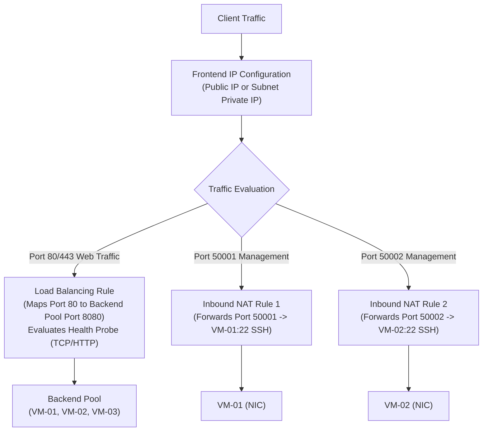
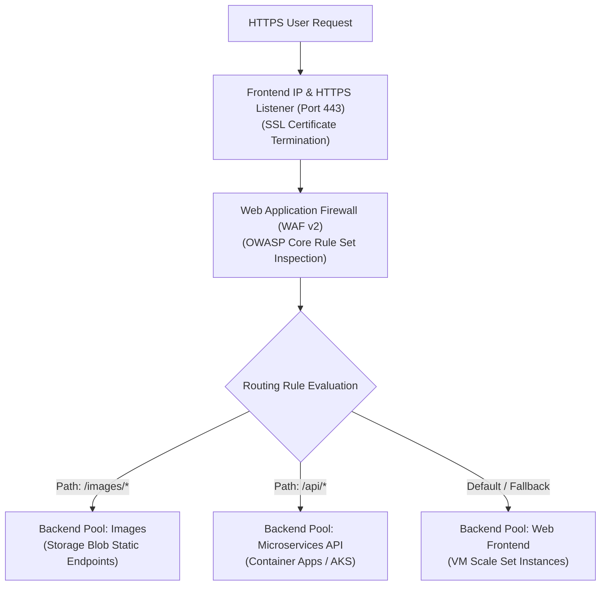
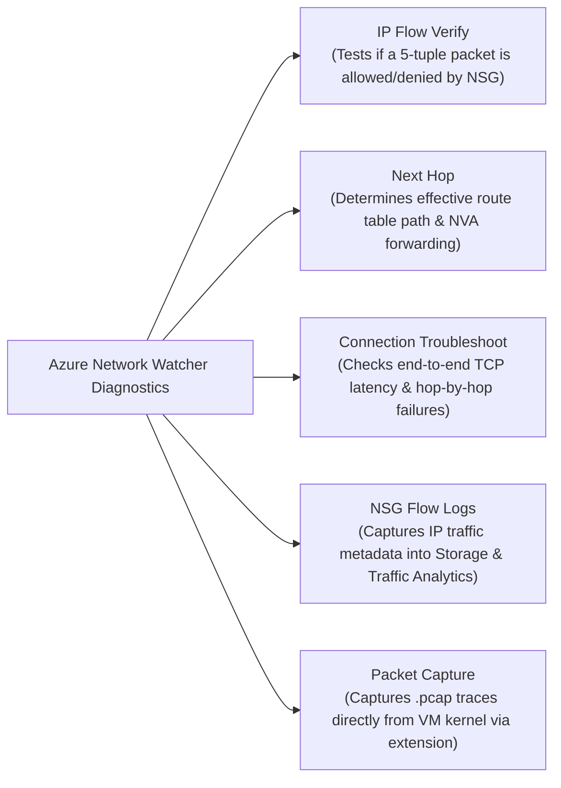

# Module 13-104-07: Administer Network Traffic, Load Balancing & Network Watcher

**Breadcrumbs:** [[13-Index - Azure|☁️ Azure Reference MOC]] > [[13-Index - AZ-104|📘 AZ-104 Exam Track]] > **07 - Administer Network Traffic**

---

## 🎯 Executive Overview & Load Balancing Matrix

Azure provides four distinct traffic distribution and load balancing solutions tailored across OSI layers (Layer 4 vs. Layer 7) and geographic operational scopes (Regional vs. Global):

```mermaid
flowchart TD
    TrafficIn["Incoming Client Request"] --> ScopeCheck{"Is routing Global (Multi-Region)\nor Regional (Within 1 Region)?"}
    
    ScopeCheck -->|Global / Multi-Region| GlobalType{"Is traffic HTTP/S (Web) or Non-HTTP (TCP/UDP)?"}
    GlobalType -->|HTTP/HTTPS (Web)| FrontDoor["Azure Front Door\n- Layer 7 Global Anycast Reverse Proxy\n- Integrated CDN & WAF\n- SSL Offloading & Path Routing"]
    GlobalType -->|Non-HTTP / DNS-based| TrafficManager["Azure Traffic Manager\n- DNS-based Global Load Balancer\n- Priority, Weighted, Performance, Geographic\n- No SSL termination"]

    ScopeCheck -->|Regional / Intra-Region| RegionalType{"Is routing Layer 7 (HTTP/S)\nor Layer 4 (TCP/UDP)?"}
    RegionalType -->|Layer 7 (HTTP/S)| AppGateway["Azure Application Gateway\n- Layer 7 Regional ADC & Load Balancer\n- URL Path & Multi-Site Routing\n- Cookie-based Session Affinity & WAF"]
    RegionalType -->|Layer 4 (TCP/UDP)| LoadBalancer["Azure Load Balancer\n- Layer 4 Regional Ultra-Low Latency\n- TCP/UDP Flow Distribution (5-tuple)\n- HA Ports & Inbound NAT Rules"]
```

### Comprehensive Comparison Matrix

| Capability | Azure Load Balancer | Azure Application Gateway | Azure Front Door | Azure Traffic Manager |
| :--- | :---: | :---: | :---: | :---: |
| **OSI Layer** | **Layer 4** (TCP/UDP) | **Layer 7** (HTTP/HTTPS/WebSocket) | **Layer 7** (HTTP/HTTPS) | **DNS Layer** (Resolution) |
| **Scope** | Regional | Regional | **Global** | **Global** |
| **Protocol Support** | Any TCP / UDP | HTTP, HTTPS, HTTP/2, WebSocket | HTTP, HTTPS | Any protocol (DNS lookup) |
| **SSL/TLS Offloading** | ❌ No | ✅ Yes | ✅ Yes | ❌ No |
| **URL Path Routing** | ❌ No | ✅ Yes (`/images/*`) | ✅ Yes | ❌ No |
| **Cookie Affinity** | ❌ No (IP hash only) | ✅ Yes (`ApplicationGatewayAffinity`) | ✅ Yes | ❌ No |
| **Web App Firewall (WAF)** | ❌ No | ✅ Yes (WAF v2 SKU) | ✅ Yes | ❌ No |
| **HA Ports (All ports)** | ✅ Yes (Internal Standard only) | ❌ No | ❌ No | ❌ No |

---

## ⚖️ Azure Load Balancer Architecture & Rules

Azure Load Balancer is an ultra-low latency, pass-through Layer 4 load balancer that distributes network traffic without terminating TCP connections.



### 1. Rule Types
- **Load Balancing Rules:** Distributes traffic arriving on a specific frontend IP and port evenly across all healthy members of a backend pool.
- **Inbound NAT Rules:** Maps a specific frontend port to a single dedicated backend virtual machine (e.g., port forwarding for administrative SSH/RDP access without assigning public IPs to individual VMs).
- **Outbound Rules:** Configures Source Network Address Translation (SNAT) for backend VMs to reach the public internet using frontend public IPs.
- **HA Ports (High Availability Ports):** An option available **exclusively on Internal Standard Load Balancers** where `Protocol: All` and `Port: 0` load balances all TCP/UDP ports simultaneously (critical for active-passive or active-active NVA firewall clusters).

### 2. Session Persistence Modes
Azure Load Balancer uses hash-based distribution:
- **None (Default - 5-Tuple):** Uses `Source IP`, `Source Port`, `Destination IP`, `Destination Port`, and `Protocol`. Successive requests from the same client may hit different backend servers.
- **Client IP (2-Tuple):** Uses `Source IP` and `Destination IP`. All requests from a specific client IP are guaranteed to route to the same backend server (useful for sticky legacy sessions).
- **Client IP and Protocol (3-Tuple):** Uses `Source IP`, `Destination IP`, and `Protocol`.

---

## 🚦 Azure Application Gateway & WAF v2

Azure Application Gateway is a dedicated Layer 7 Application Delivery Controller (ADC) operating as a reverse proxy. It terminates client connections, inspects HTTP/HTTPS payloads, evaluates security rules, and re-initiates connections to backend targets.



### Core Components
1. **Frontend IP:** Public IP, Private IP, or both.
2. **Listeners:** Listens for incoming traffic. Supports:
   - *Basic Listeners:* Listens on all hostnames for a specific port.
   - *Multi-Site Listeners:* Distinguishes requests based on the HTTP `Host` header (e.g., `contoso.com` vs. `fabrikam.com` on the same IP and port).
3. **Routing Rules:**
   - *Basic:* Routes all traffic from a listener to a single backend pool.
   - *Path-Based Routing:* Inspects URL path strings (e.g., `/video/*` routes to VideoPool, `/cart/*` routes to CheckoutPool).
   - *HTTP Redirection:* Automatically redirects HTTP port 80 requests to HTTPS port 443.
4. **Backend HTTP Settings (Backend Settings):** Configures backend port, protocol (HTTP vs. HTTPS), probe interval, connection draining, and **Cookie-Based Affinity** (injects an `ApplicationGatewayAffinity` cookie to bind browser sessions to a backend server).

---

## 🔍 Azure Network Watcher Diagnostic Suite

Network Watcher provides a comprehensive diagnostic and observability toolkit for Azure SDN environments:



| Tool Name | Operational Use Case | Diagnostic Result |
| :--- | :--- | :--- |
| **IP Flow Verify** | Quickly determine why a VM cannot communicate with a specific IP or port. | Reports `Access Allowed` or `Access Denied` along with the **exact NSG name and rule priority** causing the drop. |
| **Next Hop** | Diagnose blackhole routing or traffic not traversing an Azure Firewall NVA. | Returns the next hop type (`VirtualAppliance`, `VirtualNetworkGateway`, `Internet`, `None`) and IP address. |
| **Connection Troubleshoot** | Test end-to-end latency and reachability from a source VM to an external destination. | Provides hop-by-hop network path visualization, latency (ms), and detects packet loss. |
| **NSG Flow Logs** | Security auditing, forensics, and traffic analytics. | Exports flow records (source, destination, port, allowed/denied) to Azure Storage and Log Analytics Traffic Analytics. |
| **Packet Capture** | Deep packet inspection for application payload bugs or TLS handshake failures. | Remotely captures a `.cap` / `.pcap` trace on the VM filesystem or uploads directly to Azure Blob storage without SSH/RDP. |

---

## 🛠️ Contextual Proof of Concept: CLI Automation

### 1. Azure CLI: Standard Load Balancer with Health Probe & Load Balancing Rule

```bash
# 1. Create a Public Standard Load Balancer
az network lb create \
  --resource-group "rg-networking-poc" \
  --name "lb-web-prod" \
  --sku "Standard" \
  --location "eastus" \
  --public-ip-address "pip-lb-web" \
  --frontend-ip-name "fe-lb-public" \
  --backend-pool-name "be-web-pool"

# 2. Create an HTTP Health Probe
az network lb probe create \
  --resource-group "rg-networking-poc" \
  --lb-name "lb-web-prod" \
  --name "hp-http-80" \
  --protocol "Http" \
  --port 80 \
  --path "/healthz" \
  --interval 15 \
  --threshold 2

# 3. Create a Load Balancing Rule with Client IP Session Persistence
az network lb rule create \
  --resource-group "rg-networking-poc" \
  --lb-name "lb-web-prod" \
  --name "rule-http-distribution" \
  --protocol "Tcp" \
  --frontend-port 80 \
  --backend-port 80 \
  --frontend-ip-name "fe-lb-public" \
  --backend-pool-name "be-web-pool" \
  --probe-name "hp-http-80" \
  --load-distribution "SourceIP" \
  --idle-timeout 15 \
  --enable-tcp-reset true

# 4. Create an Inbound NAT Rule for Port Forwarding SSH to VM-01
az network lb inbound-nat-rule create \
  --resource-group "rg-networking-poc" \
  --lb-name "lb-web-prod" \
  --name "nat-ssh-vm1" \
  --protocol "Tcp" \
  --frontend-port 50001 \
  --backend-port 22 \
  --frontend-ip-name "fe-lb-public"
```

### 2. Azure CLI: Network Watcher Diagnostics

```bash
# 1. Verify IP flow permissions (Test if Port 80 is reachable from the internet)
az network watcher test-ip-flow \
  --resource-group "rg-networking-poc" \
  --vm "vm-web-01" \
  --direction "Inbound" \
  --protocol "TCP" \
  --local "10.0.1.4:80" \
  --remote "203.0.113.50:54321"

# 2. Check Next Hop for traffic routing to the internet
az network watcher show-next-hop \
  --resource-group "rg-networking-poc" \
  --vm "vm-web-01" \
  --source-ip "10.0.1.4" \
  --dest-ip "8.8.8.8"
```

---

## 🔍 Deep-Intuition AARF Framework

### Scenario: Investigating Routing Blackhole Using Network Watcher Next Hop

- **The Answer (Core Configuration):** Execute `az network watcher show-next-hop --resource-group "rg-networking-poc" --vm "vm-web-01" --source-ip "10.0.1.4" --dest-ip "10.2.0.4"`.
- **The Assumptions (Prerequisites):** 
  - Network Watcher is enabled in the target VM's region.
  - VM has an active network interface card with IP `10.0.1.4`.
- **The Rationale (Why):** When complex custom route tables (UDRs) and VNet peerings are chained together, predicting the effective route table through manual portal inspection is error-prone. The *Next Hop* diagnostic tool queries the underlying Azure software-defined physical switch to extract the true, active forwarding decision.
- **The Failure Loop (What if misconfigured):**
  - *Symptom:* `vm-web-01` cannot connect to a database in spoke VNet `10.2.0.0/16`.
  - *Next Hop Output:* `nextHopType: "None", routeTableId: "rt-spoke-egress"`.
  - *Root Cause Analysis:* An administrator added a static blackhole route `10.2.0.0/16 -> None` or forgot to enable IP forwarding on the intermediate NVA.
- **The Alternative Case (When to use 'if not'):** If testing application-layer firewall drops rather than routing paths, use **IP Flow Verify** to identify the blocking NSG rule, or **Connection Troubleshoot** to measure latency and hop-by-hop TCP connection drops.

---

## 💡 AZ-104 Exam Tips & Gotchas

> [!TIP]
> **Load Balancer vs. Application Gateway Selection Rules:**
> - If the exam question requires **SSL/TLS termination**, **URL path-based routing (`/images`)**, **multi-site hosting**, or **cookie-based sticky sessions**, choose **Application Gateway**.
> - If the exam question requires **Layer 4 ultra-low latency**, **non-HTTP protocols (e.g., custom gaming TCP/UDP port 7777)**, or **HA Ports on all ports**, choose **Azure Load Balancer**.

> [!WARNING]
> **Application Gateway Subnet Restriction:**
> - Azure Application Gateway v2 must be deployed into a **dedicated subnet** that contains NO OTHER RESOURCES (no VMs, no other gateways).
> - The Application Gateway subnet must be sized at minimum `/27` or `/26` to allow internal autoscale instance expansion.

---

## 🎙️ Video Deep Dive & Real-World Builds (Moe Intelligence Series)

> [!NOTE]
> **Source Attribution:** Transcripts and architectural walkthroughs synthesized from *Moe Intelligence (Arabic Comprehensive AZ-104 Series)*, Lessons 23 & 24 ([Playlist Reference](https://www.youtube.com/playlist?list=PLczK3J2J4clmeh328CC13dJrcALcSFZFb)). Translated to English while preserving technical taxonomy.

### 1. Azure Load Balancer: Deep Architectural Mechanics (Lesson 23)
- **Layer 4 Transport Routing:** Evaluates strictly at the transport layer (TCP/UDP); does not decrypt SSL or inspect HTTP headers.
- **Distribution Hash Algorithms:**
  - *Default (5-Tuple):* Source IP, Source Port, Destination IP, Destination Port, Protocol. Successive requests from the same client may hit different backend VMs.
  - *Client IP (2-Tuple Session Persistence):* Source IP and Destination IP. Directs all requests from a client to the same backend server (useful for legacy stateful apps).
  - *Client IP and Protocol (3-Tuple):* Source IP, Destination IP, and Protocol.
- **Health Probes Deep Dive:**
  - Standard probes test every **5 seconds** by default.
  - A backend instance is marked unhealthy after **2 consecutive failures** (10 seconds total).
  - Once marked unhealthy, the load balancer stops routing new connections immediately; existing active TCP connections may drain depending on connection draining settings.

### 2. Azure Application Gateway & WAF: Layer 7 Engineering (Lesson 24)
- **Layer 7 Capabilities:**
  - *URL Path-Based Routing:* Inspects request URI paths (`/api/*` ➔ Backend Pool API, `/images/*` ➔ Backend Pool Storage).
  - *Multi-Site Listeners:* Hosts up to 100+ separate websites (e.g., `shop.contoso.com` and `blog.contoso.com`) on a single frontend public IP address by inspecting the HTTP `Host` header.
  - *Cookie-Based Affinity:* Injects an `ARRAffinity` cookie to bind client sessions to a specific backend server instance.
  - *SSL/TLS Offloading:* Terminates HTTPS at the gateway, forwarding unencrypted HTTP to backend VMs on the secure internal VNet to reduce CPU load on web servers.
- **Web Application Firewall (WAF v2) Operational Modes:**
  - *Detection Mode:* Monitors and logs threats (OWASP CRS rules: SQLi, XSS, trojans) to Log Analytics without blocking client traffic. Use during initial 2-week staging rollout.
  - *Prevention Mode:* Actively blocks matching malicious requests with `HTTP 403 Forbidden`.

---

## 🌐 Authoritative References & Citations

- [KodeKloud AZ-104 Course - Administer Network Traffic Module](https://notes.kodekloud.com/docs/Updated-AZ-104-Microsoft-Azure-Administrator/Administer-Network-Traffic/Module-Introduction/page.md)
- [Moe Intelligence AZ-104 Video Series (Lessons 23–24)](https://www.youtube.com/playlist?list=PLczK3J2J4clmeh328CC13dJrcALcSFZFb)
- [Microsoft Learn: Load balance HTTP traffic with Application Gateway](https://learn.microsoft.com/en-us/training/modules/load-balance-web-traffic-with-application-gateway/)
- [Microsoft Learn: Troubleshoot networks with Azure Network Watcher](https://learn.microsoft.com/en-us/training/modules/troubleshoot-azure-network-infrastructure/)
- [Azure Load Balancer Technical Overview](https://learn.microsoft.com/en-us/azure/load-balancer/)
