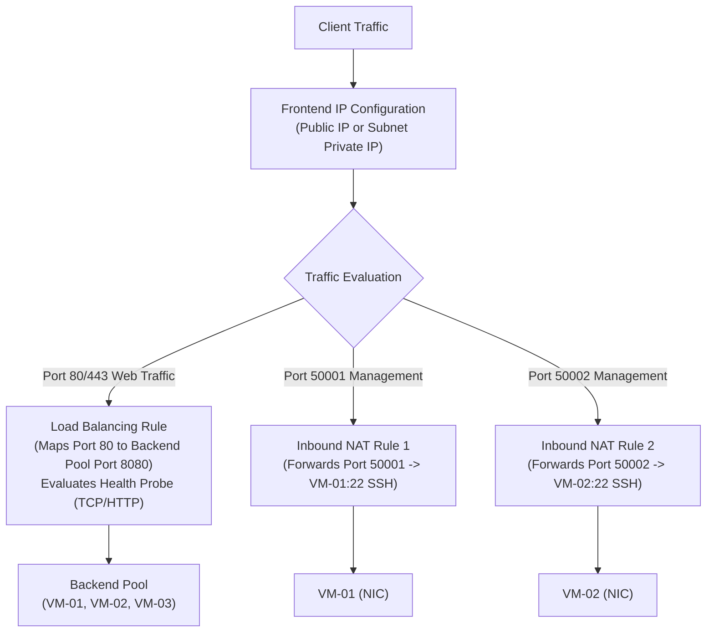
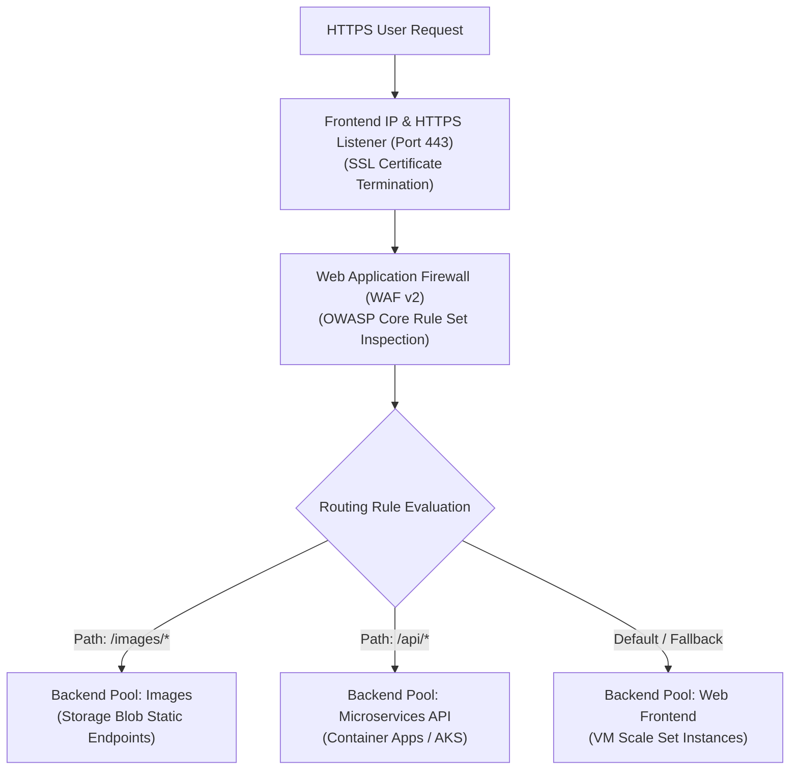
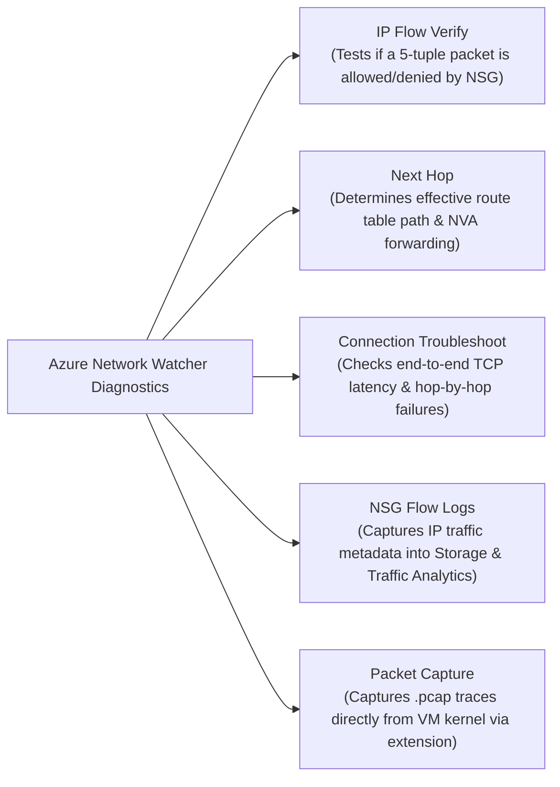
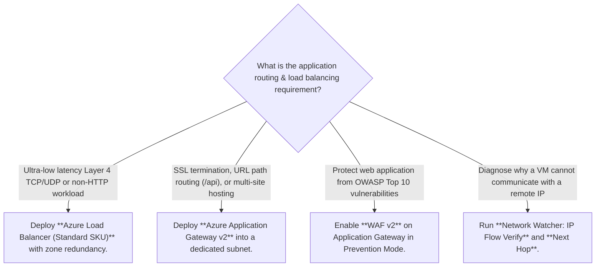

# Module 13-104-07: Administer Network Traffic, Load Balancing & Network Watcher

**Breadcrumbs:** [[13-Index - Azure|☁️ Azure Reference MOC]] > [[13-Index - AZ-104|📘 AZ-104 Exam Track]] > **07 - Administer Network Traffic**

---

## 🎯 Executive Overview & Load Balancing Matrix

Azure provides four distinct traffic distribution and load balancing solutions tailored across OSI layers (Layer 4 vs. Layer 7) and geographic operational scopes (Regional vs. Global):

```mermaid
flowchart TD
    TrafficIn["Incoming Client Request"] --> ScopeCheck{"Is routing Global (Multi-Region)\nor Regional (Within 1 Region)?"}
    
    ScopeCheck -->|Global / Multi-Region| GlobalType{"Is traffic HTTP/S (Web) or Non-HTTP (TCP/UDP)?"}
    GlobalType -->|HTTP/HTTPS (Web)| FrontDoor["Azure Front Door\n- Layer 7 Global Anycast Reverse Proxy\n- Integrated CDN & WAF\n- SSL Offloading & Path Routing"]
    GlobalType -->|Non-HTTP / DNS-based| TrafficManager["Azure Traffic Manager\n- DNS-based Global Load Balancer\n- Priority, Weighted, Performance, Geographic\n- No SSL termination"]

    ScopeCheck -->|Regional / Intra-Region| RegionalType{"Is routing Layer 7 (HTTP/S)\nor Layer 4 (TCP/UDP)?"}
    RegionalType -->|Layer 7 (HTTP/S)| AppGateway["Azure Application Gateway\n- Layer 7 Regional ADC & Load Balancer\n- URL Path & Multi-Site Routing\n- Cookie-based Session Affinity & WAF"]
    RegionalType -->|Layer 4 (TCP/UDP)| LoadBalancer["Azure Load Balancer\n- Layer 4 Regional Ultra-Low Latency\n- TCP/UDP Flow Distribution (5-tuple)\n- HA Ports & Inbound NAT Rules"]
```

### Comprehensive Comparison Matrix

| Capability | Azure Load Balancer | Azure Application Gateway | Azure Front Door | Azure Traffic Manager |
| :--- | :---: | :---: | :---: | :---: |
| **OSI Layer** | **Layer 4** (TCP/UDP) | **Layer 7** (HTTP/HTTPS/WebSocket) | **Layer 7** (HTTP/HTTPS) | **DNS Layer** (Resolution) |
| **Scope** | Regional | Regional | **Global** | **Global** |
| **Protocol Support** | Any TCP / UDP | HTTP, HTTPS, HTTP/2, WebSocket | HTTP, HTTPS | Any protocol (DNS lookup) |
| **SSL/TLS Offloading** | ❌ No | ✅ Yes | ✅ Yes | ❌ No |
| **URL Path Routing** | ❌ No | ✅ Yes (`/images/*`) | ✅ Yes | ❌ No |
| **Cookie Affinity** | ❌ No (IP hash only) | ✅ Yes (`ApplicationGatewayAffinity`) | ✅ Yes | ❌ No |
| **Web App Firewall (WAF)** | ❌ No | ✅ Yes (WAF v2 SKU) | ✅ Yes | ❌ No |
| **HA Ports (All ports)** | ✅ Yes (Internal Standard only) | ❌ No | ❌ No | ❌ No |

---

## ⚖️ Azure Load Balancer Architecture & Rules

Azure Load Balancer is an ultra-low latency, pass-through Layer 4 load balancer that distributes network traffic without terminating TCP connections.



### 1. Rule Types
- **Load Balancing Rules:** Distributes traffic arriving on a specific frontend IP and port evenly across all healthy members of a backend pool.
- **Inbound NAT Rules:** Maps a specific frontend port to a single dedicated backend virtual machine (e.g., port forwarding for administrative SSH/RDP access without assigning public IPs to individual VMs).
- **Outbound Rules:** Configures Source Network Address Translation (SNAT) for backend VMs to reach the public internet using frontend public IPs.
- **HA Ports (High Availability Ports):** An option available **exclusively on Internal Standard Load Balancers** where `Protocol: All` and `Port: 0` load balances all TCP/UDP ports simultaneously (critical for active-passive or active-active NVA firewall clusters).

### 2. Session Persistence Modes
Azure Load Balancer uses hash-based distribution:
- **None (Default - 5-Tuple):** Uses `Source IP`, `Source Port`, `Destination IP`, `Destination Port`, and `Protocol`. Successive requests from the same client may hit different backend servers.
- **Client IP (2-Tuple):** Uses `Source IP` and `Destination IP`. All requests from a specific client IP are guaranteed to route to the same backend server (useful for sticky legacy sessions).
- **Client IP and Protocol (3-Tuple):** Uses `Source IP`, `Destination IP`, and `Protocol`.

---

## 🚦 Azure Application Gateway & WAF v2

Azure Application Gateway is a dedicated Layer 7 Application Delivery Controller (ADC) operating as a reverse proxy. It terminates client connections, inspects HTTP/HTTPS payloads, evaluates security rules, and re-initiates connections to backend targets.



### Core Components
1. **Frontend IP:** Public IP, Private IP, or both.
2. **Listeners:** Listens for incoming traffic. Supports:
   - *Basic Listeners:* Listens on all hostnames for a specific port.
   - *Multi-Site Listeners:* Distinguishes requests based on the HTTP `Host` header (e.g., `contoso.com` vs. `fabrikam.com` on the same IP and port).
3. **Routing Rules:**
   - *Basic:* Routes all traffic from a listener to a single backend pool.
   - *Path-Based Routing:* Inspects URL path strings (e.g., `/video/*` routes to VideoPool, `/cart/*` routes to CheckoutPool).
   - *HTTP Redirection:* Automatically redirects HTTP port 80 requests to HTTPS port 443.
4. **Backend HTTP Settings (Backend Settings):** Configures backend port, protocol (HTTP vs. HTTPS), probe interval, connection draining, and **Cookie-Based Affinity** (injects an `ApplicationGatewayAffinity` cookie to bind browser sessions to a backend server).

---

## 🔍 Azure Network Watcher Diagnostic Suite

Network Watcher provides a comprehensive diagnostic and observability toolkit for Azure SDN environments:



| Tool Name | Operational Use Case | Diagnostic Result |
| :--- | :--- | :--- |
| **IP Flow Verify** | Quickly determine why a VM cannot communicate with a specific IP or port. | Reports `Access Allowed` or `Access Denied` along with the **exact NSG name and rule priority** causing the drop. |
| **Next Hop** | Diagnose blackhole routing or traffic not traversing an Azure Firewall NVA. | Returns the next hop type (`VirtualAppliance`, `VirtualNetworkGateway`, `Internet`, `None`) and IP address. |
| **Connection Troubleshoot** | Test end-to-end latency and reachability from a source VM to an external destination. | Provides hop-by-hop network path visualization, latency (ms), and detects packet loss. |
| **NSG Flow Logs** | Security auditing, forensics, and traffic analytics. | Exports flow records (source, destination, port, allowed/denied) to Azure Storage and Log Analytics Traffic Analytics. |
| **Packet Capture** | Deep packet inspection for application payload bugs or TLS handshake failures. | Remotely captures a `.cap` / `.pcap` trace on the VM filesystem or uploads directly to Azure Blob storage without SSH/RDP. |

---

## 🛠️ Contextual Proof of Concept: CLI Automation

### 1. Azure CLI: Standard Load Balancer with Health Probe & Load Balancing Rule

```bash
# 1. Create a Public Standard Load Balancer
az network lb create \
  --resource-group "rg-networking-poc" \
  --name "lb-web-prod" \
  --sku "Standard" \
  --location "eastus" \
  --public-ip-address "pip-lb-web" \
  --frontend-ip-name "fe-lb-public" \
  --backend-pool-name "be-web-pool"

# 2. Create an HTTP Health Probe
az network lb probe create \
  --resource-group "rg-networking-poc" \
  --lb-name "lb-web-prod" \
  --name "hp-http-80" \
  --protocol "Http" \
  --port 80 \
  --path "/healthz" \
  --interval 15 \
  --threshold 2

# 3. Create a Load Balancing Rule with Client IP Session Persistence
az network lb rule create \
  --resource-group "rg-networking-poc" \
  --lb-name "lb-web-prod" \
  --name "rule-http-distribution" \
  --protocol "Tcp" \
  --frontend-port 80 \
  --backend-port 80 \
  --frontend-ip-name "fe-lb-public" \
  --backend-pool-name "be-web-pool" \
  --probe-name "hp-http-80" \
  --load-distribution "SourceIP" \
  --idle-timeout 15 \
  --enable-tcp-reset true

# 4. Create an Inbound NAT Rule for Port Forwarding SSH to VM-01
az network lb inbound-nat-rule create \
  --resource-group "rg-networking-poc" \
  --lb-name "lb-web-prod" \
  --name "nat-ssh-vm1" \
  --protocol "Tcp" \
  --frontend-port 50001 \
  --backend-port 22 \
  --frontend-ip-name "fe-lb-public"
```

### 2. Azure CLI: Network Watcher Diagnostics

```bash
# 1. Verify IP flow permissions (Test if Port 80 is reachable from the internet)
az network watcher test-ip-flow \
  --resource-group "rg-networking-poc" \
  --vm "vm-web-01" \
  --direction "Inbound" \
  --protocol "TCP" \
  --local "10.0.1.4:80" \
  --remote "203.0.113.50:54321"

# 2. Check Next Hop for traffic routing to the internet
az network watcher show-next-hop \
  --resource-group "rg-networking-poc" \
  --vm "vm-web-01" \
  --source-ip "10.0.1.4" \
  --dest-ip "8.8.8.8"
```

---

## 🔍 Deep-Intuition AARF Framework

### Scenario: Investigating Routing Blackhole Using Network Watcher Next Hop

- **The Answer (Core Configuration):** Execute `az network watcher show-next-hop --resource-group "rg-networking-poc" --vm "vm-web-01" --source-ip "10.0.1.4" --dest-ip "10.2.0.4"`.
- **The Assumptions (Prerequisites):** 
  - Network Watcher is enabled in the target VM's region.
  - VM has an active network interface card with IP `10.0.1.4`.
- **The Rationale (Why):** When complex custom route tables (UDRs) and VNet peerings are chained together, predicting the effective route table through manual portal inspection is error-prone. The *Next Hop* diagnostic tool queries the underlying Azure software-defined physical switch to extract the true, active forwarding decision.
- **The Failure Loop (What if misconfigured):**
  - *Symptom:* `vm-web-01` cannot connect to a database in spoke VNet `10.2.0.0/16`.
  - *Next Hop Output:* `nextHopType: "None", routeTableId: "rt-spoke-egress"`.
  - *Root Cause Analysis:* An administrator added a static blackhole route `10.2.0.0/16 -> None` or forgot to enable IP forwarding on the intermediate NVA.
- **The Alternative Case (When to use 'if not'):** If testing application-layer firewall drops rather than routing paths, use **IP Flow Verify** to identify the blocking NSG rule, or **Connection Troubleshoot** to measure latency and hop-by-hop TCP connection drops.

---

## 💡 AZ-104 Exam Tips & Gotchas

> [!TIP]
> **Load Balancer vs. Application Gateway Selection Rules:**
> - If the exam question requires **SSL/TLS termination**, **URL path-based routing (`/images`)**, **multi-site hosting**, or **cookie-based sticky sessions**, choose **Application Gateway**.
> - If the exam question requires **Layer 4 ultra-low latency**, **non-HTTP protocols (e.g., custom gaming TCP/UDP port 7777)**, or **HA Ports on all ports**, choose **Azure Load Balancer**.

> [!WARNING]
> **Application Gateway Subnet Restriction:**
> - Azure Application Gateway v2 must be deployed into a **dedicated subnet** that contains NO OTHER RESOURCES (no VMs, no other gateways).
> - The Application Gateway subnet must be sized at minimum `/27` or `/26` to allow internal autoscale instance expansion.

---

## 🏛️ Layer 4 vs. Layer 7 Traffic Engineering & WAF Production Operations

### 1. Azure Load Balancer: Deep Architectural Mechanics
- **Layer 4 Transport Routing:** Evaluates strictly at the transport layer (TCP/UDP); does not inspect HTTP payloads, decrypt SSL/TLS, or modify request headers.
- **Distribution Hash Algorithms:**
  - *Default (5-Tuple Hash):* Evaluates `Source IP`, `Source Port`, `Destination IP`, `Destination Port`, and `Transport Protocol`. Successive requests from the same client may hit different backend VMs.
  - *Client IP (2-Tuple Session Persistence):* Evaluates `Source IP` and `Destination IP`. Directs all requests from a single client to the same backend server (essential for stateful applications without distributed session caches).
  - *Client IP and Protocol (3-Tuple Session Persistence):* Evaluates `Source IP`, `Destination IP`, and `Protocol`.
- **Health Probes Mechanics:**
  - Standard probes test every **5 seconds** by default.
  - A backend instance is marked unhealthy after **2 consecutive failures** (10 seconds total).
  - Once marked unhealthy, the load balancer stops routing new connections immediately; active connections drain according to connection draining settings.

### 2. Azure Application Gateway & WAF: Layer 7 Architecture
- **Layer 7 Capabilities:**
  - *URL Path-Based Routing:* Inspects request URI paths (`/api/*` ➔ Backend Pool API, `/images/*` ➔ Backend Pool Storage).
  - *Multi-Site Listeners:* Hosts up to 100+ separate web applications (e.g., `shop.company.com` and `portal.company.com`) on a single frontend public IP address by inspecting the HTTP `Host` header.
  - *Cookie-Based Affinity:* Injects an `ARRAffinity` cookie to bind client sessions to a specific backend server instance.
  - *SSL/TLS Offloading:* Terminates HTTPS at the gateway, forwarding unencrypted HTTP to backend VMs on the secure internal VNet to reduce CPU load on web servers.
- **Web Application Firewall (WAF v2) Operational Lifecycle:**
  - *Detection Mode:* Monitors and logs threats (OWASP CRS rules: SQL injection, cross-site scripting, remote code execution) to Log Analytics without dropping traffic. Use during initial 2-week staging rollout to establish false-positive exclusions.
  - *Prevention Mode:* Actively blocks matching malicious requests with `HTTP 403 Forbidden`.

---

## 💡 Traffic Management Decision Framework & Articulation Tree



---

---

## 🏛️ Deep-Dive Traffic Engineering & Load Balancing (John Savill Master Class Insights)

### 1. Azure Load Balancer vs. Application Gateway: Layer 4 vs. Layer 7
John Savill breaks down the core functional boundary between transport-level and application-level load balancing:

| Architectural Dimension | Azure Load Balancer (Layer 4) | Azure Application Gateway (Layer 7) |
| :--- | :--- | :--- |
| **Operating Layer** | Transport Layer (TCP / UDP). | Application Layer (HTTP / HTTPS / HTTP/2 / WebSockets). |
| **Proxy Architecture** | **Non-proxy, non-terminating:** Packets pass through with original source IP (or SNAT on outbound). | **Full reverse proxy:** Client TCP connection terminates at gateway; gateway opens new TCP connection to backend. |
| **Routing Intelligence** | 5-tuple hash (IPs, Ports, Protocol); cannot read URLs or HTTP headers. | Path-based (`/images`), host-based (`app.company.com`), cookie affinity (`ARRAffinity`). |
| **TLS/SSL Decryption** | Does not terminate SSL (pass-through only). | Terminates SSL at frontend, supports custom certificates in Key Vault, and provides WAF inspection. |
| **Latency Profile** | Ultra-low (microseconds); processed in hypervisor hardware pipeline. | Low (milliseconds); requires HTTP protocol parsing and reverse proxy buffering. |

### 2. Floating IP (Direct Server Return) for Clustering
- In standard load balancing, the Load Balancer rewrites the destination IP of incoming packets to the private IP of the selected backend VM.
- **The Floating IP Advantage:** When Floating IP is enabled:
  - Azure does NOT rewrite the destination IP; the packet retains the frontend Load Balancer IP as its destination.
  - The backend VM must have a loopback network interface configured with the Load Balancer's frontend IP.
  - *Primary Enterprise Use Case:* **SQL Server AlwaysOn Availability Group Listeners** and Windows Server Failover Clusters, allowing multiple cluster nodes to listen on the exact same port without IP port conflicts.

---

## 🚀 Going the Extra Mile: Architectural Deep Dive - Advanced Traffic Engineering

> [!IMPORTANT]
> **Going the Extra Mile:** In this section, we are taking an extra mile on this topic and start deep diving into the foundational SDN packet transformations, bump-in-the-wire NVA chaining with Gateway Load Balancer, Azure Front Door Anycast split-TCP mechanics, and Application Gateway for Containers (ALB) based on John Savill's Azure Deep Dives Master Class.

### 1. Azure Load Balancer Under the Hood: SDN Multiplexing & Outbound SNAT

#### A. SDN Hypervisor-Level Multiplexing (No Physical Appliance)
* **The Non-Terminating Data Path:** Azure Load Balancer is **not** a physical or virtual machine sitting in the data path. It is a distributed Software Defined Network (SDN) component operating at the **SLB (Software Load Balancer) MUX** layer within the Azure host physical hypervisors.
* **Hash Tuple Computation:**
  * **5-Tuple:** Default distribution based on `{Source IP, Source Port, Destination IP, Destination Port, Protocol}`. Every new TCP connection or source port alteration lands on a newly calculated backend target.
  * **2-Tuple (`SourceIP`):** Directs all connections from a specific client IP to the exact same backend node, regardless of destination port.
  * **3-Tuple (`SourceIP, Protocol`):** Ensures all traffic from a client utilizing the same transport protocol reaches the same target.
* **HA Ports (`0` / `*`):** Available exclusively on Internal Standard Load Balancers. By setting Frontend Port to `0`, Protocol to `All`, and Backend Port to `0`, all TCP and UDP packets on all 65,535 ports are forwarded simultaneously. This is the cornerstone topology for active-passive or active-active Network Virtual Appliance (NVA) firewalls.

#### B. Outbound SNAT Port Allocation & Exhaustion Loops
* When backend instances without dedicated instance-level public IPs make outbound Internet requests, the Azure Load Balancer performs **Source Network Address Translation (SNAT)** using the frontend Public IP.
* **Pre-Allocated SNAT Ports:** By default, Azure statically assigns a fixed number of SNAT ports per backend VM based on pool size (e.g., 1,024 ports per VM for small pools).
* **SNAT Exhaustion Failure Loop:** If backend applications initiate rapid, short-lived outbound API connections without connection pooling (e.g., microservice REST calls or database egress), all assigned SNAT ports enter `TIME_WAIT` status. Subsequent outbound connection attempts are silently dropped with TCP handshake timeouts.
* **Remediation Architecture:** Eliminate SNAT allocation limits on the Load Balancer by deploying **Azure NAT Gateway** (`Microsoft.Network/natGateways`) to the subnet, providing 64,512 dynamic, shared SNAT ports per public IP.

---

### 2. Microsoft Azure Gateway Load Balancer (GWLB): Bump-in-the-Wire NVA Chaining

#### A. The NVA Architecture Problem
Historically, routing traffic through third-party Network Virtual Appliances (Palo Alto, Fortinet, Check Point) required complex User Defined Routes (UDRs), multiple network interfaces (Untrust, Trust, Management), source NAT configuration on the firewall to ensure symmetric return paths, and complex active-active clustering.

#### B. The Gateway Load Balancer Solution
Gateway Load Balancer is a specialized SKU of Azure Load Balancer deployed specifically for transparent, inline packet inspection.

```mermaid
flowchart LR
    Client["Client on Internet"] -->|Public Traffic| ExtLB["Standard Public Load Balancer\n(Consumer Frontend IP)"]
    
    subgraph GWLB_Infra ["Gateway Load Balancer (Provider)"]
        GWLB["Gateway Load Balancer"]
        subgraph NVAPool ["NVA Backend Pool (Scale Set)"]
            NVA1["Firewall Appliance 1\n(VXLAN Tunnel Endpoint)"]
            NVA2["Firewall Appliance 2\n(VXLAN Tunnel Endpoint)"]
        end
    end

    subgraph WorkloadPool ["Workload Tier"]
        VM1["Backend App VM 1"]
        VM2["Backend App VM 2"]
    end

    ExtLB == "Chained via\nGatewayLoadBalancerId" ==> GWLB
    GWLB -->|Encapsulates in VXLAN Tunnel (Port 2001)| NVA1
    NVA1 -->|Inspects, Decapsulates, Returns via VXLAN| GWLB
    GWLB -->|Delivers Clean Original Packet| WorkloadPool
```

* **Chained Architecture:** The consumer's public Load Balancer (or VM public IP) specifies a reference to the Gateway Load Balancer frontend via the `gatewayLoadBalancer` property.
* **VXLAN Tunnel Encapsulation (RFC 7348):**
  * Incoming packets hitting the public IP are **NOT rewritten** (Source IP and Destination IP remain 100% unaltered).
  * The GWLB encapsulates the entire raw IP packet inside a **VXLAN header** (UDP port 2001 or custom) containing a Virtual Network Identifier (VNI).
  * Two separate tunnel interfaces are established between GWLB and the NVA:
    1. **Internal Tunnel:** Transports traffic between GWLB and NVA.
    2. **External Tunnel:** Transports inspected return traffic.
* **Zero UDR Egress / Ingress:** The NVA inspects the payload and sends it right back over the VXLAN tunnel to the GWLB, which decapsulates the packet and delivers it directly to the target application VM. Routing tables require zero custom routes.

---

### 3. Microsoft Azure Front Door (AFD): Anycast Routing & Split-TCP Acceleration

Azure Front Door is Microsoft's global, modern cloud content delivery network (CDN) and Layer 7 edge routing platform operating across hundreds of Global Points of Presence (Edge POPs).

#### A. Split-TCP & Anycast BGP Acceleration
* **Anycast IP Distribution:** A single Anycast public VIP is advertised via BGP globally across all Microsoft edge locations. The client's DNS query resolves to the same Anycast IP, but BGP routes the client to the physically nearest edge point of presence (POP).
* **The Split-TCP Advantage:**
  * Rather than establishing a slow 3-way TCP handshake across the Atlantic/Pacific oceans directly to the Azure Region (150ms+ RTT), the client establishes the TCP connection and TLS handshake with the local Edge POP (5–10ms RTT).
  * Front Door then reuses warm, long-lived multiplexed TCP connections across the private Microsoft dark fiber backbone to the backend origin in the target Azure region.
  * This cuts round-trip negotiation latency by up to 75% for dynamic web content.

#### B. Private Link Origin Integration
In enterprise zero-trust postures, Front Door eliminates the requirement to expose backend web apps or internal load balancers to the public internet:
* Front Door Premium connects directly to the backend origin (App Service, Internal Load Balancer, or Container App) over an **Azure Private Endpoint** using Private Link.
* The backend firewall completely forbids public Internet ingress, accepting traffic exclusively from Microsoft's internal Front Door infrastructure tenant.

---

### 4. Application Gateway for Containers (ALB): The Next-Gen Kubernetes Ingress

John Savill highlights Microsoft's newly architected **Application Gateway for Containers (ALB)**, replacing the legacy AGIC (Application Gateway Ingress Controller):
* **Control Plane vs. Data Plane Decoupling:**
  * In legacy AGIC, changes to Kubernetes Ingress or Gateway API CRDs triggered slow ARM REST calls to update the monolithic Application Gateway v2 (causing 1–3 minute update latencies).
  * In Application Gateway for Containers, an in-cluster ALB Operator streams real-time updates directly to the distributed data-plane proxies via gRPC, achieving **sub-second route convergence**.
* **Traffic Management:** Supports Gateway API standards, weighted canary routing, header manipulation, and TLS termination with line-of-sight private pod IP routing without kube-proxy SNAT overhead.


## 🌐 Authoritative References & Citations

- [John Savill: Azure Master Class v3 - Part 6 - Networking](https://www.youtube.com/playlist?list=PLlVtbbG169nGlGPWs9xaLKT1KfwqREHbs)

- [KodeKloud AZ-104 Course - Administer Network Traffic Module](https://notes.kodekloud.com/docs/Updated-AZ-104-Microsoft-Azure-Administrator/Administer-Network-Traffic/Module-Introduction/page.md)
- [Moe Intelligence AZ-104 Video Series (Lessons 23–24)](https://www.youtube.com/playlist?list=PLczK3J2J4clmeh328CC13dJrcALcSFZFb)
- [Microsoft Learn: Load balance HTTP traffic with Application Gateway](https://learn.microsoft.com/en-us/training/modules/load-balance-web-traffic-with-application-gateway/)
- [Microsoft Learn: Troubleshoot networks with Azure Network Watcher](https://learn.microsoft.com/en-us/training/modules/troubleshoot-azure-network-infrastructure/)
- [Azure Load Balancer Technical Overview](https://learn.microsoft.com/en-us/azure/load-balancer/)
